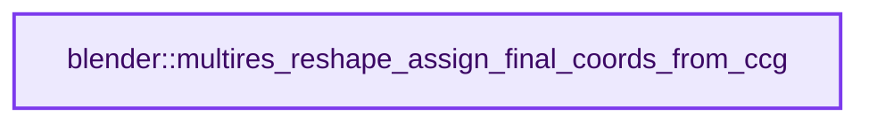
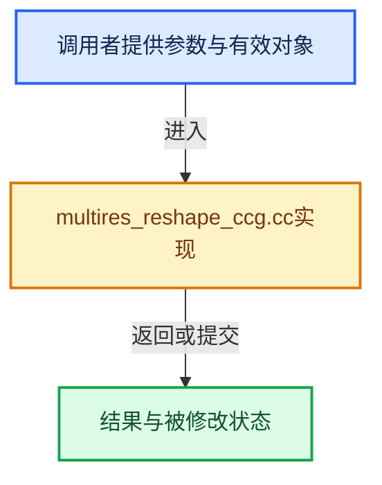

# 实现依赖专题：source/blender/blenkernel/intern/multires_reshape_ccg.cc

[实现依赖导航](../../README.md) · [符号索引](../../../00-课程指南/02-源码与提交索引/符号依赖与实现索引.md)

本专题从正文实际调用进入，集中保存共享实现。函数有稳定锚点，可从调用处直接跳到对应完整函数；递归与互相调用通过回链组织。

## 本文件的实现关系






## 完整成员与函数实现

<a id="f-00c38e623f7ae299"></a>

### `blender::multires_reshape_assign_final_coords_from_ccg`

实现位置：[source/blender/blenkernel/intern/multires_reshape_ccg.cc](../../../../../../../source/blender/blenkernel/intern/multires_reshape_ccg.cc) · L20—L87。

接口参数：

- `const MultiresReshapeContext *reshape_context`
- `SubdivCCG *subdiv_ccg`

**教学注释版**

<!-- annotated:4474664458c241 -->

```cpp
bool multires_reshape_assign_final_coords_from_ccg(const MultiresReshapeContext *reshape_context,
                                                   SubdivCCG *subdiv_ccg)
{
  const CCGKey reshape_level_key = BKE_subdiv_ccg_key(*subdiv_ccg, reshape_context->reshape.level);

  const int reshape_grid_size = reshape_context->reshape.grid_size;
  const float reshape_grid_size_1_inv = 1.0f / (float(reshape_grid_size) - 1.0f);

  const Span<float3> positions = subdiv_ccg->positions;
  const Span<float> masks = subdiv_ccg->masks;

  /* NOTE: The sculpt mode might have SubdivCCG's data out of sync from what is stored in
   * the original object. This happens in the following scenario:
   *
   *  - User enters sculpt mode of the default cube object.
   *  - Sculpt mode creates new `layer`
   *  - User does some strokes.
   *  - User used undo until sculpt mode is exited.
   *
   * In an ideal world the sculpt mode will take care of keeping CustomData and CCG layers in
   * sync by doing proper pushes to a local sculpt undo stack.
   *
   * Since the proper solution needs time to be implemented, consider the target object
   * the source of truth of which data layers are to be updated during reshape. This means,
   * for example, that if the undo system says object does not have paint mask layer, it is
   * not to be updated.
   *
   * This is fragile logic, and is only working correctly because the code path is only
   * used by sculpt changes. In other use cases the code might not catch inconsistency and
   * silently make the wrong decision. */
  /* NOTE: There is a known bug in Undo code that results in first Sculpt step
   * after a Memfile one to never be undone (see #83806). This might be the root cause of
   * this inconsistency. */

  /* Each grid writes to its own displacement and mask grid, so there are no write conflicts.
   * Balance the amount of work per task, since the work per grid depends on the grid size. */
  // [讲解] std::max：按比较关系选取较大值。本讲解中的增长公式同时满足最低请求和几何增长；若保存返回引用，还需注意实参寿命。
  const int grain_size = std::max(1, 2048 / (reshape_grid_size * reshape_grid_size));

  threading::parallel_for(
      IndexRange(subdiv_ccg->grids_num), grain_size, [&](const IndexRange range) {
        for (const int grid_index : range) {
          for (int y = 0; y < reshape_grid_size; ++y) {
            const float v = float(y) * reshape_grid_size_1_inv;
            for (int x = 0; x < reshape_grid_size; ++x) {
              const float u = float(x) * reshape_grid_size_1_inv;
              const int vert = bke::ccg::grid_xy_to_vert(reshape_level_key, grid_index, x, y);

              GridCoord grid_coord;
              grid_coord.grid_index = grid_index;
              grid_coord.u = u;
              grid_coord.v = v;

              ReshapeGridElement grid_element = multires_reshape_grid_element_for_grid_coord(
                  reshape_context, &grid_coord);

              BLI_assert(grid_element.displacement != nullptr);
              *grid_element.displacement = positions[vert];

              // [讲解] masks.is_empty：查询视图长度或生成对应有效索引区间。
              if (!masks.is_empty() && grid_element.mask != nullptr) {
                *grid_element.mask = masks[vert];
              }
            }
          }
        }
      });

  return true;
}
```

<details>
<summary>核对原始源码：source/blender/blenkernel/intern/multires_reshape_ccg.cc · L20—L87</summary>

<!-- original:4474664458c241:source/blender/blenkernel/intern/multires_reshape_ccg.cc:20:87 -->

```cpp
bool multires_reshape_assign_final_coords_from_ccg(const MultiresReshapeContext *reshape_context,
                                                   SubdivCCG *subdiv_ccg)
{
  const CCGKey reshape_level_key = BKE_subdiv_ccg_key(*subdiv_ccg, reshape_context->reshape.level);

  const int reshape_grid_size = reshape_context->reshape.grid_size;
  const float reshape_grid_size_1_inv = 1.0f / (float(reshape_grid_size) - 1.0f);

  const Span<float3> positions = subdiv_ccg->positions;
  const Span<float> masks = subdiv_ccg->masks;

  /* NOTE: The sculpt mode might have SubdivCCG's data out of sync from what is stored in
   * the original object. This happens in the following scenario:
   *
   *  - User enters sculpt mode of the default cube object.
   *  - Sculpt mode creates new `layer`
   *  - User does some strokes.
   *  - User used undo until sculpt mode is exited.
   *
   * In an ideal world the sculpt mode will take care of keeping CustomData and CCG layers in
   * sync by doing proper pushes to a local sculpt undo stack.
   *
   * Since the proper solution needs time to be implemented, consider the target object
   * the source of truth of which data layers are to be updated during reshape. This means,
   * for example, that if the undo system says object does not have paint mask layer, it is
   * not to be updated.
   *
   * This is fragile logic, and is only working correctly because the code path is only
   * used by sculpt changes. In other use cases the code might not catch inconsistency and
   * silently make the wrong decision. */
  /* NOTE: There is a known bug in Undo code that results in first Sculpt step
   * after a Memfile one to never be undone (see #83806). This might be the root cause of
   * this inconsistency. */

  /* Each grid writes to its own displacement and mask grid, so there are no write conflicts.
   * Balance the amount of work per task, since the work per grid depends on the grid size. */
  const int grain_size = std::max(1, 2048 / (reshape_grid_size * reshape_grid_size));

  threading::parallel_for(
      IndexRange(subdiv_ccg->grids_num), grain_size, [&](const IndexRange range) {
        for (const int grid_index : range) {
          for (int y = 0; y < reshape_grid_size; ++y) {
            const float v = float(y) * reshape_grid_size_1_inv;
            for (int x = 0; x < reshape_grid_size; ++x) {
              const float u = float(x) * reshape_grid_size_1_inv;
              const int vert = bke::ccg::grid_xy_to_vert(reshape_level_key, grid_index, x, y);

              GridCoord grid_coord;
              grid_coord.grid_index = grid_index;
              grid_coord.u = u;
              grid_coord.v = v;

              ReshapeGridElement grid_element = multires_reshape_grid_element_for_grid_coord(
                  reshape_context, &grid_coord);

              BLI_assert(grid_element.displacement != nullptr);
              *grid_element.displacement = positions[vert];

              if (!masks.is_empty() && grid_element.mask != nullptr) {
                *grid_element.mask = masks[vert];
              }
            }
          }
        }
      });

  return true;
}
```

</details>

**沿实际写入检查状态**

- `grid_coord.grid_index = grid_index;`
- `grid_coord.u = u;`
- `grid_coord.v = v;`

**结果出口**

- `return true;`

**继续追踪实现**

- `BKE_subdiv_ccg_key` → [blender::BKE_subdiv_ccg_key · L442](subdiv_ccg.cc.md#f-b732547778bc7f26)。
- `std::max` → [外部契约](https://eel.is/c++draft/alg.min.max)：按比较关系选取较大值。本讲解中的增长公式同时满足最低请求和几何增长；若保存返回引用，还需注意实参寿命。
- `threading::parallel_for` → [blender::threading::parallel_for · L68](../../../11-Depsgraph与并行任务系统/07-任务池与TBB接入.md#f-838294754c24426c)。
- `IndexRange` → [blender::IndexRange](../../01-BLI基础库/BLI_index_range.hh.md#t-caa3466d6776)；[blender::gpu::shader::parser::IndexRange](../../08-其他Blender模块/gpu/shader_tool/utils.hh.md#t-82d2bd4ea71c)；[blender::IndexRange](../../08-其他Blender模块/makesdna/DNA_node_types.h.md#t-0448cc889d39)。
- `bke::ccg::grid_xy_to_vert` → [blender::bke::ccg::grid_xy_to_vert · L375](../BKE_subdiv_ccg.hh.md#f-7576014dd26d80eb)。
- `multires_reshape_grid_element_for_grid_coord` → [blender::multires_reshape_grid_element_for_grid_coord · L464](multires_reshape_util.cc.md#f-f54e6cbc07ada54c)。
- `BLI_assert` → [BLI_assert · L48](../../01-BLI基础库/BLI_assert.hh.md#m-57a88495704d)；[BLI_assert · L63](../../01-BLI基础库/BLI_assert.hh.md#m-d07050020cb5)。宏定义由构建条件选择。
- `masks.is_empty` → [blender::Span::is_empty · L264](../../../01-基础容器与现代CPP/05-Span只读连续视图.md#f-8cc1d7ba8feb50e6)。
