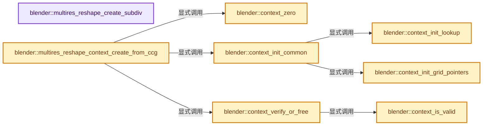
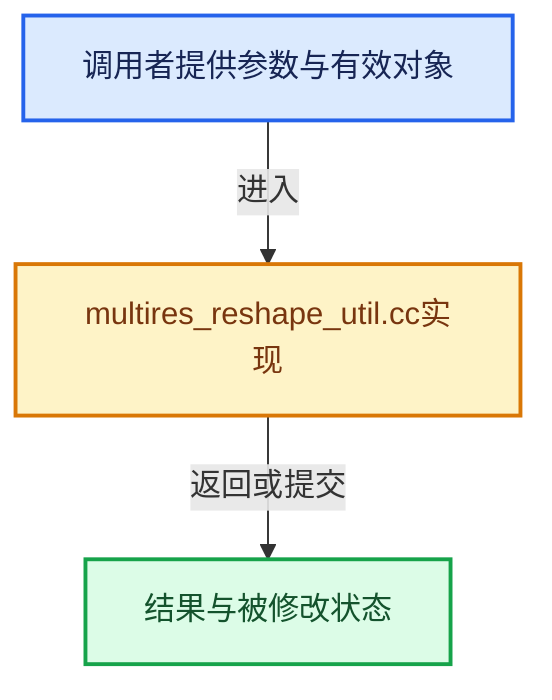

# 实现依赖专题：source/blender/blenkernel/intern/multires_reshape_util.cc

[实现依赖导航](../../README.md) · [符号索引](../../../00-课程指南/02-源码与提交索引/符号依赖与实现索引.md)

本专题从正文实际调用进入，集中保存共享实现。函数有稳定锚点，可从调用处直接跳到对应完整函数；递归与互相调用通过回链组织。

## 本文件的实现关系






## 完整成员与函数实现

<a id="f-c2aaa6049b38196f"></a>

### `blender::multires_reshape_create_subdiv`

实现位置：[source/blender/blenkernel/intern/multires_reshape_util.cc](../../../../../../../source/blender/blenkernel/intern/multires_reshape_util.cc) · L40—L67。

接口参数：

- `Depsgraph *depsgraph`
- `Object *object`
- `const MultiresModifierData *mmd`

**教学注释版**

<!-- annotated:d8a17e306cd1e6 -->

```cpp
bke::subdiv::Subdiv *multires_reshape_create_subdiv(Depsgraph *depsgraph,
                                                    /*const*/ Object *object,
                                                    const MultiresModifierData *mmd)
{
  using namespace blender::bke;
  const Mesh *base_mesh;

  if (depsgraph != nullptr) {
    Scene *scene_eval = DEG_get_evaluated_scene(depsgraph);
    Object *object_eval = DEG_get_evaluated(depsgraph, object);
    base_mesh = mesh_get_eval_deform(depsgraph, scene_eval, object_eval, &CD_MASK_BAREMESH);
  }
  else {
    base_mesh = id_cast<Mesh *>(object->data);
  }

  subdiv::Settings subdiv_settings;
  BKE_multires_subdiv_settings_init(&subdiv_settings, mmd);
  subdiv::Subdiv *subdiv = subdiv::new_from_mesh(&subdiv_settings, base_mesh);
  if (!subdiv) {
    return nullptr;
  }
  if (!subdiv::eval_begin_from_mesh(subdiv, base_mesh, subdiv::SUBDIV_EVALUATOR_TYPE_CPU)) {
    // [讲解] subdiv::free：归还相匹配的C分配存储，不自动执行C++析构；不可用于Windows的_aligned_malloc结果。
    subdiv::free(subdiv);
    return nullptr;
  }
  return subdiv;
}
```

<details>
<summary>核对原始源码：source/blender/blenkernel/intern/multires_reshape_util.cc · L40—L67</summary>

<!-- original:d8a17e306cd1e6:source/blender/blenkernel/intern/multires_reshape_util.cc:40:67 -->

```cpp
bke::subdiv::Subdiv *multires_reshape_create_subdiv(Depsgraph *depsgraph,
                                                    /*const*/ Object *object,
                                                    const MultiresModifierData *mmd)
{
  using namespace blender::bke;
  const Mesh *base_mesh;

  if (depsgraph != nullptr) {
    Scene *scene_eval = DEG_get_evaluated_scene(depsgraph);
    Object *object_eval = DEG_get_evaluated(depsgraph, object);
    base_mesh = mesh_get_eval_deform(depsgraph, scene_eval, object_eval, &CD_MASK_BAREMESH);
  }
  else {
    base_mesh = id_cast<Mesh *>(object->data);
  }

  subdiv::Settings subdiv_settings;
  BKE_multires_subdiv_settings_init(&subdiv_settings, mmd);
  subdiv::Subdiv *subdiv = subdiv::new_from_mesh(&subdiv_settings, base_mesh);
  if (!subdiv) {
    return nullptr;
  }
  if (!subdiv::eval_begin_from_mesh(subdiv, base_mesh, subdiv::SUBDIV_EVALUATOR_TYPE_CPU)) {
    subdiv::free(subdiv);
    return nullptr;
  }
  return subdiv;
}
```

</details>

**沿实际写入检查状态**

- `base_mesh = mesh_get_eval_deform(depsgraph, scene_eval, object_eval, &CD_MASK_BAREMESH);`
- `base_mesh = id_cast<Mesh *>(object->data);`

**结果出口**

- `return nullptr;`
- `return subdiv;`

**继续追踪实现**

- `DEG_get_evaluated_scene` → [blender::DEG_get_evaluated_scene · L212](../../06-Depsgraph依赖图/intern/depsgraph_query.cc.md#f-be7729d26a71d3fd)。
- `DEG_get_evaluated` → [blender::DEG_get_evaluated · L106](../../06-Depsgraph依赖图/DEG_depsgraph_query.hh.md#f-e70143fa875363bf)；[blender::DEG_get_evaluated · L112](../../06-Depsgraph依赖图/DEG_depsgraph_query.hh.md#f-129df72cfb5a1bad)。同名重载需按实参类型选择。
- `mesh_get_eval_deform` → [blender::bke::mesh_get_eval_deform · L1066](mesh_data_update.cc.md#f-71e69dd130d80aa9)。
- `id_cast<Mesh *>` → [blender::id_cast · L1417](../../08-其他Blender模块/makesdna/DNA_ID.h.md#f-6c8ac6412850ac5a)。
- `BKE_multires_subdiv_settings_init` → [blender::BKE_multires_subdiv_settings_init · L16](multires_subdiv.cc.md#f-a313efd66d1384ce)。
- `subdiv::new_from_mesh` → [blender::bke::subdiv::new_from_mesh · L133](subdiv.cc.md#f-27cfb852fa96dc80)。
- `subdiv::eval_begin_from_mesh` → [blender::bke::subdiv::eval_begin_from_mesh · L216](subdiv_eval.cc.md#f-88372aa7a8ab8f7e)。
- `subdiv::free` → [外部契约](https://eel.is/c++draft/c.malloc)：归还相匹配的C分配存储，不自动执行C++析构；不可用于Windows的_aligned_malloc结果。

<a id="f-c4386a26cd432447"></a>

### `blender::context_zero`

实现位置：[source/blender/blenkernel/intern/multires_reshape_util.cc](../../../../../../../source/blender/blenkernel/intern/multires_reshape_util.cc) · L69—L72。

接口参数：

- `MultiresReshapeContext *reshape_context`

**教学注释版**

<!-- annotated:b1dbab2168699c -->

```cpp
static void context_zero(MultiresReshapeContext *reshape_context)
{
  *reshape_context = {};
}
```

<details>
<summary>核对原始源码：source/blender/blenkernel/intern/multires_reshape_util.cc · L69—L72</summary>

<!-- original:b1dbab2168699c:source/blender/blenkernel/intern/multires_reshape_util.cc:69:72 -->

```cpp
static void context_zero(MultiresReshapeContext *reshape_context)
{
  *reshape_context = {};
}
```

</details>

**继续追踪实现**

本实现没有需要继续展开的显式调用；检查返回表达式、对象转换和调用者前置条件。

<a id="f-6df1af90a4462985"></a>

### `blender::context_init_lookup`

实现位置：[source/blender/blenkernel/intern/multires_reshape_util.cc](../../../../../../../source/blender/blenkernel/intern/multires_reshape_util.cc) · L74—L101。

接口参数：

- `MultiresReshapeContext *reshape_context`
- `const bool need_ptex_lookup`

**教学注释版**

<!-- annotated:e7db6f9656078a -->

```cpp
static void context_init_lookup(MultiresReshapeContext *reshape_context,
                                const bool need_ptex_lookup)
{
  const OffsetIndices faces = reshape_context->base_faces;

  reshape_context->num_grids = faces.total_size();
  reshape_context->base_corner_to_face = reshape_context->base_mesh->corner_to_face_map();
  if (!need_ptex_lookup) {
    return;
  }

  int num_ptex_faces = 0;
  for (const int face_index : faces.index_range()) {
    const int num_corners = faces[face_index].size();
    num_ptex_faces += (num_corners == 4) ? 1 : num_corners;
  }

  reshape_context->ptex_start_grid_index.reinitialize(num_ptex_faces);
  // [讲解] faces.size：读取连续区间或分组的边界信息。
  for (int face_index = 0, ptex_index = 0; face_index < faces.size(); ++face_index) {
    const int num_corners = faces[face_index].size();
    const int num_face_ptex_faces = (num_corners == 4) ? 1 : num_corners;
    const int grid_index = faces[face_index].start();
    for (int i = 0; i < num_face_ptex_faces; ++i) {
      reshape_context->ptex_start_grid_index[ptex_index + i] = grid_index + i;
    }
    ptex_index += num_face_ptex_faces;
  }
}
```

<details>
<summary>核对原始源码：source/blender/blenkernel/intern/multires_reshape_util.cc · L74—L101</summary>

<!-- original:e7db6f9656078a:source/blender/blenkernel/intern/multires_reshape_util.cc:74:101 -->

```cpp
static void context_init_lookup(MultiresReshapeContext *reshape_context,
                                const bool need_ptex_lookup)
{
  const OffsetIndices faces = reshape_context->base_faces;

  reshape_context->num_grids = faces.total_size();
  reshape_context->base_corner_to_face = reshape_context->base_mesh->corner_to_face_map();
  if (!need_ptex_lookup) {
    return;
  }

  int num_ptex_faces = 0;
  for (const int face_index : faces.index_range()) {
    const int num_corners = faces[face_index].size();
    num_ptex_faces += (num_corners == 4) ? 1 : num_corners;
  }

  reshape_context->ptex_start_grid_index.reinitialize(num_ptex_faces);
  for (int face_index = 0, ptex_index = 0; face_index < faces.size(); ++face_index) {
    const int num_corners = faces[face_index].size();
    const int num_face_ptex_faces = (num_corners == 4) ? 1 : num_corners;
    const int grid_index = faces[face_index].start();
    for (int i = 0; i < num_face_ptex_faces; ++i) {
      reshape_context->ptex_start_grid_index[ptex_index + i] = grid_index + i;
    }
    ptex_index += num_face_ptex_faces;
  }
}
```

</details>

**沿实际写入检查状态**

- `reshape_context->num_grids = faces.total_size();`
- `reshape_context->base_corner_to_face = reshape_context->base_mesh->corner_to_face_map();`
- `num_ptex_faces += (num_corners == 4) ? 1 : num_corners;`
- `ptex_index += num_face_ptex_faces;`

**继续追踪实现**

- `faces.total_size` → [blender::offset_indices::OffsetIndices::total_size · L58](../../../05-几何存储与拓扑映射/02-OffsetIndices完整接口.md#f-c111ffdac7a19248)。
- `reshape_context->base_mesh->corner_to_face_map` → [调用协议](../../../00-课程指南/01-路线与规范/模板宏与动态分派协议.md)：接收对象类型依赖auto、返回值或模板实例；不按同名猜测目标。调用位置L80。
- `faces.index_range` → [blender::offset_indices::OffsetIndices::index_range · L77](../../../05-几何存储与拓扑映射/02-OffsetIndices完整接口.md#f-19b5ca1456de007d)。
- `faces[face_index].size` → [调用协议](../../../00-课程指南/01-路线与规范/模板宏与动态分派协议.md)：接收对象类型依赖auto、返回值或模板实例；不按同名猜测目标。调用位置L87。
- `reshape_context->ptex_start_grid_index.reinitialize` → [调用协议](../../../00-课程指南/01-路线与规范/模板宏与动态分派协议.md)：接收对象类型依赖auto、返回值或模板实例；不按同名猜测目标。调用位置L91。
- `faces.size` → [blender::offset_indices::OffsetIndices::size · L67](../../../05-几何存储与拓扑映射/02-OffsetIndices完整接口.md#f-e238abc62ed42abd)。
- `faces[face_index].start` → [调用协议](../../../00-课程指南/01-路线与规范/模板宏与动态分派协议.md)：接收对象类型依赖auto、返回值或模板实例；不按同名猜测目标。调用位置L95。

<a id="f-a0ce53ec135d5a4f"></a>

### `blender::context_init_grid_pointers`

实现位置：[source/blender/blenkernel/intern/multires_reshape_util.cc](../../../../../../../source/blender/blenkernel/intern/multires_reshape_util.cc) · L103—L110。

接口参数：

- `MultiresReshapeContext *reshape_context`

**教学注释版**

<!-- annotated:ad84c396829704 -->

```cpp
static void context_init_grid_pointers(MultiresReshapeContext *reshape_context)
{
  Mesh *base_mesh = reshape_context->base_mesh;
  reshape_context->mdisps = static_cast<MDisps *>(
      CustomData_get_layer_for_write(&base_mesh->corner_data, CD_MDISPS, base_mesh->corners_num));
  reshape_context->grid_paint_masks = static_cast<GridPaintMask *>(CustomData_get_layer_for_write(
      &base_mesh->corner_data, CD_GRID_PAINT_MASK, base_mesh->corners_num));
}
```

<details>
<summary>核对原始源码：source/blender/blenkernel/intern/multires_reshape_util.cc · L103—L110</summary>

<!-- original:ad84c396829704:source/blender/blenkernel/intern/multires_reshape_util.cc:103:110 -->

```cpp
static void context_init_grid_pointers(MultiresReshapeContext *reshape_context)
{
  Mesh *base_mesh = reshape_context->base_mesh;
  reshape_context->mdisps = static_cast<MDisps *>(
      CustomData_get_layer_for_write(&base_mesh->corner_data, CD_MDISPS, base_mesh->corners_num));
  reshape_context->grid_paint_masks = static_cast<GridPaintMask *>(CustomData_get_layer_for_write(
      &base_mesh->corner_data, CD_GRID_PAINT_MASK, base_mesh->corners_num));
}
```

</details>

**沿实际写入检查状态**

- `reshape_context->mdisps = static_cast<MDisps *>(`
- `reshape_context->grid_paint_masks = static_cast<GridPaintMask *>(CustomData_get_layer_for_write(`

**继续追踪实现**

- `CustomData_get_layer_for_write` → [blender::CustomData_get_layer_for_write · L3318](customdata.cc.md#f-6af158905e2c1274)。

<a id="f-7cf0e07dce31a091"></a>

### `blender::context_init_common`

实现位置：[source/blender/blenkernel/intern/multires_reshape_util.cc](../../../../../../../source/blender/blenkernel/intern/multires_reshape_util.cc) · L112—L122。

接口参数：

- `MultiresReshapeContext *reshape_context`
- `const bool need_ptex_lookup = true`

**教学注释版**

<!-- annotated:2b0bde20bf9184 -->

```cpp
static void context_init_common(MultiresReshapeContext *reshape_context,
                                const bool need_ptex_lookup = true)
{
  BLI_assert(reshape_context->subdiv != nullptr);
  BLI_assert(reshape_context->base_mesh != nullptr);

  reshape_context->face_ptex_offset = bke::subdiv::face_ptex_offset_get(reshape_context->subdiv);

  context_init_lookup(reshape_context, need_ptex_lookup);
  context_init_grid_pointers(reshape_context);
}
```

<details>
<summary>核对原始源码：source/blender/blenkernel/intern/multires_reshape_util.cc · L112—L122</summary>

<!-- original:2b0bde20bf9184:source/blender/blenkernel/intern/multires_reshape_util.cc:112:122 -->

```cpp
static void context_init_common(MultiresReshapeContext *reshape_context,
                                const bool need_ptex_lookup = true)
{
  BLI_assert(reshape_context->subdiv != nullptr);
  BLI_assert(reshape_context->base_mesh != nullptr);

  reshape_context->face_ptex_offset = bke::subdiv::face_ptex_offset_get(reshape_context->subdiv);

  context_init_lookup(reshape_context, need_ptex_lookup);
  context_init_grid_pointers(reshape_context);
}
```

</details>

**沿实际写入检查状态**

- `reshape_context->face_ptex_offset = bke::subdiv::face_ptex_offset_get(reshape_context->subdiv);`

**继续追踪实现**

- `BLI_assert` → [BLI_assert · L48](../../01-BLI基础库/BLI_assert.hh.md#m-57a88495704d)；[BLI_assert · L63](../../01-BLI基础库/BLI_assert.hh.md#m-d07050020cb5)。宏定义由构建条件选择。
- `bke::subdiv::face_ptex_offset_get` → [blender::bke::subdiv::face_ptex_offset_get · L216](subdiv.cc.md#f-028aad6f12dcdad1)。
- `context_init_lookup` → [blender::context_init_lookup · L74](multires_reshape_util.cc.md#f-6df1af90a4462985)。
- `context_init_grid_pointers` → [blender::context_init_grid_pointers · L103](multires_reshape_util.cc.md#f-a0ce53ec135d5a4f)。

<a id="f-cd37386fa70b7365"></a>

### `blender::context_is_valid`

实现位置：[source/blender/blenkernel/intern/multires_reshape_util.cc](../../../../../../../source/blender/blenkernel/intern/multires_reshape_util.cc) · L124—L131。

接口参数：

- `MultiresReshapeContext *reshape_context`

**教学注释版**

<!-- annotated:7bfb4ec60c6a30 -->

```cpp
static bool context_is_valid(MultiresReshapeContext *reshape_context)
{
  if (reshape_context->mdisps == nullptr) {
    /* Multi-resolution displacement has been removed before current changes were applies. */
    return false;
  }
  return true;
}
```

<details>
<summary>核对原始源码：source/blender/blenkernel/intern/multires_reshape_util.cc · L124—L131</summary>

<!-- original:7bfb4ec60c6a30:source/blender/blenkernel/intern/multires_reshape_util.cc:124:131 -->

```cpp
static bool context_is_valid(MultiresReshapeContext *reshape_context)
{
  if (reshape_context->mdisps == nullptr) {
    /* Multi-resolution displacement has been removed before current changes were applies. */
    return false;
  }
  return true;
}
```

</details>

**结果出口**

- `return false;`
- `return true;`

**继续追踪实现**

本实现没有需要继续展开的显式调用；检查返回表达式、对象转换和调用者前置条件。

<a id="f-eaf558f03a71b453"></a>

### `blender::context_verify_or_free`

实现位置：[source/blender/blenkernel/intern/multires_reshape_util.cc](../../../../../../../source/blender/blenkernel/intern/multires_reshape_util.cc) · L133—L140。

接口参数：

- `MultiresReshapeContext *reshape_context`

**教学注释版**

<!-- annotated:e982df11126c31 -->

```cpp
static bool context_verify_or_free(MultiresReshapeContext *reshape_context)
{
  const bool is_valid = context_is_valid(reshape_context);
  if (!is_valid) {
    multires_reshape_context_free(reshape_context);
  }
  return is_valid;
}
```

<details>
<summary>核对原始源码：source/blender/blenkernel/intern/multires_reshape_util.cc · L133—L140</summary>

<!-- original:e982df11126c31:source/blender/blenkernel/intern/multires_reshape_util.cc:133:140 -->

```cpp
static bool context_verify_or_free(MultiresReshapeContext *reshape_context)
{
  const bool is_valid = context_is_valid(reshape_context);
  if (!is_valid) {
    multires_reshape_context_free(reshape_context);
  }
  return is_valid;
}
```

</details>

**结果出口**

- `return is_valid;`

**继续追踪实现**

- `context_is_valid` → [blender::context_is_valid · L124](multires_reshape_util.cc.md#f-cd37386fa70b7365)。
- `multires_reshape_context_free` → [blender::multires_reshape_context_free · L347](multires_reshape_util.cc.md#f-1845e67e2c78f6b9)。

<a id="f-1fb787766b7b0c82"></a>

### `blender::multires_reshape_context_create_from_ccg`

实现位置：[source/blender/blenkernel/intern/multires_reshape_util.cc](../../../../../../../source/blender/blenkernel/intern/multires_reshape_util.cc) · L235—L265。

接口参数：

- `MultiresReshapeContext *reshape_context`
- `SubdivCCG *subdiv_ccg`
- `Mesh *base_mesh`
- `int top_level`

**教学注释版**

<!-- annotated:0dd37c5919cc29 -->

```cpp
bool multires_reshape_context_create_from_ccg(MultiresReshapeContext *reshape_context,
                                              SubdivCCG *subdiv_ccg,
                                              Mesh *base_mesh,
                                              int top_level)
{
  context_zero(reshape_context);

  reshape_context->base_mesh = base_mesh;
  reshape_context->base_positions = base_mesh->vert_positions();
  reshape_context->base_edges = base_mesh->edges();
  reshape_context->base_faces = base_mesh->faces();
  reshape_context->base_corner_verts = base_mesh->corner_verts();
  reshape_context->base_corner_edges = base_mesh->corner_edges();

  reshape_context->subdiv = subdiv_ccg->subdiv;
  reshape_context->need_free_subdiv = false;

  reshape_context->reshape.level = subdiv_ccg->level;
  reshape_context->reshape.grid_size = bke::subdiv::grid_size_from_level(
      reshape_context->reshape.level);

  reshape_context->top.level = top_level;
  reshape_context->top.grid_size = bke::subdiv::grid_size_from_level(reshape_context->top.level);

  /* Mapping ptex coordinates back to grid coordinates is only needed by the detail smoothing pass,
   * which is skipped when displacement is assigned at the top level. */
  const bool need_ptex_lookup = reshape_context->top.level != reshape_context->reshape.level;
  context_init_common(reshape_context, need_ptex_lookup);

  return context_verify_or_free(reshape_context);
}
```

<details>
<summary>核对原始源码：source/blender/blenkernel/intern/multires_reshape_util.cc · L235—L265</summary>

<!-- original:0dd37c5919cc29:source/blender/blenkernel/intern/multires_reshape_util.cc:235:265 -->

```cpp
bool multires_reshape_context_create_from_ccg(MultiresReshapeContext *reshape_context,
                                              SubdivCCG *subdiv_ccg,
                                              Mesh *base_mesh,
                                              int top_level)
{
  context_zero(reshape_context);

  reshape_context->base_mesh = base_mesh;
  reshape_context->base_positions = base_mesh->vert_positions();
  reshape_context->base_edges = base_mesh->edges();
  reshape_context->base_faces = base_mesh->faces();
  reshape_context->base_corner_verts = base_mesh->corner_verts();
  reshape_context->base_corner_edges = base_mesh->corner_edges();

  reshape_context->subdiv = subdiv_ccg->subdiv;
  reshape_context->need_free_subdiv = false;

  reshape_context->reshape.level = subdiv_ccg->level;
  reshape_context->reshape.grid_size = bke::subdiv::grid_size_from_level(
      reshape_context->reshape.level);

  reshape_context->top.level = top_level;
  reshape_context->top.grid_size = bke::subdiv::grid_size_from_level(reshape_context->top.level);

  /* Mapping ptex coordinates back to grid coordinates is only needed by the detail smoothing pass,
   * which is skipped when displacement is assigned at the top level. */
  const bool need_ptex_lookup = reshape_context->top.level != reshape_context->reshape.level;
  context_init_common(reshape_context, need_ptex_lookup);

  return context_verify_or_free(reshape_context);
}
```

</details>

**沿实际写入检查状态**

- `reshape_context->base_mesh = base_mesh;`
- `reshape_context->base_positions = base_mesh->vert_positions();`
- `reshape_context->base_edges = base_mesh->edges();`
- `reshape_context->base_faces = base_mesh->faces();`
- `reshape_context->base_corner_verts = base_mesh->corner_verts();`
- `reshape_context->base_corner_edges = base_mesh->corner_edges();`
- `reshape_context->subdiv = subdiv_ccg->subdiv;`
- `reshape_context->need_free_subdiv = false;`
- `reshape_context->reshape.level = subdiv_ccg->level;`
- `reshape_context->reshape.grid_size = bke::subdiv::grid_size_from_level(`
- `reshape_context->top.level = top_level;`
- `reshape_context->top.grid_size = bke::subdiv::grid_size_from_level(reshape_context->top.level);`

**结果出口**

- `return context_verify_or_free(reshape_context);`

**继续追踪实现**

- `context_zero` → [blender::context_zero · L69](multires_reshape_util.cc.md#f-c4386a26cd432447)。
- `base_mesh->vert_positions` → [Mesh::vert_positions · L1193](../../../05-几何存储与拓扑映射/03-MPoly迁移与兼容.md#f-ae4177e5c5f2b371)。
- `base_mesh->edges` → [Mesh::edges · L1205](../../../05-几何存储与拓扑映射/03-MPoly迁移与兼容.md#f-7232f6756b674d12)。
- `base_mesh->faces` → [Mesh::faces · L1217](../../../05-几何存储与拓扑映射/03-MPoly迁移与兼容.md#f-ea444760154e17b2)。
- `base_mesh->corner_verts` → [Mesh::corner_verts · L1238](../../../05-几何存储与拓扑映射/03-MPoly迁移与兼容.md#f-a59c61f583b64bc4)。
- `base_mesh->corner_edges` → [Mesh::corner_edges · L1252](../../../05-几何存储与拓扑映射/03-MPoly迁移与兼容.md#f-687b790868e7f257)。
- `bke::subdiv::grid_size_from_level` → [blender::bke::subdiv::grid_size_from_level · L43](subdiv_inline.hh.md#f-b1d46bbf8975e481)。
- `context_init_common` → [blender::context_init_common · L112](multires_reshape_util.cc.md#f-7cf0e07dce31a091)。
- `context_verify_or_free` → [blender::context_verify_or_free · L133](multires_reshape_util.cc.md#f-eaf558f03a71b453)。

<a id="f-bcd544536869c45a"></a>

### `blender::multires_reshape_context_create_from_modifier`

实现位置：[source/blender/blenkernel/intern/multires_reshape_util.cc](../../../../../../../source/blender/blenkernel/intern/multires_reshape_util.cc) · L267—L280。

接口参数：

- `MultiresReshapeContext *reshape_context`
- `Object *object`
- `MultiresModifierData *mmd`
- `int top_level`

**教学注释版**

<!-- annotated:bafa762b5a1808 -->

```cpp
bool multires_reshape_context_create_from_modifier(MultiresReshapeContext *reshape_context,
                                                   Object *object,
                                                   MultiresModifierData *mmd,
                                                   int top_level)
{
  bke::subdiv::Subdiv *subdiv = multires_reshape_create_subdiv(nullptr, object, mmd);

  const bool result = multires_reshape_context_create_from_subdiv(
      reshape_context, object, mmd, subdiv, top_level);

  reshape_context->need_free_subdiv = true;

  return result;
}
```

<details>
<summary>核对原始源码：source/blender/blenkernel/intern/multires_reshape_util.cc · L267—L280</summary>

<!-- original:bafa762b5a1808:source/blender/blenkernel/intern/multires_reshape_util.cc:267:280 -->

```cpp
bool multires_reshape_context_create_from_modifier(MultiresReshapeContext *reshape_context,
                                                   Object *object,
                                                   MultiresModifierData *mmd,
                                                   int top_level)
{
  bke::subdiv::Subdiv *subdiv = multires_reshape_create_subdiv(nullptr, object, mmd);

  const bool result = multires_reshape_context_create_from_subdiv(
      reshape_context, object, mmd, subdiv, top_level);

  reshape_context->need_free_subdiv = true;

  return result;
}
```

</details>

**沿实际写入检查状态**

- `reshape_context->need_free_subdiv = true;`

**结果出口**

- `return result;`

**继续追踪实现**

- `multires_reshape_create_subdiv` → [blender::multires_reshape_create_subdiv · L40](multires_reshape_util.cc.md#f-c2aaa6049b38196f)。
- `multires_reshape_context_create_from_subdiv` → [blender::multires_reshape_context_create_from_subdiv · L282](multires_reshape_util.cc.md#f-0cf932f76346a48b)。

<a id="f-0cf932f76346a48b"></a>

### `blender::multires_reshape_context_create_from_subdiv`

实现位置：[source/blender/blenkernel/intern/multires_reshape_util.cc](../../../../../../../source/blender/blenkernel/intern/multires_reshape_util.cc) · L282—L317。

接口参数：

- `MultiresReshapeContext *reshape_context`
- `Object *object`
- `MultiresModifierData *mmd`
- `bke::subdiv::Subdiv *subdiv`
- `int top_level`

**教学注释版**

<!-- annotated:93e886b64d649d -->

```cpp
bool multires_reshape_context_create_from_subdiv(MultiresReshapeContext *reshape_context,
                                                 Object *object,
                                                 MultiresModifierData *mmd,
                                                 bke::subdiv::Subdiv *subdiv,
                                                 int top_level)
{
  using namespace blender::bke;
  context_zero(reshape_context);

  Mesh *base_mesh = id_cast<Mesh *>(object->data);

  reshape_context->mmd = mmd;
  reshape_context->base_mesh = base_mesh;
  reshape_context->base_positions = base_mesh->vert_positions();
  reshape_context->base_edges = base_mesh->edges();
  reshape_context->base_faces = base_mesh->faces();
  reshape_context->base_corner_verts = base_mesh->corner_verts();
  reshape_context->base_corner_edges = base_mesh->corner_edges();

  const bke::AttributeAccessor attributes = base_mesh->attributes();
  reshape_context->cd_vert_crease = *attributes.lookup<float>("crease_vert", AttrDomain::Point);

  reshape_context->subdiv = subdiv;
  reshape_context->need_free_subdiv = false;

  reshape_context->reshape.level = mmd->totlvl;
  reshape_context->reshape.grid_size = subdiv::grid_size_from_level(
      reshape_context->reshape.level);

  reshape_context->top.level = top_level;
  reshape_context->top.grid_size = subdiv::grid_size_from_level(reshape_context->top.level);

  context_init_common(reshape_context);

  return context_verify_or_free(reshape_context);
}
```

<details>
<summary>核对原始源码：source/blender/blenkernel/intern/multires_reshape_util.cc · L282—L317</summary>

<!-- original:93e886b64d649d:source/blender/blenkernel/intern/multires_reshape_util.cc:282:317 -->

```cpp
bool multires_reshape_context_create_from_subdiv(MultiresReshapeContext *reshape_context,
                                                 Object *object,
                                                 MultiresModifierData *mmd,
                                                 bke::subdiv::Subdiv *subdiv,
                                                 int top_level)
{
  using namespace blender::bke;
  context_zero(reshape_context);

  Mesh *base_mesh = id_cast<Mesh *>(object->data);

  reshape_context->mmd = mmd;
  reshape_context->base_mesh = base_mesh;
  reshape_context->base_positions = base_mesh->vert_positions();
  reshape_context->base_edges = base_mesh->edges();
  reshape_context->base_faces = base_mesh->faces();
  reshape_context->base_corner_verts = base_mesh->corner_verts();
  reshape_context->base_corner_edges = base_mesh->corner_edges();

  const bke::AttributeAccessor attributes = base_mesh->attributes();
  reshape_context->cd_vert_crease = *attributes.lookup<float>("crease_vert", AttrDomain::Point);

  reshape_context->subdiv = subdiv;
  reshape_context->need_free_subdiv = false;

  reshape_context->reshape.level = mmd->totlvl;
  reshape_context->reshape.grid_size = subdiv::grid_size_from_level(
      reshape_context->reshape.level);

  reshape_context->top.level = top_level;
  reshape_context->top.grid_size = subdiv::grid_size_from_level(reshape_context->top.level);

  context_init_common(reshape_context);

  return context_verify_or_free(reshape_context);
}
```

</details>

**沿实际写入检查状态**

- `reshape_context->mmd = mmd;`
- `reshape_context->base_mesh = base_mesh;`
- `reshape_context->base_positions = base_mesh->vert_positions();`
- `reshape_context->base_edges = base_mesh->edges();`
- `reshape_context->base_faces = base_mesh->faces();`
- `reshape_context->base_corner_verts = base_mesh->corner_verts();`
- `reshape_context->base_corner_edges = base_mesh->corner_edges();`
- `reshape_context->cd_vert_crease = *attributes.lookup<float>("crease_vert", AttrDomain::Point);`
- `reshape_context->subdiv = subdiv;`
- `reshape_context->need_free_subdiv = false;`
- `reshape_context->reshape.level = mmd->totlvl;`
- `reshape_context->reshape.grid_size = subdiv::grid_size_from_level(`
- `reshape_context->top.level = top_level;`
- `reshape_context->top.grid_size = subdiv::grid_size_from_level(reshape_context->top.level);`

**结果出口**

- `return context_verify_or_free(reshape_context);`

**继续追踪实现**

- `context_zero` → [blender::context_zero · L69](multires_reshape_util.cc.md#f-c4386a26cd432447)。
- `id_cast<Mesh *>` → [blender::id_cast · L1417](../../08-其他Blender模块/makesdna/DNA_ID.h.md#f-6c8ac6412850ac5a)。
- `base_mesh->vert_positions` → [Mesh::vert_positions · L1193](../../../05-几何存储与拓扑映射/03-MPoly迁移与兼容.md#f-ae4177e5c5f2b371)。
- `base_mesh->edges` → [Mesh::edges · L1205](../../../05-几何存储与拓扑映射/03-MPoly迁移与兼容.md#f-7232f6756b674d12)。
- `base_mesh->faces` → [Mesh::faces · L1217](../../../05-几何存储与拓扑映射/03-MPoly迁移与兼容.md#f-ea444760154e17b2)。
- `base_mesh->corner_verts` → [Mesh::corner_verts · L1238](../../../05-几何存储与拓扑映射/03-MPoly迁移与兼容.md#f-a59c61f583b64bc4)。
- `base_mesh->corner_edges` → [Mesh::corner_edges · L1252](../../../05-几何存储与拓扑映射/03-MPoly迁移与兼容.md#f-687b790868e7f257)。
- `base_mesh->attributes` → [Mesh::attributes · L1298](../../../05-几何存储与拓扑映射/03-MPoly迁移与兼容.md#f-607bbfe3e57cfc7f)。
- `attributes.lookup<float>` → [blender::bke::AttributeAccessor::lookup · L401](attribute_access.cc.md#f-4673351b7bb3b651)。
- `subdiv::grid_size_from_level` → [blender::bke::subdiv::grid_size_from_level · L43](subdiv_inline.hh.md#f-b1d46bbf8975e481)。
- `context_init_common` → [blender::context_init_common · L112](multires_reshape_util.cc.md#f-7cf0e07dce31a091)。
- `context_verify_or_free` → [blender::context_verify_or_free · L133](multires_reshape_util.cc.md#f-eaf558f03a71b453)。

<a id="f-736170689cac024f"></a>

### `blender::multires_reshape_free_original_grids`

实现位置：[source/blender/blenkernel/intern/multires_reshape_util.cc](../../../../../../../source/blender/blenkernel/intern/multires_reshape_util.cc) · L319—L345。

接口参数：

- `MultiresReshapeContext *reshape_context`

**教学注释版**

<!-- annotated:9770903695b4c9 -->

```cpp
void multires_reshape_free_original_grids(MultiresReshapeContext *reshape_context)
{
  MDisps *orig_mdisps = reshape_context->orig.mdisps;
  GridPaintMask *orig_grid_paint_masks = reshape_context->orig.grid_paint_masks;

  if (orig_mdisps == nullptr && orig_grid_paint_masks == nullptr) {
    return;
  }

  const int num_grids = reshape_context->num_grids;
  for (int grid_index = 0; grid_index < num_grids; grid_index++) {
    if (orig_mdisps != nullptr) {
      MDisps *orig_grid = &orig_mdisps[grid_index];
      MEM_SAFE_DELETE(orig_grid->disps);
    }
    if (orig_grid_paint_masks != nullptr) {
      GridPaintMask *orig_paint_mask_grid = &orig_grid_paint_masks[grid_index];
      MEM_SAFE_DELETE(orig_paint_mask_grid->data);
    }
  }

  MEM_SAFE_DELETE(orig_mdisps);
  MEM_SAFE_DELETE(orig_grid_paint_masks);

  reshape_context->orig.mdisps = nullptr;
  reshape_context->orig.grid_paint_masks = nullptr;
}
```

<details>
<summary>核对原始源码：source/blender/blenkernel/intern/multires_reshape_util.cc · L319—L345</summary>

<!-- original:9770903695b4c9:source/blender/blenkernel/intern/multires_reshape_util.cc:319:345 -->

```cpp
void multires_reshape_free_original_grids(MultiresReshapeContext *reshape_context)
{
  MDisps *orig_mdisps = reshape_context->orig.mdisps;
  GridPaintMask *orig_grid_paint_masks = reshape_context->orig.grid_paint_masks;

  if (orig_mdisps == nullptr && orig_grid_paint_masks == nullptr) {
    return;
  }

  const int num_grids = reshape_context->num_grids;
  for (int grid_index = 0; grid_index < num_grids; grid_index++) {
    if (orig_mdisps != nullptr) {
      MDisps *orig_grid = &orig_mdisps[grid_index];
      MEM_SAFE_DELETE(orig_grid->disps);
    }
    if (orig_grid_paint_masks != nullptr) {
      GridPaintMask *orig_paint_mask_grid = &orig_grid_paint_masks[grid_index];
      MEM_SAFE_DELETE(orig_paint_mask_grid->data);
    }
  }

  MEM_SAFE_DELETE(orig_mdisps);
  MEM_SAFE_DELETE(orig_grid_paint_masks);

  reshape_context->orig.mdisps = nullptr;
  reshape_context->orig.grid_paint_masks = nullptr;
}
```

</details>

**沿实际写入检查状态**

- `reshape_context->orig.mdisps = nullptr;`
- `reshape_context->orig.grid_paint_masks = nullptr;`

**继续追踪实现**

- `MEM_SAFE_DELETE` → [MEM_SAFE_DELETE · L436](../../07-Intern运行时与平台/guardedalloc/MEM_guardedalloc.h.md#m-eadb3bc5b902)。宏定义由构建条件选择。

<a id="f-1845e67e2c78f6b9"></a>

### `blender::multires_reshape_context_free`

实现位置：[source/blender/blenkernel/intern/multires_reshape_util.cc](../../../../../../../source/blender/blenkernel/intern/multires_reshape_util.cc) · L347—L354。

接口参数：

- `MultiresReshapeContext *reshape_context`

**教学注释版**

<!-- annotated:f25173f3051401 -->

```cpp
void multires_reshape_context_free(MultiresReshapeContext *reshape_context)
{
  if (reshape_context->need_free_subdiv) {
    // [讲解] bke::subdiv::free：归还相匹配的C分配存储，不自动执行C++析构；不可用于Windows的_aligned_malloc结果。
    bke::subdiv::free(reshape_context->subdiv);
  }

  multires_reshape_free_original_grids(reshape_context);
}
```

<details>
<summary>核对原始源码：source/blender/blenkernel/intern/multires_reshape_util.cc · L347—L354</summary>

<!-- original:f25173f3051401:source/blender/blenkernel/intern/multires_reshape_util.cc:347:354 -->

```cpp
void multires_reshape_context_free(MultiresReshapeContext *reshape_context)
{
  if (reshape_context->need_free_subdiv) {
    bke::subdiv::free(reshape_context->subdiv);
  }

  multires_reshape_free_original_grids(reshape_context);
}
```

</details>

**继续追踪实现**

- `bke::subdiv::free` → [外部契约](https://eel.is/c++draft/c.malloc)：归还相匹配的C分配存储，不自动执行C++析构；不可用于Windows的_aligned_malloc结果。
- `multires_reshape_free_original_grids` → [blender::multires_reshape_free_original_grids · L319](multires_reshape_util.cc.md#f-736170689cac024f)。

<a id="f-88bdf88b66fb4588"></a>

### `blender::multires_reshape_grid_to_face_index`

实现位置：[source/blender/blenkernel/intern/multires_reshape_util.cc](../../../../../../../source/blender/blenkernel/intern/multires_reshape_util.cc) · L362—L369。

接口参数：

- `const MultiresReshapeContext *reshape_context`
- `int grid_index`

**教学注释版**

<!-- annotated:0b4eb9c04277a1 -->

```cpp
int multires_reshape_grid_to_face_index(const MultiresReshapeContext *reshape_context,
                                        int grid_index)
{
  BLI_assert(grid_index >= 0);
  BLI_assert(grid_index < reshape_context->num_grids);

  return reshape_context->base_corner_to_face[grid_index];
}
```

<details>
<summary>核对原始源码：source/blender/blenkernel/intern/multires_reshape_util.cc · L362—L369</summary>

<!-- original:0b4eb9c04277a1:source/blender/blenkernel/intern/multires_reshape_util.cc:362:369 -->

```cpp
int multires_reshape_grid_to_face_index(const MultiresReshapeContext *reshape_context,
                                        int grid_index)
{
  BLI_assert(grid_index >= 0);
  BLI_assert(grid_index < reshape_context->num_grids);

  return reshape_context->base_corner_to_face[grid_index];
}
```

</details>

**结果出口**

- `return reshape_context->base_corner_to_face[grid_index];`

**继续追踪实现**

- `BLI_assert` → [BLI_assert · L48](../../01-BLI基础库/BLI_assert.hh.md#m-57a88495704d)；[BLI_assert · L63](../../01-BLI基础库/BLI_assert.hh.md#m-d07050020cb5)。宏定义由构建条件选择。

<a id="f-a801800925ac0997"></a>

### `blender::multires_reshape_grid_to_corner`

实现位置：[source/blender/blenkernel/intern/multires_reshape_util.cc](../../../../../../../source/blender/blenkernel/intern/multires_reshape_util.cc) · L371—L378。

接口参数：

- `const MultiresReshapeContext *reshape_context`
- `int grid_index`

**教学注释版**

<!-- annotated:5d5e678582a179 -->

```cpp
int multires_reshape_grid_to_corner(const MultiresReshapeContext *reshape_context, int grid_index)
{
  BLI_assert(grid_index >= 0);
  BLI_assert(grid_index < reshape_context->num_grids);

  const int face_index = multires_reshape_grid_to_face_index(reshape_context, grid_index);
  return grid_index - reshape_context->base_faces[face_index].start();
}
```

<details>
<summary>核对原始源码：source/blender/blenkernel/intern/multires_reshape_util.cc · L371—L378</summary>

<!-- original:5d5e678582a179:source/blender/blenkernel/intern/multires_reshape_util.cc:371:378 -->

```cpp
int multires_reshape_grid_to_corner(const MultiresReshapeContext *reshape_context, int grid_index)
{
  BLI_assert(grid_index >= 0);
  BLI_assert(grid_index < reshape_context->num_grids);

  const int face_index = multires_reshape_grid_to_face_index(reshape_context, grid_index);
  return grid_index - reshape_context->base_faces[face_index].start();
}
```

</details>

**结果出口**

- `return grid_index - reshape_context->base_faces[face_index].start();`

**继续追踪实现**

- `BLI_assert` → [BLI_assert · L48](../../01-BLI基础库/BLI_assert.hh.md#m-57a88495704d)；[BLI_assert · L63](../../01-BLI基础库/BLI_assert.hh.md#m-d07050020cb5)。宏定义由构建条件选择。
- `multires_reshape_grid_to_face_index` → [blender::multires_reshape_grid_to_face_index · L362](multires_reshape_util.cc.md#f-88bdf88b66fb4588)。
- `reshape_context->base_faces[face_index].start` → [调用协议](../../../00-课程指南/01-路线与规范/模板宏与动态分派协议.md)：接收对象类型依赖auto、返回值或模板实例；不按同名猜测目标。调用位置L377。

<a id="f-cd20812a174f063f"></a>

### `blender::multires_reshape_is_quad_face`

实现位置：[source/blender/blenkernel/intern/multires_reshape_util.cc](../../../../../../../source/blender/blenkernel/intern/multires_reshape_util.cc) · L380—L383。

接口参数：

- `const MultiresReshapeContext *reshape_context`
- `int face_index`

**教学注释版**

<!-- annotated:9d972e5bbd862e -->

```cpp
bool multires_reshape_is_quad_face(const MultiresReshapeContext *reshape_context, int face_index)
{
  return reshape_context->base_faces[face_index].size() == 4;
}
```

<details>
<summary>核对原始源码：source/blender/blenkernel/intern/multires_reshape_util.cc · L380—L383</summary>

<!-- original:9d972e5bbd862e:source/blender/blenkernel/intern/multires_reshape_util.cc:380:383 -->

```cpp
bool multires_reshape_is_quad_face(const MultiresReshapeContext *reshape_context, int face_index)
{
  return reshape_context->base_faces[face_index].size() == 4;
}
```

</details>

**结果出口**

- `return reshape_context->base_faces[face_index].size() == 4;`

**继续追踪实现**

- `reshape_context->base_faces[face_index].size` → [调用协议](../../../00-课程指南/01-路线与规范/模板宏与动态分派协议.md)：接收对象类型依赖auto、返回值或模板实例；不按同名猜测目标。调用位置L382。

<a id="f-15e5be667a6e821c"></a>

### `blender::multires_reshape_grid_to_ptex_index`

实现位置：[source/blender/blenkernel/intern/multires_reshape_util.cc](../../../../../../../source/blender/blenkernel/intern/multires_reshape_util.cc) · L385—L392。

接口参数：

- `const MultiresReshapeContext *reshape_context`
- `int grid_index`

**教学注释版**

<!-- annotated:1e38044afddb65 -->

```cpp
int multires_reshape_grid_to_ptex_index(const MultiresReshapeContext *reshape_context,
                                        int grid_index)
{
  const int face_index = multires_reshape_grid_to_face_index(reshape_context, grid_index);
  const int corner = multires_reshape_grid_to_corner(reshape_context, grid_index);
  const bool is_quad = multires_reshape_is_quad_face(reshape_context, face_index);
  return reshape_context->face_ptex_offset[face_index] + (is_quad ? 0 : corner);
}
```

<details>
<summary>核对原始源码：source/blender/blenkernel/intern/multires_reshape_util.cc · L385—L392</summary>

<!-- original:1e38044afddb65:source/blender/blenkernel/intern/multires_reshape_util.cc:385:392 -->

```cpp
int multires_reshape_grid_to_ptex_index(const MultiresReshapeContext *reshape_context,
                                        int grid_index)
{
  const int face_index = multires_reshape_grid_to_face_index(reshape_context, grid_index);
  const int corner = multires_reshape_grid_to_corner(reshape_context, grid_index);
  const bool is_quad = multires_reshape_is_quad_face(reshape_context, face_index);
  return reshape_context->face_ptex_offset[face_index] + (is_quad ? 0 : corner);
}
```

</details>

**结果出口**

- `return reshape_context->face_ptex_offset[face_index] + (is_quad ? 0 : corner);`

**继续追踪实现**

- `multires_reshape_grid_to_face_index` → [blender::multires_reshape_grid_to_face_index · L362](multires_reshape_util.cc.md#f-88bdf88b66fb4588)。
- `multires_reshape_grid_to_corner` → [blender::multires_reshape_grid_to_corner · L371](multires_reshape_util.cc.md#f-a801800925ac0997)。
- `multires_reshape_is_quad_face` → [blender::multires_reshape_is_quad_face · L380](multires_reshape_util.cc.md#f-cd20812a174f063f)。

<a id="f-a2434158aad3bf7b"></a>

### `blender::multires_reshape_grid_coord_to_ptex`

实现位置：[source/blender/blenkernel/intern/multires_reshape_util.cc](../../../../../../../source/blender/blenkernel/intern/multires_reshape_util.cc) · L394—L419。

接口参数：

- `const MultiresReshapeContext *reshape_context`
- `const GridCoord *grid_coord`

**教学注释版**

<!-- annotated:e3585adf40d842 -->

```cpp
PTexCoord multires_reshape_grid_coord_to_ptex(const MultiresReshapeContext *reshape_context,
                                              const GridCoord *grid_coord)
{
  PTexCoord ptex_coord;

  ptex_coord.ptex_face_index = multires_reshape_grid_to_ptex_index(reshape_context,
                                                                   grid_coord->grid_index);

  float corner_u, corner_v;
  bke::subdiv::grid_uv_to_ptex_face_uv(grid_coord->u, grid_coord->v, &corner_u, &corner_v);

  const int face_index = multires_reshape_grid_to_face_index(reshape_context,
                                                             grid_coord->grid_index);
  const int corner = multires_reshape_grid_to_corner(reshape_context, grid_coord->grid_index);
  if (multires_reshape_is_quad_face(reshape_context, face_index)) {
    float grid_u, grid_v;
    bke::subdiv::ptex_face_uv_to_grid_uv(corner_u, corner_v, &grid_u, &grid_v);
    bke::subdiv::rotate_grid_to_quad(corner, grid_u, grid_v, &ptex_coord.u, &ptex_coord.v);
  }
  else {
    ptex_coord.u = corner_u;
    ptex_coord.v = corner_v;
  }

  return ptex_coord;
}
```

<details>
<summary>核对原始源码：source/blender/blenkernel/intern/multires_reshape_util.cc · L394—L419</summary>

<!-- original:e3585adf40d842:source/blender/blenkernel/intern/multires_reshape_util.cc:394:419 -->

```cpp
PTexCoord multires_reshape_grid_coord_to_ptex(const MultiresReshapeContext *reshape_context,
                                              const GridCoord *grid_coord)
{
  PTexCoord ptex_coord;

  ptex_coord.ptex_face_index = multires_reshape_grid_to_ptex_index(reshape_context,
                                                                   grid_coord->grid_index);

  float corner_u, corner_v;
  bke::subdiv::grid_uv_to_ptex_face_uv(grid_coord->u, grid_coord->v, &corner_u, &corner_v);

  const int face_index = multires_reshape_grid_to_face_index(reshape_context,
                                                             grid_coord->grid_index);
  const int corner = multires_reshape_grid_to_corner(reshape_context, grid_coord->grid_index);
  if (multires_reshape_is_quad_face(reshape_context, face_index)) {
    float grid_u, grid_v;
    bke::subdiv::ptex_face_uv_to_grid_uv(corner_u, corner_v, &grid_u, &grid_v);
    bke::subdiv::rotate_grid_to_quad(corner, grid_u, grid_v, &ptex_coord.u, &ptex_coord.v);
  }
  else {
    ptex_coord.u = corner_u;
    ptex_coord.v = corner_v;
  }

  return ptex_coord;
}
```

</details>

**沿实际写入检查状态**

- `ptex_coord.ptex_face_index = multires_reshape_grid_to_ptex_index(reshape_context,`
- `ptex_coord.u = corner_u;`
- `ptex_coord.v = corner_v;`

**结果出口**

- `return ptex_coord;`

**继续追踪实现**

- `multires_reshape_grid_to_ptex_index` → [blender::multires_reshape_grid_to_ptex_index · L385](multires_reshape_util.cc.md#f-15e5be667a6e821c)。
- `bke::subdiv::grid_uv_to_ptex_face_uv` → [blender::bke::subdiv::grid_uv_to_ptex_face_uv · L34](subdiv_inline.hh.md#f-9f091991c3505c31)。
- `multires_reshape_grid_to_face_index` → [blender::multires_reshape_grid_to_face_index · L362](multires_reshape_util.cc.md#f-88bdf88b66fb4588)。
- `multires_reshape_grid_to_corner` → [blender::multires_reshape_grid_to_corner · L371](multires_reshape_util.cc.md#f-a801800925ac0997)。
- `multires_reshape_is_quad_face` → [blender::multires_reshape_is_quad_face · L380](multires_reshape_util.cc.md#f-cd20812a174f063f)。
- `bke::subdiv::ptex_face_uv_to_grid_uv` → [blender::bke::subdiv::ptex_face_uv_to_grid_uv · L20](subdiv_inline.hh.md#f-a032e356af3209ac)；[blender::bke::subdiv::ptex_face_uv_to_grid_uv · L29](subdiv_inline.hh.md#f-0dab4f54d87c18ed)。同名重载需按实参类型选择。
- `bke::subdiv::rotate_grid_to_quad` → [blender::bke::subdiv::rotate_grid_to_quad · L94](subdiv_inline.hh.md#f-3f989276798d0773)。

<a id="f-5d4eecf735a21a31"></a>

### `blender::multires_reshape_tangent_matrix_for_corner`

实现位置：[source/blender/blenkernel/intern/multires_reshape_util.cc](../../../../../../../source/blender/blenkernel/intern/multires_reshape_util.cc) · L450—L462。

接口参数：

- `const MultiresReshapeContext *reshape_context`
- `const int face_index`
- `const int corner`
- `const float3 &dPdu`
- `const float3 &dPdv`
- `float3x3 &r_tangent_matrix`

**教学注释版**

<!-- annotated:d3ca76682d186e -->

```cpp
void multires_reshape_tangent_matrix_for_corner(const MultiresReshapeContext *reshape_context,
                                                const int face_index,
                                                const int corner,
                                                const float3 &dPdu,
                                                const float3 &dPdv,
                                                float3x3 &r_tangent_matrix)
{
  /* For a quad faces we would need to flip the tangent, since they will use
   * use different coordinates within displacement grid compared to the ptex face. */
  const bool is_quad = multires_reshape_is_quad_face(reshape_context, face_index);
  const int tangent_corner = is_quad ? corner : 0;
  BKE_multires_construct_tangent_matrix(r_tangent_matrix, dPdu, dPdv, tangent_corner);
}
```

<details>
<summary>核对原始源码：source/blender/blenkernel/intern/multires_reshape_util.cc · L450—L462</summary>

<!-- original:d3ca76682d186e:source/blender/blenkernel/intern/multires_reshape_util.cc:450:462 -->

```cpp
void multires_reshape_tangent_matrix_for_corner(const MultiresReshapeContext *reshape_context,
                                                const int face_index,
                                                const int corner,
                                                const float3 &dPdu,
                                                const float3 &dPdv,
                                                float3x3 &r_tangent_matrix)
{
  /* For a quad faces we would need to flip the tangent, since they will use
   * use different coordinates within displacement grid compared to the ptex face. */
  const bool is_quad = multires_reshape_is_quad_face(reshape_context, face_index);
  const int tangent_corner = is_quad ? corner : 0;
  BKE_multires_construct_tangent_matrix(r_tangent_matrix, dPdu, dPdv, tangent_corner);
}
```

</details>

**继续追踪实现**

- `multires_reshape_is_quad_face` → [blender::multires_reshape_is_quad_face · L380](multires_reshape_util.cc.md#f-cd20812a174f063f)。
- `BKE_multires_construct_tangent_matrix` → [blender::BKE_multires_construct_tangent_matrix · L18](multires_inline.hh.md#f-67bd35ce61e3f45d)。

<a id="f-f54e6cbc07ada54c"></a>

### `blender::multires_reshape_grid_element_for_grid_coord`

实现位置：[source/blender/blenkernel/intern/multires_reshape_util.cc](../../../../../../../source/blender/blenkernel/intern/multires_reshape_util.cc) · L464—L486。

接口参数：

- `const MultiresReshapeContext *reshape_context`
- `const GridCoord *grid_coord`

**教学注释版**

<!-- annotated:76c86ac6210e29 -->

```cpp
ReshapeGridElement multires_reshape_grid_element_for_grid_coord(
    const MultiresReshapeContext *reshape_context, const GridCoord *grid_coord)
{
  ReshapeGridElement grid_element = {nullptr, nullptr};

  const int grid_size = reshape_context->top.grid_size;
  const int grid_x = lround(grid_coord->u * (grid_size - 1));
  const int grid_y = lround(grid_coord->v * (grid_size - 1));
  const int grid_element_index = grid_y * grid_size + grid_x;

  if (reshape_context->mdisps != nullptr) {
    MDisps *displacement_grid = &reshape_context->mdisps[grid_coord->grid_index];
    grid_element.displacement = reinterpret_cast<float3 *>(
        displacement_grid->disps[grid_element_index]);
  }

  if (reshape_context->grid_paint_masks != nullptr) {
    GridPaintMask *grid_paint_mask = &reshape_context->grid_paint_masks[grid_coord->grid_index];
    grid_element.mask = &grid_paint_mask->data[grid_element_index];
  }

  return grid_element;
}
```

<details>
<summary>核对原始源码：source/blender/blenkernel/intern/multires_reshape_util.cc · L464—L486</summary>

<!-- original:76c86ac6210e29:source/blender/blenkernel/intern/multires_reshape_util.cc:464:486 -->

```cpp
ReshapeGridElement multires_reshape_grid_element_for_grid_coord(
    const MultiresReshapeContext *reshape_context, const GridCoord *grid_coord)
{
  ReshapeGridElement grid_element = {nullptr, nullptr};

  const int grid_size = reshape_context->top.grid_size;
  const int grid_x = lround(grid_coord->u * (grid_size - 1));
  const int grid_y = lround(grid_coord->v * (grid_size - 1));
  const int grid_element_index = grid_y * grid_size + grid_x;

  if (reshape_context->mdisps != nullptr) {
    MDisps *displacement_grid = &reshape_context->mdisps[grid_coord->grid_index];
    grid_element.displacement = reinterpret_cast<float3 *>(
        displacement_grid->disps[grid_element_index]);
  }

  if (reshape_context->grid_paint_masks != nullptr) {
    GridPaintMask *grid_paint_mask = &reshape_context->grid_paint_masks[grid_coord->grid_index];
    grid_element.mask = &grid_paint_mask->data[grid_element_index];
  }

  return grid_element;
}
```

</details>

**沿实际写入检查状态**

- `grid_element.displacement = reinterpret_cast<float3 *>(`
- `grid_element.mask = &grid_paint_mask->data[grid_element_index];`

**结果出口**

- `return grid_element;`

**继续追踪实现**

- `lround` → [lround · L49](../../07-Intern运行时与平台/libmv/libmv/numeric/numeric.h.md#f-c5c613b2e026681d)。

<a id="f-4c6c3db1431abd4c"></a>

### `blender::multires_reshape_orig_grid_element_for_grid_coord`

实现位置：[source/blender/blenkernel/intern/multires_reshape_util.cc](../../../../../../../source/blender/blenkernel/intern/multires_reshape_util.cc) · L495—L525。

接口参数：

- `const MultiresReshapeContext *reshape_context`
- `const GridCoord *grid_coord`

**教学注释版**

<!-- annotated:8effbb338c3b4e -->

```cpp
ReshapeConstGridElement multires_reshape_orig_grid_element_for_grid_coord(
    const MultiresReshapeContext *reshape_context, const GridCoord *grid_coord)
{
  ReshapeConstGridElement grid_element = {{0.0f, 0.0f, 0.0f}, 0.0f};

  const MDisps *mdisps = reshape_context->orig.mdisps;
  if (mdisps != nullptr) {
    const int grid_size = reshape_context->orig.grid_size;
    const MDisps *displacement_grid = &mdisps[grid_coord->grid_index];
    if (displacement_grid->disps != nullptr) {
      const int grid_x = lround(grid_coord->u * (grid_size - 1));
      const int grid_y = lround(grid_coord->v * (grid_size - 1));
      const int grid_element_index = grid_y * grid_size + grid_x;
      grid_element.displacement = displacement_grid->disps[grid_element_index];
    }
  }

  const GridPaintMask *grid_paint_masks = reshape_context->orig.grid_paint_masks;
  if (grid_paint_masks != nullptr) {
    const GridPaintMask *paint_mask_grid = &grid_paint_masks[grid_coord->grid_index];
    if (paint_mask_grid->data != nullptr) {
      const int grid_size = bke::subdiv::grid_size_from_level(paint_mask_grid->level);
      const int grid_x = lround(grid_coord->u * (grid_size - 1));
      const int grid_y = lround(grid_coord->v * (grid_size - 1));
      const int grid_element_index = grid_y * grid_size + grid_x;
      grid_element.mask = paint_mask_grid->data[grid_element_index];
    }
  }

  return grid_element;
}
```

<details>
<summary>核对原始源码：source/blender/blenkernel/intern/multires_reshape_util.cc · L495—L525</summary>

<!-- original:8effbb338c3b4e:source/blender/blenkernel/intern/multires_reshape_util.cc:495:525 -->

```cpp
ReshapeConstGridElement multires_reshape_orig_grid_element_for_grid_coord(
    const MultiresReshapeContext *reshape_context, const GridCoord *grid_coord)
{
  ReshapeConstGridElement grid_element = {{0.0f, 0.0f, 0.0f}, 0.0f};

  const MDisps *mdisps = reshape_context->orig.mdisps;
  if (mdisps != nullptr) {
    const int grid_size = reshape_context->orig.grid_size;
    const MDisps *displacement_grid = &mdisps[grid_coord->grid_index];
    if (displacement_grid->disps != nullptr) {
      const int grid_x = lround(grid_coord->u * (grid_size - 1));
      const int grid_y = lround(grid_coord->v * (grid_size - 1));
      const int grid_element_index = grid_y * grid_size + grid_x;
      grid_element.displacement = displacement_grid->disps[grid_element_index];
    }
  }

  const GridPaintMask *grid_paint_masks = reshape_context->orig.grid_paint_masks;
  if (grid_paint_masks != nullptr) {
    const GridPaintMask *paint_mask_grid = &grid_paint_masks[grid_coord->grid_index];
    if (paint_mask_grid->data != nullptr) {
      const int grid_size = bke::subdiv::grid_size_from_level(paint_mask_grid->level);
      const int grid_x = lround(grid_coord->u * (grid_size - 1));
      const int grid_y = lround(grid_coord->v * (grid_size - 1));
      const int grid_element_index = grid_y * grid_size + grid_x;
      grid_element.mask = paint_mask_grid->data[grid_element_index];
    }
  }

  return grid_element;
}
```

</details>

**沿实际写入检查状态**

- `grid_element.displacement = displacement_grid->disps[grid_element_index];`
- `grid_element.mask = paint_mask_grid->data[grid_element_index];`

**结果出口**

- `return grid_element;`

**继续追踪实现**

- `lround` → [lround · L49](../../07-Intern运行时与平台/libmv/libmv/numeric/numeric.h.md#f-c5c613b2e026681d)。
- `bke::subdiv::grid_size_from_level` → [blender::bke::subdiv::grid_size_from_level · L43](subdiv_inline.hh.md#f-b1d46bbf8975e481)。

<a id="f-5b4eddd154058977"></a>

### `blender::multires_reshape_evaluate_base_mesh_limit_at_grid`

实现位置：[source/blender/blenkernel/intern/multires_reshape_util.cc](../../../../../../../source/blender/blenkernel/intern/multires_reshape_util.cc) · L533—L551。

接口参数：

- `const MultiresReshapeContext *reshape_context`
- `const GridCoord *grid_coord`
- `float3 &r_P`
- `float3x3 &r_tangent_matrix`

**教学注释版**

<!-- annotated:921f5a97d75f7d -->

```cpp
void multires_reshape_evaluate_base_mesh_limit_at_grid(
    const MultiresReshapeContext *reshape_context,
    const GridCoord *grid_coord,
    float3 &r_P,
    float3x3 &r_tangent_matrix)
{
  float3 dPdu;
  float3 dPdv;
  const PTexCoord ptex_coord = multires_reshape_grid_coord_to_ptex(reshape_context, grid_coord);
  bke::subdiv::Subdiv *subdiv = reshape_context->subdiv;
  bke::subdiv::eval_limit_point_and_derivatives(
      subdiv, ptex_coord.ptex_face_index, ptex_coord.u, ptex_coord.v, r_P, dPdu, dPdv);

  const int face_index = multires_reshape_grid_to_face_index(reshape_context,
                                                             grid_coord->grid_index);
  const int corner = multires_reshape_grid_to_corner(reshape_context, grid_coord->grid_index);
  multires_reshape_tangent_matrix_for_corner(
      reshape_context, face_index, corner, dPdu, dPdv, r_tangent_matrix);
}
```

<details>
<summary>核对原始源码：source/blender/blenkernel/intern/multires_reshape_util.cc · L533—L551</summary>

<!-- original:921f5a97d75f7d:source/blender/blenkernel/intern/multires_reshape_util.cc:533:551 -->

```cpp
void multires_reshape_evaluate_base_mesh_limit_at_grid(
    const MultiresReshapeContext *reshape_context,
    const GridCoord *grid_coord,
    float3 &r_P,
    float3x3 &r_tangent_matrix)
{
  float3 dPdu;
  float3 dPdv;
  const PTexCoord ptex_coord = multires_reshape_grid_coord_to_ptex(reshape_context, grid_coord);
  bke::subdiv::Subdiv *subdiv = reshape_context->subdiv;
  bke::subdiv::eval_limit_point_and_derivatives(
      subdiv, ptex_coord.ptex_face_index, ptex_coord.u, ptex_coord.v, r_P, dPdu, dPdv);

  const int face_index = multires_reshape_grid_to_face_index(reshape_context,
                                                             grid_coord->grid_index);
  const int corner = multires_reshape_grid_to_corner(reshape_context, grid_coord->grid_index);
  multires_reshape_tangent_matrix_for_corner(
      reshape_context, face_index, corner, dPdu, dPdv, r_tangent_matrix);
}
```

</details>

**继续追踪实现**

- `multires_reshape_grid_coord_to_ptex` → [blender::multires_reshape_grid_coord_to_ptex · L394](multires_reshape_util.cc.md#f-a2434158aad3bf7b)。
- `bke::subdiv::eval_limit_point_and_derivatives` → [blender::bke::subdiv::eval_limit_point_and_derivatives · L298](subdiv_eval.cc.md#f-63f9a464f0c8988c)。
- `multires_reshape_grid_to_face_index` → [blender::multires_reshape_grid_to_face_index · L362](multires_reshape_util.cc.md#f-88bdf88b66fb4588)。
- `multires_reshape_grid_to_corner` → [blender::multires_reshape_grid_to_corner · L371](multires_reshape_util.cc.md#f-a801800925ac0997)。
- `multires_reshape_tangent_matrix_for_corner` → [blender::multires_reshape_tangent_matrix_for_corner · L450](multires_reshape_util.cc.md#f-5d4eecf735a21a31)。

<a id="f-15b3958550770768"></a>

### `blender::allocate_displacement_grid`

实现位置：[source/blender/blenkernel/intern/multires_reshape_util.cc](../../../../../../../source/blender/blenkernel/intern/multires_reshape_util.cc) · L559—L568。

接口参数：

- `MDisps *displacement_grid`
- `const int grid_area`

**教学注释版**

<!-- annotated:07ad8eab5626f3 -->

```cpp
static void allocate_displacement_grid(MDisps *displacement_grid, const int grid_area)
{
  float (*disps)[3] = MEM_new_array_zeroed<float[3]>(grid_area, "multires disps");
  if (displacement_grid->disps != nullptr) {
    MEM_delete(displacement_grid->disps);
  }
  /* TODO(sergey): Preserve data on the old level. */
  displacement_grid->disps = disps;
  displacement_grid->totdisp = grid_area;
}
```

<details>
<summary>核对原始源码：source/blender/blenkernel/intern/multires_reshape_util.cc · L559—L568</summary>

<!-- original:07ad8eab5626f3:source/blender/blenkernel/intern/multires_reshape_util.cc:559:568 -->

```cpp
static void allocate_displacement_grid(MDisps *displacement_grid, const int grid_area)
{
  float (*disps)[3] = MEM_new_array_zeroed<float[3]>(grid_area, "multires disps");
  if (displacement_grid->disps != nullptr) {
    MEM_delete(displacement_grid->disps);
  }
  /* TODO(sergey): Preserve data on the old level. */
  displacement_grid->disps = disps;
  displacement_grid->totdisp = grid_area;
}
```

</details>

**沿实际写入检查状态**

- `displacement_grid->disps = disps;`
- `displacement_grid->totdisp = grid_area;`

**继续追踪实现**

- `MEM_new_array_zeroed<float[3]>` → [MEM_new_array_zeroed · L566](../../07-Intern运行时与平台/guardedalloc/MEM_guardedalloc.h.md#f-3a0cf63fb5216500)；[MEM_new_array_zeroed · L119](../../07-Intern运行时与平台/guardedalloc/intern/mallocn.cc.md#f-6825557da566fdbe)。同名重载需按实参类型选择。
- `MEM_delete` → [MEM_delete · L400](../../07-Intern运行时与平台/guardedalloc/MEM_guardedalloc.h.md#f-9049ffdd1682887c)。

<a id="f-7c7e015fd60ff1ca"></a>

### `blender::ensure_displacement_grid`

实现位置：[source/blender/blenkernel/intern/multires_reshape_util.cc](../../../../../../../source/blender/blenkernel/intern/multires_reshape_util.cc) · L570—L576。

接口参数：

- `MDisps *displacement_grid`
- `const int grid_area`

**教学注释版**

<!-- annotated:bc7437ffd8af1f -->

```cpp
static void ensure_displacement_grid(MDisps *displacement_grid, const int grid_area)
{
  if (displacement_grid->disps != nullptr && displacement_grid->totdisp >= grid_area) {
    return;
  }
  allocate_displacement_grid(displacement_grid, grid_area);
}
```

<details>
<summary>核对原始源码：source/blender/blenkernel/intern/multires_reshape_util.cc · L570—L576</summary>

<!-- original:bc7437ffd8af1f:source/blender/blenkernel/intern/multires_reshape_util.cc:570:576 -->

```cpp
static void ensure_displacement_grid(MDisps *displacement_grid, const int grid_area)
{
  if (displacement_grid->disps != nullptr && displacement_grid->totdisp >= grid_area) {
    return;
  }
  allocate_displacement_grid(displacement_grid, grid_area);
}
```

</details>

**继续追踪实现**

- `allocate_displacement_grid` → [blender::allocate_displacement_grid · L559](multires_reshape_util.cc.md#f-15b3958550770768)。

<a id="f-a81e8b9320807746"></a>

### `blender::ensure_displacement_grids`

实现位置：[source/blender/blenkernel/intern/multires_reshape_util.cc](../../../../../../../source/blender/blenkernel/intern/multires_reshape_util.cc) · L578—L588。

接口参数：

- `Mesh *mesh`
- `const int grid_level`

**教学注释版**

<!-- annotated:ed545f04cc13cf -->

```cpp
static void ensure_displacement_grids(Mesh *mesh, const int grid_level)
{
  const int num_grids = mesh->corners_num;
  const int grid_size = bke::subdiv::grid_size_from_level(grid_level);
  const int grid_area = grid_size * grid_size;
  MDisps *mdisps = static_cast<MDisps *>(
      CustomData_get_layer_for_write(&mesh->corner_data, CD_MDISPS, mesh->corners_num));
  for (int grid_index = 0; grid_index < num_grids; grid_index++) {
    ensure_displacement_grid(&mdisps[grid_index], grid_area);
  }
}
```

<details>
<summary>核对原始源码：source/blender/blenkernel/intern/multires_reshape_util.cc · L578—L588</summary>

<!-- original:ed545f04cc13cf:source/blender/blenkernel/intern/multires_reshape_util.cc:578:588 -->

```cpp
static void ensure_displacement_grids(Mesh *mesh, const int grid_level)
{
  const int num_grids = mesh->corners_num;
  const int grid_size = bke::subdiv::grid_size_from_level(grid_level);
  const int grid_area = grid_size * grid_size;
  MDisps *mdisps = static_cast<MDisps *>(
      CustomData_get_layer_for_write(&mesh->corner_data, CD_MDISPS, mesh->corners_num));
  for (int grid_index = 0; grid_index < num_grids; grid_index++) {
    ensure_displacement_grid(&mdisps[grid_index], grid_area);
  }
}
```

</details>

**继续追踪实现**

- `bke::subdiv::grid_size_from_level` → [blender::bke::subdiv::grid_size_from_level · L43](subdiv_inline.hh.md#f-b1d46bbf8975e481)。
- `CustomData_get_layer_for_write` → [blender::CustomData_get_layer_for_write · L3318](customdata.cc.md#f-6af158905e2c1274)。
- `ensure_displacement_grid` → [blender::ensure_displacement_grid · L570](multires_reshape_util.cc.md#f-7c7e015fd60ff1ca)。

<a id="f-34ec1b6f8d4d22ec"></a>

### `blender::ensure_mask_grids`

实现位置：[source/blender/blenkernel/intern/multires_reshape_util.cc](../../../../../../../source/blender/blenkernel/intern/multires_reshape_util.cc) · L590—L612。

接口参数：

- `Mesh *mesh`
- `const int level`

**教学注释版**

<!-- annotated:3c8a5d35d031d0 -->

```cpp
static void ensure_mask_grids(Mesh *mesh, const int level)
{
  GridPaintMask *grid_paint_masks = static_cast<GridPaintMask *>(
      CustomData_get_layer_for_write(&mesh->corner_data, CD_GRID_PAINT_MASK, mesh->corners_num));
  if (grid_paint_masks == nullptr) {
    return;
  }
  const int num_grids = mesh->corners_num;
  const int grid_size = bke::subdiv::grid_size_from_level(level);
  const int grid_area = grid_size * grid_size;
  for (int grid_index = 0; grid_index < num_grids; grid_index++) {
    GridPaintMask *grid_paint_mask = &grid_paint_masks[grid_index];
    if (grid_paint_mask->level >= level) {
      continue;
    }
    grid_paint_mask->level = level;
    if (grid_paint_mask->data) {
      MEM_delete(grid_paint_mask->data);
    }
    /* TODO(sergey): Preserve data on the old level. */
    grid_paint_mask->data = MEM_new_array_zeroed<float>(grid_area, "gpm.data");
  }
}
```

<details>
<summary>核对原始源码：source/blender/blenkernel/intern/multires_reshape_util.cc · L590—L612</summary>

<!-- original:3c8a5d35d031d0:source/blender/blenkernel/intern/multires_reshape_util.cc:590:612 -->

```cpp
static void ensure_mask_grids(Mesh *mesh, const int level)
{
  GridPaintMask *grid_paint_masks = static_cast<GridPaintMask *>(
      CustomData_get_layer_for_write(&mesh->corner_data, CD_GRID_PAINT_MASK, mesh->corners_num));
  if (grid_paint_masks == nullptr) {
    return;
  }
  const int num_grids = mesh->corners_num;
  const int grid_size = bke::subdiv::grid_size_from_level(level);
  const int grid_area = grid_size * grid_size;
  for (int grid_index = 0; grid_index < num_grids; grid_index++) {
    GridPaintMask *grid_paint_mask = &grid_paint_masks[grid_index];
    if (grid_paint_mask->level >= level) {
      continue;
    }
    grid_paint_mask->level = level;
    if (grid_paint_mask->data) {
      MEM_delete(grid_paint_mask->data);
    }
    /* TODO(sergey): Preserve data on the old level. */
    grid_paint_mask->data = MEM_new_array_zeroed<float>(grid_area, "gpm.data");
  }
}
```

</details>

**沿实际写入检查状态**

- `grid_paint_mask->level = level;`
- `grid_paint_mask->data = MEM_new_array_zeroed<float>(grid_area, "gpm.data");`

**继续追踪实现**

- `CustomData_get_layer_for_write` → [blender::CustomData_get_layer_for_write · L3318](customdata.cc.md#f-6af158905e2c1274)。
- `bke::subdiv::grid_size_from_level` → [blender::bke::subdiv::grid_size_from_level · L43](subdiv_inline.hh.md#f-b1d46bbf8975e481)。
- `MEM_delete` → [MEM_delete · L400](../../07-Intern运行时与平台/guardedalloc/MEM_guardedalloc.h.md#f-9049ffdd1682887c)。
- `MEM_new_array_zeroed<float>` → [MEM_new_array_zeroed · L566](../../07-Intern运行时与平台/guardedalloc/MEM_guardedalloc.h.md#f-3a0cf63fb5216500)；[MEM_new_array_zeroed · L119](../../07-Intern运行时与平台/guardedalloc/intern/mallocn.cc.md#f-6825557da566fdbe)。同名重载需按实参类型选择。

<a id="f-7e328656b61675cc"></a>

### `blender::multires_reshape_ensure_grids`

实现位置：[source/blender/blenkernel/intern/multires_reshape_util.cc](../../../../../../../source/blender/blenkernel/intern/multires_reshape_util.cc) · L614—L618。

接口参数：

- `Mesh *mesh`
- `const int level`

**教学注释版**

<!-- annotated:3ead00a6c638ff -->

```cpp
void multires_reshape_ensure_grids(Mesh *mesh, const int level)
{
  ensure_displacement_grids(mesh, level);
  ensure_mask_grids(mesh, level);
}
```

<details>
<summary>核对原始源码：source/blender/blenkernel/intern/multires_reshape_util.cc · L614—L618</summary>

<!-- original:3ead00a6c638ff:source/blender/blenkernel/intern/multires_reshape_util.cc:614:618 -->

```cpp
void multires_reshape_ensure_grids(Mesh *mesh, const int level)
{
  ensure_displacement_grids(mesh, level);
  ensure_mask_grids(mesh, level);
}
```

</details>

**继续追踪实现**

- `ensure_displacement_grids` → [blender::ensure_displacement_grids · L578](multires_reshape_util.cc.md#f-a81e8b9320807746)。
- `ensure_mask_grids` → [blender::ensure_mask_grids · L590](multires_reshape_util.cc.md#f-34ec1b6f8d4d22ec)。

<a id="f-2dd543f3f5744e6a"></a>

### `blender::multires_reshape_store_original_grids`

实现位置：[source/blender/blenkernel/intern/multires_reshape_util.cc](../../../../../../../source/blender/blenkernel/intern/multires_reshape_util.cc) · L626—L658。

接口参数：

- `MultiresReshapeContext *reshape_context`

**教学注释版**

<!-- annotated:7821c0093a1748 -->

```cpp
void multires_reshape_store_original_grids(MultiresReshapeContext *reshape_context)
{
  const MDisps *mdisps = reshape_context->mdisps;
  const GridPaintMask *grid_paint_masks = reshape_context->grid_paint_masks;

  MDisps *orig_mdisps = MEM_dupalloc(mdisps);
  GridPaintMask *orig_grid_paint_masks = nullptr;
  if (grid_paint_masks != nullptr) {
    orig_grid_paint_masks = MEM_dupalloc(grid_paint_masks);
  }

  const int num_grids = reshape_context->num_grids;
  for (int grid_index = 0; grid_index < num_grids; grid_index++) {
    MDisps *orig_grid = &orig_mdisps[grid_index];
    /* Ignore possibly invalid/non-allocated original grids. They will be replaced with 0 original
     * data when accessed during reshape process.
     * Reshape process will ensure all grids are on top level, but that happens on separate set of
     * grids which eventually replaces original one. */
    if (orig_grid->disps != nullptr) {
      orig_grid->disps = MEM_dupalloc(orig_grid->disps);
    }
    if (orig_grid_paint_masks != nullptr) {
      GridPaintMask *orig_paint_mask_grid = &orig_grid_paint_masks[grid_index];
      if (orig_paint_mask_grid->data != nullptr) {
        orig_paint_mask_grid->data = MEM_dupalloc(orig_paint_mask_grid->data);
      }
    }
  }

  reshape_context->orig.mdisps = orig_mdisps;
  reshape_context->orig.grid_paint_masks = orig_grid_paint_masks;
  reshape_context->orig.grid_size = math::sqrt(mdisps->totdisp);
}
```

<details>
<summary>核对原始源码：source/blender/blenkernel/intern/multires_reshape_util.cc · L626—L658</summary>

<!-- original:7821c0093a1748:source/blender/blenkernel/intern/multires_reshape_util.cc:626:658 -->

```cpp
void multires_reshape_store_original_grids(MultiresReshapeContext *reshape_context)
{
  const MDisps *mdisps = reshape_context->mdisps;
  const GridPaintMask *grid_paint_masks = reshape_context->grid_paint_masks;

  MDisps *orig_mdisps = MEM_dupalloc(mdisps);
  GridPaintMask *orig_grid_paint_masks = nullptr;
  if (grid_paint_masks != nullptr) {
    orig_grid_paint_masks = MEM_dupalloc(grid_paint_masks);
  }

  const int num_grids = reshape_context->num_grids;
  for (int grid_index = 0; grid_index < num_grids; grid_index++) {
    MDisps *orig_grid = &orig_mdisps[grid_index];
    /* Ignore possibly invalid/non-allocated original grids. They will be replaced with 0 original
     * data when accessed during reshape process.
     * Reshape process will ensure all grids are on top level, but that happens on separate set of
     * grids which eventually replaces original one. */
    if (orig_grid->disps != nullptr) {
      orig_grid->disps = MEM_dupalloc(orig_grid->disps);
    }
    if (orig_grid_paint_masks != nullptr) {
      GridPaintMask *orig_paint_mask_grid = &orig_grid_paint_masks[grid_index];
      if (orig_paint_mask_grid->data != nullptr) {
        orig_paint_mask_grid->data = MEM_dupalloc(orig_paint_mask_grid->data);
      }
    }
  }

  reshape_context->orig.mdisps = orig_mdisps;
  reshape_context->orig.grid_paint_masks = orig_grid_paint_masks;
  reshape_context->orig.grid_size = math::sqrt(mdisps->totdisp);
}
```

</details>

**沿实际写入检查状态**

- `orig_grid_paint_masks = MEM_dupalloc(grid_paint_masks);`
- `orig_grid->disps = MEM_dupalloc(orig_grid->disps);`
- `orig_paint_mask_grid->data = MEM_dupalloc(orig_paint_mask_grid->data);`
- `reshape_context->orig.mdisps = orig_mdisps;`
- `reshape_context->orig.grid_paint_masks = orig_grid_paint_masks;`
- `reshape_context->orig.grid_size = math::sqrt(mdisps->totdisp);`

**继续追踪实现**

- `MEM_dupalloc` → [MEM_dupalloc · L627](../../07-Intern运行时与平台/guardedalloc/MEM_guardedalloc.h.md#f-78a72b71e3c57010)。
- `math::sqrt` → [外部契约](https://eel.is/c++draft/)：这个边界按实际表达式及所属类型核对参数、返回值、寿命与失败行为。这里提供接口入口，不声称已解释该第三方版本的内部实现。

<a id="f-7856ca9329a9e3ca"></a>

### `blender::foreach_grid_coordinate`

实现位置：[source/blender/blenkernel/intern/multires_reshape_util.cc](../../../../../../../source/blender/blenkernel/intern/multires_reshape_util.cc) · L706—L726。

接口参数：

- `const MultiresReshapeContext *reshape_context`
- `const int level`
- `ForeachGridCoordinateCallback callback`
- `void *userdata_v`

**教学注释版**

<!-- annotated:96d8b44b644811 -->

```cpp
static void foreach_grid_coordinate(const MultiresReshapeContext *reshape_context,
                                    const int level,
                                    ForeachGridCoordinateCallback callback,
                                    void *userdata_v)
{
  ForeachGridCoordinateTaskData data;
  data.reshape_context = reshape_context;
  data.grid_size = bke::subdiv::grid_size_from_level(level);
  data.grid_size_1_inv = 1.0f / (float(data.grid_size) - 1.0f);
  data.callback = callback;
  data.callback_userdata_v = userdata_v;

  TaskParallelSettings parallel_range_settings;
  BLI_parallel_range_settings_defaults(&parallel_range_settings);
  parallel_range_settings.min_iter_per_thread = 1;

  const Mesh *base_mesh = reshape_context->base_mesh;
  const int num_faces = base_mesh->faces_num;
  BLI_task_parallel_range(
      0, num_faces, &data, foreach_grid_face_coordinate_task, &parallel_range_settings);
}
```

<details>
<summary>核对原始源码：source/blender/blenkernel/intern/multires_reshape_util.cc · L706—L726</summary>

<!-- original:96d8b44b644811:source/blender/blenkernel/intern/multires_reshape_util.cc:706:726 -->

```cpp
static void foreach_grid_coordinate(const MultiresReshapeContext *reshape_context,
                                    const int level,
                                    ForeachGridCoordinateCallback callback,
                                    void *userdata_v)
{
  ForeachGridCoordinateTaskData data;
  data.reshape_context = reshape_context;
  data.grid_size = bke::subdiv::grid_size_from_level(level);
  data.grid_size_1_inv = 1.0f / (float(data.grid_size) - 1.0f);
  data.callback = callback;
  data.callback_userdata_v = userdata_v;

  TaskParallelSettings parallel_range_settings;
  BLI_parallel_range_settings_defaults(&parallel_range_settings);
  parallel_range_settings.min_iter_per_thread = 1;

  const Mesh *base_mesh = reshape_context->base_mesh;
  const int num_faces = base_mesh->faces_num;
  BLI_task_parallel_range(
      0, num_faces, &data, foreach_grid_face_coordinate_task, &parallel_range_settings);
}
```

</details>

**沿实际写入检查状态**

- `data.reshape_context = reshape_context;`
- `data.grid_size = bke::subdiv::grid_size_from_level(level);`
- `data.grid_size_1_inv = 1.0f / (float(data.grid_size) - 1.0f);`
- `data.callback = callback;`
- `data.callback_userdata_v = userdata_v;`
- `parallel_range_settings.min_iter_per_thread = 1;`

**继续追踪实现**

- `bke::subdiv::grid_size_from_level` → [blender::bke::subdiv::grid_size_from_level · L43](subdiv_inline.hh.md#f-b1d46bbf8975e481)。
- `BLI_parallel_range_settings_defaults` → [blender::BLI_parallel_range_settings_defaults · L218](../../01-BLI基础库/BLI_task_c.hh.md#f-3858ad801a98e123)。
- `BLI_task_parallel_range` → [blender::BLI_task_parallel_range · L101](../../../11-Depsgraph与并行任务系统/08-任务隔离死锁与实战.md#f-9d237d7e4e78d7e2)。

<a id="f-fd93b78ce31d0da9"></a>

### `blender::multires_reshape_object_grids_to_tangent_displacement`

实现位置：[source/blender/blenkernel/intern/multires_reshape_util.cc](../../../../../../../source/blender/blenkernel/intern/multires_reshape_util.cc) · L750—L757。

接口参数：

- `const MultiresReshapeContext *reshape_context`

**教学注释版**

<!-- annotated:710eb152c1f9ff -->

```cpp
void multires_reshape_object_grids_to_tangent_displacement(
    const MultiresReshapeContext *reshape_context)
{
  foreach_grid_coordinate(reshape_context,
                          reshape_context->top.level,
                          object_grid_element_to_tangent_displacement,
                          nullptr);
}
```

<details>
<summary>核对原始源码：source/blender/blenkernel/intern/multires_reshape_util.cc · L750—L757</summary>

<!-- original:710eb152c1f9ff:source/blender/blenkernel/intern/multires_reshape_util.cc:750:757 -->

```cpp
void multires_reshape_object_grids_to_tangent_displacement(
    const MultiresReshapeContext *reshape_context)
{
  foreach_grid_coordinate(reshape_context,
                          reshape_context->top.level,
                          object_grid_element_to_tangent_displacement,
                          nullptr);
}
```

</details>

**继续追踪实现**

- `foreach_grid_coordinate` → [blender::foreach_grid_coordinate · L706](multires_reshape_util.cc.md#f-7856ca9329a9e3ca)。

<a id="f-3c4876325cb0f84a"></a>

### `blender::multires_reshape_assign_final_coords_from_mdisps`

实现位置：[source/blender/blenkernel/intern/multires_reshape_util.cc](../../../../../../../source/blender/blenkernel/intern/multires_reshape_util.cc) · L784—L792。

接口参数：

- `const MultiresReshapeContext *reshape_context`

**教学注释版**

<!-- annotated:15a0fa978d60ac -->

```cpp
void multires_reshape_assign_final_coords_from_mdisps(
    const MultiresReshapeContext *reshape_context)
{
  /* The final coordinates are calculated from the original grids. */
  BLI_assert(reshape_context->orig.mdisps != nullptr);

  foreach_grid_coordinate(
      reshape_context, reshape_context->top.level, assign_final_coords_from_mdisps, nullptr);
}
```

<details>
<summary>核对原始源码：source/blender/blenkernel/intern/multires_reshape_util.cc · L784—L792</summary>

<!-- original:15a0fa978d60ac:source/blender/blenkernel/intern/multires_reshape_util.cc:784:792 -->

```cpp
void multires_reshape_assign_final_coords_from_mdisps(
    const MultiresReshapeContext *reshape_context)
{
  /* The final coordinates are calculated from the original grids. */
  BLI_assert(reshape_context->orig.mdisps != nullptr);

  foreach_grid_coordinate(
      reshape_context, reshape_context->top.level, assign_final_coords_from_mdisps, nullptr);
}
```

</details>

**继续追踪实现**

- `BLI_assert` → [BLI_assert · L48](../../01-BLI基础库/BLI_assert.hh.md#m-57a88495704d)；[BLI_assert · L63](../../01-BLI基础库/BLI_assert.hh.md#m-d07050020cb5)。宏定义由构建条件选择。
- `foreach_grid_coordinate` → [blender::foreach_grid_coordinate · L706](multires_reshape_util.cc.md#f-7856ca9329a9e3ca)。
