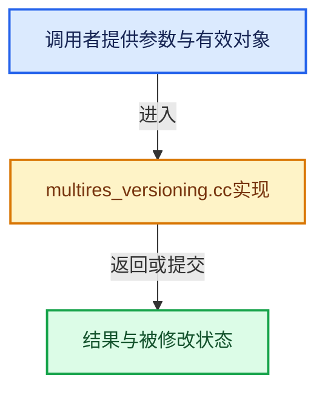

# 实现依赖专题：source/blender/blenkernel/intern/multires_versioning.cc

[实现依赖导航](../../README.md) · [符号索引](../../../00-课程指南/02-源码与提交索引/符号依赖与实现索引.md)

本专题从正文实际调用进入，集中保存共享实现。函数有稳定锚点，可从调用处直接跳到对应完整函数；递归与互相调用通过回链组织。

## 本文件的实现关系





## 完整成员与函数实现

<a id="f-43f9f7f35096a9e8"></a>

### `blender::subdiv_for_simple_to_catmull_clark`

实现位置：[source/blender/blenkernel/intern/multires_versioning.cc](../../../../../../../source/blender/blenkernel/intern/multires_versioning.cc) · L24—L52。

接口参数：

- `Object *object`
- `MultiresModifierData *mmd`

**教学注释版**

<!-- annotated:670f10a1f9bfca -->

```cpp
static bke::subdiv::Subdiv *subdiv_for_simple_to_catmull_clark(Object *object,
                                                               MultiresModifierData *mmd)
{
  using namespace blender::bke;
  subdiv::Settings subdiv_settings;
  BKE_multires_subdiv_settings_init(&subdiv_settings, mmd);

  const Mesh *base_mesh = id_cast<const Mesh *>(object->data);

  OpenSubdiv_Converter converter;
  subdiv::converter_init_for_mesh(&converter, &subdiv_settings, base_mesh);

  /* Emulate the old simple subdivision by making all of the topology infinitely sharp. */
  const Array<float> edge_sharpness(int64_t(converter.edges.size()),
                                    OPENSUBDIV_SHARPNESS_INFINITE);
  const Array<float> vert_sharpness(converter.verts_num, OPENSUBDIV_SHARPNESS_INFINITE);
  converter.edge_sharpness = edge_sharpness;
  converter.vert_sharpness = vert_sharpness;

  subdiv::Subdiv *subdiv = subdiv::new_from_converter(&subdiv_settings, &converter);
  subdiv::converter_free(&converter);

  if (!subdiv::eval_begin_from_mesh(subdiv, base_mesh, subdiv::SUBDIV_EVALUATOR_TYPE_CPU)) {
    // [讲解] subdiv::free：归还相匹配的C分配存储，不自动执行C++析构；不可用于Windows的_aligned_malloc结果。
    subdiv::free(subdiv);
    return nullptr;
  }

  return subdiv;
}
```

<details>
<summary>核对原始源码：source/blender/blenkernel/intern/multires_versioning.cc · L24—L52</summary>

<!-- original:670f10a1f9bfca:source/blender/blenkernel/intern/multires_versioning.cc:24:52 -->

```cpp
static bke::subdiv::Subdiv *subdiv_for_simple_to_catmull_clark(Object *object,
                                                               MultiresModifierData *mmd)
{
  using namespace blender::bke;
  subdiv::Settings subdiv_settings;
  BKE_multires_subdiv_settings_init(&subdiv_settings, mmd);

  const Mesh *base_mesh = id_cast<const Mesh *>(object->data);

  OpenSubdiv_Converter converter;
  subdiv::converter_init_for_mesh(&converter, &subdiv_settings, base_mesh);

  /* Emulate the old simple subdivision by making all of the topology infinitely sharp. */
  const Array<float> edge_sharpness(int64_t(converter.edges.size()),
                                    OPENSUBDIV_SHARPNESS_INFINITE);
  const Array<float> vert_sharpness(converter.verts_num, OPENSUBDIV_SHARPNESS_INFINITE);
  converter.edge_sharpness = edge_sharpness;
  converter.vert_sharpness = vert_sharpness;

  subdiv::Subdiv *subdiv = subdiv::new_from_converter(&subdiv_settings, &converter);
  subdiv::converter_free(&converter);

  if (!subdiv::eval_begin_from_mesh(subdiv, base_mesh, subdiv::SUBDIV_EVALUATOR_TYPE_CPU)) {
    subdiv::free(subdiv);
    return nullptr;
  }

  return subdiv;
}
```

</details>

**沿实际写入检查状态**

- `converter.edge_sharpness = edge_sharpness;`
- `converter.vert_sharpness = vert_sharpness;`

**结果出口**

- `return nullptr;`
- `return subdiv;`

**继续追踪实现**

- `BKE_multires_subdiv_settings_init` → [blender::BKE_multires_subdiv_settings_init · L16](multires_subdiv.cc.md#f-a313efd66d1384ce)。
- `id_cast<const Mesh *>` → [blender::id_cast · L1417](../../08-其他Blender模块/makesdna/DNA_ID.h.md#f-6c8ac6412850ac5a)。
- `subdiv::converter_init_for_mesh` → [blender::bke::subdiv::converter_init_for_mesh · L405](subdiv_converter_mesh.cc.md#f-266c51ca08322a69)。
- `converter.edges.size` → [调用协议](../../../00-课程指南/01-路线与规范/模板宏与动态分派协议.md)：接收对象类型依赖auto、返回值或模板实例；不按同名猜测目标。调用位置L37。
- `subdiv::new_from_converter` → [blender::bke::subdiv::new_from_converter · L100](subdiv.cc.md#f-665aa0c873b427e8)。
- `subdiv::converter_free` → [blender::bke::subdiv::converter_free · L15](subdiv_converter.cc.md#f-cb699c2ac85acac1)。
- `subdiv::eval_begin_from_mesh` → [blender::bke::subdiv::eval_begin_from_mesh · L216](subdiv_eval.cc.md#f-88372aa7a8ab8f7e)。
- `subdiv::free` → [外部契约](https://eel.is/c++draft/c.malloc)：归还相匹配的C分配存储，不自动执行C++析构；不可用于Windows的_aligned_malloc结果。

<a id="f-5c1d14de6ec48def"></a>

### `blender::multires_do_versions_simple_to_catmull_clark`

实现位置：[source/blender/blenkernel/intern/multires_versioning.cc](../../../../../../../source/blender/blenkernel/intern/multires_versioning.cc) · L56—L95。

接口参数：

- `Object *object`
- `MultiresModifierData *mmd`

**教学注释版**

<!-- annotated:b2c00e742c9d63 -->

```cpp
void multires_do_versions_simple_to_catmull_clark(Object *object, MultiresModifierData *mmd)
{
#ifdef WITH_OPENSUBDIV
  const Mesh *base_mesh = id_cast<const Mesh *>(object->data);
  if (base_mesh->corners_num == 0) {
    return;
  }

  /* Store the grids displacement in object space against the simple limit surface. */
  {
    bke::subdiv::Subdiv *subdiv = subdiv_for_simple_to_catmull_clark(object, mmd);
    MultiresReshapeContext reshape_context;
    if (!multires_reshape_context_create_from_subdiv(
            &reshape_context, object, mmd, subdiv, mmd->totlvl))
    {
      // [讲解] bke::subdiv::free：归还相匹配的C分配存储，不自动执行C++析构；不可用于Windows的_aligned_malloc结果。
      bke::subdiv::free(subdiv);
      return;
    }

    multires_reshape_store_original_grids(&reshape_context);
    multires_reshape_assign_final_coords_from_mdisps(&reshape_context);
    multires_reshape_context_free(&reshape_context);

    bke::subdiv::free(subdiv);
  }

  /* Calculate the new tangent displacement against the new Catmull-Clark limit surface. */
  {
    MultiresReshapeContext reshape_context;
    if (!multires_reshape_context_create_from_modifier(&reshape_context, object, mmd, mmd->totlvl))
    {
      return;
    }
    multires_reshape_object_grids_to_tangent_displacement(&reshape_context);
    multires_reshape_context_free(&reshape_context);
  }
#else
  UNUSED_VARS(object, mmd);
#endif
}
```

<details>
<summary>核对原始源码：source/blender/blenkernel/intern/multires_versioning.cc · L56—L95</summary>

<!-- original:b2c00e742c9d63:source/blender/blenkernel/intern/multires_versioning.cc:56:95 -->

```cpp
void multires_do_versions_simple_to_catmull_clark(Object *object, MultiresModifierData *mmd)
{
#ifdef WITH_OPENSUBDIV
  const Mesh *base_mesh = id_cast<const Mesh *>(object->data);
  if (base_mesh->corners_num == 0) {
    return;
  }

  /* Store the grids displacement in object space against the simple limit surface. */
  {
    bke::subdiv::Subdiv *subdiv = subdiv_for_simple_to_catmull_clark(object, mmd);
    MultiresReshapeContext reshape_context;
    if (!multires_reshape_context_create_from_subdiv(
            &reshape_context, object, mmd, subdiv, mmd->totlvl))
    {
      bke::subdiv::free(subdiv);
      return;
    }

    multires_reshape_store_original_grids(&reshape_context);
    multires_reshape_assign_final_coords_from_mdisps(&reshape_context);
    multires_reshape_context_free(&reshape_context);

    bke::subdiv::free(subdiv);
  }

  /* Calculate the new tangent displacement against the new Catmull-Clark limit surface. */
  {
    MultiresReshapeContext reshape_context;
    if (!multires_reshape_context_create_from_modifier(&reshape_context, object, mmd, mmd->totlvl))
    {
      return;
    }
    multires_reshape_object_grids_to_tangent_displacement(&reshape_context);
    multires_reshape_context_free(&reshape_context);
  }
#else
  UNUSED_VARS(object, mmd);
#endif
}
```

</details>

**继续追踪实现**

- `id_cast<const Mesh *>` → [blender::id_cast · L1417](../../08-其他Blender模块/makesdna/DNA_ID.h.md#f-6c8ac6412850ac5a)。
- `subdiv_for_simple_to_catmull_clark` → [blender::subdiv_for_simple_to_catmull_clark · L24](multires_versioning.cc.md#f-43f9f7f35096a9e8)。
- `multires_reshape_context_create_from_subdiv` → [blender::multires_reshape_context_create_from_subdiv · L282](multires_reshape_util.cc.md#f-0cf932f76346a48b)。
- `bke::subdiv::free` → [外部契约](https://eel.is/c++draft/c.malloc)：归还相匹配的C分配存储，不自动执行C++析构；不可用于Windows的_aligned_malloc结果。
- `multires_reshape_store_original_grids` → [blender::multires_reshape_store_original_grids · L626](multires_reshape_util.cc.md#f-2dd543f3f5744e6a)。
- `multires_reshape_assign_final_coords_from_mdisps` → [blender::multires_reshape_assign_final_coords_from_mdisps · L784](multires_reshape_util.cc.md#f-3c4876325cb0f84a)。
- `multires_reshape_context_free` → [blender::multires_reshape_context_free · L347](multires_reshape_util.cc.md#f-1845e67e2c78f6b9)。
- `multires_reshape_context_create_from_modifier` → [blender::multires_reshape_context_create_from_modifier · L267](multires_reshape_util.cc.md#f-bcd544536869c45a)。
- `multires_reshape_object_grids_to_tangent_displacement` → [blender::multires_reshape_object_grids_to_tangent_displacement · L750](multires_reshape_util.cc.md#f-fd93b78ce31d0da9)。
- `UNUSED_VARS` → [UNUSED_VARS · L522](../../01-BLI基础库/BLI_utildefines.hh.md#m-013582537634)；[UNUSED_VARS · L41](../../08-其他Blender模块/gpu/GPU_shader_shared_utils.hh.md#m-05d9d7a33da0)；[UNUSED_VARS · L62](../../08-其他Blender模块/gpu/GPU_shader_shared_utils.hh.md#m-e12c683a4aca)。宏定义由构建条件选择。
