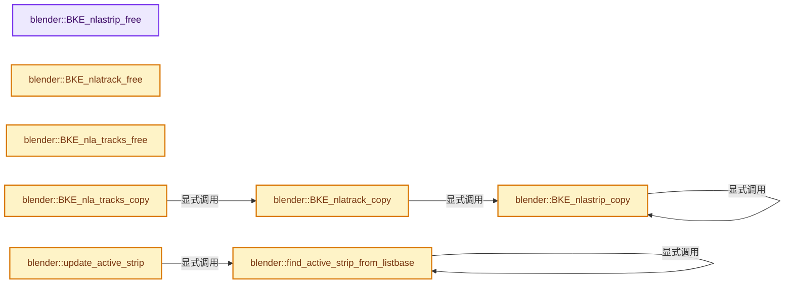
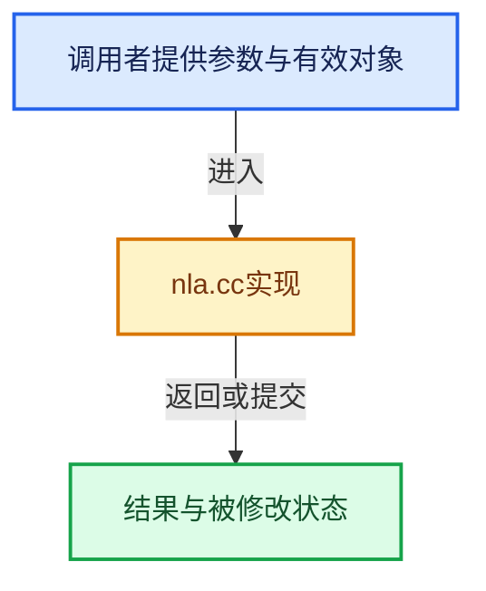

# 实现依赖专题：source/blender/blenkernel/intern/nla.cc

[实现依赖导航](../../README.md) · [符号索引](../../../00-课程指南/02-源码与提交索引/符号依赖与实现索引.md)

本专题从正文实际调用进入，集中保存共享实现。函数有稳定锚点，可从调用处直接跳到对应完整函数；递归与互相调用通过回链组织。

## 本文件的实现关系






## 完整成员与函数实现

<a id="f-0d4861b09127b5a9"></a>

### `blender::BKE_nlastrip_free`

实现位置：[source/blender/blenkernel/intern/nla.cc](../../../../../../../source/blender/blenkernel/intern/nla.cc) · L78—L107。

接口参数：

- `NlaStrip *strip`
- `const bool do_id_user`

**教学注释版**

<!-- annotated:e21c728de6905c -->

```cpp
void BKE_nlastrip_free(NlaStrip *strip, const bool do_id_user)
{
  NlaStrip *cs, *csn;

  /* sanity checks */
  if (strip == nullptr) {
    return;
  }

  /* free child-strips */
  for (cs = strip->strips.first(); cs; cs = csn) {
    csn = cs->next;
    BKE_nlastrip_remove_and_free(&strip->strips, cs, do_id_user);
  }

  /* remove reference to action */
  if (strip->act != nullptr && do_id_user) {
    id_us_min(&strip->act->id);
  }

  /* free own F-Curves */
  BKE_fcurves_free(&strip->fcurves);

  /* free own F-Modifiers */
  free_fmodifiers(&strip->modifiers);

  /* free the strip runtime and itself */
  MEM_delete(strip->runtime);
  MEM_delete(strip);
}
```

<details>
<summary>核对原始源码：source/blender/blenkernel/intern/nla.cc · L78—L107</summary>

<!-- original:e21c728de6905c:source/blender/blenkernel/intern/nla.cc:78:107 -->

```cpp
void BKE_nlastrip_free(NlaStrip *strip, const bool do_id_user)
{
  NlaStrip *cs, *csn;

  /* sanity checks */
  if (strip == nullptr) {
    return;
  }

  /* free child-strips */
  for (cs = strip->strips.first(); cs; cs = csn) {
    csn = cs->next;
    BKE_nlastrip_remove_and_free(&strip->strips, cs, do_id_user);
  }

  /* remove reference to action */
  if (strip->act != nullptr && do_id_user) {
    id_us_min(&strip->act->id);
  }

  /* free own F-Curves */
  BKE_fcurves_free(&strip->fcurves);

  /* free own F-Modifiers */
  free_fmodifiers(&strip->modifiers);

  /* free the strip runtime and itself */
  MEM_delete(strip->runtime);
  MEM_delete(strip);
}
```

</details>

**沿实际写入检查状态**

- `csn = cs->next;`

**继续追踪实现**

- `strip->strips.first` → [调用协议](../../../00-课程指南/01-路线与规范/模板宏与动态分派协议.md)：接收对象类型依赖auto、返回值或模板实例；不按同名猜测目标。调用位置L88。
- `BKE_nlastrip_remove_and_free` → [blender::BKE_nlastrip_remove_and_free · L1516](nla.cc.md#f-0a587b76b5f4718b)。
- `id_us_min` → [blender::id_us_min · L441](lib_id.cc.md#f-c5e5246a79962257)。
- `BKE_fcurves_free` → [blender::BKE_fcurves_free · L101](fcurve.cc.md#f-8d7f34aa906ce734)。
- `free_fmodifiers` → [blender::free_fmodifiers · L1321](fmodifier.cc.md#f-70774f004fea93d4)。
- `MEM_delete` → [MEM_delete · L400](../../07-Intern运行时与平台/guardedalloc/MEM_guardedalloc.h.md#f-9049ffdd1682887c)。

<a id="f-de78f0d604292917"></a>

### `blender::BKE_nlatrack_free`

实现位置：[source/blender/blenkernel/intern/nla.cc](../../../../../../../source/blender/blenkernel/intern/nla.cc) · L109—L126。

接口参数：

- `NlaTrack *nlt`
- `const bool do_id_user`

**教学注释版**

<!-- annotated:bb47321e7366a6 -->

```cpp
void BKE_nlatrack_free(NlaTrack *nlt, const bool do_id_user)
{
  NlaStrip *strip, *stripn;

  /* sanity checks */
  if (nlt == nullptr) {
    return;
  }

  /* free strips */
  for (strip = nlt->strips.first(); strip; strip = stripn) {
    stripn = strip->next;
    BKE_nlastrip_remove_and_free(&nlt->strips, strip, do_id_user);
  }

  /* free NLA track itself now */
  MEM_delete(nlt);
}
```

<details>
<summary>核对原始源码：source/blender/blenkernel/intern/nla.cc · L109—L126</summary>

<!-- original:bb47321e7366a6:source/blender/blenkernel/intern/nla.cc:109:126 -->

```cpp
void BKE_nlatrack_free(NlaTrack *nlt, const bool do_id_user)
{
  NlaStrip *strip, *stripn;

  /* sanity checks */
  if (nlt == nullptr) {
    return;
  }

  /* free strips */
  for (strip = nlt->strips.first(); strip; strip = stripn) {
    stripn = strip->next;
    BKE_nlastrip_remove_and_free(&nlt->strips, strip, do_id_user);
  }

  /* free NLA track itself now */
  MEM_delete(nlt);
}
```

</details>

**沿实际写入检查状态**

- `stripn = strip->next;`

**继续追踪实现**

- `nlt->strips.first` → [调用协议](../../../00-课程指南/01-路线与规范/模板宏与动态分派协议.md)：接收对象类型依赖auto、返回值或模板实例；不按同名猜测目标。调用位置L119。
- `BKE_nlastrip_remove_and_free` → [blender::BKE_nlastrip_remove_and_free · L1516](nla.cc.md#f-0a587b76b5f4718b)。
- `MEM_delete` → [MEM_delete · L400](../../07-Intern运行时与平台/guardedalloc/MEM_guardedalloc.h.md#f-9049ffdd1682887c)。

<a id="f-078f449854048a5a"></a>

### `blender::BKE_nla_tracks_free`

实现位置：[source/blender/blenkernel/intern/nla.cc](../../../../../../../source/blender/blenkernel/intern/nla.cc) · L128—L145。

接口参数：

- `ListBaseT<NlaTrack> *tracks`
- `bool do_id_user`

**教学注释版**

<!-- annotated:5be1d63606e17d -->

```cpp
void BKE_nla_tracks_free(ListBaseT<NlaTrack> *tracks, bool do_id_user)
{
  NlaTrack *nlt, *nltn;

  /* sanity checks */
  if (ELEM(nullptr, tracks, tracks->first())) {
    return;
  }

  /* free tracks one by one */
  for (nlt = tracks->first(); nlt; nlt = nltn) {
    nltn = nlt->next;
    BKE_nlatrack_remove_and_free(tracks, nlt, do_id_user);
  }

  /* clear the list's pointers to be safe */
  tracks->clear_no_delete();
}
```

<details>
<summary>核对原始源码：source/blender/blenkernel/intern/nla.cc · L128—L145</summary>

<!-- original:5be1d63606e17d:source/blender/blenkernel/intern/nla.cc:128:145 -->

```cpp
void BKE_nla_tracks_free(ListBaseT<NlaTrack> *tracks, bool do_id_user)
{
  NlaTrack *nlt, *nltn;

  /* sanity checks */
  if (ELEM(nullptr, tracks, tracks->first())) {
    return;
  }

  /* free tracks one by one */
  for (nlt = tracks->first(); nlt; nlt = nltn) {
    nltn = nlt->next;
    BKE_nlatrack_remove_and_free(tracks, nlt, do_id_user);
  }

  /* clear the list's pointers to be safe */
  tracks->clear_no_delete();
}
```

</details>

**沿实际写入检查状态**

- `nltn = nlt->next;`

**继续追踪实现**

- `ELEM` → [ELEM · L88](../../07-Intern运行时与平台/ghost/intern/GHOST_utildefines.hh.md#m-d28724a15928)；[ELEM · L135](../../01-BLI基础库/BLI_utildefines.hh.md#m-d6572de7cae0)。宏定义由构建条件选择。
- `tracks->first` → [blender::ListBaseT::first · L102](../../08-其他Blender模块/makesdna/DNA_listBase.h.md#f-3d12ff35da057c9e)；[blender::ListBaseT::first · L106](../../08-其他Blender模块/makesdna/DNA_listBase.h.md#f-0df87c3480e059f9)。同名重载需按实参类型选择。
- `BKE_nlatrack_remove_and_free` → [blender::BKE_nlatrack_remove_and_free · L679](nla.cc.md#f-ca41127639990f15)。
- `tracks->clear_no_delete` → [blender::ListBaseT::clear_no_delete · L68](../../08-其他Blender模块/makesdna/DNA_listBase.h.md#f-431defdf189ae643)。

<a id="f-61b6e64cfc61e650"></a>

### `blender::BKE_nlastrip_copy`

实现位置：[source/blender/blenkernel/intern/nla.cc](../../../../../../../source/blender/blenkernel/intern/nla.cc) · L149—L197。

接口参数：

- `Main *bmain`
- `NlaStrip *strip`
- `const bool use_same_action`
- `const int flag`

**教学注释版**

<!-- annotated:264aebb115f48d -->

```cpp
NlaStrip *BKE_nlastrip_copy(Main *bmain,
                            NlaStrip *strip,
                            const bool use_same_action,
                            const int flag)
{
  NlaStrip *strip_d;
  NlaStrip *cs_d;

  const bool do_id_user = (flag & LIB_ID_CREATE_NO_USER_REFCOUNT) == 0;

  /* sanity check */
  if (strip == nullptr) {
    return nullptr;
  }

  /* make a copy */
  strip_d = MEM_dupalloc(strip);
  strip_d->next = strip_d->prev = nullptr;
  strip_d->runtime = nullptr;

  /* handle action */
  if (strip_d->act) {
    if (use_same_action) {
      if (do_id_user) {
        /* increase user-count of action */
        id_us_plus(&strip_d->act->id);
      }
    }
    else {
      /* use a copy of the action instead (user count shouldn't have changed yet) */
      BKE_id_copy_ex(bmain, &strip_d->act->id, reinterpret_cast<ID **>(&strip_d->act), flag);
    }
  }

  /* copy F-Curves and modifiers */
  BKE_fcurves_copy(&strip_d->fcurves, &strip->fcurves);
  copy_fmodifiers(&strip_d->modifiers, &strip->modifiers);

  /* make a copy of all the child-strips, one at a time */
  strip_d->strips.clear_no_delete();

  for (NlaStrip &cs : strip->strips) {
    cs_d = BKE_nlastrip_copy(bmain, &cs, use_same_action, flag);
    BLI_addtail(&strip_d->strips, cs_d);
  }

  /* return the strip */
  return strip_d;
}
```

<details>
<summary>核对原始源码：source/blender/blenkernel/intern/nla.cc · L149—L197</summary>

<!-- original:264aebb115f48d:source/blender/blenkernel/intern/nla.cc:149:197 -->

```cpp
NlaStrip *BKE_nlastrip_copy(Main *bmain,
                            NlaStrip *strip,
                            const bool use_same_action,
                            const int flag)
{
  NlaStrip *strip_d;
  NlaStrip *cs_d;

  const bool do_id_user = (flag & LIB_ID_CREATE_NO_USER_REFCOUNT) == 0;

  /* sanity check */
  if (strip == nullptr) {
    return nullptr;
  }

  /* make a copy */
  strip_d = MEM_dupalloc(strip);
  strip_d->next = strip_d->prev = nullptr;
  strip_d->runtime = nullptr;

  /* handle action */
  if (strip_d->act) {
    if (use_same_action) {
      if (do_id_user) {
        /* increase user-count of action */
        id_us_plus(&strip_d->act->id);
      }
    }
    else {
      /* use a copy of the action instead (user count shouldn't have changed yet) */
      BKE_id_copy_ex(bmain, &strip_d->act->id, reinterpret_cast<ID **>(&strip_d->act), flag);
    }
  }

  /* copy F-Curves and modifiers */
  BKE_fcurves_copy(&strip_d->fcurves, &strip->fcurves);
  copy_fmodifiers(&strip_d->modifiers, &strip->modifiers);

  /* make a copy of all the child-strips, one at a time */
  strip_d->strips.clear_no_delete();

  for (NlaStrip &cs : strip->strips) {
    cs_d = BKE_nlastrip_copy(bmain, &cs, use_same_action, flag);
    BLI_addtail(&strip_d->strips, cs_d);
  }

  /* return the strip */
  return strip_d;
}
```

</details>

**沿实际写入检查状态**

- `strip_d = MEM_dupalloc(strip);`
- `strip_d->next = strip_d->prev = nullptr;`
- `strip_d->runtime = nullptr;`
- `cs_d = BKE_nlastrip_copy(bmain, &cs, use_same_action, flag);`

**结果出口**

- `return nullptr;`
- `return strip_d;`

**继续追踪实现**

- `MEM_dupalloc` → [MEM_dupalloc · L627](../../07-Intern运行时与平台/guardedalloc/MEM_guardedalloc.h.md#f-78a72b71e3c57010)。
- `id_us_plus` → [blender::id_us_plus · L433](lib_id.cc.md#f-1b90ef7608c4f32e)。
- `BKE_id_copy_ex` → [blender::BKE_id_copy_ex · L851](lib_id.cc.md#f-24272170c95f49fb)。
- `BKE_fcurves_copy` → [blender::BKE_fcurves_copy · L157](fcurve.cc.md#f-63469f0f9cea1060)。
- `copy_fmodifiers` → [blender::copy_fmodifiers · L1253](fmodifier.cc.md#f-e43a4f17723ec755)。
- `strip_d->strips.clear_no_delete` → [调用协议](../../../00-课程指南/01-路线与规范/模板宏与动态分派协议.md)：接收对象类型依赖auto、返回值或模板实例；不按同名猜测目标。调用位置L188。
- `BKE_nlastrip_copy` → [blender::BKE_nlastrip_copy · L149](nla.cc.md#f-61b6e64cfc61e650)。
- `BLI_addtail` → [blender::BLI_addtail · L118](../../01-BLI基础库/intern/listbase.cc.md#f-4fb027713fa3115b)。

<a id="f-40c53a11cbf4a3d0"></a>

### `blender::BKE_nlatrack_copy`

实现位置：[source/blender/blenkernel/intern/nla.cc](../../../../../../../source/blender/blenkernel/intern/nla.cc) · L199—L226。

接口参数：

- `Main *bmain`
- `NlaTrack *nlt`
- `const bool use_same_actions`
- `const int flag`

**教学注释版**

<!-- annotated:875d28ae6f16b8 -->

```cpp
NlaTrack *BKE_nlatrack_copy(Main *bmain,
                            NlaTrack *nlt,
                            const bool use_same_actions,
                            const int flag)
{
  NlaStrip *strip_d;
  NlaTrack *nlt_d;

  /* sanity check */
  if (nlt == nullptr) {
    return nullptr;
  }

  /* make a copy */
  nlt_d = MEM_dupalloc(nlt);
  nlt_d->next = nlt_d->prev = nullptr;

  /* make a copy of all the strips, one at a time */
  nlt_d->strips.clear_no_delete();

  for (NlaStrip &strip : nlt->strips) {
    strip_d = BKE_nlastrip_copy(bmain, &strip, use_same_actions, flag);
    BLI_addtail(&nlt_d->strips, strip_d);
  }

  /* return the copy */
  return nlt_d;
}
```

<details>
<summary>核对原始源码：source/blender/blenkernel/intern/nla.cc · L199—L226</summary>

<!-- original:875d28ae6f16b8:source/blender/blenkernel/intern/nla.cc:199:226 -->

```cpp
NlaTrack *BKE_nlatrack_copy(Main *bmain,
                            NlaTrack *nlt,
                            const bool use_same_actions,
                            const int flag)
{
  NlaStrip *strip_d;
  NlaTrack *nlt_d;

  /* sanity check */
  if (nlt == nullptr) {
    return nullptr;
  }

  /* make a copy */
  nlt_d = MEM_dupalloc(nlt);
  nlt_d->next = nlt_d->prev = nullptr;

  /* make a copy of all the strips, one at a time */
  nlt_d->strips.clear_no_delete();

  for (NlaStrip &strip : nlt->strips) {
    strip_d = BKE_nlastrip_copy(bmain, &strip, use_same_actions, flag);
    BLI_addtail(&nlt_d->strips, strip_d);
  }

  /* return the copy */
  return nlt_d;
}
```

</details>

**沿实际写入检查状态**

- `nlt_d = MEM_dupalloc(nlt);`
- `nlt_d->next = nlt_d->prev = nullptr;`
- `strip_d = BKE_nlastrip_copy(bmain, &strip, use_same_actions, flag);`

**结果出口**

- `return nullptr;`
- `return nlt_d;`

**继续追踪实现**

- `MEM_dupalloc` → [MEM_dupalloc · L627](../../07-Intern运行时与平台/guardedalloc/MEM_guardedalloc.h.md#f-78a72b71e3c57010)。
- `nlt_d->strips.clear_no_delete` → [调用协议](../../../00-课程指南/01-路线与规范/模板宏与动态分派协议.md)：接收对象类型依赖auto、返回值或模板实例；不按同名猜测目标。调用位置L217。
- `BKE_nlastrip_copy` → [blender::BKE_nlastrip_copy · L149](nla.cc.md#f-61b6e64cfc61e650)。
- `BLI_addtail` → [blender::BLI_addtail · L118](../../01-BLI基础库/intern/listbase.cc.md#f-4fb027713fa3115b)。

<a id="f-a4fde674299ae4d5"></a>

### `blender::BKE_nla_tracks_copy`

实现位置：[source/blender/blenkernel/intern/nla.cc](../../../../../../../source/blender/blenkernel/intern/nla.cc) · L228—L250。

接口参数：

- `Main *bmain`
- `ListBaseT<NlaTrack> *dst`
- `const ListBaseT<NlaTrack> *src`
- `const int flag`

**教学注释版**

<!-- annotated:0bb1d5f24cbf67 -->

```cpp
void BKE_nla_tracks_copy(Main *bmain,
                         ListBaseT<NlaTrack> *dst,
                         const ListBaseT<NlaTrack> *src,
                         const int flag)
{
  NlaTrack *nlt_d;

  /* sanity checks */
  if (ELEM(nullptr, dst, src)) {
    return;
  }

  /* clear out the destination list first for precautions... */
  dst->clear_no_delete();

  /* copy each NLA-track, one at a time */
  for (NlaTrack &nlt : *src) {
    /* make a copy, and add the copy to the destination list */
    /* XXX: we need to fix this sometime. */
    nlt_d = BKE_nlatrack_copy(bmain, &nlt, true, flag);
    BLI_addtail(dst, nlt_d);
  }
}
```

<details>
<summary>核对原始源码：source/blender/blenkernel/intern/nla.cc · L228—L250</summary>

<!-- original:0bb1d5f24cbf67:source/blender/blenkernel/intern/nla.cc:228:250 -->

```cpp
void BKE_nla_tracks_copy(Main *bmain,
                         ListBaseT<NlaTrack> *dst,
                         const ListBaseT<NlaTrack> *src,
                         const int flag)
{
  NlaTrack *nlt_d;

  /* sanity checks */
  if (ELEM(nullptr, dst, src)) {
    return;
  }

  /* clear out the destination list first for precautions... */
  dst->clear_no_delete();

  /* copy each NLA-track, one at a time */
  for (NlaTrack &nlt : *src) {
    /* make a copy, and add the copy to the destination list */
    /* XXX: we need to fix this sometime. */
    nlt_d = BKE_nlatrack_copy(bmain, &nlt, true, flag);
    BLI_addtail(dst, nlt_d);
  }
}
```

</details>

**沿实际写入检查状态**

- `nlt_d = BKE_nlatrack_copy(bmain, &nlt, true, flag);`

**继续追踪实现**

- `ELEM` → [ELEM · L88](../../07-Intern运行时与平台/ghost/intern/GHOST_utildefines.hh.md#m-d28724a15928)；[ELEM · L135](../../01-BLI基础库/BLI_utildefines.hh.md#m-d6572de7cae0)。宏定义由构建条件选择。
- `dst->clear_no_delete` → [blender::ListBaseT::clear_no_delete · L68](../../08-其他Blender模块/makesdna/DNA_listBase.h.md#f-431defdf189ae643)。
- `BKE_nlatrack_copy` → [blender::BKE_nlatrack_copy · L199](nla.cc.md#f-40c53a11cbf4a3d0)。
- `BLI_addtail` → [blender::BLI_addtail · L118](../../01-BLI基础库/intern/listbase.cc.md#f-4fb027713fa3115b)。

<a id="f-cd26864f9265d952"></a>

### `blender::find_active_strip_from_listbase`

实现位置：[source/blender/blenkernel/intern/nla.cc](../../../../../../../source/blender/blenkernel/intern/nla.cc) · L256—L291。

接口参数：

- `const NlaStrip *active_strip`
- `const ListBaseT<NlaStrip> *strips_source`
- `const ListBaseT<NlaStrip> *strips_dest`

**教学注释版**

<!-- annotated:d832f29d0c14d6 -->

```cpp
static NlaStrip *find_active_strip_from_listbase(const NlaStrip *active_strip,
                                                 const ListBaseT<NlaStrip> *strips_source,
                                                 const ListBaseT<NlaStrip> *strips_dest)
{
  BLI_assert_msg(strips_source->count() == strips_dest->count(),
                 "Expecting the same number of source and destination strips");

  NlaStrip *strip_dest = strips_dest->first();
  for (const NlaStrip &strip_source : *strips_source) {
    if (strip_dest == nullptr) {
      /* The tracks are assumed to have an equal number of strips, but this is
       * not the case. Not sure when this might happen, but it's better to not
       * crash. */
      break;
    }
    if (&strip_source == active_strip) {
      return strip_dest;
    }

    const bool src_is_meta = strip_source.type == NLASTRIP_TYPE_META;
    const bool dst_is_meta = strip_dest->type == NLASTRIP_TYPE_META;
    BLI_assert_msg(src_is_meta == dst_is_meta,
                   "Expecting topology of source and destination strips to be equal");
    if (src_is_meta && dst_is_meta) {
      NlaStrip *found_in_meta = find_active_strip_from_listbase(
          active_strip, &strip_source.strips, &strip_dest->strips);
      if (found_in_meta != nullptr) {
        return found_in_meta;
      }
    }

    strip_dest = strip_dest->next;
  }

  return nullptr;
}
```

<details>
<summary>核对原始源码：source/blender/blenkernel/intern/nla.cc · L256—L291</summary>

<!-- original:d832f29d0c14d6:source/blender/blenkernel/intern/nla.cc:256:291 -->

```cpp
static NlaStrip *find_active_strip_from_listbase(const NlaStrip *active_strip,
                                                 const ListBaseT<NlaStrip> *strips_source,
                                                 const ListBaseT<NlaStrip> *strips_dest)
{
  BLI_assert_msg(strips_source->count() == strips_dest->count(),
                 "Expecting the same number of source and destination strips");

  NlaStrip *strip_dest = strips_dest->first();
  for (const NlaStrip &strip_source : *strips_source) {
    if (strip_dest == nullptr) {
      /* The tracks are assumed to have an equal number of strips, but this is
       * not the case. Not sure when this might happen, but it's better to not
       * crash. */
      break;
    }
    if (&strip_source == active_strip) {
      return strip_dest;
    }

    const bool src_is_meta = strip_source.type == NLASTRIP_TYPE_META;
    const bool dst_is_meta = strip_dest->type == NLASTRIP_TYPE_META;
    BLI_assert_msg(src_is_meta == dst_is_meta,
                   "Expecting topology of source and destination strips to be equal");
    if (src_is_meta && dst_is_meta) {
      NlaStrip *found_in_meta = find_active_strip_from_listbase(
          active_strip, &strip_source.strips, &strip_dest->strips);
      if (found_in_meta != nullptr) {
        return found_in_meta;
      }
    }

    strip_dest = strip_dest->next;
  }

  return nullptr;
}
```

</details>

**沿实际写入检查状态**

- `strip_dest = strip_dest->next;`

**结果出口**

- `return strip_dest;`
- `return found_in_meta;`
- `return nullptr;`

**继续追踪实现**

- `BLI_assert_msg` → [BLI_assert_msg · L55](../../01-BLI基础库/BLI_assert.hh.md#m-695eed20dceb)；[BLI_assert_msg · L64](../../01-BLI基础库/BLI_assert.hh.md#m-7de5563de4db)。宏定义由构建条件选择。
- `strips_source->count` → [blender::ListBaseT::count · L92](../../08-其他Blender模块/makesdna/DNA_listBase.h.md#f-7d243d006ac4c693)。
- `strips_dest->count` → [blender::ListBaseT::count · L92](../../08-其他Blender模块/makesdna/DNA_listBase.h.md#f-7d243d006ac4c693)。
- `strips_dest->first` → [blender::ListBaseT::first · L102](../../08-其他Blender模块/makesdna/DNA_listBase.h.md#f-3d12ff35da057c9e)；[blender::ListBaseT::first · L106](../../08-其他Blender模块/makesdna/DNA_listBase.h.md#f-0df87c3480e059f9)。同名重载需按实参类型选择。
- `find_active_strip_from_listbase` → [blender::find_active_strip_from_listbase · L256](nla.cc.md#f-cd26864f9265d952)。

<a id="f-8d5185b3e8319bb3"></a>

### `blender::update_active_strip`

实现位置：[source/blender/blenkernel/intern/nla.cc](../../../../../../../source/blender/blenkernel/intern/nla.cc) · L296—L306。

接口参数：

- `AnimData *adt_dest`
- `NlaTrack *track_dest`
- `const AnimData *adt_source`
- `const NlaTrack *track_source`

**教学注释版**

<!-- annotated:03fc8662af0acf -->

```cpp
static void update_active_strip(AnimData *adt_dest,
                                NlaTrack *track_dest,
                                const AnimData *adt_source,
                                const NlaTrack *track_source)
{
  BLI_assert(track_source->strips.count() == track_dest->strips.count());

  NlaStrip *active_strip = find_active_strip_from_listbase(
      adt_source->actstrip, &track_source->strips, &track_dest->strips);
  adt_dest->actstrip = active_strip;
}
```

<details>
<summary>核对原始源码：source/blender/blenkernel/intern/nla.cc · L296—L306</summary>

<!-- original:03fc8662af0acf:source/blender/blenkernel/intern/nla.cc:296:306 -->

```cpp
static void update_active_strip(AnimData *adt_dest,
                                NlaTrack *track_dest,
                                const AnimData *adt_source,
                                const NlaTrack *track_source)
{
  BLI_assert(track_source->strips.count() == track_dest->strips.count());

  NlaStrip *active_strip = find_active_strip_from_listbase(
      adt_source->actstrip, &track_source->strips, &track_dest->strips);
  adt_dest->actstrip = active_strip;
}
```

</details>

**沿实际写入检查状态**

- `adt_dest->actstrip = active_strip;`

**继续追踪实现**

- `BLI_assert` → [BLI_assert · L48](../../01-BLI基础库/BLI_assert.hh.md#m-57a88495704d)；[BLI_assert · L63](../../01-BLI基础库/BLI_assert.hh.md#m-d07050020cb5)。宏定义由构建条件选择。
- `track_source->strips.count` → [调用协议](../../../00-课程指南/01-路线与规范/模板宏与动态分派协议.md)：接收对象类型依赖auto、返回值或模板实例；不按同名猜测目标。调用位置L301。
- `track_dest->strips.count` → [调用协议](../../../00-课程指南/01-路线与规范/模板宏与动态分派协议.md)：接收对象类型依赖auto、返回值或模板实例；不按同名猜测目标。调用位置L301。
- `find_active_strip_from_listbase` → [blender::find_active_strip_from_listbase · L256](nla.cc.md#f-cd26864f9265d952)。

<a id="f-08842c1b7f103424"></a>

### `blender::update_active_track`

实现位置：[source/blender/blenkernel/intern/nla.cc](../../../../../../../source/blender/blenkernel/intern/nla.cc) · L309—L341。

接口参数：

- `AnimData *adt_dest`
- `const AnimData *adt_source`

**教学注释版**

<!-- annotated:2f472314faefe3 -->

```cpp
static void update_active_track(AnimData *adt_dest, const AnimData *adt_source)
{
  adt_dest->act_track = nullptr;
  adt_dest->actstrip = nullptr;
  if (adt_source->act_track == nullptr && adt_source->actstrip == nullptr) {
    return;
  }

  BLI_assert(adt_source->nla_tracks.count() == adt_dest->nla_tracks.count());

  NlaTrack *track_dest = adt_dest->nla_tracks.first();
  for (NlaTrack &track_source : adt_source->nla_tracks) {
    if (&track_source == adt_source->act_track) {
      adt_dest->act_track = track_dest;
    }

    /* Only search for the active strip if it hasn't been found yet. */
    if (adt_dest->actstrip == nullptr && adt_source->actstrip != nullptr) {
      update_active_strip(adt_dest, track_dest, adt_source, &track_source);
    }

    track_dest = track_dest->next;
  }

#ifndef NDEBUG
  {
    const bool source_has_actstrip = adt_source->actstrip != nullptr;
    const bool dest_has_actstrip = adt_dest->actstrip != nullptr;
    BLI_assert_msg(source_has_actstrip == dest_has_actstrip,
                   "Active strip did not copy correctly");
  }
#endif
}
```

<details>
<summary>核对原始源码：source/blender/blenkernel/intern/nla.cc · L309—L341</summary>

<!-- original:2f472314faefe3:source/blender/blenkernel/intern/nla.cc:309:341 -->

```cpp
static void update_active_track(AnimData *adt_dest, const AnimData *adt_source)
{
  adt_dest->act_track = nullptr;
  adt_dest->actstrip = nullptr;
  if (adt_source->act_track == nullptr && adt_source->actstrip == nullptr) {
    return;
  }

  BLI_assert(adt_source->nla_tracks.count() == adt_dest->nla_tracks.count());

  NlaTrack *track_dest = adt_dest->nla_tracks.first();
  for (NlaTrack &track_source : adt_source->nla_tracks) {
    if (&track_source == adt_source->act_track) {
      adt_dest->act_track = track_dest;
    }

    /* Only search for the active strip if it hasn't been found yet. */
    if (adt_dest->actstrip == nullptr && adt_source->actstrip != nullptr) {
      update_active_strip(adt_dest, track_dest, adt_source, &track_source);
    }

    track_dest = track_dest->next;
  }

#ifndef NDEBUG
  {
    const bool source_has_actstrip = adt_source->actstrip != nullptr;
    const bool dest_has_actstrip = adt_dest->actstrip != nullptr;
    BLI_assert_msg(source_has_actstrip == dest_has_actstrip,
                   "Active strip did not copy correctly");
  }
#endif
}
```

</details>

**沿实际写入检查状态**

- `adt_dest->act_track = nullptr;`
- `adt_dest->actstrip = nullptr;`
- `adt_dest->act_track = track_dest;`
- `track_dest = track_dest->next;`

**继续追踪实现**

- `BLI_assert` → [BLI_assert · L48](../../01-BLI基础库/BLI_assert.hh.md#m-57a88495704d)；[BLI_assert · L63](../../01-BLI基础库/BLI_assert.hh.md#m-d07050020cb5)。宏定义由构建条件选择。
- `adt_source->nla_tracks.count` → [调用协议](../../../00-课程指南/01-路线与规范/模板宏与动态分派协议.md)：接收对象类型依赖auto、返回值或模板实例；不按同名猜测目标。调用位置L317。
- `adt_dest->nla_tracks.count` → [调用协议](../../../00-课程指南/01-路线与规范/模板宏与动态分派协议.md)：接收对象类型依赖auto、返回值或模板实例；不按同名猜测目标。调用位置L317。
- `adt_dest->nla_tracks.first` → [调用协议](../../../00-课程指南/01-路线与规范/模板宏与动态分派协议.md)：接收对象类型依赖auto、返回值或模板实例；不按同名猜测目标。调用位置L319。
- `update_active_strip` → [blender::update_active_strip · L296](nla.cc.md#f-8d5185b3e8319bb3)。
- `BLI_assert_msg` → [BLI_assert_msg · L55](../../01-BLI基础库/BLI_assert.hh.md#m-695eed20dceb)；[BLI_assert_msg · L64](../../01-BLI基础库/BLI_assert.hh.md#m-7de5563de4db)。宏定义由构建条件选择。

<a id="f-e7d36139a58a9b13"></a>

### `blender::BKE_nla_tracks_copy_from_adt`

实现位置：[source/blender/blenkernel/intern/nla.cc](../../../../../../../source/blender/blenkernel/intern/nla.cc) · L343—L353。

接口参数：

- `Main *bmain`
- `AnimData *adt_dest`
- `const AnimData *adt_source`
- `const int flag`

**教学注释版**

<!-- annotated:ebcb8624943034 -->

```cpp
void BKE_nla_tracks_copy_from_adt(Main *bmain,
                                  AnimData *adt_dest,
                                  const AnimData *adt_source,
                                  const int flag)
{
  adt_dest->act_track = nullptr;
  adt_dest->actstrip = nullptr;

  BKE_nla_tracks_copy(bmain, &adt_dest->nla_tracks, &adt_source->nla_tracks, flag);
  update_active_track(adt_dest, adt_source);
}
```

<details>
<summary>核对原始源码：source/blender/blenkernel/intern/nla.cc · L343—L353</summary>

<!-- original:ebcb8624943034:source/blender/blenkernel/intern/nla.cc:343:353 -->

```cpp
void BKE_nla_tracks_copy_from_adt(Main *bmain,
                                  AnimData *adt_dest,
                                  const AnimData *adt_source,
                                  const int flag)
{
  adt_dest->act_track = nullptr;
  adt_dest->actstrip = nullptr;

  BKE_nla_tracks_copy(bmain, &adt_dest->nla_tracks, &adt_source->nla_tracks, flag);
  update_active_track(adt_dest, adt_source);
}
```

</details>

**沿实际写入检查状态**

- `adt_dest->act_track = nullptr;`
- `adt_dest->actstrip = nullptr;`

**继续追踪实现**

- `BKE_nla_tracks_copy` → [blender::BKE_nla_tracks_copy · L228](nla.cc.md#f-a4fde674299ae4d5)。
- `update_active_track` → [blender::update_active_track · L309](nla.cc.md#f-08842c1b7f103424)。

<a id="f-9fde0ceaf5b338f1"></a>

### `blender::BKE_nla_clip_length_get_nonzero`

实现位置：[source/blender/blenkernel/intern/nla.cc](../../../../../../../source/blender/blenkernel/intern/nla.cc) · L470—L476。

接口参数：

- `const NlaStrip *strip`

**教学注释版**

<!-- annotated:c33cf5d1813ea3 -->

```cpp
float BKE_nla_clip_length_get_nonzero(const NlaStrip *strip)
{
  if (strip->actend <= strip->actstart) {
    return 1.0f;
  }
  return strip->actend - strip->actstart;
}
```

<details>
<summary>核对原始源码：source/blender/blenkernel/intern/nla.cc · L470—L476</summary>

<!-- original:c33cf5d1813ea3:source/blender/blenkernel/intern/nla.cc:470:476 -->

```cpp
float BKE_nla_clip_length_get_nonzero(const NlaStrip *strip)
{
  if (strip->actend <= strip->actstart) {
    return 1.0f;
  }
  return strip->actend - strip->actstart;
}
```

</details>

**结果出口**

- `return 1.0f;`
- `return strip->actend - strip->actstart;`

**继续追踪实现**

本实现没有需要继续展开的显式调用；检查返回表达式、对象转换和调用者前置条件。

<a id="f-c844ef134691eeaf"></a>

### `blender::BKE_nla_clip_length_ensure_nonzero`

实现位置：[source/blender/blenkernel/intern/nla.cc](../../../../../../../source/blender/blenkernel/intern/nla.cc) · L478—L483。

接口参数：

- `const float *actstart`
- `float *r_actend`

**教学注释版**

<!-- annotated:ef4bec1ed825b4 -->

```cpp
void BKE_nla_clip_length_ensure_nonzero(const float *actstart, float *r_actend)
{
  if (*r_actend <= *actstart) {
    *r_actend = *actstart + 1.0f;
  }
}
```

<details>
<summary>核对原始源码：source/blender/blenkernel/intern/nla.cc · L478—L483</summary>

<!-- original:ef4bec1ed825b4:source/blender/blenkernel/intern/nla.cc:478:483 -->

```cpp
void BKE_nla_clip_length_ensure_nonzero(const float *actstart, float *r_actend)
{
  if (*r_actend <= *actstart) {
    *r_actend = *actstart + 1.0f;
  }
}
```

</details>

**继续追踪实现**

本实现没有需要继续展开的显式调用；检查返回表达式、对象转换和调用者前置条件。

<a id="f-897dfadc5ac4e61f"></a>

### `blender::BKE_nla_strip_foreach_id`

实现位置：[source/blender/blenkernel/intern/nla.cc](../../../../../../../source/blender/blenkernel/intern/nla.cc) · L658—L669。

接口参数：

- `NlaStrip *strip`
- `LibraryForeachIDData *data`

**教学注释版**

<!-- annotated:d0622820a2aa3a -->

```cpp
void BKE_nla_strip_foreach_id(NlaStrip *strip, LibraryForeachIDData *data)
{
  BKE_LIB_FOREACHID_PROCESS_IDSUPER(data, strip->act, IDWALK_CB_USER);

  for (FCurve &fcu : strip->fcurves) {
    BKE_LIB_FOREACHID_PROCESS_FUNCTION_CALL(data, BKE_fcurve_foreach_id(&fcu, data));
  }

  for (NlaStrip &substrip : strip->strips) {
    BKE_LIB_FOREACHID_PROCESS_FUNCTION_CALL(data, BKE_nla_strip_foreach_id(&substrip, data));
  }
}
```

<details>
<summary>核对原始源码：source/blender/blenkernel/intern/nla.cc · L658—L669</summary>

<!-- original:d0622820a2aa3a:source/blender/blenkernel/intern/nla.cc:658:669 -->

```cpp
void BKE_nla_strip_foreach_id(NlaStrip *strip, LibraryForeachIDData *data)
{
  BKE_LIB_FOREACHID_PROCESS_IDSUPER(data, strip->act, IDWALK_CB_USER);

  for (FCurve &fcu : strip->fcurves) {
    BKE_LIB_FOREACHID_PROCESS_FUNCTION_CALL(data, BKE_fcurve_foreach_id(&fcu, data));
  }

  for (NlaStrip &substrip : strip->strips) {
    BKE_LIB_FOREACHID_PROCESS_FUNCTION_CALL(data, BKE_nla_strip_foreach_id(&substrip, data));
  }
}
```

</details>

**继续追踪实现**

- `BKE_LIB_FOREACHID_PROCESS_IDSUPER` → [BKE_LIB_FOREACHID_PROCESS_IDSUPER · L293](../BKE_lib_query.hh.md#m-1b059b49d6cb)。宏定义由构建条件选择。
- `BKE_LIB_FOREACHID_PROCESS_FUNCTION_CALL` → [BKE_LIB_FOREACHID_PROCESS_FUNCTION_CALL · L299](../BKE_lib_query.hh.md#m-c45df84f7bf3)。宏定义由构建条件选择。
- `BKE_fcurve_foreach_id` → [blender::BKE_fcurve_foreach_id · L229](fcurve.cc.md#f-072b1b2e8dc76f61)。
- `BKE_nla_strip_foreach_id` → [blender::BKE_nla_strip_foreach_id · L658](nla.cc.md#f-897dfadc5ac4e61f)。

<a id="f-82c8132185efb171"></a>

### `blender::BKE_nlatrack_remove`

实现位置：[source/blender/blenkernel/intern/nla.cc](../../../../../../../source/blender/blenkernel/intern/nla.cc) · L673—L677。

接口参数：

- `ListBaseT<NlaTrack> *tracks`
- `NlaTrack *nlt`

**教学注释版**

<!-- annotated:ac8261e9810539 -->

```cpp
void BKE_nlatrack_remove(ListBaseT<NlaTrack> *tracks, NlaTrack *nlt)
{
  BLI_assert(tracks);
  BLI_remlink(tracks, nlt);
}
```

<details>
<summary>核对原始源码：source/blender/blenkernel/intern/nla.cc · L673—L677</summary>

<!-- original:ac8261e9810539:source/blender/blenkernel/intern/nla.cc:673:677 -->

```cpp
void BKE_nlatrack_remove(ListBaseT<NlaTrack> *tracks, NlaTrack *nlt)
{
  BLI_assert(tracks);
  BLI_remlink(tracks, nlt);
}
```

</details>

**继续追踪实现**

- `BLI_assert` → [BLI_assert · L48](../../01-BLI基础库/BLI_assert.hh.md#m-57a88495704d)；[BLI_assert · L63](../../01-BLI基础库/BLI_assert.hh.md#m-d07050020cb5)。宏定义由构建条件选择。
- `BLI_remlink` → [blender::BLI_remlink · L138](../../01-BLI基础库/intern/listbase.cc.md#f-120d80f281ca4cb7)。

<a id="f-ca41127639990f15"></a>

### `blender::BKE_nlatrack_remove_and_free`

实现位置：[source/blender/blenkernel/intern/nla.cc](../../../../../../../source/blender/blenkernel/intern/nla.cc) · L679—L683。

接口参数：

- `ListBaseT<NlaTrack> *tracks`
- `NlaTrack *nlt`
- `bool do_id_user`

**教学注释版**

<!-- annotated:ef35f105e8242b -->

```cpp
void BKE_nlatrack_remove_and_free(ListBaseT<NlaTrack> *tracks, NlaTrack *nlt, bool do_id_user)
{
  BKE_nlatrack_remove(tracks, nlt);
  BKE_nlatrack_free(nlt, do_id_user);
}
```

<details>
<summary>核对原始源码：source/blender/blenkernel/intern/nla.cc · L679—L683</summary>

<!-- original:ef35f105e8242b:source/blender/blenkernel/intern/nla.cc:679:683 -->

```cpp
void BKE_nlatrack_remove_and_free(ListBaseT<NlaTrack> *tracks, NlaTrack *nlt, bool do_id_user)
{
  BKE_nlatrack_remove(tracks, nlt);
  BKE_nlatrack_free(nlt, do_id_user);
}
```

</details>

**继续追踪实现**

- `BKE_nlatrack_remove` → [blender::BKE_nlatrack_remove · L673](nla.cc.md#f-82c8132185efb171)。
- `BKE_nlatrack_free` → [blender::BKE_nlatrack_free · L109](nla.cc.md#f-de78f0d604292917)。

<a id="f-fc2b05e308bb67ac"></a>

### `blender::BKE_nlatrack_is_enabled`

实现位置：[source/blender/blenkernel/intern/nla.cc](../../../../../../../source/blender/blenkernel/intern/nla.cc) · L685—L692。

接口参数：

- `const AnimData &adt`
- `const NlaTrack &nlt`

**教学注释版**

<!-- annotated:6f1ad94bbfb6f9 -->

```cpp
bool BKE_nlatrack_is_enabled(const AnimData &adt, const NlaTrack &nlt)
{
  if (adt.flag & ADT_NLA_SOLO_TRACK) {
    return (nlt.flag & NLATRACK_SOLO);
  }

  return !(nlt.flag & NLATRACK_MUTED);
}
```

<details>
<summary>核对原始源码：source/blender/blenkernel/intern/nla.cc · L685—L692</summary>

<!-- original:6f1ad94bbfb6f9:source/blender/blenkernel/intern/nla.cc:685:692 -->

```cpp
bool BKE_nlatrack_is_enabled(const AnimData &adt, const NlaTrack &nlt)
{
  if (adt.flag & ADT_NLA_SOLO_TRACK) {
    return (nlt.flag & NLATRACK_SOLO);
  }

  return !(nlt.flag & NLATRACK_MUTED);
}
```

</details>

**结果出口**

- `return (nlt.flag & NLATRACK_SOLO);`
- `return !(nlt.flag & NLATRACK_MUTED);`

**继续追踪实现**

本实现没有需要继续展开的显式调用；检查返回表达式、对象转换和调用者前置条件。

<a id="f-f44835580878ba83"></a>

### `blender::nlastrip_get_frame_actionclip`

实现位置：[source/blender/blenkernel/intern/nla.cc](../../../../../../../source/blender/blenkernel/intern/nla.cc) · L702—L765。

接口参数：

- `NlaStrip *strip`
- `float cframe`
- `short mode`

**教学注释版**

<!-- annotated:b94898b5ff15bc -->

```cpp
static float nlastrip_get_frame_actionclip(NlaStrip *strip, float cframe, short mode)
{
  float scale;
  // float repeat; // UNUSED

  /* get number of repeats */
  if (IS_EQF(strip->repeat, 0.0f)) {
    strip->repeat = 1.0f;
  }
  // repeat = strip->repeat; /* UNUSED */

  /* scaling */
  if (IS_EQF(strip->scale, 0.0f)) {
    strip->scale = 1.0f;
  }

  /* Scale must be positive - we've got a special flag for reversing. */
  scale = fabsf(strip->scale);

  /* length of referenced action */
  const float actlength = BKE_nla_clip_length_get_nonzero(strip);

  /* reversed = play strip backwards */
  if (strip->flag & NLASTRIP_FLAG_REVERSE) {
    /* FIXME: this won't work right with Graph Editor? */
    if (mode == NLATIME_CONVERT_MAP) {
      return strip->end - scale * (cframe - strip->actstart);
    }
    if (mode == NLATIME_CONVERT_UNMAP) {
      return (strip->end + (strip->actstart * scale - cframe)) / scale;
    }
    /* if (mode == NLATIME_CONVERT_EVAL) */
    if (IS_EQF(float(cframe), strip->end) && IS_EQF(strip->repeat, floorf(strip->repeat))) {
      /* This case prevents the motion snapping back to the first frame at the end of the strip
       * by catching the case where repeats is a whole number, which means that the end of the
       * strip could also be interpreted as the end of the start of a repeat. */
      return strip->actstart;
    }

    /* - The `fmod(..., actlength * scale)` is needed to get the repeats working.
     * - The `/ scale` is needed to ensure that scaling influences the timing within the repeat.
     */
    return strip->actend - fmodf(cframe - strip->start, actlength * scale) / scale;
  }

  if (mode == NLATIME_CONVERT_MAP) {
    return strip->start + scale * (cframe - strip->actstart);
  }
  if (mode == NLATIME_CONVERT_UNMAP) {
    return strip->actstart + (cframe - strip->start) / scale;
  }
  /* if (mode == NLATIME_CONVERT_EVAL) */
  if (IS_EQF(cframe, strip->end) && IS_EQF(strip->repeat, floorf(strip->repeat))) {
    /* This case prevents the motion snapping back to the first frame at the end of the strip
     * by catching the case where repeats is a whole number, which means that the end of the
     * strip could also be interpreted as the end of the start of a repeat. */
    return strip->actend;
  }

  /* - The `fmod(..., actlength * scale)` is needed to get the repeats working.
   * - The `/ scale` is needed to ensure that scaling influences the timing within the repeat.
   */
  return strip->actstart + fmodf(cframe - strip->start, actlength * scale) / scale;
}
```

<details>
<summary>核对原始源码：source/blender/blenkernel/intern/nla.cc · L702—L765</summary>

<!-- original:b94898b5ff15bc:source/blender/blenkernel/intern/nla.cc:702:765 -->

```cpp
static float nlastrip_get_frame_actionclip(NlaStrip *strip, float cframe, short mode)
{
  float scale;
  // float repeat; // UNUSED

  /* get number of repeats */
  if (IS_EQF(strip->repeat, 0.0f)) {
    strip->repeat = 1.0f;
  }
  // repeat = strip->repeat; /* UNUSED */

  /* scaling */
  if (IS_EQF(strip->scale, 0.0f)) {
    strip->scale = 1.0f;
  }

  /* Scale must be positive - we've got a special flag for reversing. */
  scale = fabsf(strip->scale);

  /* length of referenced action */
  const float actlength = BKE_nla_clip_length_get_nonzero(strip);

  /* reversed = play strip backwards */
  if (strip->flag & NLASTRIP_FLAG_REVERSE) {
    /* FIXME: this won't work right with Graph Editor? */
    if (mode == NLATIME_CONVERT_MAP) {
      return strip->end - scale * (cframe - strip->actstart);
    }
    if (mode == NLATIME_CONVERT_UNMAP) {
      return (strip->end + (strip->actstart * scale - cframe)) / scale;
    }
    /* if (mode == NLATIME_CONVERT_EVAL) */
    if (IS_EQF(float(cframe), strip->end) && IS_EQF(strip->repeat, floorf(strip->repeat))) {
      /* This case prevents the motion snapping back to the first frame at the end of the strip
       * by catching the case where repeats is a whole number, which means that the end of the
       * strip could also be interpreted as the end of the start of a repeat. */
      return strip->actstart;
    }

    /* - The `fmod(..., actlength * scale)` is needed to get the repeats working.
     * - The `/ scale` is needed to ensure that scaling influences the timing within the repeat.
     */
    return strip->actend - fmodf(cframe - strip->start, actlength * scale) / scale;
  }

  if (mode == NLATIME_CONVERT_MAP) {
    return strip->start + scale * (cframe - strip->actstart);
  }
  if (mode == NLATIME_CONVERT_UNMAP) {
    return strip->actstart + (cframe - strip->start) / scale;
  }
  /* if (mode == NLATIME_CONVERT_EVAL) */
  if (IS_EQF(cframe, strip->end) && IS_EQF(strip->repeat, floorf(strip->repeat))) {
    /* This case prevents the motion snapping back to the first frame at the end of the strip
     * by catching the case where repeats is a whole number, which means that the end of the
     * strip could also be interpreted as the end of the start of a repeat. */
    return strip->actend;
  }

  /* - The `fmod(..., actlength * scale)` is needed to get the repeats working.
   * - The `/ scale` is needed to ensure that scaling influences the timing within the repeat.
   */
  return strip->actstart + fmodf(cframe - strip->start, actlength * scale) / scale;
}
```

</details>

**沿实际写入检查状态**

- `strip->repeat = 1.0f;`
- `strip->scale = 1.0f;`
- `scale = fabsf(strip->scale);`

**结果出口**

- `return strip->end - scale * (cframe - strip->actstart);`
- `return (strip->end + (strip->actstart * scale - cframe)) / scale;`
- `return strip->actstart;`
- `return strip->actend - fmodf(cframe - strip->start, actlength * scale) / scale;`
- `return strip->start + scale * (cframe - strip->actstart);`
- `return strip->actstart + (cframe - strip->start) / scale;`
- `return strip->actend;`
- `return strip->actstart + fmodf(cframe - strip->start, actlength * scale) / scale;`

**继续追踪实现**

- `IS_EQF` → [IS_EQF · L150](../../01-BLI基础库/BLI_utildefines.hh.md#m-cbb89356c077)。宏定义由构建条件选择。
- `fabsf` → [fabsf · L21](../../07-Intern运行时与平台/cycles/kernel/svm/radial_tiling_shared.h.md#m-02cc4c69cfb3)；[fabsf · L43](../../07-Intern运行时与平台/cycles/kernel/svm/radial_tiling_shared.h.md#m-04effe61803b)；[fabsf · L74](../../07-Intern运行时与平台/cycles/kernel/svm/radial_tiling_shared.h.md#m-927dd4eba7dc)；[fabsf · L25](../../01-BLI基础库/intern/radial_tiling_shared.hh.md#m-8348d6b3d08f)；[fabsf · L47](../../01-BLI基础库/intern/radial_tiling_shared.hh.md#m-13b7e0b6d84f)；[fabsf · L78](../../01-BLI基础库/intern/radial_tiling_shared.hh.md#m-326c83464a0d)；[fabsf · L21](../../07-Intern运行时与平台/cycles/kernel/osl/shaders/node_radial_tiling_shared.h.md#m-7c3ee12fc119)；[fabsf · L43](../../07-Intern运行时与平台/cycles/kernel/osl/shaders/node_radial_tiling_shared.h.md#m-9112db0e2dd1)；[fabsf · L74](../../07-Intern运行时与平台/cycles/kernel/osl/shaders/node_radial_tiling_shared.h.md#m-ee4e61908a6f)；[fabsf · L167](../../07-Intern运行时与平台/cycles/kernel/device/oneapi/compat.h.md#m-b039ee6c1601)；[fabsf · L265](../../07-Intern运行时与平台/cycles/kernel/device/metal/compat.h.md#m-6b21869e9f3f)。宏定义由构建条件选择。
- `BKE_nla_clip_length_get_nonzero` → [blender::BKE_nla_clip_length_get_nonzero · L470](nla.cc.md#f-9fde0ceaf5b338f1)。
- `floorf` → [floorf · L22](../../07-Intern运行时与平台/cycles/kernel/svm/radial_tiling_shared.h.md#m-fb64dda1b0f0)；[floorf · L44](../../07-Intern运行时与平台/cycles/kernel/svm/radial_tiling_shared.h.md#m-25e4a157b53d)；[floorf · L75](../../07-Intern运行时与平台/cycles/kernel/svm/radial_tiling_shared.h.md#m-e128f662cbe8)；[floorf · L26](../../01-BLI基础库/intern/radial_tiling_shared.hh.md#m-ebadf845d492)；[floorf · L48](../../01-BLI基础库/intern/radial_tiling_shared.hh.md#m-efe0b148573a)；[floorf · L79](../../01-BLI基础库/intern/radial_tiling_shared.hh.md#m-9df2f26758e8)；[floorf · L22](../../07-Intern运行时与平台/cycles/kernel/osl/shaders/node_radial_tiling_shared.h.md#m-6b2e29ad4b19)；[floorf · L44](../../07-Intern运行时与平台/cycles/kernel/osl/shaders/node_radial_tiling_shared.h.md#m-f90222d9b445)；[floorf · L75](../../07-Intern运行时与平台/cycles/kernel/osl/shaders/node_radial_tiling_shared.h.md#m-938380992bb5)；[floorf · L172](../../07-Intern运行时与平台/cycles/kernel/device/oneapi/compat.h.md#m-176475a253a6)；[floorf · L270](../../07-Intern运行时与平台/cycles/kernel/device/metal/compat.h.md#m-fb37dbc77698)；[floorf · L49](../../08-其他Blender模块/gpu/GPU_shader_shared_utils.hh.md#m-e7115fdd7560)；[floorf · L70](../../08-其他Blender模块/gpu/GPU_shader_shared_utils.hh.md#m-aee5f6a438e4)。宏定义由构建条件选择。
- `fmodf` → [fmodf · L182](../../07-Intern运行时与平台/cycles/kernel/device/oneapi/compat.h.md#m-56e5993ab048)；[fmodf · L277](../../07-Intern运行时与平台/cycles/kernel/device/metal/compat.h.md#m-d7e7e2616aed)。宏定义由构建条件选择。

<a id="f-ac262fdb782f0513"></a>

### `blender::nlastrip_get_frame_transition`

实现位置：[source/blender/blenkernel/intern/nla.cc](../../../../../../../source/blender/blenkernel/intern/nla.cc) · L770—L791。

接口参数：

- `NlaStrip *strip`
- `float cframe`
- `short mode`

**教学注释版**

<!-- annotated:78d07846b18731 -->

```cpp
static float nlastrip_get_frame_transition(NlaStrip *strip, float cframe, short mode)
{
  float length;

  /* length of strip */
  length = strip->end - strip->start;

  /* reversed = play strip backwards */
  if (strip->flag & NLASTRIP_FLAG_REVERSE) {
    if (mode == NLATIME_CONVERT_MAP) {
      return strip->end - (length * cframe);
    }

    return (strip->end - cframe) / length;
  }

  if (mode == NLATIME_CONVERT_MAP) {
    return (length * cframe) + strip->start;
  }

  return (cframe - strip->start) / length;
}
```

<details>
<summary>核对原始源码：source/blender/blenkernel/intern/nla.cc · L770—L791</summary>

<!-- original:78d07846b18731:source/blender/blenkernel/intern/nla.cc:770:791 -->

```cpp
static float nlastrip_get_frame_transition(NlaStrip *strip, float cframe, short mode)
{
  float length;

  /* length of strip */
  length = strip->end - strip->start;

  /* reversed = play strip backwards */
  if (strip->flag & NLASTRIP_FLAG_REVERSE) {
    if (mode == NLATIME_CONVERT_MAP) {
      return strip->end - (length * cframe);
    }

    return (strip->end - cframe) / length;
  }

  if (mode == NLATIME_CONVERT_MAP) {
    return (length * cframe) + strip->start;
  }

  return (cframe - strip->start) / length;
}
```

</details>

**沿实际写入检查状态**

- `length = strip->end - strip->start;`

**结果出口**

- `return strip->end - (length * cframe);`
- `return (strip->end - cframe) / length;`
- `return (length * cframe) + strip->start;`
- `return (cframe - strip->start) / length;`

**继续追踪实现**

本实现没有需要继续展开的显式调用；检查返回表达式、对象转换和调用者前置条件。

<a id="f-b9663af23114100b"></a>

### `blender::nlastrip_get_frame`

实现位置：[source/blender/blenkernel/intern/nla.cc](../../../../../../../source/blender/blenkernel/intern/nla.cc) · L793—L805。

接口参数：

- `NlaStrip *strip`
- `float cframe`
- `short mode`

**教学注释版**

<!-- annotated:5e36b31f884d46 -->

```cpp
float nlastrip_get_frame(NlaStrip *strip, float cframe, short mode)
{
  switch (strip->type) {
    case NLASTRIP_TYPE_META:       /* Meta - for now, does the same as transition
                                    * (is really just an empty container). */
    case NLASTRIP_TYPE_TRANSITION: /* transition */
      return nlastrip_get_frame_transition(strip, cframe, mode);

    case NLASTRIP_TYPE_CLIP: /* action-clip (default) */
    default:
      return nlastrip_get_frame_actionclip(strip, cframe, mode);
  }
}
```

<details>
<summary>核对原始源码：source/blender/blenkernel/intern/nla.cc · L793—L805</summary>

<!-- original:5e36b31f884d46:source/blender/blenkernel/intern/nla.cc:793:805 -->

```cpp
float nlastrip_get_frame(NlaStrip *strip, float cframe, short mode)
{
  switch (strip->type) {
    case NLASTRIP_TYPE_META:       /* Meta - for now, does the same as transition
                                    * (is really just an empty container). */
    case NLASTRIP_TYPE_TRANSITION: /* transition */
      return nlastrip_get_frame_transition(strip, cframe, mode);

    case NLASTRIP_TYPE_CLIP: /* action-clip (default) */
    default:
      return nlastrip_get_frame_actionclip(strip, cframe, mode);
  }
}
```

</details>

**结果出口**

- `return nlastrip_get_frame_transition(strip, cframe, mode);`
- `return nlastrip_get_frame_actionclip(strip, cframe, mode);`

**继续追踪实现**

- `nlastrip_get_frame_transition` → [blender::nlastrip_get_frame_transition · L770](nla.cc.md#f-ac262fdb782f0513)。
- `nlastrip_get_frame_actionclip` → [blender::nlastrip_get_frame_actionclip · L702](nla.cc.md#f-f44835580878ba83)。

<a id="f-9074bdbe8cd2f2c6"></a>

### `blender::BKE_nla_tweakedit_remap`

实现位置：[source/blender/blenkernel/intern/nla.cc](../../../../../../../source/blender/blenkernel/intern/nla.cc) · L807—L847。

接口参数：

- `AnimData *adt`
- `const float cframe`
- `const eNlaTime_ConvertModes mode`

**教学注释版**

<!-- annotated:d71600ec44eecf -->

```cpp
float BKE_nla_tweakedit_remap(AnimData *adt, const float cframe, const eNlaTime_ConvertModes mode)
{
  NlaStrip *strip;

  /* Sanity checks:
   * - Obviously we've got to have some starting data.
   * - When not in tweak-mode, the active Action does not have any scaling applied :)
   * - When in tweak-mode, if the no-mapping flag is set, do not map.
   */
  if ((adt == nullptr) || (adt->flag & ADT_NLA_EDIT_ON) == 0 || (adt->flag & ADT_NLA_EDIT_NOMAP)) {
    return cframe;
  }

  /* if the active-strip info has been stored already, access this, otherwise look this up
   * and store for (very probable) future usage
   */
  if (adt->act_track == nullptr) {
    if (adt->actstrip) {
      adt->act_track = BKE_nlatrack_find_tweaked(adt);
    }
    else {
      adt->act_track = BKE_nlatrack_find_active(&adt->nla_tracks);
    }
  }
  if (adt->actstrip == nullptr) {
    adt->actstrip = BKE_nlastrip_find_active(adt->act_track);
  }
  strip = adt->actstrip;

  /* Sanity checks:
   * - In rare cases, we may not be able to find this strip for some reason (internal error)
   * - For now, if the user has defined a curve to control the time, this correction cannot be
   *   performed reliably.
   */
  if ((strip == nullptr) || (strip->flag & NLASTRIP_FLAG_USR_TIME)) {
    return cframe;
  }

  /* perform the correction now... */
  return nlastrip_get_frame(strip, cframe, mode);
}
```

<details>
<summary>核对原始源码：source/blender/blenkernel/intern/nla.cc · L807—L847</summary>

<!-- original:d71600ec44eecf:source/blender/blenkernel/intern/nla.cc:807:847 -->

```cpp
float BKE_nla_tweakedit_remap(AnimData *adt, const float cframe, const eNlaTime_ConvertModes mode)
{
  NlaStrip *strip;

  /* Sanity checks:
   * - Obviously we've got to have some starting data.
   * - When not in tweak-mode, the active Action does not have any scaling applied :)
   * - When in tweak-mode, if the no-mapping flag is set, do not map.
   */
  if ((adt == nullptr) || (adt->flag & ADT_NLA_EDIT_ON) == 0 || (adt->flag & ADT_NLA_EDIT_NOMAP)) {
    return cframe;
  }

  /* if the active-strip info has been stored already, access this, otherwise look this up
   * and store for (very probable) future usage
   */
  if (adt->act_track == nullptr) {
    if (adt->actstrip) {
      adt->act_track = BKE_nlatrack_find_tweaked(adt);
    }
    else {
      adt->act_track = BKE_nlatrack_find_active(&adt->nla_tracks);
    }
  }
  if (adt->actstrip == nullptr) {
    adt->actstrip = BKE_nlastrip_find_active(adt->act_track);
  }
  strip = adt->actstrip;

  /* Sanity checks:
   * - In rare cases, we may not be able to find this strip for some reason (internal error)
   * - For now, if the user has defined a curve to control the time, this correction cannot be
   *   performed reliably.
   */
  if ((strip == nullptr) || (strip->flag & NLASTRIP_FLAG_USR_TIME)) {
    return cframe;
  }

  /* perform the correction now... */
  return nlastrip_get_frame(strip, cframe, mode);
}
```

</details>

**沿实际写入检查状态**

- `adt->act_track = BKE_nlatrack_find_tweaked(adt);`
- `adt->act_track = BKE_nlatrack_find_active(&adt->nla_tracks);`
- `adt->actstrip = BKE_nlastrip_find_active(adt->act_track);`
- `strip = adt->actstrip;`

**结果出口**

- `return cframe;`
- `return nlastrip_get_frame(strip, cframe, mode);`

**继续追踪实现**

- `BKE_nlatrack_find_tweaked` → [blender::BKE_nlatrack_find_tweaked · L1228](nla.cc.md#f-105f258eb4af02b3)。
- `BKE_nlatrack_find_active` → [blender::BKE_nlatrack_find_active · L1210](nla.cc.md#f-6b4f636cf0fae48d)。
- `BKE_nlastrip_find_active` → [blender::BKE_nlastrip_find_active · L1501](nla.cc.md#f-aa6e68f84c84145a)。
- `nlastrip_get_frame` → [blender::nlastrip_get_frame · L793](nla.cc.md#f-b9663af23114100b)。

<a id="f-6b4f636cf0fae48d"></a>

### `blender::BKE_nlatrack_find_active`

实现位置：[source/blender/blenkernel/intern/nla.cc](../../../../../../../source/blender/blenkernel/intern/nla.cc) · L1210—L1226。

接口参数：

- `ListBaseT<NlaTrack> *tracks`

**教学注释版**

<!-- annotated:98f33809c3872b -->

```cpp
NlaTrack *BKE_nlatrack_find_active(ListBaseT<NlaTrack> *tracks)
{
  /* sanity check */
  if (ELEM(nullptr, tracks, tracks->first())) {
    return nullptr;
  }

  /* try to find the first active track */
  for (NlaTrack &nlt : *tracks) {
    if (nlt.flag & NLATRACK_ACTIVE) {
      return &nlt;
    }
  }

  /* none found */
  return nullptr;
}
```

<details>
<summary>核对原始源码：source/blender/blenkernel/intern/nla.cc · L1210—L1226</summary>

<!-- original:98f33809c3872b:source/blender/blenkernel/intern/nla.cc:1210:1226 -->

```cpp
NlaTrack *BKE_nlatrack_find_active(ListBaseT<NlaTrack> *tracks)
{
  /* sanity check */
  if (ELEM(nullptr, tracks, tracks->first())) {
    return nullptr;
  }

  /* try to find the first active track */
  for (NlaTrack &nlt : *tracks) {
    if (nlt.flag & NLATRACK_ACTIVE) {
      return &nlt;
    }
  }

  /* none found */
  return nullptr;
}
```

</details>

**结果出口**

- `return nullptr;`
- `return &nlt;`

**继续追踪实现**

- `ELEM` → [ELEM · L88](../../07-Intern运行时与平台/ghost/intern/GHOST_utildefines.hh.md#m-d28724a15928)；[ELEM · L135](../../01-BLI基础库/BLI_utildefines.hh.md#m-d6572de7cae0)。宏定义由构建条件选择。
- `tracks->first` → [blender::ListBaseT::first · L102](../../08-其他Blender模块/makesdna/DNA_listBase.h.md#f-3d12ff35da057c9e)；[blender::ListBaseT::first · L106](../../08-其他Blender模块/makesdna/DNA_listBase.h.md#f-0df87c3480e059f9)。同名重载需按实参类型选择。

<a id="f-105f258eb4af02b3"></a>

### `blender::BKE_nlatrack_find_tweaked`

实现位置：[source/blender/blenkernel/intern/nla.cc](../../../../../../../source/blender/blenkernel/intern/nla.cc) · L1228—L1255。

接口参数：

- `AnimData *adt`

**教学注释版**

<!-- annotated:f87731cc9daff6 -->

```cpp
NlaTrack *BKE_nlatrack_find_tweaked(AnimData *adt)
{
  /* sanity check */
  if (adt == nullptr) {
    return nullptr;
  }

  /* Since the track itself gets disabled, we want the first disabled... */
  for (NlaTrack &nlt : adt->nla_tracks) {
    if (nlt.flag & (NLATRACK_ACTIVE | NLATRACK_DISABLED)) {
      /* For good measure, make sure that strip actually exists there */
      if (BLI_findindex(&nlt.strips, adt->actstrip) != -1) {
        return &nlt;
      }
      if (G.debug & G_DEBUG) {
        printf("%s: Active strip (%p, %s) not in NLA track found (%p, %s)\n",
               __func__,
               adt->actstrip,
               (adt->actstrip) ? adt->actstrip->name : "<None>",
               &nlt,
               nlt.name);
      }
    }
  }

  /* Not found! */
  return nullptr;
}
```

<details>
<summary>核对原始源码：source/blender/blenkernel/intern/nla.cc · L1228—L1255</summary>

<!-- original:f87731cc9daff6:source/blender/blenkernel/intern/nla.cc:1228:1255 -->

```cpp
NlaTrack *BKE_nlatrack_find_tweaked(AnimData *adt)
{
  /* sanity check */
  if (adt == nullptr) {
    return nullptr;
  }

  /* Since the track itself gets disabled, we want the first disabled... */
  for (NlaTrack &nlt : adt->nla_tracks) {
    if (nlt.flag & (NLATRACK_ACTIVE | NLATRACK_DISABLED)) {
      /* For good measure, make sure that strip actually exists there */
      if (BLI_findindex(&nlt.strips, adt->actstrip) != -1) {
        return &nlt;
      }
      if (G.debug & G_DEBUG) {
        printf("%s: Active strip (%p, %s) not in NLA track found (%p, %s)\n",
               __func__,
               adt->actstrip,
               (adt->actstrip) ? adt->actstrip->name : "<None>",
               &nlt,
               nlt.name);
      }
    }
  }

  /* Not found! */
  return nullptr;
}
```

</details>

**结果出口**

- `return nullptr;`
- `return &nlt;`

**继续追踪实现**

- `BLI_findindex` → [blender::BLI_findindex · L593](../../01-BLI基础库/intern/listbase.cc.md#f-cb9036f12bd486b7)。
- `printf` → [外部契约](https://eel.is/c++draft/)：这个边界按实际表达式及所属类型核对参数、返回值、寿命与失败行为。这里提供接口入口，不声称已解释该第三方版本的内部实现。

<a id="f-ce869f1f777c80e2"></a>

### `blender::BKE_nlatrack_has_strips`

实现位置：[source/blender/blenkernel/intern/nla.cc](../../../../../../../source/blender/blenkernel/intern/nla.cc) · L1327—L1343。

接口参数：

- `ListBaseT<NlaTrack> *tracks`

**教学注释版**

<!-- annotated:6124fee1d24954 -->

```cpp
bool BKE_nlatrack_has_strips(ListBaseT<NlaTrack> *tracks)
{
  /* sanity checks */
  if (tracks->is_empty()) {
    return false;
  }

  /* Check each track for NLA strips. */
  for (NlaTrack &track : *tracks) {
    if (track.strips.count() > 0) {
      return true;
    }
  }

  /* none found */
  return false;
}
```

<details>
<summary>核对原始源码：source/blender/blenkernel/intern/nla.cc · L1327—L1343</summary>

<!-- original:6124fee1d24954:source/blender/blenkernel/intern/nla.cc:1327:1343 -->

```cpp
bool BKE_nlatrack_has_strips(ListBaseT<NlaTrack> *tracks)
{
  /* sanity checks */
  if (tracks->is_empty()) {
    return false;
  }

  /* Check each track for NLA strips. */
  for (NlaTrack &track : *tracks) {
    if (track.strips.count() > 0) {
      return true;
    }
  }

  /* none found */
  return false;
}
```

</details>

**结果出口**

- `return false;`
- `return true;`

**继续追踪实现**

- `tracks->is_empty` → [blender::ListBaseT::is_empty · L54](../../08-其他Blender模块/makesdna/DNA_listBase.h.md#f-189938e5bf0f989b)。
- `track.strips.count` → [调用协议](../../../00-课程指南/01-路线与规范/模板宏与动态分派协议.md)：接收对象类型依赖auto、返回值或模板实例；不按同名猜测目标。调用位置L1336。

<a id="f-4c161ccda4fe7707"></a>

### `blender::nlastrip_find_active`

实现位置：[source/blender/blenkernel/intern/nla.cc](../../../../../../../source/blender/blenkernel/intern/nla.cc) · L1419—L1437。

接口参数：

- `ListBaseT<NlaStrip> *strips`

**教学注释版**

<!-- annotated:ec1941cc6f41d9 -->

```cpp
static NlaStrip *nlastrip_find_active(ListBaseT<NlaStrip> *strips)
{
  for (NlaStrip &strip : *strips) {
    if (strip.flag & NLASTRIP_FLAG_ACTIVE) {
      return &strip;
    }

    if (strip.type != NLASTRIP_TYPE_META) {
      continue;
    }

    NlaStrip *inner_active = nlastrip_find_active(&strip.strips);
    if (inner_active != nullptr) {
      return inner_active;
    }
  }

  return nullptr;
}
```

<details>
<summary>核对原始源码：source/blender/blenkernel/intern/nla.cc · L1419—L1437</summary>

<!-- original:ec1941cc6f41d9:source/blender/blenkernel/intern/nla.cc:1419:1437 -->

```cpp
static NlaStrip *nlastrip_find_active(ListBaseT<NlaStrip> *strips)
{
  for (NlaStrip &strip : *strips) {
    if (strip.flag & NLASTRIP_FLAG_ACTIVE) {
      return &strip;
    }

    if (strip.type != NLASTRIP_TYPE_META) {
      continue;
    }

    NlaStrip *inner_active = nlastrip_find_active(&strip.strips);
    if (inner_active != nullptr) {
      return inner_active;
    }
  }

  return nullptr;
}
```

</details>

**结果出口**

- `return &strip;`
- `return inner_active;`
- `return nullptr;`

**继续追踪实现**

- `nlastrip_find_active` → [blender::nlastrip_find_active · L1419](nla.cc.md#f-4c161ccda4fe7707)。

<a id="f-aa6e68f84c84145a"></a>

### `blender::BKE_nlastrip_find_active`

实现位置：[source/blender/blenkernel/intern/nla.cc](../../../../../../../source/blender/blenkernel/intern/nla.cc) · L1501—L1508。

接口参数：

- `NlaTrack *nlt`

**教学注释版**

<!-- annotated:dc4b267f57668b -->

```cpp
NlaStrip *BKE_nlastrip_find_active(NlaTrack *nlt)
{
  if (nlt == nullptr) {
    return nullptr;
  }

  return nlastrip_find_active(&nlt->strips);
}
```

<details>
<summary>核对原始源码：source/blender/blenkernel/intern/nla.cc · L1501—L1508</summary>

<!-- original:dc4b267f57668b:source/blender/blenkernel/intern/nla.cc:1501:1508 -->

```cpp
NlaStrip *BKE_nlastrip_find_active(NlaTrack *nlt)
{
  if (nlt == nullptr) {
    return nullptr;
  }

  return nlastrip_find_active(&nlt->strips);
}
```

</details>

**结果出口**

- `return nullptr;`
- `return nlastrip_find_active(&nlt->strips);`

**继续追踪实现**

- `nlastrip_find_active` → [blender::nlastrip_find_active · L1419](nla.cc.md#f-4c161ccda4fe7707)。

<a id="f-e59133cf723f333c"></a>

### `blender::BKE_nlastrip_remove`

实现位置：[source/blender/blenkernel/intern/nla.cc](../../../../../../../source/blender/blenkernel/intern/nla.cc) · L1510—L1514。

接口参数：

- `ListBaseT<NlaStrip> *strips`
- `NlaStrip *strip`

**教学注释版**

<!-- annotated:2759e6f4b6e7b8 -->

```cpp
void BKE_nlastrip_remove(ListBaseT<NlaStrip> *strips, NlaStrip *strip)
{
  BLI_assert(strips);
  BLI_remlink(strips, strip);
}
```

<details>
<summary>核对原始源码：source/blender/blenkernel/intern/nla.cc · L1510—L1514</summary>

<!-- original:2759e6f4b6e7b8:source/blender/blenkernel/intern/nla.cc:1510:1514 -->

```cpp
void BKE_nlastrip_remove(ListBaseT<NlaStrip> *strips, NlaStrip *strip)
{
  BLI_assert(strips);
  BLI_remlink(strips, strip);
}
```

</details>

**继续追踪实现**

- `BLI_assert` → [BLI_assert · L48](../../01-BLI基础库/BLI_assert.hh.md#m-57a88495704d)；[BLI_assert · L63](../../01-BLI基础库/BLI_assert.hh.md#m-d07050020cb5)。宏定义由构建条件选择。
- `BLI_remlink` → [blender::BLI_remlink · L138](../../01-BLI基础库/intern/listbase.cc.md#f-120d80f281ca4cb7)。

<a id="f-0a587b76b5f4718b"></a>

### `blender::BKE_nlastrip_remove_and_free`

实现位置：[source/blender/blenkernel/intern/nla.cc](../../../../../../../source/blender/blenkernel/intern/nla.cc) · L1516—L1522。

接口参数：

- `ListBaseT<NlaStrip> *strips`
- `NlaStrip *strip`
- `const bool do_id_user`

**教学注释版**

<!-- annotated:6ae4820027f822 -->

```cpp
void BKE_nlastrip_remove_and_free(ListBaseT<NlaStrip> *strips,
                                  NlaStrip *strip,
                                  const bool do_id_user)
{
  BKE_nlastrip_remove(strips, strip);
  BKE_nlastrip_free(strip, do_id_user);
}
```

<details>
<summary>核对原始源码：source/blender/blenkernel/intern/nla.cc · L1516—L1522</summary>

<!-- original:6ae4820027f822:source/blender/blenkernel/intern/nla.cc:1516:1522 -->

```cpp
void BKE_nlastrip_remove_and_free(ListBaseT<NlaStrip> *strips,
                                  NlaStrip *strip,
                                  const bool do_id_user)
{
  BKE_nlastrip_remove(strips, strip);
  BKE_nlastrip_free(strip, do_id_user);
}
```

</details>

**继续追踪实现**

- `BKE_nlastrip_remove` → [blender::BKE_nlastrip_remove · L1510](nla.cc.md#f-e59133cf723f333c)。
- `BKE_nlastrip_free` → [blender::BKE_nlastrip_free · L78](nla.cc.md#f-0d4861b09127b5a9)。

<a id="f-1f2c0d75ad1ff989"></a>

### `blender::nlastrip_fix_resize_overlaps`

实现位置：[source/blender/blenkernel/intern/nla.cc](../../../../../../../source/blender/blenkernel/intern/nla.cc) · L1611—L1707。

接口参数：

- `NlaStrip *strip`

**教学注释版**

<!-- annotated:cc9af4955be892 -->

```cpp
static void nlastrip_fix_resize_overlaps(NlaStrip *strip)
{
  /* next strips - do this first, since we're often just getting longer */
  if (strip->next) {
    NlaStrip *nls = strip->next;
    float offset = 0.0f;

    if (nls->type == NLASTRIP_TYPE_TRANSITION) {
      /* transition strips should grow/shrink to accommodate the resized strip,
       * but if the strip's bounds now exceed the transition, we're forced to
       * offset everything to maintain the balance
       */
      if (strip->end <= nls->start) {
        /* grow the transition to fill the void */
        nls->start = strip->end;
      }
      else if (strip->end < nls->end) {
        /* shrink the transition to give the strip room */
        nls->start = strip->end;
      }
      else {
        /* Shrink transition down to 1 frame long (so that it can still be found),
         * then offset everything else by the remaining deficit to give the strip room. */
        nls->start = nls->end - 1.0f;

        /* XXX: review whether preventing fractional values is good here... */
        offset = ceilf(strip->end - nls->start);

        /* apply necessary offset to ensure that the strip has enough space */
        for (; nls; nls = nls->next) {
          nls->start += offset;
          nls->end += offset;
        }
      }
    }
    else if (strip->end > nls->start) {
      /* NOTE: need to ensure we don't have a fractional frame offset, even if that leaves a gap,
       * otherwise it will be very hard to get rid of later
       */
      offset = ceilf(strip->end - nls->start);

      /* apply to times of all strips in this direction */
      for (; nls; nls = nls->next) {
        nls->start += offset;
        nls->end += offset;
      }
    }
  }

  /* previous strips - same routine as before */
  /* NOTE: when strip bounds are recalculated, this is not considered! */
  if (strip->prev) {
    NlaStrip *nls = strip->prev;
    float offset = 0.0f;

    if (nls->type == NLASTRIP_TYPE_TRANSITION) {
      /* transition strips should grow/shrink to accommodate the resized strip,
       * but if the strip's bounds now exceed the transition, we're forced to
       * offset everything to maintain the balance
       */
      if (strip->start >= nls->end) {
        /* grow the transition to fill the void */
        nls->end = strip->start;
      }
      else if (strip->start > nls->start) {
        /* shrink the transition to give the strip room */
        nls->end = strip->start;
      }
      else {
        /* Shrink transition down to 1 frame long (so that it can still be found),
         * then offset everything else by the remaining deficit to give the strip room. */
        nls->end = nls->start + 1.0f;

        /* XXX: review whether preventing fractional values is good here... */
        offset = ceilf(nls->end - strip->start);

        /* apply necessary offset to ensure that the strip has enough space */
        for (; nls; nls = nls->prev) {
          nls->start -= offset;
          nls->end -= offset;
        }
      }
    }
    else if (strip->start < nls->end) {
      /* NOTE: need to ensure we don't have a fractional frame offset, even if that leaves a gap,
       * otherwise it will be very hard to get rid of later
       */
      offset = ceilf(nls->end - strip->start);

      /* apply to times of all strips in this direction */
      for (; nls; nls = nls->prev) {
        nls->start -= offset;
        nls->end -= offset;
      }
    }
  }
}
```

<details>
<summary>核对原始源码：source/blender/blenkernel/intern/nla.cc · L1611—L1707</summary>

<!-- original:cc9af4955be892:source/blender/blenkernel/intern/nla.cc:1611:1707 -->

```cpp
static void nlastrip_fix_resize_overlaps(NlaStrip *strip)
{
  /* next strips - do this first, since we're often just getting longer */
  if (strip->next) {
    NlaStrip *nls = strip->next;
    float offset = 0.0f;

    if (nls->type == NLASTRIP_TYPE_TRANSITION) {
      /* transition strips should grow/shrink to accommodate the resized strip,
       * but if the strip's bounds now exceed the transition, we're forced to
       * offset everything to maintain the balance
       */
      if (strip->end <= nls->start) {
        /* grow the transition to fill the void */
        nls->start = strip->end;
      }
      else if (strip->end < nls->end) {
        /* shrink the transition to give the strip room */
        nls->start = strip->end;
      }
      else {
        /* Shrink transition down to 1 frame long (so that it can still be found),
         * then offset everything else by the remaining deficit to give the strip room. */
        nls->start = nls->end - 1.0f;

        /* XXX: review whether preventing fractional values is good here... */
        offset = ceilf(strip->end - nls->start);

        /* apply necessary offset to ensure that the strip has enough space */
        for (; nls; nls = nls->next) {
          nls->start += offset;
          nls->end += offset;
        }
      }
    }
    else if (strip->end > nls->start) {
      /* NOTE: need to ensure we don't have a fractional frame offset, even if that leaves a gap,
       * otherwise it will be very hard to get rid of later
       */
      offset = ceilf(strip->end - nls->start);

      /* apply to times of all strips in this direction */
      for (; nls; nls = nls->next) {
        nls->start += offset;
        nls->end += offset;
      }
    }
  }

  /* previous strips - same routine as before */
  /* NOTE: when strip bounds are recalculated, this is not considered! */
  if (strip->prev) {
    NlaStrip *nls = strip->prev;
    float offset = 0.0f;

    if (nls->type == NLASTRIP_TYPE_TRANSITION) {
      /* transition strips should grow/shrink to accommodate the resized strip,
       * but if the strip's bounds now exceed the transition, we're forced to
       * offset everything to maintain the balance
       */
      if (strip->start >= nls->end) {
        /* grow the transition to fill the void */
        nls->end = strip->start;
      }
      else if (strip->start > nls->start) {
        /* shrink the transition to give the strip room */
        nls->end = strip->start;
      }
      else {
        /* Shrink transition down to 1 frame long (so that it can still be found),
         * then offset everything else by the remaining deficit to give the strip room. */
        nls->end = nls->start + 1.0f;

        /* XXX: review whether preventing fractional values is good here... */
        offset = ceilf(nls->end - strip->start);

        /* apply necessary offset to ensure that the strip has enough space */
        for (; nls; nls = nls->prev) {
          nls->start -= offset;
          nls->end -= offset;
        }
      }
    }
    else if (strip->start < nls->end) {
      /* NOTE: need to ensure we don't have a fractional frame offset, even if that leaves a gap,
       * otherwise it will be very hard to get rid of later
       */
      offset = ceilf(nls->end - strip->start);

      /* apply to times of all strips in this direction */
      for (; nls; nls = nls->prev) {
        nls->start -= offset;
        nls->end -= offset;
      }
    }
  }
}
```

</details>

**沿实际写入检查状态**

- `nls->start = strip->end;`
- `nls->start = nls->end - 1.0f;`
- `offset = ceilf(strip->end - nls->start);`
- `nls->start += offset;`
- `nls->end += offset;`
- `nls->end = strip->start;`
- `nls->end = nls->start + 1.0f;`
- `offset = ceilf(nls->end - strip->start);`
- `nls->start -= offset;`
- `nls->end -= offset;`

**继续追踪实现**

- `ceilf` → [ceilf · L19](../../07-Intern运行时与平台/cycles/kernel/svm/radial_tiling_shared.h.md#m-30f54371dd32)；[ceilf · L41](../../07-Intern运行时与平台/cycles/kernel/svm/radial_tiling_shared.h.md#m-227f233ea8b8)；[ceilf · L72](../../07-Intern运行时与平台/cycles/kernel/svm/radial_tiling_shared.h.md#m-093dc1c96d76)；[ceilf · L23](../../01-BLI基础库/intern/radial_tiling_shared.hh.md#m-d2cb70ab3380)；[ceilf · L45](../../01-BLI基础库/intern/radial_tiling_shared.hh.md#m-e7bc3f4e92a8)；[ceilf · L76](../../01-BLI基础库/intern/radial_tiling_shared.hh.md#m-3815d2ca4ed1)；[ceilf · L19](../../07-Intern运行时与平台/cycles/kernel/osl/shaders/node_radial_tiling_shared.h.md#m-392d4a61825d)；[ceilf · L41](../../07-Intern运行时与平台/cycles/kernel/osl/shaders/node_radial_tiling_shared.h.md#m-6bc83db21146)；[ceilf · L72](../../07-Intern运行时与平台/cycles/kernel/osl/shaders/node_radial_tiling_shared.h.md#m-3cb77b1f59b4)；[ceilf · L173](../../07-Intern运行时与平台/cycles/kernel/device/oneapi/compat.h.md#m-8b19a4af8ed1)；[ceilf · L271](../../07-Intern运行时与平台/cycles/kernel/device/metal/compat.h.md#m-95cb074a923c)；[ceilf · L50](../../08-其他Blender模块/gpu/GPU_shader_shared_utils.hh.md#m-9a3148f04496)；[ceilf · L71](../../08-其他Blender模块/gpu/GPU_shader_shared_utils.hh.md#m-a5269177f54f)。宏定义由构建条件选择。

<a id="f-e46eaadd5fc11970"></a>

### `blender::BKE_nlastrip_recalculate_bounds_sync_action`

实现位置：[source/blender/blenkernel/intern/nla.cc](../../../../../../../source/blender/blenkernel/intern/nla.cc) · L1709—L1729。

接口参数：

- `NlaStrip *strip`

**教学注释版**

<!-- annotated:1dd35b32638454 -->

```cpp
void BKE_nlastrip_recalculate_bounds_sync_action(NlaStrip *strip)
{
  float prev_actstart;

  if (strip == nullptr || strip->type != NLASTRIP_TYPE_CLIP) {
    return;
  }

  prev_actstart = strip->actstart;

  const float2 frame_range = strip->act->wrap().get_frame_range_of_slot(strip->action_slot_handle);
  strip->actstart = frame_range[0];
  strip->actend = frame_range[1];

  BKE_nla_clip_length_ensure_nonzero(&strip->actstart, &strip->actend);

  /* Set start such that key's do not visually move, to preserve the overall animation result. */
  strip->start += (strip->actstart - prev_actstart) * strip->scale;

  BKE_nlastrip_recalculate_bounds(strip);
}
```

<details>
<summary>核对原始源码：source/blender/blenkernel/intern/nla.cc · L1709—L1729</summary>

<!-- original:1dd35b32638454:source/blender/blenkernel/intern/nla.cc:1709:1729 -->

```cpp
void BKE_nlastrip_recalculate_bounds_sync_action(NlaStrip *strip)
{
  float prev_actstart;

  if (strip == nullptr || strip->type != NLASTRIP_TYPE_CLIP) {
    return;
  }

  prev_actstart = strip->actstart;

  const float2 frame_range = strip->act->wrap().get_frame_range_of_slot(strip->action_slot_handle);
  strip->actstart = frame_range[0];
  strip->actend = frame_range[1];

  BKE_nla_clip_length_ensure_nonzero(&strip->actstart, &strip->actend);

  /* Set start such that key's do not visually move, to preserve the overall animation result. */
  strip->start += (strip->actstart - prev_actstart) * strip->scale;

  BKE_nlastrip_recalculate_bounds(strip);
}
```

</details>

**沿实际写入检查状态**

- `prev_actstart = strip->actstart;`
- `strip->actstart = frame_range[0];`
- `strip->actend = frame_range[1];`
- `strip->start += (strip->actstart - prev_actstart) * strip->scale;`

**继续追踪实现**

- `strip->act->wrap().get_frame_range_of_slot` → [调用协议](../../../00-课程指南/01-路线与规范/模板宏与动态分派协议.md)：接收对象类型依赖auto、返回值或模板实例；不按同名猜测目标。调用位置L1719。
- `strip->act->wrap` → [调用协议](../../../00-课程指南/01-路线与规范/模板宏与动态分派协议.md)：接收对象类型依赖auto、返回值或模板实例；不按同名猜测目标。调用位置L1719。
- `BKE_nla_clip_length_ensure_nonzero` → [blender::BKE_nla_clip_length_ensure_nonzero · L478](nla.cc.md#f-c844ef134691eeaf)。
- `BKE_nlastrip_recalculate_bounds` → [blender::BKE_nlastrip_recalculate_bounds · L1730](nla.cc.md#f-b2cc629e3aec10ce)。

<a id="f-b2cc629e3aec10ce"></a>

### `blender::BKE_nlastrip_recalculate_bounds`

实现位置：[source/blender/blenkernel/intern/nla.cc](../../../../../../../source/blender/blenkernel/intern/nla.cc) · L1730—L1754。

接口参数：

- `NlaStrip *strip`

**教学注释版**

<!-- annotated:2c27564626422e -->

```cpp
void BKE_nlastrip_recalculate_bounds(NlaStrip *strip)
{
  float mapping;

  /* sanity checks
   * - must have a strip
   * - can only be done for action clips
   */
  if ((strip == nullptr) || (strip->type != NLASTRIP_TYPE_CLIP)) {
    return;
  }

  /* calculate new length factors */
  const float actlen = BKE_nla_clip_length_get_nonzero(strip);

  mapping = strip->scale * strip->repeat;

  /* adjust endpoint of strip in response to this */
  if (IS_EQF(mapping, 0.0f) == 0) {
    strip->end = (actlen * mapping) + strip->start;
  }

  /* make sure we don't overlap our neighbors */
  nlastrip_fix_resize_overlaps(strip);
}
```

<details>
<summary>核对原始源码：source/blender/blenkernel/intern/nla.cc · L1730—L1754</summary>

<!-- original:2c27564626422e:source/blender/blenkernel/intern/nla.cc:1730:1754 -->

```cpp
void BKE_nlastrip_recalculate_bounds(NlaStrip *strip)
{
  float mapping;

  /* sanity checks
   * - must have a strip
   * - can only be done for action clips
   */
  if ((strip == nullptr) || (strip->type != NLASTRIP_TYPE_CLIP)) {
    return;
  }

  /* calculate new length factors */
  const float actlen = BKE_nla_clip_length_get_nonzero(strip);

  mapping = strip->scale * strip->repeat;

  /* adjust endpoint of strip in response to this */
  if (IS_EQF(mapping, 0.0f) == 0) {
    strip->end = (actlen * mapping) + strip->start;
  }

  /* make sure we don't overlap our neighbors */
  nlastrip_fix_resize_overlaps(strip);
}
```

</details>

**沿实际写入检查状态**

- `mapping = strip->scale * strip->repeat;`
- `strip->end = (actlen * mapping) + strip->start;`

**继续追踪实现**

- `BKE_nla_clip_length_get_nonzero` → [blender::BKE_nla_clip_length_get_nonzero · L470](nla.cc.md#f-9fde0ceaf5b338f1)。
- `IS_EQF` → [IS_EQF · L150](../../01-BLI基础库/BLI_utildefines.hh.md#m-cbb89356c077)。宏定义由构建条件选择。
- `nlastrip_fix_resize_overlaps` → [blender::nlastrip_fix_resize_overlaps · L1611](nla.cc.md#f-1f2c0d75ad1ff989)。

<a id="f-0290f571ce2d1e76"></a>

### `blender::BKE_nlastrip_has_curves_for_property`

实现位置：[source/blender/blenkernel/intern/nla.cc](../../../../../../../source/blender/blenkernel/intern/nla.cc) · L1899—L1929。

接口参数：

- `const PointerRNA *ptr`
- `const PropertyRNA *prop`

**教学注释版**

<!-- annotated:41325151ad1c78 -->

```cpp
bool BKE_nlastrip_has_curves_for_property(const PointerRNA *ptr, const PropertyRNA *prop)
{
  /* sanity checks */
  if (ELEM(nullptr, ptr, prop)) {
    return false;
  }

  /* 1) Must be NLA strip */
  if (ptr->type == RNA_NlaStrip) {
    /* 2) Must be one of the predefined properties */
    static PropertyRNA *prop_influence = nullptr;
    static PropertyRNA *prop_time = nullptr;
    static bool needs_init = true;

    /* Init the properties on first use */
    if (needs_init) {
      prop_influence = RNA_struct_type_find_property(RNA_NlaStrip, "influence");
      prop_time = RNA_struct_type_find_property(RNA_NlaStrip, "strip_time");

      needs_init = false;
    }

    /* Check if match */
    if (ELEM(prop, prop_influence, prop_time)) {
      return true;
    }
  }

  /* No criteria met */
  return false;
}
```

<details>
<summary>核对原始源码：source/blender/blenkernel/intern/nla.cc · L1899—L1929</summary>

<!-- original:41325151ad1c78:source/blender/blenkernel/intern/nla.cc:1899:1929 -->

```cpp
bool BKE_nlastrip_has_curves_for_property(const PointerRNA *ptr, const PropertyRNA *prop)
{
  /* sanity checks */
  if (ELEM(nullptr, ptr, prop)) {
    return false;
  }

  /* 1) Must be NLA strip */
  if (ptr->type == RNA_NlaStrip) {
    /* 2) Must be one of the predefined properties */
    static PropertyRNA *prop_influence = nullptr;
    static PropertyRNA *prop_time = nullptr;
    static bool needs_init = true;

    /* Init the properties on first use */
    if (needs_init) {
      prop_influence = RNA_struct_type_find_property(RNA_NlaStrip, "influence");
      prop_time = RNA_struct_type_find_property(RNA_NlaStrip, "strip_time");

      needs_init = false;
    }

    /* Check if match */
    if (ELEM(prop, prop_influence, prop_time)) {
      return true;
    }
  }

  /* No criteria met */
  return false;
}
```

</details>

**沿实际写入检查状态**

- `prop_influence = RNA_struct_type_find_property(RNA_NlaStrip, "influence");`
- `prop_time = RNA_struct_type_find_property(RNA_NlaStrip, "strip_time");`
- `needs_init = false;`

**结果出口**

- `return false;`
- `return true;`

**继续追踪实现**

- `ELEM` → [ELEM · L88](../../07-Intern运行时与平台/ghost/intern/GHOST_utildefines.hh.md#m-d28724a15928)；[ELEM · L135](../../01-BLI基础库/BLI_utildefines.hh.md#m-d6572de7cae0)。宏定义由构建条件选择。
- `RNA_struct_type_find_property` → [blender::RNA_struct_type_find_property · L1061](../../08-其他Blender模块/makesrna/intern/rna_access.cc.md#f-ca7d4a9ceba67784)。

<a id="f-3915081e954a9a35"></a>

### `blender::nla_tweakmode_find_active`

实现位置：[source/blender/blenkernel/intern/nla.cc](../../../../../../../source/blender/blenkernel/intern/nla.cc) · L2290—L2344。

接口参数：

- `ListBaseT<NlaTrack> *nla_tracks`
- `NlaTrack **r_track_of_active_strip`
- `NlaStrip **r_active_strip`

**教学注释版**

<!-- annotated:bafd6cf1e5e21f -->

```cpp
static void nla_tweakmode_find_active(ListBaseT<NlaTrack> *nla_tracks,
                                      NlaTrack **r_track_of_active_strip,
                                      NlaStrip **r_active_strip)
{
  NlaTrack *activeTrack = nullptr;
  NlaStrip *activeStrip = nullptr;

  /* go over the tracks, finding the active one, and its active strip
   * - if we cannot find both, then there's nothing to do
   */
  for (NlaTrack &nlt : *nla_tracks) {
    /* check if active */
    if (nlt.flag & NLATRACK_ACTIVE) {
      /* store reference to this active track */
      activeTrack = &nlt;

      /* now try to find active strip */
      activeStrip = BKE_nlastrip_find_active(&nlt);
      break;
    }
  }

  /* There are situations where we may have multiple strips selected and we want to enter
   * tweak-mode on all of those at once. Usually in those cases,
   * it will usually just be a single strip per AnimData.
   * In such cases, compromise and take the last selected track and/or last selected strip,
   * #28468.
   */
  if (activeTrack == nullptr) {
    /* try last selected track for active strip */
    for (NlaTrack &nlt : nla_tracks->items_reversed()) {
      if (nlt.flag & NLATRACK_SELECTED) {
        /* assume this is the active track */
        activeTrack = &nlt;

        /* try to find active strip */
        activeStrip = BKE_nlastrip_find_active(&nlt);
        break;
      }
    }
  }
  if ((activeTrack) && (activeStrip == nullptr)) {
    /* No active strip in active or last selected track;
     * compromise for first selected (assuming only single). */
    for (NlaStrip &strip : activeTrack->strips) {
      if (strip.flag & (NLASTRIP_FLAG_SELECT | NLASTRIP_FLAG_ACTIVE)) {
        activeStrip = &strip;
        break;
      }
    }
  }

  *r_track_of_active_strip = activeTrack;
  *r_active_strip = activeStrip;
}
```

<details>
<summary>核对原始源码：source/blender/blenkernel/intern/nla.cc · L2290—L2344</summary>

<!-- original:bafd6cf1e5e21f:source/blender/blenkernel/intern/nla.cc:2290:2344 -->

```cpp
static void nla_tweakmode_find_active(ListBaseT<NlaTrack> *nla_tracks,
                                      NlaTrack **r_track_of_active_strip,
                                      NlaStrip **r_active_strip)
{
  NlaTrack *activeTrack = nullptr;
  NlaStrip *activeStrip = nullptr;

  /* go over the tracks, finding the active one, and its active strip
   * - if we cannot find both, then there's nothing to do
   */
  for (NlaTrack &nlt : *nla_tracks) {
    /* check if active */
    if (nlt.flag & NLATRACK_ACTIVE) {
      /* store reference to this active track */
      activeTrack = &nlt;

      /* now try to find active strip */
      activeStrip = BKE_nlastrip_find_active(&nlt);
      break;
    }
  }

  /* There are situations where we may have multiple strips selected and we want to enter
   * tweak-mode on all of those at once. Usually in those cases,
   * it will usually just be a single strip per AnimData.
   * In such cases, compromise and take the last selected track and/or last selected strip,
   * #28468.
   */
  if (activeTrack == nullptr) {
    /* try last selected track for active strip */
    for (NlaTrack &nlt : nla_tracks->items_reversed()) {
      if (nlt.flag & NLATRACK_SELECTED) {
        /* assume this is the active track */
        activeTrack = &nlt;

        /* try to find active strip */
        activeStrip = BKE_nlastrip_find_active(&nlt);
        break;
      }
    }
  }
  if ((activeTrack) && (activeStrip == nullptr)) {
    /* No active strip in active or last selected track;
     * compromise for first selected (assuming only single). */
    for (NlaStrip &strip : activeTrack->strips) {
      if (strip.flag & (NLASTRIP_FLAG_SELECT | NLASTRIP_FLAG_ACTIVE)) {
        activeStrip = &strip;
        break;
      }
    }
  }

  *r_track_of_active_strip = activeTrack;
  *r_active_strip = activeStrip;
}
```

</details>

**沿实际写入检查状态**

- `activeTrack = &nlt;`
- `activeStrip = BKE_nlastrip_find_active(&nlt);`
- `activeStrip = &strip;`

**继续追踪实现**

- `BKE_nlastrip_find_active` → [blender::BKE_nlastrip_find_active · L1501](nla.cc.md#f-aa6e68f84c84145a)。
- `nla_tracks->items_reversed` → [blender::ListBaseT::items_reversed · L169](../../08-其他Blender模块/makesdna/DNA_listBase.h.md#f-b3e66527a9d65d3d)；[blender::ListBaseT::items_reversed · L174](../../08-其他Blender模块/makesdna/DNA_listBase.h.md#f-46ee6c76cb55120e)。同名重载需按实参类型选择。

<a id="f-e7839984bdb96902"></a>

### `blender::is_nla_in_tweakmode`

实现位置：[source/blender/blenkernel/intern/nla.cc](../../../../../../../source/blender/blenkernel/intern/nla.cc) · L2452—L2455。

接口参数：

- `AnimData *adt`

**教学注释版**

<!-- annotated:7c0bc82a187c9c -->

```cpp
static bool is_nla_in_tweakmode(AnimData *adt)
{
  return adt && (adt->flag & ADT_NLA_EDIT_ON);
}
```

<details>
<summary>核对原始源码：source/blender/blenkernel/intern/nla.cc · L2452—L2455</summary>

<!-- original:7c0bc82a187c9c:source/blender/blenkernel/intern/nla.cc:2452:2455 -->

```cpp
static bool is_nla_in_tweakmode(AnimData *adt)
{
  return adt && (adt->flag & ADT_NLA_EDIT_ON);
}
```

</details>

**结果出口**

- `return adt && (adt->flag & ADT_NLA_EDIT_ON);`

**继续追踪实现**

本实现没有需要继续展开的显式调用；检查返回表达式、对象转换和调用者前置条件。

<a id="f-09dfe82308538897"></a>

### `blender::nla_tweakmode_exit_sync_strip_lengths`

实现位置：[source/blender/blenkernel/intern/nla.cc](../../../../../../../source/blender/blenkernel/intern/nla.cc) · L2457—L2480。

接口参数：

- `AnimData *adt`

**教学注释版**

<!-- annotated:47329ce47007c5 -->

```cpp
static void nla_tweakmode_exit_sync_strip_lengths(AnimData *adt)
{
  NlaStrip *active_strip = adt->actstrip;
  if (!active_strip || !active_strip->act) {
    return;
  }

  /* sync the length of the user-strip with the new state of the action
   * but only if the user has explicitly asked for this to happen
   * (see #34645 for things to be careful about)
   */
  if (active_strip->flag & NLASTRIP_FLAG_SYNC_LENGTH) {
    BKE_nlastrip_recalculate_bounds_sync_action(active_strip);
  }

  /* Sync strip extents of strips using the same Action as the tweaked strip. */
  for (NlaTrack &nlt : adt->nla_tracks) {
    for (NlaStrip &strip : nlt.strips) {
      if ((strip.flag & NLASTRIP_FLAG_SYNC_LENGTH) && active_strip->act == strip.act) {
        BKE_nlastrip_recalculate_bounds_sync_action(&strip);
      }
    }
  }
}
```

<details>
<summary>核对原始源码：source/blender/blenkernel/intern/nla.cc · L2457—L2480</summary>

<!-- original:47329ce47007c5:source/blender/blenkernel/intern/nla.cc:2457:2480 -->

```cpp
static void nla_tweakmode_exit_sync_strip_lengths(AnimData *adt)
{
  NlaStrip *active_strip = adt->actstrip;
  if (!active_strip || !active_strip->act) {
    return;
  }

  /* sync the length of the user-strip with the new state of the action
   * but only if the user has explicitly asked for this to happen
   * (see #34645 for things to be careful about)
   */
  if (active_strip->flag & NLASTRIP_FLAG_SYNC_LENGTH) {
    BKE_nlastrip_recalculate_bounds_sync_action(active_strip);
  }

  /* Sync strip extents of strips using the same Action as the tweaked strip. */
  for (NlaTrack &nlt : adt->nla_tracks) {
    for (NlaStrip &strip : nlt.strips) {
      if ((strip.flag & NLASTRIP_FLAG_SYNC_LENGTH) && active_strip->act == strip.act) {
        BKE_nlastrip_recalculate_bounds_sync_action(&strip);
      }
    }
  }
}
```

</details>

**继续追踪实现**

- `BKE_nlastrip_recalculate_bounds_sync_action` → [blender::BKE_nlastrip_recalculate_bounds_sync_action · L1709](nla.cc.md#f-e46eaadd5fc11970)。

<a id="f-944648f62deb60bd"></a>

### `blender::nla_tweakmode_exit_nofollowptr`

实现位置：[source/blender/blenkernel/intern/nla.cc](../../../../../../../source/blender/blenkernel/intern/nla.cc) · L2486—L2499。

接口参数：

- `AnimData *adt`

**教学注释版**

<!-- annotated:8d9e3f252b3723 -->

```cpp
static void nla_tweakmode_exit_nofollowptr(AnimData *adt)
{
  BKE_nla_tweakmode_clear_flags(adt);

  adt->action = adt->tmpact;
  adt->slot_handle = adt->tmp_slot_handle;

  adt->tmpact = nullptr;
  adt->tmp_slot_handle = animrig::Slot::unassigned;
  STRNCPY_UTF8(adt->last_slot_identifier, adt->tmp_last_slot_identifier);

  adt->act_track = nullptr;
  adt->actstrip = nullptr;
}
```

<details>
<summary>核对原始源码：source/blender/blenkernel/intern/nla.cc · L2486—L2499</summary>

<!-- original:8d9e3f252b3723:source/blender/blenkernel/intern/nla.cc:2486:2499 -->

```cpp
static void nla_tweakmode_exit_nofollowptr(AnimData *adt)
{
  BKE_nla_tweakmode_clear_flags(adt);

  adt->action = adt->tmpact;
  adt->slot_handle = adt->tmp_slot_handle;

  adt->tmpact = nullptr;
  adt->tmp_slot_handle = animrig::Slot::unassigned;
  STRNCPY_UTF8(adt->last_slot_identifier, adt->tmp_last_slot_identifier);

  adt->act_track = nullptr;
  adt->actstrip = nullptr;
}
```

</details>

**沿实际写入检查状态**

- `adt->action = adt->tmpact;`
- `adt->slot_handle = adt->tmp_slot_handle;`
- `adt->tmpact = nullptr;`
- `adt->tmp_slot_handle = animrig::Slot::unassigned;`
- `adt->act_track = nullptr;`
- `adt->actstrip = nullptr;`

**继续追踪实现**

- `BKE_nla_tweakmode_clear_flags` → [blender::BKE_nla_tweakmode_clear_flags · L2561](nla.cc.md#f-42612131dd689422)。
- `STRNCPY_UTF8` → [STRNCPY_UTF8 · L335](../../01-BLI基础库/BLI_string_utf8.hh.md#m-222967f0ab6a)。宏定义由构建条件选择。

<a id="f-3a5039cc36dc7fb5"></a>

### `blender::BKE_nla_tweakmode_exit_nofollowptr`

实现位置：[source/blender/blenkernel/intern/nla.cc](../../../../../../../source/blender/blenkernel/intern/nla.cc) · L2501—L2508。

接口参数：

- `AnimData *adt`

**教学注释版**

<!-- annotated:54655b24668fec -->

```cpp
void BKE_nla_tweakmode_exit_nofollowptr(AnimData *adt)
{
  if (!is_nla_in_tweakmode(adt)) {
    return;
  }

  nla_tweakmode_exit_nofollowptr(adt);
}
```

<details>
<summary>核对原始源码：source/blender/blenkernel/intern/nla.cc · L2501—L2508</summary>

<!-- original:54655b24668fec:source/blender/blenkernel/intern/nla.cc:2501:2508 -->

```cpp
void BKE_nla_tweakmode_exit_nofollowptr(AnimData *adt)
{
  if (!is_nla_in_tweakmode(adt)) {
    return;
  }

  nla_tweakmode_exit_nofollowptr(adt);
}
```

</details>

**继续追踪实现**

- `is_nla_in_tweakmode` → [blender::is_nla_in_tweakmode · L2452](nla.cc.md#f-e7839984bdb96902)。
- `nla_tweakmode_exit_nofollowptr` → [blender::nla_tweakmode_exit_nofollowptr · L2486](nla.cc.md#f-944648f62deb60bd)。

<a id="f-ac7712242983a12d"></a>

### `blender::BKE_nla_tweakmode_exit`

实现位置：[source/blender/blenkernel/intern/nla.cc](../../../../../../../source/blender/blenkernel/intern/nla.cc) · L2510—L2559。

接口参数：

- `const OwnedAnimData owned_adt`

**教学注释版**

<!-- annotated:726d1720bac06e -->

```cpp
void BKE_nla_tweakmode_exit(const OwnedAnimData owned_adt)
{
  if (!is_nla_in_tweakmode(&owned_adt.adt)) {
    return;
  }

  if (owned_adt.adt.action) {
    /* When a strip has no slot assigned, it can still enter tweak mode. Inserting a key will then
     * create a slot. When exiting tweak mode, this slot has to be assigned to the strip.
     * At this moment in time, the adt->action is still the one being tweaked. */
    NlaStrip *active_strip = owned_adt.adt.actstrip;
    if (active_strip && active_strip->action_slot_handle != owned_adt.adt.slot_handle) {
      const animrig::ActionSlotAssignmentResult result = animrig::nla::assign_action_slot_handle(
          *active_strip, owned_adt.adt.slot_handle, owned_adt.owner_id);
      BLI_assert_msg(result == animrig::ActionSlotAssignmentResult::OK,
                     "When exiting tweak mode, syncing the tweaked Action slot should work");
      UNUSED_VARS_NDEBUG(result);
    }

    /* The Action will be replaced with adt->tmpact, and thus needs to be unassigned first. */

    /* The high-level function animrig::unassign_action() will check whether NLA tweak mode is
     * enabled, and if so, refuse to work (and rightfully so). However, exiting tweak mode is not
     * just setting a flag (see BKE_animdata_action_editable(), it checks for the tmpact pointer as
     * well). Because of that, here we call the low-level generic assignment function, to
     * circumvent that check and unconditionally unassign the tweaked Action. */
    const bool unassign_ok = animrig::generic_assign_action(owned_adt.owner_id,
                                                            nullptr,
                                                            owned_adt.adt.action,
                                                            owned_adt.adt.slot_handle,
                                                            owned_adt.adt.last_slot_identifier);
    BLI_assert_msg(unassign_ok,
                   "When exiting tweak mode, unassigning the tweaked Action should work");
    UNUSED_VARS_NDEBUG(unassign_ok);
  }

  nla_tweakmode_exit_sync_strip_lengths(&owned_adt.adt);
  nla_tweakmode_exit_nofollowptr(&owned_adt.adt);

  /* nla_tweakmode_exit_nofollowptr() does not follow any pointers, and thus cannot update the slot
   * user map. So it has to be done here now. This is safe to do here, as slot->users_add()
   * gracefully handles duplicates. */
  if (owned_adt.adt.action && owned_adt.adt.slot_handle != animrig::Slot::unassigned) {
    animrig::Action &action = owned_adt.adt.action->wrap();
    animrig::Slot *slot = action.slot_for_handle(owned_adt.adt.slot_handle);
    if (slot) {
      slot->users_add(owned_adt.owner_id);
    }
  }
}
```

<details>
<summary>核对原始源码：source/blender/blenkernel/intern/nla.cc · L2510—L2559</summary>

<!-- original:726d1720bac06e:source/blender/blenkernel/intern/nla.cc:2510:2559 -->

```cpp
void BKE_nla_tweakmode_exit(const OwnedAnimData owned_adt)
{
  if (!is_nla_in_tweakmode(&owned_adt.adt)) {
    return;
  }

  if (owned_adt.adt.action) {
    /* When a strip has no slot assigned, it can still enter tweak mode. Inserting a key will then
     * create a slot. When exiting tweak mode, this slot has to be assigned to the strip.
     * At this moment in time, the adt->action is still the one being tweaked. */
    NlaStrip *active_strip = owned_adt.adt.actstrip;
    if (active_strip && active_strip->action_slot_handle != owned_adt.adt.slot_handle) {
      const animrig::ActionSlotAssignmentResult result = animrig::nla::assign_action_slot_handle(
          *active_strip, owned_adt.adt.slot_handle, owned_adt.owner_id);
      BLI_assert_msg(result == animrig::ActionSlotAssignmentResult::OK,
                     "When exiting tweak mode, syncing the tweaked Action slot should work");
      UNUSED_VARS_NDEBUG(result);
    }

    /* The Action will be replaced with adt->tmpact, and thus needs to be unassigned first. */

    /* The high-level function animrig::unassign_action() will check whether NLA tweak mode is
     * enabled, and if so, refuse to work (and rightfully so). However, exiting tweak mode is not
     * just setting a flag (see BKE_animdata_action_editable(), it checks for the tmpact pointer as
     * well). Because of that, here we call the low-level generic assignment function, to
     * circumvent that check and unconditionally unassign the tweaked Action. */
    const bool unassign_ok = animrig::generic_assign_action(owned_adt.owner_id,
                                                            nullptr,
                                                            owned_adt.adt.action,
                                                            owned_adt.adt.slot_handle,
                                                            owned_adt.adt.last_slot_identifier);
    BLI_assert_msg(unassign_ok,
                   "When exiting tweak mode, unassigning the tweaked Action should work");
    UNUSED_VARS_NDEBUG(unassign_ok);
  }

  nla_tweakmode_exit_sync_strip_lengths(&owned_adt.adt);
  nla_tweakmode_exit_nofollowptr(&owned_adt.adt);

  /* nla_tweakmode_exit_nofollowptr() does not follow any pointers, and thus cannot update the slot
   * user map. So it has to be done here now. This is safe to do here, as slot->users_add()
   * gracefully handles duplicates. */
  if (owned_adt.adt.action && owned_adt.adt.slot_handle != animrig::Slot::unassigned) {
    animrig::Action &action = owned_adt.adt.action->wrap();
    animrig::Slot *slot = action.slot_for_handle(owned_adt.adt.slot_handle);
    if (slot) {
      slot->users_add(owned_adt.owner_id);
    }
  }
}
```

</details>

**继续追踪实现**

- `is_nla_in_tweakmode` → [blender::is_nla_in_tweakmode · L2452](nla.cc.md#f-e7839984bdb96902)。
- `animrig::nla::assign_action_slot_handle` → [blender::animrig::nla::assign_action_slot_handle · L83](../../08-其他Blender模块/animrig/intern/nla.cc.md#f-fa6f2900aa31ab87)。
- `BLI_assert_msg` → [BLI_assert_msg · L55](../../01-BLI基础库/BLI_assert.hh.md#m-695eed20dceb)；[BLI_assert_msg · L64](../../01-BLI基础库/BLI_assert.hh.md#m-7de5563de4db)。宏定义由构建条件选择。
- `UNUSED_VARS_NDEBUG` → [UNUSED_VARS_NDEBUG · L526](../../01-BLI基础库/BLI_utildefines.hh.md#m-fea439f7d366)；[UNUSED_VARS_NDEBUG · L528](../../01-BLI基础库/BLI_utildefines.hh.md#m-a8f8cfac06c0)。宏定义由构建条件选择。
- `animrig::generic_assign_action` → [blender::animrig::generic_assign_action · L1276](../../08-其他Blender模块/animrig/intern/action.cc.md#f-12e216dd89091d36)。
- `nla_tweakmode_exit_sync_strip_lengths` → [blender::nla_tweakmode_exit_sync_strip_lengths · L2457](nla.cc.md#f-09dfe82308538897)。
- `nla_tweakmode_exit_nofollowptr` → [blender::nla_tweakmode_exit_nofollowptr · L2486](nla.cc.md#f-944648f62deb60bd)。
- `owned_adt.adt.action->wrap` → [调用协议](../../../00-课程指南/01-路线与规范/模板宏与动态分派协议.md)：接收对象类型依赖auto、返回值或模板实例；不按同名猜测目标。调用位置L2553。
- `action.slot_for_handle` → [blender::animrig::Action::slot_for_handle · L352](../../08-其他Blender模块/animrig/intern/action.cc.md#f-0ca66427ea102118)；[blender::animrig::Action::slot_for_handle · L358](../../08-其他Blender模块/animrig/intern/action.cc.md#f-85ad4c7b53315484)。同名重载需按实参类型选择。
- `slot->users_add` → [blender::animrig::Slot::users_add · L1083](../../08-其他Blender模块/animrig/intern/action.cc.md#f-83ebed02aaa1497e)。

<a id="f-42612131dd689422"></a>

### `blender::BKE_nla_tweakmode_clear_flags`

实现位置：[source/blender/blenkernel/intern/nla.cc](../../../../../../../source/blender/blenkernel/intern/nla.cc) · L2561—L2571。

接口参数：

- `AnimData *adt`

**教学注释版**

<!-- annotated:b20ddc3053b75b -->

```cpp
void BKE_nla_tweakmode_clear_flags(AnimData *adt)
{
  for (NlaTrack &nlt : adt->nla_tracks) {
    nlt.flag &= ~NLATRACK_DISABLED;

    for (NlaStrip &strip : nlt.strips) {
      strip.flag &= ~NLASTRIP_FLAG_TWEAKUSER;
    }
  }
  adt->flag &= ~ADT_NLA_EDIT_ON;
}
```

<details>
<summary>核对原始源码：source/blender/blenkernel/intern/nla.cc · L2561—L2571</summary>

<!-- original:b20ddc3053b75b:source/blender/blenkernel/intern/nla.cc:2561:2571 -->

```cpp
void BKE_nla_tweakmode_clear_flags(AnimData *adt)
{
  for (NlaTrack &nlt : adt->nla_tracks) {
    nlt.flag &= ~NLATRACK_DISABLED;

    for (NlaStrip &strip : nlt.strips) {
      strip.flag &= ~NLASTRIP_FLAG_TWEAKUSER;
    }
  }
  adt->flag &= ~ADT_NLA_EDIT_ON;
}
```

</details>

**沿实际写入检查状态**

- `nlt.flag &= ~NLATRACK_DISABLED;`
- `strip.flag &= ~NLASTRIP_FLAG_TWEAKUSER;`
- `adt->flag &= ~ADT_NLA_EDIT_ON;`

**继续追踪实现**

本实现没有需要继续展开的显式调用；检查返回表达式、对象转换和调用者前置条件。

<a id="f-1836a8b8d425bbd6"></a>

### `blender::blend_write_nla_strips`

实现位置：[source/blender/blenkernel/intern/nla.cc](../../../../../../../source/blender/blenkernel/intern/nla.cc) · L2701—L2712。

接口参数：

- `BlendWriter *writer`
- `ListBaseT<NlaStrip> *strips`

**教学注释版**

<!-- annotated:f6a4f623cf2583 -->

```cpp
static void blend_write_nla_strips(BlendWriter *writer, ListBaseT<NlaStrip> *strips)
{
  writer->write_struct_list(strips);
  for (NlaStrip &strip : *strips) {
    /* write the strip's F-Curves and modifiers */
    BKE_fcurve_blend_write_listbase(writer, &strip.fcurves);
    BKE_fmodifiers_blend_write(writer, &strip.modifiers);

    /* write the strip's children */
    blend_write_nla_strips(writer, &strip.strips);
  }
}
```

<details>
<summary>核对原始源码：source/blender/blenkernel/intern/nla.cc · L2701—L2712</summary>

<!-- original:f6a4f623cf2583:source/blender/blenkernel/intern/nla.cc:2701:2712 -->

```cpp
static void blend_write_nla_strips(BlendWriter *writer, ListBaseT<NlaStrip> *strips)
{
  writer->write_struct_list(strips);
  for (NlaStrip &strip : *strips) {
    /* write the strip's F-Curves and modifiers */
    BKE_fcurve_blend_write_listbase(writer, &strip.fcurves);
    BKE_fmodifiers_blend_write(writer, &strip.modifiers);

    /* write the strip's children */
    blend_write_nla_strips(writer, &strip.strips);
  }
}
```

</details>

**继续追踪实现**

- `writer->write_struct_list` → [blender::BlendWriter::write_struct_list · L298](../../08-其他Blender模块/blenloader/BLO_read_write.hh.md#f-8aca3b06a9458bda)。
- `BKE_fcurve_blend_write_listbase` → [blender::BKE_fcurve_blend_write_listbase · L2649](fcurve.cc.md#f-71c799ac5051e852)。
- `BKE_fmodifiers_blend_write` → [blender::BKE_fmodifiers_blend_write · L2527](fcurve.cc.md#f-7aaef879b0531724)。
- `blend_write_nla_strips` → [blender::blend_write_nla_strips · L2701](nla.cc.md#f-1836a8b8d425bbd6)。

<a id="f-61539da8d59bcf9b"></a>

### `blender::blend_data_read_nla_strips`

实现位置：[source/blender/blenkernel/intern/nla.cc](../../../../../../../source/blender/blenkernel/intern/nla.cc) · L2714—L2729。

接口参数：

- `BlendDataReader *reader`
- `ListBaseT<NlaStrip> *strips`

**教学注释版**

<!-- annotated:1d49516844a501 -->

```cpp
static void blend_data_read_nla_strips(BlendDataReader *reader, ListBaseT<NlaStrip> *strips)
{
  for (NlaStrip &strip : *strips) {
    /* strip's child strips */
    BLO_read_struct_list(reader, NlaStrip, &strip.strips);
    blend_data_read_nla_strips(reader, &strip.strips);

    /* strip's F-Curves */
    BLO_read_struct_list(reader, FCurve, &strip.fcurves);
    BKE_fcurve_blend_read_data_listbase(reader, &strip.fcurves);

    /* strip's F-Modifiers */
    BLO_read_struct_list(reader, FModifier, &strip.modifiers);
    BKE_fmodifiers_blend_read_data(reader, &strip.modifiers, nullptr);
  }
}
```

<details>
<summary>核对原始源码：source/blender/blenkernel/intern/nla.cc · L2714—L2729</summary>

<!-- original:1d49516844a501:source/blender/blenkernel/intern/nla.cc:2714:2729 -->

```cpp
static void blend_data_read_nla_strips(BlendDataReader *reader, ListBaseT<NlaStrip> *strips)
{
  for (NlaStrip &strip : *strips) {
    /* strip's child strips */
    BLO_read_struct_list(reader, NlaStrip, &strip.strips);
    blend_data_read_nla_strips(reader, &strip.strips);

    /* strip's F-Curves */
    BLO_read_struct_list(reader, FCurve, &strip.fcurves);
    BKE_fcurve_blend_read_data_listbase(reader, &strip.fcurves);

    /* strip's F-Modifiers */
    BLO_read_struct_list(reader, FModifier, &strip.modifiers);
    BKE_fmodifiers_blend_read_data(reader, &strip.modifiers, nullptr);
  }
}
```

</details>

**继续追踪实现**

- `BLO_read_struct_list` → [BLO_read_struct_list · L542](../../08-其他Blender模块/blenloader/BLO_read_write.hh.md#m-7f0b2171679f)。宏定义由构建条件选择。
- `blend_data_read_nla_strips` → [blender::blend_data_read_nla_strips · L2714](nla.cc.md#f-61539da8d59bcf9b)。
- `BKE_fcurve_blend_read_data_listbase` → [blender::BKE_fcurve_blend_read_data_listbase · L2721](fcurve.cc.md#f-b0cc393285189524)。
- `BKE_fmodifiers_blend_read_data` → [blender::BKE_fmodifiers_blend_read_data · L2570](fcurve.cc.md#f-047a998734d256c6)。

<a id="f-1d82ab0b1700f61f"></a>

### `blender::BKE_nla_blend_write`

实现位置：[source/blender/blenkernel/intern/nla.cc](../../../../../../../source/blender/blenkernel/intern/nla.cc) · L2731—L2741。

接口参数：

- `BlendWriter *writer`
- `ListBaseT<NlaTrack> *tracks`

**教学注释版**

<!-- annotated:f05a0ae99c4dfb -->

```cpp
void BKE_nla_blend_write(BlendWriter *writer, ListBaseT<NlaTrack> *tracks)
{
  /* write all the tracks */
  for (NlaTrack &nlt : *tracks) {
    /* write the track first */
    writer->write_struct(&nlt);

    /* write the track's strips */
    blend_write_nla_strips(writer, &nlt.strips);
  }
}
```

<details>
<summary>核对原始源码：source/blender/blenkernel/intern/nla.cc · L2731—L2741</summary>

<!-- original:f05a0ae99c4dfb:source/blender/blenkernel/intern/nla.cc:2731:2741 -->

```cpp
void BKE_nla_blend_write(BlendWriter *writer, ListBaseT<NlaTrack> *tracks)
{
  /* write all the tracks */
  for (NlaTrack &nlt : *tracks) {
    /* write the track first */
    writer->write_struct(&nlt);

    /* write the track's strips */
    blend_write_nla_strips(writer, &nlt.strips);
  }
}
```

</details>

**继续追踪实现**

- `writer->write_struct` → [blender::BlendWriter::write_struct · L236](../../08-其他Blender模块/blenloader/BLO_read_write.hh.md#f-65ffd01269f4b779)。
- `blend_write_nla_strips` → [blender::blend_write_nla_strips · L2701](nla.cc.md#f-1836a8b8d425bbd6)。

<a id="f-e8c1e84420e8c3fb"></a>

### `blender::BKE_nla_blend_read_data`

实现位置：[source/blender/blenkernel/intern/nla.cc](../../../../../../../source/blender/blenkernel/intern/nla.cc) · L2743—L2757。

接口参数：

- `BlendDataReader *reader`
- `ID *id_owner`
- `ListBaseT<NlaTrack> *tracks`

**教学注释版**

<!-- annotated:6f0c65119ef18f -->

```cpp
void BKE_nla_blend_read_data(BlendDataReader *reader, ID *id_owner, ListBaseT<NlaTrack> *tracks)
{
  for (NlaTrack &nlt : *tracks) {
    /* If linking from a library, clear 'local' library override flag. */
    if (ID_IS_LINKED(id_owner)) {
      nlt.flag &= ~NLATRACK_OVERRIDELIBRARY_LOCAL;
    }

    /* relink list of strips */
    BLO_read_struct_list(reader, NlaStrip, &nlt.strips);

    /* relink strip data */
    blend_data_read_nla_strips(reader, &nlt.strips);
  }
}
```

<details>
<summary>核对原始源码：source/blender/blenkernel/intern/nla.cc · L2743—L2757</summary>

<!-- original:6f0c65119ef18f:source/blender/blenkernel/intern/nla.cc:2743:2757 -->

```cpp
void BKE_nla_blend_read_data(BlendDataReader *reader, ID *id_owner, ListBaseT<NlaTrack> *tracks)
{
  for (NlaTrack &nlt : *tracks) {
    /* If linking from a library, clear 'local' library override flag. */
    if (ID_IS_LINKED(id_owner)) {
      nlt.flag &= ~NLATRACK_OVERRIDELIBRARY_LOCAL;
    }

    /* relink list of strips */
    BLO_read_struct_list(reader, NlaStrip, &nlt.strips);

    /* relink strip data */
    blend_data_read_nla_strips(reader, &nlt.strips);
  }
}
```

</details>

**沿实际写入检查状态**

- `nlt.flag &= ~NLATRACK_OVERRIDELIBRARY_LOCAL;`

**继续追踪实现**

- `ID_IS_LINKED` → [ID_IS_LINKED · L697](../../08-其他Blender模块/makesdna/DNA_ID.h.md#m-7e1e1e9b20e6)。宏定义由构建条件选择。
- `BLO_read_struct_list` → [BLO_read_struct_list · L542](../../08-其他Blender模块/blenloader/BLO_read_write.hh.md#m-7f0b2171679f)。宏定义由构建条件选择。
- `blend_data_read_nla_strips` → [blender::blend_data_read_nla_strips · L2714](nla.cc.md#f-61539da8d59bcf9b)。

<a id="f-65f6f7a7cdce671a"></a>

### `blender::BKE_nla_liboverride_post_process`

实现位置：[source/blender/blenkernel/intern/nla.cc](../../../../../../../source/blender/blenkernel/intern/nla.cc) · L2759—L2795。

接口参数：

- `ID *id`
- `AnimData *adt`

**教学注释版**

<!-- annotated:16c1e28d414a37 -->

```cpp
void BKE_nla_liboverride_post_process(ID *id, AnimData *adt)
{
  /* TODO(Sybren): replace these two parameters with an OwnedAnimData struct. */
  BLI_assert(id);
  BLI_assert(adt);

  /* The 'id' parameter is unused as it's not necessary here, but still can be useful when
   * debugging. And with the NLA complexity the way it is, debugging comfort is kinda nice. */
  UNUSED_VARS_NDEBUG(id);

  const bool is_tweak_mode = (adt->flag & ADT_NLA_EDIT_ON);
  const bool has_tracks = !adt->nla_tracks.is_empty();

  if (!has_tracks) {
    if (is_tweak_mode) {
      /* No tracks, so it's impossible to actually be in tweak mode. */
      BKE_nla_tweakmode_exit({*id, *adt});
    }
    return;
  }

  if (!is_tweak_mode) {
    /* Library-linked data should already have been cleared of NLA Tweak Mode flags, and the
     * overrides also didn't set tweak mode enabled. Assuming here that the override-added
     * tracks/strips are consistent with the override's tweak mode flag. */
    return;
  }

  /* In tweak mode, with tracks, so ensure that the active track/strip pointers are correct. Since
   * these pointers may come from a library, but the override may have added other tracks and
   * strips (one of which is in tweak mode), always look up the current pointer values. */
  nla_tweakmode_find_active(&adt->nla_tracks, &adt->act_track, &adt->actstrip);
  if (!adt->act_track || !adt->actstrip) {
    /* Could not find the active track/strip, so better to exit tweak mode. */
    BKE_nla_tweakmode_exit({*id, *adt});
  }
}
```

<details>
<summary>核对原始源码：source/blender/blenkernel/intern/nla.cc · L2759—L2795</summary>

<!-- original:16c1e28d414a37:source/blender/blenkernel/intern/nla.cc:2759:2795 -->

```cpp
void BKE_nla_liboverride_post_process(ID *id, AnimData *adt)
{
  /* TODO(Sybren): replace these two parameters with an OwnedAnimData struct. */
  BLI_assert(id);
  BLI_assert(adt);

  /* The 'id' parameter is unused as it's not necessary here, but still can be useful when
   * debugging. And with the NLA complexity the way it is, debugging comfort is kinda nice. */
  UNUSED_VARS_NDEBUG(id);

  const bool is_tweak_mode = (adt->flag & ADT_NLA_EDIT_ON);
  const bool has_tracks = !adt->nla_tracks.is_empty();

  if (!has_tracks) {
    if (is_tweak_mode) {
      /* No tracks, so it's impossible to actually be in tweak mode. */
      BKE_nla_tweakmode_exit({*id, *adt});
    }
    return;
  }

  if (!is_tweak_mode) {
    /* Library-linked data should already have been cleared of NLA Tweak Mode flags, and the
     * overrides also didn't set tweak mode enabled. Assuming here that the override-added
     * tracks/strips are consistent with the override's tweak mode flag. */
    return;
  }

  /* In tweak mode, with tracks, so ensure that the active track/strip pointers are correct. Since
   * these pointers may come from a library, but the override may have added other tracks and
   * strips (one of which is in tweak mode), always look up the current pointer values. */
  nla_tweakmode_find_active(&adt->nla_tracks, &adt->act_track, &adt->actstrip);
  if (!adt->act_track || !adt->actstrip) {
    /* Could not find the active track/strip, so better to exit tweak mode. */
    BKE_nla_tweakmode_exit({*id, *adt});
  }
}
```

</details>

**继续追踪实现**

- `BLI_assert` → [BLI_assert · L48](../../01-BLI基础库/BLI_assert.hh.md#m-57a88495704d)；[BLI_assert · L63](../../01-BLI基础库/BLI_assert.hh.md#m-d07050020cb5)。宏定义由构建条件选择。
- `UNUSED_VARS_NDEBUG` → [UNUSED_VARS_NDEBUG · L526](../../01-BLI基础库/BLI_utildefines.hh.md#m-fea439f7d366)；[UNUSED_VARS_NDEBUG · L528](../../01-BLI基础库/BLI_utildefines.hh.md#m-a8f8cfac06c0)。宏定义由构建条件选择。
- `adt->nla_tracks.is_empty` → [调用协议](../../../00-课程指南/01-路线与规范/模板宏与动态分派协议.md)：接收对象类型依赖auto、返回值或模板实例；不按同名猜测目标。调用位置L2770。
- `BKE_nla_tweakmode_exit` → [blender::BKE_nla_tweakmode_exit · L2510](nla.cc.md#f-ac7712242983a12d)。
- `nla_tweakmode_find_active` → [blender::nla_tweakmode_find_active · L2290](nla.cc.md#f-3915081e954a9a35)。

<a id="f-50c4fc3f52c09b4b"></a>

### `blender::visit_strip`

实现位置：[source/blender/blenkernel/intern/nla.cc](../../../../../../../source/blender/blenkernel/intern/nla.cc) · L2797—L2810。

接口参数：

- `NlaStrip *strip`
- `FunctionRef<bool(NlaStrip *)> callback`
- `NlaStrip *`

**教学注释版**

<!-- annotated:4d95ecbc1b8e1a -->

```cpp
static bool visit_strip(NlaStrip *strip, FunctionRef<bool(NlaStrip *)> callback)
{
  if (!callback(strip)) {
    return false;
  }

  /* Recurse into sub-strips. */
  for (NlaStrip &sub_strip : strip->strips) {
    if (!visit_strip(&sub_strip, callback)) {
      return false;
    }
  }
  return true;
}
```

<details>
<summary>核对原始源码：source/blender/blenkernel/intern/nla.cc · L2797—L2810</summary>

<!-- original:4d95ecbc1b8e1a:source/blender/blenkernel/intern/nla.cc:2797:2810 -->

```cpp
static bool visit_strip(NlaStrip *strip, FunctionRef<bool(NlaStrip *)> callback)
{
  if (!callback(strip)) {
    return false;
  }

  /* Recurse into sub-strips. */
  for (NlaStrip &sub_strip : strip->strips) {
    if (!visit_strip(&sub_strip, callback)) {
      return false;
    }
  }
  return true;
}
```

</details>

**结果出口**

- `return false;`
- `return true;`

**继续追踪实现**

- `callback` → [调用协议](../../../00-课程指南/01-路线与规范/模板宏与动态分派协议.md)：局部可调用对象，须结合其初始化与捕获环境。调用位置L2799。
- `visit_strip` → [blender::visit_strip · L2797](nla.cc.md#f-50c4fc3f52c09b4b)。

<a id="f-1fed4174dab3e3dc"></a>

### `blender::bke::nla::foreach_strip_adt`

实现位置：[source/blender/blenkernel/intern/nla.cc](../../../../../../../source/blender/blenkernel/intern/nla.cc) · L2824—L2834。

接口参数：

- `const AnimData &adt`
- `FunctionRef<bool(NlaStrip *)> callback`
- `NlaStrip *`

**教学注释版**

<!-- annotated:d86cb255b1e0f1 -->

```cpp
bool foreach_strip_adt(const AnimData &adt, FunctionRef<bool(NlaStrip *)> callback)
{
  for (NlaTrack &nlt : adt.nla_tracks) {
    for (NlaStrip &strip : nlt.strips) {
      if (!visit_strip(&strip, callback)) {
        return false;
      }
    }
  }
  return true;
}
```

<details>
<summary>核对原始源码：source/blender/blenkernel/intern/nla.cc · L2824—L2834</summary>

<!-- original:d86cb255b1e0f1:source/blender/blenkernel/intern/nla.cc:2824:2834 -->

```cpp
bool foreach_strip_adt(const AnimData &adt, FunctionRef<bool(NlaStrip *)> callback)
{
  for (NlaTrack &nlt : adt.nla_tracks) {
    for (NlaStrip &strip : nlt.strips) {
      if (!visit_strip(&strip, callback)) {
        return false;
      }
    }
  }
  return true;
}
```

</details>

**结果出口**

- `return false;`
- `return true;`

**继续追踪实现**

- `visit_strip` → [blender::visit_strip · L2797](nla.cc.md#f-50c4fc3f52c09b4b)。
