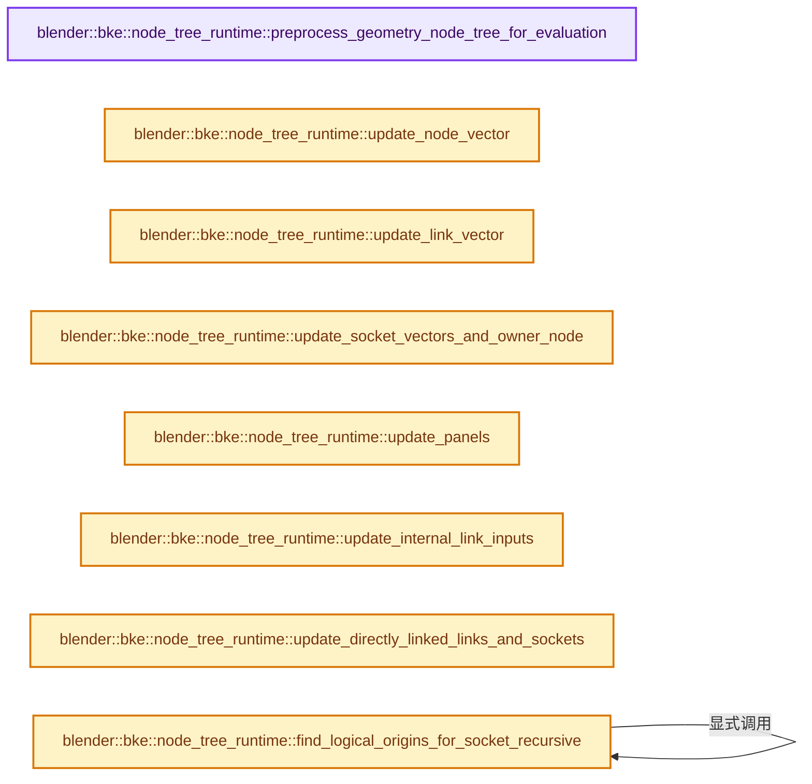
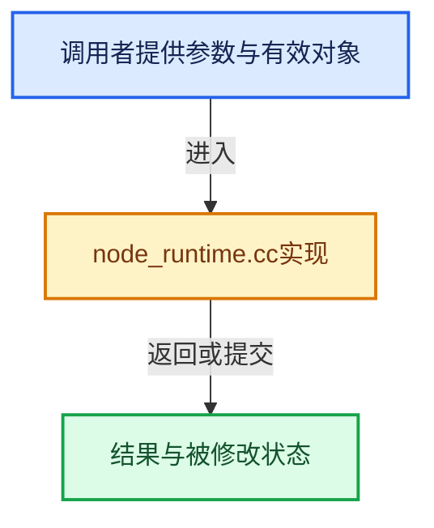

# 实现依赖专题：source/blender/blenkernel/intern/node_runtime.cc

[实现依赖导航](../../README.md) · [符号索引](../../../00-课程指南/02-源码与提交索引/符号依赖与实现索引.md)

本专题从正文实际调用进入，集中保存共享实现。函数有稳定锚点，可从调用处直接跳到对应完整函数；递归与互相调用通过回链组织。

## 本文件的实现关系






## 完整成员与函数实现

<a id="f-44a8df94d86fdf90"></a>

### `blender::bke::node_tree_runtime::preprocess_geometry_node_tree_for_evaluation`

实现位置：[source/blender/blenkernel/intern/node_runtime.cc](../../../../../../../source/blender/blenkernel/intern/node_runtime.cc) · L27—L33。

接口参数：

- `bNodeTree &tree_cow`

**教学注释版**

<!-- annotated:bedc66c04aff2c -->

```cpp
void preprocess_geometry_node_tree_for_evaluation(bNodeTree &tree_cow)
{
  BLI_assert(tree_cow.type == NTREE_GEOMETRY);
  /* Rebuild geometry nodes lazy function graph. */
  tree_cow.runtime->geometry_nodes_lazy_function_graph_info_mutex.tag_dirty();
  nodes::ensure_geometry_nodes_lazy_function_graph(tree_cow);
}
```

<details>
<summary>核对原始源码：source/blender/blenkernel/intern/node_runtime.cc · L27—L33</summary>

<!-- original:bedc66c04aff2c:source/blender/blenkernel/intern/node_runtime.cc:27:33 -->

```cpp
void preprocess_geometry_node_tree_for_evaluation(bNodeTree &tree_cow)
{
  BLI_assert(tree_cow.type == NTREE_GEOMETRY);
  /* Rebuild geometry nodes lazy function graph. */
  tree_cow.runtime->geometry_nodes_lazy_function_graph_info_mutex.tag_dirty();
  nodes::ensure_geometry_nodes_lazy_function_graph(tree_cow);
}
```

</details>

**继续追踪实现**

- `BLI_assert` → [BLI_assert · L48](../../01-BLI基础库/BLI_assert.hh.md#m-57a88495704d)；[BLI_assert · L63](../../01-BLI基础库/BLI_assert.hh.md#m-d07050020cb5)。宏定义由构建条件选择。
- `tree_cow.runtime->geometry_nodes_lazy_function_graph_info_mutex.tag_dirty` → [调用协议](../../../00-课程指南/01-路线与规范/模板宏与动态分派协议.md)：接收对象类型依赖auto、返回值或模板实例；不按同名猜测目标。调用位置L31。
- `nodes::ensure_geometry_nodes_lazy_function_graph` → [blender::nodes::ensure_geometry_nodes_lazy_function_graph · L4334](../../../09-LazyFunction与节点执行架构/12-嵌套图副作用日志与测试.md#f-52501f045c159f79)。

<a id="f-3cc95b54efa0f142"></a>

### `blender::bke::node_tree_runtime::update_node_vector`

实现位置：[source/blender/blenkernel/intern/node_runtime.cc](../../../../../../../source/blender/blenkernel/intern/node_runtime.cc) · L35—L50。

接口参数：

- `const bNodeTree &ntree`

**教学注释版**

<!-- annotated:63b2acaf2bc3bb -->

```cpp
static void update_node_vector(const bNodeTree &ntree)
{
  bNodeTreeRuntime &tree_runtime = *ntree.runtime;
  const Span<bNode *> nodes = tree_runtime.nodes_by_id;
  tree_runtime.group_nodes.clear();
  tree_runtime.has_undefined_nodes_or_sockets = false;
  // [讲解] nodes.index_range：查询视图长度或生成对应有效索引区间。
  for (const int i : nodes.index_range()) {
    bNode &node = *nodes[i];
    node.runtime->index_in_tree = i;
    node.runtime->owner_tree = const_cast<bNodeTree *>(&ntree);
    tree_runtime.has_undefined_nodes_or_sockets |= node.is_undefined();
    if (node.is_group()) {
      tree_runtime.group_nodes.append(&node);
    }
  }
}
```

<details>
<summary>核对原始源码：source/blender/blenkernel/intern/node_runtime.cc · L35—L50</summary>

<!-- original:63b2acaf2bc3bb:source/blender/blenkernel/intern/node_runtime.cc:35:50 -->

```cpp
static void update_node_vector(const bNodeTree &ntree)
{
  bNodeTreeRuntime &tree_runtime = *ntree.runtime;
  const Span<bNode *> nodes = tree_runtime.nodes_by_id;
  tree_runtime.group_nodes.clear();
  tree_runtime.has_undefined_nodes_or_sockets = false;
  for (const int i : nodes.index_range()) {
    bNode &node = *nodes[i];
    node.runtime->index_in_tree = i;
    node.runtime->owner_tree = const_cast<bNodeTree *>(&ntree);
    tree_runtime.has_undefined_nodes_or_sockets |= node.is_undefined();
    if (node.is_group()) {
      tree_runtime.group_nodes.append(&node);
    }
  }
}
```

</details>

**沿实际写入检查状态**

- `tree_runtime.has_undefined_nodes_or_sockets = false;`
- `node.runtime->index_in_tree = i;`
- `node.runtime->owner_tree = const_cast<bNodeTree *>(&ntree);`
- `tree_runtime.has_undefined_nodes_or_sockets |= node.is_undefined();`

**继续追踪实现**

- `tree_runtime.group_nodes.clear` → [调用协议](../../../00-课程指南/01-路线与规范/模板宏与动态分派协议.md)：接收对象类型依赖auto、返回值或模板实例；不按同名猜测目标。调用位置L39。
- `nodes.index_range` → [blender::Span::index_range · L405](../../../01-基础容器与现代CPP/05-Span只读连续视图.md#f-caaa9b06e13e53e0)。
- `node.is_undefined` → [blender::bNode::is_undefined · L926](../BKE_node_runtime.hh.md#f-48ba40c353bcf4a3)。
- `node.is_group` → [blender::bNode::is_group · L906](../BKE_node_runtime.hh.md#f-0685281392963ec9)。
- `tree_runtime.group_nodes.append` → [调用协议](../../../00-课程指南/01-路线与规范/模板宏与动态分派协议.md)：接收对象类型依赖auto、返回值或模板实例；不按同名猜测目标。调用位置L47。

<a id="f-1c83e80536d8a123"></a>

### `blender::bke::node_tree_runtime::update_link_vector`

实现位置：[source/blender/blenkernel/intern/node_runtime.cc](../../../../../../../source/blender/blenkernel/intern/node_runtime.cc) · L52—L63。

接口参数：

- `const bNodeTree &ntree`

**教学注释版**

<!-- annotated:5ce181f480c756 -->

```cpp
static void update_link_vector(const bNodeTree &ntree)
{
  bNodeTreeRuntime &tree_runtime = *ntree.runtime;
  tree_runtime.links.clear();
  for (bNodeLink &link : ntree.links) {
    /* Check that the link connects nodes within this tree. */
    BLI_assert(tree_runtime.nodes_by_id.contains(link.fromnode));
    BLI_assert(tree_runtime.nodes_by_id.contains(link.tonode));

    tree_runtime.links.append(&link);
  }
}
```

<details>
<summary>核对原始源码：source/blender/blenkernel/intern/node_runtime.cc · L52—L63</summary>

<!-- original:5ce181f480c756:source/blender/blenkernel/intern/node_runtime.cc:52:63 -->

```cpp
static void update_link_vector(const bNodeTree &ntree)
{
  bNodeTreeRuntime &tree_runtime = *ntree.runtime;
  tree_runtime.links.clear();
  for (bNodeLink &link : ntree.links) {
    /* Check that the link connects nodes within this tree. */
    BLI_assert(tree_runtime.nodes_by_id.contains(link.fromnode));
    BLI_assert(tree_runtime.nodes_by_id.contains(link.tonode));

    tree_runtime.links.append(&link);
  }
}
```

</details>

**继续追踪实现**

- `tree_runtime.links.clear` → [调用协议](../../../00-课程指南/01-路线与规范/模板宏与动态分派协议.md)：接收对象类型依赖auto、返回值或模板实例；不按同名猜测目标。调用位置L55。
- `BLI_assert` → [BLI_assert · L48](../../01-BLI基础库/BLI_assert.hh.md#m-57a88495704d)；[BLI_assert · L63](../../01-BLI基础库/BLI_assert.hh.md#m-d07050020cb5)。宏定义由构建条件选择。
- `tree_runtime.nodes_by_id.contains` → [调用协议](../../../00-课程指南/01-路线与规范/模板宏与动态分派协议.md)：接收对象类型依赖auto、返回值或模板实例；不按同名猜测目标。调用位置L58。
- `tree_runtime.links.append` → [调用协议](../../../00-课程指南/01-路线与规范/模板宏与动态分派协议.md)：接收对象类型依赖auto、返回值或模板实例；不按同名猜测目标。调用位置L61。

<a id="f-7feee017d2abbb9f"></a>

### `blender::bke::node_tree_runtime::update_socket_vectors_and_owner_node`

实现位置：[source/blender/blenkernel/intern/node_runtime.cc](../../../../../../../source/blender/blenkernel/intern/node_runtime.cc) · L65—L94。

接口参数：

- `const bNodeTree &ntree`

**教学注释版**

<!-- annotated:bbd3c2e9248cd9 -->

```cpp
static void update_socket_vectors_and_owner_node(const bNodeTree &ntree)
{
  bNodeTreeRuntime &tree_runtime = *ntree.runtime;
  tree_runtime.sockets.clear();
  tree_runtime.input_sockets.clear();
  tree_runtime.output_sockets.clear();
  for (bNode *node : tree_runtime.nodes_by_id) {
    bNodeRuntime &node_runtime = *node->runtime;
    node_runtime.inputs.clear();
    node_runtime.outputs.clear();
    for (bNodeSocket &socket : node->inputs) {
      socket.runtime->index_in_node = node_runtime.inputs.append_and_get_index(&socket);
      socket.runtime->index_in_all_sockets = tree_runtime.sockets.append_and_get_index(&socket);
      socket.runtime->index_in_inout_sockets = tree_runtime.input_sockets.append_and_get_index(
          &socket);
      socket.runtime->owner_node = node;
      tree_runtime.has_undefined_nodes_or_sockets |= socket.typeinfo ==
                                                     &bke::NodeSocketTypeUndefined;
    }
    for (bNodeSocket &socket : node->outputs) {
      socket.runtime->index_in_node = node_runtime.outputs.append_and_get_index(&socket);
      socket.runtime->index_in_all_sockets = tree_runtime.sockets.append_and_get_index(&socket);
      socket.runtime->index_in_inout_sockets = tree_runtime.output_sockets.append_and_get_index(
          &socket);
      socket.runtime->owner_node = node;
      tree_runtime.has_undefined_nodes_or_sockets |= socket.typeinfo ==
                                                     &bke::NodeSocketTypeUndefined;
    }
  }
}
```

<details>
<summary>核对原始源码：source/blender/blenkernel/intern/node_runtime.cc · L65—L94</summary>

<!-- original:bbd3c2e9248cd9:source/blender/blenkernel/intern/node_runtime.cc:65:94 -->

```cpp
static void update_socket_vectors_and_owner_node(const bNodeTree &ntree)
{
  bNodeTreeRuntime &tree_runtime = *ntree.runtime;
  tree_runtime.sockets.clear();
  tree_runtime.input_sockets.clear();
  tree_runtime.output_sockets.clear();
  for (bNode *node : tree_runtime.nodes_by_id) {
    bNodeRuntime &node_runtime = *node->runtime;
    node_runtime.inputs.clear();
    node_runtime.outputs.clear();
    for (bNodeSocket &socket : node->inputs) {
      socket.runtime->index_in_node = node_runtime.inputs.append_and_get_index(&socket);
      socket.runtime->index_in_all_sockets = tree_runtime.sockets.append_and_get_index(&socket);
      socket.runtime->index_in_inout_sockets = tree_runtime.input_sockets.append_and_get_index(
          &socket);
      socket.runtime->owner_node = node;
      tree_runtime.has_undefined_nodes_or_sockets |= socket.typeinfo ==
                                                     &bke::NodeSocketTypeUndefined;
    }
    for (bNodeSocket &socket : node->outputs) {
      socket.runtime->index_in_node = node_runtime.outputs.append_and_get_index(&socket);
      socket.runtime->index_in_all_sockets = tree_runtime.sockets.append_and_get_index(&socket);
      socket.runtime->index_in_inout_sockets = tree_runtime.output_sockets.append_and_get_index(
          &socket);
      socket.runtime->owner_node = node;
      tree_runtime.has_undefined_nodes_or_sockets |= socket.typeinfo ==
                                                     &bke::NodeSocketTypeUndefined;
    }
  }
}
```

</details>

**沿实际写入检查状态**

- `socket.runtime->index_in_node = node_runtime.inputs.append_and_get_index(&socket);`
- `socket.runtime->index_in_all_sockets = tree_runtime.sockets.append_and_get_index(&socket);`
- `socket.runtime->index_in_inout_sockets = tree_runtime.input_sockets.append_and_get_index(`
- `socket.runtime->owner_node = node;`
- `tree_runtime.has_undefined_nodes_or_sockets |= socket.typeinfo ==`
- `socket.runtime->index_in_node = node_runtime.outputs.append_and_get_index(&socket);`
- `socket.runtime->index_in_inout_sockets = tree_runtime.output_sockets.append_and_get_index(`

**继续追踪实现**

- `tree_runtime.sockets.clear` → [调用协议](../../../00-课程指南/01-路线与规范/模板宏与动态分派协议.md)：接收对象类型依赖auto、返回值或模板实例；不按同名猜测目标。调用位置L68。
- `tree_runtime.input_sockets.clear` → [调用协议](../../../00-课程指南/01-路线与规范/模板宏与动态分派协议.md)：接收对象类型依赖auto、返回值或模板实例；不按同名猜测目标。调用位置L69。
- `tree_runtime.output_sockets.clear` → [调用协议](../../../00-课程指南/01-路线与规范/模板宏与动态分派协议.md)：接收对象类型依赖auto、返回值或模板实例；不按同名猜测目标。调用位置L70。
- `node_runtime.inputs.clear` → [调用协议](../../../00-课程指南/01-路线与规范/模板宏与动态分派协议.md)：接收对象类型依赖auto、返回值或模板实例；不按同名猜测目标。调用位置L73。
- `node_runtime.outputs.clear` → [调用协议](../../../00-课程指南/01-路线与规范/模板宏与动态分派协议.md)：接收对象类型依赖auto、返回值或模板实例；不按同名猜测目标。调用位置L74。
- `node_runtime.inputs.append_and_get_index` → [调用协议](../../../00-课程指南/01-路线与规范/模板宏与动态分派协议.md)：接收对象类型依赖auto、返回值或模板实例；不按同名猜测目标。调用位置L76。
- `tree_runtime.sockets.append_and_get_index` → [调用协议](../../../00-课程指南/01-路线与规范/模板宏与动态分派协议.md)：接收对象类型依赖auto、返回值或模板实例；不按同名猜测目标。调用位置L77。
- `tree_runtime.input_sockets.append_and_get_index` → [调用协议](../../../00-课程指南/01-路线与规范/模板宏与动态分派协议.md)：接收对象类型依赖auto、返回值或模板实例；不按同名猜测目标。调用位置L78。
- `node_runtime.outputs.append_and_get_index` → [调用协议](../../../00-课程指南/01-路线与规范/模板宏与动态分派协议.md)：接收对象类型依赖auto、返回值或模板实例；不按同名猜测目标。调用位置L85。
- `tree_runtime.output_sockets.append_and_get_index` → [调用协议](../../../00-课程指南/01-路线与规范/模板宏与动态分派协议.md)：接收对象类型依赖auto、返回值或模板实例；不按同名猜测目标。调用位置L87。

<a id="f-578d91a002777611"></a>

### `blender::bke::node_tree_runtime::update_panels`

实现位置：[source/blender/blenkernel/intern/node_runtime.cc](../../../../../../../source/blender/blenkernel/intern/node_runtime.cc) · L96—L103。

接口参数：

- `const bNodeTree &ntree`

**教学注释版**

<!-- annotated:4eb7814e649e0d -->

```cpp
static void update_panels(const bNodeTree &ntree)
{
  bNodeTreeRuntime &tree_runtime = *ntree.runtime;
  for (bNode *node : tree_runtime.nodes_by_id) {
    bNodeRuntime &node_runtime = *node->runtime;
    node_runtime.panels.reinitialize(node->num_panel_states);
  }
}
```

<details>
<summary>核对原始源码：source/blender/blenkernel/intern/node_runtime.cc · L96—L103</summary>

<!-- original:4eb7814e649e0d:source/blender/blenkernel/intern/node_runtime.cc:96:103 -->

```cpp
static void update_panels(const bNodeTree &ntree)
{
  bNodeTreeRuntime &tree_runtime = *ntree.runtime;
  for (bNode *node : tree_runtime.nodes_by_id) {
    bNodeRuntime &node_runtime = *node->runtime;
    node_runtime.panels.reinitialize(node->num_panel_states);
  }
}
```

</details>

**继续追踪实现**

- `node_runtime.panels.reinitialize` → [调用协议](../../../00-课程指南/01-路线与规范/模板宏与动态分派协议.md)：接收对象类型依赖auto、返回值或模板实例；不按同名猜测目标。调用位置L101。

<a id="f-dbbcca7dadb26a9f"></a>

### `blender::bke::node_tree_runtime::update_internal_link_inputs`

实现位置：[source/blender/blenkernel/intern/node_runtime.cc](../../../../../../../source/blender/blenkernel/intern/node_runtime.cc) · L105—L116。

接口参数：

- `const bNodeTree &ntree`

**教学注释版**

<!-- annotated:f59058aaf22189 -->

```cpp
static void update_internal_link_inputs(const bNodeTree &ntree)
{
  bNodeTreeRuntime &tree_runtime = *ntree.runtime;
  for (bNode *node : tree_runtime.nodes_by_id) {
    for (bNodeSocket *socket : node->runtime->outputs) {
      socket->runtime->internal_link_input = nullptr;
    }
    for (bNodeInternalLink &link : node->runtime->internal_links) {
      link.out->runtime->internal_link_input = link.in;
    }
  }
}
```

<details>
<summary>核对原始源码：source/blender/blenkernel/intern/node_runtime.cc · L105—L116</summary>

<!-- original:f59058aaf22189:source/blender/blenkernel/intern/node_runtime.cc:105:116 -->

```cpp
static void update_internal_link_inputs(const bNodeTree &ntree)
{
  bNodeTreeRuntime &tree_runtime = *ntree.runtime;
  for (bNode *node : tree_runtime.nodes_by_id) {
    for (bNodeSocket *socket : node->runtime->outputs) {
      socket->runtime->internal_link_input = nullptr;
    }
    for (bNodeInternalLink &link : node->runtime->internal_links) {
      link.out->runtime->internal_link_input = link.in;
    }
  }
}
```

</details>

**沿实际写入检查状态**

- `socket->runtime->internal_link_input = nullptr;`
- `link.out->runtime->internal_link_input = link.in;`

**继续追踪实现**

本实现没有需要继续展开的显式调用；检查返回表达式、对象转换和调用者前置条件。

<a id="f-36f6002d35086170"></a>

### `blender::bke::node_tree_runtime::update_directly_linked_links_and_sockets`

实现位置：[source/blender/blenkernel/intern/node_runtime.cc](../../../../../../../source/blender/blenkernel/intern/node_runtime.cc) · L118—L158。

接口参数：

- `const bNodeTree &ntree`

**教学注释版**

<!-- annotated:1e6bcc88672bee -->

```cpp
static void update_directly_linked_links_and_sockets(const bNodeTree &ntree)
{
  bNodeTreeRuntime &tree_runtime = *ntree.runtime;
  for (bNode *node : tree_runtime.nodes_by_id) {
    for (bNodeSocket *socket : node->runtime->inputs) {
      socket->runtime->directly_linked_links.clear();
      socket->runtime->directly_linked_sockets.clear();
    }
    for (bNodeSocket *socket : node->runtime->outputs) {
      socket->runtime->directly_linked_links.clear();
      socket->runtime->directly_linked_sockets.clear();
    }
    node->runtime->has_available_linked_inputs = false;
    node->runtime->has_available_linked_outputs = false;
  }
  for (bNodeLink *link : tree_runtime.links) {
    link->fromsock->runtime->directly_linked_links.append(link);
    link->fromsock->runtime->directly_linked_sockets.append(link->tosock);
    link->tosock->runtime->directly_linked_links.append(link);
    if (link->is_available()) {
      link->fromnode->runtime->has_available_linked_outputs = true;
      link->tonode->runtime->has_available_linked_inputs = true;
    }
    BLI_assert(link->fromsock->runtime->owner_node == link->fromnode);
    BLI_assert(link->tosock->runtime->owner_node == link->tonode);
  }
  for (bNodeSocket *socket : tree_runtime.input_sockets) {
    if (socket->flag & SOCK_MULTI_INPUT) {
      std::ranges::sort(socket->runtime->directly_linked_links,
                        [&](const bNodeLink *a, const bNodeLink *b) {
                          return a->multi_input_sort_id > b->multi_input_sort_id;
                        });
    }
  }
  for (bNodeSocket *socket : tree_runtime.input_sockets) {
    for (bNodeLink *link : socket->runtime->directly_linked_links) {
      /* Do this after sorting the input links. */
      socket->runtime->directly_linked_sockets.append(link->fromsock);
    }
  }
}
```

<details>
<summary>核对原始源码：source/blender/blenkernel/intern/node_runtime.cc · L118—L158</summary>

<!-- original:1e6bcc88672bee:source/blender/blenkernel/intern/node_runtime.cc:118:158 -->

```cpp
static void update_directly_linked_links_and_sockets(const bNodeTree &ntree)
{
  bNodeTreeRuntime &tree_runtime = *ntree.runtime;
  for (bNode *node : tree_runtime.nodes_by_id) {
    for (bNodeSocket *socket : node->runtime->inputs) {
      socket->runtime->directly_linked_links.clear();
      socket->runtime->directly_linked_sockets.clear();
    }
    for (bNodeSocket *socket : node->runtime->outputs) {
      socket->runtime->directly_linked_links.clear();
      socket->runtime->directly_linked_sockets.clear();
    }
    node->runtime->has_available_linked_inputs = false;
    node->runtime->has_available_linked_outputs = false;
  }
  for (bNodeLink *link : tree_runtime.links) {
    link->fromsock->runtime->directly_linked_links.append(link);
    link->fromsock->runtime->directly_linked_sockets.append(link->tosock);
    link->tosock->runtime->directly_linked_links.append(link);
    if (link->is_available()) {
      link->fromnode->runtime->has_available_linked_outputs = true;
      link->tonode->runtime->has_available_linked_inputs = true;
    }
    BLI_assert(link->fromsock->runtime->owner_node == link->fromnode);
    BLI_assert(link->tosock->runtime->owner_node == link->tonode);
  }
  for (bNodeSocket *socket : tree_runtime.input_sockets) {
    if (socket->flag & SOCK_MULTI_INPUT) {
      std::ranges::sort(socket->runtime->directly_linked_links,
                        [&](const bNodeLink *a, const bNodeLink *b) {
                          return a->multi_input_sort_id > b->multi_input_sort_id;
                        });
    }
  }
  for (bNodeSocket *socket : tree_runtime.input_sockets) {
    for (bNodeLink *link : socket->runtime->directly_linked_links) {
      /* Do this after sorting the input links. */
      socket->runtime->directly_linked_sockets.append(link->fromsock);
    }
  }
}
```

</details>

**沿实际写入检查状态**

- `node->runtime->has_available_linked_inputs = false;`
- `node->runtime->has_available_linked_outputs = false;`
- `link->fromnode->runtime->has_available_linked_outputs = true;`
- `link->tonode->runtime->has_available_linked_inputs = true;`

**结果出口**

- `return a->multi_input_sort_id > b->multi_input_sort_id;`

**继续追踪实现**

- `socket->runtime->directly_linked_links.clear` → [调用协议](../../../00-课程指南/01-路线与规范/模板宏与动态分派协议.md)：接收对象类型依赖auto、返回值或模板实例；不按同名猜测目标。调用位置L123。
- `socket->runtime->directly_linked_sockets.clear` → [调用协议](../../../00-课程指南/01-路线与规范/模板宏与动态分派协议.md)：接收对象类型依赖auto、返回值或模板实例；不按同名猜测目标。调用位置L124。
- `link->fromsock->runtime->directly_linked_links.append` → [调用协议](../../../00-课程指南/01-路线与规范/模板宏与动态分派协议.md)：接收对象类型依赖auto、返回值或模板实例；不按同名猜测目标。调用位置L134。
- `link->fromsock->runtime->directly_linked_sockets.append` → [调用协议](../../../00-课程指南/01-路线与规范/模板宏与动态分派协议.md)：接收对象类型依赖auto、返回值或模板实例；不按同名猜测目标。调用位置L135。
- `link->tosock->runtime->directly_linked_links.append` → [调用协议](../../../00-课程指南/01-路线与规范/模板宏与动态分派协议.md)：接收对象类型依赖auto、返回值或模板实例；不按同名猜测目标。调用位置L136。
- `link->is_available` → [调用协议](../../../00-课程指南/01-路线与规范/模板宏与动态分派协议.md)：接收对象类型依赖auto、返回值或模板实例；不按同名猜测目标。调用位置L137。
- `BLI_assert` → [BLI_assert · L48](../../01-BLI基础库/BLI_assert.hh.md#m-57a88495704d)；[BLI_assert · L63](../../01-BLI基础库/BLI_assert.hh.md#m-d07050020cb5)。宏定义由构建条件选择。
- `std::ranges::sort` → [外部契约](https://eel.is/c++draft/)：这个边界按实际表达式及所属类型核对参数、返回值、寿命与失败行为。这里提供接口入口，不声称已解释该第三方版本的内部实现。
- `socket->runtime->directly_linked_sockets.append` → [调用协议](../../../00-课程指南/01-路线与规范/模板宏与动态分派协议.md)：接收对象类型依赖auto、返回值或模板实例；不按同名猜测目标。调用位置L155。

<a id="f-0e5e0c8b7a75dd42"></a>

### `blender::bke::node_tree_runtime::find_logical_origins_for_socket_recursive`

实现位置：[source/blender/blenkernel/intern/node_runtime.cc](../../../../../../../source/blender/blenkernel/intern/node_runtime.cc) · L160—L212。

接口参数：

- `bNodeSocket &input_socket`
- `bool only_follow_first_input_link`
- `Vector<bNodeSocket *, 16> &sockets_in_current_chain`
- `Vector<bNodeSocket *> &r_logical_origins`
- `Vector<bNodeSocket *> &r_skipped_origins`

**教学注释版**

<!-- annotated:bbdbd282aee8e0 -->

```cpp
static void find_logical_origins_for_socket_recursive(
    bNodeSocket &input_socket,
    bool only_follow_first_input_link,
    Vector<bNodeSocket *, 16> &sockets_in_current_chain,
    Vector<bNodeSocket *> &r_logical_origins,
    Vector<bNodeSocket *> &r_skipped_origins)
{
  // [讲解] sockets_in_current_chain.contains：在有效元素中按相等关系查找。
  if (sockets_in_current_chain.contains(&input_socket)) {
    /* Protect against reroute recursions. */
    return;
  }
  // [讲解] sockets_in_current_chain.append：在尾部建立新元素，必要时先扩大存储。
  sockets_in_current_chain.append(&input_socket);

  Span<bNodeLink *> links_to_check = input_socket.runtime->directly_linked_links;
  if (only_follow_first_input_link) {
    // [讲解] links_to_check.take_front：从两端裁去或选取一定数量元素形成新视图。
    links_to_check = links_to_check.take_front(1);
  }
  for (bNodeLink *link : links_to_check) {
    if (link->is_muted()) {
      continue;
    }
    if (!link->is_available()) {
      continue;
    }
    bNodeSocket &origin_socket = *link->fromsock;
    bNode &origin_node = *link->fromnode;
    if (!origin_socket.is_available()) {
      /* Non available sockets are ignored. */
      continue;
    }
    if (origin_node.is_reroute()) {
      bNodeSocket &reroute_input = *origin_node.runtime->inputs[0];
      bNodeSocket &reroute_output = *origin_node.runtime->outputs[0];
      r_skipped_origins.append(&reroute_input);
      r_skipped_origins.append(&reroute_output);
      find_logical_origins_for_socket_recursive(
          reroute_input, false, sockets_in_current_chain, r_logical_origins, r_skipped_origins);
      continue;
    }
    if (origin_node.is_muted()) {
      if (bNodeSocket *mute_input = origin_socket.runtime->internal_link_input) {
        r_skipped_origins.append(&origin_socket);
        r_skipped_origins.append(mute_input);
        find_logical_origins_for_socket_recursive(
            *mute_input, true, sockets_in_current_chain, r_logical_origins, r_skipped_origins);
      }
      continue;
    }
    r_logical_origins.append(&origin_socket);
  }

  // [讲解] sockets_in_current_chain.pop_last：取走最后一个值并移除末元素。
  sockets_in_current_chain.pop_last();
}
```

<details>
<summary>核对原始源码：source/blender/blenkernel/intern/node_runtime.cc · L160—L212</summary>

<!-- original:bbdbd282aee8e0:source/blender/blenkernel/intern/node_runtime.cc:160:212 -->

```cpp
static void find_logical_origins_for_socket_recursive(
    bNodeSocket &input_socket,
    bool only_follow_first_input_link,
    Vector<bNodeSocket *, 16> &sockets_in_current_chain,
    Vector<bNodeSocket *> &r_logical_origins,
    Vector<bNodeSocket *> &r_skipped_origins)
{
  if (sockets_in_current_chain.contains(&input_socket)) {
    /* Protect against reroute recursions. */
    return;
  }
  sockets_in_current_chain.append(&input_socket);

  Span<bNodeLink *> links_to_check = input_socket.runtime->directly_linked_links;
  if (only_follow_first_input_link) {
    links_to_check = links_to_check.take_front(1);
  }
  for (bNodeLink *link : links_to_check) {
    if (link->is_muted()) {
      continue;
    }
    if (!link->is_available()) {
      continue;
    }
    bNodeSocket &origin_socket = *link->fromsock;
    bNode &origin_node = *link->fromnode;
    if (!origin_socket.is_available()) {
      /* Non available sockets are ignored. */
      continue;
    }
    if (origin_node.is_reroute()) {
      bNodeSocket &reroute_input = *origin_node.runtime->inputs[0];
      bNodeSocket &reroute_output = *origin_node.runtime->outputs[0];
      r_skipped_origins.append(&reroute_input);
      r_skipped_origins.append(&reroute_output);
      find_logical_origins_for_socket_recursive(
          reroute_input, false, sockets_in_current_chain, r_logical_origins, r_skipped_origins);
      continue;
    }
    if (origin_node.is_muted()) {
      if (bNodeSocket *mute_input = origin_socket.runtime->internal_link_input) {
        r_skipped_origins.append(&origin_socket);
        r_skipped_origins.append(mute_input);
        find_logical_origins_for_socket_recursive(
            *mute_input, true, sockets_in_current_chain, r_logical_origins, r_skipped_origins);
      }
      continue;
    }
    r_logical_origins.append(&origin_socket);
  }

  sockets_in_current_chain.pop_last();
}
```

</details>

**沿实际写入检查状态**

- `links_to_check = links_to_check.take_front(1);`

**继续追踪实现**

- `sockets_in_current_chain.contains` → [blender::Vector::contains · L938](../../../01-基础容器与现代CPP/12-Vector异常安全与边界.md#f-11ad8adb697ee04a)。
- `sockets_in_current_chain.append` → [blender::Vector::append · L498](../../../01-基础容器与现代CPP/11-Vector插入删除与重排.md#f-5bde268a69e443ec)；[blender::Vector::append · L502](../../../01-基础容器与现代CPP/11-Vector插入删除与重排.md#f-591e0b15e6308532)。同名重载需按实参类型选择。
- `links_to_check.take_front` → [blender::Span::take_front · L197](../../../01-基础容器与现代CPP/05-Span只读连续视图.md#f-1556b8b4aac9d42f)。
- `link->is_muted` → [调用协议](../../../00-课程指南/01-路线与规范/模板宏与动态分派协议.md)：接收对象类型依赖auto、返回值或模板实例；不按同名猜测目标。调用位置L178。
- `link->is_available` → [调用协议](../../../00-课程指南/01-路线与规范/模板宏与动态分派协议.md)：接收对象类型依赖auto、返回值或模板实例；不按同名猜测目标。调用位置L181。
- `origin_socket.is_available` → [blender::bNodeSocket::is_available · L1041](../BKE_node_runtime.hh.md#f-24ff02531a14ce08)。
- `origin_node.is_reroute` → [blender::bNode::is_reroute · L896](../BKE_node_runtime.hh.md#f-d97a49597e48e8ea)。
- `r_skipped_origins.append` → [blender::Vector::append · L498](../../../01-基础容器与现代CPP/11-Vector插入删除与重排.md#f-5bde268a69e443ec)；[blender::Vector::append · L502](../../../01-基础容器与现代CPP/11-Vector插入删除与重排.md#f-591e0b15e6308532)。同名重载需按实参类型选择。
- `find_logical_origins_for_socket_recursive` → [blender::bke::node_tree_runtime::find_logical_origins_for_socket_recursive · L160](node_runtime.cc.md#f-0e5e0c8b7a75dd42)。
- `origin_node.is_muted` → [blender::bNode::is_muted · L886](../BKE_node_runtime.hh.md#f-4d91efc4cc87d00d)。
- `r_logical_origins.append` → [blender::Vector::append · L498](../../../01-基础容器与现代CPP/11-Vector插入删除与重排.md#f-5bde268a69e443ec)；[blender::Vector::append · L502](../../../01-基础容器与现代CPP/11-Vector插入删除与重排.md#f-591e0b15e6308532)。同名重载需按实参类型选择。
- `sockets_in_current_chain.pop_last` → [blender::Vector::pop_last · L815](../../../01-基础容器与现代CPP/11-Vector插入删除与重排.md#f-e001e773e04130ce)。

<a id="f-0b78acd8b4b1be1c"></a>

### `blender::bke::node_tree_runtime::update_logically_linked_sockets`

实现位置：[source/blender/blenkernel/intern/node_runtime.cc](../../../../../../../source/blender/blenkernel/intern/node_runtime.cc) · L214—L255。

接口参数：

- `const bNodeTree &ntree`

**教学注释版**

<!-- annotated:446c363081f8ea -->

```cpp
static void update_logically_linked_sockets(const bNodeTree &ntree)
{
  /* Compute logically linked sockets to inputs. */
  bNodeTreeRuntime &tree_runtime = *ntree.runtime;
  Span<bNode *> nodes = tree_runtime.nodes_by_id;
  // [讲解] nodes.index_range：查询视图长度或生成对应有效索引区间。
  threading::parallel_for(nodes.index_range(), 128, [&](const IndexRange range) {
    for (const int i : range) {
      bNode &node = *nodes[i];
      for (bNodeSocket *socket : node.runtime->inputs) {
        Vector<bNodeSocket *, 16> sockets_in_current_chain;
        socket->runtime->logically_linked_sockets.clear();
        socket->runtime->logically_linked_skipped_sockets.clear();
        find_logical_origins_for_socket_recursive(
            *socket,
            false,
            sockets_in_current_chain,
            socket->runtime->logically_linked_sockets,
            socket->runtime->logically_linked_skipped_sockets);
      }
    }
  });

  /* Clear logically linked sockets to outputs. */
  threading::parallel_for(nodes.index_range(), 128, [&](const IndexRange range) {
    for (const int i : range) {
      bNode &node = *nodes[i];
      for (bNodeSocket *socket : node.runtime->outputs) {
        socket->runtime->logically_linked_sockets.clear();
      }
    }
  });

  /* Compute logically linked sockets to outputs using the previously computed logically linked
   * sockets to inputs. */
  for (const bNode *node : nodes) {
    for (bNodeSocket *input_socket : node->runtime->inputs) {
      for (bNodeSocket *output_socket : input_socket->runtime->logically_linked_sockets) {
        output_socket->runtime->logically_linked_sockets.append(input_socket);
      }
    }
  }
}
```

<details>
<summary>核对原始源码：source/blender/blenkernel/intern/node_runtime.cc · L214—L255</summary>

<!-- original:446c363081f8ea:source/blender/blenkernel/intern/node_runtime.cc:214:255 -->

```cpp
static void update_logically_linked_sockets(const bNodeTree &ntree)
{
  /* Compute logically linked sockets to inputs. */
  bNodeTreeRuntime &tree_runtime = *ntree.runtime;
  Span<bNode *> nodes = tree_runtime.nodes_by_id;
  threading::parallel_for(nodes.index_range(), 128, [&](const IndexRange range) {
    for (const int i : range) {
      bNode &node = *nodes[i];
      for (bNodeSocket *socket : node.runtime->inputs) {
        Vector<bNodeSocket *, 16> sockets_in_current_chain;
        socket->runtime->logically_linked_sockets.clear();
        socket->runtime->logically_linked_skipped_sockets.clear();
        find_logical_origins_for_socket_recursive(
            *socket,
            false,
            sockets_in_current_chain,
            socket->runtime->logically_linked_sockets,
            socket->runtime->logically_linked_skipped_sockets);
      }
    }
  });

  /* Clear logically linked sockets to outputs. */
  threading::parallel_for(nodes.index_range(), 128, [&](const IndexRange range) {
    for (const int i : range) {
      bNode &node = *nodes[i];
      for (bNodeSocket *socket : node.runtime->outputs) {
        socket->runtime->logically_linked_sockets.clear();
      }
    }
  });

  /* Compute logically linked sockets to outputs using the previously computed logically linked
   * sockets to inputs. */
  for (const bNode *node : nodes) {
    for (bNodeSocket *input_socket : node->runtime->inputs) {
      for (bNodeSocket *output_socket : input_socket->runtime->logically_linked_sockets) {
        output_socket->runtime->logically_linked_sockets.append(input_socket);
      }
    }
  }
}
```

</details>

**继续追踪实现**

- `threading::parallel_for` → [blender::threading::parallel_for · L68](../../../11-Depsgraph与并行任务系统/07-任务池与TBB接入.md#f-838294754c24426c)。
- `nodes.index_range` → [blender::Span::index_range · L405](../../../01-基础容器与现代CPP/05-Span只读连续视图.md#f-caaa9b06e13e53e0)。
- `socket->runtime->logically_linked_sockets.clear` → [调用协议](../../../00-课程指南/01-路线与规范/模板宏与动态分派协议.md)：接收对象类型依赖auto、返回值或模板实例；不按同名猜测目标。调用位置L224。
- `socket->runtime->logically_linked_skipped_sockets.clear` → [调用协议](../../../00-课程指南/01-路线与规范/模板宏与动态分派协议.md)：接收对象类型依赖auto、返回值或模板实例；不按同名猜测目标。调用位置L225。
- `find_logical_origins_for_socket_recursive` → [blender::bke::node_tree_runtime::find_logical_origins_for_socket_recursive · L160](node_runtime.cc.md#f-0e5e0c8b7a75dd42)。
- `output_socket->runtime->logically_linked_sockets.append` → [调用协议](../../../00-课程指南/01-路线与规范/模板宏与动态分派协议.md)：接收对象类型依赖auto、返回值或模板实例；不按同名猜测目标。调用位置L251。

<a id="f-b9d631e2fcc8d241"></a>

### `blender::bke::node_tree_runtime::update_nodes_by_type`

实现位置：[source/blender/blenkernel/intern/node_runtime.cc](../../../../../../../source/blender/blenkernel/intern/node_runtime.cc) · L257—L264。

接口参数：

- `const bNodeTree &ntree`

**教学注释版**

<!-- annotated:21206e4a529acf -->

```cpp
static void update_nodes_by_type(const bNodeTree &ntree)
{
  bNodeTreeRuntime &tree_runtime = *ntree.runtime;
  tree_runtime.nodes_by_type.clear();
  for (bNode *node : tree_runtime.nodes_by_id) {
    tree_runtime.nodes_by_type.add(node->typeinfo, node);
  }
}
```

<details>
<summary>核对原始源码：source/blender/blenkernel/intern/node_runtime.cc · L257—L264</summary>

<!-- original:21206e4a529acf:source/blender/blenkernel/intern/node_runtime.cc:257:264 -->

```cpp
static void update_nodes_by_type(const bNodeTree &ntree)
{
  bNodeTreeRuntime &tree_runtime = *ntree.runtime;
  tree_runtime.nodes_by_type.clear();
  for (bNode *node : tree_runtime.nodes_by_id) {
    tree_runtime.nodes_by_type.add(node->typeinfo, node);
  }
}
```

</details>

**继续追踪实现**

- `tree_runtime.nodes_by_type.clear` → [调用协议](../../../00-课程指南/01-路线与规范/模板宏与动态分派协议.md)：接收对象类型依赖auto、返回值或模板实例；不按同名猜测目标。调用位置L260。
- `tree_runtime.nodes_by_type.add` → [调用协议](../../../00-课程指南/01-路线与规范/模板宏与动态分派协议.md)：接收对象类型依赖auto、返回值或模板实例；不按同名猜测目标。调用位置L262。

<a id="f-a09bffe0e5db4829"></a>

### `blender::bke::node_tree_runtime::update_sockets_by_identifier`

实现位置：[source/blender/blenkernel/intern/node_runtime.cc](../../../../../../../source/blender/blenkernel/intern/node_runtime.cc) · L266—L284。

接口参数：

- `const bNodeTree &ntree`

**教学注释版**

<!-- annotated:c2967b47969470 -->

```cpp
static void update_sockets_by_identifier(const bNodeTree &ntree)
{
  bNodeTreeRuntime &tree_runtime = *ntree.runtime;
  Span<bNode *> nodes = tree_runtime.nodes_by_id;
  // [讲解] nodes.index_range：查询视图长度或生成对应有效索引区间。
  threading::parallel_for(nodes.index_range(), 128, [&](const IndexRange range) {
    // [讲解] nodes.slice：建立原连续范围的子视图。
    for (bNode *node : nodes.slice(range)) {
      node->runtime->inputs_by_identifier.clear();
      node->runtime->outputs_by_identifier.clear();
      for (bNodeSocket *socket : node->runtime->inputs) {
        BLI_assert(socket->identifier == socket->identifier_ustr());
        node->runtime->inputs_by_identifier.add_new(socket->identifier_ustr(), socket);
      }
      for (bNodeSocket *socket : node->runtime->outputs) {
        BLI_assert(socket->identifier == socket->identifier_ustr());
        node->runtime->outputs_by_identifier.add_new(socket->identifier_ustr(), socket);
      }
    }
  });
}
```

<details>
<summary>核对原始源码：source/blender/blenkernel/intern/node_runtime.cc · L266—L284</summary>

<!-- original:c2967b47969470:source/blender/blenkernel/intern/node_runtime.cc:266:284 -->

```cpp
static void update_sockets_by_identifier(const bNodeTree &ntree)
{
  bNodeTreeRuntime &tree_runtime = *ntree.runtime;
  Span<bNode *> nodes = tree_runtime.nodes_by_id;
  threading::parallel_for(nodes.index_range(), 128, [&](const IndexRange range) {
    for (bNode *node : nodes.slice(range)) {
      node->runtime->inputs_by_identifier.clear();
      node->runtime->outputs_by_identifier.clear();
      for (bNodeSocket *socket : node->runtime->inputs) {
        BLI_assert(socket->identifier == socket->identifier_ustr());
        node->runtime->inputs_by_identifier.add_new(socket->identifier_ustr(), socket);
      }
      for (bNodeSocket *socket : node->runtime->outputs) {
        BLI_assert(socket->identifier == socket->identifier_ustr());
        node->runtime->outputs_by_identifier.add_new(socket->identifier_ustr(), socket);
      }
    }
  });
}
```

</details>

**继续追踪实现**

- `threading::parallel_for` → [blender::threading::parallel_for · L68](../../../11-Depsgraph与并行任务系统/07-任务池与TBB接入.md#f-838294754c24426c)。
- `nodes.index_range` → [blender::Span::index_range · L405](../../../01-基础容器与现代CPP/05-Span只读连续视图.md#f-caaa9b06e13e53e0)。
- `nodes.slice` → [blender::Span::slice · L141](../../../01-基础容器与现代CPP/05-Span只读连续视图.md#f-380a0e8fdcbd53cc)；[blender::Span::slice · L149](../../../01-基础容器与现代CPP/05-Span只读连续视图.md#f-9b9c15e78dd54eec)。同名重载需按实参类型选择。
- `node->runtime->inputs_by_identifier.clear` → [调用协议](../../../00-课程指南/01-路线与规范/模板宏与动态分派协议.md)：接收对象类型依赖auto、返回值或模板实例；不按同名猜测目标。调用位置L272。
- `node->runtime->outputs_by_identifier.clear` → [调用协议](../../../00-课程指南/01-路线与规范/模板宏与动态分派协议.md)：接收对象类型依赖auto、返回值或模板实例；不按同名猜测目标。调用位置L273。
- `BLI_assert` → [BLI_assert · L48](../../01-BLI基础库/BLI_assert.hh.md#m-57a88495704d)；[BLI_assert · L63](../../01-BLI基础库/BLI_assert.hh.md#m-d07050020cb5)。宏定义由构建条件选择。
- `socket->identifier_ustr` → [调用协议](../../../00-课程指南/01-路线与规范/模板宏与动态分派协议.md)：接收对象类型依赖auto、返回值或模板实例；不按同名猜测目标。调用位置L275。
- `node->runtime->inputs_by_identifier.add_new` → [调用协议](../../../00-课程指南/01-路线与规范/模板宏与动态分派协议.md)：接收对象类型依赖auto、返回值或模板实例；不按同名猜测目标。调用位置L276。
- `node->runtime->outputs_by_identifier.add_new` → [调用协议](../../../00-课程指南/01-路线与规范/模板宏与动态分派协议.md)：接收对象类型依赖auto、返回值或模板实例；不按同名猜测目标。调用位置L280。

<a id="f-269f3a66a8a17d8e"></a>

### `blender::bke::node_tree_runtime::get_implicit_origin_nodes`

实现位置：[source/blender/blenkernel/intern/node_runtime.cc](../../../../../../../source/blender/blenkernel/intern/node_runtime.cc) · L296—L312。

接口参数：

- `const bNodeTree &ntree`
- `bNode &node`

**教学注释版**

<!-- annotated:4b34b81a84bc80 -->

```cpp
static Vector<const bNode *> get_implicit_origin_nodes(const bNodeTree &ntree, bNode &node)
{
  Vector<const bNode *> origin_nodes;
  if (all_zone_output_node_types().contains(node.type_legacy)) {
    const bNodeZoneType &zone_type = *zone_type_by_node_type(node.type_legacy);
    /* Can't use #zone_type.get_corresponding_input because that expects the topology cache to be
     * build already, but we are still building it here. */
    for (const bNode *input_node :
         ntree.runtime->nodes_by_type.lookup(bke::node_type_find(zone_type.input_idname)))
    {
      if (zone_type.get_corresponding_output_id(*input_node) == node.identifier) {
        // [讲解] origin_nodes.append：在尾部建立新元素，必要时先扩大存储。
        origin_nodes.append(input_node);
      }
    }
  }
  return origin_nodes;
}
```

<details>
<summary>核对原始源码：source/blender/blenkernel/intern/node_runtime.cc · L296—L312</summary>

<!-- original:4b34b81a84bc80:source/blender/blenkernel/intern/node_runtime.cc:296:312 -->

```cpp
static Vector<const bNode *> get_implicit_origin_nodes(const bNodeTree &ntree, bNode &node)
{
  Vector<const bNode *> origin_nodes;
  if (all_zone_output_node_types().contains(node.type_legacy)) {
    const bNodeZoneType &zone_type = *zone_type_by_node_type(node.type_legacy);
    /* Can't use #zone_type.get_corresponding_input because that expects the topology cache to be
     * build already, but we are still building it here. */
    for (const bNode *input_node :
         ntree.runtime->nodes_by_type.lookup(bke::node_type_find(zone_type.input_idname)))
    {
      if (zone_type.get_corresponding_output_id(*input_node) == node.identifier) {
        origin_nodes.append(input_node);
      }
    }
  }
  return origin_nodes;
}
```

</details>

**结果出口**

- `return origin_nodes;`

**继续追踪实现**

- `all_zone_output_node_types().contains` → [调用协议](../../../00-课程指南/01-路线与规范/模板宏与动态分派协议.md)：接收对象类型依赖auto、返回值或模板实例；不按同名猜测目标。调用位置L299。
- `all_zone_output_node_types` → [blender::bke::all_zone_output_node_types · L563](node_tree_zones.cc.md#f-414886f235d25392)。
- `zone_type_by_node_type` → [blender::bke::zone_type_by_node_type · L575](node_tree_zones.cc.md#f-e15b3588965609cf)。
- `ntree.runtime->nodes_by_type.lookup` → [调用协议](../../../00-课程指南/01-路线与规范/模板宏与动态分派协议.md)：接收对象类型依赖auto、返回值或模板实例；不按同名猜测目标。调用位置L304。
- `bke::node_type_find` → [blender::bke::node_type_find · L2883](node.cc.md#f-43bb33d661e48fe2)。
- `zone_type.get_corresponding_output_id` → [bNodeZoneType::get_corresponding_output_id · L1321](../BKE_node.hh.md#f-83fa308b827169d3)。
- `origin_nodes.append` → [blender::Vector::append · L498](../../../01-基础容器与现代CPP/11-Vector插入删除与重排.md#f-5bde268a69e443ec)；[blender::Vector::append · L502](../../../01-基础容器与现代CPP/11-Vector插入删除与重排.md#f-591e0b15e6308532)。同名重载需按实参类型选择。

<a id="f-5f2668ded8cba1b8"></a>

### `blender::bke::node_tree_runtime::get_implicit_target_nodes`

实现位置：[source/blender/blenkernel/intern/node_runtime.cc](../../../../../../../source/blender/blenkernel/intern/node_runtime.cc) · L314—L324。

接口参数：

- `const bNodeTree &ntree`
- `bNode &node`

**教学注释版**

<!-- annotated:f470e964db172f -->

```cpp
static Vector<const bNode *> get_implicit_target_nodes(const bNodeTree &ntree, bNode &node)
{
  Vector<const bNode *> target_nodes;
  if (all_zone_input_node_types().contains(node.type_legacy)) {
    const bNodeZoneType &zone_type = *zone_type_by_node_type(node.type_legacy);
    if (const bNode *output_node = zone_type.get_corresponding_output(ntree, node)) {
      // [讲解] target_nodes.append：在尾部建立新元素，必要时先扩大存储。
      target_nodes.append(output_node);
    }
  }
  return target_nodes;
}
```

<details>
<summary>核对原始源码：source/blender/blenkernel/intern/node_runtime.cc · L314—L324</summary>

<!-- original:f470e964db172f:source/blender/blenkernel/intern/node_runtime.cc:314:324 -->

```cpp
static Vector<const bNode *> get_implicit_target_nodes(const bNodeTree &ntree, bNode &node)
{
  Vector<const bNode *> target_nodes;
  if (all_zone_input_node_types().contains(node.type_legacy)) {
    const bNodeZoneType &zone_type = *zone_type_by_node_type(node.type_legacy);
    if (const bNode *output_node = zone_type.get_corresponding_output(ntree, node)) {
      target_nodes.append(output_node);
    }
  }
  return target_nodes;
}
```

</details>

**结果出口**

- `return target_nodes;`

**继续追踪实现**

- `all_zone_input_node_types().contains` → [调用协议](../../../00-课程指南/01-路线与规范/模板宏与动态分派协议.md)：接收对象类型依赖auto、返回值或模板实例；不按同名猜测目标。调用位置L317。
- `all_zone_input_node_types` → [blender::bke::all_zone_input_node_types · L551](node_tree_zones.cc.md#f-71714be31c5b4385)。
- `zone_type_by_node_type` → [blender::bke::zone_type_by_node_type · L575](node_tree_zones.cc.md#f-e15b3588965609cf)。
- `zone_type.get_corresponding_output` → [blender::bke::bNodeZoneType::get_corresponding_output · L504](node_tree_zones.cc.md#f-b4cf6a6324d9b816)；[blender::bke::bNodeZoneType::get_corresponding_output · L516](node_tree_zones.cc.md#f-03562d1ac0958424)。同名重载需按实参类型选择。
- `target_nodes.append` → [blender::Vector::append · L498](../../../01-基础容器与现代CPP/11-Vector插入删除与重排.md#f-5bde268a69e443ec)；[blender::Vector::append · L502](../../../01-基础容器与现代CPP/11-Vector插入删除与重排.md#f-591e0b15e6308532)。同名重载需按实参类型选择。

<a id="f-ea247bbb4c0957cd"></a>

### `blender::bke::node_tree_runtime::toposort_from_start_node`

实现位置：[source/blender/blenkernel/intern/node_runtime.cc](../../../../../../../source/blender/blenkernel/intern/node_runtime.cc) · L326—L428。

接口参数：

- `const bNodeTree &ntree`
- `const ToposortDirection direction`
- `bNode &start_node`
- `MutableSpan<ToposortNodeState> node_states`
- `Vector<bNode *> &r_sorted_nodes`
- `bool &r_cycle_detected`

**教学注释版**

<!-- annotated:4cd662de243864 -->

```cpp
static void toposort_from_start_node(const bNodeTree &ntree,
                                     const ToposortDirection direction,
                                     bNode &start_node,
                                     MutableSpan<ToposortNodeState> node_states,
                                     Vector<bNode *> &r_sorted_nodes,
                                     bool &r_cycle_detected)
{
  struct Item {
    bNode *node;
    int socket_index = 0;
    int link_index = 0;
    int implicit_link_index = 0;
  };

  Stack<Item, 64> nodes_to_check;
  nodes_to_check.push({&start_node});
  node_states[start_node.index()].is_in_stack = true;
  while (!nodes_to_check.is_empty()) {
    Item &item = nodes_to_check.peek();
    bNode &node = *item.node;
    bool pushed_node = false;

    auto handle_linked_node = [&](bNode &linked_node) {
      ToposortNodeState &linked_node_state = node_states[linked_node.index()];
      if (linked_node_state.is_done) {
        /* The linked node has already been visited. */
        return true;
      }
      if (linked_node_state.is_in_stack) {
        r_cycle_detected = true;
      }
      else {
        nodes_to_check.push({&linked_node});
        linked_node_state.is_in_stack = true;
        pushed_node = true;
      }
      return false;
    };

    const Span<bNodeSocket *> sockets = (direction == ToposortDirection::LeftToRight) ?
                                            node.runtime->inputs :
                                            node.runtime->outputs;
    while (true) {
      // [讲解] sockets.size：查询视图长度或生成对应有效索引区间。
      if (item.socket_index == sockets.size()) {
        /* All sockets have already been visited. */
        break;
      }
      bNodeSocket &socket = *sockets[item.socket_index];
      const Span<bNodeLink *> linked_links = socket.runtime->directly_linked_links;
      if (item.link_index == linked_links.size()) {
        /* All links connected to this socket have already been visited. */
        item.socket_index++;
        item.link_index = 0;
        continue;
      }
      bNodeLink &link = *linked_links[item.link_index];
      if (!link.is_available()) {
        /* Ignore unavailable links. */
        item.link_index++;
        continue;
      }
      bNodeSocket &linked_socket = *socket.runtime->directly_linked_sockets[item.link_index];
      bNode &linked_node = *linked_socket.runtime->owner_node;
      if (handle_linked_node(linked_node)) {
        /* The linked node has already been visited. */
        item.link_index++;
        continue;
      }
      break;
    }

    if (!pushed_node) {
      /* Some nodes are internally linked without an explicit `bNodeLink`. The toposort should
       * still order them correctly and find cycles. */
      const Vector<const bNode *> implicitly_linked_nodes =
          (direction == ToposortDirection::LeftToRight) ? get_implicit_origin_nodes(ntree, node) :
                                                          get_implicit_target_nodes(ntree, node);
      while (true) {
        if (item.implicit_link_index == implicitly_linked_nodes.size()) {
          /* All implicitly linked nodes have already been visited. */
          break;
        }
        const bNode &linked_node = *implicitly_linked_nodes[item.implicit_link_index];
        if (handle_linked_node(const_cast<bNode &>(linked_node))) {
          /* The implicitly linked node has already been visited. */
          item.implicit_link_index++;
          continue;
        }
        break;
      }
    }

    /* If no other element has been pushed, the current node can be pushed to the sorted list.
     */
    if (!pushed_node) {
      ToposortNodeState &node_state = node_states[node.index()];
      node_state.is_done = true;
      node_state.is_in_stack = false;
      // [讲解] r_sorted_nodes.append：在尾部建立新元素，必要时先扩大存储。
      r_sorted_nodes.append(&node);
      nodes_to_check.pop();
    }
  }
}
```

<details>
<summary>核对原始源码：source/blender/blenkernel/intern/node_runtime.cc · L326—L428</summary>

<!-- original:4cd662de243864:source/blender/blenkernel/intern/node_runtime.cc:326:428 -->

```cpp
static void toposort_from_start_node(const bNodeTree &ntree,
                                     const ToposortDirection direction,
                                     bNode &start_node,
                                     MutableSpan<ToposortNodeState> node_states,
                                     Vector<bNode *> &r_sorted_nodes,
                                     bool &r_cycle_detected)
{
  struct Item {
    bNode *node;
    int socket_index = 0;
    int link_index = 0;
    int implicit_link_index = 0;
  };

  Stack<Item, 64> nodes_to_check;
  nodes_to_check.push({&start_node});
  node_states[start_node.index()].is_in_stack = true;
  while (!nodes_to_check.is_empty()) {
    Item &item = nodes_to_check.peek();
    bNode &node = *item.node;
    bool pushed_node = false;

    auto handle_linked_node = [&](bNode &linked_node) {
      ToposortNodeState &linked_node_state = node_states[linked_node.index()];
      if (linked_node_state.is_done) {
        /* The linked node has already been visited. */
        return true;
      }
      if (linked_node_state.is_in_stack) {
        r_cycle_detected = true;
      }
      else {
        nodes_to_check.push({&linked_node});
        linked_node_state.is_in_stack = true;
        pushed_node = true;
      }
      return false;
    };

    const Span<bNodeSocket *> sockets = (direction == ToposortDirection::LeftToRight) ?
                                            node.runtime->inputs :
                                            node.runtime->outputs;
    while (true) {
      if (item.socket_index == sockets.size()) {
        /* All sockets have already been visited. */
        break;
      }
      bNodeSocket &socket = *sockets[item.socket_index];
      const Span<bNodeLink *> linked_links = socket.runtime->directly_linked_links;
      if (item.link_index == linked_links.size()) {
        /* All links connected to this socket have already been visited. */
        item.socket_index++;
        item.link_index = 0;
        continue;
      }
      bNodeLink &link = *linked_links[item.link_index];
      if (!link.is_available()) {
        /* Ignore unavailable links. */
        item.link_index++;
        continue;
      }
      bNodeSocket &linked_socket = *socket.runtime->directly_linked_sockets[item.link_index];
      bNode &linked_node = *linked_socket.runtime->owner_node;
      if (handle_linked_node(linked_node)) {
        /* The linked node has already been visited. */
        item.link_index++;
        continue;
      }
      break;
    }

    if (!pushed_node) {
      /* Some nodes are internally linked without an explicit `bNodeLink`. The toposort should
       * still order them correctly and find cycles. */
      const Vector<const bNode *> implicitly_linked_nodes =
          (direction == ToposortDirection::LeftToRight) ? get_implicit_origin_nodes(ntree, node) :
                                                          get_implicit_target_nodes(ntree, node);
      while (true) {
        if (item.implicit_link_index == implicitly_linked_nodes.size()) {
          /* All implicitly linked nodes have already been visited. */
          break;
        }
        const bNode &linked_node = *implicitly_linked_nodes[item.implicit_link_index];
        if (handle_linked_node(const_cast<bNode &>(linked_node))) {
          /* The implicitly linked node has already been visited. */
          item.implicit_link_index++;
          continue;
        }
        break;
      }
    }

    /* If no other element has been pushed, the current node can be pushed to the sorted list.
     */
    if (!pushed_node) {
      ToposortNodeState &node_state = node_states[node.index()];
      node_state.is_done = true;
      node_state.is_in_stack = false;
      r_sorted_nodes.append(&node);
      nodes_to_check.pop();
    }
  }
}
```

</details>

**沿实际写入检查状态**

- `r_cycle_detected = true;`
- `linked_node_state.is_in_stack = true;`
- `pushed_node = true;`
- `item.link_index = 0;`
- `node_state.is_done = true;`
- `node_state.is_in_stack = false;`

**结果出口**

- `return true;`
- `return false;`

**继续追踪实现**

- `nodes_to_check.push` → [blender::Stack::push · L215](../../../01-基础容器与现代CPP/13-Stack与栈接口.md#f-4e2f52822df4658e)；[blender::Stack::push · L219](../../../01-基础容器与现代CPP/13-Stack与栈接口.md#f-6eb0d6a78e38b4e8)。同名重载需按实参类型选择。
- `start_node.index` → [blender::bNode::index · L745](../BKE_node_runtime.hh.md#f-0b206fb814a0e6da)。
- `nodes_to_check.is_empty` → [blender::Stack::is_empty · L310](../../../01-基础容器与现代CPP/13-Stack与栈接口.md#f-0dbc636232316093)。
- `nodes_to_check.peek` → [blender::Stack::peek · L265](../../../01-基础容器与现代CPP/13-Stack与栈接口.md#f-a3114651b0124209)；[blender::Stack::peek · L271](../../../01-基础容器与现代CPP/13-Stack与栈接口.md#f-2a790db47a49cdfc)。同名重载需按实参类型选择。
- `linked_node.index` → [blender::bNode::index · L745](../BKE_node_runtime.hh.md#f-0b206fb814a0e6da)。
- `sockets.size` → [blender::Span::size · L256](../../../01-基础容器与现代CPP/05-Span只读连续视图.md#f-5f80fa006089c998)。
- `linked_links.size` → [blender::Span::size · L256](../../../01-基础容器与现代CPP/05-Span只读连续视图.md#f-5f80fa006089c998)。
- `link.is_available` → [blender::bNodeLink::is_available · L980](../BKE_node_runtime.hh.md#f-6f8d8214f7b6c1b8)。
- `handle_linked_node` → [调用协议](../../../00-课程指南/01-路线与规范/模板宏与动态分派协议.md)：局部可调用对象，须结合其初始化与捕获环境。调用位置L389。
- `get_implicit_origin_nodes` → [blender::bke::node_tree_runtime::get_implicit_origin_nodes · L296](node_runtime.cc.md#f-269f3a66a8a17d8e)。
- `get_implicit_target_nodes` → [blender::bke::node_tree_runtime::get_implicit_target_nodes · L314](node_runtime.cc.md#f-5f2668ded8cba1b8)。
- `implicitly_linked_nodes.size` → [blender::Vector::size · L780](../../../01-基础容器与现代CPP/11-Vector插入删除与重排.md#f-714773731767349c)。
- `node.index` → [blender::bNode::index · L745](../BKE_node_runtime.hh.md#f-0b206fb814a0e6da)。
- `r_sorted_nodes.append` → [blender::Vector::append · L498](../../../01-基础容器与现代CPP/11-Vector插入删除与重排.md#f-5bde268a69e443ec)；[blender::Vector::append · L502](../../../01-基础容器与现代CPP/11-Vector插入删除与重排.md#f-591e0b15e6308532)。同名重载需按实参类型选择。
- `nodes_to_check.pop` → [blender::Stack::pop · L244](../../../01-基础容器与现代CPP/13-Stack与栈接口.md#f-6ef6c36a2a0aa986)。

<a id="f-6a8aff92494a792b"></a>

### `blender::bke::node_tree_runtime::update_toposort`

实现位置：[source/blender/blenkernel/intern/node_runtime.cc](../../../../../../../source/blender/blenkernel/intern/node_runtime.cc) · L430—L471。

接口参数：

- `const bNodeTree &ntree`
- `const ToposortDirection direction`
- `Vector<bNode *> &r_sorted_nodes`
- `bool &r_cycle_detected`

**教学注释版**

<!-- annotated:890c984af21b75 -->

```cpp
static void update_toposort(const bNodeTree &ntree,
                            const ToposortDirection direction,
                            Vector<bNode *> &r_sorted_nodes,
                            bool &r_cycle_detected)
{
  bNodeTreeRuntime &tree_runtime = *ntree.runtime;
  // [讲解] r_sorted_nodes.clear：销毁所有有效元素，把size变为0，但保留原分配或内嵌容量。
  r_sorted_nodes.clear();
  // [讲解] r_sorted_nodes.reserve：确保可容纳至少min_capacity个元素；当前size和已有元素值不因容量请求本身而增加。
  r_sorted_nodes.reserve(tree_runtime.nodes_by_id.size());
  r_cycle_detected = false;

  Array<ToposortNodeState> node_states(tree_runtime.nodes_by_id.size());
  for (bNode *node : tree_runtime.nodes_by_id) {
    if (node_states[node->index()].is_done) {
      /* Ignore nodes that are done already. */
      continue;
    }
    if ((direction == ToposortDirection::LeftToRight) ?
            node->runtime->has_available_linked_outputs :
            node->runtime->has_available_linked_inputs)
    {
      /* Ignore non-start nodes. */
      continue;
    }
    toposort_from_start_node(
        ntree, direction, *node, node_states, r_sorted_nodes, r_cycle_detected);
  }

  // [讲解] r_sorted_nodes.size：用end_减begin_得到活元素数量。
  if (r_sorted_nodes.size() < tree_runtime.nodes_by_id.size()) {
    r_cycle_detected = true;
    for (bNode *node : tree_runtime.nodes_by_id) {
      if (node_states[node->index()].is_done) {
        /* Ignore nodes that are done already. */
        continue;
      }
      /* Start toposort at this node which is somewhere in the middle of a loop. */
      toposort_from_start_node(
          ntree, direction, *node, node_states, r_sorted_nodes, r_cycle_detected);
    }
  }

  BLI_assert(tree_runtime.nodes_by_id.size() == r_sorted_nodes.size());
}
```

<details>
<summary>核对原始源码：source/blender/blenkernel/intern/node_runtime.cc · L430—L471</summary>

<!-- original:890c984af21b75:source/blender/blenkernel/intern/node_runtime.cc:430:471 -->

```cpp
static void update_toposort(const bNodeTree &ntree,
                            const ToposortDirection direction,
                            Vector<bNode *> &r_sorted_nodes,
                            bool &r_cycle_detected)
{
  bNodeTreeRuntime &tree_runtime = *ntree.runtime;
  r_sorted_nodes.clear();
  r_sorted_nodes.reserve(tree_runtime.nodes_by_id.size());
  r_cycle_detected = false;

  Array<ToposortNodeState> node_states(tree_runtime.nodes_by_id.size());
  for (bNode *node : tree_runtime.nodes_by_id) {
    if (node_states[node->index()].is_done) {
      /* Ignore nodes that are done already. */
      continue;
    }
    if ((direction == ToposortDirection::LeftToRight) ?
            node->runtime->has_available_linked_outputs :
            node->runtime->has_available_linked_inputs)
    {
      /* Ignore non-start nodes. */
      continue;
    }
    toposort_from_start_node(
        ntree, direction, *node, node_states, r_sorted_nodes, r_cycle_detected);
  }

  if (r_sorted_nodes.size() < tree_runtime.nodes_by_id.size()) {
    r_cycle_detected = true;
    for (bNode *node : tree_runtime.nodes_by_id) {
      if (node_states[node->index()].is_done) {
        /* Ignore nodes that are done already. */
        continue;
      }
      /* Start toposort at this node which is somewhere in the middle of a loop. */
      toposort_from_start_node(
          ntree, direction, *node, node_states, r_sorted_nodes, r_cycle_detected);
    }
  }

  BLI_assert(tree_runtime.nodes_by_id.size() == r_sorted_nodes.size());
}
```

</details>

**沿实际写入检查状态**

- `r_cycle_detected = false;`
- `r_cycle_detected = true;`

**继续追踪实现**

- `r_sorted_nodes.clear` → [blender::Vector::clear · L468](../../../01-基础容器与现代CPP/10-Vector扩容与增长.md#f-d051bebff5275a43)。
- `r_sorted_nodes.reserve` → [blender::Vector::reserve · L405](../../../01-基础容器与现代CPP/10-Vector扩容与增长.md#f-4cf9c0f00e01102e)。
- `tree_runtime.nodes_by_id.size` → [调用协议](../../../00-课程指南/01-路线与规范/模板宏与动态分派协议.md)：接收对象类型依赖auto、返回值或模板实例；不按同名猜测目标。调用位置L437。
- `node->index` → [调用协议](../../../00-课程指南/01-路线与规范/模板宏与动态分派协议.md)：接收对象类型依赖auto、返回值或模板实例；不按同名猜测目标。调用位置L442。
- `toposort_from_start_node` → [blender::bke::node_tree_runtime::toposort_from_start_node · L326](node_runtime.cc.md#f-ea247bbb4c0957cd)。
- `r_sorted_nodes.size` → [blender::Vector::size · L780](../../../01-基础容器与现代CPP/11-Vector插入删除与重排.md#f-714773731767349c)。
- `BLI_assert` → [BLI_assert · L48](../../01-BLI基础库/BLI_assert.hh.md#m-57a88495704d)；[BLI_assert · L63](../../01-BLI基础库/BLI_assert.hh.md#m-d07050020cb5)。宏定义由构建条件选择。

<a id="f-334c3fa95cabac4a"></a>

### `blender::bke::node_tree_runtime::update_root_frames`

实现位置：[source/blender/blenkernel/intern/node_runtime.cc](../../../../../../../source/blender/blenkernel/intern/node_runtime.cc) · L473—L485。

接口参数：

- `const bNodeTree &ntree`

**教学注释版**

<!-- annotated:db3b0eff53ed23 -->

```cpp
static void update_root_frames(const bNodeTree &ntree)
{
  bNodeTreeRuntime &tree_runtime = *ntree.runtime;
  Span<bNode *> nodes = tree_runtime.nodes_by_id;

  tree_runtime.root_frames.clear();

  for (bNode *node : nodes) {
    if (!node->parent && node->is_frame()) {
      tree_runtime.root_frames.append(node);
    }
  }
}
```

<details>
<summary>核对原始源码：source/blender/blenkernel/intern/node_runtime.cc · L473—L485</summary>

<!-- original:db3b0eff53ed23:source/blender/blenkernel/intern/node_runtime.cc:473:485 -->

```cpp
static void update_root_frames(const bNodeTree &ntree)
{
  bNodeTreeRuntime &tree_runtime = *ntree.runtime;
  Span<bNode *> nodes = tree_runtime.nodes_by_id;

  tree_runtime.root_frames.clear();

  for (bNode *node : nodes) {
    if (!node->parent && node->is_frame()) {
      tree_runtime.root_frames.append(node);
    }
  }
}
```

</details>

**继续追踪实现**

- `tree_runtime.root_frames.clear` → [调用协议](../../../00-课程指南/01-路线与规范/模板宏与动态分派协议.md)：接收对象类型依赖auto、返回值或模板实例；不按同名猜测目标。调用位置L478。
- `node->is_frame` → [调用协议](../../../00-课程指南/01-路线与规范/模板宏与动态分派协议.md)：接收对象类型依赖auto、返回值或模板实例；不按同名猜测目标。调用位置L481。
- `tree_runtime.root_frames.append` → [调用协议](../../../00-课程指南/01-路线与规范/模板宏与动态分派协议.md)：接收对象类型依赖auto、返回值或模板实例；不按同名猜测目标。调用位置L482。

<a id="f-39407e76b2877fdc"></a>

### `blender::bke::node_tree_runtime::update_direct_frames_childrens`

实现位置：[source/blender/blenkernel/intern/node_runtime.cc](../../../../../../../source/blender/blenkernel/intern/node_runtime.cc) · L487—L501。

接口参数：

- `const bNodeTree &ntree`

**教学注释版**

<!-- annotated:a8c02349cdbf18 -->

```cpp
static void update_direct_frames_childrens(const bNodeTree &ntree)
{
  bNodeTreeRuntime &tree_runtime = *ntree.runtime;
  Span<bNode *> nodes = tree_runtime.nodes_by_id;

  for (bNode *node : nodes) {
    node->runtime->direct_children_in_frame.clear();
  }

  for (bNode *node : nodes) {
    if (const bNode *frame = node->parent) {
      frame->runtime->direct_children_in_frame.append(node);
    }
  }
}
```

<details>
<summary>核对原始源码：source/blender/blenkernel/intern/node_runtime.cc · L487—L501</summary>

<!-- original:a8c02349cdbf18:source/blender/blenkernel/intern/node_runtime.cc:487:501 -->

```cpp
static void update_direct_frames_childrens(const bNodeTree &ntree)
{
  bNodeTreeRuntime &tree_runtime = *ntree.runtime;
  Span<bNode *> nodes = tree_runtime.nodes_by_id;

  for (bNode *node : nodes) {
    node->runtime->direct_children_in_frame.clear();
  }

  for (bNode *node : nodes) {
    if (const bNode *frame = node->parent) {
      frame->runtime->direct_children_in_frame.append(node);
    }
  }
}
```

</details>

**继续追踪实现**

- `node->runtime->direct_children_in_frame.clear` → [调用协议](../../../00-课程指南/01-路线与规范/模板宏与动态分派协议.md)：接收对象类型依赖auto、返回值或模板实例；不按同名猜测目标。调用位置L493。
- `frame->runtime->direct_children_in_frame.append` → [调用协议](../../../00-课程指南/01-路线与规范/模板宏与动态分派协议.md)：接收对象类型依赖auto、返回值或模板实例；不按同名猜测目标。调用位置L498。

<a id="f-6b52bb8e3f0fba52"></a>

### `blender::bke::node_tree_runtime::update_group_output_node`

实现位置：[source/blender/blenkernel/intern/node_runtime.cc](../../../../../../../source/blender/blenkernel/intern/node_runtime.cc) · L503—L523。

接口参数：

- `const bNodeTree &ntree`

**教学注释版**

<!-- annotated:c279f03effd7af -->

```cpp
static void update_group_output_node(const bNodeTree &ntree)
{
  bNodeTreeRuntime &tree_runtime = *ntree.runtime;
  const bke::bNodeType *node_type = bke::node_type_find("NodeGroupOutput"_ustr);
  const Span<bNode *> group_output_nodes = tree_runtime.nodes_by_type.lookup(node_type);
  // [讲解] group_output_nodes.is_empty：查询视图长度或生成对应有效索引区间。
  if (group_output_nodes.is_empty()) {
    tree_runtime.group_output_node = nullptr;
  }
  // [讲解] group_output_nodes.size：查询视图长度或生成对应有效索引区间。
  else if (group_output_nodes.size() == 1) {
    tree_runtime.group_output_node = group_output_nodes[0];
  }
  else {
    tree_runtime.group_output_node = nullptr;
    for (bNode *group_output : group_output_nodes) {
      if (group_output->flag & NODE_DO_OUTPUT) {
        tree_runtime.group_output_node = group_output;
        break;
      }
    }
  }
}
```

<details>
<summary>核对原始源码：source/blender/blenkernel/intern/node_runtime.cc · L503—L523</summary>

<!-- original:c279f03effd7af:source/blender/blenkernel/intern/node_runtime.cc:503:523 -->

```cpp
static void update_group_output_node(const bNodeTree &ntree)
{
  bNodeTreeRuntime &tree_runtime = *ntree.runtime;
  const bke::bNodeType *node_type = bke::node_type_find("NodeGroupOutput"_ustr);
  const Span<bNode *> group_output_nodes = tree_runtime.nodes_by_type.lookup(node_type);
  if (group_output_nodes.is_empty()) {
    tree_runtime.group_output_node = nullptr;
  }
  else if (group_output_nodes.size() == 1) {
    tree_runtime.group_output_node = group_output_nodes[0];
  }
  else {
    tree_runtime.group_output_node = nullptr;
    for (bNode *group_output : group_output_nodes) {
      if (group_output->flag & NODE_DO_OUTPUT) {
        tree_runtime.group_output_node = group_output;
        break;
      }
    }
  }
}
```

</details>

**沿实际写入检查状态**

- `tree_runtime.group_output_node = nullptr;`
- `tree_runtime.group_output_node = group_output_nodes[0];`
- `tree_runtime.group_output_node = group_output;`

**继续追踪实现**

- `bke::node_type_find` → [blender::bke::node_type_find · L2883](node.cc.md#f-43bb33d661e48fe2)。
- `tree_runtime.nodes_by_type.lookup` → [调用协议](../../../00-课程指南/01-路线与规范/模板宏与动态分派协议.md)：接收对象类型依赖auto、返回值或模板实例；不按同名猜测目标。调用位置L507。
- `group_output_nodes.is_empty` → [blender::Span::is_empty · L264](../../../01-基础容器与现代CPP/05-Span只读连续视图.md#f-8cc1d7ba8feb50e6)。
- `group_output_nodes.size` → [blender::Span::size · L256](../../../01-基础容器与现代CPP/05-Span只读连续视图.md#f-5f80fa006089c998)。

<a id="f-af5d6f80ac001149"></a>

### `blender::bke::node_tree_runtime::update_dangling_reroute_nodes`

实现位置：[source/blender/blenkernel/intern/node_runtime.cc](../../../../../../../source/blender/blenkernel/intern/node_runtime.cc) · L525—L542。

接口参数：

- `const bNodeTree &ntree`

**教学注释版**

<!-- annotated:8f3b4eacc9e3fa -->

```cpp
static void update_dangling_reroute_nodes(const bNodeTree &ntree)
{
  for (const bNode *node : ntree.runtime->toposort_left_to_right) {
    bNodeRuntime &node_runtime = *node->runtime;
    if (!node->is_reroute()) {
      node_runtime.is_dangling_reroute = false;
      continue;
    }
    const Span<const bNodeLink *> links = node_runtime.inputs[0]->runtime->directly_linked_links;
    // [讲解] links.is_empty：查询视图长度或生成对应有效索引区间。
    if (links.is_empty()) {
      node_runtime.is_dangling_reroute = true;
      continue;
    }
    // [讲解] links.size：查询视图长度或生成对应有效索引区间。
    BLI_assert(links.size() == 1);
    // [讲解] links.first：按视图边界访问元素。
    const bNode &source_node = *links.first()->fromnode;
    node_runtime.is_dangling_reroute = source_node.runtime->is_dangling_reroute;
  }
}
```

<details>
<summary>核对原始源码：source/blender/blenkernel/intern/node_runtime.cc · L525—L542</summary>

<!-- original:8f3b4eacc9e3fa:source/blender/blenkernel/intern/node_runtime.cc:525:542 -->

```cpp
static void update_dangling_reroute_nodes(const bNodeTree &ntree)
{
  for (const bNode *node : ntree.runtime->toposort_left_to_right) {
    bNodeRuntime &node_runtime = *node->runtime;
    if (!node->is_reroute()) {
      node_runtime.is_dangling_reroute = false;
      continue;
    }
    const Span<const bNodeLink *> links = node_runtime.inputs[0]->runtime->directly_linked_links;
    if (links.is_empty()) {
      node_runtime.is_dangling_reroute = true;
      continue;
    }
    BLI_assert(links.size() == 1);
    const bNode &source_node = *links.first()->fromnode;
    node_runtime.is_dangling_reroute = source_node.runtime->is_dangling_reroute;
  }
}
```

</details>

**沿实际写入检查状态**

- `node_runtime.is_dangling_reroute = false;`
- `node_runtime.is_dangling_reroute = true;`
- `node_runtime.is_dangling_reroute = source_node.runtime->is_dangling_reroute;`

**继续追踪实现**

- `node->is_reroute` → [调用协议](../../../00-课程指南/01-路线与规范/模板宏与动态分派协议.md)：接收对象类型依赖auto、返回值或模板实例；不按同名猜测目标。调用位置L529。
- `links.is_empty` → [blender::Span::is_empty · L264](../../../01-基础容器与现代CPP/05-Span只读连续视图.md#f-8cc1d7ba8feb50e6)。
- `BLI_assert` → [BLI_assert · L48](../../01-BLI基础库/BLI_assert.hh.md#m-57a88495704d)；[BLI_assert · L63](../../01-BLI基础库/BLI_assert.hh.md#m-d07050020cb5)。宏定义由构建条件选择。
- `links.size` → [blender::Span::size · L256](../../../01-基础容器与现代CPP/05-Span只读连续视图.md#f-5f80fa006089c998)。
- `links.first` → [blender::Span::first · L319](../../../01-基础容器与现代CPP/05-Span只读连续视图.md#f-d8c9bcc3e9757248)。

<a id="f-7240af4234617256"></a>

### `blender::bke::node_tree_runtime::ensure_topology_cache`

实现位置：[source/blender/blenkernel/intern/node_runtime.cc](../../../../../../../source/blender/blenkernel/intern/node_runtime.cc) · L544—L584。

接口参数：

- `const bNodeTree &ntree`

**教学注释版**

<!-- annotated:1691d15b30e3f2 -->

```cpp
static void ensure_topology_cache(const bNodeTree &ntree)
{
  bNodeTreeRuntime &tree_runtime = *ntree.runtime;
  tree_runtime.topology_cache_mutex.ensure([&]() {
    update_node_vector(ntree);
    update_link_vector(ntree);
    update_socket_vectors_and_owner_node(ntree);
    update_panels(ntree);
    update_internal_link_inputs(ntree);
    update_directly_linked_links_and_sockets(ntree);
    update_nodes_by_type(ntree);
    threading::parallel_invoke(
        tree_runtime.nodes_by_id.size() > 32,
        [&]() { update_logically_linked_sockets(ntree); },
        [&]() { update_sockets_by_identifier(ntree); },
        [&]() {
          update_toposort(ntree,
                          ToposortDirection::LeftToRight,
                          tree_runtime.toposort_left_to_right,
                          tree_runtime.has_available_link_cycle);
          for (const int i : tree_runtime.toposort_left_to_right.index_range()) {
            const bNode &node = *tree_runtime.toposort_left_to_right[i];
            node.runtime->toposort_left_to_right_index = i;
          }
        },
        [&]() {
          bool dummy;
          update_toposort(
              ntree, ToposortDirection::RightToLeft, tree_runtime.toposort_right_to_left, dummy);
          for (const int i : tree_runtime.toposort_right_to_left.index_range()) {
            const bNode &node = *tree_runtime.toposort_right_to_left[i];
            node.runtime->toposort_right_to_left_index = i;
          }
        },
        [&]() { update_root_frames(ntree); },
        [&]() { update_direct_frames_childrens(ntree); });
    update_group_output_node(ntree);
    update_dangling_reroute_nodes(ntree);
    tree_runtime.topology_cache_exists = true;
  });
}
```

<details>
<summary>核对原始源码：source/blender/blenkernel/intern/node_runtime.cc · L544—L584</summary>

<!-- original:1691d15b30e3f2:source/blender/blenkernel/intern/node_runtime.cc:544:584 -->

```cpp
static void ensure_topology_cache(const bNodeTree &ntree)
{
  bNodeTreeRuntime &tree_runtime = *ntree.runtime;
  tree_runtime.topology_cache_mutex.ensure([&]() {
    update_node_vector(ntree);
    update_link_vector(ntree);
    update_socket_vectors_and_owner_node(ntree);
    update_panels(ntree);
    update_internal_link_inputs(ntree);
    update_directly_linked_links_and_sockets(ntree);
    update_nodes_by_type(ntree);
    threading::parallel_invoke(
        tree_runtime.nodes_by_id.size() > 32,
        [&]() { update_logically_linked_sockets(ntree); },
        [&]() { update_sockets_by_identifier(ntree); },
        [&]() {
          update_toposort(ntree,
                          ToposortDirection::LeftToRight,
                          tree_runtime.toposort_left_to_right,
                          tree_runtime.has_available_link_cycle);
          for (const int i : tree_runtime.toposort_left_to_right.index_range()) {
            const bNode &node = *tree_runtime.toposort_left_to_right[i];
            node.runtime->toposort_left_to_right_index = i;
          }
        },
        [&]() {
          bool dummy;
          update_toposort(
              ntree, ToposortDirection::RightToLeft, tree_runtime.toposort_right_to_left, dummy);
          for (const int i : tree_runtime.toposort_right_to_left.index_range()) {
            const bNode &node = *tree_runtime.toposort_right_to_left[i];
            node.runtime->toposort_right_to_left_index = i;
          }
        },
        [&]() { update_root_frames(ntree); },
        [&]() { update_direct_frames_childrens(ntree); });
    update_group_output_node(ntree);
    update_dangling_reroute_nodes(ntree);
    tree_runtime.topology_cache_exists = true;
  });
}
```

</details>

**沿实际写入检查状态**

- `node.runtime->toposort_left_to_right_index = i;`
- `node.runtime->toposort_right_to_left_index = i;`
- `tree_runtime.topology_cache_exists = true;`

**继续追踪实现**

- `tree_runtime.topology_cache_mutex.ensure` → [调用协议](../../../00-课程指南/01-路线与规范/模板宏与动态分派协议.md)：接收对象类型依赖auto、返回值或模板实例；不按同名猜测目标。调用位置L547。
- `update_node_vector` → [blender::bke::node_tree_runtime::update_node_vector · L35](node_runtime.cc.md#f-3cc95b54efa0f142)。
- `update_link_vector` → [blender::bke::node_tree_runtime::update_link_vector · L52](node_runtime.cc.md#f-1c83e80536d8a123)。
- `update_socket_vectors_and_owner_node` → [blender::bke::node_tree_runtime::update_socket_vectors_and_owner_node · L65](node_runtime.cc.md#f-7feee017d2abbb9f)。
- `update_panels` → [blender::bke::node_tree_runtime::update_panels · L96](node_runtime.cc.md#f-578d91a002777611)。
- `update_internal_link_inputs` → [blender::bke::node_tree_runtime::update_internal_link_inputs · L105](node_runtime.cc.md#f-dbbcca7dadb26a9f)。
- `update_directly_linked_links_and_sockets` → [blender::bke::node_tree_runtime::update_directly_linked_links_and_sockets · L118](node_runtime.cc.md#f-36f6002d35086170)。
- `update_nodes_by_type` → [blender::bke::node_tree_runtime::update_nodes_by_type · L257](node_runtime.cc.md#f-b9d631e2fcc8d241)。
- `threading::parallel_invoke` → [blender::threading::parallel_invoke · L197](../../../11-Depsgraph与并行任务系统/07-任务池与TBB接入.md#f-82fe32e383788161)；[blender::threading::parallel_invoke · L211](../../../11-Depsgraph与并行任务系统/07-任务池与TBB接入.md#f-8600ab96e862d7e4)。同名重载需按实参类型选择。
- `tree_runtime.nodes_by_id.size` → [调用协议](../../../00-课程指南/01-路线与规范/模板宏与动态分派协议.md)：接收对象类型依赖auto、返回值或模板实例；不按同名猜测目标。调用位置L556。
- `update_logically_linked_sockets` → [blender::bke::node_tree_runtime::update_logically_linked_sockets · L214](node_runtime.cc.md#f-0b78acd8b4b1be1c)。
- `update_sockets_by_identifier` → [blender::bke::node_tree_runtime::update_sockets_by_identifier · L266](node_runtime.cc.md#f-a09bffe0e5db4829)。
- `update_toposort` → [blender::bke::node_tree_runtime::update_toposort · L430](node_runtime.cc.md#f-6a8aff92494a792b)。
- `tree_runtime.toposort_left_to_right.index_range` → [调用协议](../../../00-课程指南/01-路线与规范/模板宏与动态分派协议.md)：接收对象类型依赖auto、返回值或模板实例；不按同名猜测目标。调用位置L564。
- `tree_runtime.toposort_right_to_left.index_range` → [调用协议](../../../00-课程指南/01-路线与规范/模板宏与动态分派协议.md)：接收对象类型依赖auto、返回值或模板实例；不按同名猜测目标。调用位置L573。
- `update_root_frames` → [blender::bke::node_tree_runtime::update_root_frames · L473](node_runtime.cc.md#f-334c3fa95cabac4a)。
- `update_direct_frames_childrens` → [blender::bke::node_tree_runtime::update_direct_frames_childrens · L487](node_runtime.cc.md#f-39407e76b2877fdc)。
- `update_group_output_node` → [blender::bke::node_tree_runtime::update_group_output_node · L503](node_runtime.cc.md#f-6b52bb8e3f0fba52)。
- `update_dangling_reroute_nodes` → [blender::bke::node_tree_runtime::update_dangling_reroute_nodes · L525](node_runtime.cc.md#f-af5d6f80ac001149)。

<a id="f-566e97bdf0367424"></a>

### `blender::bNodeTree::ensure_topology_cache`

实现位置：[source/blender/blenkernel/intern/node_runtime.cc](../../../../../../../source/blender/blenkernel/intern/node_runtime.cc) · L621—L624。

**教学注释版**

<!-- annotated:da144efbf84d10 -->

```cpp
void bNodeTree::ensure_topology_cache() const
{
  bke::node_tree_runtime::ensure_topology_cache(*this);
}
```

<details>
<summary>核对原始源码：source/blender/blenkernel/intern/node_runtime.cc · L621—L624</summary>

<!-- original:da144efbf84d10:source/blender/blenkernel/intern/node_runtime.cc:621:624 -->

```cpp
void bNodeTree::ensure_topology_cache() const
{
  bke::node_tree_runtime::ensure_topology_cache(*this);
}
```

</details>

**继续追踪实现**

- `bke::node_tree_runtime::ensure_topology_cache` → [blender::bke::node_tree_runtime::ensure_topology_cache · L544](node_runtime.cc.md#f-7240af4234617256)。

<a id="f-64c54b8c3c9fe83e"></a>

### `blender::bNodeTree::find_nested_node_ref`

实现位置：[source/blender/blenkernel/intern/node_runtime.cc](../../../../../../../source/blender/blenkernel/intern/node_runtime.cc) · L626—L634。

接口参数：

- `const int32_t nested_node_id`

**教学注释版**

<!-- annotated:a6c5648ccdb213 -->

```cpp
const bNestedNodeRef *bNodeTree::find_nested_node_ref(const int32_t nested_node_id) const
{
  for (const bNestedNodeRef &ref : this->nested_node_refs_span()) {
    if (ref.id == nested_node_id) {
      return &ref;
    }
  }
  return nullptr;
}
```

<details>
<summary>核对原始源码：source/blender/blenkernel/intern/node_runtime.cc · L626—L634</summary>

<!-- original:a6c5648ccdb213:source/blender/blenkernel/intern/node_runtime.cc:626:634 -->

```cpp
const bNestedNodeRef *bNodeTree::find_nested_node_ref(const int32_t nested_node_id) const
{
  for (const bNestedNodeRef &ref : this->nested_node_refs_span()) {
    if (ref.id == nested_node_id) {
      return &ref;
    }
  }
  return nullptr;
}
```

</details>

**结果出口**

- `return &ref;`
- `return nullptr;`

**继续追踪实现**

- `this->nested_node_refs_span` → [blender::bNodeTree::nested_node_refs_span · L660](../BKE_node_runtime.hh.md#f-d151f2bdba4f0f3e)；[blender::bNodeTree::nested_node_refs_span · L665](../BKE_node_runtime.hh.md#f-61ca6123ee478974)。同名重载需按实参类型选择。

<a id="f-e64a64a3d050784a"></a>

### `blender::bNodeTree::nested_node_ref_from_node_id_path`

实现位置：[source/blender/blenkernel/intern/node_runtime.cc](../../../../../../../source/blender/blenkernel/intern/node_runtime.cc) · L636—L651。

接口参数：

- `const Span<int32_t> node_ids`

**教学注释版**

<!-- annotated:377e7f9b25db2f -->

```cpp
const bNestedNodeRef *bNodeTree::nested_node_ref_from_node_id_path(
    const Span<int32_t> node_ids) const
{
  // [讲解] node_ids.is_empty：查询视图长度或生成对应有效索引区间。
  if (node_ids.is_empty()) {
    return nullptr;
  }
  for (const bNestedNodeRef &ref : this->nested_node_refs_span()) {
    Vector<int> current_node_ids;
    if (this->node_id_path_from_nested_node_ref(ref.id, current_node_ids)) {
      // [讲解] current_node_ids.as_span：构造对当前有效元素区间的借用视图。
      if (current_node_ids.as_span() == node_ids) {
        return &ref;
      }
    }
  }
  return nullptr;
}
```

<details>
<summary>核对原始源码：source/blender/blenkernel/intern/node_runtime.cc · L636—L651</summary>

<!-- original:377e7f9b25db2f:source/blender/blenkernel/intern/node_runtime.cc:636:651 -->

```cpp
const bNestedNodeRef *bNodeTree::nested_node_ref_from_node_id_path(
    const Span<int32_t> node_ids) const
{
  if (node_ids.is_empty()) {
    return nullptr;
  }
  for (const bNestedNodeRef &ref : this->nested_node_refs_span()) {
    Vector<int> current_node_ids;
    if (this->node_id_path_from_nested_node_ref(ref.id, current_node_ids)) {
      if (current_node_ids.as_span() == node_ids) {
        return &ref;
      }
    }
  }
  return nullptr;
}
```

</details>

**结果出口**

- `return nullptr;`
- `return &ref;`

**继续追踪实现**

- `node_ids.is_empty` → [blender::Span::is_empty · L264](../../../01-基础容器与现代CPP/05-Span只读连续视图.md#f-8cc1d7ba8feb50e6)。
- `this->nested_node_refs_span` → [blender::bNodeTree::nested_node_refs_span · L660](../BKE_node_runtime.hh.md#f-d151f2bdba4f0f3e)；[blender::bNodeTree::nested_node_refs_span · L665](../BKE_node_runtime.hh.md#f-61ca6123ee478974)。同名重载需按实参类型选择。
- `this->node_id_path_from_nested_node_ref` → [blender::bNodeTree::node_id_path_from_nested_node_ref · L653](node_runtime.cc.md#f-32049091b5f86607)。
- `current_node_ids.as_span` → [blender::Vector::as_span · L390](../../../01-基础容器与现代CPP/10-Vector扩容与增长.md#f-e2eed03cefcdd2ff)。

<a id="f-32049091b5f86607"></a>

### `blender::bNodeTree::node_id_path_from_nested_node_ref`

实现位置：[source/blender/blenkernel/intern/node_runtime.cc](../../../../../../../source/blender/blenkernel/intern/node_runtime.cc) · L653—L674。

接口参数：

- `const int32_t nested_node_id`
- `Vector<int> &r_node_ids`

**教学注释版**

<!-- annotated:0451ba6c679e21 -->

```cpp
bool bNodeTree::node_id_path_from_nested_node_ref(const int32_t nested_node_id,
                                                  Vector<int> &r_node_ids) const
{
  const bNestedNodeRef *ref = this->find_nested_node_ref(nested_node_id);
  if (ref == nullptr) {
    return false;
  }
  const int32_t node_id = ref->path.node_id;
  const bNode *node = this->node_by_id(node_id);
  if (node == nullptr) {
    return false;
  }
  // [讲解] r_node_ids.append：在尾部建立新元素，必要时先扩大存储。
  r_node_ids.append(node_id);
  if (!node->is_group()) {
    return true;
  }
  const bNodeTree *group = reinterpret_cast<const bNodeTree *>(node->id);
  if (group == nullptr) {
    return false;
  }
  return group->node_id_path_from_nested_node_ref(ref->path.id_in_node, r_node_ids);
}
```

<details>
<summary>核对原始源码：source/blender/blenkernel/intern/node_runtime.cc · L653—L674</summary>

<!-- original:0451ba6c679e21:source/blender/blenkernel/intern/node_runtime.cc:653:674 -->

```cpp
bool bNodeTree::node_id_path_from_nested_node_ref(const int32_t nested_node_id,
                                                  Vector<int> &r_node_ids) const
{
  const bNestedNodeRef *ref = this->find_nested_node_ref(nested_node_id);
  if (ref == nullptr) {
    return false;
  }
  const int32_t node_id = ref->path.node_id;
  const bNode *node = this->node_by_id(node_id);
  if (node == nullptr) {
    return false;
  }
  r_node_ids.append(node_id);
  if (!node->is_group()) {
    return true;
  }
  const bNodeTree *group = reinterpret_cast<const bNodeTree *>(node->id);
  if (group == nullptr) {
    return false;
  }
  return group->node_id_path_from_nested_node_ref(ref->path.id_in_node, r_node_ids);
}
```

</details>

**结果出口**

- `return false;`
- `return true;`
- `return group->node_id_path_from_nested_node_ref(ref->path.id_in_node, r_node_ids);`

**继续追踪实现**

- `this->find_nested_node_ref` → [blender::bNodeTree::find_nested_node_ref · L626](node_runtime.cc.md#f-64c54b8c3c9fe83e)。
- `this->node_by_id` → [blender::bNodeTree::node_by_id · L510](../BKE_node_runtime.hh.md#f-9ad10482fbea31d4)；[blender::bNodeTree::node_by_id · L517](../BKE_node_runtime.hh.md#f-d25cdfa86a7c2cb1)。同名重载需按实参类型选择。
- `r_node_ids.append` → [blender::Vector::append · L498](../../../01-基础容器与现代CPP/11-Vector插入删除与重排.md#f-5bde268a69e443ec)；[blender::Vector::append · L502](../../../01-基础容器与现代CPP/11-Vector插入删除与重排.md#f-591e0b15e6308532)。同名重载需按实参类型选择。
- `node->is_group` → [blender::bNode::is_group · L906](../BKE_node_runtime.hh.md#f-0685281392963ec9)。
- `group->node_id_path_from_nested_node_ref` → [blender::bNodeTree::node_id_path_from_nested_node_ref · L653](node_runtime.cc.md#f-32049091b5f86607)。

<a id="f-6fe5812e9fe5fe4e"></a>

### `blender::ensure_inference_usage_cache`

实现位置：[source/blender/blenkernel/intern/node_runtime.cc](../../../../../../../source/blender/blenkernel/intern/node_runtime.cc) · L711—L717。

接口参数：

- `const bNodeTree &tree`

**教学注释版**

<!-- annotated:290de1678ee4aa -->

```cpp
static void ensure_inference_usage_cache(const bNodeTree &tree)
{
  tree.runtime->inferenced_input_socket_usage_mutex.ensure([&]() {
    tree.runtime->inferenced_socket_usage = nodes::socket_usage_inference::infer_all_sockets_usage(
        tree);
  });
}
```

<details>
<summary>核对原始源码：source/blender/blenkernel/intern/node_runtime.cc · L711—L717</summary>

<!-- original:290de1678ee4aa:source/blender/blenkernel/intern/node_runtime.cc:711:717 -->

```cpp
static void ensure_inference_usage_cache(const bNodeTree &tree)
{
  tree.runtime->inferenced_input_socket_usage_mutex.ensure([&]() {
    tree.runtime->inferenced_socket_usage = nodes::socket_usage_inference::infer_all_sockets_usage(
        tree);
  });
}
```

</details>

**沿实际写入检查状态**

- `tree.runtime->inferenced_socket_usage = nodes::socket_usage_inference::infer_all_sockets_usage(`

**继续追踪实现**

- `tree.runtime->inferenced_input_socket_usage_mutex.ensure` → [调用协议](../../../00-课程指南/01-路线与规范/模板宏与动态分派协议.md)：接收对象类型依赖auto、返回值或模板实例；不按同名猜测目标。调用位置L713。
- `nodes::socket_usage_inference::infer_all_sockets_usage` → [blender::nodes::socket_usage_inference::infer_all_sockets_usage · L898](../../04-Nodes节点系统/intern/socket_usage_inference.cc.md#f-36411f84fed72ee4)。

<a id="f-0e216ef6a0d0fe26"></a>

### `blender::bNodeSocket::affects_node_output`

实现位置：[source/blender/blenkernel/intern/node_runtime.cc](../../../../../../../source/blender/blenkernel/intern/node_runtime.cc) · L719—L726。

**教学注释版**

<!-- annotated:8ba725bbbb91ae -->

```cpp
bool bNodeSocket::affects_node_output() const
{
  BLI_assert(this->is_input());
  BLI_assert(bke::node_tree_runtime::topology_cache_is_available(*this));
  const bNodeTree &tree = this->owner_tree();
  ensure_inference_usage_cache(tree);
  return tree.runtime->inferenced_socket_usage[this->index_in_tree()].is_used;
}
```

<details>
<summary>核对原始源码：source/blender/blenkernel/intern/node_runtime.cc · L719—L726</summary>

<!-- original:8ba725bbbb91ae:source/blender/blenkernel/intern/node_runtime.cc:719:726 -->

```cpp
bool bNodeSocket::affects_node_output() const
{
  BLI_assert(this->is_input());
  BLI_assert(bke::node_tree_runtime::topology_cache_is_available(*this));
  const bNodeTree &tree = this->owner_tree();
  ensure_inference_usage_cache(tree);
  return tree.runtime->inferenced_socket_usage[this->index_in_tree()].is_used;
}
```

</details>

**结果出口**

- `return tree.runtime->inferenced_socket_usage[this->index_in_tree()].is_used;`

**继续追踪实现**

- `BLI_assert` → [BLI_assert · L48](../../01-BLI基础库/BLI_assert.hh.md#m-57a88495704d)；[BLI_assert · L63](../../01-BLI基础库/BLI_assert.hh.md#m-d07050020cb5)。宏定义由构建条件选择。
- `this->is_input` → [blender::bNodeSocket::is_input · L1144](../BKE_node_runtime.hh.md#f-708c56203502bb29)。
- `bke::node_tree_runtime::topology_cache_is_available` → [blender::bke::node_tree_runtime::topology_cache_is_available · L456](../BKE_node_runtime.hh.md#f-12caabb825726d07)；[blender::bke::node_tree_runtime::topology_cache_is_available · L470](../BKE_node_runtime.hh.md#f-de145c13b3ce3142)；[blender::bke::node_tree_runtime::topology_cache_is_available · L479](../BKE_node_runtime.hh.md#f-0652c04a9c9c3f12)。同名重载需按实参类型选择。
- `this->owner_tree` → [blender::bNodeSocket::owner_tree · L1075](../BKE_node_runtime.hh.md#f-f9e57ebb7c921e6e)；[blender::bNodeSocket::owner_tree · L1081](../BKE_node_runtime.hh.md#f-d25eb820cedebb99)。同名重载需按实参类型选择。
- `ensure_inference_usage_cache` → [blender::ensure_inference_usage_cache · L711](node_runtime.cc.md#f-6fe5812e9fe5fe4e)。
- `this->index_in_tree` → [blender::bNodeSocket::index_in_tree · L1002](../BKE_node_runtime.hh.md#f-84ec49d8e3ae0cdb)。
