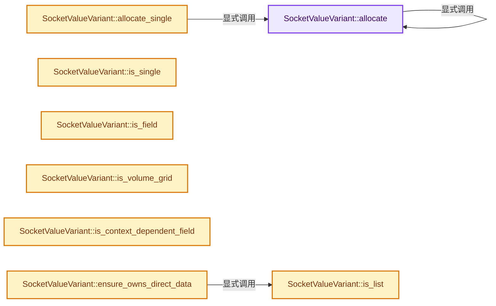

# 实现依赖专题：source/blender/blenkernel/intern/node_socket_value.cc

[实现依赖导航](../../README.md) · [符号索引](../../../00-课程指南/02-源码与提交索引/符号依赖与实现索引.md)

本专题从正文实际调用进入，集中保存共享实现。函数有稳定锚点，可从调用处直接跳到对应完整函数；递归与互相调用通过回链组织。

## 本文件的实现关系




## 完整成员与函数实现

<a id="f-24245d16d403dc88"></a>

### `SocketValueVariant::allocate`

实现位置：[source/blender/blenkernel/intern/node_socket_value.cc](../../../../../../../source/blender/blenkernel/intern/node_socket_value.cc) · L472—L494。

接口参数：

- `const CPPType &type`
- `detail::SocketValueVariantAny &value`

**教学注释版**

<!-- annotated:d7342b4a03d0a4 -->

```cpp
void *SocketValueVariant::allocate(const CPPType &type, detail::SocketValueVariantAny &value)
{
#define X(TYPE) \
  if (type.is<TYPE>()) { \
    return value.allocate<TYPE>(); \
  }
  SOCKET_VALUE_SINGLE_TYPES
#undef X

  if (type.is<GField>()) {
    return value.allocate<GField>();
  }
  if (type.is<GListPtr>()) {
    return value.allocate<GListPtr>();
  }
#ifdef WITH_OPENVDB
  if (type.is<GVolumeGrid>()) {
    return value.allocate<GVolumeGrid>();
  }
#endif
  BLI_assert_unreachable();
  return nullptr;
}
```

<details>
<summary>核对原始源码：source/blender/blenkernel/intern/node_socket_value.cc · L472—L494</summary>

<!-- original:d7342b4a03d0a4:source/blender/blenkernel/intern/node_socket_value.cc:472:494 -->

```cpp
void *SocketValueVariant::allocate(const CPPType &type, detail::SocketValueVariantAny &value)
{
#define X(TYPE) \
  if (type.is<TYPE>()) { \
    return value.allocate<TYPE>(); \
  }
  SOCKET_VALUE_SINGLE_TYPES
#undef X

  if (type.is<GField>()) {
    return value.allocate<GField>();
  }
  if (type.is<GListPtr>()) {
    return value.allocate<GListPtr>();
  }
#ifdef WITH_OPENVDB
  if (type.is<GVolumeGrid>()) {
    return value.allocate<GVolumeGrid>();
  }
#endif
  BLI_assert_unreachable();
  return nullptr;
}
```

</details>

**结果出口**

- `return value.allocate<TYPE>(); \`
- `return value.allocate<GField>();`
- `return value.allocate<GListPtr>();`
- `return value.allocate<GVolumeGrid>();`
- `return nullptr;`

**继续追踪实现**

- `type.is<GField>` → [blender::CPPType::is · L758](../../../03-内存分配与运行时类型/09-CPPType复制移动重定位.md#f-2e2c3ee7602530a4)。
- `value.allocate<GField>` → [SocketValueVariant::allocate · L472](node_socket_value.cc.md#f-24245d16d403dc88)。
- `type.is<GListPtr>` → [blender::CPPType::is · L758](../../../03-内存分配与运行时类型/09-CPPType复制移动重定位.md#f-2e2c3ee7602530a4)。
- `value.allocate<GListPtr>` → [SocketValueVariant::allocate · L472](node_socket_value.cc.md#f-24245d16d403dc88)。
- `type.is<GVolumeGrid>` → [blender::CPPType::is · L758](../../../03-内存分配与运行时类型/09-CPPType复制移动重定位.md#f-2e2c3ee7602530a4)。
- `value.allocate<GVolumeGrid>` → [SocketValueVariant::allocate · L472](node_socket_value.cc.md#f-24245d16d403dc88)。
- `BLI_assert_unreachable` → [BLI_assert_unreachable · L77](../../01-BLI基础库/BLI_assert.hh.md#m-7a2d91a67d8e)。宏定义由构建条件选择。

<a id="f-937aba1f0ff2c1db"></a>

### `SocketValueVariant::allocate_single`

实现位置：[source/blender/blenkernel/intern/node_socket_value.cc](../../../../../../../source/blender/blenkernel/intern/node_socket_value.cc) · L496—L499。

接口参数：

- `const CPPType &type`

**教学注释版**

<!-- annotated:1996aa53a11d27 -->

```cpp
void *SocketValueVariant::allocate_single(const CPPType &type)
{
  return SocketValueVariant::allocate(type, value_);
}
```

<details>
<summary>核对原始源码：source/blender/blenkernel/intern/node_socket_value.cc · L496—L499</summary>

<!-- original:1996aa53a11d27:source/blender/blenkernel/intern/node_socket_value.cc:496:499 -->

```cpp
void *SocketValueVariant::allocate_single(const CPPType &type)
{
  return SocketValueVariant::allocate(type, value_);
}
```

</details>

**结果出口**

- `return SocketValueVariant::allocate(type, value_);`

**继续追踪实现**

- `SocketValueVariant::allocate` → [SocketValueVariant::allocate · L472](node_socket_value.cc.md#f-24245d16d403dc88)。

<a id="f-305458280511ae60"></a>

### `SocketValueVariant::is_single`

实现位置：[source/blender/blenkernel/intern/node_socket_value.cc](../../../../../../../source/blender/blenkernel/intern/node_socket_value.cc) · L501—L514。

**教学注释版**

<!-- annotated:6d557dd2423735 -->

```cpp
bool SocketValueVariant::is_single() const
{
  const CPPType *type = this->get().type();
  if (!type) {
    return false;
  }
#define X(TYPE) \
  if (type->is<TYPE>()) { \
    return true; \
  }
  SOCKET_VALUE_SINGLE_TYPES
#undef X
  return false;
}
```

<details>
<summary>核对原始源码：source/blender/blenkernel/intern/node_socket_value.cc · L501—L514</summary>

<!-- original:6d557dd2423735:source/blender/blenkernel/intern/node_socket_value.cc:501:514 -->

```cpp
bool SocketValueVariant::is_single() const
{
  const CPPType *type = this->get().type();
  if (!type) {
    return false;
  }
#define X(TYPE) \
  if (type->is<TYPE>()) { \
    return true; \
  }
  SOCKET_VALUE_SINGLE_TYPES
#undef X
  return false;
}
```

</details>

**结果出口**

- `return false;`
- `return true; \`

**继续追踪实现**

- `this->get().type` → [调用协议](../../../00-课程指南/01-路线与规范/模板宏与动态分派协议.md)：接收对象类型依赖auto、返回值或模板实例；不按同名猜测目标。调用位置L503。
- `this->get` → [blender::bke::SocketValueVariant::get · L340](../BKE_node_socket_value.hh.md#f-44fd803c51c13447)；[blender::bke::SocketValueVariant::get · L349](../BKE_node_socket_value.hh.md#f-c63e6331bfae49c4)。同名重载需按实参类型选择。

<a id="f-a047c02c1d9894fc"></a>

### `SocketValueVariant::is_field`

实现位置：[source/blender/blenkernel/intern/node_socket_value.cc](../../../../../../../source/blender/blenkernel/intern/node_socket_value.cc) · L516—L519。

**教学注释版**

<!-- annotated:a7f2ae88306fc1 -->

```cpp
bool SocketValueVariant::is_field() const
{
  return this->get().type()->is<fn::GField>();
}
```

<details>
<summary>核对原始源码：source/blender/blenkernel/intern/node_socket_value.cc · L516—L519</summary>

<!-- original:a7f2ae88306fc1:source/blender/blenkernel/intern/node_socket_value.cc:516:519 -->

```cpp
bool SocketValueVariant::is_field() const
{
  return this->get().type()->is<fn::GField>();
}
```

</details>

**结果出口**

- `return this->get().type()->is<fn::GField>();`

**继续追踪实现**

- `this->get().type()->is<fn::GField>` → [调用协议](../../../00-课程指南/01-路线与规范/模板宏与动态分派协议.md)：接收对象类型依赖auto、返回值或模板实例；不按同名猜测目标。调用位置L518。
- `this->get().type` → [调用协议](../../../00-课程指南/01-路线与规范/模板宏与动态分派协议.md)：接收对象类型依赖auto、返回值或模板实例；不按同名猜测目标。调用位置L518。
- `this->get` → [blender::bke::SocketValueVariant::get · L340](../BKE_node_socket_value.hh.md#f-44fd803c51c13447)；[blender::bke::SocketValueVariant::get · L349](../BKE_node_socket_value.hh.md#f-c63e6331bfae49c4)。同名重载需按实参类型选择。

<a id="f-8ca466804cfc0dfe"></a>

### `SocketValueVariant::is_list`

实现位置：[source/blender/blenkernel/intern/node_socket_value.cc](../../../../../../../source/blender/blenkernel/intern/node_socket_value.cc) · L521—L524。

**教学注释版**

<!-- annotated:3cac60996fa81f -->

```cpp
bool SocketValueVariant::is_list() const
{
  return this->get().type()->is<nodes::GListPtr>();
}
```

<details>
<summary>核对原始源码：source/blender/blenkernel/intern/node_socket_value.cc · L521—L524</summary>

<!-- original:3cac60996fa81f:source/blender/blenkernel/intern/node_socket_value.cc:521:524 -->

```cpp
bool SocketValueVariant::is_list() const
{
  return this->get().type()->is<nodes::GListPtr>();
}
```

</details>

**结果出口**

- `return this->get().type()->is<nodes::GListPtr>();`

**继续追踪实现**

- `this->get().type()->is<nodes::GListPtr>` → [调用协议](../../../00-课程指南/01-路线与规范/模板宏与动态分派协议.md)：接收对象类型依赖auto、返回值或模板实例；不按同名猜测目标。调用位置L523。
- `this->get().type` → [调用协议](../../../00-课程指南/01-路线与规范/模板宏与动态分派协议.md)：接收对象类型依赖auto、返回值或模板实例；不按同名猜测目标。调用位置L523。
- `this->get` → [blender::bke::SocketValueVariant::get · L340](../BKE_node_socket_value.hh.md#f-44fd803c51c13447)；[blender::bke::SocketValueVariant::get · L349](../BKE_node_socket_value.hh.md#f-c63e6331bfae49c4)。同名重载需按实参类型选择。

<a id="f-e53b8ae8600b40db"></a>

### `SocketValueVariant::is_volume_grid`

实现位置：[source/blender/blenkernel/intern/node_socket_value.cc](../../../../../../../source/blender/blenkernel/intern/node_socket_value.cc) · L525—L532。

**教学注释版**

<!-- annotated:a269294271be99 -->

```cpp
bool SocketValueVariant::is_volume_grid() const
{
#ifdef WITH_OPENVDB
  return this->get().type()->is<bke::GVolumeGrid>();
#else
  return false;
#endif
}
```

<details>
<summary>核对原始源码：source/blender/blenkernel/intern/node_socket_value.cc · L525—L532</summary>

<!-- original:a269294271be99:source/blender/blenkernel/intern/node_socket_value.cc:525:532 -->

```cpp
bool SocketValueVariant::is_volume_grid() const
{
#ifdef WITH_OPENVDB
  return this->get().type()->is<bke::GVolumeGrid>();
#else
  return false;
#endif
}
```

</details>

**结果出口**

- `return this->get().type()->is<bke::GVolumeGrid>();`
- `return false;`

**继续追踪实现**

- `this->get().type()->is<bke::GVolumeGrid>` → [调用协议](../../../00-课程指南/01-路线与规范/模板宏与动态分派协议.md)：接收对象类型依赖auto、返回值或模板实例；不按同名猜测目标。调用位置L528。
- `this->get().type` → [调用协议](../../../00-课程指南/01-路线与规范/模板宏与动态分派协议.md)：接收对象类型依赖auto、返回值或模板实例；不按同名猜测目标。调用位置L528。
- `this->get` → [blender::bke::SocketValueVariant::get · L340](../BKE_node_socket_value.hh.md#f-44fd803c51c13447)；[blender::bke::SocketValueVariant::get · L349](../BKE_node_socket_value.hh.md#f-c63e6331bfae49c4)。同名重载需按实参类型选择。

<a id="f-55e5e1818d077c80"></a>

### `SocketValueVariant::is_context_dependent_field`

实现位置：[source/blender/blenkernel/intern/node_socket_value.cc](../../../../../../../source/blender/blenkernel/intern/node_socket_value.cc) · L534—L541。

**教学注释版**

<!-- annotated:66acd11525b7f3 -->

```cpp
bool SocketValueVariant::is_context_dependent_field() const
{
  const fn::GField *field = this->get_if<fn::GField>();
  if (!field) {
    return false;
  }
  return field->depends_on_input();
}
```

<details>
<summary>核对原始源码：source/blender/blenkernel/intern/node_socket_value.cc · L534—L541</summary>

<!-- original:66acd11525b7f3:source/blender/blenkernel/intern/node_socket_value.cc:534:541 -->

```cpp
bool SocketValueVariant::is_context_dependent_field() const
{
  const fn::GField *field = this->get_if<fn::GField>();
  if (!field) {
    return false;
  }
  return field->depends_on_input();
}
```

</details>

**结果出口**

- `return false;`
- `return field->depends_on_input();`

**继续追踪实现**

- `this->get_if<fn::GField>` → [blender::bke::SocketValueVariant::get_if · L293](../BKE_node_socket_value.hh.md#f-5744f0088e078efb)；[blender::bke::SocketValueVariant::get_if · L315](../BKE_node_socket_value.hh.md#f-0ee4db24be0746a2)；[blender::bke::SocketValueVariant::get_if · L320](../BKE_node_socket_value.hh.md#f-1e9674022bd220af)；[blender::bke::SocketValueVariant::get_if · L335](../BKE_node_socket_value.hh.md#f-95510bddaf248ec5)。同名重载需按实参类型选择。
- `field->depends_on_input` → [blender::fn::GField::depends_on_input · L614](../../../08-Field表达式与求值/05-FieldOperation运算节点.md#f-f9ec31f757d56a15)。

<a id="f-2bfd70198d975fdc"></a>

### `SocketValueVariant::ensure_owns_direct_data`

实现位置：[source/blender/blenkernel/intern/node_socket_value.cc](../../../../../../../source/blender/blenkernel/intern/node_socket_value.cc) · L543—L566。

**教学注释版**

<!-- annotated:0889b8056791f8 -->

```cpp
void SocketValueVariant::ensure_owns_direct_data()
{
  if (this->owns_direct_data()) {
    return;
  }
  if (this->get().is_type<nodes::BundlePtr>()) {
    if (nodes::BundlePtr &bundle_ptr = value_.get<nodes::BundlePtr>()) {
      bundle_ptr.ensure_mutable_inplace();
      nodes::Bundle &bundle = const_cast<nodes::Bundle &>(*bundle_ptr);
      bundle.ensure_owns_direct_data();
    }
  }
  if (this->is_list()) {
    if (nodes::GListPtr &list_ptr = value_.get<nodes::GListPtr>()) {
      auto &list = list_ptr.get_for_write();
      list.ensure_owns_direct_data();
    }
  }
  if (this->get().is_type<GeometrySet>()) {
    GeometrySet &geometry = value_.get<GeometrySet>();
    geometry.ensure_owns_direct_data();
  }
  BLI_assert(this->owns_direct_data());
}
```

<details>
<summary>核对原始源码：source/blender/blenkernel/intern/node_socket_value.cc · L543—L566</summary>

<!-- original:0889b8056791f8:source/blender/blenkernel/intern/node_socket_value.cc:543:566 -->

```cpp
void SocketValueVariant::ensure_owns_direct_data()
{
  if (this->owns_direct_data()) {
    return;
  }
  if (this->get().is_type<nodes::BundlePtr>()) {
    if (nodes::BundlePtr &bundle_ptr = value_.get<nodes::BundlePtr>()) {
      bundle_ptr.ensure_mutable_inplace();
      nodes::Bundle &bundle = const_cast<nodes::Bundle &>(*bundle_ptr);
      bundle.ensure_owns_direct_data();
    }
  }
  if (this->is_list()) {
    if (nodes::GListPtr &list_ptr = value_.get<nodes::GListPtr>()) {
      auto &list = list_ptr.get_for_write();
      list.ensure_owns_direct_data();
    }
  }
  if (this->get().is_type<GeometrySet>()) {
    GeometrySet &geometry = value_.get<GeometrySet>();
    geometry.ensure_owns_direct_data();
  }
  BLI_assert(this->owns_direct_data());
}
```

</details>

**继续追踪实现**

- `this->owns_direct_data` → [SocketValueVariant::owns_direct_data · L568](node_socket_value.cc.md#f-8b5629281af6a7f6)。
- `this->get().is_type<nodes::BundlePtr>` → [调用协议](../../../00-课程指南/01-路线与规范/模板宏与动态分派协议.md)：接收对象类型依赖auto、返回值或模板实例；不按同名猜测目标。调用位置L548。
- `this->get` → [blender::bke::SocketValueVariant::get · L340](../BKE_node_socket_value.hh.md#f-44fd803c51c13447)；[blender::bke::SocketValueVariant::get · L349](../BKE_node_socket_value.hh.md#f-c63e6331bfae49c4)。同名重载需按实参类型选择。
- `value_.get<nodes::BundlePtr>` → [调用协议](../../../00-课程指南/01-路线与规范/模板宏与动态分派协议.md)：接收对象类型依赖auto、返回值或模板实例；不按同名猜测目标。调用位置L549。
- `bundle_ptr.ensure_mutable_inplace` → [blender::ImplicitSharingPtr::ensure_mutable_inplace · L144](../../../06-隐式共享与缓存系统/03-Mixin与共享指针封装.md#f-d9e9b25281edf91a)。
- `bundle.ensure_owns_direct_data` → [blender::nodes::Bundle::ensure_owns_direct_data · L264](../../../10-引用生命周期与Closure/05-Bundle值组合.md#f-61947a2b69b1bf21)。
- `this->is_list` → [SocketValueVariant::is_list · L521](node_socket_value.cc.md#f-8ca466804cfc0dfe)。
- `value_.get<nodes::GListPtr>` → [调用协议](../../../00-课程指南/01-路线与规范/模板宏与动态分派协议.md)：接收对象类型依赖auto、返回值或模板实例；不按同名猜测目标。调用位置L556。
- `list_ptr.get_for_write` → [blender::nodes::GListPtr::get_for_write · L347](../../04-Nodes节点系统/NOD_geometry_nodes_list.hh.md#f-5ea994c546b4d8cd)。
- `list.ensure_owns_direct_data` → [调用协议](../../../00-课程指南/01-路线与规范/模板宏与动态分派协议.md)：接收对象类型依赖auto、返回值或模板实例；不按同名猜测目标。调用位置L558。
- `this->get().is_type<GeometrySet>` → [调用协议](../../../00-课程指南/01-路线与规范/模板宏与动态分派协议.md)：接收对象类型依赖auto、返回值或模板实例；不按同名猜测目标。调用位置L561。
- `value_.get<GeometrySet>` → [调用协议](../../../00-课程指南/01-路线与规范/模板宏与动态分派协议.md)：接收对象类型依赖auto、返回值或模板实例；不按同名猜测目标。调用位置L562。
- `geometry.ensure_owns_direct_data` → [blender::bke::GeometrySet::ensure_owns_direct_data · L272](../../../06-隐式共享与缓存系统/05-GeometrySet读写与复制.md#f-9626a230081195a6)。
- `BLI_assert` → [BLI_assert · L48](../../01-BLI基础库/BLI_assert.hh.md#m-57a88495704d)；[BLI_assert · L63](../../01-BLI基础库/BLI_assert.hh.md#m-d07050020cb5)。宏定义由构建条件选择。

<a id="f-8b5629281af6a7f6"></a>

### `SocketValueVariant::owns_direct_data`

实现位置：[source/blender/blenkernel/intern/node_socket_value.cc](../../../../../../../source/blender/blenkernel/intern/node_socket_value.cc) · L568—L585。

**教学注释版**

<!-- annotated:af9e2a9aeb0dcb -->

```cpp
bool SocketValueVariant::owns_direct_data() const
{
  if (this->get().is_type<nodes::BundlePtr>()) {
    if (const nodes::BundlePtr &bundle_ptr = value_.get<nodes::BundlePtr>()) {
      return bundle_ptr->owns_direct_data();
    }
  }
  if (this->is_list()) {
    if (const nodes::GListPtr &list_ptr = value_.get<nodes::GListPtr>()) {
      return list_ptr->owns_direct_data();
    }
  }
  if (this->get().is_type<GeometrySet>()) {
    const GeometrySet &geometry = value_.get<GeometrySet>();
    return geometry.owns_direct_data();
  }
  return true;
}
```

<details>
<summary>核对原始源码：source/blender/blenkernel/intern/node_socket_value.cc · L568—L585</summary>

<!-- original:af9e2a9aeb0dcb:source/blender/blenkernel/intern/node_socket_value.cc:568:585 -->

```cpp
bool SocketValueVariant::owns_direct_data() const
{
  if (this->get().is_type<nodes::BundlePtr>()) {
    if (const nodes::BundlePtr &bundle_ptr = value_.get<nodes::BundlePtr>()) {
      return bundle_ptr->owns_direct_data();
    }
  }
  if (this->is_list()) {
    if (const nodes::GListPtr &list_ptr = value_.get<nodes::GListPtr>()) {
      return list_ptr->owns_direct_data();
    }
  }
  if (this->get().is_type<GeometrySet>()) {
    const GeometrySet &geometry = value_.get<GeometrySet>();
    return geometry.owns_direct_data();
  }
  return true;
}
```

</details>

**结果出口**

- `return bundle_ptr->owns_direct_data();`
- `return list_ptr->owns_direct_data();`
- `return geometry.owns_direct_data();`
- `return true;`

**继续追踪实现**

- `this->get().is_type<nodes::BundlePtr>` → [调用协议](../../../00-课程指南/01-路线与规范/模板宏与动态分派协议.md)：接收对象类型依赖auto、返回值或模板实例；不按同名猜测目标。调用位置L570。
- `this->get` → [blender::bke::SocketValueVariant::get · L340](../BKE_node_socket_value.hh.md#f-44fd803c51c13447)；[blender::bke::SocketValueVariant::get · L349](../BKE_node_socket_value.hh.md#f-c63e6331bfae49c4)。同名重载需按实参类型选择。
- `value_.get<nodes::BundlePtr>` → [调用协议](../../../00-课程指南/01-路线与规范/模板宏与动态分派协议.md)：接收对象类型依赖auto、返回值或模板实例；不按同名猜测目标。调用位置L571。
- `bundle_ptr->owns_direct_data` → [SocketValueVariant::owns_direct_data · L568](node_socket_value.cc.md#f-8b5629281af6a7f6)。
- `this->is_list` → [SocketValueVariant::is_list · L521](node_socket_value.cc.md#f-8ca466804cfc0dfe)。
- `value_.get<nodes::GListPtr>` → [调用协议](../../../00-课程指南/01-路线与规范/模板宏与动态分派协议.md)：接收对象类型依赖auto、返回值或模板实例；不按同名猜测目标。调用位置L576。
- `list_ptr->owns_direct_data` → [SocketValueVariant::owns_direct_data · L568](node_socket_value.cc.md#f-8b5629281af6a7f6)。
- `this->get().is_type<GeometrySet>` → [调用协议](../../../00-课程指南/01-路线与规范/模板宏与动态分派协议.md)：接收对象类型依赖auto、返回值或模板实例；不按同名猜测目标。调用位置L580。
- `value_.get<GeometrySet>` → [调用协议](../../../00-课程指南/01-路线与规范/模板宏与动态分派协议.md)：接收对象类型依赖auto、返回值或模板实例；不按同名猜测目标。调用位置L581。
- `geometry.owns_direct_data` → [blender::bke::GeometrySet::owns_direct_data · L294](../../../06-隐式共享与缓存系统/05-GeometrySet读写与复制.md#f-fa1220837e627b58)。
