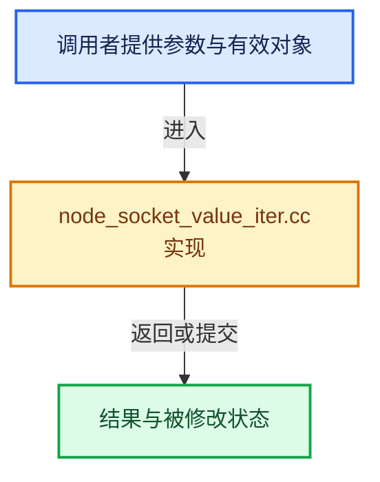

# 实现依赖专题：source/blender/blenkernel/intern/node_socket_value_iter.cc

[实现依赖导航](../../README.md) · [符号索引](../../../00-课程指南/02-源码与提交索引/符号依赖与实现索引.md)

本专题从正文实际调用进入，集中保存共享实现。函数有稳定锚点，可从调用处直接跳到对应完整函数；递归与互相调用通过回链组织。

## 本文件的实现关系

```mermaid
flowchart LR
  F0["blender::bke::socket_value_visitor::RecursiveVisitor::check_SocketValueVariant"]:::abstraction
  F1["blender::bke::socket_value_visitor::RecursiveVisitor::edit_SocketValueVariant"]:::compute
  F2["blender::bke::socket_value_visitor::RecursiveVisitor::check_GPointer"]:::compute
  F3["blender::bke::socket_value_visitor::RecursiveVisitor::edit_GPointer"]:::compute
  F4["blender::bke::socket_value_visitor::RecursiveVisitor::check_GeometrySet"]:::compute
  F5["blender::bke::socket_value_visitor::RecursiveVisitor::edit_GeometrySet"]:::compute
  F6["blender::bke::socket_value_visitor::RecursiveVisitor::check_GeometryComponent"]:::compute
  F7["blender::bke::socket_value_visitor::RecursiveVisitor::edit_GeometryComponent"]:::compute
  F0 -->|"显式调用"| F2
  F1 -->|"显式调用"| F3
  F2 -->|"显式调用"| F4
  F3 -->|"显式调用"| F5
  F4 -->|"显式调用"| F6
  F5 -->|"显式调用"| F6
  F5 -->|"显式调用"| F7
  classDef input fill:#DBEAFE,stroke:#2563EB,color:#172554,stroke-width:2px;
  classDef data fill:#CFFAFE,stroke:#0891B2,color:#164E63,stroke-width:2px;
  classDef abstraction fill:#EDE9FE,stroke:#7C3AED,color:#3B0764,stroke-width:2px;
  classDef compute fill:#FEF3C7,stroke:#D97706,color:#78350F,stroke-width:2px;
  classDef result fill:#DCFCE7,stroke:#16A34A,color:#14532D,stroke-width:2px;
  classDef error fill:#FEE2E2,stroke:#DC2626,color:#7F1D1D,stroke-width:2px;
```






## 完整成员与函数实现

<a id="f-69d0e1fba9057d5c"></a>

### `blender::bke::socket_value_visitor::RecursiveVisitor::check_SocketValueVariant`

实现位置：[source/blender/blenkernel/intern/node_socket_value_iter.cc](../../../../../../../source/blender/blenkernel/intern/node_socket_value_iter.cc) · L29—L52。

接口参数：

- `const SocketValueVariant &value`

**教学注释版**

<!-- annotated:28f361a71000ad -->

```cpp
  bool check_SocketValueVariant(const SocketValueVariant &value)
  {
    if (value.is_single()) {
      const GPointer value_ptr = value.get();
      if (this->check_GPointer(value_ptr)) {
        return true;
      }
    }
    else if (value.is_field()) {
      const fn::GField &field = *value.get_if<fn::GField>();
      if (this->check_GField(field)) {
        return true;
      }
    }
    else if (value.is_list()) {
      const nodes::GListPtr &list = *value.get_if<nodes::GListPtr>();
      if (list) {
        if (this->check_GList(*list)) {
          return true;
        }
      }
    }
    return false;
  }
```

<details>
<summary>核对原始源码：source/blender/blenkernel/intern/node_socket_value_iter.cc · L29—L52</summary>

<!-- original:28f361a71000ad:source/blender/blenkernel/intern/node_socket_value_iter.cc:29:52 -->

```cpp
  bool check_SocketValueVariant(const SocketValueVariant &value)
  {
    if (value.is_single()) {
      const GPointer value_ptr = value.get();
      if (this->check_GPointer(value_ptr)) {
        return true;
      }
    }
    else if (value.is_field()) {
      const fn::GField &field = *value.get_if<fn::GField>();
      if (this->check_GField(field)) {
        return true;
      }
    }
    else if (value.is_list()) {
      const nodes::GListPtr &list = *value.get_if<nodes::GListPtr>();
      if (list) {
        if (this->check_GList(*list)) {
          return true;
        }
      }
    }
    return false;
  }
```

</details>

**结果出口**

- `return true;`
- `return false;`

**继续追踪实现**

- `value.is_single` → [SocketValueVariant::is_single · L501](node_socket_value.cc.md#f-305458280511ae60)。
- `value.get` → [blender::bke::SocketValueVariant::get · L340](../BKE_node_socket_value.hh.md#f-44fd803c51c13447)；[blender::bke::SocketValueVariant::get · L349](../BKE_node_socket_value.hh.md#f-c63e6331bfae49c4)。同名重载需按实参类型选择。
- `this->check_GPointer` → [blender::bke::socket_value_visitor::RecursiveVisitor::check_GPointer · L77](node_socket_value_iter.cc.md#f-a125dbcc9fee3ef3)。
- `value.is_field` → [SocketValueVariant::is_field · L516](node_socket_value.cc.md#f-a047c02c1d9894fc)。
- `value.get_if<fn::GField>` → [blender::bke::SocketValueVariant::get_if · L293](../BKE_node_socket_value.hh.md#f-5744f0088e078efb)；[blender::bke::SocketValueVariant::get_if · L315](../BKE_node_socket_value.hh.md#f-0ee4db24be0746a2)；[blender::bke::SocketValueVariant::get_if · L320](../BKE_node_socket_value.hh.md#f-1e9674022bd220af)；[blender::bke::SocketValueVariant::get_if · L335](../BKE_node_socket_value.hh.md#f-95510bddaf248ec5)。同名重载需按实参类型选择。
- `this->check_GField` → [blender::bke::socket_value_visitor::RecursiveVisitor::check_GField · L334](node_socket_value_iter.cc.md#f-61d862f50d045ac1)。
- `value.is_list` → [SocketValueVariant::is_list · L521](node_socket_value.cc.md#f-8ca466804cfc0dfe)。
- `value.get_if<nodes::GListPtr>` → [blender::bke::SocketValueVariant::get_if · L293](../BKE_node_socket_value.hh.md#f-5744f0088e078efb)；[blender::bke::SocketValueVariant::get_if · L315](../BKE_node_socket_value.hh.md#f-0ee4db24be0746a2)；[blender::bke::SocketValueVariant::get_if · L320](../BKE_node_socket_value.hh.md#f-1e9674022bd220af)；[blender::bke::SocketValueVariant::get_if · L335](../BKE_node_socket_value.hh.md#f-95510bddaf248ec5)。同名重载需按实参类型选择。
- `this->check_GList` → [blender::bke::socket_value_visitor::RecursiveVisitor::check_GList · L351](node_socket_value_iter.cc.md#f-2795425012a62e7c)。

<a id="f-b56574e92817d3fb"></a>

### `blender::bke::socket_value_visitor::RecursiveVisitor::edit_SocketValueVariant`

实现位置：[source/blender/blenkernel/intern/node_socket_value_iter.cc](../../../../../../../source/blender/blenkernel/intern/node_socket_value_iter.cc) · L54—L75。

接口参数：

- `SocketValueVariant &value`

**教学注释版**

<!-- annotated:2d39834802b507 -->

```cpp
  void edit_SocketValueVariant(SocketValueVariant &value)
  {
    if (value.is_single()) {
      GMutablePointer value_ptr = value.get();
      this->edit_GPointer(value_ptr);
      return;
    }
    if (value.is_field()) {
      fn::GField field = value.extract<fn::GField>();
      this->edit_GField(field);
      // [讲解] std::move：把表达式转换成可供移动重载选择的值类别；不保证真的移动，不结束源对象寿命，对const值可能选择复制。
      value.emplace<fn::GField>(std::move(field));
      return;
    }
    if (value.is_list()) {
      nodes::GListPtr list = value.extract<nodes::GListPtr>();
      if (list) {
        this->edit_GList(list.get_for_write());
      }
      value.emplace<nodes::GListPtr>(std::move(list));
      return;
    }
  }
```

<details>
<summary>核对原始源码：source/blender/blenkernel/intern/node_socket_value_iter.cc · L54—L75</summary>

<!-- original:2d39834802b507:source/blender/blenkernel/intern/node_socket_value_iter.cc:54:75 -->

```cpp
  void edit_SocketValueVariant(SocketValueVariant &value)
  {
    if (value.is_single()) {
      GMutablePointer value_ptr = value.get();
      this->edit_GPointer(value_ptr);
      return;
    }
    if (value.is_field()) {
      fn::GField field = value.extract<fn::GField>();
      this->edit_GField(field);
      value.emplace<fn::GField>(std::move(field));
      return;
    }
    if (value.is_list()) {
      nodes::GListPtr list = value.extract<nodes::GListPtr>();
      if (list) {
        this->edit_GList(list.get_for_write());
      }
      value.emplace<nodes::GListPtr>(std::move(list));
      return;
    }
  }
```

</details>

**继续追踪实现**

- `value.is_single` → [SocketValueVariant::is_single · L501](node_socket_value.cc.md#f-305458280511ae60)。
- `value.get` → [blender::bke::SocketValueVariant::get · L340](../BKE_node_socket_value.hh.md#f-44fd803c51c13447)；[blender::bke::SocketValueVariant::get · L349](../BKE_node_socket_value.hh.md#f-c63e6331bfae49c4)。同名重载需按实参类型选择。
- `this->edit_GPointer` → [blender::bke::socket_value_visitor::RecursiveVisitor::edit_GPointer · L102](node_socket_value_iter.cc.md#f-40e2844c8076a1ae)。
- `value.is_field` → [SocketValueVariant::is_field · L516](node_socket_value.cc.md#f-a047c02c1d9894fc)。
- `value.extract<fn::GField>` → [blender::bke::SocketValueVariant::extract · L368](../BKE_node_socket_value.hh.md#f-a81e32a03fee5871)。
- `this->edit_GField` → [blender::bke::socket_value_visitor::RecursiveVisitor::edit_GField · L344](node_socket_value_iter.cc.md#f-fa623265f31276ea)。
- `value.emplace<fn::GField>` → [blender::bke::SocketValueVariant::emplace · L227](../BKE_node_socket_value.hh.md#f-b1c23f5500ae1b73)。
- `std::move` → [外部契约](https://eel.is/c++draft/utility.forward)：把表达式转换成可供移动重载选择的值类别；不保证真的移动，不结束源对象寿命，对const值可能选择复制。
- `value.is_list` → [SocketValueVariant::is_list · L521](node_socket_value.cc.md#f-8ca466804cfc0dfe)。
- `value.extract<nodes::GListPtr>` → [blender::bke::SocketValueVariant::extract · L368](../BKE_node_socket_value.hh.md#f-a81e32a03fee5871)。
- `this->edit_GList` → [blender::bke::socket_value_visitor::RecursiveVisitor::edit_GList · L399](node_socket_value_iter.cc.md#f-d4ebc969ef95945c)。
- `list.get_for_write` → [blender::nodes::GListPtr::get_for_write · L347](../../04-Nodes节点系统/NOD_geometry_nodes_list.hh.md#f-5ea994c546b4d8cd)。
- `value.emplace<nodes::GListPtr>` → [blender::bke::SocketValueVariant::emplace · L227](../BKE_node_socket_value.hh.md#f-b1c23f5500ae1b73)。

<a id="f-a125dbcc9fee3ef3"></a>

### `blender::bke::socket_value_visitor::RecursiveVisitor::check_GPointer`

实现位置：[source/blender/blenkernel/intern/node_socket_value_iter.cc](../../../../../../../source/blender/blenkernel/intern/node_socket_value_iter.cc) · L77—L100。

接口参数：

- `const GPointer value_ptr`

**教学注释版**

<!-- annotated:34e7036c1e7384 -->

```cpp
  bool check_GPointer(const GPointer value_ptr)
  {
    const CPPType &type = *value_ptr.type();
    if (type.is<GeometrySet>()) {
      return this->check_GeometrySet(*value_ptr.get<GeometrySet>());
    }
    if (type.is<nodes::BundlePtr>()) {
      const nodes::BundlePtr &bundle_ptr = *value_ptr.get<nodes::BundlePtr>();
      if (bundle_ptr) {
        return this->check_Bundle(*bundle_ptr);
      }
      return false;
    }
    if (type.is<nodes::ClosurePtr>()) {
      if (params_.check_non_editable) {
        const nodes::ClosurePtr &closure_ptr = *value_ptr.get<nodes::ClosurePtr>();
        if (closure_ptr) {
          return this->check_Closure(*closure_ptr);
        }
      }
      return false;
    }
    return false;
  }
```

<details>
<summary>核对原始源码：source/blender/blenkernel/intern/node_socket_value_iter.cc · L77—L100</summary>

<!-- original:34e7036c1e7384:source/blender/blenkernel/intern/node_socket_value_iter.cc:77:100 -->

```cpp
  bool check_GPointer(const GPointer value_ptr)
  {
    const CPPType &type = *value_ptr.type();
    if (type.is<GeometrySet>()) {
      return this->check_GeometrySet(*value_ptr.get<GeometrySet>());
    }
    if (type.is<nodes::BundlePtr>()) {
      const nodes::BundlePtr &bundle_ptr = *value_ptr.get<nodes::BundlePtr>();
      if (bundle_ptr) {
        return this->check_Bundle(*bundle_ptr);
      }
      return false;
    }
    if (type.is<nodes::ClosurePtr>()) {
      if (params_.check_non_editable) {
        const nodes::ClosurePtr &closure_ptr = *value_ptr.get<nodes::ClosurePtr>();
        if (closure_ptr) {
          return this->check_Closure(*closure_ptr);
        }
      }
      return false;
    }
    return false;
  }
```

</details>

**结果出口**

- `return this->check_GeometrySet(*value_ptr.get<GeometrySet>());`
- `return this->check_Bundle(*bundle_ptr);`
- `return false;`
- `return this->check_Closure(*closure_ptr);`

**继续追踪实现**

- `value_ptr.type` → [blender::GPointer::type · L122](../../../03-内存分配与运行时类型/12-异构值存储实战.md#f-fab893bd990213d9)。
- `type.is<GeometrySet>` → [blender::CPPType::is · L758](../../../03-内存分配与运行时类型/09-CPPType复制移动重定位.md#f-2e2c3ee7602530a4)。
- `this->check_GeometrySet` → [blender::bke::socket_value_visitor::RecursiveVisitor::check_GeometrySet · L123](node_socket_value_iter.cc.md#f-1d583c1be64e59bc)。
- `value_ptr.get<GeometrySet>` → [blender::GPointer::get · L117](../../../03-内存分配与运行时类型/12-异构值存储实战.md#f-d98a4f1af4104afe)；[blender::GPointer::get · L127](../../../03-内存分配与运行时类型/12-异构值存储实战.md#f-5cf9e563400cde6b)。同名重载需按实参类型选择。
- `type.is<nodes::BundlePtr>` → [blender::CPPType::is · L758](../../../03-内存分配与运行时类型/09-CPPType复制移动重定位.md#f-2e2c3ee7602530a4)。
- `value_ptr.get<nodes::BundlePtr>` → [blender::GPointer::get · L117](../../../03-内存分配与运行时类型/12-异构值存储实战.md#f-d98a4f1af4104afe)；[blender::GPointer::get · L127](../../../03-内存分配与运行时类型/12-异构值存储实战.md#f-5cf9e563400cde6b)。同名重载需按实参类型选择。
- `this->check_Bundle` → [blender::bke::socket_value_visitor::RecursiveVisitor::check_Bundle · L297](node_socket_value_iter.cc.md#f-6cc148f33532d3e0)。
- `type.is<nodes::ClosurePtr>` → [blender::CPPType::is · L758](../../../03-内存分配与运行时类型/09-CPPType复制移动重定位.md#f-2e2c3ee7602530a4)。
- `value_ptr.get<nodes::ClosurePtr>` → [blender::GPointer::get · L117](../../../03-内存分配与运行时类型/12-异构值存储实战.md#f-d98a4f1af4104afe)；[blender::GPointer::get · L127](../../../03-内存分配与运行时类型/12-异构值存储实战.md#f-5cf9e563400cde6b)。同名重载需按实参类型选择。
- `this->check_Closure` → [blender::bke::socket_value_visitor::RecursiveVisitor::check_Closure · L319](node_socket_value_iter.cc.md#f-02ac2e2037f051a8)。

<a id="f-40e2844c8076a1ae"></a>

### `blender::bke::socket_value_visitor::RecursiveVisitor::edit_GPointer`

实现位置：[source/blender/blenkernel/intern/node_socket_value_iter.cc](../../../../../../../source/blender/blenkernel/intern/node_socket_value_iter.cc) · L102—L121。

接口参数：

- `GMutablePointer value`

**教学注释版**

<!-- annotated:3108f4aa49fcc2 -->

```cpp
  void edit_GPointer(GMutablePointer value)
  {
    const CPPType &type = *value.type();
    if (type.is<GeometrySet>()) {
      this->edit_GeometrySet(*value.get<GeometrySet>());
      return;
    }
    if (type.is<nodes::BundlePtr>()) {
      nodes::BundlePtr &bundle_ptr = *value.get<nodes::BundlePtr>();
      if (bundle_ptr) {
        nodes::Bundle &bundle = bundle_ptr.ensure_mutable_inplace();
        this->edit_Bundle(bundle);
      }
      return;
    }
    if (type.is<nodes::ClosurePtr>()) {
      /* Can't edit closures. */
      return;
    }
  }
```

<details>
<summary>核对原始源码：source/blender/blenkernel/intern/node_socket_value_iter.cc · L102—L121</summary>

<!-- original:3108f4aa49fcc2:source/blender/blenkernel/intern/node_socket_value_iter.cc:102:121 -->

```cpp
  void edit_GPointer(GMutablePointer value)
  {
    const CPPType &type = *value.type();
    if (type.is<GeometrySet>()) {
      this->edit_GeometrySet(*value.get<GeometrySet>());
      return;
    }
    if (type.is<nodes::BundlePtr>()) {
      nodes::BundlePtr &bundle_ptr = *value.get<nodes::BundlePtr>();
      if (bundle_ptr) {
        nodes::Bundle &bundle = bundle_ptr.ensure_mutable_inplace();
        this->edit_Bundle(bundle);
      }
      return;
    }
    if (type.is<nodes::ClosurePtr>()) {
      /* Can't edit closures. */
      return;
    }
  }
```

</details>

**继续追踪实现**

- `value.type` → [blender::GMutablePointer::type · L46](../../../03-内存分配与运行时类型/12-异构值存储实战.md#f-a083aa9dc4c7b8e1)。
- `type.is<GeometrySet>` → [blender::CPPType::is · L758](../../../03-内存分配与运行时类型/09-CPPType复制移动重定位.md#f-2e2c3ee7602530a4)。
- `this->edit_GeometrySet` → [blender::bke::socket_value_visitor::RecursiveVisitor::edit_GeometrySet · L149](node_socket_value_iter.cc.md#f-0872af3b755663e5)。
- `value.get<GeometrySet>` → [blender::GMutablePointer::get · L41](../../../03-内存分配与运行时类型/12-异构值存储实战.md#f-212d33f800c0316e)；[blender::GMutablePointer::get · L56](../../../03-内存分配与运行时类型/12-异构值存储实战.md#f-f00e2816067f0feb)。同名重载需按实参类型选择。
- `type.is<nodes::BundlePtr>` → [blender::CPPType::is · L758](../../../03-内存分配与运行时类型/09-CPPType复制移动重定位.md#f-2e2c3ee7602530a4)。
- `value.get<nodes::BundlePtr>` → [blender::GMutablePointer::get · L41](../../../03-内存分配与运行时类型/12-异构值存储实战.md#f-212d33f800c0316e)；[blender::GMutablePointer::get · L56](../../../03-内存分配与运行时类型/12-异构值存储实战.md#f-f00e2816067f0feb)。同名重载需按实参类型选择。
- `bundle_ptr.ensure_mutable_inplace` → [blender::ImplicitSharingPtr::ensure_mutable_inplace · L144](../../../06-隐式共享与缓存系统/03-Mixin与共享指针封装.md#f-d9e9b25281edf91a)。
- `this->edit_Bundle` → [blender::bke::socket_value_visitor::RecursiveVisitor::edit_Bundle · L310](node_socket_value_iter.cc.md#f-18518206e1d477d0)。
- `type.is<nodes::ClosurePtr>` → [blender::CPPType::is · L758](../../../03-内存分配与运行时类型/09-CPPType复制移动重定位.md#f-2e2c3ee7602530a4)。

<a id="f-1d583c1be64e59bc"></a>

### `blender::bke::socket_value_visitor::RecursiveVisitor::check_GeometrySet`

实现位置：[source/blender/blenkernel/intern/node_socket_value_iter.cc](../../../../../../../source/blender/blenkernel/intern/node_socket_value_iter.cc) · L123—L147。

接口参数：

- `const GeometrySet &geometry_set`

**教学注释版**

<!-- annotated:8e68b7d54a985c -->

```cpp
  bool check_GeometrySet(const GeometrySet &geometry_set)
  {
    for (const GeometryComponent::Type type : {GeometryComponent::Type::Mesh,
                                               GeometryComponent::Type::PointCloud,
                                               GeometryComponent::Type::Instance,
                                               GeometryComponent::Type::Volume,
                                               GeometryComponent::Type::Curve,
                                               GeometryComponent::Type::Edit,
                                               GeometryComponent::Type::GreasePencil})
    {
      if (!geometry_set.has(type)) {
        continue;
      }
      const GeometryComponent &component = *geometry_set.get_component(type);
      if (this->check_GeometryComponent(component)) {
        return true;
      }
    }
    if (geometry_set.has_bundle()) {
      if (this->check_Bundle(*geometry_set.bundle())) {
        return true;
      }
    }
    return false;
  }
```

<details>
<summary>核对原始源码：source/blender/blenkernel/intern/node_socket_value_iter.cc · L123—L147</summary>

<!-- original:8e68b7d54a985c:source/blender/blenkernel/intern/node_socket_value_iter.cc:123:147 -->

```cpp
  bool check_GeometrySet(const GeometrySet &geometry_set)
  {
    for (const GeometryComponent::Type type : {GeometryComponent::Type::Mesh,
                                               GeometryComponent::Type::PointCloud,
                                               GeometryComponent::Type::Instance,
                                               GeometryComponent::Type::Volume,
                                               GeometryComponent::Type::Curve,
                                               GeometryComponent::Type::Edit,
                                               GeometryComponent::Type::GreasePencil})
    {
      if (!geometry_set.has(type)) {
        continue;
      }
      const GeometryComponent &component = *geometry_set.get_component(type);
      if (this->check_GeometryComponent(component)) {
        return true;
      }
    }
    if (geometry_set.has_bundle()) {
      if (this->check_Bundle(*geometry_set.bundle())) {
        return true;
      }
    }
    return false;
  }
```

</details>

**结果出口**

- `return true;`
- `return false;`

**继续追踪实现**

- `geometry_set.has` → [blender::bke::GeometrySet::has · L142](../../../06-隐式共享与缓存系统/05-GeometrySet读写与复制.md#f-5777be605a5451b6)。
- `geometry_set.get_component` → [blender::bke::GeometrySet::get_component · L137](../../../06-隐式共享与缓存系统/05-GeometrySet读写与复制.md#f-26f915a73bb3d7e8)。
- `this->check_GeometryComponent` → [blender::bke::socket_value_visitor::RecursiveVisitor::check_GeometryComponent · L178](node_socket_value_iter.cc.md#f-4c3edf7ad5f02a91)。
- `geometry_set.has_bundle` → [blender::bke::GeometrySet::has_bundle · L759](../../../06-隐式共享与缓存系统/05-GeometrySet读写与复制.md#f-607ccecfa5f4141f)。
- `this->check_Bundle` → [blender::bke::socket_value_visitor::RecursiveVisitor::check_Bundle · L297](node_socket_value_iter.cc.md#f-6cc148f33532d3e0)。
- `geometry_set.bundle` → [blender::bke::GeometrySet::bundle · L764](../../../06-隐式共享与缓存系统/05-GeometrySet读写与复制.md#f-96d381ad16719cfb)。

<a id="f-0872af3b755663e5"></a>

### `blender::bke::socket_value_visitor::RecursiveVisitor::edit_GeometrySet`

实现位置：[source/blender/blenkernel/intern/node_socket_value_iter.cc](../../../../../../../source/blender/blenkernel/intern/node_socket_value_iter.cc) · L149—L176。

接口参数：

- `GeometrySet &geometry_set`

**教学注释版**

<!-- annotated:0ae98987905af2 -->

```cpp
  void edit_GeometrySet(GeometrySet &geometry_set)
  {
    if (geometry_set.has_bundle()) {
      if (this->check_Bundle(*geometry_set.bundle())) {
        this->edit_Bundle(geometry_set.bundle_for_write());
      }
    }
    for (const GeometryComponent::Type type : {GeometryComponent::Type::Mesh,
                                               GeometryComponent::Type::PointCloud,
                                               GeometryComponent::Type::Instance,
                                               GeometryComponent::Type::Volume,
                                               GeometryComponent::Type::Curve,
                                               GeometryComponent::Type::Edit,
                                               GeometryComponent::Type::GreasePencil})
    {
      if (!geometry_set.has(type)) {
        continue;
      }
      {
        const GeometryComponent &component = *geometry_set.get_component(type);
        if (!this->check_GeometryComponent(component)) {
          continue;
        }
      }
      GeometryComponent &component = geometry_set.get_component_for_write(type);
      this->edit_GeometryComponent(component);
    }
  }
```

<details>
<summary>核对原始源码：source/blender/blenkernel/intern/node_socket_value_iter.cc · L149—L176</summary>

<!-- original:0ae98987905af2:source/blender/blenkernel/intern/node_socket_value_iter.cc:149:176 -->

```cpp
  void edit_GeometrySet(GeometrySet &geometry_set)
  {
    if (geometry_set.has_bundle()) {
      if (this->check_Bundle(*geometry_set.bundle())) {
        this->edit_Bundle(geometry_set.bundle_for_write());
      }
    }
    for (const GeometryComponent::Type type : {GeometryComponent::Type::Mesh,
                                               GeometryComponent::Type::PointCloud,
                                               GeometryComponent::Type::Instance,
                                               GeometryComponent::Type::Volume,
                                               GeometryComponent::Type::Curve,
                                               GeometryComponent::Type::Edit,
                                               GeometryComponent::Type::GreasePencil})
    {
      if (!geometry_set.has(type)) {
        continue;
      }
      {
        const GeometryComponent &component = *geometry_set.get_component(type);
        if (!this->check_GeometryComponent(component)) {
          continue;
        }
      }
      GeometryComponent &component = geometry_set.get_component_for_write(type);
      this->edit_GeometryComponent(component);
    }
  }
```

</details>

**继续追踪实现**

- `geometry_set.has_bundle` → [blender::bke::GeometrySet::has_bundle · L759](../../../06-隐式共享与缓存系统/05-GeometrySet读写与复制.md#f-607ccecfa5f4141f)。
- `this->check_Bundle` → [blender::bke::socket_value_visitor::RecursiveVisitor::check_Bundle · L297](node_socket_value_iter.cc.md#f-6cc148f33532d3e0)。
- `geometry_set.bundle` → [blender::bke::GeometrySet::bundle · L764](../../../06-隐式共享与缓存系统/05-GeometrySet读写与复制.md#f-96d381ad16719cfb)。
- `this->edit_Bundle` → [blender::bke::socket_value_visitor::RecursiveVisitor::edit_Bundle · L310](node_socket_value_iter.cc.md#f-18518206e1d477d0)。
- `geometry_set.bundle_for_write` → [blender::bke::GeometrySet::bundle_for_write · L779](../../../06-隐式共享与缓存系统/05-GeometrySet读写与复制.md#f-9f3eaefe0279cab7)。
- `geometry_set.has` → [blender::bke::GeometrySet::has · L142](../../../06-隐式共享与缓存系统/05-GeometrySet读写与复制.md#f-5777be605a5451b6)。
- `geometry_set.get_component` → [blender::bke::GeometrySet::get_component · L137](../../../06-隐式共享与缓存系统/05-GeometrySet读写与复制.md#f-26f915a73bb3d7e8)。
- `this->check_GeometryComponent` → [blender::bke::socket_value_visitor::RecursiveVisitor::check_GeometryComponent · L178](node_socket_value_iter.cc.md#f-4c3edf7ad5f02a91)。
- `geometry_set.get_component_for_write` → [blender::bke::GeometrySet::get_component_for_write · L119](../../../06-隐式共享与缓存系统/05-GeometrySet读写与复制.md#f-21eccb196f5b9a78)。
- `this->edit_GeometryComponent` → [blender::bke::socket_value_visitor::RecursiveVisitor::edit_GeometryComponent · L210](node_socket_value_iter.cc.md#f-41e5a9f3186bb60a)。

<a id="f-4c3edf7ad5f02a91"></a>

### `blender::bke::socket_value_visitor::RecursiveVisitor::check_GeometryComponent`

实现位置：[source/blender/blenkernel/intern/node_socket_value_iter.cc](../../../../../../../source/blender/blenkernel/intern/node_socket_value_iter.cc) · L178—L208。

接口参数：

- `const GeometryComponent &component`

**教学注释版**

<!-- annotated:d7296f23e6035a -->

```cpp
  bool check_GeometryComponent(const GeometryComponent &component)
  {
    if (const std::optional<bke::AttributeAccessor> attributes = component.attributes()) {
      if (this->check_AttributeAccessor(*attributes)) {
        return true;
      }
    }
    if (component.type() == GeometryComponent::Type::Instance) {
      const InstancesComponent &instance_component = static_cast<const InstancesComponent &>(
          component);
      if (const Instances *instances = instance_component.get()) {
        for (const InstanceReference &reference : instances->references()) {
          if (this->check_InstanceReference(reference)) {
            return true;
          }
        }
      }
    }
    if (component.type() == GeometryComponent::Type::GreasePencil) {
      const GreasePencilComponent &grease_pencil_component =
          static_cast<const GreasePencilComponent &>(component);
      if (const GreasePencil *grease_pencil = grease_pencil_component.get()) {
        for (const greasepencil::Layer *layer : grease_pencil->layers()) {
          if (this->check_Layer(*grease_pencil, *layer)) {
            return true;
          }
        }
      }
    }
    return false;
  }
```

<details>
<summary>核对原始源码：source/blender/blenkernel/intern/node_socket_value_iter.cc · L178—L208</summary>

<!-- original:d7296f23e6035a:source/blender/blenkernel/intern/node_socket_value_iter.cc:178:208 -->

```cpp
  bool check_GeometryComponent(const GeometryComponent &component)
  {
    if (const std::optional<bke::AttributeAccessor> attributes = component.attributes()) {
      if (this->check_AttributeAccessor(*attributes)) {
        return true;
      }
    }
    if (component.type() == GeometryComponent::Type::Instance) {
      const InstancesComponent &instance_component = static_cast<const InstancesComponent &>(
          component);
      if (const Instances *instances = instance_component.get()) {
        for (const InstanceReference &reference : instances->references()) {
          if (this->check_InstanceReference(reference)) {
            return true;
          }
        }
      }
    }
    if (component.type() == GeometryComponent::Type::GreasePencil) {
      const GreasePencilComponent &grease_pencil_component =
          static_cast<const GreasePencilComponent &>(component);
      if (const GreasePencil *grease_pencil = grease_pencil_component.get()) {
        for (const greasepencil::Layer *layer : grease_pencil->layers()) {
          if (this->check_Layer(*grease_pencil, *layer)) {
            return true;
          }
        }
      }
    }
    return false;
  }
```

</details>

**结果出口**

- `return true;`
- `return false;`

**继续追踪实现**

- `component.attributes` → [blender::bke::GeometryComponent::attributes · L75](../../../06-隐式共享与缓存系统/05-GeometrySet读写与复制.md#f-d58a41ede5a46f2c)。
- `this->check_AttributeAccessor` → [blender::bke::socket_value_visitor::RecursiveVisitor::check_AttributeAccessor · L235](node_socket_value_iter.cc.md#f-e808d6907b6d94c2)。
- `component.type` → [blender::bke::GeometryComponent::type · L86](../../../06-隐式共享与缓存系统/05-GeometrySet读写与复制.md#f-f73336c224943890)。
- `instance_component.get` → [blender::bke::InstancesComponent::get · L74](geometry_component_instances.cc.md#f-4c08d16e1f4a620c)。
- `instances->references` → [blender::bke::Instances::references · L290](instances.cc.md#f-d0561cd365f4ff3b)。
- `this->check_InstanceReference` → [blender::bke::socket_value_visitor::RecursiveVisitor::check_InstanceReference · L272](node_socket_value_iter.cc.md#f-8b383a26eb16dc8e)。
- `grease_pencil_component.get` → [blender::bke::GreasePencilComponent::get · L72](geometry_component_grease_pencil.cc.md#f-5a16e7ffc6574319)。
- `grease_pencil->layers` → [blender::GreasePencil::layers · L3983](grease_pencil.cc.md#f-15d64ed11a2babc0)。
- `this->check_Layer` → [blender::bke::socket_value_visitor::RecursiveVisitor::check_Layer · L252](node_socket_value_iter.cc.md#f-aa307ebc59839cb2)。

<a id="f-41e5a9f3186bb60a"></a>

### `blender::bke::socket_value_visitor::RecursiveVisitor::edit_GeometryComponent`

实现位置：[source/blender/blenkernel/intern/node_socket_value_iter.cc](../../../../../../../source/blender/blenkernel/intern/node_socket_value_iter.cc) · L210—L233。

接口参数：

- `GeometryComponent &component`

**教学注释版**

<!-- annotated:7c7df6feda57ad -->

```cpp
  void edit_GeometryComponent(GeometryComponent &component)
  {
    if (std::optional<bke::MutableAttributeAccessor> attributes = component.attributes_for_write())
    {
      this->edit_AttributeAccessor(*attributes);
    }
    if (component.type() == GeometryComponent::Type::Instance) {
      InstancesComponent &instance_component = static_cast<InstancesComponent &>(component);
      if (Instances *instances = instance_component.get_for_write()) {
        for (InstanceReference &reference : instances->references_for_write()) {
          this->edit_InstanceReference(reference);
        }
      }
    }
    if (component.type() == GeometryComponent::Type::GreasePencil) {
      GreasePencilComponent &grease_pencil_component = static_cast<GreasePencilComponent &>(
          component);
      if (GreasePencil *grease_pencil = grease_pencil_component.get_for_write()) {
        for (greasepencil::Layer *layer : grease_pencil->layers_for_write()) {
          this->edit_Layer(*grease_pencil, *layer);
        }
      }
    }
  }
```

<details>
<summary>核对原始源码：source/blender/blenkernel/intern/node_socket_value_iter.cc · L210—L233</summary>

<!-- original:7c7df6feda57ad:source/blender/blenkernel/intern/node_socket_value_iter.cc:210:233 -->

```cpp
  void edit_GeometryComponent(GeometryComponent &component)
  {
    if (std::optional<bke::MutableAttributeAccessor> attributes = component.attributes_for_write())
    {
      this->edit_AttributeAccessor(*attributes);
    }
    if (component.type() == GeometryComponent::Type::Instance) {
      InstancesComponent &instance_component = static_cast<InstancesComponent &>(component);
      if (Instances *instances = instance_component.get_for_write()) {
        for (InstanceReference &reference : instances->references_for_write()) {
          this->edit_InstanceReference(reference);
        }
      }
    }
    if (component.type() == GeometryComponent::Type::GreasePencil) {
      GreasePencilComponent &grease_pencil_component = static_cast<GreasePencilComponent &>(
          component);
      if (GreasePencil *grease_pencil = grease_pencil_component.get_for_write()) {
        for (greasepencil::Layer *layer : grease_pencil->layers_for_write()) {
          this->edit_Layer(*grease_pencil, *layer);
        }
      }
    }
  }
```

</details>

**继续追踪实现**

- `component.attributes_for_write` → [blender::bke::GeometryComponent::attributes_for_write · L79](../../../06-隐式共享与缓存系统/05-GeometrySet读写与复制.md#f-c68ee72f71fc3179)。
- `this->edit_AttributeAccessor` → [blender::bke::socket_value_visitor::RecursiveVisitor::edit_AttributeAccessor · L245](node_socket_value_iter.cc.md#f-df2db365af335363)。
- `component.type` → [blender::bke::GeometryComponent::type · L86](../../../06-隐式共享与缓存系统/05-GeometrySet读写与复制.md#f-f73336c224943890)。
- `instance_component.get_for_write` → [blender::bke::InstancesComponent::get_for_write · L79](geometry_component_instances.cc.md#f-4489915c6bc73234)。
- `instances->references_for_write` → [blender::bke::Instances::references_for_write · L295](instances.cc.md#f-91b59acce441c731)。
- `this->edit_InstanceReference` → [blender::bke::socket_value_visitor::RecursiveVisitor::edit_InstanceReference · L290](node_socket_value_iter.cc.md#f-abbbc687817d40c4)。
- `grease_pencil_component.get_for_write` → [blender::bke::GreasePencilComponent::get_for_write · L77](geometry_component_grease_pencil.cc.md#f-b399cde6e81f49c4)。
- `grease_pencil->layers_for_write` → [blender::GreasePencil::layers_for_write · L3989](grease_pencil.cc.md#f-8d19d3f84ede61d5)。
- `this->edit_Layer` → [blender::bke::socket_value_visitor::RecursiveVisitor::edit_Layer · L263](node_socket_value_iter.cc.md#f-5e2e3fd2cabd35f9)。

<a id="f-e808d6907b6d94c2"></a>

### `blender::bke::socket_value_visitor::RecursiveVisitor::check_AttributeAccessor`

实现位置：[source/blender/blenkernel/intern/node_socket_value_iter.cc](../../../../../../../source/blender/blenkernel/intern/node_socket_value_iter.cc) · L235—L243。

接口参数：

- `const bke::AttributeAccessor &accessor`

**教学注释版**

<!-- annotated:85fe21550f88de -->

```cpp
  bool check_AttributeAccessor(const bke::AttributeAccessor &accessor)
  {
    if (params_.check_AttributeAccessor) {
      if (params_.check_AttributeAccessor(accessor)) {
        return true;
      }
    }
    return false;
  }
```

<details>
<summary>核对原始源码：source/blender/blenkernel/intern/node_socket_value_iter.cc · L235—L243</summary>

<!-- original:85fe21550f88de:source/blender/blenkernel/intern/node_socket_value_iter.cc:235:243 -->

```cpp
  bool check_AttributeAccessor(const bke::AttributeAccessor &accessor)
  {
    if (params_.check_AttributeAccessor) {
      if (params_.check_AttributeAccessor(accessor)) {
        return true;
      }
    }
    return false;
  }
```

</details>

**结果出口**

- `return true;`
- `return false;`

**继续追踪实现**

- `params_.check_AttributeAccessor` → [blender::bke::socket_value_visitor::RecursiveVisitor::check_AttributeAccessor · L235](node_socket_value_iter.cc.md#f-e808d6907b6d94c2)。

<a id="f-df2db365af335363"></a>

### `blender::bke::socket_value_visitor::RecursiveVisitor::edit_AttributeAccessor`

实现位置：[source/blender/blenkernel/intern/node_socket_value_iter.cc](../../../../../../../source/blender/blenkernel/intern/node_socket_value_iter.cc) · L245—L250。

接口参数：

- `bke::MutableAttributeAccessor &accessor`

**教学注释版**

<!-- annotated:d86825de2b1146 -->

```cpp
  void edit_AttributeAccessor(bke::MutableAttributeAccessor &accessor)
  {
    if (params_.edit_AttributeAccessor) {
      params_.edit_AttributeAccessor(accessor);
    }
  }
```

<details>
<summary>核对原始源码：source/blender/blenkernel/intern/node_socket_value_iter.cc · L245—L250</summary>

<!-- original:d86825de2b1146:source/blender/blenkernel/intern/node_socket_value_iter.cc:245:250 -->

```cpp
  void edit_AttributeAccessor(bke::MutableAttributeAccessor &accessor)
  {
    if (params_.edit_AttributeAccessor) {
      params_.edit_AttributeAccessor(accessor);
    }
  }
```

</details>

**继续追踪实现**

- `params_.edit_AttributeAccessor` → [blender::bke::socket_value_visitor::RecursiveVisitor::edit_AttributeAccessor · L245](node_socket_value_iter.cc.md#f-df2db365af335363)。

<a id="f-aa307ebc59839cb2"></a>

### `blender::bke::socket_value_visitor::RecursiveVisitor::check_Layer`

实现位置：[source/blender/blenkernel/intern/node_socket_value_iter.cc](../../../../../../../source/blender/blenkernel/intern/node_socket_value_iter.cc) · L252—L261。

接口参数：

- `const GreasePencil &grease_pencil`
- `const greasepencil::Layer &layer`

**教学注释版**

<!-- annotated:bddacbff2a8bbf -->

```cpp
  bool check_Layer(const GreasePencil &grease_pencil, const greasepencil::Layer &layer)
  {
    if (const greasepencil::Drawing *drawing = grease_pencil.get_eval_drawing(layer)) {
      const CurvesGeometry &curves = drawing->strokes();
      if (this->check_AttributeAccessor(curves.attributes())) {
        return true;
      }
    }
    return false;
  }
```

<details>
<summary>核对原始源码：source/blender/blenkernel/intern/node_socket_value_iter.cc · L252—L261</summary>

<!-- original:bddacbff2a8bbf:source/blender/blenkernel/intern/node_socket_value_iter.cc:252:261 -->

```cpp
  bool check_Layer(const GreasePencil &grease_pencil, const greasepencil::Layer &layer)
  {
    if (const greasepencil::Drawing *drawing = grease_pencil.get_eval_drawing(layer)) {
      const CurvesGeometry &curves = drawing->strokes();
      if (this->check_AttributeAccessor(curves.attributes())) {
        return true;
      }
    }
    return false;
  }
```

</details>

**结果出口**

- `return true;`
- `return false;`

**继续追踪实现**

- `grease_pencil.get_eval_drawing` → [blender::GreasePencil::get_eval_drawing · L3877](grease_pencil.cc.md#f-90fc4aad8697fbb6)；[blender::GreasePencil::get_eval_drawing · L3883](grease_pencil.cc.md#f-c0c3d7e7fffac861)。同名重载需按实参类型选择。
- `drawing->strokes` → [blender::bke::greasepencil::Drawing::strokes · L1007](grease_pencil.cc.md#f-59e6522a8e8ac409)。
- `this->check_AttributeAccessor` → [blender::bke::socket_value_visitor::RecursiveVisitor::check_AttributeAccessor · L235](node_socket_value_iter.cc.md#f-e808d6907b6d94c2)。
- `curves.attributes` → [blender::bke::CurvesGeometry::attributes · L1908](curves_geometry.cc.md#f-8e24fbf758862a22)。

<a id="f-5e2e3fd2cabd35f9"></a>

### `blender::bke::socket_value_visitor::RecursiveVisitor::edit_Layer`

实现位置：[source/blender/blenkernel/intern/node_socket_value_iter.cc](../../../../../../../source/blender/blenkernel/intern/node_socket_value_iter.cc) · L263—L270。

接口参数：

- `GreasePencil &grease_pencil`
- `greasepencil::Layer &layer`

**教学注释版**

<!-- annotated:6518d1d3890227 -->

```cpp
  void edit_Layer(GreasePencil &grease_pencil, greasepencil::Layer &layer)
  {
    if (greasepencil::Drawing *drawing = grease_pencil.get_eval_drawing(layer)) {
      CurvesGeometry &curves = drawing->strokes_for_write();
      MutableAttributeAccessor attributes = curves.attributes_for_write();
      this->edit_AttributeAccessor(attributes);
    }
  }
```

<details>
<summary>核对原始源码：source/blender/blenkernel/intern/node_socket_value_iter.cc · L263—L270</summary>

<!-- original:6518d1d3890227:source/blender/blenkernel/intern/node_socket_value_iter.cc:263:270 -->

```cpp
  void edit_Layer(GreasePencil &grease_pencil, greasepencil::Layer &layer)
  {
    if (greasepencil::Drawing *drawing = grease_pencil.get_eval_drawing(layer)) {
      CurvesGeometry &curves = drawing->strokes_for_write();
      MutableAttributeAccessor attributes = curves.attributes_for_write();
      this->edit_AttributeAccessor(attributes);
    }
  }
```

</details>

**继续追踪实现**

- `grease_pencil.get_eval_drawing` → [blender::GreasePencil::get_eval_drawing · L3877](grease_pencil.cc.md#f-90fc4aad8697fbb6)；[blender::GreasePencil::get_eval_drawing · L3883](grease_pencil.cc.md#f-c0c3d7e7fffac861)。同名重载需按实参类型选择。
- `drawing->strokes_for_write` → [blender::bke::greasepencil::Drawing::strokes_for_write · L1012](grease_pencil.cc.md#f-0649333785d0aa95)。
- `curves.attributes_for_write` → [blender::bke::CurvesGeometry::attributes_for_write · L1913](curves_geometry.cc.md#f-4930091b34fa9663)。
- `this->edit_AttributeAccessor` → [blender::bke::socket_value_visitor::RecursiveVisitor::edit_AttributeAccessor · L245](node_socket_value_iter.cc.md#f-df2db365af335363)。

<a id="f-8b383a26eb16dc8e"></a>

### `blender::bke::socket_value_visitor::RecursiveVisitor::check_InstanceReference`

实现位置：[source/blender/blenkernel/intern/node_socket_value_iter.cc](../../../../../../../source/blender/blenkernel/intern/node_socket_value_iter.cc) · L272—L288。

接口参数：

- `const bke::InstanceReference &reference`

**教学注释版**

<!-- annotated:1ccf782df90e98 -->

```cpp
  bool check_InstanceReference(const bke::InstanceReference &reference)
  {
    if (reference.type() == bke::InstanceReference::Type::GeometrySet) {
      if (this->check_GeometrySet(reference.geometry_set())) {
        return true;
      }
      return false;
    }
    if (!params_.ignore_non_geometry_instances) {
      GeometrySet geometry_set;
      reference.to_geometry_set(geometry_set);
      if (this->check_GeometrySet(geometry_set)) {
        return true;
      }
    }
    return false;
  }
```

<details>
<summary>核对原始源码：source/blender/blenkernel/intern/node_socket_value_iter.cc · L272—L288</summary>

<!-- original:1ccf782df90e98:source/blender/blenkernel/intern/node_socket_value_iter.cc:272:288 -->

```cpp
  bool check_InstanceReference(const bke::InstanceReference &reference)
  {
    if (reference.type() == bke::InstanceReference::Type::GeometrySet) {
      if (this->check_GeometrySet(reference.geometry_set())) {
        return true;
      }
      return false;
    }
    if (!params_.ignore_non_geometry_instances) {
      GeometrySet geometry_set;
      reference.to_geometry_set(geometry_set);
      if (this->check_GeometrySet(geometry_set)) {
        return true;
      }
    }
    return false;
  }
```

</details>

**结果出口**

- `return true;`
- `return false;`

**继续追踪实现**

- `reference.type` → [blender::bke::InstanceReference::type · L278](../BKE_instances.hh.md#f-8a88b8335a3ad388)。
- `this->check_GeometrySet` → [blender::bke::socket_value_visitor::RecursiveVisitor::check_GeometrySet · L123](node_socket_value_iter.cc.md#f-1d583c1be64e59bc)。
- `reference.geometry_set` → [blender::bke::InstanceReference::geometry_set · L295](../BKE_instances.hh.md#f-39e1851c90d6f6f3)；[blender::bke::InstanceReference::geometry_set · L301](../BKE_instances.hh.md#f-3bba5053fead4038)。同名重载需按实参类型选择。
- `reference.to_geometry_set` → [blender::bke::InstanceReference::to_geometry_set · L115](instances.cc.md#f-597955f536f1020f)。

<a id="f-abbbc687817d40c4"></a>

### `blender::bke::socket_value_visitor::RecursiveVisitor::edit_InstanceReference`

实现位置：[source/blender/blenkernel/intern/node_socket_value_iter.cc](../../../../../../../source/blender/blenkernel/intern/node_socket_value_iter.cc) · L290—L295。

接口参数：

- `bke::InstanceReference &reference`

**教学注释版**

<!-- annotated:202ad0ebc81cbd -->

```cpp
  void edit_InstanceReference(bke::InstanceReference &reference)
  {
    if (reference.type() == bke::InstanceReference::Type::GeometrySet) {
      this->edit_GeometrySet(reference.geometry_set());
    }
  }
```

<details>
<summary>核对原始源码：source/blender/blenkernel/intern/node_socket_value_iter.cc · L290—L295</summary>

<!-- original:202ad0ebc81cbd:source/blender/blenkernel/intern/node_socket_value_iter.cc:290:295 -->

```cpp
  void edit_InstanceReference(bke::InstanceReference &reference)
  {
    if (reference.type() == bke::InstanceReference::Type::GeometrySet) {
      this->edit_GeometrySet(reference.geometry_set());
    }
  }
```

</details>

**继续追踪实现**

- `reference.type` → [blender::bke::InstanceReference::type · L278](../BKE_instances.hh.md#f-8a88b8335a3ad388)。
- `this->edit_GeometrySet` → [blender::bke::socket_value_visitor::RecursiveVisitor::edit_GeometrySet · L149](node_socket_value_iter.cc.md#f-0872af3b755663e5)。
- `reference.geometry_set` → [blender::bke::InstanceReference::geometry_set · L295](../BKE_instances.hh.md#f-39e1851c90d6f6f3)；[blender::bke::InstanceReference::geometry_set · L301](../BKE_instances.hh.md#f-3bba5053fead4038)。同名重载需按实参类型选择。

<a id="f-6cc148f33532d3e0"></a>

### `blender::bke::socket_value_visitor::RecursiveVisitor::check_Bundle`

实现位置：[source/blender/blenkernel/intern/node_socket_value_iter.cc](../../../../../../../source/blender/blenkernel/intern/node_socket_value_iter.cc) · L297—L308。

接口参数：

- `const nodes::Bundle &bundle`

**教学注释版**

<!-- annotated:7bfadd68788f4c -->

```cpp
  bool check_Bundle(const nodes::Bundle &bundle)
  {
    for (const auto &item : bundle.items()) {
      if (const auto *socket_value = std::get_if<nodes::BundleItemSocketValue>(&item.value.value))
      {
        if (this->check_SocketValueVariant(socket_value->value)) {
          return true;
        }
      }
    }
    return false;
  }
```

<details>
<summary>核对原始源码：source/blender/blenkernel/intern/node_socket_value_iter.cc · L297—L308</summary>

<!-- original:7bfadd68788f4c:source/blender/blenkernel/intern/node_socket_value_iter.cc:297:308 -->

```cpp
  bool check_Bundle(const nodes::Bundle &bundle)
  {
    for (const auto &item : bundle.items()) {
      if (const auto *socket_value = std::get_if<nodes::BundleItemSocketValue>(&item.value.value))
      {
        if (this->check_SocketValueVariant(socket_value->value)) {
          return true;
        }
      }
    }
    return false;
  }
```

</details>

**结果出口**

- `return true;`
- `return false;`

**继续追踪实现**

- `bundle.items` → [blender::nodes::Bundle::items · L473](../../04-Nodes节点系统/NOD_geometry_nodes_bundle.hh.md#f-616ba9c6736bfe47)；[blender::nodes::Bundle::items · L478](../../04-Nodes节点系统/NOD_geometry_nodes_bundle.hh.md#f-3d168e026e1c4226)。同名重载需按实参类型选择。
- `std::get_if<nodes::BundleItemSocketValue>` → [外部契约](https://eel.is/c++draft/)：这个边界按实际表达式及所属类型核对参数、返回值、寿命与失败行为。这里提供接口入口，不声称已解释该第三方版本的内部实现。
- `this->check_SocketValueVariant` → [blender::bke::socket_value_visitor::RecursiveVisitor::check_SocketValueVariant · L29](node_socket_value_iter.cc.md#f-69d0e1fba9057d5c)。

<a id="f-18518206e1d477d0"></a>

### `blender::bke::socket_value_visitor::RecursiveVisitor::edit_Bundle`

实现位置：[source/blender/blenkernel/intern/node_socket_value_iter.cc](../../../../../../../source/blender/blenkernel/intern/node_socket_value_iter.cc) · L310—L317。

接口参数：

- `nodes::Bundle &bundle`

**教学注释版**

<!-- annotated:3ac66dbf7da774 -->

```cpp
  void edit_Bundle(nodes::Bundle &bundle)
  {
    for (auto &&item : bundle.items()) {
      if (auto *socket_value = std::get_if<nodes::BundleItemSocketValue>(&item.value.value)) {
        this->edit_SocketValueVariant(socket_value->value);
      }
    }
  }
```

<details>
<summary>核对原始源码：source/blender/blenkernel/intern/node_socket_value_iter.cc · L310—L317</summary>

<!-- original:3ac66dbf7da774:source/blender/blenkernel/intern/node_socket_value_iter.cc:310:317 -->

```cpp
  void edit_Bundle(nodes::Bundle &bundle)
  {
    for (auto &&item : bundle.items()) {
      if (auto *socket_value = std::get_if<nodes::BundleItemSocketValue>(&item.value.value)) {
        this->edit_SocketValueVariant(socket_value->value);
      }
    }
  }
```

</details>

**继续追踪实现**

- `bundle.items` → [blender::nodes::Bundle::items · L473](../../04-Nodes节点系统/NOD_geometry_nodes_bundle.hh.md#f-616ba9c6736bfe47)；[blender::nodes::Bundle::items · L478](../../04-Nodes节点系统/NOD_geometry_nodes_bundle.hh.md#f-3d168e026e1c4226)。同名重载需按实参类型选择。
- `std::get_if<nodes::BundleItemSocketValue>` → [外部契约](https://eel.is/c++draft/)：这个边界按实际表达式及所属类型核对参数、返回值、寿命与失败行为。这里提供接口入口，不声称已解释该第三方版本的内部实现。
- `this->edit_SocketValueVariant` → [blender::bke::socket_value_visitor::RecursiveVisitor::edit_SocketValueVariant · L54](node_socket_value_iter.cc.md#f-b56574e92817d3fb)。

<a id="f-02ac2e2037f051a8"></a>

### `blender::bke::socket_value_visitor::RecursiveVisitor::check_Closure`

实现位置：[source/blender/blenkernel/intern/node_socket_value_iter.cc](../../../../../../../source/blender/blenkernel/intern/node_socket_value_iter.cc) · L319—L332。

接口参数：

- `const nodes::Closure &closure`

**教学注释版**

<!-- annotated:8ef43ad0989b81 -->

```cpp
  bool check_Closure(const nodes::Closure &closure)
  {
    for (const SocketValueVariant *value : closure.captured_values()) {
      if (this->check_SocketValueVariant(*value)) {
        return true;
      }
    }
    for (const SocketValueVariant &default_value : closure.default_input_values()) {
      if (this->check_SocketValueVariant(default_value)) {
        return true;
      }
    }
    return false;
  }
```

<details>
<summary>核对原始源码：source/blender/blenkernel/intern/node_socket_value_iter.cc · L319—L332</summary>

<!-- original:8ef43ad0989b81:source/blender/blenkernel/intern/node_socket_value_iter.cc:319:332 -->

```cpp
  bool check_Closure(const nodes::Closure &closure)
  {
    for (const SocketValueVariant *value : closure.captured_values()) {
      if (this->check_SocketValueVariant(*value)) {
        return true;
      }
    }
    for (const SocketValueVariant &default_value : closure.default_input_values()) {
      if (this->check_SocketValueVariant(default_value)) {
        return true;
      }
    }
    return false;
  }
```

</details>

**结果出口**

- `return true;`
- `return false;`

**继续追踪实现**

- `closure.captured_values` → [blender::nodes::Closure::captured_values · L127](../../../10-引用生命周期与Closure/06-Closure表示与捕获.md#f-30bae2230fc08100)。
- `this->check_SocketValueVariant` → [blender::bke::socket_value_visitor::RecursiveVisitor::check_SocketValueVariant · L29](node_socket_value_iter.cc.md#f-69d0e1fba9057d5c)。
- `closure.default_input_values` → [blender::nodes::Closure::default_input_values · L122](../../../10-引用生命周期与Closure/06-Closure表示与捕获.md#f-f23385651688fa55)。

<a id="f-61d862f50d045ac1"></a>

### `blender::bke::socket_value_visitor::RecursiveVisitor::check_GField`

实现位置：[source/blender/blenkernel/intern/node_socket_value_iter.cc](../../../../../../../source/blender/blenkernel/intern/node_socket_value_iter.cc) · L334—L342。

接口参数：

- `const fn::GField &field`

**教学注释版**

<!-- annotated:b996b022ebb2eb -->

```cpp
  bool check_GField(const fn::GField &field)
  {
    if (params_.check_GField) {
      if (params_.check_GField(field)) {
        return true;
      }
    }
    return false;
  }
```

<details>
<summary>核对原始源码：source/blender/blenkernel/intern/node_socket_value_iter.cc · L334—L342</summary>

<!-- original:b996b022ebb2eb:source/blender/blenkernel/intern/node_socket_value_iter.cc:334:342 -->

```cpp
  bool check_GField(const fn::GField &field)
  {
    if (params_.check_GField) {
      if (params_.check_GField(field)) {
        return true;
      }
    }
    return false;
  }
```

</details>

**结果出口**

- `return true;`
- `return false;`

**继续追踪实现**

- `params_.check_GField` → [blender::bke::socket_value_visitor::RecursiveVisitor::check_GField · L334](node_socket_value_iter.cc.md#f-61d862f50d045ac1)。

<a id="f-fa623265f31276ea"></a>

### `blender::bke::socket_value_visitor::RecursiveVisitor::edit_GField`

实现位置：[source/blender/blenkernel/intern/node_socket_value_iter.cc](../../../../../../../source/blender/blenkernel/intern/node_socket_value_iter.cc) · L344—L349。

接口参数：

- `fn::GField &field`

**教学注释版**

<!-- annotated:1dff49b0e78a6a -->

```cpp
  void edit_GField(fn::GField &field)
  {
    if (params_.edit_GField) {
      params_.edit_GField(field);
    }
  }
```

<details>
<summary>核对原始源码：source/blender/blenkernel/intern/node_socket_value_iter.cc · L344—L349</summary>

<!-- original:1dff49b0e78a6a:source/blender/blenkernel/intern/node_socket_value_iter.cc:344:349 -->

```cpp
  void edit_GField(fn::GField &field)
  {
    if (params_.edit_GField) {
      params_.edit_GField(field);
    }
  }
```

</details>

**继续追踪实现**

- `params_.edit_GField` → [blender::bke::socket_value_visitor::RecursiveVisitor::edit_GField · L344](node_socket_value_iter.cc.md#f-fa623265f31276ea)。

<a id="f-2795425012a62e7c"></a>

### `blender::bke::socket_value_visitor::RecursiveVisitor::check_GList`

实现位置：[source/blender/blenkernel/intern/node_socket_value_iter.cc](../../../../../../../source/blender/blenkernel/intern/node_socket_value_iter.cc) · L351—L397。

接口参数：

- `const nodes::GList &list`

**教学注释版**

<!-- annotated:ab9a742d69b8bc -->

```cpp
  bool check_GList(const nodes::GList &list)
  {
    const CPPType &type = list.cpp_type();
    if (type.is<SocketValueVariant>()) {
      bool need_edit = false;
      list.typed<SocketValueVariant>().foreach([&](const SocketValueVariant &value_variant) {
        if (!need_edit) {
          need_edit = this->check_SocketValueVariant(value_variant);
        }
      });
      return need_edit;
    }
    if (type.is<GeometrySet>()) {
      bool need_edit = false;
      list.typed<GeometrySet>().foreach([&](const GeometrySet &geometry) {
        if (!need_edit) {
          need_edit = this->check_GeometrySet(geometry);
        }
      });
      return need_edit;
    }
    if (type.is<nodes::BundlePtr>()) {
      bool need_edit = false;
      list.typed<nodes::BundlePtr>().foreach([&](const nodes::BundlePtr &bundle_ptr) {
        if (!bundle_ptr) {
          return;
        }
        if (!need_edit) {
          need_edit = this->check_Bundle(*bundle_ptr);
        }
      });
      return need_edit;
    }
    if (type.is<nodes::ClosurePtr>()) {
      bool need_edit = false;
      list.typed<nodes::ClosurePtr>().foreach([&](const nodes::ClosurePtr &closure_ptr) {
        if (!closure_ptr) {
          return;
        }
        if (!need_edit) {
          need_edit = this->check_Closure(*closure_ptr);
        }
      });
      return need_edit;
    }
    return false;
  }
```

<details>
<summary>核对原始源码：source/blender/blenkernel/intern/node_socket_value_iter.cc · L351—L397</summary>

<!-- original:ab9a742d69b8bc:source/blender/blenkernel/intern/node_socket_value_iter.cc:351:397 -->

```cpp
  bool check_GList(const nodes::GList &list)
  {
    const CPPType &type = list.cpp_type();
    if (type.is<SocketValueVariant>()) {
      bool need_edit = false;
      list.typed<SocketValueVariant>().foreach([&](const SocketValueVariant &value_variant) {
        if (!need_edit) {
          need_edit = this->check_SocketValueVariant(value_variant);
        }
      });
      return need_edit;
    }
    if (type.is<GeometrySet>()) {
      bool need_edit = false;
      list.typed<GeometrySet>().foreach([&](const GeometrySet &geometry) {
        if (!need_edit) {
          need_edit = this->check_GeometrySet(geometry);
        }
      });
      return need_edit;
    }
    if (type.is<nodes::BundlePtr>()) {
      bool need_edit = false;
      list.typed<nodes::BundlePtr>().foreach([&](const nodes::BundlePtr &bundle_ptr) {
        if (!bundle_ptr) {
          return;
        }
        if (!need_edit) {
          need_edit = this->check_Bundle(*bundle_ptr);
        }
      });
      return need_edit;
    }
    if (type.is<nodes::ClosurePtr>()) {
      bool need_edit = false;
      list.typed<nodes::ClosurePtr>().foreach([&](const nodes::ClosurePtr &closure_ptr) {
        if (!closure_ptr) {
          return;
        }
        if (!need_edit) {
          need_edit = this->check_Closure(*closure_ptr);
        }
      });
      return need_edit;
    }
    return false;
  }
```

</details>

**沿实际写入检查状态**

- `need_edit = this->check_SocketValueVariant(value_variant);`
- `need_edit = this->check_GeometrySet(geometry);`
- `need_edit = this->check_Bundle(*bundle_ptr);`
- `need_edit = this->check_Closure(*closure_ptr);`

**结果出口**

- `return need_edit;`
- `return false;`

**继续追踪实现**

- `list.cpp_type` → [blender::nodes::GList::cpp_type · L218](../../04-Nodes节点系统/NOD_geometry_nodes_list.hh.md#f-c8f69b2e40d6c43b)。
- `type.is<SocketValueVariant>` → [blender::CPPType::is · L758](../../../03-内存分配与运行时类型/09-CPPType复制移动重定位.md#f-2e2c3ee7602530a4)。
- `list.typed<SocketValueVariant>().foreach` → [调用协议](../../../00-课程指南/01-路线与规范/模板宏与动态分派协议.md)：接收对象类型依赖auto、返回值或模板实例；不按同名猜测目标。调用位置L356。
- `list.typed<SocketValueVariant>` → [blender::nodes::GList::typed · L228](../../04-Nodes节点系统/NOD_geometry_nodes_list.hh.md#f-d0e9511d99b92d14)；[blender::nodes::GList::typed · L235](../../04-Nodes节点系统/NOD_geometry_nodes_list.hh.md#f-be106fdf4e8e4749)。同名重载需按实参类型选择。
- `this->check_SocketValueVariant` → [blender::bke::socket_value_visitor::RecursiveVisitor::check_SocketValueVariant · L29](node_socket_value_iter.cc.md#f-69d0e1fba9057d5c)。
- `type.is<GeometrySet>` → [blender::CPPType::is · L758](../../../03-内存分配与运行时类型/09-CPPType复制移动重定位.md#f-2e2c3ee7602530a4)。
- `list.typed<GeometrySet>().foreach` → [调用协议](../../../00-课程指南/01-路线与规范/模板宏与动态分派协议.md)：接收对象类型依赖auto、返回值或模板实例；不按同名猜测目标。调用位置L365。
- `list.typed<GeometrySet>` → [blender::nodes::GList::typed · L228](../../04-Nodes节点系统/NOD_geometry_nodes_list.hh.md#f-d0e9511d99b92d14)；[blender::nodes::GList::typed · L235](../../04-Nodes节点系统/NOD_geometry_nodes_list.hh.md#f-be106fdf4e8e4749)。同名重载需按实参类型选择。
- `this->check_GeometrySet` → [blender::bke::socket_value_visitor::RecursiveVisitor::check_GeometrySet · L123](node_socket_value_iter.cc.md#f-1d583c1be64e59bc)。
- `type.is<nodes::BundlePtr>` → [blender::CPPType::is · L758](../../../03-内存分配与运行时类型/09-CPPType复制移动重定位.md#f-2e2c3ee7602530a4)。
- `list.typed<nodes::BundlePtr>().foreach` → [调用协议](../../../00-课程指南/01-路线与规范/模板宏与动态分派协议.md)：接收对象类型依赖auto、返回值或模板实例；不按同名猜测目标。调用位置L374。
- `list.typed<nodes::BundlePtr>` → [blender::nodes::GList::typed · L228](../../04-Nodes节点系统/NOD_geometry_nodes_list.hh.md#f-d0e9511d99b92d14)；[blender::nodes::GList::typed · L235](../../04-Nodes节点系统/NOD_geometry_nodes_list.hh.md#f-be106fdf4e8e4749)。同名重载需按实参类型选择。
- `this->check_Bundle` → [blender::bke::socket_value_visitor::RecursiveVisitor::check_Bundle · L297](node_socket_value_iter.cc.md#f-6cc148f33532d3e0)。
- `type.is<nodes::ClosurePtr>` → [blender::CPPType::is · L758](../../../03-内存分配与运行时类型/09-CPPType复制移动重定位.md#f-2e2c3ee7602530a4)。
- `list.typed<nodes::ClosurePtr>().foreach` → [调用协议](../../../00-课程指南/01-路线与规范/模板宏与动态分派协议.md)：接收对象类型依赖auto、返回值或模板实例；不按同名猜测目标。调用位置L386。
- `list.typed<nodes::ClosurePtr>` → [blender::nodes::GList::typed · L228](../../04-Nodes节点系统/NOD_geometry_nodes_list.hh.md#f-d0e9511d99b92d14)；[blender::nodes::GList::typed · L235](../../04-Nodes节点系统/NOD_geometry_nodes_list.hh.md#f-be106fdf4e8e4749)。同名重载需按实参类型选择。
- `this->check_Closure` → [blender::bke::socket_value_visitor::RecursiveVisitor::check_Closure · L319](node_socket_value_iter.cc.md#f-02ac2e2037f051a8)。

<a id="f-d4ebc969ef95945c"></a>

### `blender::bke::socket_value_visitor::RecursiveVisitor::edit_GList`

实现位置：[source/blender/blenkernel/intern/node_socket_value_iter.cc](../../../../../../../source/blender/blenkernel/intern/node_socket_value_iter.cc) · L399—L418。

接口参数：

- `nodes::GList &list`

**教学注释版**

<!-- annotated:4318b99bcf45d7 -->

```cpp
  void edit_GList(nodes::GList &list)
  {
    const CPPType &type = list.cpp_type();
    if (type.is<SocketValueVariant>()) {
      list.typed<SocketValueVariant>().foreach_for_write([&](SocketValueVariant &value_variant) {
        this->edit_SocketValueVariant(value_variant);
      });
    }
    else if (type.is<GeometrySet>()) {
      list.typed<GeometrySet>().foreach_for_write(
          [&](GeometrySet &geometry) { this->edit_GeometrySet(geometry); });
    }
    else if (type.is<nodes::BundlePtr>()) {
      list.typed<nodes::BundlePtr>().foreach_for_write([&](nodes::BundlePtr &bundle_ptr) {
        if (bundle_ptr) {
          this->edit_Bundle(bundle_ptr.ensure_mutable_inplace());
        }
      });
    }
  }
```

<details>
<summary>核对原始源码：source/blender/blenkernel/intern/node_socket_value_iter.cc · L399—L418</summary>

<!-- original:4318b99bcf45d7:source/blender/blenkernel/intern/node_socket_value_iter.cc:399:418 -->

```cpp
  void edit_GList(nodes::GList &list)
  {
    const CPPType &type = list.cpp_type();
    if (type.is<SocketValueVariant>()) {
      list.typed<SocketValueVariant>().foreach_for_write([&](SocketValueVariant &value_variant) {
        this->edit_SocketValueVariant(value_variant);
      });
    }
    else if (type.is<GeometrySet>()) {
      list.typed<GeometrySet>().foreach_for_write(
          [&](GeometrySet &geometry) { this->edit_GeometrySet(geometry); });
    }
    else if (type.is<nodes::BundlePtr>()) {
      list.typed<nodes::BundlePtr>().foreach_for_write([&](nodes::BundlePtr &bundle_ptr) {
        if (bundle_ptr) {
          this->edit_Bundle(bundle_ptr.ensure_mutable_inplace());
        }
      });
    }
  }
```

</details>

**继续追踪实现**

- `list.cpp_type` → [blender::nodes::GList::cpp_type · L218](../../04-Nodes节点系统/NOD_geometry_nodes_list.hh.md#f-c8f69b2e40d6c43b)。
- `type.is<SocketValueVariant>` → [blender::CPPType::is · L758](../../../03-内存分配与运行时类型/09-CPPType复制移动重定位.md#f-2e2c3ee7602530a4)。
- `list.typed<SocketValueVariant>().foreach_for_write` → [调用协议](../../../00-课程指南/01-路线与规范/模板宏与动态分派协议.md)：接收对象类型依赖auto、返回值或模板实例；不按同名猜测目标。调用位置L403。
- `list.typed<SocketValueVariant>` → [blender::nodes::GList::typed · L228](../../04-Nodes节点系统/NOD_geometry_nodes_list.hh.md#f-d0e9511d99b92d14)；[blender::nodes::GList::typed · L235](../../04-Nodes节点系统/NOD_geometry_nodes_list.hh.md#f-be106fdf4e8e4749)。同名重载需按实参类型选择。
- `this->edit_SocketValueVariant` → [blender::bke::socket_value_visitor::RecursiveVisitor::edit_SocketValueVariant · L54](node_socket_value_iter.cc.md#f-b56574e92817d3fb)。
- `type.is<GeometrySet>` → [blender::CPPType::is · L758](../../../03-内存分配与运行时类型/09-CPPType复制移动重定位.md#f-2e2c3ee7602530a4)。
- `list.typed<GeometrySet>().foreach_for_write` → [调用协议](../../../00-课程指南/01-路线与规范/模板宏与动态分派协议.md)：接收对象类型依赖auto、返回值或模板实例；不按同名猜测目标。调用位置L408。
- `list.typed<GeometrySet>` → [blender::nodes::GList::typed · L228](../../04-Nodes节点系统/NOD_geometry_nodes_list.hh.md#f-d0e9511d99b92d14)；[blender::nodes::GList::typed · L235](../../04-Nodes节点系统/NOD_geometry_nodes_list.hh.md#f-be106fdf4e8e4749)。同名重载需按实参类型选择。
- `this->edit_GeometrySet` → [blender::bke::socket_value_visitor::RecursiveVisitor::edit_GeometrySet · L149](node_socket_value_iter.cc.md#f-0872af3b755663e5)。
- `type.is<nodes::BundlePtr>` → [blender::CPPType::is · L758](../../../03-内存分配与运行时类型/09-CPPType复制移动重定位.md#f-2e2c3ee7602530a4)。
- `list.typed<nodes::BundlePtr>().foreach_for_write` → [调用协议](../../../00-课程指南/01-路线与规范/模板宏与动态分派协议.md)：接收对象类型依赖auto、返回值或模板实例；不按同名猜测目标。调用位置L412。
- `list.typed<nodes::BundlePtr>` → [blender::nodes::GList::typed · L228](../../04-Nodes节点系统/NOD_geometry_nodes_list.hh.md#f-d0e9511d99b92d14)；[blender::nodes::GList::typed · L235](../../04-Nodes节点系统/NOD_geometry_nodes_list.hh.md#f-be106fdf4e8e4749)。同名重载需按实参类型选择。
- `this->edit_Bundle` → [blender::bke::socket_value_visitor::RecursiveVisitor::edit_Bundle · L310](node_socket_value_iter.cc.md#f-18518206e1d477d0)。
- `bundle_ptr.ensure_mutable_inplace` → [blender::ImplicitSharingPtr::ensure_mutable_inplace · L144](../../../06-隐式共享与缓存系统/03-Mixin与共享指针封装.md#f-d9e9b25281edf91a)。

<a id="f-df3054acc1d289a1"></a>

### `blender::bke::socket_value_visitor::edit_recursive`

实现位置：[source/blender/blenkernel/intern/node_socket_value_iter.cc](../../../../../../../source/blender/blenkernel/intern/node_socket_value_iter.cc) · L421—L425。

接口参数：

- `SocketValueVariant &value`
- `const VisitParams &params`

**教学注释版**

<!-- annotated:e1b90fa0b158d1 -->

```cpp
void edit_recursive(SocketValueVariant &value, const VisitParams &params)
{
  RecursiveVisitor visitor{params};
  visitor.edit_SocketValueVariant(value);
}
```

<details>
<summary>核对原始源码：source/blender/blenkernel/intern/node_socket_value_iter.cc · L421—L425</summary>

<!-- original:e1b90fa0b158d1:source/blender/blenkernel/intern/node_socket_value_iter.cc:421:425 -->

```cpp
void edit_recursive(SocketValueVariant &value, const VisitParams &params)
{
  RecursiveVisitor visitor{params};
  visitor.edit_SocketValueVariant(value);
}
```

</details>

**继续追踪实现**

- `visitor.edit_SocketValueVariant` → [blender::bke::socket_value_visitor::RecursiveVisitor::edit_SocketValueVariant · L54](node_socket_value_iter.cc.md#f-b56574e92817d3fb)。

<a id="f-5be0b8264b2bab39"></a>

### `blender::bke::socket_value_visitor::edit_recursive`

实现位置：[source/blender/blenkernel/intern/node_socket_value_iter.cc](../../../../../../../source/blender/blenkernel/intern/node_socket_value_iter.cc) · L427—L431。

接口参数：

- `GeometrySet &value`
- `const VisitParams &params`

**教学注释版**

<!-- annotated:a0cb304cb16b6a -->

```cpp
void edit_recursive(GeometrySet &value, const VisitParams &params)
{
  RecursiveVisitor visitor{params};
  visitor.edit_GeometrySet(value);
}
```

<details>
<summary>核对原始源码：source/blender/blenkernel/intern/node_socket_value_iter.cc · L427—L431</summary>

<!-- original:a0cb304cb16b6a:source/blender/blenkernel/intern/node_socket_value_iter.cc:427:431 -->

```cpp
void edit_recursive(GeometrySet &value, const VisitParams &params)
{
  RecursiveVisitor visitor{params};
  visitor.edit_GeometrySet(value);
}
```

</details>

**继续追踪实现**

- `visitor.edit_GeometrySet` → [blender::bke::socket_value_visitor::RecursiveVisitor::edit_GeometrySet · L149](node_socket_value_iter.cc.md#f-0872af3b755663e5)。

<a id="f-bc8c0dbcd177b608"></a>

### `blender::bke::socket_value_visitor::check_recursive`

实现位置：[source/blender/blenkernel/intern/node_socket_value_iter.cc](../../../../../../../source/blender/blenkernel/intern/node_socket_value_iter.cc) · L433—L437。

接口参数：

- `const SocketValueVariant &value`
- `const VisitParams &params`

**教学注释版**

<!-- annotated:848c439b89dd09 -->

```cpp
void check_recursive(const SocketValueVariant &value, const VisitParams &params)
{
  RecursiveVisitor visitor{params};
  visitor.check_SocketValueVariant(value);
}
```

<details>
<summary>核对原始源码：source/blender/blenkernel/intern/node_socket_value_iter.cc · L433—L437</summary>

<!-- original:848c439b89dd09:source/blender/blenkernel/intern/node_socket_value_iter.cc:433:437 -->

```cpp
void check_recursive(const SocketValueVariant &value, const VisitParams &params)
{
  RecursiveVisitor visitor{params};
  visitor.check_SocketValueVariant(value);
}
```

</details>

**继续追踪实现**

- `visitor.check_SocketValueVariant` → [blender::bke::socket_value_visitor::RecursiveVisitor::check_SocketValueVariant · L29](node_socket_value_iter.cc.md#f-69d0e1fba9057d5c)。

<a id="f-8a27f94c2acb5181"></a>

### `blender::bke::socket_value_visitor::check_recursive`

实现位置：[source/blender/blenkernel/intern/node_socket_value_iter.cc](../../../../../../../source/blender/blenkernel/intern/node_socket_value_iter.cc) · L439—L443。

接口参数：

- `const GeometrySet &value`
- `const VisitParams &params`

**教学注释版**

<!-- annotated:560ada23b0684e -->

```cpp
void check_recursive(const GeometrySet &value, const VisitParams &params)
{
  RecursiveVisitor visitor{params};
  visitor.check_GeometrySet(value);
}
```

<details>
<summary>核对原始源码：source/blender/blenkernel/intern/node_socket_value_iter.cc · L439—L443</summary>

<!-- original:560ada23b0684e:source/blender/blenkernel/intern/node_socket_value_iter.cc:439:443 -->

```cpp
void check_recursive(const GeometrySet &value, const VisitParams &params)
{
  RecursiveVisitor visitor{params};
  visitor.check_GeometrySet(value);
}
```

</details>

**继续追踪实现**

- `visitor.check_GeometrySet` → [blender::bke::socket_value_visitor::RecursiveVisitor::check_GeometrySet · L123](node_socket_value_iter.cc.md#f-1d583c1be64e59bc)。
