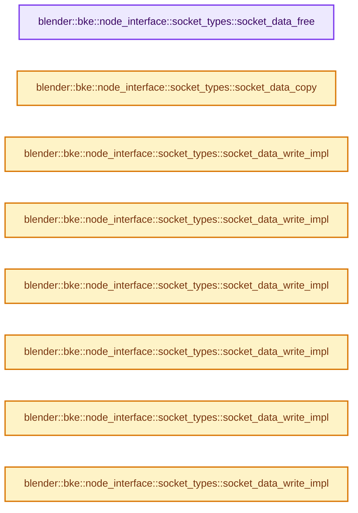
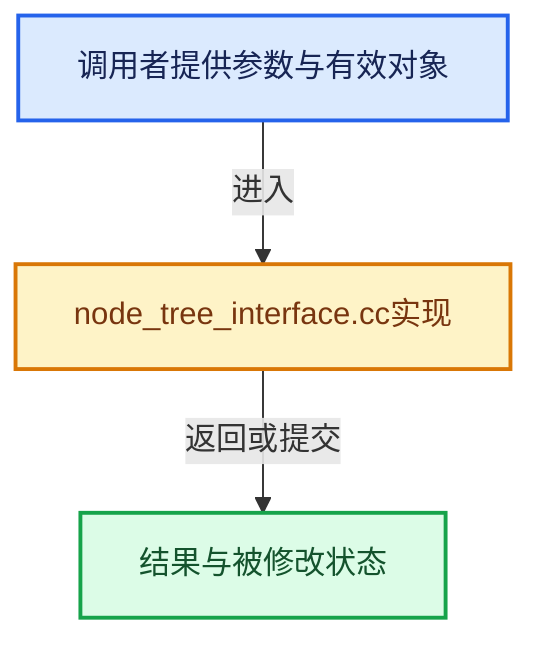

# 实现依赖专题：source/blender/blenkernel/intern/node_tree_interface.cc

[实现依赖导航](../../README.md) · [符号索引](../../../00-课程指南/02-源码与提交索引/符号依赖与实现索引.md)

本专题从正文实际调用进入，集中保存共享实现。函数有稳定锚点，可从调用处直接跳到对应完整函数；递归与互相调用通过回链组织。

## 本文件的实现关系






## 完整成员与函数实现

<a id="f-47994289f4bafa79"></a>

### `blender::bke::node_interface::socket_types::socket_data_free`

实现位置：[source/blender/blenkernel/intern/node_tree_interface.cc](../../../../../../../source/blender/blenkernel/intern/node_tree_interface.cc) · L90—L99。

接口参数：

- `bNodeTreeInterfaceSocket &socket`
- `const bool do_id_user`

**教学注释版**

<!-- annotated:9a291429561fac -->

```cpp
static void socket_data_free(bNodeTreeInterfaceSocket &socket, const bool do_id_user)
{
  if (socket.socket_data == nullptr) {
    return;
  }
  if (const bNodeSocketType *stype = socket.socket_typeinfo()) {
    socket_value_free(stype->type, socket.socket_data, do_id_user);
  }
  socket.socket_data = nullptr;
}
```

<details>
<summary>核对原始源码：source/blender/blenkernel/intern/node_tree_interface.cc · L90—L99</summary>

<!-- original:9a291429561fac:source/blender/blenkernel/intern/node_tree_interface.cc:90:99 -->

```cpp
static void socket_data_free(bNodeTreeInterfaceSocket &socket, const bool do_id_user)
{
  if (socket.socket_data == nullptr) {
    return;
  }
  if (const bNodeSocketType *stype = socket.socket_typeinfo()) {
    socket_value_free(stype->type, socket.socket_data, do_id_user);
  }
  socket.socket_data = nullptr;
}
```

</details>

**沿实际写入检查状态**

- `socket.socket_data = nullptr;`

**继续追踪实现**

- `socket.socket_typeinfo` → [blender::bNodeTreeInterfaceSocket::socket_typeinfo · L770](node_tree_interface.cc.md#f-f6d586e3bc159207)。
- `socket_value_free` → [blender::bke::socket_value_free · L3347](node.cc.md#f-db44183b55ebdcac)。

<a id="f-d16cb6fce22edebf"></a>

### `blender::bke::node_interface::socket_types::socket_data_copy`

实现位置：[source/blender/blenkernel/intern/node_tree_interface.cc](../../../../../../../source/blender/blenkernel/intern/node_tree_interface.cc) · L107—L115。

接口参数：

- `bNodeTreeInterfaceSocket &dst`
- `const bNodeTreeInterfaceSocket &src`
- `int flag`

**教学注释版**

<!-- annotated:088470b57d3216 -->

```cpp
static void socket_data_copy(bNodeTreeInterfaceSocket &dst,
                             const bNodeTreeInterfaceSocket &src,
                             int flag)
{
  const bool do_id_user = (flag & LIB_ID_CREATE_NO_USER_REFCOUNT) == 0;
  if (const bNodeSocketType *stype = src.socket_typeinfo()) {
    dst.socket_data = socket_value_copy(stype->type, src.socket_data, do_id_user);
  }
}
```

<details>
<summary>核对原始源码：source/blender/blenkernel/intern/node_tree_interface.cc · L107—L115</summary>

<!-- original:088470b57d3216:source/blender/blenkernel/intern/node_tree_interface.cc:107:115 -->

```cpp
static void socket_data_copy(bNodeTreeInterfaceSocket &dst,
                             const bNodeTreeInterfaceSocket &src,
                             int flag)
{
  const bool do_id_user = (flag & LIB_ID_CREATE_NO_USER_REFCOUNT) == 0;
  if (const bNodeSocketType *stype = src.socket_typeinfo()) {
    dst.socket_data = socket_value_copy(stype->type, src.socket_data, do_id_user);
  }
}
```

</details>

**沿实际写入检查状态**

- `dst.socket_data = socket_value_copy(stype->type, src.socket_data, do_id_user);`

**继续追踪实现**

- `src.socket_typeinfo` → [blender::bNodeTreeInterfaceSocket::socket_typeinfo · L770](node_tree_interface.cc.md#f-f6d586e3bc159207)。
- `socket_value_copy` → [blender::bke::socket_value_copy · L3285](node.cc.md#f-bcc489adbba3c689)。

<a id="f-a0cceb0d3c34581e"></a>

### `blender::bke::node_interface::socket_types::socket_data_write_impl`

实现位置：[source/blender/blenkernel/intern/node_tree_interface.cc](../../../../../../../source/blender/blenkernel/intern/node_tree_interface.cc) · L140—L143。

接口参数：

- `BlendWriter *writer`
- `bNodeSocketValueFloat &data`

**教学注释版**

<!-- annotated:356bed6f4ce1c6 -->

```cpp
inline void socket_data_write_impl(BlendWriter *writer, bNodeSocketValueFloat &data)
{
  writer->write_struct(&data);
}
```

<details>
<summary>核对原始源码：source/blender/blenkernel/intern/node_tree_interface.cc · L140—L143</summary>

<!-- original:356bed6f4ce1c6:source/blender/blenkernel/intern/node_tree_interface.cc:140:143 -->

```cpp
inline void socket_data_write_impl(BlendWriter *writer, bNodeSocketValueFloat &data)
{
  writer->write_struct(&data);
}
```

</details>

**继续追踪实现**

- `writer->write_struct` → [blender::BlendWriter::write_struct · L236](../../08-其他Blender模块/blenloader/BLO_read_write.hh.md#f-65ffd01269f4b779)。

<a id="f-eae27cd5791e4088"></a>

### `blender::bke::node_interface::socket_types::socket_data_write_impl`

实现位置：[source/blender/blenkernel/intern/node_tree_interface.cc](../../../../../../../source/blender/blenkernel/intern/node_tree_interface.cc) · L144—L147。

接口参数：

- `BlendWriter *writer`
- `bNodeSocketValueInt &data`

**教学注释版**

<!-- annotated:731fcf4ae40ba2 -->

```cpp
inline void socket_data_write_impl(BlendWriter *writer, bNodeSocketValueInt &data)
{
  writer->write_struct(&data);
}
```

<details>
<summary>核对原始源码：source/blender/blenkernel/intern/node_tree_interface.cc · L144—L147</summary>

<!-- original:731fcf4ae40ba2:source/blender/blenkernel/intern/node_tree_interface.cc:144:147 -->

```cpp
inline void socket_data_write_impl(BlendWriter *writer, bNodeSocketValueInt &data)
{
  writer->write_struct(&data);
}
```

</details>

**继续追踪实现**

- `writer->write_struct` → [blender::BlendWriter::write_struct · L236](../../08-其他Blender模块/blenloader/BLO_read_write.hh.md#f-65ffd01269f4b779)。

<a id="f-cd5faafb9265cac3"></a>

### `blender::bke::node_interface::socket_types::socket_data_write_impl`

实现位置：[source/blender/blenkernel/intern/node_tree_interface.cc](../../../../../../../source/blender/blenkernel/intern/node_tree_interface.cc) · L148—L151。

接口参数：

- `BlendWriter *writer`
- `bNodeSocketValueBoolean &data`

**教学注释版**

<!-- annotated:afa77635499b78 -->

```cpp
inline void socket_data_write_impl(BlendWriter *writer, bNodeSocketValueBoolean &data)
{
  writer->write_struct(&data);
}
```

<details>
<summary>核对原始源码：source/blender/blenkernel/intern/node_tree_interface.cc · L148—L151</summary>

<!-- original:afa77635499b78:source/blender/blenkernel/intern/node_tree_interface.cc:148:151 -->

```cpp
inline void socket_data_write_impl(BlendWriter *writer, bNodeSocketValueBoolean &data)
{
  writer->write_struct(&data);
}
```

</details>

**继续追踪实现**

- `writer->write_struct` → [blender::BlendWriter::write_struct · L236](../../08-其他Blender模块/blenloader/BLO_read_write.hh.md#f-65ffd01269f4b779)。

<a id="f-389a6f84f6fe7be3"></a>

### `blender::bke::node_interface::socket_types::socket_data_write_impl`

实现位置：[source/blender/blenkernel/intern/node_tree_interface.cc](../../../../../../../source/blender/blenkernel/intern/node_tree_interface.cc) · L152—L155。

接口参数：

- `BlendWriter *writer`
- `bNodeSocketValueRotation &data`

**教学注释版**

<!-- annotated:89799de270e675 -->

```cpp
inline void socket_data_write_impl(BlendWriter *writer, bNodeSocketValueRotation &data)
{
  writer->write_struct(&data);
}
```

<details>
<summary>核对原始源码：source/blender/blenkernel/intern/node_tree_interface.cc · L152—L155</summary>

<!-- original:89799de270e675:source/blender/blenkernel/intern/node_tree_interface.cc:152:155 -->

```cpp
inline void socket_data_write_impl(BlendWriter *writer, bNodeSocketValueRotation &data)
{
  writer->write_struct(&data);
}
```

</details>

**继续追踪实现**

- `writer->write_struct` → [blender::BlendWriter::write_struct · L236](../../08-其他Blender模块/blenloader/BLO_read_write.hh.md#f-65ffd01269f4b779)。

<a id="f-0b1b1ada25db0e03"></a>

### `blender::bke::node_interface::socket_types::socket_data_write_impl`

实现位置：[source/blender/blenkernel/intern/node_tree_interface.cc](../../../../../../../source/blender/blenkernel/intern/node_tree_interface.cc) · L156—L159。

接口参数：

- `BlendWriter *writer`
- `bNodeSocketValueVector &data`

**教学注释版**

<!-- annotated:b80c000a4e8961 -->

```cpp
inline void socket_data_write_impl(BlendWriter *writer, bNodeSocketValueVector &data)
{
  writer->write_struct(&data);
}
```

<details>
<summary>核对原始源码：source/blender/blenkernel/intern/node_tree_interface.cc · L156—L159</summary>

<!-- original:b80c000a4e8961:source/blender/blenkernel/intern/node_tree_interface.cc:156:159 -->

```cpp
inline void socket_data_write_impl(BlendWriter *writer, bNodeSocketValueVector &data)
{
  writer->write_struct(&data);
}
```

</details>

**继续追踪实现**

- `writer->write_struct` → [blender::BlendWriter::write_struct · L236](../../08-其他Blender模块/blenloader/BLO_read_write.hh.md#f-65ffd01269f4b779)。

<a id="f-63ffb06ab34543c5"></a>

### `blender::bke::node_interface::socket_types::socket_data_write_impl`

实现位置：[source/blender/blenkernel/intern/node_tree_interface.cc](../../../../../../../source/blender/blenkernel/intern/node_tree_interface.cc) · L160—L163。

接口参数：

- `BlendWriter *writer`
- `bNodeSocketValueRGBA &data`

**教学注释版**

<!-- annotated:324c650f08bbcc -->

```cpp
inline void socket_data_write_impl(BlendWriter *writer, bNodeSocketValueRGBA &data)
{
  writer->write_struct(&data);
}
```

<details>
<summary>核对原始源码：source/blender/blenkernel/intern/node_tree_interface.cc · L160—L163</summary>

<!-- original:324c650f08bbcc:source/blender/blenkernel/intern/node_tree_interface.cc:160:163 -->

```cpp
inline void socket_data_write_impl(BlendWriter *writer, bNodeSocketValueRGBA &data)
{
  writer->write_struct(&data);
}
```

</details>

**继续追踪实现**

- `writer->write_struct` → [blender::BlendWriter::write_struct · L236](../../08-其他Blender模块/blenloader/BLO_read_write.hh.md#f-65ffd01269f4b779)。

<a id="f-0e447aa83f0d19c7"></a>

### `blender::bke::node_interface::socket_types::socket_data_write_impl`

实现位置：[source/blender/blenkernel/intern/node_tree_interface.cc](../../../../../../../source/blender/blenkernel/intern/node_tree_interface.cc) · L164—L167。

接口参数：

- `BlendWriter *writer`
- `bNodeSocketValueString &data`

**教学注释版**

<!-- annotated:cd5a654eddafbc -->

```cpp
inline void socket_data_write_impl(BlendWriter *writer, bNodeSocketValueString &data)
{
  writer->write_struct(&data);
}
```

<details>
<summary>核对原始源码：source/blender/blenkernel/intern/node_tree_interface.cc · L164—L167</summary>

<!-- original:cd5a654eddafbc:source/blender/blenkernel/intern/node_tree_interface.cc:164:167 -->

```cpp
inline void socket_data_write_impl(BlendWriter *writer, bNodeSocketValueString &data)
{
  writer->write_struct(&data);
}
```

</details>

**继续追踪实现**

- `writer->write_struct` → [blender::BlendWriter::write_struct · L236](../../08-其他Blender模块/blenloader/BLO_read_write.hh.md#f-65ffd01269f4b779)。

<a id="f-1f6f3bfacd2d5e5f"></a>

### `blender::bke::node_interface::socket_types::socket_data_write_impl`

实现位置：[source/blender/blenkernel/intern/node_tree_interface.cc](../../../../../../../source/blender/blenkernel/intern/node_tree_interface.cc) · L168—L171。

接口参数：

- `BlendWriter *writer`
- `bNodeSocketValueObject &data`

**教学注释版**

<!-- annotated:19c97e783b2084 -->

```cpp
inline void socket_data_write_impl(BlendWriter *writer, bNodeSocketValueObject &data)
{
  writer->write_struct(&data);
}
```

<details>
<summary>核对原始源码：source/blender/blenkernel/intern/node_tree_interface.cc · L168—L171</summary>

<!-- original:19c97e783b2084:source/blender/blenkernel/intern/node_tree_interface.cc:168:171 -->

```cpp
inline void socket_data_write_impl(BlendWriter *writer, bNodeSocketValueObject &data)
{
  writer->write_struct(&data);
}
```

</details>

**继续追踪实现**

- `writer->write_struct` → [blender::BlendWriter::write_struct · L236](../../08-其他Blender模块/blenloader/BLO_read_write.hh.md#f-65ffd01269f4b779)。

<a id="f-cdcc9aa279477ad5"></a>

### `blender::bke::node_interface::socket_types::socket_data_write_impl`

实现位置：[source/blender/blenkernel/intern/node_tree_interface.cc](../../../../../../../source/blender/blenkernel/intern/node_tree_interface.cc) · L172—L175。

接口参数：

- `BlendWriter *writer`
- `bNodeSocketValueImage &data`

**教学注释版**

<!-- annotated:53abda6a92bad2 -->

```cpp
inline void socket_data_write_impl(BlendWriter *writer, bNodeSocketValueImage &data)
{
  writer->write_struct(&data);
}
```

<details>
<summary>核对原始源码：source/blender/blenkernel/intern/node_tree_interface.cc · L172—L175</summary>

<!-- original:53abda6a92bad2:source/blender/blenkernel/intern/node_tree_interface.cc:172:175 -->

```cpp
inline void socket_data_write_impl(BlendWriter *writer, bNodeSocketValueImage &data)
{
  writer->write_struct(&data);
}
```

</details>

**继续追踪实现**

- `writer->write_struct` → [blender::BlendWriter::write_struct · L236](../../08-其他Blender模块/blenloader/BLO_read_write.hh.md#f-65ffd01269f4b779)。

<a id="f-3f569a3f9ec8a59b"></a>

### `blender::bke::node_interface::socket_types::socket_data_write_impl`

实现位置：[source/blender/blenkernel/intern/node_tree_interface.cc](../../../../../../../source/blender/blenkernel/intern/node_tree_interface.cc) · L176—L179。

接口参数：

- `BlendWriter *writer`
- `bNodeSocketValueCollection &data`

**教学注释版**

<!-- annotated:25aa54c7addcc0 -->

```cpp
inline void socket_data_write_impl(BlendWriter *writer, bNodeSocketValueCollection &data)
{
  writer->write_struct(&data);
}
```

<details>
<summary>核对原始源码：source/blender/blenkernel/intern/node_tree_interface.cc · L176—L179</summary>

<!-- original:25aa54c7addcc0:source/blender/blenkernel/intern/node_tree_interface.cc:176:179 -->

```cpp
inline void socket_data_write_impl(BlendWriter *writer, bNodeSocketValueCollection &data)
{
  writer->write_struct(&data);
}
```

</details>

**继续追踪实现**

- `writer->write_struct` → [blender::BlendWriter::write_struct · L236](../../08-其他Blender模块/blenloader/BLO_read_write.hh.md#f-65ffd01269f4b779)。

<a id="f-b049ba4c5d0663c0"></a>

### `blender::bke::node_interface::socket_types::socket_data_write_impl`

实现位置：[source/blender/blenkernel/intern/node_tree_interface.cc](../../../../../../../source/blender/blenkernel/intern/node_tree_interface.cc) · L180—L183。

接口参数：

- `BlendWriter *writer`
- `bNodeSocketValueTexture &data`

**教学注释版**

<!-- annotated:4b54dbbab637a6 -->

```cpp
inline void socket_data_write_impl(BlendWriter *writer, bNodeSocketValueTexture &data)
{
  writer->write_struct(&data);
}
```

<details>
<summary>核对原始源码：source/blender/blenkernel/intern/node_tree_interface.cc · L180—L183</summary>

<!-- original:4b54dbbab637a6:source/blender/blenkernel/intern/node_tree_interface.cc:180:183 -->

```cpp
inline void socket_data_write_impl(BlendWriter *writer, bNodeSocketValueTexture &data)
{
  writer->write_struct(&data);
}
```

</details>

**继续追踪实现**

- `writer->write_struct` → [blender::BlendWriter::write_struct · L236](../../08-其他Blender模块/blenloader/BLO_read_write.hh.md#f-65ffd01269f4b779)。

<a id="f-b56f56f83eff60a3"></a>

### `blender::bke::node_interface::socket_types::socket_data_write_impl`

实现位置：[source/blender/blenkernel/intern/node_tree_interface.cc](../../../../../../../source/blender/blenkernel/intern/node_tree_interface.cc) · L184—L187。

接口参数：

- `BlendWriter *writer`
- `bNodeSocketValueMaterial &data`

**教学注释版**

<!-- annotated:f2b33f56beabc5 -->

```cpp
inline void socket_data_write_impl(BlendWriter *writer, bNodeSocketValueMaterial &data)
{
  writer->write_struct(&data);
}
```

<details>
<summary>核对原始源码：source/blender/blenkernel/intern/node_tree_interface.cc · L184—L187</summary>

<!-- original:f2b33f56beabc5:source/blender/blenkernel/intern/node_tree_interface.cc:184:187 -->

```cpp
inline void socket_data_write_impl(BlendWriter *writer, bNodeSocketValueMaterial &data)
{
  writer->write_struct(&data);
}
```

</details>

**继续追踪实现**

- `writer->write_struct` → [blender::BlendWriter::write_struct · L236](../../08-其他Blender模块/blenloader/BLO_read_write.hh.md#f-65ffd01269f4b779)。

<a id="f-982e85efad72e9ed"></a>

### `blender::bke::node_interface::socket_types::socket_data_write_impl`

实现位置：[source/blender/blenkernel/intern/node_tree_interface.cc](../../../../../../../source/blender/blenkernel/intern/node_tree_interface.cc) · L188—L191。

接口参数：

- `BlendWriter *writer`
- `bNodeSocketValueFont &data`

**教学注释版**

<!-- annotated:00d4883c32ed7b -->

```cpp
inline void socket_data_write_impl(BlendWriter *writer, bNodeSocketValueFont &data)
{
  writer->write_struct(&data);
}
```

<details>
<summary>核对原始源码：source/blender/blenkernel/intern/node_tree_interface.cc · L188—L191</summary>

<!-- original:00d4883c32ed7b:source/blender/blenkernel/intern/node_tree_interface.cc:188:191 -->

```cpp
inline void socket_data_write_impl(BlendWriter *writer, bNodeSocketValueFont &data)
{
  writer->write_struct(&data);
}
```

</details>

**继续追踪实现**

- `writer->write_struct` → [blender::BlendWriter::write_struct · L236](../../08-其他Blender模块/blenloader/BLO_read_write.hh.md#f-65ffd01269f4b779)。

<a id="f-13d6414f91779ddb"></a>

### `blender::bke::node_interface::socket_types::socket_data_write_impl`

实现位置：[source/blender/blenkernel/intern/node_tree_interface.cc](../../../../../../../source/blender/blenkernel/intern/node_tree_interface.cc) · L192—L195。

接口参数：

- `BlendWriter *writer`
- `bNodeSocketValueScene &data`

**教学注释版**

<!-- annotated:56324a801d9bea -->

```cpp
inline void socket_data_write_impl(BlendWriter *writer, bNodeSocketValueScene &data)
{
  writer->write_struct(&data);
}
```

<details>
<summary>核对原始源码：source/blender/blenkernel/intern/node_tree_interface.cc · L192—L195</summary>

<!-- original:56324a801d9bea:source/blender/blenkernel/intern/node_tree_interface.cc:192:195 -->

```cpp
inline void socket_data_write_impl(BlendWriter *writer, bNodeSocketValueScene &data)
{
  writer->write_struct(&data);
}
```

</details>

**继续追踪实现**

- `writer->write_struct` → [blender::BlendWriter::write_struct · L236](../../08-其他Blender模块/blenloader/BLO_read_write.hh.md#f-65ffd01269f4b779)。

<a id="f-e1ab58b4cbba6dbe"></a>

### `blender::bke::node_interface::socket_types::socket_data_write_impl`

实现位置：[source/blender/blenkernel/intern/node_tree_interface.cc](../../../../../../../source/blender/blenkernel/intern/node_tree_interface.cc) · L196—L199。

接口参数：

- `BlendWriter *writer`
- `bNodeSocketValueText &data`

**教学注释版**

<!-- annotated:47902a5c1a86ec -->

```cpp
inline void socket_data_write_impl(BlendWriter *writer, bNodeSocketValueText &data)
{
  writer->write_struct(&data);
}
```

<details>
<summary>核对原始源码：source/blender/blenkernel/intern/node_tree_interface.cc · L196—L199</summary>

<!-- original:47902a5c1a86ec:source/blender/blenkernel/intern/node_tree_interface.cc:196:199 -->

```cpp
inline void socket_data_write_impl(BlendWriter *writer, bNodeSocketValueText &data)
{
  writer->write_struct(&data);
}
```

</details>

**继续追踪实现**

- `writer->write_struct` → [blender::BlendWriter::write_struct · L236](../../08-其他Blender模块/blenloader/BLO_read_write.hh.md#f-65ffd01269f4b779)。

<a id="f-fbeced1e2a652a90"></a>

### `blender::bke::node_interface::socket_types::socket_data_write_impl`

实现位置：[source/blender/blenkernel/intern/node_tree_interface.cc](../../../../../../../source/blender/blenkernel/intern/node_tree_interface.cc) · L200—L203。

接口参数：

- `BlendWriter *writer`
- `bNodeSocketValueMask &data`

**教学注释版**

<!-- annotated:b6c672d4e36334 -->

```cpp
inline void socket_data_write_impl(BlendWriter *writer, bNodeSocketValueMask &data)
{
  writer->write_struct(&data);
}
```

<details>
<summary>核对原始源码：source/blender/blenkernel/intern/node_tree_interface.cc · L200—L203</summary>

<!-- original:b6c672d4e36334:source/blender/blenkernel/intern/node_tree_interface.cc:200:203 -->

```cpp
inline void socket_data_write_impl(BlendWriter *writer, bNodeSocketValueMask &data)
{
  writer->write_struct(&data);
}
```

</details>

**继续追踪实现**

- `writer->write_struct` → [blender::BlendWriter::write_struct · L236](../../08-其他Blender模块/blenloader/BLO_read_write.hh.md#f-65ffd01269f4b779)。

<a id="f-8e17a9764a67ee8c"></a>

### `blender::bke::node_interface::socket_types::socket_data_write_impl`

实现位置：[source/blender/blenkernel/intern/node_tree_interface.cc](../../../../../../../source/blender/blenkernel/intern/node_tree_interface.cc) · L204—L207。

接口参数：

- `BlendWriter *writer`
- `bNodeSocketValueSound &data`

**教学注释版**

<!-- annotated:d5f65a6193fb24 -->

```cpp
inline void socket_data_write_impl(BlendWriter *writer, bNodeSocketValueSound &data)
{
  writer->write_struct(&data);
}
```

<details>
<summary>核对原始源码：source/blender/blenkernel/intern/node_tree_interface.cc · L204—L207</summary>

<!-- original:d5f65a6193fb24:source/blender/blenkernel/intern/node_tree_interface.cc:204:207 -->

```cpp
inline void socket_data_write_impl(BlendWriter *writer, bNodeSocketValueSound &data)
{
  writer->write_struct(&data);
}
```

</details>

**继续追踪实现**

- `writer->write_struct` → [blender::BlendWriter::write_struct · L236](../../08-其他Blender模块/blenloader/BLO_read_write.hh.md#f-65ffd01269f4b779)。

<a id="f-7be88e262cdaad40"></a>

### `blender::bke::node_interface::socket_types::socket_data_write_impl`

实现位置：[source/blender/blenkernel/intern/node_tree_interface.cc](../../../../../../../source/blender/blenkernel/intern/node_tree_interface.cc) · L208—L211。

接口参数：

- `BlendWriter *writer`
- `bNodeSocketValueMenu &data`

**教学注释版**

<!-- annotated:b6db0e50e90c25 -->

```cpp
inline void socket_data_write_impl(BlendWriter *writer, bNodeSocketValueMenu &data)
{
  writer->write_struct(&data);
}
```

<details>
<summary>核对原始源码：source/blender/blenkernel/intern/node_tree_interface.cc · L208—L211</summary>

<!-- original:b6db0e50e90c25:source/blender/blenkernel/intern/node_tree_interface.cc:208:211 -->

```cpp
inline void socket_data_write_impl(BlendWriter *writer, bNodeSocketValueMenu &data)
{
  writer->write_struct(&data);
}
```

</details>

**继续追踪实现**

- `writer->write_struct` → [blender::BlendWriter::write_struct · L236](../../08-其他Blender模块/blenloader/BLO_read_write.hh.md#f-65ffd01269f4b779)。

<a id="f-d74723b53fba6843"></a>

### `blender::bke::node_interface::socket_types::socket_data_write_impl`

实现位置：[source/blender/blenkernel/intern/node_tree_interface.cc](../../../../../../../source/blender/blenkernel/intern/node_tree_interface.cc) · L212—L215。

接口参数：

- `BlendWriter *writer`
- `bNodeSocketValueIntVector &data`

**教学注释版**

<!-- annotated:a1420176956a1a -->

```cpp
inline void socket_data_write_impl(BlendWriter *writer, bNodeSocketValueIntVector &data)
{
  writer->write_struct(&data);
}
```

<details>
<summary>核对原始源码：source/blender/blenkernel/intern/node_tree_interface.cc · L212—L215</summary>

<!-- original:a1420176956a1a:source/blender/blenkernel/intern/node_tree_interface.cc:212:215 -->

```cpp
inline void socket_data_write_impl(BlendWriter *writer, bNodeSocketValueIntVector &data)
{
  writer->write_struct(&data);
}
```

</details>

**继续追踪实现**

- `writer->write_struct` → [blender::BlendWriter::write_struct · L236](../../08-其他Blender模块/blenloader/BLO_read_write.hh.md#f-65ffd01269f4b779)。

<a id="f-7a18ce5ebbfcc677"></a>

### `blender::bke::node_interface::socket_types::socket_data_write`

实现位置：[source/blender/blenkernel/intern/node_tree_interface.cc](../../../../../../../source/blender/blenkernel/intern/node_tree_interface.cc) · L217—L222。

接口参数：

- `BlendWriter *writer`
- `bNodeTreeInterfaceSocket &socket`

**教学注释版**

<!-- annotated:b2f43afa68b9c6 -->

```cpp
static void socket_data_write(BlendWriter *writer, bNodeTreeInterfaceSocket &socket)
{
  socket_data_to_static_type(socket.socket_type, [&]<typename SocketDataType>() {
    socket_data_write_impl(writer, get_socket_data_as<SocketDataType>(socket));
  });
}
```

<details>
<summary>核对原始源码：source/blender/blenkernel/intern/node_tree_interface.cc · L217—L222</summary>

<!-- original:b2f43afa68b9c6:source/blender/blenkernel/intern/node_tree_interface.cc:217:222 -->

```cpp
static void socket_data_write(BlendWriter *writer, bNodeTreeInterfaceSocket &socket)
{
  socket_data_to_static_type(socket.socket_type, [&]<typename SocketDataType>() {
    socket_data_write_impl(writer, get_socket_data_as<SocketDataType>(socket));
  });
}
```

</details>

**继续追踪实现**

- `socket_data_to_static_type` → [blender::bke::node_interface::socket_types::socket_data_to_static_type · L306](../BKE_node_tree_interface.hh.md#f-73ef587f4bfa1589)。
- `socket_data_write_impl` → [blender::bke::node_interface::socket_types::socket_data_write_impl · L140](node_tree_interface.cc.md#f-a0cceb0d3c34581e)；[blender::bke::node_interface::socket_types::socket_data_write_impl · L144](node_tree_interface.cc.md#f-eae27cd5791e4088)；[blender::bke::node_interface::socket_types::socket_data_write_impl · L148](node_tree_interface.cc.md#f-cd5faafb9265cac3)；[blender::bke::node_interface::socket_types::socket_data_write_impl · L152](node_tree_interface.cc.md#f-389a6f84f6fe7be3)；[blender::bke::node_interface::socket_types::socket_data_write_impl · L156](node_tree_interface.cc.md#f-0b1b1ada25db0e03)；[blender::bke::node_interface::socket_types::socket_data_write_impl · L160](node_tree_interface.cc.md#f-63ffb06ab34543c5)；[blender::bke::node_interface::socket_types::socket_data_write_impl · L164](node_tree_interface.cc.md#f-0e447aa83f0d19c7)；[blender::bke::node_interface::socket_types::socket_data_write_impl · L168](node_tree_interface.cc.md#f-1f6f3bfacd2d5e5f)；[blender::bke::node_interface::socket_types::socket_data_write_impl · L172](node_tree_interface.cc.md#f-cdcc9aa279477ad5)；[blender::bke::node_interface::socket_types::socket_data_write_impl · L176](node_tree_interface.cc.md#f-3f569a3f9ec8a59b)；[blender::bke::node_interface::socket_types::socket_data_write_impl · L180](node_tree_interface.cc.md#f-b049ba4c5d0663c0)；[blender::bke::node_interface::socket_types::socket_data_write_impl · L184](node_tree_interface.cc.md#f-b56f56f83eff60a3)；[blender::bke::node_interface::socket_types::socket_data_write_impl · L188](node_tree_interface.cc.md#f-982e85efad72e9ed)；[blender::bke::node_interface::socket_types::socket_data_write_impl · L192](node_tree_interface.cc.md#f-13d6414f91779ddb)；[blender::bke::node_interface::socket_types::socket_data_write_impl · L196](node_tree_interface.cc.md#f-e1ab58b4cbba6dbe)；[blender::bke::node_interface::socket_types::socket_data_write_impl · L200](node_tree_interface.cc.md#f-fbeced1e2a652a90)；[blender::bke::node_interface::socket_types::socket_data_write_impl · L204](node_tree_interface.cc.md#f-8e17a9764a67ee8c)；[blender::bke::node_interface::socket_types::socket_data_write_impl · L208](node_tree_interface.cc.md#f-7be88e262cdaad40)；[blender::bke::node_interface::socket_types::socket_data_write_impl · L212](node_tree_interface.cc.md#f-d74723b53fba6843)。同名重载需按实参类型选择。
- `get_socket_data_as<SocketDataType>` → [blender::bke::node_interface::get_socket_data_as · L327](../BKE_node_tree_interface.hh.md#f-ec1cf21faf45ae8d)；[blender::bke::node_interface::get_socket_data_as · L333](../BKE_node_tree_interface.hh.md#f-fb86310e2041c317)。同名重载需按实参类型选择。

<a id="f-ba60e8a4b5e9ad31"></a>

### `blender::bke::node_interface::socket_types::socket_data_foreach_id_impl`

实现位置：[source/blender/blenkernel/intern/node_tree_interface.cc](../../../../../../../source/blender/blenkernel/intern/node_tree_interface.cc) · L385—L388。

接口参数：

- `LibraryForeachIDData *`
- `T &`

**教学注释版**

<!-- annotated:ad6ff7da908ae6 -->

```cpp
template<typename T>
void socket_data_foreach_id_impl(LibraryForeachIDData * /*data*/, T & /*data*/)
{
}
```

<details>
<summary>核对原始源码：source/blender/blenkernel/intern/node_tree_interface.cc · L385—L388</summary>

<!-- original:ad6ff7da908ae6:source/blender/blenkernel/intern/node_tree_interface.cc:385:388 -->

```cpp
template<typename T>
void socket_data_foreach_id_impl(LibraryForeachIDData * /*data*/, T & /*data*/)
{
}
```

</details>

**继续追踪实现**

本实现没有需要继续展开的显式调用；检查返回表达式、对象转换和调用者前置条件。

<a id="f-5769eb305ee255a4"></a>

### `blender::bke::node_interface::socket_types::socket_data_foreach_id_impl`

实现位置：[source/blender/blenkernel/intern/node_tree_interface.cc](../../../../../../../source/blender/blenkernel/intern/node_tree_interface.cc) · L389—L392。

接口参数：

- `LibraryForeachIDData *cb`
- `bNodeSocketValueObject &data`

**教学注释版**

<!-- annotated:81561c918dc8fe -->

```cpp
template<> void socket_data_foreach_id_impl(LibraryForeachIDData *cb, bNodeSocketValueObject &data)
{
  BKE_LIB_FOREACHID_PROCESS_IDSUPER(cb, data.value, IDWALK_CB_USER);
}
```

<details>
<summary>核对原始源码：source/blender/blenkernel/intern/node_tree_interface.cc · L389—L392</summary>

<!-- original:81561c918dc8fe:source/blender/blenkernel/intern/node_tree_interface.cc:389:392 -->

```cpp
template<> void socket_data_foreach_id_impl(LibraryForeachIDData *cb, bNodeSocketValueObject &data)
{
  BKE_LIB_FOREACHID_PROCESS_IDSUPER(cb, data.value, IDWALK_CB_USER);
}
```

</details>

**继续追踪实现**

- `BKE_LIB_FOREACHID_PROCESS_IDSUPER` → [BKE_LIB_FOREACHID_PROCESS_IDSUPER · L293](../BKE_lib_query.hh.md#m-1b059b49d6cb)。宏定义由构建条件选择。

<a id="f-98b9fc978b3e50df"></a>

### `blender::bke::node_interface::socket_types::socket_data_foreach_id_impl`

实现位置：[source/blender/blenkernel/intern/node_tree_interface.cc](../../../../../../../source/blender/blenkernel/intern/node_tree_interface.cc) · L393—L396。

接口参数：

- `LibraryForeachIDData *cb`
- `bNodeSocketValueImage &data`

**教学注释版**

<!-- annotated:bfee4997d828e8 -->

```cpp
template<> void socket_data_foreach_id_impl(LibraryForeachIDData *cb, bNodeSocketValueImage &data)
{
  BKE_LIB_FOREACHID_PROCESS_IDSUPER(cb, data.value, IDWALK_CB_USER);
}
```

<details>
<summary>核对原始源码：source/blender/blenkernel/intern/node_tree_interface.cc · L393—L396</summary>

<!-- original:bfee4997d828e8:source/blender/blenkernel/intern/node_tree_interface.cc:393:396 -->

```cpp
template<> void socket_data_foreach_id_impl(LibraryForeachIDData *cb, bNodeSocketValueImage &data)
{
  BKE_LIB_FOREACHID_PROCESS_IDSUPER(cb, data.value, IDWALK_CB_USER);
}
```

</details>

**继续追踪实现**

- `BKE_LIB_FOREACHID_PROCESS_IDSUPER` → [BKE_LIB_FOREACHID_PROCESS_IDSUPER · L293](../BKE_lib_query.hh.md#m-1b059b49d6cb)。宏定义由构建条件选择。

<a id="f-dfa652dc1e3dd145"></a>

### `blender::bke::node_interface::socket_types::socket_data_foreach_id_impl`

实现位置：[source/blender/blenkernel/intern/node_tree_interface.cc](../../../../../../../source/blender/blenkernel/intern/node_tree_interface.cc) · L397—L401。

接口参数：

- `LibraryForeachIDData *cb`
- `bNodeSocketValueCollection &data`

**教学注释版**

<!-- annotated:61676f8010876d -->

```cpp
template<>
void socket_data_foreach_id_impl(LibraryForeachIDData *cb, bNodeSocketValueCollection &data)
{
  BKE_LIB_FOREACHID_PROCESS_IDSUPER(cb, data.value, IDWALK_CB_USER);
}
```

<details>
<summary>核对原始源码：source/blender/blenkernel/intern/node_tree_interface.cc · L397—L401</summary>

<!-- original:61676f8010876d:source/blender/blenkernel/intern/node_tree_interface.cc:397:401 -->

```cpp
template<>
void socket_data_foreach_id_impl(LibraryForeachIDData *cb, bNodeSocketValueCollection &data)
{
  BKE_LIB_FOREACHID_PROCESS_IDSUPER(cb, data.value, IDWALK_CB_USER);
}
```

</details>

**继续追踪实现**

- `BKE_LIB_FOREACHID_PROCESS_IDSUPER` → [BKE_LIB_FOREACHID_PROCESS_IDSUPER · L293](../BKE_lib_query.hh.md#m-1b059b49d6cb)。宏定义由构建条件选择。

<a id="f-df16159b995322d3"></a>

### `blender::bke::node_interface::socket_types::socket_data_foreach_id_impl`

实现位置：[source/blender/blenkernel/intern/node_tree_interface.cc](../../../../../../../source/blender/blenkernel/intern/node_tree_interface.cc) · L402—L406。

接口参数：

- `LibraryForeachIDData *cb`
- `bNodeSocketValueTexture &data`

**教学注释版**

<!-- annotated:8a88b112a48575 -->

```cpp
template<>
void socket_data_foreach_id_impl(LibraryForeachIDData *cb, bNodeSocketValueTexture &data)
{
  BKE_LIB_FOREACHID_PROCESS_IDSUPER(cb, data.value, IDWALK_CB_USER);
}
```

<details>
<summary>核对原始源码：source/blender/blenkernel/intern/node_tree_interface.cc · L402—L406</summary>

<!-- original:8a88b112a48575:source/blender/blenkernel/intern/node_tree_interface.cc:402:406 -->

```cpp
template<>
void socket_data_foreach_id_impl(LibraryForeachIDData *cb, bNodeSocketValueTexture &data)
{
  BKE_LIB_FOREACHID_PROCESS_IDSUPER(cb, data.value, IDWALK_CB_USER);
}
```

</details>

**继续追踪实现**

- `BKE_LIB_FOREACHID_PROCESS_IDSUPER` → [BKE_LIB_FOREACHID_PROCESS_IDSUPER · L293](../BKE_lib_query.hh.md#m-1b059b49d6cb)。宏定义由构建条件选择。

<a id="f-1df1cf0ca3d2f608"></a>

### `blender::bke::node_interface::socket_types::socket_data_foreach_id_impl`

实现位置：[source/blender/blenkernel/intern/node_tree_interface.cc](../../../../../../../source/blender/blenkernel/intern/node_tree_interface.cc) · L407—L411。

接口参数：

- `LibraryForeachIDData *cb`
- `bNodeSocketValueMaterial &data`

**教学注释版**

<!-- annotated:6ce3112733d93d -->

```cpp
template<>
void socket_data_foreach_id_impl(LibraryForeachIDData *cb, bNodeSocketValueMaterial &data)
{
  BKE_LIB_FOREACHID_PROCESS_IDSUPER(cb, data.value, IDWALK_CB_USER);
}
```

<details>
<summary>核对原始源码：source/blender/blenkernel/intern/node_tree_interface.cc · L407—L411</summary>

<!-- original:6ce3112733d93d:source/blender/blenkernel/intern/node_tree_interface.cc:407:411 -->

```cpp
template<>
void socket_data_foreach_id_impl(LibraryForeachIDData *cb, bNodeSocketValueMaterial &data)
{
  BKE_LIB_FOREACHID_PROCESS_IDSUPER(cb, data.value, IDWALK_CB_USER);
}
```

</details>

**继续追踪实现**

- `BKE_LIB_FOREACHID_PROCESS_IDSUPER` → [BKE_LIB_FOREACHID_PROCESS_IDSUPER · L293](../BKE_lib_query.hh.md#m-1b059b49d6cb)。宏定义由构建条件选择。

<a id="f-cdea3b1bc91068f9"></a>

### `blender::bke::node_interface::socket_types::socket_data_foreach_id_impl`

实现位置：[source/blender/blenkernel/intern/node_tree_interface.cc](../../../../../../../source/blender/blenkernel/intern/node_tree_interface.cc) · L412—L415。

接口参数：

- `LibraryForeachIDData *cb`
- `bNodeSocketValueFont &data`

**教学注释版**

<!-- annotated:4850e5db37a5f3 -->

```cpp
template<> void socket_data_foreach_id_impl(LibraryForeachIDData *cb, bNodeSocketValueFont &data)
{
  BKE_LIB_FOREACHID_PROCESS_IDSUPER(cb, data.value, IDWALK_CB_USER);
}
```

<details>
<summary>核对原始源码：source/blender/blenkernel/intern/node_tree_interface.cc · L412—L415</summary>

<!-- original:4850e5db37a5f3:source/blender/blenkernel/intern/node_tree_interface.cc:412:415 -->

```cpp
template<> void socket_data_foreach_id_impl(LibraryForeachIDData *cb, bNodeSocketValueFont &data)
{
  BKE_LIB_FOREACHID_PROCESS_IDSUPER(cb, data.value, IDWALK_CB_USER);
}
```

</details>

**继续追踪实现**

- `BKE_LIB_FOREACHID_PROCESS_IDSUPER` → [BKE_LIB_FOREACHID_PROCESS_IDSUPER · L293](../BKE_lib_query.hh.md#m-1b059b49d6cb)。宏定义由构建条件选择。

<a id="f-84a4994a602aa868"></a>

### `blender::bke::node_interface::socket_types::socket_data_foreach_id_impl`

实现位置：[source/blender/blenkernel/intern/node_tree_interface.cc](../../../../../../../source/blender/blenkernel/intern/node_tree_interface.cc) · L416—L419。

接口参数：

- `LibraryForeachIDData *cb`
- `bNodeSocketValueScene &data`

**教学注释版**

<!-- annotated:12f911be839ab6 -->

```cpp
template<> void socket_data_foreach_id_impl(LibraryForeachIDData *cb, bNodeSocketValueScene &data)
{
  BKE_LIB_FOREACHID_PROCESS_IDSUPER(cb, data.value, IDWALK_CB_USER);
}
```

<details>
<summary>核对原始源码：source/blender/blenkernel/intern/node_tree_interface.cc · L416—L419</summary>

<!-- original:12f911be839ab6:source/blender/blenkernel/intern/node_tree_interface.cc:416:419 -->

```cpp
template<> void socket_data_foreach_id_impl(LibraryForeachIDData *cb, bNodeSocketValueScene &data)
{
  BKE_LIB_FOREACHID_PROCESS_IDSUPER(cb, data.value, IDWALK_CB_USER);
}
```

</details>

**继续追踪实现**

- `BKE_LIB_FOREACHID_PROCESS_IDSUPER` → [BKE_LIB_FOREACHID_PROCESS_IDSUPER · L293](../BKE_lib_query.hh.md#m-1b059b49d6cb)。宏定义由构建条件选择。

<a id="f-2108d8471003412a"></a>

### `blender::bke::node_interface::socket_types::socket_data_foreach_id_impl`

实现位置：[source/blender/blenkernel/intern/node_tree_interface.cc](../../../../../../../source/blender/blenkernel/intern/node_tree_interface.cc) · L420—L423。

接口参数：

- `LibraryForeachIDData *cb`
- `bNodeSocketValueText &data`

**教学注释版**

<!-- annotated:f6ee1e2dcfa82e -->

```cpp
template<> void socket_data_foreach_id_impl(LibraryForeachIDData *cb, bNodeSocketValueText &data)
{
  BKE_LIB_FOREACHID_PROCESS_IDSUPER(cb, data.value, IDWALK_CB_USER);
}
```

<details>
<summary>核对原始源码：source/blender/blenkernel/intern/node_tree_interface.cc · L420—L423</summary>

<!-- original:f6ee1e2dcfa82e:source/blender/blenkernel/intern/node_tree_interface.cc:420:423 -->

```cpp
template<> void socket_data_foreach_id_impl(LibraryForeachIDData *cb, bNodeSocketValueText &data)
{
  BKE_LIB_FOREACHID_PROCESS_IDSUPER(cb, data.value, IDWALK_CB_USER);
}
```

</details>

**继续追踪实现**

- `BKE_LIB_FOREACHID_PROCESS_IDSUPER` → [BKE_LIB_FOREACHID_PROCESS_IDSUPER · L293](../BKE_lib_query.hh.md#m-1b059b49d6cb)。宏定义由构建条件选择。

<a id="f-e0bde97e48b4b34e"></a>

### `blender::bke::node_interface::socket_types::socket_data_foreach_id_impl`

实现位置：[source/blender/blenkernel/intern/node_tree_interface.cc](../../../../../../../source/blender/blenkernel/intern/node_tree_interface.cc) · L424—L427。

接口参数：

- `LibraryForeachIDData *cb`
- `bNodeSocketValueMask &data`

**教学注释版**

<!-- annotated:0384d93a5bb91b -->

```cpp
template<> void socket_data_foreach_id_impl(LibraryForeachIDData *cb, bNodeSocketValueMask &data)
{
  BKE_LIB_FOREACHID_PROCESS_IDSUPER(cb, data.value, IDWALK_CB_USER);
}
```

<details>
<summary>核对原始源码：source/blender/blenkernel/intern/node_tree_interface.cc · L424—L427</summary>

<!-- original:0384d93a5bb91b:source/blender/blenkernel/intern/node_tree_interface.cc:424:427 -->

```cpp
template<> void socket_data_foreach_id_impl(LibraryForeachIDData *cb, bNodeSocketValueMask &data)
{
  BKE_LIB_FOREACHID_PROCESS_IDSUPER(cb, data.value, IDWALK_CB_USER);
}
```

</details>

**继续追踪实现**

- `BKE_LIB_FOREACHID_PROCESS_IDSUPER` → [BKE_LIB_FOREACHID_PROCESS_IDSUPER · L293](../BKE_lib_query.hh.md#m-1b059b49d6cb)。宏定义由构建条件选择。

<a id="f-39345b9eb6aab2d2"></a>

### `blender::bke::node_interface::socket_types::socket_data_foreach_id_impl`

实现位置：[source/blender/blenkernel/intern/node_tree_interface.cc](../../../../../../../source/blender/blenkernel/intern/node_tree_interface.cc) · L428—L431。

接口参数：

- `LibraryForeachIDData *cb`
- `bNodeSocketValueSound &data`

**教学注释版**

<!-- annotated:f46296799297b1 -->

```cpp
template<> void socket_data_foreach_id_impl(LibraryForeachIDData *cb, bNodeSocketValueSound &data)
{
  BKE_LIB_FOREACHID_PROCESS_IDSUPER(cb, data.value, IDWALK_CB_USER);
}
```

<details>
<summary>核对原始源码：source/blender/blenkernel/intern/node_tree_interface.cc · L428—L431</summary>

<!-- original:f46296799297b1:source/blender/blenkernel/intern/node_tree_interface.cc:428:431 -->

```cpp
template<> void socket_data_foreach_id_impl(LibraryForeachIDData *cb, bNodeSocketValueSound &data)
{
  BKE_LIB_FOREACHID_PROCESS_IDSUPER(cb, data.value, IDWALK_CB_USER);
}
```

</details>

**继续追踪实现**

- `BKE_LIB_FOREACHID_PROCESS_IDSUPER` → [BKE_LIB_FOREACHID_PROCESS_IDSUPER · L293](../BKE_lib_query.hh.md#m-1b059b49d6cb)。宏定义由构建条件选择。

<a id="f-efd232075a48f75f"></a>

### `blender::bke::node_interface::socket_types::socket_data_foreach_id`

实现位置：[source/blender/blenkernel/intern/node_tree_interface.cc](../../../../../../../source/blender/blenkernel/intern/node_tree_interface.cc) · L433—L438。

接口参数：

- `LibraryForeachIDData *data`
- `bNodeTreeInterfaceSocket &socket`

**教学注释版**

<!-- annotated:2e674dbb405fd3 -->

```cpp
static void socket_data_foreach_id(LibraryForeachIDData *data, bNodeTreeInterfaceSocket &socket)
{
  socket_data_to_static_type(socket.socket_type, [&]<typename SocketDataType>() {
    socket_data_foreach_id_impl(data, get_socket_data_as<SocketDataType>(socket));
  });
}
```

<details>
<summary>核对原始源码：source/blender/blenkernel/intern/node_tree_interface.cc · L433—L438</summary>

<!-- original:2e674dbb405fd3:source/blender/blenkernel/intern/node_tree_interface.cc:433:438 -->

```cpp
static void socket_data_foreach_id(LibraryForeachIDData *data, bNodeTreeInterfaceSocket &socket)
{
  socket_data_to_static_type(socket.socket_type, [&]<typename SocketDataType>() {
    socket_data_foreach_id_impl(data, get_socket_data_as<SocketDataType>(socket));
  });
}
```

</details>

**继续追踪实现**

- `socket_data_to_static_type` → [blender::bke::node_interface::socket_types::socket_data_to_static_type · L306](../BKE_node_tree_interface.hh.md#f-73ef587f4bfa1589)。
- `socket_data_foreach_id_impl` → [blender::bke::node_interface::socket_types::socket_data_foreach_id_impl · L385](node_tree_interface.cc.md#f-ba60e8a4b5e9ad31)；[blender::bke::node_interface::socket_types::socket_data_foreach_id_impl · L389](node_tree_interface.cc.md#f-5769eb305ee255a4)；[blender::bke::node_interface::socket_types::socket_data_foreach_id_impl · L393](node_tree_interface.cc.md#f-98b9fc978b3e50df)；[blender::bke::node_interface::socket_types::socket_data_foreach_id_impl · L397](node_tree_interface.cc.md#f-dfa652dc1e3dd145)；[blender::bke::node_interface::socket_types::socket_data_foreach_id_impl · L402](node_tree_interface.cc.md#f-df16159b995322d3)；[blender::bke::node_interface::socket_types::socket_data_foreach_id_impl · L407](node_tree_interface.cc.md#f-1df1cf0ca3d2f608)；[blender::bke::node_interface::socket_types::socket_data_foreach_id_impl · L412](node_tree_interface.cc.md#f-cdea3b1bc91068f9)；[blender::bke::node_interface::socket_types::socket_data_foreach_id_impl · L416](node_tree_interface.cc.md#f-84a4994a602aa868)；[blender::bke::node_interface::socket_types::socket_data_foreach_id_impl · L420](node_tree_interface.cc.md#f-2108d8471003412a)；[blender::bke::node_interface::socket_types::socket_data_foreach_id_impl · L424](node_tree_interface.cc.md#f-e0bde97e48b4b34e)；[blender::bke::node_interface::socket_types::socket_data_foreach_id_impl · L428](node_tree_interface.cc.md#f-39345b9eb6aab2d2)。同名重载需按实参类型选择。
- `get_socket_data_as<SocketDataType>` → [blender::bke::node_interface::get_socket_data_as · L327](../BKE_node_tree_interface.hh.md#f-ec1cf21faf45ae8d)；[blender::bke::node_interface::get_socket_data_as · L333](../BKE_node_tree_interface.hh.md#f-fb86310e2041c317)。同名重载需按实参类型选择。

<a id="f-1cab5896cbeb0663"></a>

### `blender::bke::node_interface::item_types::panel_init`

实现位置：[source/blender/blenkernel/intern/node_tree_interface.cc](../../../../../../../source/blender/blenkernel/intern/node_tree_interface.cc) · L458—L472。

接口参数：

- `bNodeTreeInterfacePanel &panel`
- `const Span<const bNodeTreeInterfaceItem *> items_src`
- `const int flag`
- `UidGeneratorFn generate_uid`

**教学注释版**

<!-- annotated:2f8e8f775c3a2d -->

```cpp
static void panel_init(bNodeTreeInterfacePanel &panel,
                       const Span<const bNodeTreeInterfaceItem *> items_src,
                       const int flag,
                       UidGeneratorFn generate_uid)
{
  // [讲解] items_src.size：查询视图长度或生成对应有效索引区间。
  panel.items_num = items_src.size();
  panel.items_array = MEM_new_array_zeroed<bNodeTreeInterfaceItem *>(panel.items_num, __func__);

  /* Copy buffers. */
  // [讲解] items_src.index_range：查询视图长度或生成对应有效索引区间。
  for (const int i : items_src.index_range()) {
    const bNodeTreeInterfaceItem *item_src = items_src[i];
    panel.items_array[i] = MEM_dupalloc(item_src);
    item_types::item_copy(*panel.items_array[i], *item_src, flag, generate_uid);
  }
}
```

<details>
<summary>核对原始源码：source/blender/blenkernel/intern/node_tree_interface.cc · L458—L472</summary>

<!-- original:2f8e8f775c3a2d:source/blender/blenkernel/intern/node_tree_interface.cc:458:472 -->

```cpp
static void panel_init(bNodeTreeInterfacePanel &panel,
                       const Span<const bNodeTreeInterfaceItem *> items_src,
                       const int flag,
                       UidGeneratorFn generate_uid)
{
  panel.items_num = items_src.size();
  panel.items_array = MEM_new_array_zeroed<bNodeTreeInterfaceItem *>(panel.items_num, __func__);

  /* Copy buffers. */
  for (const int i : items_src.index_range()) {
    const bNodeTreeInterfaceItem *item_src = items_src[i];
    panel.items_array[i] = MEM_dupalloc(item_src);
    item_types::item_copy(*panel.items_array[i], *item_src, flag, generate_uid);
  }
}
```

</details>

**沿实际写入检查状态**

- `panel.items_num = items_src.size();`
- `panel.items_array = MEM_new_array_zeroed<bNodeTreeInterfaceItem *>(panel.items_num, __func__);`
- `panel.items_array[i] = MEM_dupalloc(item_src);`

**继续追踪实现**

- `items_src.size` → [blender::Span::size · L256](../../../01-基础容器与现代CPP/05-Span只读连续视图.md#f-5f80fa006089c998)。
- `MEM_new_array_zeroed<bNodeTreeInterfaceItem *>` → [MEM_new_array_zeroed · L566](../../07-Intern运行时与平台/guardedalloc/MEM_guardedalloc.h.md#f-3a0cf63fb5216500)；[MEM_new_array_zeroed · L119](../../07-Intern运行时与平台/guardedalloc/intern/mallocn.cc.md#f-6825557da566fdbe)。同名重载需按实参类型选择。
- `items_src.index_range` → [blender::Span::index_range · L405](../../../01-基础容器与现代CPP/05-Span只读连续视图.md#f-caaa9b06e13e53e0)。
- `MEM_dupalloc` → [MEM_dupalloc · L627](../../07-Intern运行时与平台/guardedalloc/MEM_guardedalloc.h.md#f-78a72b71e3c57010)。
- `item_types::item_copy` → [blender::bke::node_interface::item_types::item_copy · L479](node_tree_interface.cc.md#f-1e9cf4a53156c0cc)。

<a id="f-1e9cf4a53156c0cc"></a>

### `blender::bke::node_interface::item_types::item_copy`

实现位置：[source/blender/blenkernel/intern/node_tree_interface.cc](../../../../../../../source/blender/blenkernel/intern/node_tree_interface.cc) · L479—L518。

接口参数：

- `bNodeTreeInterfaceItem &dst`
- `const bNodeTreeInterfaceItem &src`
- `const int flag`
- `UidGeneratorFn generate_uid`

**教学注释版**

<!-- annotated:5e13d0f5f4bae3 -->

```cpp
static void item_copy(bNodeTreeInterfaceItem &dst,
                      const bNodeTreeInterfaceItem &src,
                      const int flag,
                      UidGeneratorFn generate_uid)
{
  switch (dst.item_type) {
    case NodeTreeInterfaceItemType::Socket: {
      bNodeTreeInterfaceSocket &dst_socket = reinterpret_cast<bNodeTreeInterfaceSocket &>(dst);
      const bNodeTreeInterfaceSocket &src_socket =
          reinterpret_cast<const bNodeTreeInterfaceSocket &>(src);
      BLI_assert(src_socket.socket_type != nullptr);

      dst_socket.name_ = BLI_strdup_null(src_socket.name_);
      dst_socket.description_ = BLI_strdup_null(src_socket.description_);
      dst_socket.socket_type = BLI_strdup(src_socket.socket_type);
      dst_socket.default_attribute_name = BLI_strdup_null(src_socket.default_attribute_name);
      dst_socket.identifier = generate_uid ? BLI_sprintfN("Socket_%d", generate_uid()) :
                                             BLI_strdup(src_socket.identifier);
      if (src_socket.properties) {
        dst_socket.properties = IDP_CopyProperty_ex(src_socket.properties, flag);
      }
      if (src_socket.socket_data != nullptr) {
        socket_types::socket_data_copy(dst_socket, src_socket, flag);
      }
      break;
    }
    case NodeTreeInterfaceItemType::Panel: {
      bNodeTreeInterfacePanel &dst_panel = reinterpret_cast<bNodeTreeInterfacePanel &>(dst);
      const bNodeTreeInterfacePanel &src_panel = reinterpret_cast<const bNodeTreeInterfacePanel &>(
          src);

      dst_panel.name_ = BLI_strdup_null(src_panel.name_);
      dst_panel.description_ = BLI_strdup_null(src_panel.description_);
      dst_panel.identifier = generate_uid ? generate_uid() : src_panel.identifier;

      panel_init(dst_panel, src_panel.items(), flag, generate_uid);
      break;
    }
  }
}
```

<details>
<summary>核对原始源码：source/blender/blenkernel/intern/node_tree_interface.cc · L479—L518</summary>

<!-- original:5e13d0f5f4bae3:source/blender/blenkernel/intern/node_tree_interface.cc:479:518 -->

```cpp
static void item_copy(bNodeTreeInterfaceItem &dst,
                      const bNodeTreeInterfaceItem &src,
                      const int flag,
                      UidGeneratorFn generate_uid)
{
  switch (dst.item_type) {
    case NodeTreeInterfaceItemType::Socket: {
      bNodeTreeInterfaceSocket &dst_socket = reinterpret_cast<bNodeTreeInterfaceSocket &>(dst);
      const bNodeTreeInterfaceSocket &src_socket =
          reinterpret_cast<const bNodeTreeInterfaceSocket &>(src);
      BLI_assert(src_socket.socket_type != nullptr);

      dst_socket.name_ = BLI_strdup_null(src_socket.name_);
      dst_socket.description_ = BLI_strdup_null(src_socket.description_);
      dst_socket.socket_type = BLI_strdup(src_socket.socket_type);
      dst_socket.default_attribute_name = BLI_strdup_null(src_socket.default_attribute_name);
      dst_socket.identifier = generate_uid ? BLI_sprintfN("Socket_%d", generate_uid()) :
                                             BLI_strdup(src_socket.identifier);
      if (src_socket.properties) {
        dst_socket.properties = IDP_CopyProperty_ex(src_socket.properties, flag);
      }
      if (src_socket.socket_data != nullptr) {
        socket_types::socket_data_copy(dst_socket, src_socket, flag);
      }
      break;
    }
    case NodeTreeInterfaceItemType::Panel: {
      bNodeTreeInterfacePanel &dst_panel = reinterpret_cast<bNodeTreeInterfacePanel &>(dst);
      const bNodeTreeInterfacePanel &src_panel = reinterpret_cast<const bNodeTreeInterfacePanel &>(
          src);

      dst_panel.name_ = BLI_strdup_null(src_panel.name_);
      dst_panel.description_ = BLI_strdup_null(src_panel.description_);
      dst_panel.identifier = generate_uid ? generate_uid() : src_panel.identifier;

      panel_init(dst_panel, src_panel.items(), flag, generate_uid);
      break;
    }
  }
}
```

</details>

**沿实际写入检查状态**

- `dst_socket.name_ = BLI_strdup_null(src_socket.name_);`
- `dst_socket.description_ = BLI_strdup_null(src_socket.description_);`
- `dst_socket.socket_type = BLI_strdup(src_socket.socket_type);`
- `dst_socket.default_attribute_name = BLI_strdup_null(src_socket.default_attribute_name);`
- `dst_socket.identifier = generate_uid ? BLI_sprintfN("Socket_%d", generate_uid()) :`
- `dst_socket.properties = IDP_CopyProperty_ex(src_socket.properties, flag);`
- `dst_panel.name_ = BLI_strdup_null(src_panel.name_);`
- `dst_panel.description_ = BLI_strdup_null(src_panel.description_);`
- `dst_panel.identifier = generate_uid ? generate_uid() : src_panel.identifier;`

**继续追踪实现**

- `BLI_assert` → [BLI_assert · L48](../../01-BLI基础库/BLI_assert.hh.md#m-57a88495704d)；[BLI_assert · L63](../../01-BLI基础库/BLI_assert.hh.md#m-d07050020cb5)。宏定义由构建条件选择。
- `BLI_strdup_null` → [blender::BLI_strdup_null · L48](../../01-BLI基础库/intern/string.cc.md#f-c1cd7c6336fe3fe0)。
- `BLI_strdup` → [blender::BLI_strdup · L43](../../01-BLI基础库/intern/string.cc.md#f-7e6d5c696c20c0e1)。
- `BLI_sprintfN` → [blender::BLI_sprintfN · L296](../../01-BLI基础库/intern/string.cc.md#f-bfbc2f7076298fc0)。
- `generate_uid` → [调用协议](../../../00-课程指南/01-路线与规范/模板宏与动态分派协议.md)：局部可调用对象，须结合其初始化与捕获环境。调用位置L495。
- `IDP_CopyProperty_ex` → [blender::IDP_CopyProperty_ex · L968](idprop.cc.md#f-df4a72661231af0c)。
- `socket_types::socket_data_copy` → [blender::bke::node_interface::socket_types::socket_data_copy · L107](node_tree_interface.cc.md#f-d16cb6fce22edebf)。
- `panel_init` → [blender::bke::node_interface::item_types::panel_init · L458](node_tree_interface.cc.md#f-1cab5896cbeb0663)。
- `src_panel.items` → [blender::bNodeTreeInterfacePanel::items · L913](node_tree_interface.cc.md#f-8f062acb6aeed4ab)；[blender::bNodeTreeInterfacePanel::items · L918](node_tree_interface.cc.md#f-2ab0a0fed01de607)。同名重载需按实参类型选择。

<a id="f-739b1a1073f1965b"></a>

### `blender::bke::node_interface::item_types::item_free`

实现位置：[source/blender/blenkernel/intern/node_tree_interface.cc](../../../../../../../source/blender/blenkernel/intern/node_tree_interface.cc) · L520—L551。

接口参数：

- `bNodeTreeInterfaceItem &item`
- `const bool do_id_user`

**教学注释版**

<!-- annotated:2d20c9f428531d -->

```cpp
static void item_free(bNodeTreeInterfaceItem &item, const bool do_id_user)
{
  switch (item.item_type) {
    case NodeTreeInterfaceItemType::Socket: {
      bNodeTreeInterfaceSocket &socket = reinterpret_cast<bNodeTreeInterfaceSocket &>(item);

      if (socket.socket_data != nullptr) {
        socket_types::socket_data_free(socket, do_id_user);
      }

      MEM_SAFE_DELETE(socket.name_);
      MEM_SAFE_DELETE(socket.description_);
      MEM_SAFE_DELETE(socket.socket_type);
      MEM_SAFE_DELETE(socket.default_attribute_name);
      MEM_SAFE_DELETE(socket.identifier);
      if (socket.properties) {
        IDP_FreeProperty_ex(socket.properties, do_id_user);
      }
      break;
    }
    case NodeTreeInterfaceItemType::Panel: {
      bNodeTreeInterfacePanel &panel = reinterpret_cast<bNodeTreeInterfacePanel &>(item);

      panel.clear(do_id_user);
      MEM_SAFE_DELETE(panel.name_);
      MEM_SAFE_DELETE(panel.description_);
      break;
    }
  }

  MEM_delete(&item);
}
```

<details>
<summary>核对原始源码：source/blender/blenkernel/intern/node_tree_interface.cc · L520—L551</summary>

<!-- original:2d20c9f428531d:source/blender/blenkernel/intern/node_tree_interface.cc:520:551 -->

```cpp
static void item_free(bNodeTreeInterfaceItem &item, const bool do_id_user)
{
  switch (item.item_type) {
    case NodeTreeInterfaceItemType::Socket: {
      bNodeTreeInterfaceSocket &socket = reinterpret_cast<bNodeTreeInterfaceSocket &>(item);

      if (socket.socket_data != nullptr) {
        socket_types::socket_data_free(socket, do_id_user);
      }

      MEM_SAFE_DELETE(socket.name_);
      MEM_SAFE_DELETE(socket.description_);
      MEM_SAFE_DELETE(socket.socket_type);
      MEM_SAFE_DELETE(socket.default_attribute_name);
      MEM_SAFE_DELETE(socket.identifier);
      if (socket.properties) {
        IDP_FreeProperty_ex(socket.properties, do_id_user);
      }
      break;
    }
    case NodeTreeInterfaceItemType::Panel: {
      bNodeTreeInterfacePanel &panel = reinterpret_cast<bNodeTreeInterfacePanel &>(item);

      panel.clear(do_id_user);
      MEM_SAFE_DELETE(panel.name_);
      MEM_SAFE_DELETE(panel.description_);
      break;
    }
  }

  MEM_delete(&item);
}
```

</details>

**继续追踪实现**

- `socket_types::socket_data_free` → [blender::bke::node_interface::socket_types::socket_data_free · L90](node_tree_interface.cc.md#f-47994289f4bafa79)。
- `MEM_SAFE_DELETE` → [MEM_SAFE_DELETE · L436](../../07-Intern运行时与平台/guardedalloc/MEM_guardedalloc.h.md#m-eadb3bc5b902)。宏定义由构建条件选择。
- `IDP_FreeProperty_ex` → [blender::IDP_FreeProperty_ex · L1398](idprop.cc.md#f-4b1dc3efcf18b18c)。
- `panel.clear` → [blender::bNodeTreeInterfacePanel::clear · L1115](node_tree_interface.cc.md#f-ecd53bd40ed5c756)。
- `MEM_delete` → [MEM_delete · L400](../../07-Intern运行时与平台/guardedalloc/MEM_guardedalloc.h.md#f-9049ffdd1682887c)。

<a id="f-c387af4fcc2dcda7"></a>

### `blender::bke::node_interface::item_types::item_write_data`

实现位置：[source/blender/blenkernel/intern/node_tree_interface.cc](../../../../../../../source/blender/blenkernel/intern/node_tree_interface.cc) · L555—L583。

接口参数：

- `BlendWriter *writer`
- `bNodeTreeInterfaceItem &item`

**教学注释版**

<!-- annotated:08618dbe25dc6a -->

```cpp
static void item_write_data(BlendWriter *writer, bNodeTreeInterfaceItem &item)
{
  switch (item.item_type) {
    case NodeTreeInterfaceItemType::Socket: {
      bNodeTreeInterfaceSocket &socket = reinterpret_cast<bNodeTreeInterfaceSocket &>(item);
      writer->write_string(socket.name_);
      writer->write_string(socket.identifier);
      writer->write_string(socket.description_);
      writer->write_string(socket.socket_type);
      writer->write_string(socket.default_attribute_name);
      if (socket.properties) {
        IDP_BlendWrite(writer, socket.properties);
      }

      socket_types::socket_data_write(writer, socket);
      break;
    }
    case NodeTreeInterfaceItemType::Panel: {
      bNodeTreeInterfacePanel &panel = reinterpret_cast<bNodeTreeInterfacePanel &>(item);
      writer->write_string(panel.name_);
      writer->write_string(panel.description_);
      writer->write_pointer_array(panel.items_num, panel.items_array);
      for (bNodeTreeInterfaceItem *child_item : panel.items()) {
        item_write_struct(writer, *child_item);
      }
      break;
    }
  }
}
```

<details>
<summary>核对原始源码：source/blender/blenkernel/intern/node_tree_interface.cc · L555—L583</summary>

<!-- original:08618dbe25dc6a:source/blender/blenkernel/intern/node_tree_interface.cc:555:583 -->

```cpp
static void item_write_data(BlendWriter *writer, bNodeTreeInterfaceItem &item)
{
  switch (item.item_type) {
    case NodeTreeInterfaceItemType::Socket: {
      bNodeTreeInterfaceSocket &socket = reinterpret_cast<bNodeTreeInterfaceSocket &>(item);
      writer->write_string(socket.name_);
      writer->write_string(socket.identifier);
      writer->write_string(socket.description_);
      writer->write_string(socket.socket_type);
      writer->write_string(socket.default_attribute_name);
      if (socket.properties) {
        IDP_BlendWrite(writer, socket.properties);
      }

      socket_types::socket_data_write(writer, socket);
      break;
    }
    case NodeTreeInterfaceItemType::Panel: {
      bNodeTreeInterfacePanel &panel = reinterpret_cast<bNodeTreeInterfacePanel &>(item);
      writer->write_string(panel.name_);
      writer->write_string(panel.description_);
      writer->write_pointer_array(panel.items_num, panel.items_array);
      for (bNodeTreeInterfaceItem *child_item : panel.items()) {
        item_write_struct(writer, *child_item);
      }
      break;
    }
  }
}
```

</details>

**继续追踪实现**

- `writer->write_string` → [blender::BlendWriter::write_string · L2357](../../08-其他Blender模块/blenloader/intern/writefile.cc.md#f-3fd83db72afbdcbe)。
- `IDP_BlendWrite` → [blender::IDP_BlendWrite · L1696](idprop.cc.md#f-6fff3964b602094e)。
- `socket_types::socket_data_write` → [blender::bke::node_interface::socket_types::socket_data_write · L217](node_tree_interface.cc.md#f-7a18ce5ebbfcc677)。
- `writer->write_pointer_array` → [blender::BlendWriter::write_pointer_array · L2344](../../08-其他Blender模块/blenloader/intern/writefile.cc.md#f-cc1f2cbff41105e7)。
- `panel.items` → [blender::bNodeTreeInterfacePanel::items · L913](node_tree_interface.cc.md#f-8f062acb6aeed4ab)；[blender::bNodeTreeInterfacePanel::items · L918](node_tree_interface.cc.md#f-2ab0a0fed01de607)。同名重载需按实参类型选择。
- `item_write_struct` → [blender::bke::node_interface::item_types::item_write_struct · L635](node_tree_interface.cc.md#f-5a89217fe5b3a8c0)。

<a id="f-8ffc17397e06376b"></a>

### `blender::bke::node_interface::item_types::subtype_pixel_to_none`

实现位置：[source/blender/blenkernel/intern/node_tree_interface.cc](../../../../../../../source/blender/blenkernel/intern/node_tree_interface.cc) · L585—L596。

**教学注释版**

<!-- annotated:7419f2b947eb9d -->

```cpp
static const Map<StringRef, StringRef> &subtype_pixel_to_none()
{
  static const Map<StringRef, StringRef> map = {
      {"NodeSocketFloatPixel", "NodeSocketFloat"},
      {"NodeSocketVectorPixel", "NodeSocketVector"},
      {"NodeSocketVectorPixel2D", "NodeSocketVector2D"},
      {"NodeSocketVectorPixel4D", "NodeSocketVector4D"},
      {"NodeSocketIntPixel", "NodeSocketInt"},
      {"NodeSocketIntVectorPixel2D", "NodeSocketIntVector2D"},
      {"NodeSocketIntVectorPixel3D", "NodeSocketIntVector3D"}};
  return map;
}
```

<details>
<summary>核对原始源码：source/blender/blenkernel/intern/node_tree_interface.cc · L585—L596</summary>

<!-- original:7419f2b947eb9d:source/blender/blenkernel/intern/node_tree_interface.cc:585:596 -->

```cpp
static const Map<StringRef, StringRef> &subtype_pixel_to_none()
{
  static const Map<StringRef, StringRef> map = {
      {"NodeSocketFloatPixel", "NodeSocketFloat"},
      {"NodeSocketVectorPixel", "NodeSocketVector"},
      {"NodeSocketVectorPixel2D", "NodeSocketVector2D"},
      {"NodeSocketVectorPixel4D", "NodeSocketVector4D"},
      {"NodeSocketIntPixel", "NodeSocketInt"},
      {"NodeSocketIntVectorPixel2D", "NodeSocketIntVector2D"},
      {"NodeSocketIntVectorPixel3D", "NodeSocketIntVector3D"}};
  return map;
}
```

</details>

**结果出口**

- `return map;`

**继续追踪实现**

本实现没有需要继续展开的显式调用；检查返回表达式、对象转换和调用者前置条件。

<a id="f-a1d77839e23710b8"></a>

### `blender::bke::node_interface::item_types::socket_set_subtype`

实现位置：[source/blender/blenkernel/intern/node_tree_interface.cc](../../../../../../../source/blender/blenkernel/intern/node_tree_interface.cc) · L598—L608。

接口参数：

- `bNodeTreeInterfaceSocket &socket`
- `const PropertySubType subtype`

**教学注释版**

<!-- annotated:6130549c3e75c3 -->

```cpp
static void socket_set_subtype(bNodeTreeInterfaceSocket &socket, const PropertySubType subtype)
{
  socket_types::socket_data_to_static_type(socket.socket_type, [&]<typename SocketDataType>() {
    SocketDataType *socket_data = reinterpret_cast<SocketDataType *>(socket.socket_data);
    if constexpr (requires { socket_data->subtype; }) {
      if (socket_data) {
        socket_data->subtype = subtype;
      }
    }
  });
}
```

<details>
<summary>核对原始源码：source/blender/blenkernel/intern/node_tree_interface.cc · L598—L608</summary>

<!-- original:6130549c3e75c3:source/blender/blenkernel/intern/node_tree_interface.cc:598:608 -->

```cpp
static void socket_set_subtype(bNodeTreeInterfaceSocket &socket, const PropertySubType subtype)
{
  socket_types::socket_data_to_static_type(socket.socket_type, [&]<typename SocketDataType>() {
    SocketDataType *socket_data = reinterpret_cast<SocketDataType *>(socket.socket_data);
    if constexpr (requires { socket_data->subtype; }) {
      if (socket_data) {
        socket_data->subtype = subtype;
      }
    }
  });
}
```

</details>

**沿实际写入检查状态**

- `socket_data->subtype = subtype;`

**继续追踪实现**

- `socket_types::socket_data_to_static_type` → [blender::bke::node_interface::socket_types::socket_data_to_static_type · L306](../BKE_node_tree_interface.hh.md#f-73ef587f4bfa1589)。

<a id="f-546423fc375144f8"></a>

### `blender::bke::node_interface::item_types::pixel_subtype_forward_compat`

实现位置：[source/blender/blenkernel/intern/node_tree_interface.cc](../../../../../../../source/blender/blenkernel/intern/node_tree_interface.cc) · L610—L633。

接口参数：

- `BlendWriter *writer`
- `bNodeTreeInterfaceItem &item`

**教学注释版**

<!-- annotated:2724b592c3e6aa -->

```cpp
static void pixel_subtype_forward_compat(BlendWriter *writer, bNodeTreeInterfaceItem &item)
{
  /* The Pixel subtype is written as None subtype to ensure forward compatibility. */
  bNodeTreeInterfaceSocket &socket = get_item_as<bNodeTreeInterfaceSocket>(item);
  const Map<StringRef, StringRef> &subtype_pixel_to_none_map = subtype_pixel_to_none();
  // [讲解] subtype_pixel_to_none_map.lookup：按键查找对应项。
  const StringRef new_type = subtype_pixel_to_none_map.lookup(socket.socket_type);
  /* Sockets with and without Pixel subtype share the same socket storage, so socket_type can
   * be assigned safely. */
  char *original_type = BLI_strdup(socket.socket_type);
  BLI_assert(new_type.size() <= StringRef(original_type).size());
  new_type.copy_unsafe(socket.socket_type);
  socket_set_subtype(socket, PROP_NONE);

  socket.is_pixel_socket_forward_compat = true;

  writer->write_struct_cast<bNodeTreeInterfaceSocket>(&item);
  item_write_data(writer, item);

  /* Restore type and subtype. */
  StringRef(original_type).copy_unsafe(socket.socket_type);
  socket_set_subtype(socket, PROP_PIXEL);
  socket.is_pixel_socket_forward_compat = false;
  MEM_SAFE_DELETE(original_type);
}
```

<details>
<summary>核对原始源码：source/blender/blenkernel/intern/node_tree_interface.cc · L610—L633</summary>

<!-- original:2724b592c3e6aa:source/blender/blenkernel/intern/node_tree_interface.cc:610:633 -->

```cpp
static void pixel_subtype_forward_compat(BlendWriter *writer, bNodeTreeInterfaceItem &item)
{
  /* The Pixel subtype is written as None subtype to ensure forward compatibility. */
  bNodeTreeInterfaceSocket &socket = get_item_as<bNodeTreeInterfaceSocket>(item);
  const Map<StringRef, StringRef> &subtype_pixel_to_none_map = subtype_pixel_to_none();
  const StringRef new_type = subtype_pixel_to_none_map.lookup(socket.socket_type);
  /* Sockets with and without Pixel subtype share the same socket storage, so socket_type can
   * be assigned safely. */
  char *original_type = BLI_strdup(socket.socket_type);
  BLI_assert(new_type.size() <= StringRef(original_type).size());
  new_type.copy_unsafe(socket.socket_type);
  socket_set_subtype(socket, PROP_NONE);

  socket.is_pixel_socket_forward_compat = true;

  writer->write_struct_cast<bNodeTreeInterfaceSocket>(&item);
  item_write_data(writer, item);

  /* Restore type and subtype. */
  StringRef(original_type).copy_unsafe(socket.socket_type);
  socket_set_subtype(socket, PROP_PIXEL);
  socket.is_pixel_socket_forward_compat = false;
  MEM_SAFE_DELETE(original_type);
}
```

</details>

**沿实际写入检查状态**

- `socket.is_pixel_socket_forward_compat = true;`
- `socket.is_pixel_socket_forward_compat = false;`

**继续追踪实现**

- `get_item_as<bNodeTreeInterfaceSocket>` → [blender::bke::node_interface::get_item_as · L78](../BKE_node_tree_interface.hh.md#f-76ced6fe7f66b781)；[blender::bke::node_interface::get_item_as · L84](../BKE_node_tree_interface.hh.md#f-e58dbdce088e2922)；[blender::bke::node_interface::get_item_as · L90](../BKE_node_tree_interface.hh.md#f-405151e1e9846ed0)；[blender::bke::node_interface::get_item_as · L98](../BKE_node_tree_interface.hh.md#f-acff7fe443ea201d)。同名重载需按实参类型选择。
- `subtype_pixel_to_none` → [blender::bke::node_interface::item_types::subtype_pixel_to_none · L585](node_tree_interface.cc.md#f-8ffc17397e06376b)。
- `subtype_pixel_to_none_map.lookup` → [blender::Map::lookup · L545](../../../02-哈希表与关联数据结构/04-Map查找与键访问.md#f-f25ef95f1454656d)；[blender::Map::lookup · L549](../../../02-哈希表与关联数据结构/04-Map查找与键访问.md#f-742f9454fa7ea4b9)。同名重载需按实参类型选择。
- `BLI_strdup` → [blender::BLI_strdup · L43](../../01-BLI基础库/intern/string.cc.md#f-7e6d5c696c20c0e1)。
- `BLI_assert` → [BLI_assert · L48](../../01-BLI基础库/BLI_assert.hh.md#m-57a88495704d)；[BLI_assert · L63](../../01-BLI基础库/BLI_assert.hh.md#m-d07050020cb5)。宏定义由构建条件选择。
- `new_type.size` → [调用协议](../../../00-课程指南/01-路线与规范/模板宏与动态分派协议.md)：由接收对象具体类型或运行时策略提供实现。调用位置L619。
- `StringRef(original_type).size` → [调用协议](../../../00-课程指南/01-路线与规范/模板宏与动态分派协议.md)：接收对象类型依赖auto、返回值或模板实例；不按同名猜测目标。调用位置L619。
- `StringRef` → [blender::StringRef::StringRef · L555](../../../01-基础容器与现代CPP/15-StringRef字符串视图.md#f-f6aca324a36faa7e)；[blender::StringRef::StringRef · L560](../../../01-基础容器与现代CPP/15-StringRef字符串视图.md#f-ab9714781ca51bac)；[blender::StringRef::StringRef · L565](../../../01-基础容器与现代CPP/15-StringRef字符串视图.md#f-95f0b483bbdd7739)；[blender::StringRef::StringRef · L570](../../../01-基础容器与现代CPP/15-StringRef字符串视图.md#f-808d05699cb33334)；[blender::StringRef::StringRef · L631](../../../01-基础容器与现代CPP/15-StringRef字符串视图.md#f-37788e5f3fa3b736)；[blender::StringRef::StringRef · L641](../../../01-基础容器与现代CPP/15-StringRef字符串视图.md#f-11abd0510fb6b926)；[blender::StringRef::StringRef · L646](../../../01-基础容器与现代CPP/15-StringRef字符串视图.md#f-8437dbd8a582eefd)；[blender::StringRef::StringRef · L651](../../../01-基础容器与现代CPP/15-StringRef字符串视图.md#f-70bcb338de0db978)。同名重载需按实参类型选择。
- `new_type.copy_unsafe` → [blender::StringRefBase::copy_unsafe · L248](../../../01-基础容器与现代CPP/15-StringRef字符串视图.md#f-0616684a44814e0a)。
- `socket_set_subtype` → [blender::bke::node_interface::item_types::socket_set_subtype · L598](node_tree_interface.cc.md#f-a1d77839e23710b8)。
- `writer->write_struct_cast<bNodeTreeInterfaceSocket>` → [blender::BlendWriter::write_struct_cast · L242](../../08-其他Blender模块/blenloader/BLO_read_write.hh.md#f-9f4cdb61a752062e)。
- `item_write_data` → [blender::bke::node_interface::item_types::item_write_data · L555](node_tree_interface.cc.md#f-c387af4fcc2dcda7)。
- `StringRef(original_type).copy_unsafe` → [调用协议](../../../00-课程指南/01-路线与规范/模板宏与动态分派协议.md)：接收对象类型依赖auto、返回值或模板实例；不按同名猜测目标。调用位置L629。
- `MEM_SAFE_DELETE` → [MEM_SAFE_DELETE · L436](../../07-Intern运行时与平台/guardedalloc/MEM_guardedalloc.h.md#m-eadb3bc5b902)。宏定义由构建条件选择。

<a id="f-5a89217fe5b3a8c0"></a>

### `blender::bke::node_interface::item_types::item_write_struct`

实现位置：[source/blender/blenkernel/intern/node_tree_interface.cc](../../../../../../../source/blender/blenkernel/intern/node_tree_interface.cc) · L635—L662。

接口参数：

- `BlendWriter *writer`
- `bNodeTreeInterfaceItem &item`

**教学注释版**

<!-- annotated:afc0831f9ad156 -->

```cpp
void item_write_struct(BlendWriter *writer, bNodeTreeInterfaceItem &item)
{
  switch (item.item_type) {
    case NodeTreeInterfaceItemType::Socket: {
      /* Forward compatible writing of older single value only flag. To be removed in 5.0. */
      bNodeTreeInterfaceSocket &socket = get_item_as<bNodeTreeInterfaceSocket>(item);
      SET_FLAG_FROM_TEST(socket.flag,
                         socket.structure_type == NodeSocketInterfaceStructureType::Single,
                         NODE_INTERFACE_SOCKET_SINGLE_VALUE_ONLY_LEGACY);

      /* Todo(#140111): Forward compatible writing of Pixel subtype. To be removed in 6.0. */
      if (!writer->is_undo() && subtype_pixel_to_none().contains(socket.socket_type)) {
        pixel_subtype_forward_compat(writer, item);
      }
      else {
        writer->write_struct_cast<bNodeTreeInterfaceSocket>(&item);
        item_write_data(writer, item);
      }

      break;
    }
    case NodeTreeInterfaceItemType::Panel: {
      writer->write_struct_cast<bNodeTreeInterfacePanel>(&item);
      item_write_data(writer, item);
      break;
    }
  }
}
```

<details>
<summary>核对原始源码：source/blender/blenkernel/intern/node_tree_interface.cc · L635—L662</summary>

<!-- original:afc0831f9ad156:source/blender/blenkernel/intern/node_tree_interface.cc:635:662 -->

```cpp
void item_write_struct(BlendWriter *writer, bNodeTreeInterfaceItem &item)
{
  switch (item.item_type) {
    case NodeTreeInterfaceItemType::Socket: {
      /* Forward compatible writing of older single value only flag. To be removed in 5.0. */
      bNodeTreeInterfaceSocket &socket = get_item_as<bNodeTreeInterfaceSocket>(item);
      SET_FLAG_FROM_TEST(socket.flag,
                         socket.structure_type == NodeSocketInterfaceStructureType::Single,
                         NODE_INTERFACE_SOCKET_SINGLE_VALUE_ONLY_LEGACY);

      /* Todo(#140111): Forward compatible writing of Pixel subtype. To be removed in 6.0. */
      if (!writer->is_undo() && subtype_pixel_to_none().contains(socket.socket_type)) {
        pixel_subtype_forward_compat(writer, item);
      }
      else {
        writer->write_struct_cast<bNodeTreeInterfaceSocket>(&item);
        item_write_data(writer, item);
      }

      break;
    }
    case NodeTreeInterfaceItemType::Panel: {
      writer->write_struct_cast<bNodeTreeInterfacePanel>(&item);
      item_write_data(writer, item);
      break;
    }
  }
}
```

</details>

**继续追踪实现**

- `get_item_as<bNodeTreeInterfaceSocket>` → [blender::bke::node_interface::get_item_as · L78](../BKE_node_tree_interface.hh.md#f-76ced6fe7f66b781)；[blender::bke::node_interface::get_item_as · L84](../BKE_node_tree_interface.hh.md#f-e58dbdce088e2922)；[blender::bke::node_interface::get_item_as · L90](../BKE_node_tree_interface.hh.md#f-405151e1e9846ed0)；[blender::bke::node_interface::get_item_as · L98](../BKE_node_tree_interface.hh.md#f-acff7fe443ea201d)。同名重载需按实参类型选择。
- `SET_FLAG_FROM_TEST` → [SET_FLAG_FROM_TEST · L557](../../01-BLI基础库/BLI_utildefines.hh.md#m-8e0dc83e01a8)。宏定义由构建条件选择。
- `writer->is_undo` → [blender::BlendWriter::is_undo · L2199](../../08-其他Blender模块/blenloader/intern/writefile.cc.md#f-575a0be6b62031df)。
- `subtype_pixel_to_none().contains` → [调用协议](../../../00-课程指南/01-路线与规范/模板宏与动态分派协议.md)：接收对象类型依赖auto、返回值或模板实例；不按同名猜测目标。调用位置L646。
- `subtype_pixel_to_none` → [blender::bke::node_interface::item_types::subtype_pixel_to_none · L585](node_tree_interface.cc.md#f-8ffc17397e06376b)。
- `pixel_subtype_forward_compat` → [blender::bke::node_interface::item_types::pixel_subtype_forward_compat · L610](node_tree_interface.cc.md#f-546423fc375144f8)。
- `writer->write_struct_cast<bNodeTreeInterfaceSocket>` → [blender::BlendWriter::write_struct_cast · L242](../../08-其他Blender模块/blenloader/BLO_read_write.hh.md#f-9f4cdb61a752062e)。
- `item_write_data` → [blender::bke::node_interface::item_types::item_write_data · L555](node_tree_interface.cc.md#f-c387af4fcc2dcda7)。
- `writer->write_struct_cast<bNodeTreeInterfacePanel>` → [blender::BlendWriter::write_struct_cast · L242](../../08-其他Blender模块/blenloader/BLO_read_write.hh.md#f-9f4cdb61a752062e)。

<a id="f-d4e61d0efd2da497"></a>

### `blender::bke::node_interface::item_types::item_foreach_id`

实现位置：[source/blender/blenkernel/intern/node_tree_interface.cc](../../../../../../../source/blender/blenkernel/intern/node_tree_interface.cc) · L715—L737。

接口参数：

- `LibraryForeachIDData *data`
- `bNodeTreeInterfaceItem &item`

**教学注释版**

<!-- annotated:994b69a45e3813 -->

```cpp
static void item_foreach_id(LibraryForeachIDData *data, bNodeTreeInterfaceItem &item)
{
  switch (item.item_type) {
    case NodeTreeInterfaceItemType::Socket: {
      bNodeTreeInterfaceSocket &socket = reinterpret_cast<bNodeTreeInterfaceSocket &>(item);

      BKE_LIB_FOREACHID_PROCESS_FUNCTION_CALL(
          data, IDP_foreach_property(socket.properties, IDP_TYPE_FILTER_ID, [&](IDProperty *prop) {
            BKE_lib_query_idpropertiesForeachIDLink_callback(prop, data);
          }));

      socket_types::socket_data_foreach_id(data, socket);
      break;
    }
    case NodeTreeInterfaceItemType::Panel: {
      bNodeTreeInterfacePanel &panel = reinterpret_cast<bNodeTreeInterfacePanel &>(item);
      for (bNodeTreeInterfaceItem *item : panel.items()) {
        item_foreach_id(data, *item);
      }
      break;
    }
  }
}
```

<details>
<summary>核对原始源码：source/blender/blenkernel/intern/node_tree_interface.cc · L715—L737</summary>

<!-- original:994b69a45e3813:source/blender/blenkernel/intern/node_tree_interface.cc:715:737 -->

```cpp
static void item_foreach_id(LibraryForeachIDData *data, bNodeTreeInterfaceItem &item)
{
  switch (item.item_type) {
    case NodeTreeInterfaceItemType::Socket: {
      bNodeTreeInterfaceSocket &socket = reinterpret_cast<bNodeTreeInterfaceSocket &>(item);

      BKE_LIB_FOREACHID_PROCESS_FUNCTION_CALL(
          data, IDP_foreach_property(socket.properties, IDP_TYPE_FILTER_ID, [&](IDProperty *prop) {
            BKE_lib_query_idpropertiesForeachIDLink_callback(prop, data);
          }));

      socket_types::socket_data_foreach_id(data, socket);
      break;
    }
    case NodeTreeInterfaceItemType::Panel: {
      bNodeTreeInterfacePanel &panel = reinterpret_cast<bNodeTreeInterfacePanel &>(item);
      for (bNodeTreeInterfaceItem *item : panel.items()) {
        item_foreach_id(data, *item);
      }
      break;
    }
  }
}
```

</details>

**继续追踪实现**

- `BKE_LIB_FOREACHID_PROCESS_FUNCTION_CALL` → [BKE_LIB_FOREACHID_PROCESS_FUNCTION_CALL · L299](../BKE_lib_query.hh.md#m-c45df84f7bf3)。宏定义由构建条件选择。
- `IDP_foreach_property` → [blender::IDP_foreach_property · L1469](idprop.cc.md#f-63095cdb2dc834a9)。
- `BKE_lib_query_idpropertiesForeachIDLink_callback` → [blender::BKE_lib_query_idpropertiesForeachIDLink_callback · L164](lib_query.cc.md#f-b14e8687a7be6fdb)。
- `socket_types::socket_data_foreach_id` → [blender::bke::node_interface::socket_types::socket_data_foreach_id · L433](node_tree_interface.cc.md#f-efd232075a48f75f)。
- `panel.items` → [blender::bNodeTreeInterfacePanel::items · L913](node_tree_interface.cc.md#f-8f062acb6aeed4ab)；[blender::bNodeTreeInterfacePanel::items · L918](node_tree_interface.cc.md#f-2ab0a0fed01de607)。同名重载需按实参类型选择。
- `item_foreach_id` → [blender::bke::node_interface::item_types::item_foreach_id · L715](node_tree_interface.cc.md#f-d4e61d0efd2da497)。

<a id="f-17b06c8fb888e080"></a>

### `blender::bNodeTreeInterfaceSocket::name`

实现位置：[source/blender/blenkernel/intern/node_tree_interface.cc](../../../../../../../source/blender/blenkernel/intern/node_tree_interface.cc) · L760—L763。

**教学注释版**

<!-- annotated:1cce854cbed227 -->

```cpp
StringRefNull bNodeTreeInterfaceSocket::name() const
{
  return this->name_ ? this->name_ : "";
}
```

<details>
<summary>核对原始源码：source/blender/blenkernel/intern/node_tree_interface.cc · L760—L763</summary>

<!-- original:1cce854cbed227:source/blender/blenkernel/intern/node_tree_interface.cc:760:763 -->

```cpp
StringRefNull bNodeTreeInterfaceSocket::name() const
{
  return this->name_ ? this->name_ : "";
}
```

</details>

**结果出口**

- `return this->name_ ? this->name_ : "";`

**继续追踪实现**

本实现没有需要继续展开的显式调用；检查返回表达式、对象转换和调用者前置条件。

<a id="f-fab05a58d255bc31"></a>

### `blender::bNodeTreeInterfaceSocket::description`

实现位置：[source/blender/blenkernel/intern/node_tree_interface.cc](../../../../../../../source/blender/blenkernel/intern/node_tree_interface.cc) · L765—L768。

**教学注释版**

<!-- annotated:2bfc69a23305c0 -->

```cpp
StringRefNull bNodeTreeInterfaceSocket::description() const
{
  return this->description_ ? this->description_ : "";
}
```

<details>
<summary>核对原始源码：source/blender/blenkernel/intern/node_tree_interface.cc · L765—L768</summary>

<!-- original:2bfc69a23305c0:source/blender/blenkernel/intern/node_tree_interface.cc:765:768 -->

```cpp
StringRefNull bNodeTreeInterfaceSocket::description() const
{
  return this->description_ ? this->description_ : "";
}
```

</details>

**结果出口**

- `return this->description_ ? this->description_ : "";`

**继续追踪实现**

本实现没有需要继续展开的显式调用；检查返回表达式、对象转换和调用者前置条件。

<a id="f-f6d586e3bc159207"></a>

### `blender::bNodeTreeInterfaceSocket::socket_typeinfo`

实现位置：[source/blender/blenkernel/intern/node_tree_interface.cc](../../../../../../../source/blender/blenkernel/intern/node_tree_interface.cc) · L770—L777。

**教学注释版**

<!-- annotated:a99031da4aaabf -->

```cpp
bke::bNodeSocketType *bNodeTreeInterfaceSocket::socket_typeinfo() const
{
  bke::bNodeSocketType *value = bke::node_socket_type_find(socket_type);
  if (!value) {
    return &bke::NodeSocketTypeUndefined;
  }
  return value;
}
```

<details>
<summary>核对原始源码：source/blender/blenkernel/intern/node_tree_interface.cc · L770—L777</summary>

<!-- original:a99031da4aaabf:source/blender/blenkernel/intern/node_tree_interface.cc:770:777 -->

```cpp
bke::bNodeSocketType *bNodeTreeInterfaceSocket::socket_typeinfo() const
{
  bke::bNodeSocketType *value = bke::node_socket_type_find(socket_type);
  if (!value) {
    return &bke::NodeSocketTypeUndefined;
  }
  return value;
}
```

</details>

**结果出口**

- `return &bke::NodeSocketTypeUndefined;`
- `return value;`

**继续追踪实现**

- `bke::node_socket_type_find` → [blender::bke::node_socket_type_find · L2966](node.cc.md#f-69979d36f9912943)。

<a id="f-c2125cd86d6ecd9f"></a>

### `blender::bNodeTreeInterfacePanel::name`

实现位置：[source/blender/blenkernel/intern/node_tree_interface.cc](../../../../../../../source/blender/blenkernel/intern/node_tree_interface.cc) · L898—L901。

**教学注释版**

<!-- annotated:c903bfd282df93 -->

```cpp
StringRefNull bNodeTreeInterfacePanel::name() const
{
  return this->name_ ? this->name_ : "";
}
```

<details>
<summary>核对原始源码：source/blender/blenkernel/intern/node_tree_interface.cc · L898—L901</summary>

<!-- original:c903bfd282df93:source/blender/blenkernel/intern/node_tree_interface.cc:898:901 -->

```cpp
StringRefNull bNodeTreeInterfacePanel::name() const
{
  return this->name_ ? this->name_ : "";
}
```

</details>

**结果出口**

- `return this->name_ ? this->name_ : "";`

**继续追踪实现**

本实现没有需要继续展开的显式调用；检查返回表达式、对象转换和调用者前置条件。

<a id="f-8f062acb6aeed4ab"></a>

### `blender::bNodeTreeInterfacePanel::items`

实现位置：[source/blender/blenkernel/intern/node_tree_interface.cc](../../../../../../../source/blender/blenkernel/intern/node_tree_interface.cc) · L913—L916。

**教学注释版**

<!-- annotated:f20e92856aabd0 -->

```cpp
Span<const bNodeTreeInterfaceItem *> bNodeTreeInterfacePanel::items() const
{
  return Span(items_array, items_num);
}
```

<details>
<summary>核对原始源码：source/blender/blenkernel/intern/node_tree_interface.cc · L913—L916</summary>

<!-- original:f20e92856aabd0:source/blender/blenkernel/intern/node_tree_interface.cc:913:916 -->

```cpp
Span<const bNodeTreeInterfaceItem *> bNodeTreeInterfacePanel::items() const
{
  return Span(items_array, items_num);
}
```

</details>

**结果出口**

- `return Span(items_array, items_num);`

**继续追踪实现**

- `Span` → [blender::Span · L214](../../../01-基础容器与现代CPP/15-StringRef字符串视图.md#f-eea723436ab634ed)。

<a id="f-2ab0a0fed01de607"></a>

### `blender::bNodeTreeInterfacePanel::items`

实现位置：[source/blender/blenkernel/intern/node_tree_interface.cc](../../../../../../../source/blender/blenkernel/intern/node_tree_interface.cc) · L918—L921。

**教学注释版**

<!-- annotated:2fd692cf787ba4 -->

```cpp
MutableSpan<bNodeTreeInterfaceItem *> bNodeTreeInterfacePanel::items()
{
  return MutableSpan(items_array, items_num);
}
```

<details>
<summary>核对原始源码：source/blender/blenkernel/intern/node_tree_interface.cc · L918—L921</summary>

<!-- original:2fd692cf787ba4:source/blender/blenkernel/intern/node_tree_interface.cc:918:921 -->

```cpp
MutableSpan<bNodeTreeInterfaceItem *> bNodeTreeInterfacePanel::items()
{
  return MutableSpan(items_array, items_num);
}
```

</details>

**结果出口**

- `return MutableSpan(items_array, items_num);`

**继续追踪实现**

- `MutableSpan` → [blender::MutableSpan::MutableSpan · L462](../../../01-基础容器与现代CPP/06-MutableSpan可写视图.md#f-0f07034aaffc3384)；[blender::MutableSpan::MutableSpan · L464](../../../01-基础容器与现代CPP/06-MutableSpan可写视图.md#f-39977234ad0ce192)；[blender::MutableSpan::MutableSpan · L466](../../../01-基础容器与现代CPP/06-MutableSpan可写视图.md#f-ee249b5042dd38aa)；[blender::MutableSpan::MutableSpan · L468](../../../01-基础容器与现代CPP/06-MutableSpan可写视图.md#f-479c5f85921e531f)；[blender::MutableSpan::MutableSpan · L477](../../../01-基础容器与现代CPP/06-MutableSpan可写视图.md#f-afcce5325e6f19e0)。同名重载需按实参类型选择。

<a id="f-ba8671d8881bed94"></a>

### `blender::bNodeTreeInterfacePanel::contains`

实现位置：[source/blender/blenkernel/intern/node_tree_interface.cc](../../../../../../../source/blender/blenkernel/intern/node_tree_interface.cc) · L923—L926。

接口参数：

- `const bNodeTreeInterfaceItem &item`

**教学注释版**

<!-- annotated:a28f4877137240 -->

```cpp
bool bNodeTreeInterfacePanel::contains(const bNodeTreeInterfaceItem &item) const
{
  return items().contains(&item);
}
```

<details>
<summary>核对原始源码：source/blender/blenkernel/intern/node_tree_interface.cc · L923—L926</summary>

<!-- original:a28f4877137240:source/blender/blenkernel/intern/node_tree_interface.cc:923:926 -->

```cpp
bool bNodeTreeInterfacePanel::contains(const bNodeTreeInterfaceItem &item) const
{
  return items().contains(&item);
}
```

</details>

**结果出口**

- `return items().contains(&item);`

**继续追踪实现**

- `items().contains` → [调用协议](../../../00-课程指南/01-路线与规范/模板宏与动态分派协议.md)：接收对象类型依赖auto、返回值或模板实例；不按同名猜测目标。调用位置L925。
- `items` → [blender::bNodeTreeInterfacePanel::items · L913](node_tree_interface.cc.md#f-8f062acb6aeed4ab)；[blender::bNodeTreeInterfacePanel::items · L918](node_tree_interface.cc.md#f-2ab0a0fed01de607)。同名重载需按实参类型选择。

<a id="f-ecd53bd40ed5c756"></a>

### `blender::bNodeTreeInterfacePanel::clear`

实现位置：[source/blender/blenkernel/intern/node_tree_interface.cc](../../../../../../../source/blender/blenkernel/intern/node_tree_interface.cc) · L1115—L1123。

接口参数：

- `bool do_id_user`

**教学注释版**

<!-- annotated:8f8c16ec2ec62a -->

```cpp
void bNodeTreeInterfacePanel::clear(bool do_id_user)
{
  for (bNodeTreeInterfaceItem *item : this->items()) {
    item_types::item_free(*item, do_id_user);
  }
  MEM_SAFE_DELETE(items_array);
  items_array = nullptr;
  items_num = 0;
}
```

<details>
<summary>核对原始源码：source/blender/blenkernel/intern/node_tree_interface.cc · L1115—L1123</summary>

<!-- original:8f8c16ec2ec62a:source/blender/blenkernel/intern/node_tree_interface.cc:1115:1123 -->

```cpp
void bNodeTreeInterfacePanel::clear(bool do_id_user)
{
  for (bNodeTreeInterfaceItem *item : this->items()) {
    item_types::item_free(*item, do_id_user);
  }
  MEM_SAFE_DELETE(items_array);
  items_array = nullptr;
  items_num = 0;
}
```

</details>

**沿实际写入检查状态**

- `items_array = nullptr;`
- `items_num = 0;`

**继续追踪实现**

- `this->items` → [blender::bNodeTreeInterfacePanel::items · L913](node_tree_interface.cc.md#f-8f062acb6aeed4ab)；[blender::bNodeTreeInterfacePanel::items · L918](node_tree_interface.cc.md#f-2ab0a0fed01de607)。同名重载需按实参类型选择。
- `item_types::item_free` → [blender::bke::node_interface::item_types::item_free · L520](node_tree_interface.cc.md#f-739b1a1073f1965b)。
- `MEM_SAFE_DELETE` → [MEM_SAFE_DELETE · L436](../../07-Intern运行时与平台/guardedalloc/MEM_guardedalloc.h.md#m-eadb3bc5b902)。宏定义由构建条件选择。

<a id="f-4b0f769e66c64d9c"></a>

### `blender::bNodeTreeInterfacePanel::foreach_item`

实现位置：[source/blender/blenkernel/intern/node_tree_interface.cc](../../../../../../../source/blender/blenkernel/intern/node_tree_interface.cc) · L1160—L1193。

接口参数：

- `FunctionRef<bool(bNodeTreeInterfaceItem &item)> fn`
- `bNodeTreeInterfaceItem &item`
- `bool include_self`

**教学注释版**

<!-- annotated:38f9bb8515b3b8 -->

```cpp
void bNodeTreeInterfacePanel::foreach_item(FunctionRef<bool(bNodeTreeInterfaceItem &item)> fn,
                                           bool include_self)
{
  using ItemSpan = Span<bNodeTreeInterfaceItem *>;
  Stack<ItemSpan> stack;

  if (include_self && fn(this->item) == false) {
    return;
  }
  stack.push(this->items());

  while (!stack.is_empty()) {
    const ItemSpan current_items = stack.pop();

    for (const int index : current_items.index_range()) {
      bNodeTreeInterfaceItem *item = current_items[index];
      if (fn(*item) == false) {
        return;
      }

      if (item->item_type == NodeTreeInterfaceItemType::Panel) {
        bNodeTreeInterfacePanel *panel = reinterpret_cast<bNodeTreeInterfacePanel *>(item);
        /* Reinsert remaining items. */
        if (index < current_items.size() - 1) {
          const ItemSpan remaining_items = current_items.drop_front(index + 1);
          stack.push(remaining_items);
        }
        /* Handle child items first before continuing with current span. */
        stack.push(panel->items());
        break;
      }
    }
  }
}
```

<details>
<summary>核对原始源码：source/blender/blenkernel/intern/node_tree_interface.cc · L1160—L1193</summary>

<!-- original:38f9bb8515b3b8:source/blender/blenkernel/intern/node_tree_interface.cc:1160:1193 -->

```cpp
void bNodeTreeInterfacePanel::foreach_item(FunctionRef<bool(bNodeTreeInterfaceItem &item)> fn,
                                           bool include_self)
{
  using ItemSpan = Span<bNodeTreeInterfaceItem *>;
  Stack<ItemSpan> stack;

  if (include_self && fn(this->item) == false) {
    return;
  }
  stack.push(this->items());

  while (!stack.is_empty()) {
    const ItemSpan current_items = stack.pop();

    for (const int index : current_items.index_range()) {
      bNodeTreeInterfaceItem *item = current_items[index];
      if (fn(*item) == false) {
        return;
      }

      if (item->item_type == NodeTreeInterfaceItemType::Panel) {
        bNodeTreeInterfacePanel *panel = reinterpret_cast<bNodeTreeInterfacePanel *>(item);
        /* Reinsert remaining items. */
        if (index < current_items.size() - 1) {
          const ItemSpan remaining_items = current_items.drop_front(index + 1);
          stack.push(remaining_items);
        }
        /* Handle child items first before continuing with current span. */
        stack.push(panel->items());
        break;
      }
    }
  }
}
```

</details>

**继续追踪实现**

- `fn` → [调用协议](../../../00-课程指南/01-路线与规范/模板宏与动态分派协议.md)：局部可调用对象，须结合其初始化与捕获环境。调用位置L1166。
- `stack.push` → [blender::Stack::push · L215](../../../01-基础容器与现代CPP/13-Stack与栈接口.md#f-4e2f52822df4658e)；[blender::Stack::push · L219](../../../01-基础容器与现代CPP/13-Stack与栈接口.md#f-6eb0d6a78e38b4e8)。同名重载需按实参类型选择。
- `this->items` → [blender::bNodeTreeInterfacePanel::items · L913](node_tree_interface.cc.md#f-8f062acb6aeed4ab)；[blender::bNodeTreeInterfacePanel::items · L918](node_tree_interface.cc.md#f-2ab0a0fed01de607)。同名重载需按实参类型选择。
- `stack.is_empty` → [blender::Stack::is_empty · L310](../../../01-基础容器与现代CPP/13-Stack与栈接口.md#f-0dbc636232316093)。
- `stack.pop` → [blender::Stack::pop · L244](../../../01-基础容器与现代CPP/13-Stack与栈接口.md#f-6ef6c36a2a0aa986)。
- `current_items.index_range` → [blender::GVArrayCommon::index_range · L615](../../../04-虚拟数组与索引选择/05-GVArray运行时类型.md#f-7c884dad91d86bf8)；[blender::StringRefBase::index_range · L243](../../../01-基础容器与现代CPP/15-StringRef字符串视图.md#f-d4dfd09c4cf9e9af)。同名重载需按实参类型选择。
- `current_items.size` → [blender::MainAllIDsIterator::size · L1291](main.cc.md#f-520d1311c646452f)。
- `current_items.drop_front` → [调用协议](../../../00-课程指南/01-路线与规范/模板宏与动态分派协议.md)：由接收对象具体类型或运行时策略提供实现。调用位置L1184。
- `panel->items` → [blender::bNodeTreeInterfacePanel::items · L913](node_tree_interface.cc.md#f-8f062acb6aeed4ab)；[blender::bNodeTreeInterfacePanel::items · L918](node_tree_interface.cc.md#f-2ab0a0fed01de607)。同名重载需按实参类型选择。

<a id="f-c31131b8e14b0d72"></a>

### `blender::bNodeTreeInterfacePanel::foreach_item`

实现位置：[source/blender/blenkernel/intern/node_tree_interface.cc](../../../../../../../source/blender/blenkernel/intern/node_tree_interface.cc) · L1195—L1229。

接口参数：

- `FunctionRef<bool(const bNodeTreeInterfaceItem &item)> fn`
- `const bNodeTreeInterfaceItem &item`
- `bool include_self`

**教学注释版**

<!-- annotated:f90faa7451ee1a -->

```cpp
void bNodeTreeInterfacePanel::foreach_item(
    FunctionRef<bool(const bNodeTreeInterfaceItem &item)> fn, bool include_self) const
{
  using ItemSpan = Span<const bNodeTreeInterfaceItem *>;
  Stack<ItemSpan> stack;

  if (include_self && fn(this->item) == false) {
    return;
  }
  stack.push(this->items());

  while (!stack.is_empty()) {
    const ItemSpan current_items = stack.pop();

    for (const int index : current_items.index_range()) {
      const bNodeTreeInterfaceItem *item = current_items[index];
      if (fn(*item) == false) {
        return;
      }

      if (item->item_type == NodeTreeInterfaceItemType::Panel) {
        const bNodeTreeInterfacePanel *panel = reinterpret_cast<const bNodeTreeInterfacePanel *>(
            item);
        /* Reinsert remaining items. */
        if (index < current_items.size() - 1) {
          const ItemSpan remaining_items = current_items.drop_front(index + 1);
          stack.push(remaining_items);
        }
        /* Handle child items first before continuing with current span. */
        stack.push(panel->items());
        break;
      }
    }
  }
}
```

<details>
<summary>核对原始源码：source/blender/blenkernel/intern/node_tree_interface.cc · L1195—L1229</summary>

<!-- original:f90faa7451ee1a:source/blender/blenkernel/intern/node_tree_interface.cc:1195:1229 -->

```cpp
void bNodeTreeInterfacePanel::foreach_item(
    FunctionRef<bool(const bNodeTreeInterfaceItem &item)> fn, bool include_self) const
{
  using ItemSpan = Span<const bNodeTreeInterfaceItem *>;
  Stack<ItemSpan> stack;

  if (include_self && fn(this->item) == false) {
    return;
  }
  stack.push(this->items());

  while (!stack.is_empty()) {
    const ItemSpan current_items = stack.pop();

    for (const int index : current_items.index_range()) {
      const bNodeTreeInterfaceItem *item = current_items[index];
      if (fn(*item) == false) {
        return;
      }

      if (item->item_type == NodeTreeInterfaceItemType::Panel) {
        const bNodeTreeInterfacePanel *panel = reinterpret_cast<const bNodeTreeInterfacePanel *>(
            item);
        /* Reinsert remaining items. */
        if (index < current_items.size() - 1) {
          const ItemSpan remaining_items = current_items.drop_front(index + 1);
          stack.push(remaining_items);
        }
        /* Handle child items first before continuing with current span. */
        stack.push(panel->items());
        break;
      }
    }
  }
}
```

</details>

**继续追踪实现**

- `fn` → [调用协议](../../../00-课程指南/01-路线与规范/模板宏与动态分派协议.md)：局部可调用对象，须结合其初始化与捕获环境。调用位置L1201。
- `stack.push` → [blender::Stack::push · L215](../../../01-基础容器与现代CPP/13-Stack与栈接口.md#f-4e2f52822df4658e)；[blender::Stack::push · L219](../../../01-基础容器与现代CPP/13-Stack与栈接口.md#f-6eb0d6a78e38b4e8)。同名重载需按实参类型选择。
- `this->items` → [blender::bNodeTreeInterfacePanel::items · L913](node_tree_interface.cc.md#f-8f062acb6aeed4ab)；[blender::bNodeTreeInterfacePanel::items · L918](node_tree_interface.cc.md#f-2ab0a0fed01de607)。同名重载需按实参类型选择。
- `stack.is_empty` → [blender::Stack::is_empty · L310](../../../01-基础容器与现代CPP/13-Stack与栈接口.md#f-0dbc636232316093)。
- `stack.pop` → [blender::Stack::pop · L244](../../../01-基础容器与现代CPP/13-Stack与栈接口.md#f-6ef6c36a2a0aa986)。
- `current_items.index_range` → [blender::GVArrayCommon::index_range · L615](../../../04-虚拟数组与索引选择/05-GVArray运行时类型.md#f-7c884dad91d86bf8)；[blender::StringRefBase::index_range · L243](../../../01-基础容器与现代CPP/15-StringRef字符串视图.md#f-d4dfd09c4cf9e9af)。同名重载需按实参类型选择。
- `current_items.size` → [blender::MainAllIDsIterator::size · L1291](main.cc.md#f-520d1311c646452f)。
- `current_items.drop_front` → [调用协议](../../../00-课程指南/01-路线与规范/模板宏与动态分派协议.md)：由接收对象具体类型或运行时策略提供实现。调用位置L1220。
- `panel->items` → [blender::bNodeTreeInterfacePanel::items · L913](node_tree_interface.cc.md#f-8f062acb6aeed4ab)；[blender::bNodeTreeInterfacePanel::items · L918](node_tree_interface.cc.md#f-2ab0a0fed01de607)。同名重载需按实参类型选择。

<a id="f-74ba6732d3c0355d"></a>

### `blender::bNodeTreeInterfacePanel::header_toggle_socket`

实现位置：[source/blender/blenkernel/intern/node_tree_interface.cc](../../../../../../../source/blender/blenkernel/intern/node_tree_interface.cc) · L1231—L1251。

**教学注释版**

<!-- annotated:e56d1912a2838b -->

```cpp
const bNodeTreeInterfaceSocket *bNodeTreeInterfacePanel::header_toggle_socket() const
{
  if (this->items().is_empty()) {
    return nullptr;
  }
  const bNodeTreeInterfaceItem *first_item = this->items().first();
  if (first_item->item_type != NodeTreeInterfaceItemType::Socket) {
    return nullptr;
  }
  const auto &socket = *reinterpret_cast<const bNodeTreeInterfaceSocket *>(first_item);
  if (!(socket.flag & NODE_INTERFACE_SOCKET_INPUT) ||
      !(socket.flag & NODE_INTERFACE_SOCKET_PANEL_TOGGLE))
  {
    return nullptr;
  }
  const bke::bNodeSocketType *typeinfo = socket.socket_typeinfo();
  if (!typeinfo || typeinfo->type != SOCK_BOOLEAN) {
    return nullptr;
  }
  return &socket;
}
```

<details>
<summary>核对原始源码：source/blender/blenkernel/intern/node_tree_interface.cc · L1231—L1251</summary>

<!-- original:e56d1912a2838b:source/blender/blenkernel/intern/node_tree_interface.cc:1231:1251 -->

```cpp
const bNodeTreeInterfaceSocket *bNodeTreeInterfacePanel::header_toggle_socket() const
{
  if (this->items().is_empty()) {
    return nullptr;
  }
  const bNodeTreeInterfaceItem *first_item = this->items().first();
  if (first_item->item_type != NodeTreeInterfaceItemType::Socket) {
    return nullptr;
  }
  const auto &socket = *reinterpret_cast<const bNodeTreeInterfaceSocket *>(first_item);
  if (!(socket.flag & NODE_INTERFACE_SOCKET_INPUT) ||
      !(socket.flag & NODE_INTERFACE_SOCKET_PANEL_TOGGLE))
  {
    return nullptr;
  }
  const bke::bNodeSocketType *typeinfo = socket.socket_typeinfo();
  if (!typeinfo || typeinfo->type != SOCK_BOOLEAN) {
    return nullptr;
  }
  return &socket;
}
```

</details>

**结果出口**

- `return nullptr;`
- `return &socket;`

**继续追踪实现**

- `this->items().is_empty` → [调用协议](../../../00-课程指南/01-路线与规范/模板宏与动态分派协议.md)：接收对象类型依赖auto、返回值或模板实例；不按同名猜测目标。调用位置L1233。
- `this->items` → [blender::bNodeTreeInterfacePanel::items · L913](node_tree_interface.cc.md#f-8f062acb6aeed4ab)；[blender::bNodeTreeInterfacePanel::items · L918](node_tree_interface.cc.md#f-2ab0a0fed01de607)。同名重载需按实参类型选择。
- `this->items().first` → [调用协议](../../../00-课程指南/01-路线与规范/模板宏与动态分派协议.md)：接收对象类型依赖auto、返回值或模板实例；不按同名猜测目标。调用位置L1236。
- `socket.socket_typeinfo` → [调用协议](../../../00-课程指南/01-路线与规范/模板宏与动态分派协议.md)：接收对象类型依赖auto、返回值或模板实例；不按同名猜测目标。调用位置L1246。

<a id="f-41602081eef48dcf"></a>

### `blender::bNodeTreeInterfacePanel::header_toggle_socket`

实现位置：[source/blender/blenkernel/intern/node_tree_interface.cc](../../../../../../../source/blender/blenkernel/intern/node_tree_interface.cc) · L1252—L1256。

**教学注释版**

<!-- annotated:6030f61cb41232 -->

```cpp
bNodeTreeInterfaceSocket *bNodeTreeInterfacePanel::header_toggle_socket()
{
  return const_cast<bNodeTreeInterfaceSocket *>(
      const_cast<const bNodeTreeInterfacePanel *>(this)->header_toggle_socket());
}
```

<details>
<summary>核对原始源码：source/blender/blenkernel/intern/node_tree_interface.cc · L1252—L1256</summary>

<!-- original:6030f61cb41232:source/blender/blenkernel/intern/node_tree_interface.cc:1252:1256 -->

```cpp
bNodeTreeInterfaceSocket *bNodeTreeInterfacePanel::header_toggle_socket()
{
  return const_cast<bNodeTreeInterfaceSocket *>(
      const_cast<const bNodeTreeInterfacePanel *>(this)->header_toggle_socket());
}
```

</details>

**结果出口**

- `return const_cast<bNodeTreeInterfaceSocket *>(`

**继续追踪实现**

- `const_cast<const bNodeTreeInterfacePanel *>(this)->header_toggle_socket` → [调用协议](../../../00-课程指南/01-路线与规范/模板宏与动态分派协议.md)：接收对象类型依赖auto、返回值或模板实例；不按同名猜测目标。调用位置L1255。

<a id="f-2c1ec6ee2ef6abe4"></a>

### `blender::bke::node_interface::item_reference_free`

实现位置：[source/blender/blenkernel/intern/node_tree_interface.cc](../../../../../../../source/blender/blenkernel/intern/node_tree_interface.cc) · L1715—L1723。

接口参数：

- `bNodeTreeInterfaceItemReference *item_reference`

**教学注释版**

<!-- annotated:94bbb873cb9fad -->

```cpp
void item_reference_free(bNodeTreeInterfaceItemReference *item_reference)
{
  if (item_reference == nullptr) {
    return;
  }

  MEM_delete(item_reference->items);
  MEM_delete(item_reference);
}
```

<details>
<summary>核对原始源码：source/blender/blenkernel/intern/node_tree_interface.cc · L1715—L1723</summary>

<!-- original:94bbb873cb9fad:source/blender/blenkernel/intern/node_tree_interface.cc:1715:1723 -->

```cpp
void item_reference_free(bNodeTreeInterfaceItemReference *item_reference)
{
  if (item_reference == nullptr) {
    return;
  }

  MEM_delete(item_reference->items);
  MEM_delete(item_reference);
}
```

</details>

**继续追踪实现**

- `MEM_delete` → [MEM_delete · L400](../../07-Intern运行时与平台/guardedalloc/MEM_guardedalloc.h.md#f-9049ffdd1682887c)。

<a id="f-388b1a0c7b6bf6a4"></a>

### `blender::bNodeTreeInterface::init_data`

实现位置：[source/blender/blenkernel/intern/node_tree_interface.cc](../../../../../../../source/blender/blenkernel/intern/node_tree_interface.cc) · L1727—L1731。

**教学注释版**

<!-- annotated:cfc485d84fb07b -->

```cpp
void bNodeTreeInterface::init_data()
{
  this->runtime = MEM_new<bke::bNodeTreeInterfaceRuntime>(__func__);
  this->tag_missing_runtime_data();
}
```

<details>
<summary>核对原始源码：source/blender/blenkernel/intern/node_tree_interface.cc · L1727—L1731</summary>

<!-- original:cfc485d84fb07b:source/blender/blenkernel/intern/node_tree_interface.cc:1727:1731 -->

```cpp
void bNodeTreeInterface::init_data()
{
  this->runtime = MEM_new<bke::bNodeTreeInterfaceRuntime>(__func__);
  this->tag_missing_runtime_data();
}
```

</details>

**沿实际写入检查状态**

- `this->runtime = MEM_new<bke::bNodeTreeInterfaceRuntime>(__func__);`

**继续追踪实现**

- `MEM_new<bke::bNodeTreeInterfaceRuntime>` → [MEM_new · L351](../../07-Intern运行时与平台/guardedalloc/MEM_guardedalloc.h.md#f-115f9b6784f89912)。
- `this->tag_missing_runtime_data` → [blender::bNodeTreeInterface::tag_missing_runtime_data · L2116](node_tree_interface.cc.md#f-ac3d6cba477a9202)。

<a id="f-57f205d914a130e0"></a>

### `blender::bNodeTreeInterface::copy_data`

实现位置：[source/blender/blenkernel/intern/node_tree_interface.cc](../../../../../../../source/blender/blenkernel/intern/node_tree_interface.cc) · L1733—L1740。

接口参数：

- `const bNodeTreeInterface &src`
- `int flag`

**教学注释版**

<!-- annotated:46e9c703408b88 -->

```cpp
void bNodeTreeInterface::copy_data(const bNodeTreeInterface &src, int flag)
{
  item_types::panel_init(this->root_panel, src.root_panel.items(), flag, nullptr);
  this->active_index = src.active_index;

  this->runtime = MEM_new<bke::bNodeTreeInterfaceRuntime>(__func__);
  this->tag_missing_runtime_data();
}
```

<details>
<summary>核对原始源码：source/blender/blenkernel/intern/node_tree_interface.cc · L1733—L1740</summary>

<!-- original:46e9c703408b88:source/blender/blenkernel/intern/node_tree_interface.cc:1733:1740 -->

```cpp
void bNodeTreeInterface::copy_data(const bNodeTreeInterface &src, int flag)
{
  item_types::panel_init(this->root_panel, src.root_panel.items(), flag, nullptr);
  this->active_index = src.active_index;

  this->runtime = MEM_new<bke::bNodeTreeInterfaceRuntime>(__func__);
  this->tag_missing_runtime_data();
}
```

</details>

**沿实际写入检查状态**

- `this->active_index = src.active_index;`
- `this->runtime = MEM_new<bke::bNodeTreeInterfaceRuntime>(__func__);`

**继续追踪实现**

- `item_types::panel_init` → [blender::bke::node_interface::item_types::panel_init · L458](node_tree_interface.cc.md#f-1cab5896cbeb0663)。
- `src.root_panel.items` → [调用协议](../../../00-课程指南/01-路线与规范/模板宏与动态分派协议.md)：接收对象类型依赖auto、返回值或模板实例；不按同名猜测目标。调用位置L1735。
- `MEM_new<bke::bNodeTreeInterfaceRuntime>` → [MEM_new · L351](../../07-Intern运行时与平台/guardedalloc/MEM_guardedalloc.h.md#f-115f9b6784f89912)。
- `this->tag_missing_runtime_data` → [blender::bNodeTreeInterface::tag_missing_runtime_data · L2116](node_tree_interface.cc.md#f-ac3d6cba477a9202)。

<a id="f-71f6f7812aa213ee"></a>

### `blender::bNodeTreeInterface::free_data`

实现位置：[source/blender/blenkernel/intern/node_tree_interface.cc](../../../../../../../source/blender/blenkernel/intern/node_tree_interface.cc) · L1742—L1748。

**教学注释版**

<!-- annotated:29d83b3a45746c -->

```cpp
void bNodeTreeInterface::free_data()
{
  MEM_delete(this->runtime);

  /* Called when freeing the main database, don't do user refcount here. */
  this->root_panel.clear(false);
}
```

<details>
<summary>核对原始源码：source/blender/blenkernel/intern/node_tree_interface.cc · L1742—L1748</summary>

<!-- original:29d83b3a45746c:source/blender/blenkernel/intern/node_tree_interface.cc:1742:1748 -->

```cpp
void bNodeTreeInterface::free_data()
{
  MEM_delete(this->runtime);

  /* Called when freeing the main database, don't do user refcount here. */
  this->root_panel.clear(false);
}
```

</details>

**继续追踪实现**

- `MEM_delete` → [MEM_delete · L400](../../07-Intern运行时与平台/guardedalloc/MEM_guardedalloc.h.md#f-9049ffdd1682887c)。
- `this->root_panel.clear` → [调用协议](../../../00-课程指南/01-路线与规范/模板宏与动态分派协议.md)：接收对象类型依赖auto、返回值或模板实例；不按同名猜测目标。调用位置L1747。

<a id="f-f452b38f3e8d1b9c"></a>

### `blender::bNodeTreeInterface::write`

实现位置：[source/blender/blenkernel/intern/node_tree_interface.cc](../../../../../../../source/blender/blenkernel/intern/node_tree_interface.cc) · L1750—L1754。

接口参数：

- `BlendWriter *writer`

**教学注释版**

<!-- annotated:4b35bc689246de -->

```cpp
void bNodeTreeInterface::write(BlendWriter *writer)
{
  /* Don't write the root panel struct itself, it's nested in the interface struct. */
  item_types::item_write_data(writer, this->root_panel.item);
}
```

<details>
<summary>核对原始源码：source/blender/blenkernel/intern/node_tree_interface.cc · L1750—L1754</summary>

<!-- original:4b35bc689246de:source/blender/blenkernel/intern/node_tree_interface.cc:1750:1754 -->

```cpp
void bNodeTreeInterface::write(BlendWriter *writer)
{
  /* Don't write the root panel struct itself, it's nested in the interface struct. */
  item_types::item_write_data(writer, this->root_panel.item);
}
```

</details>

**继续追踪实现**

- `item_types::item_write_data` → [blender::bke::node_interface::item_types::item_write_data · L555](node_tree_interface.cc.md#f-c387af4fcc2dcda7)。

<a id="f-999335c9406b6e08"></a>

### `blender::bNodeTreeInterface::foreach_id`

实现位置：[source/blender/blenkernel/intern/node_tree_interface.cc](../../../../../../../source/blender/blenkernel/intern/node_tree_interface.cc) · L2037—L2040。

接口参数：

- `LibraryForeachIDData *cb`

**教学注释版**

<!-- annotated:4ef9e583818ad7 -->

```cpp
void bNodeTreeInterface::foreach_id(LibraryForeachIDData *cb)
{
  item_types::item_foreach_id(cb, root_panel.item);
}
```

<details>
<summary>核对原始源码：source/blender/blenkernel/intern/node_tree_interface.cc · L2037—L2040</summary>

<!-- original:4ef9e583818ad7:source/blender/blenkernel/intern/node_tree_interface.cc:2037:2040 -->

```cpp
void bNodeTreeInterface::foreach_id(LibraryForeachIDData *cb)
{
  item_types::item_foreach_id(cb, root_panel.item);
}
```

</details>

**继续追踪实现**

- `item_types::item_foreach_id` → [blender::bke::node_interface::item_types::item_foreach_id · L715](node_tree_interface.cc.md#f-d4e61d0efd2da497)。

<a id="f-a3afbf1a2c07a3d5"></a>

### `blender::bNodeTreeInterface::tag_interface_changed`

实现位置：[source/blender/blenkernel/intern/node_tree_interface.cc](../../../../../../../source/blender/blenkernel/intern/node_tree_interface.cc) · L2089—L2092。

**教学注释版**

<!-- annotated:44820a6e44fff1 -->

```cpp
void bNodeTreeInterface::tag_interface_changed()
{
  this->runtime->interface_changed_.store(true);
}
```

<details>
<summary>核对原始源码：source/blender/blenkernel/intern/node_tree_interface.cc · L2089—L2092</summary>

<!-- original:44820a6e44fff1:source/blender/blenkernel/intern/node_tree_interface.cc:2089:2092 -->

```cpp
void bNodeTreeInterface::tag_interface_changed()
{
  this->runtime->interface_changed_.store(true);
}
```

</details>

**继续追踪实现**

- `this->runtime->interface_changed_.store` → [调用协议](../../../00-课程指南/01-路线与规范/模板宏与动态分派协议.md)：接收对象类型依赖auto、返回值或模板实例；不按同名猜测目标。调用位置L2091。

<a id="f-b9efe9d9eb445741"></a>

### `blender::bNodeTreeInterface::tag_items_changed`

实现位置：[source/blender/blenkernel/intern/node_tree_interface.cc](../../../../../../../source/blender/blenkernel/intern/node_tree_interface.cc) · L2099—L2103。

**教学注释版**

<!-- annotated:f1ff638b9da0ea -->

```cpp
void bNodeTreeInterface::tag_items_changed()
{
  this->tag_interface_changed();
  this->runtime->items_cache_mutex_.tag_dirty();
}
```

<details>
<summary>核对原始源码：source/blender/blenkernel/intern/node_tree_interface.cc · L2099—L2103</summary>

<!-- original:f1ff638b9da0ea:source/blender/blenkernel/intern/node_tree_interface.cc:2099:2103 -->

```cpp
void bNodeTreeInterface::tag_items_changed()
{
  this->tag_interface_changed();
  this->runtime->items_cache_mutex_.tag_dirty();
}
```

</details>

**继续追踪实现**

- `this->tag_interface_changed` → [blender::bNodeTreeInterface::tag_interface_changed · L2089](node_tree_interface.cc.md#f-a3afbf1a2c07a3d5)。
- `this->runtime->items_cache_mutex_.tag_dirty` → [调用协议](../../../00-课程指南/01-路线与规范/模板宏与动态分派协议.md)：接收对象类型依赖auto、返回值或模板实例；不按同名猜测目标。调用位置L2102。

<a id="f-ac3d6cba477a9202"></a>

### `blender::bNodeTreeInterface::tag_missing_runtime_data`

实现位置：[source/blender/blenkernel/intern/node_tree_interface.cc](../../../../../../../source/blender/blenkernel/intern/node_tree_interface.cc) · L2116—L2119。

**教学注释版**

<!-- annotated:5baa39384e4ded -->

```cpp
void bNodeTreeInterface::tag_missing_runtime_data()
{
  this->tag_items_changed();
}
```

<details>
<summary>核对原始源码：source/blender/blenkernel/intern/node_tree_interface.cc · L2116—L2119</summary>

<!-- original:5baa39384e4ded:source/blender/blenkernel/intern/node_tree_interface.cc:2116:2119 -->

```cpp
void bNodeTreeInterface::tag_missing_runtime_data()
{
  this->tag_items_changed();
}
```

</details>

**继续追踪实现**

- `this->tag_items_changed` → [blender::bNodeTreeInterface::tag_items_changed · L2099](node_tree_interface.cc.md#f-b9efe9d9eb445741)。
