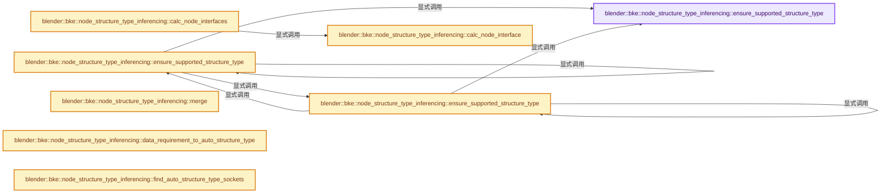
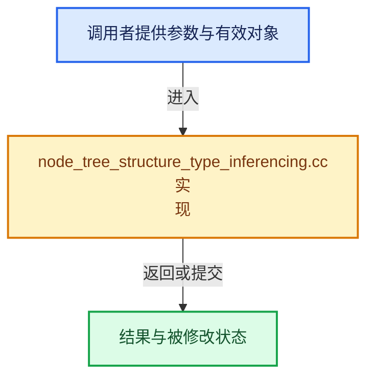

# 实现依赖专题：source/blender/blenkernel/intern/node_tree_structure_type_inferencing.cc

[实现依赖导航](../../README.md) · [符号索引](../../../00-课程指南/02-源码与提交索引/符号依赖与实现索引.md)

本专题从正文实际调用进入，集中保存共享实现。函数有稳定锚点，可从调用处直接跳到对应完整函数；递归与互相调用通过回链组织。

## 本文件的实现关系






## 完整成员与函数实现

<a id="f-31d29a3280bae127"></a>

### `blender::bke::node_structure_type_inferencing::ensure_supported_structure_type`

实现位置：[source/blender/blenkernel/intern/node_tree_structure_type_inferencing.cc](../../../../../../../source/blender/blenkernel/intern/node_tree_structure_type_inferencing.cc) · L31—L41。

接口参数：

- `const eNodeSocketDatatype socket_type`
- `const StructureType structure_type`

**教学注释版**

<!-- annotated:303e1fe5dc1430 -->

```cpp
static StructureType ensure_supported_structure_type(const eNodeSocketDatatype socket_type,
                                                     const StructureType structure_type)
{
  if (structure_type == StructureType::Field && !nodes::socket_type_supports_fields(socket_type)) {
    return StructureType::Single;
  }
  if (structure_type == StructureType::Grid && !nodes::socket_type_supports_grids(socket_type)) {
    return StructureType::Single;
  }
  return structure_type;
}
```

<details>
<summary>核对原始源码：source/blender/blenkernel/intern/node_tree_structure_type_inferencing.cc · L31—L41</summary>

<!-- original:303e1fe5dc1430:source/blender/blenkernel/intern/node_tree_structure_type_inferencing.cc:31:41 -->

```cpp
static StructureType ensure_supported_structure_type(const eNodeSocketDatatype socket_type,
                                                     const StructureType structure_type)
{
  if (structure_type == StructureType::Field && !nodes::socket_type_supports_fields(socket_type)) {
    return StructureType::Single;
  }
  if (structure_type == StructureType::Grid && !nodes::socket_type_supports_grids(socket_type)) {
    return StructureType::Single;
  }
  return structure_type;
}
```

</details>

**结果出口**

- `return StructureType::Single;`
- `return structure_type;`

**继续追踪实现**

- `nodes::socket_type_supports_fields` → [blender::nodes::socket_type_supports_fields · L663](../../04-Nodes节点系统/intern/node_socket.cc.md#f-2d675fda05d0eec2)。
- `nodes::socket_type_supports_grids` → [blender::nodes::socket_type_supports_grids · L689](../../04-Nodes节点系统/intern/node_socket.cc.md#f-34f917e3f42cf2e9)。

<a id="f-8f0356bf8b3e1b4c"></a>

### `blender::bke::node_structure_type_inferencing::ensure_supported_structure_type`

实现位置：[source/blender/blenkernel/intern/node_tree_structure_type_inferencing.cc](../../../../../../../source/blender/blenkernel/intern/node_tree_structure_type_inferencing.cc) · L43—L47。

接口参数：

- `const bNodeSocket &socket`
- `const StructureType structure_type`

**教学注释版**

<!-- annotated:52b394f146dde1 -->

```cpp
static StructureType ensure_supported_structure_type(const bNodeSocket &socket,
                                                     const StructureType structure_type)
{
  return ensure_supported_structure_type(eNodeSocketDatatype(socket.type), structure_type);
}
```

<details>
<summary>核对原始源码：source/blender/blenkernel/intern/node_tree_structure_type_inferencing.cc · L43—L47</summary>

<!-- original:52b394f146dde1:source/blender/blenkernel/intern/node_tree_structure_type_inferencing.cc:43:47 -->

```cpp
static StructureType ensure_supported_structure_type(const bNodeSocket &socket,
                                                     const StructureType structure_type)
{
  return ensure_supported_structure_type(eNodeSocketDatatype(socket.type), structure_type);
}
```

</details>

**结果出口**

- `return ensure_supported_structure_type(eNodeSocketDatatype(socket.type), structure_type);`

**继续追踪实现**

- `ensure_supported_structure_type` → [blender::bke::node_structure_type_inferencing::ensure_supported_structure_type · L31](node_tree_structure_type_inferencing.cc.md#f-31d29a3280bae127)；[blender::bke::node_structure_type_inferencing::ensure_supported_structure_type · L43](node_tree_structure_type_inferencing.cc.md#f-8f0356bf8b3e1b4c)；[blender::bke::node_structure_type_inferencing::ensure_supported_structure_type · L49](node_tree_structure_type_inferencing.cc.md#f-36574c355a093bf2)。同名重载需按实参类型选择。
- `eNodeSocketDatatype` → [eNodeSocketDatatype](../../08-其他Blender模块/sequencer/intern/compositor.hh.md#t-09b65f729b18)；[blender::eNodeSocketDatatype](../../08-其他Blender模块/makesdna/DNA_node_types.h.md#t-fdea02f95b31)。

<a id="f-36574c355a093bf2"></a>

### `blender::bke::node_structure_type_inferencing::ensure_supported_structure_type`

实现位置：[source/blender/blenkernel/intern/node_tree_structure_type_inferencing.cc](../../../../../../../source/blender/blenkernel/intern/node_tree_structure_type_inferencing.cc) · L49—L57。

接口参数：

- `const bNodeTreeInterfaceSocket &io_socket`
- `const StructureType structure_type`

**教学注释版**

<!-- annotated:684af1cd289384 -->

```cpp
static StructureType ensure_supported_structure_type(const bNodeTreeInterfaceSocket &io_socket,
                                                     const StructureType structure_type)
{
  const bke::bNodeSocketType *socket_type = io_socket.socket_typeinfo();
  if (!socket_type) {
    return structure_type;
  }
  return ensure_supported_structure_type(eNodeSocketDatatype(socket_type->type), structure_type);
}
```

<details>
<summary>核对原始源码：source/blender/blenkernel/intern/node_tree_structure_type_inferencing.cc · L49—L57</summary>

<!-- original:684af1cd289384:source/blender/blenkernel/intern/node_tree_structure_type_inferencing.cc:49:57 -->

```cpp
static StructureType ensure_supported_structure_type(const bNodeTreeInterfaceSocket &io_socket,
                                                     const StructureType structure_type)
{
  const bke::bNodeSocketType *socket_type = io_socket.socket_typeinfo();
  if (!socket_type) {
    return structure_type;
  }
  return ensure_supported_structure_type(eNodeSocketDatatype(socket_type->type), structure_type);
}
```

</details>

**结果出口**

- `return structure_type;`
- `return ensure_supported_structure_type(eNodeSocketDatatype(socket_type->type), structure_type);`

**继续追踪实现**

- `io_socket.socket_typeinfo` → [blender::bNodeTreeInterfaceSocket::socket_typeinfo · L770](node_tree_interface.cc.md#f-f6d586e3bc159207)。
- `ensure_supported_structure_type` → [blender::bke::node_structure_type_inferencing::ensure_supported_structure_type · L31](node_tree_structure_type_inferencing.cc.md#f-31d29a3280bae127)；[blender::bke::node_structure_type_inferencing::ensure_supported_structure_type · L43](node_tree_structure_type_inferencing.cc.md#f-8f0356bf8b3e1b4c)；[blender::bke::node_structure_type_inferencing::ensure_supported_structure_type · L49](node_tree_structure_type_inferencing.cc.md#f-36574c355a093bf2)。同名重载需按实参类型选择。
- `eNodeSocketDatatype` → [eNodeSocketDatatype](../../08-其他Blender模块/sequencer/intern/compositor.hh.md#t-09b65f729b18)；[blender::eNodeSocketDatatype](../../08-其他Blender模块/makesdna/DNA_node_types.h.md#t-fdea02f95b31)。

<a id="f-9fce2443a59d8e88"></a>

### `blender::bke::node_structure_type_inferencing::calc_node_interface`

实现位置：[source/blender/blenkernel/intern/node_tree_structure_type_inferencing.cc](../../../../../../../source/blender/blenkernel/intern/node_tree_structure_type_inferencing.cc) · L59—L120。

接口参数：

- `const bNode &node`

**教学注释版**

<!-- annotated:4da8c523abedae -->

```cpp
static nodes::StructureTypeInterface calc_node_interface(const bNode &node)
{
  if (node.is_group()) {
    if (const bNodeTree *group = id_cast<const bNodeTree *>(node.id)) {
      if (!ID_MISSING(group) && group->runtime->structure_type_interface) {
        return *group->runtime->structure_type_interface;
      }
    }
  }

  const Span<const bNodeSocket *> input_sockets = node.input_sockets();
  const Span<const bNodeSocket *> output_sockets = node.output_sockets();

  nodes::StructureTypeInterface node_interface;
  // [讲解] input_sockets.size：查询视图长度或生成对应有效索引区间。
  node_interface.inputs.reinitialize(input_sockets.size());
  node_interface.outputs.reinitialize(output_sockets.size());

  if (node.is_undefined() || !node.declaration() || node.declaration()->skip_updating_sockets) {
    node_interface.inputs.fill(StructureType::Dynamic);
    node_interface.outputs.fill(
        nodes::StructureTypeInterface::OutputDependency{StructureType::Dynamic});
    return node_interface;
  }
  if (node.is_reroute()) {
    node_interface.inputs.first() = StructureType::Dynamic;
    node_interface.outputs.first() = {StructureType::Dynamic, {0}};
    return node_interface;
  }

  // [讲解] input_sockets.index_range：查询视图长度或生成对应有效索引区间。
  for (const int i : input_sockets.index_range()) {
    const nodes::SocketDeclaration &decl = *input_sockets[i]->runtime->declaration;
    node_interface.inputs[i] = decl.structure_type;
  }

  for (const int output : output_sockets.index_range()) {
    const nodes::SocketDeclaration &decl = *output_sockets[output]->runtime->declaration;
    nodes::StructureTypeInterface::OutputDependency &dependency = node_interface.outputs[output];
    dependency.type = decl.structure_type;
    if (dependency.type != StructureType::Dynamic) {
      continue;
    }
    // [讲解] std::visit：按variant当前活动分支调用访客；所有候选分支的类型要求需满足，不能读取非活动分支的对象表示。
    std::visit(
        [&]<typename T>(const T &value) {
          if constexpr (std::is_same_v<T, nodes::OutputStructureTypeDependency::None>) {
            /* Nothing to do. */
          }
          else if constexpr (std::is_same_v<T, nodes::OutputStructureTypeDependency::All>) {
            dependency.linked_inputs.reinitialize(input_sockets.size());
            array_utils::fill_index_range(dependency.linked_inputs.as_mutable_span());
          }
          else if constexpr (std::is_same_v<T, nodes::OutputStructureTypeDependency::Partial>) {
            dependency.linked_inputs = value.linked_inputs.as_span();
          }
          else {
            BLI_assert_unreachable_static_t(T);
          }
        },
        decl.structure_type_output_dependency.variant);
  }

  return node_interface;
}
```

<details>
<summary>核对原始源码：source/blender/blenkernel/intern/node_tree_structure_type_inferencing.cc · L59—L120</summary>

<!-- original:4da8c523abedae:source/blender/blenkernel/intern/node_tree_structure_type_inferencing.cc:59:120 -->

```cpp
static nodes::StructureTypeInterface calc_node_interface(const bNode &node)
{
  if (node.is_group()) {
    if (const bNodeTree *group = id_cast<const bNodeTree *>(node.id)) {
      if (!ID_MISSING(group) && group->runtime->structure_type_interface) {
        return *group->runtime->structure_type_interface;
      }
    }
  }

  const Span<const bNodeSocket *> input_sockets = node.input_sockets();
  const Span<const bNodeSocket *> output_sockets = node.output_sockets();

  nodes::StructureTypeInterface node_interface;
  node_interface.inputs.reinitialize(input_sockets.size());
  node_interface.outputs.reinitialize(output_sockets.size());

  if (node.is_undefined() || !node.declaration() || node.declaration()->skip_updating_sockets) {
    node_interface.inputs.fill(StructureType::Dynamic);
    node_interface.outputs.fill(
        nodes::StructureTypeInterface::OutputDependency{StructureType::Dynamic});
    return node_interface;
  }
  if (node.is_reroute()) {
    node_interface.inputs.first() = StructureType::Dynamic;
    node_interface.outputs.first() = {StructureType::Dynamic, {0}};
    return node_interface;
  }

  for (const int i : input_sockets.index_range()) {
    const nodes::SocketDeclaration &decl = *input_sockets[i]->runtime->declaration;
    node_interface.inputs[i] = decl.structure_type;
  }

  for (const int output : output_sockets.index_range()) {
    const nodes::SocketDeclaration &decl = *output_sockets[output]->runtime->declaration;
    nodes::StructureTypeInterface::OutputDependency &dependency = node_interface.outputs[output];
    dependency.type = decl.structure_type;
    if (dependency.type != StructureType::Dynamic) {
      continue;
    }
    std::visit(
        [&]<typename T>(const T &value) {
          if constexpr (std::is_same_v<T, nodes::OutputStructureTypeDependency::None>) {
            /* Nothing to do. */
          }
          else if constexpr (std::is_same_v<T, nodes::OutputStructureTypeDependency::All>) {
            dependency.linked_inputs.reinitialize(input_sockets.size());
            array_utils::fill_index_range(dependency.linked_inputs.as_mutable_span());
          }
          else if constexpr (std::is_same_v<T, nodes::OutputStructureTypeDependency::Partial>) {
            dependency.linked_inputs = value.linked_inputs.as_span();
          }
          else {
            BLI_assert_unreachable_static_t(T);
          }
        },
        decl.structure_type_output_dependency.variant);
  }

  return node_interface;
}
```

</details>

**沿实际写入检查状态**

- `node_interface.inputs[i] = decl.structure_type;`
- `dependency.type = decl.structure_type;`
- `dependency.linked_inputs = value.linked_inputs.as_span();`

**结果出口**

- `return *group->runtime->structure_type_interface;`
- `return node_interface;`

**继续追踪实现**

- `node.is_group` → [blender::bNode::is_group · L906](../BKE_node_runtime.hh.md#f-0685281392963ec9)。
- `id_cast<const bNodeTree *>` → [blender::id_cast · L1417](../../08-其他Blender模块/makesdna/DNA_ID.h.md#f-6c8ac6412850ac5a)。
- `ID_MISSING` → [ID_MISSING · L695](../../08-其他Blender模块/makesdna/DNA_ID.h.md#m-ab9a2a270fb3)。宏定义由构建条件选择。
- `node.input_sockets` → [blender::bNode::input_sockets · L754](../BKE_node_runtime.hh.md#f-82cd385c5c18b40d)；[blender::bNode::input_sockets · L766](../BKE_node_runtime.hh.md#f-65ad84a029887502)。同名重载需按实参类型选择。
- `node.output_sockets` → [blender::bNode::output_sockets · L760](../BKE_node_runtime.hh.md#f-40ec6d6aed2ab6fb)；[blender::bNode::output_sockets · L772](../BKE_node_runtime.hh.md#f-ddbd8f42409bdcd1)。同名重载需按实参类型选择。
- `node_interface.inputs.reinitialize` → [调用协议](../../../00-课程指南/01-路线与规范/模板宏与动态分派协议.md)：接收对象类型依赖auto、返回值或模板实例；不按同名猜测目标。调用位置L73。
- `input_sockets.size` → [blender::Span::size · L256](../../../01-基础容器与现代CPP/05-Span只读连续视图.md#f-5f80fa006089c998)。
- `node_interface.outputs.reinitialize` → [调用协议](../../../00-课程指南/01-路线与规范/模板宏与动态分派协议.md)：接收对象类型依赖auto、返回值或模板实例；不按同名猜测目标。调用位置L74。
- `output_sockets.size` → [blender::Span::size · L256](../../../01-基础容器与现代CPP/05-Span只读连续视图.md#f-5f80fa006089c998)。
- `node.is_undefined` → [blender::bNode::is_undefined · L926](../BKE_node_runtime.hh.md#f-48ba40c353bcf4a3)。
- `node.declaration` → [blender::bNode::declaration · L954](../BKE_node_runtime.hh.md#f-f092d18c09c116e8)。
- `node_interface.inputs.fill` → [调用协议](../../../00-课程指南/01-路线与规范/模板宏与动态分派协议.md)：接收对象类型依赖auto、返回值或模板实例；不按同名猜测目标。调用位置L77。
- `node_interface.outputs.fill` → [调用协议](../../../00-课程指南/01-路线与规范/模板宏与动态分派协议.md)：接收对象类型依赖auto、返回值或模板实例；不按同名猜测目标。调用位置L78。
- `node.is_reroute` → [blender::bNode::is_reroute · L896](../BKE_node_runtime.hh.md#f-d97a49597e48e8ea)。
- `node_interface.inputs.first` → [调用协议](../../../00-课程指南/01-路线与规范/模板宏与动态分派协议.md)：接收对象类型依赖auto、返回值或模板实例；不按同名猜测目标。调用位置L83。
- `node_interface.outputs.first` → [调用协议](../../../00-课程指南/01-路线与规范/模板宏与动态分派协议.md)：接收对象类型依赖auto、返回值或模板实例；不按同名猜测目标。调用位置L84。
- `input_sockets.index_range` → [blender::Span::index_range · L405](../../../01-基础容器与现代CPP/05-Span只读连续视图.md#f-caaa9b06e13e53e0)。
- `output_sockets.index_range` → [blender::Span::index_range · L405](../../../01-基础容器与现代CPP/05-Span只读连续视图.md#f-caaa9b06e13e53e0)。
- `std::visit` → [外部契约](https://eel.is/c++draft/variant.visit)：按variant当前活动分支调用访客；所有候选分支的类型要求需满足，不能读取非活动分支的对象表示。
- `dependency.linked_inputs.reinitialize` → [调用协议](../../../00-课程指南/01-路线与规范/模板宏与动态分派协议.md)：接收对象类型依赖auto、返回值或模板实例；不按同名猜测目标。调用位置L106。
- `array_utils::fill_index_range` → [blender::array_utils::fill_index_range · L434](../../../05-几何存储与拓扑映射/07-分组访问与反向索引.md#f-f8128b104d76df0f)；[blender::array_utils::fill_index_range · L439](../../../05-几何存储与拓扑映射/07-分组访问与反向索引.md#f-95ca84458bfc7e7e)；[blender::array_utils::fill_index_range · L445](../../../05-几何存储与拓扑映射/07-分组访问与反向索引.md#f-c11b114c213cd61a)。同名重载需按实参类型选择。
- `dependency.linked_inputs.as_mutable_span` → [调用协议](../../../00-课程指南/01-路线与规范/模板宏与动态分派协议.md)：接收对象类型依赖auto、返回值或模板实例；不按同名猜测目标。调用位置L107。
- `value.linked_inputs.as_span` → [调用协议](../../../00-课程指南/01-路线与规范/模板宏与动态分派协议.md)：接收对象类型依赖auto、返回值或模板实例；不按同名猜测目标。调用位置L110。
- `BLI_assert_unreachable_static_t` → [BLI_assert_unreachable_static_t · L99](../../01-BLI基础库/BLI_assert.hh.md#m-368120c7952b)。宏定义由构建条件选择。

<a id="f-a7181defb98126b4"></a>

### `blender::bke::node_structure_type_inferencing::calc_node_interfaces`

实现位置：[source/blender/blenkernel/intern/node_tree_structure_type_inferencing.cc](../../../../../../../source/blender/blenkernel/intern/node_tree_structure_type_inferencing.cc) · L122—L130。

接口参数：

- `const bNodeTree &tree`

**教学注释版**

<!-- annotated:7e1bac21741656 -->

```cpp
static Array<nodes::StructureTypeInterface> calc_node_interfaces(const bNodeTree &tree)
{
  const Span<const bNode *> nodes = tree.all_nodes();
  // [讲解] nodes.size：查询视图长度或生成对应有效索引区间。
  Array<nodes::StructureTypeInterface> interfaces(nodes.size());
  // [讲解] nodes.index_range：查询视图长度或生成对应有效索引区间。
  for (const int i : nodes.index_range()) {
    interfaces[i] = calc_node_interface(*nodes[i]);
  }
  return interfaces;
}
```

<details>
<summary>核对原始源码：source/blender/blenkernel/intern/node_tree_structure_type_inferencing.cc · L122—L130</summary>

<!-- original:7e1bac21741656:source/blender/blenkernel/intern/node_tree_structure_type_inferencing.cc:122:130 -->

```cpp
static Array<nodes::StructureTypeInterface> calc_node_interfaces(const bNodeTree &tree)
{
  const Span<const bNode *> nodes = tree.all_nodes();
  Array<nodes::StructureTypeInterface> interfaces(nodes.size());
  for (const int i : nodes.index_range()) {
    interfaces[i] = calc_node_interface(*nodes[i]);
  }
  return interfaces;
}
```

</details>

**沿实际写入检查状态**

- `interfaces[i] = calc_node_interface(*nodes[i]);`

**结果出口**

- `return interfaces;`

**继续追踪实现**

- `tree.all_nodes` → [blender::bNodeTree::all_nodes · L500](../BKE_node_runtime.hh.md#f-cda455cbcc6c7f36)；[blender::bNodeTree::all_nodes · L505](../BKE_node_runtime.hh.md#f-358b65e5678f8a32)。同名重载需按实参类型选择。
- `nodes.size` → [blender::Span::size · L256](../../../01-基础容器与现代CPP/05-Span只读连续视图.md#f-5f80fa006089c998)。
- `nodes.index_range` → [blender::Span::index_range · L405](../../../01-基础容器与现代CPP/05-Span只读连续视图.md#f-caaa9b06e13e53e0)。
- `calc_node_interface` → [blender::bke::node_structure_type_inferencing::calc_node_interface · L59](node_tree_structure_type_inferencing.cc.md#f-9fce2443a59d8e88)。

<a id="f-3955a79c74130601"></a>

### `blender::bke::node_structure_type_inferencing::merge`

实现位置：[source/blender/blenkernel/intern/node_tree_structure_type_inferencing.cc](../../../../../../../source/blender/blenkernel/intern/node_tree_structure_type_inferencing.cc) · L134—L152。

接口参数：

- `const DataRequirement a`
- `const DataRequirement b`

**教学注释版**

<!-- annotated:cf251943e2097b -->

```cpp
static DataRequirement merge(const DataRequirement a, const DataRequirement b)
{
  if (a == b) {
    return a;
  }
  if (a == DataRequirement::None) {
    return b;
  }
  if (b == DataRequirement::None) {
    return a;
  }
  if ((a == DataRequirement::Field && b == DataRequirement::Single) ||
      (a == DataRequirement::Single && b == DataRequirement::Field))
  {
    /* Single beats field, because fields can accept single values too. */
    return DataRequirement::Single;
  }
  return DataRequirement::Invalid;
}
```

<details>
<summary>核对原始源码：source/blender/blenkernel/intern/node_tree_structure_type_inferencing.cc · L134—L152</summary>

<!-- original:cf251943e2097b:source/blender/blenkernel/intern/node_tree_structure_type_inferencing.cc:134:152 -->

```cpp
static DataRequirement merge(const DataRequirement a, const DataRequirement b)
{
  if (a == b) {
    return a;
  }
  if (a == DataRequirement::None) {
    return b;
  }
  if (b == DataRequirement::None) {
    return a;
  }
  if ((a == DataRequirement::Field && b == DataRequirement::Single) ||
      (a == DataRequirement::Single && b == DataRequirement::Field))
  {
    /* Single beats field, because fields can accept single values too. */
    return DataRequirement::Single;
  }
  return DataRequirement::Invalid;
}
```

</details>

**结果出口**

- `return a;`
- `return b;`
- `return DataRequirement::Single;`
- `return DataRequirement::Invalid;`

**继续追踪实现**

本实现没有需要继续展开的显式调用；检查返回表达式、对象转换和调用者前置条件。

<a id="f-51119d108068884b"></a>

### `blender::bke::node_structure_type_inferencing::data_requirement_to_auto_structure_type`

实现位置：[source/blender/blenkernel/intern/node_tree_structure_type_inferencing.cc](../../../../../../../source/blender/blenkernel/intern/node_tree_structure_type_inferencing.cc) · L154—L172。

接口参数：

- `const DataRequirement requirement`

**教学注释版**

<!-- annotated:09fc106e206f92 -->

```cpp
static StructureType data_requirement_to_auto_structure_type(const DataRequirement requirement)
{
  switch (requirement) {
    case DataRequirement::None:
      return StructureType::Dynamic;
    case DataRequirement::Field:
      return StructureType::Field;
    case DataRequirement::Single:
      return StructureType::Single;
    case DataRequirement::Grid:
      return StructureType::Grid;
    case DataRequirement::List:
      return StructureType::List;
    case DataRequirement::Invalid:
      return StructureType::Dynamic;
  }
  BLI_assert_unreachable();
  return StructureType::Dynamic;
}
```

<details>
<summary>核对原始源码：source/blender/blenkernel/intern/node_tree_structure_type_inferencing.cc · L154—L172</summary>

<!-- original:09fc106e206f92:source/blender/blenkernel/intern/node_tree_structure_type_inferencing.cc:154:172 -->

```cpp
static StructureType data_requirement_to_auto_structure_type(const DataRequirement requirement)
{
  switch (requirement) {
    case DataRequirement::None:
      return StructureType::Dynamic;
    case DataRequirement::Field:
      return StructureType::Field;
    case DataRequirement::Single:
      return StructureType::Single;
    case DataRequirement::Grid:
      return StructureType::Grid;
    case DataRequirement::List:
      return StructureType::List;
    case DataRequirement::Invalid:
      return StructureType::Dynamic;
  }
  BLI_assert_unreachable();
  return StructureType::Dynamic;
}
```

</details>

**结果出口**

- `return StructureType::Dynamic;`
- `return StructureType::Field;`
- `return StructureType::Single;`
- `return StructureType::Grid;`
- `return StructureType::List;`

**继续追踪实现**

- `BLI_assert_unreachable` → [BLI_assert_unreachable · L77](../../01-BLI基础库/BLI_assert.hh.md#m-7a2d91a67d8e)。宏定义由构建条件选择。

<a id="f-4279825a5b9162ea"></a>

### `blender::bke::node_structure_type_inferencing::find_auto_structure_type_sockets`

实现位置：[source/blender/blenkernel/intern/node_tree_structure_type_inferencing.cc](../../../../../../../source/blender/blenkernel/intern/node_tree_structure_type_inferencing.cc) · L174—L280。

接口参数：

- `const bNodeTree &tree`
- `bits::MutableBoundedBitSpan is_auto_structure_type`

**教学注释版**

<!-- annotated:34ef1788a115be -->

```cpp
static void find_auto_structure_type_sockets(const bNodeTree &tree,
                                             bits::MutableBoundedBitSpan is_auto_structure_type)
{
  /* Handle group inputs. */
  for (const int i : tree.interface_inputs().index_range()) {
    const bNodeTreeInterfaceSocket &io_socket = *tree.interface_inputs()[i];
    if (io_socket.structure_type != NodeSocketInterfaceStructureType::Auto) {
      continue;
    }
    for (const bNode *node : tree.group_input_nodes()) {
      const bNodeSocket &socket = node->output_socket(i);
      is_auto_structure_type[socket.index_in_tree()].set();
    }
  }

  /* Handle group outputs. */
  if (const bNode *group_output_node = tree.group_output_node()) {
    is_auto_structure_type.slice(group_output_node->input_socket_indices_in_tree().drop_back(1))
        .set_all();
  }

  /* Handle closure inputs and outputs. */
  const bke::bNodeZoneType *closure_zone_type = bke::zone_type_by_node_type(NODE_CLOSURE_OUTPUT);
  for (const bNode *closure_input_node : tree.nodes_by_type("NodeClosureInput"_ustr)) {
    const auto *closure_output_node = closure_zone_type->get_corresponding_output(
        tree, *closure_input_node);
    if (!closure_output_node) {
      continue;
    }
    const auto &storage = *static_cast<const NodeClosureOutput *>(closure_output_node->storage);
    for (const int i : IndexRange(storage.input_items.items_num)) {
      const NodeClosureInputItem &item = storage.input_items.items[i];
      if (item.structure_type == NodeSocketInterfaceStructureType::Auto) {
        const bNodeSocket &socket = closure_input_node->output_socket(i);
        is_auto_structure_type[socket.index_in_tree()].set();
      }
    }
    for (const int i : IndexRange(storage.output_items.items_num)) {
      const NodeClosureOutputItem &item = storage.output_items.items[i];
      if (item.structure_type == NodeSocketInterfaceStructureType::Auto) {
        const bNodeSocket &socket = closure_output_node->input_socket(i);
        is_auto_structure_type[socket.index_in_tree()].set();
      }
    }
  }

  /* Handle Evaluate Closure nodes. */
  for (const bNode *evaluate_closure_node : tree.nodes_by_type("NodeEvaluateClosure"_ustr)) {
    auto &storage = *static_cast<NodeEvaluateClosure *>(evaluate_closure_node->storage);
    for (const int i : IndexRange(storage.input_items.items_num)) {
      const NodeEvaluateClosureInputItem &item = storage.input_items.items[i];
      if (item.structure_type == NodeSocketInterfaceStructureType::Auto) {
        const bNodeSocket &socket = evaluate_closure_node->input_socket(i + 1);
        is_auto_structure_type[socket.index_in_tree()].set();
      }
    }
    for (const int i : IndexRange(storage.output_items.items_num)) {
      const NodeEvaluateClosureOutputItem &item = storage.output_items.items[i];
      if (item.structure_type == NodeSocketInterfaceStructureType::Auto) {
        const bNodeSocket &socket = evaluate_closure_node->output_socket(i);
        is_auto_structure_type[socket.index_in_tree()].set();
      }
    }
  }

  /* Handle Combine Bundle nodes. */
  for (const bNode *node : tree.nodes_by_type("NodeCombineBundle"_ustr)) {
    auto &storage = *static_cast<NodeCombineBundle *>(node->storage);
    for (const int i : IndexRange(storage.items_num)) {
      const NodeCombineBundleItem &item = storage.items[i];
      if (item.structure_type == NodeSocketInterfaceStructureType::Auto) {
        const bNodeSocket &socket = node->input_socket(i);
        is_auto_structure_type[socket.index_in_tree()].set();
      }
    }
  }

  /* Handle Separate Bundle nodes. */
  for (const bNode *node : tree.nodes_by_type("NodeSeparateBundle"_ustr)) {
    auto &storage = *static_cast<NodeSeparateBundle *>(node->storage);
    for (const int i : IndexRange(storage.items_num)) {
      const NodeSeparateBundleItem &item = storage.items[i];
      if (item.structure_type == NodeSocketInterfaceStructureType::Auto) {
        const bNodeSocket &socket = node->output_socket(i);
        is_auto_structure_type[socket.index_in_tree()].set();
      }
    }
  }

  /* Handle Store Bundle Item nodes. */
  for (const bNode *node : tree.nodes_by_type("NodeStoreBundleItem"_ustr)) {
    auto &storage = *static_cast<NodeStoreBundleItem *>(node->storage);
    if (storage.structure_type == NodeSocketInterfaceStructureType::Auto) {
      const bNodeSocket &socket = *node->input_by_identifier("Item"_ustr);
      is_auto_structure_type[socket.index_in_tree()].set();
    }
  }

  /* Handle Get Bundle Item nodes. */
  for (const bNode *node : tree.nodes_by_type("NodeGetBundleItem"_ustr)) {
    auto &storage = *static_cast<NodeGetBundleItem *>(node->storage);
    if (storage.structure_type == NodeSocketInterfaceStructureType::Auto) {
      const bNodeSocket &socket = *node->output_by_identifier("Item"_ustr);
      is_auto_structure_type[socket.index_in_tree()].set();
    }
  }
}
```

<details>
<summary>核对原始源码：source/blender/blenkernel/intern/node_tree_structure_type_inferencing.cc · L174—L280</summary>

<!-- original:34ef1788a115be:source/blender/blenkernel/intern/node_tree_structure_type_inferencing.cc:174:280 -->

```cpp
static void find_auto_structure_type_sockets(const bNodeTree &tree,
                                             bits::MutableBoundedBitSpan is_auto_structure_type)
{
  /* Handle group inputs. */
  for (const int i : tree.interface_inputs().index_range()) {
    const bNodeTreeInterfaceSocket &io_socket = *tree.interface_inputs()[i];
    if (io_socket.structure_type != NodeSocketInterfaceStructureType::Auto) {
      continue;
    }
    for (const bNode *node : tree.group_input_nodes()) {
      const bNodeSocket &socket = node->output_socket(i);
      is_auto_structure_type[socket.index_in_tree()].set();
    }
  }

  /* Handle group outputs. */
  if (const bNode *group_output_node = tree.group_output_node()) {
    is_auto_structure_type.slice(group_output_node->input_socket_indices_in_tree().drop_back(1))
        .set_all();
  }

  /* Handle closure inputs and outputs. */
  const bke::bNodeZoneType *closure_zone_type = bke::zone_type_by_node_type(NODE_CLOSURE_OUTPUT);
  for (const bNode *closure_input_node : tree.nodes_by_type("NodeClosureInput"_ustr)) {
    const auto *closure_output_node = closure_zone_type->get_corresponding_output(
        tree, *closure_input_node);
    if (!closure_output_node) {
      continue;
    }
    const auto &storage = *static_cast<const NodeClosureOutput *>(closure_output_node->storage);
    for (const int i : IndexRange(storage.input_items.items_num)) {
      const NodeClosureInputItem &item = storage.input_items.items[i];
      if (item.structure_type == NodeSocketInterfaceStructureType::Auto) {
        const bNodeSocket &socket = closure_input_node->output_socket(i);
        is_auto_structure_type[socket.index_in_tree()].set();
      }
    }
    for (const int i : IndexRange(storage.output_items.items_num)) {
      const NodeClosureOutputItem &item = storage.output_items.items[i];
      if (item.structure_type == NodeSocketInterfaceStructureType::Auto) {
        const bNodeSocket &socket = closure_output_node->input_socket(i);
        is_auto_structure_type[socket.index_in_tree()].set();
      }
    }
  }

  /* Handle Evaluate Closure nodes. */
  for (const bNode *evaluate_closure_node : tree.nodes_by_type("NodeEvaluateClosure"_ustr)) {
    auto &storage = *static_cast<NodeEvaluateClosure *>(evaluate_closure_node->storage);
    for (const int i : IndexRange(storage.input_items.items_num)) {
      const NodeEvaluateClosureInputItem &item = storage.input_items.items[i];
      if (item.structure_type == NodeSocketInterfaceStructureType::Auto) {
        const bNodeSocket &socket = evaluate_closure_node->input_socket(i + 1);
        is_auto_structure_type[socket.index_in_tree()].set();
      }
    }
    for (const int i : IndexRange(storage.output_items.items_num)) {
      const NodeEvaluateClosureOutputItem &item = storage.output_items.items[i];
      if (item.structure_type == NodeSocketInterfaceStructureType::Auto) {
        const bNodeSocket &socket = evaluate_closure_node->output_socket(i);
        is_auto_structure_type[socket.index_in_tree()].set();
      }
    }
  }

  /* Handle Combine Bundle nodes. */
  for (const bNode *node : tree.nodes_by_type("NodeCombineBundle"_ustr)) {
    auto &storage = *static_cast<NodeCombineBundle *>(node->storage);
    for (const int i : IndexRange(storage.items_num)) {
      const NodeCombineBundleItem &item = storage.items[i];
      if (item.structure_type == NodeSocketInterfaceStructureType::Auto) {
        const bNodeSocket &socket = node->input_socket(i);
        is_auto_structure_type[socket.index_in_tree()].set();
      }
    }
  }

  /* Handle Separate Bundle nodes. */
  for (const bNode *node : tree.nodes_by_type("NodeSeparateBundle"_ustr)) {
    auto &storage = *static_cast<NodeSeparateBundle *>(node->storage);
    for (const int i : IndexRange(storage.items_num)) {
      const NodeSeparateBundleItem &item = storage.items[i];
      if (item.structure_type == NodeSocketInterfaceStructureType::Auto) {
        const bNodeSocket &socket = node->output_socket(i);
        is_auto_structure_type[socket.index_in_tree()].set();
      }
    }
  }

  /* Handle Store Bundle Item nodes. */
  for (const bNode *node : tree.nodes_by_type("NodeStoreBundleItem"_ustr)) {
    auto &storage = *static_cast<NodeStoreBundleItem *>(node->storage);
    if (storage.structure_type == NodeSocketInterfaceStructureType::Auto) {
      const bNodeSocket &socket = *node->input_by_identifier("Item"_ustr);
      is_auto_structure_type[socket.index_in_tree()].set();
    }
  }

  /* Handle Get Bundle Item nodes. */
  for (const bNode *node : tree.nodes_by_type("NodeGetBundleItem"_ustr)) {
    auto &storage = *static_cast<NodeGetBundleItem *>(node->storage);
    if (storage.structure_type == NodeSocketInterfaceStructureType::Auto) {
      const bNodeSocket &socket = *node->output_by_identifier("Item"_ustr);
      is_auto_structure_type[socket.index_in_tree()].set();
    }
  }
}
```

</details>

**继续追踪实现**

- `tree.interface_inputs().index_range` → [调用协议](../../../00-课程指南/01-路线与规范/模板宏与动态分派协议.md)：接收对象类型依赖auto、返回值或模板实例；不按同名猜测目标。调用位置L178。
- `tree.interface_inputs` → [blender::bNodeTree::interface_inputs · L675](../BKE_node_runtime.hh.md#f-b5decde7a09fbf57)；[blender::bNodeTree::interface_inputs · L681](../BKE_node_runtime.hh.md#f-f999995c05009884)。同名重载需按实参类型选择。
- `tree.group_input_nodes` → [blender::bNodeTree::group_input_nodes · L596](../BKE_node_runtime.hh.md#f-f4d5daa939963761)；[blender::bNodeTree::group_input_nodes · L601](../BKE_node_runtime.hh.md#f-b54e41a48ba6ce7a)。同名重载需按实参类型选择。
- `node->output_socket` → [调用协议](../../../00-课程指南/01-路线与规范/模板宏与动态分派协议.md)：接收对象类型依赖auto、返回值或模板实例；不按同名猜测目标。调用位置L184。
- `is_auto_structure_type[socket.index_in_tree()].set` → [调用协议](../../../00-课程指南/01-路线与规范/模板宏与动态分派协议.md)：接收对象类型依赖auto、返回值或模板实例；不按同名猜测目标。调用位置L185。
- `socket.index_in_tree` → [blender::bNodeSocket::index_in_tree · L1002](../BKE_node_runtime.hh.md#f-84ec49d8e3ae0cdb)。
- `tree.group_output_node` → [blender::bNodeTree::group_output_node · L584](../BKE_node_runtime.hh.md#f-a01078b19d92ff02)；[blender::bNodeTree::group_output_node · L590](../BKE_node_runtime.hh.md#f-453bfee152775d3a)。同名重载需按实参类型选择。
- `is_auto_structure_type.slice(group_output_node->input_socket_indices_in_tree().drop_back(1)) .set_all` → [调用协议](../../../00-课程指南/01-路线与规范/模板宏与动态分派协议.md)：接收对象类型依赖auto、返回值或模板实例；不按同名猜测目标。调用位置L191。
- `is_auto_structure_type.slice` → [调用协议](../../../00-课程指南/01-路线与规范/模板宏与动态分派协议.md)：由接收对象具体类型或运行时策略提供实现。调用位置L191。
- `group_output_node->input_socket_indices_in_tree().drop_back` → [调用协议](../../../00-课程指南/01-路线与规范/模板宏与动态分派协议.md)：接收对象类型依赖auto、返回值或模板实例；不按同名猜测目标。调用位置L191。
- `group_output_node->input_socket_indices_in_tree` → [blender::bNode::input_socket_indices_in_tree · L778](../BKE_node_runtime.hh.md#f-ec49e89d6ffc675d)。
- `bke::zone_type_by_node_type` → [blender::bke::zone_type_by_node_type · L575](node_tree_zones.cc.md#f-e15b3588965609cf)。
- `tree.nodes_by_type` → [blender::bNodeTree::nodes_by_type · L524](../BKE_node_runtime.hh.md#f-dbf5b02db7697f8c)；[blender::bNodeTree::nodes_by_type · L530](../BKE_node_runtime.hh.md#f-1316cfee8b291699)。同名重载需按实参类型选择。
- `closure_zone_type->get_corresponding_output` → [blender::bke::bNodeZoneType::get_corresponding_output · L504](node_tree_zones.cc.md#f-b4cf6a6324d9b816)；[blender::bke::bNodeZoneType::get_corresponding_output · L516](node_tree_zones.cc.md#f-03562d1ac0958424)。同名重载需按实参类型选择。
- `IndexRange` → [blender::IndexRange](../../01-BLI基础库/BLI_index_range.hh.md#t-caa3466d6776)；[blender::gpu::shader::parser::IndexRange](../../08-其他Blender模块/gpu/shader_tool/utils.hh.md#t-82d2bd4ea71c)；[blender::IndexRange](../../08-其他Blender模块/makesdna/DNA_node_types.h.md#t-0448cc889d39)。
- `closure_input_node->output_socket` → [调用协议](../../../00-课程指南/01-路线与规范/模板宏与动态分派协议.md)：接收对象类型依赖auto、返回值或模板实例；不按同名猜测目标。调用位置L207。
- `closure_output_node->input_socket` → [调用协议](../../../00-课程指南/01-路线与规范/模板宏与动态分派协议.md)：接收对象类型依赖auto、返回值或模板实例；不按同名猜测目标。调用位置L214。
- `evaluate_closure_node->input_socket` → [调用协议](../../../00-课程指南/01-路线与规范/模板宏与动态分派协议.md)：接收对象类型依赖auto、返回值或模板实例；不按同名猜测目标。调用位置L226。
- `evaluate_closure_node->output_socket` → [调用协议](../../../00-课程指南/01-路线与规范/模板宏与动态分派协议.md)：接收对象类型依赖auto、返回值或模板实例；不按同名猜测目标。调用位置L233。
- `node->input_socket` → [调用协议](../../../00-课程指南/01-路线与规范/模板宏与动态分派协议.md)：接收对象类型依赖auto、返回值或模板实例；不按同名猜测目标。调用位置L245。
- `node->input_by_identifier` → [调用协议](../../../00-课程指南/01-路线与规范/模板宏与动态分派协议.md)：接收对象类型依赖auto、返回值或模板实例；不按同名猜测目标。调用位置L267。
- `node->output_by_identifier` → [调用协议](../../../00-课程指南/01-路线与规范/模板宏与动态分派协议.md)：接收对象类型依赖auto、返回值或模板实例；不按同名猜测目标。调用位置L276。

<a id="f-b0620a8d602ff405"></a>

### `blender::bke::node_structure_type_inferencing::init_input_requirements`

实现位置：[source/blender/blenkernel/intern/node_tree_structure_type_inferencing.cc](../../../../../../../source/blender/blenkernel/intern/node_tree_structure_type_inferencing.cc) · L282—L322。

接口参数：

- `const bNodeTree &tree`
- `const bits::BoundedBitSpan is_auto_structure_type`
- `MutableSpan<DataRequirement> input_requirements`

**教学注释版**

<!-- annotated:8776e56946410f -->

```cpp
static void init_input_requirements(const bNodeTree &tree,
                                    const bits::BoundedBitSpan is_auto_structure_type,
                                    MutableSpan<DataRequirement> input_requirements)
{
  for (const bNode *node : tree.all_nodes()) {
    for (const bNodeSocket *socket : node->input_sockets()) {
      DataRequirement &requirement = input_requirements[socket->index_in_all_inputs()];
      if (is_auto_structure_type[socket->index_in_tree()]) {
        requirement = DataRequirement::None;
        continue;
      }
      const nodes::SocketDeclaration *declaration = socket->runtime->declaration;
      if (!declaration) {
        requirement = DataRequirement::None;
        continue;
      }
      switch (declaration->structure_type) {
        case StructureType::Dynamic: {
          requirement = DataRequirement::None;
          break;
        }
        case StructureType::Single: {
          requirement = DataRequirement::Single;
          break;
        }
        case StructureType::Grid: {
          requirement = DataRequirement::Grid;
          break;
        }
        case StructureType::Field: {
          requirement = DataRequirement::Field;
          break;
        }
        case StructureType::List: {
          requirement = DataRequirement::List;
          break;
        }
      }
    }
  }
}
```

<details>
<summary>核对原始源码：source/blender/blenkernel/intern/node_tree_structure_type_inferencing.cc · L282—L322</summary>

<!-- original:8776e56946410f:source/blender/blenkernel/intern/node_tree_structure_type_inferencing.cc:282:322 -->

```cpp
static void init_input_requirements(const bNodeTree &tree,
                                    const bits::BoundedBitSpan is_auto_structure_type,
                                    MutableSpan<DataRequirement> input_requirements)
{
  for (const bNode *node : tree.all_nodes()) {
    for (const bNodeSocket *socket : node->input_sockets()) {
      DataRequirement &requirement = input_requirements[socket->index_in_all_inputs()];
      if (is_auto_structure_type[socket->index_in_tree()]) {
        requirement = DataRequirement::None;
        continue;
      }
      const nodes::SocketDeclaration *declaration = socket->runtime->declaration;
      if (!declaration) {
        requirement = DataRequirement::None;
        continue;
      }
      switch (declaration->structure_type) {
        case StructureType::Dynamic: {
          requirement = DataRequirement::None;
          break;
        }
        case StructureType::Single: {
          requirement = DataRequirement::Single;
          break;
        }
        case StructureType::Grid: {
          requirement = DataRequirement::Grid;
          break;
        }
        case StructureType::Field: {
          requirement = DataRequirement::Field;
          break;
        }
        case StructureType::List: {
          requirement = DataRequirement::List;
          break;
        }
      }
    }
  }
}
```

</details>

**沿实际写入检查状态**

- `requirement = DataRequirement::None;`
- `requirement = DataRequirement::Single;`
- `requirement = DataRequirement::Grid;`
- `requirement = DataRequirement::Field;`
- `requirement = DataRequirement::List;`

**继续追踪实现**

- `tree.all_nodes` → [blender::bNodeTree::all_nodes · L500](../BKE_node_runtime.hh.md#f-cda455cbcc6c7f36)；[blender::bNodeTree::all_nodes · L505](../BKE_node_runtime.hh.md#f-358b65e5678f8a32)。同名重载需按实参类型选择。
- `node->input_sockets` → [调用协议](../../../00-课程指南/01-路线与规范/模板宏与动态分派协议.md)：接收对象类型依赖auto、返回值或模板实例；不按同名猜测目标。调用位置L287。
- `socket->index_in_all_inputs` → [调用协议](../../../00-课程指南/01-路线与规范/模板宏与动态分派协议.md)：接收对象类型依赖auto、返回值或模板实例；不按同名猜测目标。调用位置L288。
- `socket->index_in_tree` → [调用协议](../../../00-课程指南/01-路线与规范/模板宏与动态分派协议.md)：接收对象类型依赖auto、返回值或模板实例；不按同名猜测目标。调用位置L289。

<a id="f-5e835c275bb3a48e"></a>

### `blender::bke::node_structure_type_inferencing::calc_output_socket_requirement`

实现位置：[source/blender/blenkernel/intern/node_tree_structure_type_inferencing.cc](../../../../../../../source/blender/blenkernel/intern/node_tree_structure_type_inferencing.cc) · L324—L338。

接口参数：

- `const bNodeSocket &output_socket`
- `const Span<DataRequirement> input_requirements`

**教学注释版**

<!-- annotated:ca5e9794037a8a -->

```cpp
static DataRequirement calc_output_socket_requirement(
    const bNodeSocket &output_socket, const Span<DataRequirement> input_requirements)
{
  DataRequirement requirement = DataRequirement::None;
  if (!output_socket.is_available()) {
    return requirement;
  }
  for (const bNodeSocket *socket : output_socket.directly_linked_sockets()) {
    if (!socket->is_available()) {
      continue;
    }
    requirement = merge(requirement, input_requirements[socket->index_in_all_inputs()]);
  }
  return requirement;
}
```

<details>
<summary>核对原始源码：source/blender/blenkernel/intern/node_tree_structure_type_inferencing.cc · L324—L338</summary>

<!-- original:ca5e9794037a8a:source/blender/blenkernel/intern/node_tree_structure_type_inferencing.cc:324:338 -->

```cpp
static DataRequirement calc_output_socket_requirement(
    const bNodeSocket &output_socket, const Span<DataRequirement> input_requirements)
{
  DataRequirement requirement = DataRequirement::None;
  if (!output_socket.is_available()) {
    return requirement;
  }
  for (const bNodeSocket *socket : output_socket.directly_linked_sockets()) {
    if (!socket->is_available()) {
      continue;
    }
    requirement = merge(requirement, input_requirements[socket->index_in_all_inputs()]);
  }
  return requirement;
}
```

</details>

**沿实际写入检查状态**

- `requirement = merge(requirement, input_requirements[socket->index_in_all_inputs()]);`

**结果出口**

- `return requirement;`

**继续追踪实现**

- `output_socket.is_available` → [blender::bNodeSocket::is_available · L1041](../BKE_node_runtime.hh.md#f-24ff02531a14ce08)。
- `output_socket.directly_linked_sockets` → [blender::bNodeSocket::directly_linked_sockets · L1105](../BKE_node_runtime.hh.md#f-12f0d14262f9dc33)；[blender::bNodeSocket::directly_linked_sockets · L1111](../BKE_node_runtime.hh.md#f-0076ff8a0b592cc9)。同名重载需按实参类型选择。
- `socket->is_available` → [调用协议](../../../00-课程指南/01-路线与规范/模板宏与动态分派协议.md)：接收对象类型依赖auto、返回值或模板实例；不按同名猜测目标。调用位置L332。
- `merge` → [blender::bke::node_structure_type_inferencing::merge · L134](node_tree_structure_type_inferencing.cc.md#f-3955a79c74130601)。
- `socket->index_in_all_inputs` → [调用协议](../../../00-课程指南/01-路线与规范/模板宏与动态分派协议.md)：接收对象类型依赖auto、返回值或模板实例；不按同名猜测目标。调用位置L335。

<a id="f-e228dd7ca5b6abe9"></a>

### `blender::bke::node_structure_type_inferencing::store_group_input_structure_types`

实现位置：[source/blender/blenkernel/intern/node_tree_structure_type_inferencing.cc](../../../../../../../source/blender/blenkernel/intern/node_tree_structure_type_inferencing.cc) · L340—L369。

接口参数：

- `const bNodeTree &tree`
- `const Span<DataRequirement> input_requirements`
- `nodes::StructureTypeInterface &derived_interface`

**教学注释版**

<!-- annotated:182a6c67b279f1 -->

```cpp
static void store_group_input_structure_types(const bNodeTree &tree,
                                              const Span<DataRequirement> input_requirements,
                                              nodes::StructureTypeInterface &derived_interface)
{
  /* Merge usages from all group input nodes. */
  Array<DataRequirement> interface_requirements(tree.interface_inputs().size(),
                                                DataRequirement::None);
  for (const bNode *node : tree.group_input_nodes()) {
    const Span<const bNodeSocket *> output_sockets = node->output_sockets();
    // [讲解] output_sockets.index_range：查询视图长度或生成对应有效索引区间。
    for (const int i : output_sockets.index_range().drop_back(1)) {
      const bNodeSocket &output = *output_sockets[i];
      interface_requirements[i] = merge(
          interface_requirements[i], calc_output_socket_requirement(output, input_requirements));
    }
  }

  /* Build derived interface structure types from group input nodes. */
  for (const int i : tree.interface_inputs().index_range()) {
    const bNodeTreeInterfaceSocket &io_socket = *tree.interface_inputs()[i];
    if (io_socket.structure_type != NodeSocketInterfaceStructureType::Auto) {
      derived_interface.inputs[i] = ensure_supported_structure_type(
          io_socket, StructureType(io_socket.structure_type));
      continue;
    }

    const DataRequirement requirement = interface_requirements[i];
    derived_interface.inputs[i] = ensure_supported_structure_type(
        io_socket, data_requirement_to_auto_structure_type(requirement));
  }
}
```

<details>
<summary>核对原始源码：source/blender/blenkernel/intern/node_tree_structure_type_inferencing.cc · L340—L369</summary>

<!-- original:182a6c67b279f1:source/blender/blenkernel/intern/node_tree_structure_type_inferencing.cc:340:369 -->

```cpp
static void store_group_input_structure_types(const bNodeTree &tree,
                                              const Span<DataRequirement> input_requirements,
                                              nodes::StructureTypeInterface &derived_interface)
{
  /* Merge usages from all group input nodes. */
  Array<DataRequirement> interface_requirements(tree.interface_inputs().size(),
                                                DataRequirement::None);
  for (const bNode *node : tree.group_input_nodes()) {
    const Span<const bNodeSocket *> output_sockets = node->output_sockets();
    for (const int i : output_sockets.index_range().drop_back(1)) {
      const bNodeSocket &output = *output_sockets[i];
      interface_requirements[i] = merge(
          interface_requirements[i], calc_output_socket_requirement(output, input_requirements));
    }
  }

  /* Build derived interface structure types from group input nodes. */
  for (const int i : tree.interface_inputs().index_range()) {
    const bNodeTreeInterfaceSocket &io_socket = *tree.interface_inputs()[i];
    if (io_socket.structure_type != NodeSocketInterfaceStructureType::Auto) {
      derived_interface.inputs[i] = ensure_supported_structure_type(
          io_socket, StructureType(io_socket.structure_type));
      continue;
    }

    const DataRequirement requirement = interface_requirements[i];
    derived_interface.inputs[i] = ensure_supported_structure_type(
        io_socket, data_requirement_to_auto_structure_type(requirement));
  }
}
```

</details>

**沿实际写入检查状态**

- `interface_requirements[i] = merge(`
- `derived_interface.inputs[i] = ensure_supported_structure_type(`

**继续追踪实现**

- `tree.interface_inputs().size` → [调用协议](../../../00-课程指南/01-路线与规范/模板宏与动态分派协议.md)：接收对象类型依赖auto、返回值或模板实例；不按同名猜测目标。调用位置L345。
- `tree.interface_inputs` → [blender::bNodeTree::interface_inputs · L675](../BKE_node_runtime.hh.md#f-b5decde7a09fbf57)；[blender::bNodeTree::interface_inputs · L681](../BKE_node_runtime.hh.md#f-f999995c05009884)。同名重载需按实参类型选择。
- `tree.group_input_nodes` → [blender::bNodeTree::group_input_nodes · L596](../BKE_node_runtime.hh.md#f-f4d5daa939963761)；[blender::bNodeTree::group_input_nodes · L601](../BKE_node_runtime.hh.md#f-b54e41a48ba6ce7a)。同名重载需按实参类型选择。
- `node->output_sockets` → [调用协议](../../../00-课程指南/01-路线与规范/模板宏与动态分派协议.md)：接收对象类型依赖auto、返回值或模板实例；不按同名猜测目标。调用位置L348。
- `output_sockets.index_range().drop_back` → [调用协议](../../../00-课程指南/01-路线与规范/模板宏与动态分派协议.md)：接收对象类型依赖auto、返回值或模板实例；不按同名猜测目标。调用位置L349。
- `output_sockets.index_range` → [blender::Span::index_range · L405](../../../01-基础容器与现代CPP/05-Span只读连续视图.md#f-caaa9b06e13e53e0)。
- `merge` → [blender::bke::node_structure_type_inferencing::merge · L134](node_tree_structure_type_inferencing.cc.md#f-3955a79c74130601)。
- `calc_output_socket_requirement` → [blender::bke::node_structure_type_inferencing::calc_output_socket_requirement · L324](node_tree_structure_type_inferencing.cc.md#f-5e835c275bb3a48e)。
- `tree.interface_inputs().index_range` → [调用协议](../../../00-课程指南/01-路线与规范/模板宏与动态分派协议.md)：接收对象类型依赖auto、返回值或模板实例；不按同名猜测目标。调用位置L357。
- `ensure_supported_structure_type` → [blender::bke::node_structure_type_inferencing::ensure_supported_structure_type · L31](node_tree_structure_type_inferencing.cc.md#f-31d29a3280bae127)；[blender::bke::node_structure_type_inferencing::ensure_supported_structure_type · L43](node_tree_structure_type_inferencing.cc.md#f-8f0356bf8b3e1b4c)；[blender::bke::node_structure_type_inferencing::ensure_supported_structure_type · L49](node_tree_structure_type_inferencing.cc.md#f-36574c355a093bf2)。同名重载需按实参类型选择。
- `StructureType` → [blender::nodes::StructureType](../../08-其他Blender模块/makesdna/DNA_node_tree_interface_types.h.md#t-b820bfddfd8f)。
- `data_requirement_to_auto_structure_type` → [blender::bke::node_structure_type_inferencing::data_requirement_to_auto_structure_type · L154](node_tree_structure_type_inferencing.cc.md#f-51119d108068884b)。

<a id="f-90f435048967bb9c"></a>

### `blender::bke::node_structure_type_inferencing::store_auto_output_structure_types`

实现位置：[source/blender/blenkernel/intern/node_tree_structure_type_inferencing.cc](../../../../../../../source/blender/blenkernel/intern/node_tree_structure_type_inferencing.cc) · L371—L393。

接口参数：

- `const bNodeTree &tree`
- `const Span<DataRequirement> input_requirements`
- `const bits::BoundedBitSpan is_auto_structure_type`
- `MutableSpan<StructureType> structure_types`

**教学注释版**

<!-- annotated:5a276db9232055 -->

```cpp
static void store_auto_output_structure_types(const bNodeTree &tree,
                                              const Span<DataRequirement> input_requirements,
                                              const bits::BoundedBitSpan is_auto_structure_type,
                                              MutableSpan<StructureType> structure_types)
{
  const Span<const bNodeSocket *> all_sockets = tree.all_sockets();
  bits::foreach_1_index(is_auto_structure_type, [&](const int i) {
    const bNodeSocket &socket = *all_sockets[i];
    if (socket.is_input()) {
      return;
    }
    const bNode &node = socket.owner_node();
    if (node.is_group_input()) {
      /* Group input nodes have special handling in #store_group_input_structure_types because
       * corresponding sockets on all group input nodes should have the same structure type. */
      return;
    }

    const DataRequirement requirement = calc_output_socket_requirement(socket, input_requirements);
    structure_types[socket.index_in_tree()] = ensure_supported_structure_type(
        socket, data_requirement_to_auto_structure_type(requirement));
  });
}
```

<details>
<summary>核对原始源码：source/blender/blenkernel/intern/node_tree_structure_type_inferencing.cc · L371—L393</summary>

<!-- original:5a276db9232055:source/blender/blenkernel/intern/node_tree_structure_type_inferencing.cc:371:393 -->

```cpp
static void store_auto_output_structure_types(const bNodeTree &tree,
                                              const Span<DataRequirement> input_requirements,
                                              const bits::BoundedBitSpan is_auto_structure_type,
                                              MutableSpan<StructureType> structure_types)
{
  const Span<const bNodeSocket *> all_sockets = tree.all_sockets();
  bits::foreach_1_index(is_auto_structure_type, [&](const int i) {
    const bNodeSocket &socket = *all_sockets[i];
    if (socket.is_input()) {
      return;
    }
    const bNode &node = socket.owner_node();
    if (node.is_group_input()) {
      /* Group input nodes have special handling in #store_group_input_structure_types because
       * corresponding sockets on all group input nodes should have the same structure type. */
      return;
    }

    const DataRequirement requirement = calc_output_socket_requirement(socket, input_requirements);
    structure_types[socket.index_in_tree()] = ensure_supported_structure_type(
        socket, data_requirement_to_auto_structure_type(requirement));
  });
}
```

</details>

**继续追踪实现**

- `tree.all_sockets` → [blender::bNodeTree::all_sockets · L630](../BKE_node_runtime.hh.md#f-ba7946d064c035f9)；[blender::bNodeTree::all_sockets · L636](../BKE_node_runtime.hh.md#f-e6c5064300cb4f69)。同名重载需按实参类型选择。
- `bits::foreach_1_index` → [blender::bits::foreach_1_index · L319](../../01-BLI基础库/BLI_bit_span_ops.hh.md#f-27c095604fcf6348)。
- `socket.is_input` → [blender::bNodeSocket::is_input · L1144](../BKE_node_runtime.hh.md#f-708c56203502bb29)。
- `socket.owner_node` → [blender::bNodeSocket::owner_node · L1069](../BKE_node_runtime.hh.md#f-e92f9934c26a08ec)；[blender::bNodeSocket::owner_node · L1159](../BKE_node_runtime.hh.md#f-88477f32cb5dce90)。同名重载需按实参类型选择。
- `node.is_group_input` → [blender::bNode::is_group_input · L916](../BKE_node_runtime.hh.md#f-eb0154c1b06d331c)。
- `calc_output_socket_requirement` → [blender::bke::node_structure_type_inferencing::calc_output_socket_requirement · L324](node_tree_structure_type_inferencing.cc.md#f-5e835c275bb3a48e)。
- `socket.index_in_tree` → [blender::bNodeSocket::index_in_tree · L1002](../BKE_node_runtime.hh.md#f-84ec49d8e3ae0cdb)。
- `ensure_supported_structure_type` → [blender::bke::node_structure_type_inferencing::ensure_supported_structure_type · L31](node_tree_structure_type_inferencing.cc.md#f-31d29a3280bae127)；[blender::bke::node_structure_type_inferencing::ensure_supported_structure_type · L43](node_tree_structure_type_inferencing.cc.md#f-8f0356bf8b3e1b4c)；[blender::bke::node_structure_type_inferencing::ensure_supported_structure_type · L49](node_tree_structure_type_inferencing.cc.md#f-36574c355a093bf2)。同名重载需按实参类型选择。
- `data_requirement_to_auto_structure_type` → [blender::bke::node_structure_type_inferencing::data_requirement_to_auto_structure_type · L154](node_tree_structure_type_inferencing.cc.md#f-51119d108068884b)。

<a id="f-3ad8c0059ebc8a41"></a>

### `blender::bke::node_structure_type_inferencing::simulation_zone_requirements_propagate`

实现位置：[source/blender/blenkernel/intern/node_tree_structure_type_inferencing.cc](../../../../../../../source/blender/blenkernel/intern/node_tree_structure_type_inferencing.cc) · L402—L426。

接口参数：

- `const bNode &input_node`
- `const bNode &output_node`
- `MutableSpan<DataRequirement> input_requirements`

**教学注释版**

<!-- annotated:2cc24d2452b785 -->

```cpp
static ZoneInOutChange simulation_zone_requirements_propagate(
    const bNode &input_node,
    const bNode &output_node,
    MutableSpan<DataRequirement> input_requirements)
{
  ZoneInOutChange change = ZoneInOutChange::None;
  for (const int i : output_node.output_sockets().index_range()) {
    /* First input node output is Delta Time which does not appear in the output node outputs. */
    const bNodeSocket &input_of_input_node = input_node.input_socket(i);
    const bNodeSocket &output_of_output_node = output_node.output_socket(i);
    const bNodeSocket &input_of_output_node = output_node.input_socket(i + 1);
    const DataRequirement new_value = merge(
        input_requirements[input_of_input_node.index_in_all_inputs()],
        calc_output_socket_requirement(output_of_output_node, input_requirements));
    if (input_requirements[input_of_input_node.index_in_all_inputs()] != new_value) {
      input_requirements[input_of_input_node.index_in_all_inputs()] = new_value;
      change |= ZoneInOutChange::In;
    }
    if (input_requirements[input_of_output_node.index_in_all_inputs()] != new_value) {
      input_requirements[input_of_output_node.index_in_all_inputs()] = new_value;
      change |= ZoneInOutChange::Out;
    }
  }
  return change;
}
```

<details>
<summary>核对原始源码：source/blender/blenkernel/intern/node_tree_structure_type_inferencing.cc · L402—L426</summary>

<!-- original:2cc24d2452b785:source/blender/blenkernel/intern/node_tree_structure_type_inferencing.cc:402:426 -->

```cpp
static ZoneInOutChange simulation_zone_requirements_propagate(
    const bNode &input_node,
    const bNode &output_node,
    MutableSpan<DataRequirement> input_requirements)
{
  ZoneInOutChange change = ZoneInOutChange::None;
  for (const int i : output_node.output_sockets().index_range()) {
    /* First input node output is Delta Time which does not appear in the output node outputs. */
    const bNodeSocket &input_of_input_node = input_node.input_socket(i);
    const bNodeSocket &output_of_output_node = output_node.output_socket(i);
    const bNodeSocket &input_of_output_node = output_node.input_socket(i + 1);
    const DataRequirement new_value = merge(
        input_requirements[input_of_input_node.index_in_all_inputs()],
        calc_output_socket_requirement(output_of_output_node, input_requirements));
    if (input_requirements[input_of_input_node.index_in_all_inputs()] != new_value) {
      input_requirements[input_of_input_node.index_in_all_inputs()] = new_value;
      change |= ZoneInOutChange::In;
    }
    if (input_requirements[input_of_output_node.index_in_all_inputs()] != new_value) {
      input_requirements[input_of_output_node.index_in_all_inputs()] = new_value;
      change |= ZoneInOutChange::Out;
    }
  }
  return change;
}
```

</details>

**沿实际写入检查状态**

- `change |= ZoneInOutChange::In;`
- `change |= ZoneInOutChange::Out;`

**结果出口**

- `return change;`

**继续追踪实现**

- `output_node.output_sockets().index_range` → [调用协议](../../../00-课程指南/01-路线与规范/模板宏与动态分派协议.md)：接收对象类型依赖auto、返回值或模板实例；不按同名猜测目标。调用位置L408。
- `output_node.output_sockets` → [blender::bNode::output_sockets · L760](../BKE_node_runtime.hh.md#f-40ec6d6aed2ab6fb)；[blender::bNode::output_sockets · L772](../BKE_node_runtime.hh.md#f-ddbd8f42409bdcd1)。同名重载需按实参类型选择。
- `input_node.input_socket` → [blender::bNode::input_socket · L818](../BKE_node_runtime.hh.md#f-00274c021929d3dc)；[blender::bNode::input_socket · L830](../BKE_node_runtime.hh.md#f-e9c8cccac4999eb8)。同名重载需按实参类型选择。
- `output_node.output_socket` → [blender::bNode::output_socket · L824](../BKE_node_runtime.hh.md#f-9e46f3a437215eb5)；[blender::bNode::output_socket · L836](../BKE_node_runtime.hh.md#f-39021ff32ee7c409)。同名重载需按实参类型选择。
- `output_node.input_socket` → [blender::bNode::input_socket · L818](../BKE_node_runtime.hh.md#f-00274c021929d3dc)；[blender::bNode::input_socket · L830](../BKE_node_runtime.hh.md#f-e9c8cccac4999eb8)。同名重载需按实参类型选择。
- `merge` → [blender::bke::node_structure_type_inferencing::merge · L134](node_tree_structure_type_inferencing.cc.md#f-3955a79c74130601)。
- `input_of_input_node.index_in_all_inputs` → [blender::bNodeSocket::index_in_all_inputs · L1008](../BKE_node_runtime.hh.md#f-c69ac37d66d97027)。
- `calc_output_socket_requirement` → [blender::bke::node_structure_type_inferencing::calc_output_socket_requirement · L324](node_tree_structure_type_inferencing.cc.md#f-5e835c275bb3a48e)。
- `input_of_output_node.index_in_all_inputs` → [blender::bNodeSocket::index_in_all_inputs · L1008](../BKE_node_runtime.hh.md#f-c69ac37d66d97027)。

<a id="f-c97915cb68c0a72d"></a>

### `blender::bke::node_structure_type_inferencing::repeat_zone_requirements_propagate`

实现位置：[source/blender/blenkernel/intern/node_tree_structure_type_inferencing.cc](../../../../../../../source/blender/blenkernel/intern/node_tree_structure_type_inferencing.cc) · L428—L451。

接口参数：

- `const bNode &input_node`
- `const bNode &output_node`
- `MutableSpan<DataRequirement> input_requirements`

**教学注释版**

<!-- annotated:6358e9d7779876 -->

```cpp
static ZoneInOutChange repeat_zone_requirements_propagate(
    const bNode &input_node,
    const bNode &output_node,
    MutableSpan<DataRequirement> input_requirements)
{
  ZoneInOutChange change = ZoneInOutChange::None;
  for (const int i : output_node.output_sockets().index_range()) {
    const bNodeSocket &input_of_input_node = input_node.input_socket(i + 1);
    const bNodeSocket &output_of_output_node = output_node.output_socket(i);
    const bNodeSocket &input_of_output_node = output_node.input_socket(i);
    const DataRequirement new_value = merge(
        input_requirements[input_of_input_node.index_in_all_inputs()],
        calc_output_socket_requirement(output_of_output_node, input_requirements));
    if (input_requirements[input_of_input_node.index_in_all_inputs()] != new_value) {
      input_requirements[input_of_input_node.index_in_all_inputs()] = new_value;
      change |= ZoneInOutChange::In;
    }
    if (input_requirements[input_of_output_node.index_in_all_inputs()] != new_value) {
      input_requirements[input_of_output_node.index_in_all_inputs()] = new_value;
      change |= ZoneInOutChange::Out;
    }
  }
  return change;
}
```

<details>
<summary>核对原始源码：source/blender/blenkernel/intern/node_tree_structure_type_inferencing.cc · L428—L451</summary>

<!-- original:6358e9d7779876:source/blender/blenkernel/intern/node_tree_structure_type_inferencing.cc:428:451 -->

```cpp
static ZoneInOutChange repeat_zone_requirements_propagate(
    const bNode &input_node,
    const bNode &output_node,
    MutableSpan<DataRequirement> input_requirements)
{
  ZoneInOutChange change = ZoneInOutChange::None;
  for (const int i : output_node.output_sockets().index_range()) {
    const bNodeSocket &input_of_input_node = input_node.input_socket(i + 1);
    const bNodeSocket &output_of_output_node = output_node.output_socket(i);
    const bNodeSocket &input_of_output_node = output_node.input_socket(i);
    const DataRequirement new_value = merge(
        input_requirements[input_of_input_node.index_in_all_inputs()],
        calc_output_socket_requirement(output_of_output_node, input_requirements));
    if (input_requirements[input_of_input_node.index_in_all_inputs()] != new_value) {
      input_requirements[input_of_input_node.index_in_all_inputs()] = new_value;
      change |= ZoneInOutChange::In;
    }
    if (input_requirements[input_of_output_node.index_in_all_inputs()] != new_value) {
      input_requirements[input_of_output_node.index_in_all_inputs()] = new_value;
      change |= ZoneInOutChange::Out;
    }
  }
  return change;
}
```

</details>

**沿实际写入检查状态**

- `change |= ZoneInOutChange::In;`
- `change |= ZoneInOutChange::Out;`

**结果出口**

- `return change;`

**继续追踪实现**

- `output_node.output_sockets().index_range` → [调用协议](../../../00-课程指南/01-路线与规范/模板宏与动态分派协议.md)：接收对象类型依赖auto、返回值或模板实例；不按同名猜测目标。调用位置L434。
- `output_node.output_sockets` → [blender::bNode::output_sockets · L760](../BKE_node_runtime.hh.md#f-40ec6d6aed2ab6fb)；[blender::bNode::output_sockets · L772](../BKE_node_runtime.hh.md#f-ddbd8f42409bdcd1)。同名重载需按实参类型选择。
- `input_node.input_socket` → [blender::bNode::input_socket · L818](../BKE_node_runtime.hh.md#f-00274c021929d3dc)；[blender::bNode::input_socket · L830](../BKE_node_runtime.hh.md#f-e9c8cccac4999eb8)。同名重载需按实参类型选择。
- `output_node.output_socket` → [blender::bNode::output_socket · L824](../BKE_node_runtime.hh.md#f-9e46f3a437215eb5)；[blender::bNode::output_socket · L836](../BKE_node_runtime.hh.md#f-39021ff32ee7c409)。同名重载需按实参类型选择。
- `output_node.input_socket` → [blender::bNode::input_socket · L818](../BKE_node_runtime.hh.md#f-00274c021929d3dc)；[blender::bNode::input_socket · L830](../BKE_node_runtime.hh.md#f-e9c8cccac4999eb8)。同名重载需按实参类型选择。
- `merge` → [blender::bke::node_structure_type_inferencing::merge · L134](node_tree_structure_type_inferencing.cc.md#f-3955a79c74130601)。
- `input_of_input_node.index_in_all_inputs` → [blender::bNodeSocket::index_in_all_inputs · L1008](../BKE_node_runtime.hh.md#f-c69ac37d66d97027)。
- `calc_output_socket_requirement` → [blender::bke::node_structure_type_inferencing::calc_output_socket_requirement · L324](node_tree_structure_type_inferencing.cc.md#f-5e835c275bb3a48e)。
- `input_of_output_node.index_in_all_inputs` → [blender::bNodeSocket::index_in_all_inputs · L1008](../BKE_node_runtime.hh.md#f-c69ac37d66d97027)。

<a id="f-2d5b31723a0f4a70"></a>

### `blender::bke::node_structure_type_inferencing::propagate_zone_data_requirements`

实现位置：[source/blender/blenkernel/intern/node_tree_structure_type_inferencing.cc](../../../../../../../source/blender/blenkernel/intern/node_tree_structure_type_inferencing.cc) · L453—L510。

接口参数：

- `const bNodeTree &tree`
- `const bNode &node`
- `MutableSpan<DataRequirement> input_requirements`

**教学注释版**

<!-- annotated:421dbd04fc0427 -->

```cpp
static bool propagate_zone_data_requirements(const bNodeTree &tree,
                                             const bNode &node,
                                             MutableSpan<DataRequirement> input_requirements)
{
  /* Sync field state between zone nodes and schedule another pass if necessary. */
  switch (node.type_legacy) {
    case GEO_NODE_SIMULATION_INPUT: {
      const auto &data = *static_cast<const NodeGeometrySimulationInput *>(node.storage);
      if (const bNode *output_node = tree.node_by_id(data.output_node_id)) {
        const ZoneInOutChange change = simulation_zone_requirements_propagate(
            node, *output_node, input_requirements);
        if (flag_is_set(change, ZoneInOutChange::Out)) {
          return true;
        }
      }
      return false;
    }
    case GEO_NODE_SIMULATION_OUTPUT: {
      for (const bNode *input_node : tree.nodes_by_type("GeometryNodeSimulationInput"_ustr)) {
        const auto &data = *static_cast<const NodeGeometrySimulationInput *>(input_node->storage);
        if (node.identifier == data.output_node_id) {
          const ZoneInOutChange change = simulation_zone_requirements_propagate(
              *input_node, node, input_requirements);
          if (flag_is_set(change, ZoneInOutChange::In)) {
            return true;
          }
        }
      }
      return false;
    }
    case GEO_NODE_REPEAT_INPUT: {
      const auto &data = *static_cast<const NodeGeometryRepeatInput *>(node.storage);
      if (const bNode *output_node = tree.node_by_id(data.output_node_id)) {
        const ZoneInOutChange change = repeat_zone_requirements_propagate(
            node, *output_node, input_requirements);
        if (flag_is_set(change, ZoneInOutChange::Out)) {
          return true;
        }
      }
      return false;
    }
    case GEO_NODE_REPEAT_OUTPUT: {
      for (const bNode *input_node : tree.nodes_by_type("GeometryNodeRepeatInput"_ustr)) {
        const auto &data = *static_cast<const NodeGeometryRepeatInput *>(input_node->storage);
        if (node.identifier == data.output_node_id) {
          const ZoneInOutChange change = repeat_zone_requirements_propagate(
              *input_node, node, input_requirements);
          if (flag_is_set(change, ZoneInOutChange::In)) {
            return true;
          }
        }
      }
      return false;
    }
  }

  return false;
}
```

<details>
<summary>核对原始源码：source/blender/blenkernel/intern/node_tree_structure_type_inferencing.cc · L453—L510</summary>

<!-- original:421dbd04fc0427:source/blender/blenkernel/intern/node_tree_structure_type_inferencing.cc:453:510 -->

```cpp
static bool propagate_zone_data_requirements(const bNodeTree &tree,
                                             const bNode &node,
                                             MutableSpan<DataRequirement> input_requirements)
{
  /* Sync field state between zone nodes and schedule another pass if necessary. */
  switch (node.type_legacy) {
    case GEO_NODE_SIMULATION_INPUT: {
      const auto &data = *static_cast<const NodeGeometrySimulationInput *>(node.storage);
      if (const bNode *output_node = tree.node_by_id(data.output_node_id)) {
        const ZoneInOutChange change = simulation_zone_requirements_propagate(
            node, *output_node, input_requirements);
        if (flag_is_set(change, ZoneInOutChange::Out)) {
          return true;
        }
      }
      return false;
    }
    case GEO_NODE_SIMULATION_OUTPUT: {
      for (const bNode *input_node : tree.nodes_by_type("GeometryNodeSimulationInput"_ustr)) {
        const auto &data = *static_cast<const NodeGeometrySimulationInput *>(input_node->storage);
        if (node.identifier == data.output_node_id) {
          const ZoneInOutChange change = simulation_zone_requirements_propagate(
              *input_node, node, input_requirements);
          if (flag_is_set(change, ZoneInOutChange::In)) {
            return true;
          }
        }
      }
      return false;
    }
    case GEO_NODE_REPEAT_INPUT: {
      const auto &data = *static_cast<const NodeGeometryRepeatInput *>(node.storage);
      if (const bNode *output_node = tree.node_by_id(data.output_node_id)) {
        const ZoneInOutChange change = repeat_zone_requirements_propagate(
            node, *output_node, input_requirements);
        if (flag_is_set(change, ZoneInOutChange::Out)) {
          return true;
        }
      }
      return false;
    }
    case GEO_NODE_REPEAT_OUTPUT: {
      for (const bNode *input_node : tree.nodes_by_type("GeometryNodeRepeatInput"_ustr)) {
        const auto &data = *static_cast<const NodeGeometryRepeatInput *>(input_node->storage);
        if (node.identifier == data.output_node_id) {
          const ZoneInOutChange change = repeat_zone_requirements_propagate(
              *input_node, node, input_requirements);
          if (flag_is_set(change, ZoneInOutChange::In)) {
            return true;
          }
        }
      }
      return false;
    }
  }

  return false;
}
```

</details>

**结果出口**

- `return true;`
- `return false;`

**继续追踪实现**

- `tree.node_by_id` → [blender::bNodeTree::node_by_id · L510](../BKE_node_runtime.hh.md#f-9ad10482fbea31d4)；[blender::bNodeTree::node_by_id · L517](../BKE_node_runtime.hh.md#f-d25cdfa86a7c2cb1)。同名重载需按实参类型选择。
- `simulation_zone_requirements_propagate` → [blender::bke::node_structure_type_inferencing::simulation_zone_requirements_propagate · L402](node_tree_structure_type_inferencing.cc.md#f-3ad8c0059ebc8a41)。
- `flag_is_set` → [调用协议](../../../00-课程指南/01-路线与规范/模板宏与动态分派协议.md)：函数指针、局部可调用对象或未展开的宏；必须结合调用者环境。调用位置L464。
- `tree.nodes_by_type` → [blender::bNodeTree::nodes_by_type · L524](../BKE_node_runtime.hh.md#f-dbf5b02db7697f8c)；[blender::bNodeTree::nodes_by_type · L530](../BKE_node_runtime.hh.md#f-1316cfee8b291699)。同名重载需按实参类型选择。
- `repeat_zone_requirements_propagate` → [blender::bke::node_structure_type_inferencing::repeat_zone_requirements_propagate · L428](node_tree_structure_type_inferencing.cc.md#f-c97915cb68c0a72d)。

<a id="f-09e1097ae91cd414"></a>

### `blender::bke::node_structure_type_inferencing::propagate_right_to_left`

实现位置：[source/blender/blenkernel/intern/node_tree_structure_type_inferencing.cc](../../../../../../../source/blender/blenkernel/intern/node_tree_structure_type_inferencing.cc) · L512—L591。

接口参数：

- `const bNodeTree &tree`
- `const Span<nodes::StructureTypeInterface> node_interfaces`
- `MutableSpan<DataRequirement> input_requirements`

**教学注释版**

<!-- annotated:d23c134c680a78 -->

```cpp
static void propagate_right_to_left(const bNodeTree &tree,
                                    const Span<nodes::StructureTypeInterface> node_interfaces,
                                    MutableSpan<DataRequirement> input_requirements)
{
  while (true) {
    bool need_update = false;

    for (const bNode *node : tree.toposort_right_to_left()) {
      const Span<const bNodeSocket *> input_sockets = node->input_sockets();
      const Span<const bNodeSocket *> output_sockets = node->output_sockets();
      const nodes::StructureTypeInterface &node_interface = node_interfaces[node->index()];

      for (const int output : node_interface.outputs.index_range()) {
        const bNodeSocket &output_socket = *output_sockets[output];
        DataRequirement output_requirement = DataRequirement::None;
        for (const bNodeSocket *socket : output_socket.directly_linked_sockets()) {
          if (!socket->is_available()) {
            continue;
          }
          output_requirement = merge(output_requirement,
                                     input_requirements[socket->index_in_all_inputs()]);
        }

        switch (output_requirement) {
          case DataRequirement::Invalid:
          case DataRequirement::None: {
            break;
          }
          case DataRequirement::Single: {
            /* If the output is a single, all inputs must be singles. */
            for (const int input : node_interface.outputs[output].linked_inputs) {
              const bNodeSocket &input_socket = *input_sockets[input];
              input_requirements[input_socket.index_in_all_inputs()] = DataRequirement::Single;
            }
            break;
          }
          case DataRequirement::Field:
          case DataRequirement::Grid:
          case DataRequirement::List: {
            /* When a data requirement could be provided by multiple node inputs (i.e. only a
             * single node input involved in a math operation has to be a volume grid for the
             * output to be a grid), it's better to not propagate the data requirement than
             * incorrectly saying that all of the inputs have it. */
            Vector<int, 8> inputs_with_links;
            for (const int input : node_interface.outputs[output].linked_inputs) {
              const bNodeSocket &input_socket = *input_sockets[input];
              if (input_requirements[input_socket.index_in_all_inputs()] ==
                  DataRequirement::Single)
              {
                /* Inputs which require a single value can't get a different requirement. */
                continue;
              }
              if (input_socket.is_directly_linked()) {
                // [讲解] inputs_with_links.append：在尾部建立新元素，必要时先扩大存储。
                inputs_with_links.append(input_socket.index_in_all_inputs());
              }
            }
            // [讲解] inputs_with_links.size：用end_减begin_得到活元素数量。
            if (inputs_with_links.size() == 1) {
              // [讲解] inputs_with_links.first：访问有效范围首端或末端元素。
              input_requirements[inputs_with_links.first()] = output_requirement;
            }
            else {
              for (const int input : inputs_with_links) {
                input_requirements[input] = DataRequirement::None;
              }
            }
            break;
          }
        }
      }

      /* Find reverse dependencies and resolve conflicts, which may require another pass. */
      if (propagate_zone_data_requirements(tree, *node, input_requirements)) {
        need_update = true;
      }
    }

    if (!need_update) {
      break;
    }
  }
}
```

<details>
<summary>核对原始源码：source/blender/blenkernel/intern/node_tree_structure_type_inferencing.cc · L512—L591</summary>

<!-- original:d23c134c680a78:source/blender/blenkernel/intern/node_tree_structure_type_inferencing.cc:512:591 -->

```cpp
static void propagate_right_to_left(const bNodeTree &tree,
                                    const Span<nodes::StructureTypeInterface> node_interfaces,
                                    MutableSpan<DataRequirement> input_requirements)
{
  while (true) {
    bool need_update = false;

    for (const bNode *node : tree.toposort_right_to_left()) {
      const Span<const bNodeSocket *> input_sockets = node->input_sockets();
      const Span<const bNodeSocket *> output_sockets = node->output_sockets();
      const nodes::StructureTypeInterface &node_interface = node_interfaces[node->index()];

      for (const int output : node_interface.outputs.index_range()) {
        const bNodeSocket &output_socket = *output_sockets[output];
        DataRequirement output_requirement = DataRequirement::None;
        for (const bNodeSocket *socket : output_socket.directly_linked_sockets()) {
          if (!socket->is_available()) {
            continue;
          }
          output_requirement = merge(output_requirement,
                                     input_requirements[socket->index_in_all_inputs()]);
        }

        switch (output_requirement) {
          case DataRequirement::Invalid:
          case DataRequirement::None: {
            break;
          }
          case DataRequirement::Single: {
            /* If the output is a single, all inputs must be singles. */
            for (const int input : node_interface.outputs[output].linked_inputs) {
              const bNodeSocket &input_socket = *input_sockets[input];
              input_requirements[input_socket.index_in_all_inputs()] = DataRequirement::Single;
            }
            break;
          }
          case DataRequirement::Field:
          case DataRequirement::Grid:
          case DataRequirement::List: {
            /* When a data requirement could be provided by multiple node inputs (i.e. only a
             * single node input involved in a math operation has to be a volume grid for the
             * output to be a grid), it's better to not propagate the data requirement than
             * incorrectly saying that all of the inputs have it. */
            Vector<int, 8> inputs_with_links;
            for (const int input : node_interface.outputs[output].linked_inputs) {
              const bNodeSocket &input_socket = *input_sockets[input];
              if (input_requirements[input_socket.index_in_all_inputs()] ==
                  DataRequirement::Single)
              {
                /* Inputs which require a single value can't get a different requirement. */
                continue;
              }
              if (input_socket.is_directly_linked()) {
                inputs_with_links.append(input_socket.index_in_all_inputs());
              }
            }
            if (inputs_with_links.size() == 1) {
              input_requirements[inputs_with_links.first()] = output_requirement;
            }
            else {
              for (const int input : inputs_with_links) {
                input_requirements[input] = DataRequirement::None;
              }
            }
            break;
          }
        }
      }

      /* Find reverse dependencies and resolve conflicts, which may require another pass. */
      if (propagate_zone_data_requirements(tree, *node, input_requirements)) {
        need_update = true;
      }
    }

    if (!need_update) {
      break;
    }
  }
}
```

</details>

**沿实际写入检查状态**

- `output_requirement = merge(output_requirement,`
- `input_requirements[input] = DataRequirement::None;`
- `need_update = true;`

**继续追踪实现**

- `tree.toposort_right_to_left` → [blender::bNodeTree::toposort_right_to_left · L542](../BKE_node_runtime.hh.md#f-35b8b72c0f4e3706)；[blender::bNodeTree::toposort_right_to_left · L554](../BKE_node_runtime.hh.md#f-e32e4c3c7da5d6ad)。同名重载需按实参类型选择。
- `node->input_sockets` → [调用协议](../../../00-课程指南/01-路线与规范/模板宏与动态分派协议.md)：接收对象类型依赖auto、返回值或模板实例；不按同名猜测目标。调用位置L520。
- `node->output_sockets` → [调用协议](../../../00-课程指南/01-路线与规范/模板宏与动态分派协议.md)：接收对象类型依赖auto、返回值或模板实例；不按同名猜测目标。调用位置L521。
- `node->index` → [调用协议](../../../00-课程指南/01-路线与规范/模板宏与动态分派协议.md)：接收对象类型依赖auto、返回值或模板实例；不按同名猜测目标。调用位置L522。
- `node_interface.outputs.index_range` → [调用协议](../../../00-课程指南/01-路线与规范/模板宏与动态分派协议.md)：接收对象类型依赖auto、返回值或模板实例；不按同名猜测目标。调用位置L524。
- `output_socket.directly_linked_sockets` → [blender::bNodeSocket::directly_linked_sockets · L1105](../BKE_node_runtime.hh.md#f-12f0d14262f9dc33)；[blender::bNodeSocket::directly_linked_sockets · L1111](../BKE_node_runtime.hh.md#f-0076ff8a0b592cc9)。同名重载需按实参类型选择。
- `socket->is_available` → [调用协议](../../../00-课程指南/01-路线与规范/模板宏与动态分派协议.md)：接收对象类型依赖auto、返回值或模板实例；不按同名猜测目标。调用位置L528。
- `merge` → [blender::bke::node_structure_type_inferencing::merge · L134](node_tree_structure_type_inferencing.cc.md#f-3955a79c74130601)。
- `socket->index_in_all_inputs` → [调用协议](../../../00-课程指南/01-路线与规范/模板宏与动态分派协议.md)：接收对象类型依赖auto、返回值或模板实例；不按同名猜测目标。调用位置L532。
- `input_socket.index_in_all_inputs` → [blender::bNodeSocket::index_in_all_inputs · L1008](../BKE_node_runtime.hh.md#f-c69ac37d66d97027)。
- `input_socket.is_directly_linked` → [blender::bNodeSocket::is_directly_linked · L1117](../BKE_node_runtime.hh.md#f-3cb481d43d55e865)。
- `inputs_with_links.append` → [blender::Vector::append · L498](../../../01-基础容器与现代CPP/11-Vector插入删除与重排.md#f-5bde268a69e443ec)；[blender::Vector::append · L502](../../../01-基础容器与现代CPP/11-Vector插入删除与重排.md#f-591e0b15e6308532)。同名重载需按实参类型选择。
- `inputs_with_links.size` → [blender::Vector::size · L780](../../../01-基础容器与现代CPP/11-Vector插入删除与重排.md#f-714773731767349c)。
- `inputs_with_links.first` → [blender::Vector::first · L766](../../../01-基础容器与现代CPP/11-Vector插入删除与重排.md#f-2dacb3f08535697d)；[blender::Vector::first · L771](../../../01-基础容器与现代CPP/11-Vector插入删除与重排.md#f-1d394fd9ab82bf04)。同名重载需按实参类型选择。
- `propagate_zone_data_requirements` → [blender::bke::node_structure_type_inferencing::propagate_zone_data_requirements · L453](node_tree_structure_type_inferencing.cc.md#f-2d5b31723a0f4a70)。

<a id="f-449ac76611cbac45"></a>

### `blender::bke::node_structure_type_inferencing::left_to_right_merge`

实现位置：[source/blender/blenkernel/intern/node_tree_structure_type_inferencing.cc](../../../../../../../source/blender/blenkernel/intern/node_tree_structure_type_inferencing.cc) · L593—L628。

接口参数：

- `const StructureType a`
- `const StructureType b`

**教学注释版**

<!-- annotated:0ad6fe61f0816e -->

```cpp
static StructureType left_to_right_merge(const StructureType a, const StructureType b)
{
  if (a == b) {
    return a;
  }
  if (a == StructureType::Dynamic || b == StructureType::Dynamic) {
    return StructureType::Dynamic;
  }
  if ((a == StructureType::Field && b == StructureType::Grid) ||
      (a == StructureType::Grid && b == StructureType::Field))
  {
    return StructureType::Grid;
  }
  if ((a == StructureType::Single && b == StructureType::Field) ||
      (a == StructureType::Field && b == StructureType::Single))
  {
    return StructureType::Field;
  }
  if ((a == StructureType::Single && b == StructureType::Grid) ||
      (a == StructureType::Grid && b == StructureType::Single))
  {
    return StructureType::Grid;
  }
  if ((a == StructureType::Single && b == StructureType::List) ||
      (a == StructureType::List && b == StructureType::Single))
  {
    return StructureType::List;
  }
  if ((a == StructureType::Field && b == StructureType::List) ||
      (a == StructureType::List && b == StructureType::Field))
  {
    return StructureType::List;
  }
  /* Invalid combination. */
  return a;
}
```

<details>
<summary>核对原始源码：source/blender/blenkernel/intern/node_tree_structure_type_inferencing.cc · L593—L628</summary>

<!-- original:0ad6fe61f0816e:source/blender/blenkernel/intern/node_tree_structure_type_inferencing.cc:593:628 -->

```cpp
static StructureType left_to_right_merge(const StructureType a, const StructureType b)
{
  if (a == b) {
    return a;
  }
  if (a == StructureType::Dynamic || b == StructureType::Dynamic) {
    return StructureType::Dynamic;
  }
  if ((a == StructureType::Field && b == StructureType::Grid) ||
      (a == StructureType::Grid && b == StructureType::Field))
  {
    return StructureType::Grid;
  }
  if ((a == StructureType::Single && b == StructureType::Field) ||
      (a == StructureType::Field && b == StructureType::Single))
  {
    return StructureType::Field;
  }
  if ((a == StructureType::Single && b == StructureType::Grid) ||
      (a == StructureType::Grid && b == StructureType::Single))
  {
    return StructureType::Grid;
  }
  if ((a == StructureType::Single && b == StructureType::List) ||
      (a == StructureType::List && b == StructureType::Single))
  {
    return StructureType::List;
  }
  if ((a == StructureType::Field && b == StructureType::List) ||
      (a == StructureType::List && b == StructureType::Field))
  {
    return StructureType::List;
  }
  /* Invalid combination. */
  return a;
}
```

</details>

**结果出口**

- `return a;`
- `return StructureType::Dynamic;`
- `return StructureType::Grid;`
- `return StructureType::Field;`
- `return StructureType::List;`

**继续追踪实现**

本实现没有需要继续展开的显式调用；检查返回表达式、对象转换和调用者前置条件。

<a id="f-8495646d3c6134b3"></a>

### `blender::bke::node_structure_type_inferencing::simulation_zone_status_propagate`

实现位置：[source/blender/blenkernel/intern/node_tree_structure_type_inferencing.cc](../../../../../../../source/blender/blenkernel/intern/node_tree_structure_type_inferencing.cc) · L630—L653。

接口参数：

- `const bNode &input_node`
- `const bNode &output_node`
- `MutableSpan<StructureType> structure_types`

**教学注释版**

<!-- annotated:9cc32ff2c6321b -->

```cpp
static ZoneInOutChange simulation_zone_status_propagate(const bNode &input_node,
                                                        const bNode &output_node,
                                                        MutableSpan<StructureType> structure_types)
{
  ZoneInOutChange change = ZoneInOutChange::None;
  for (const int i : output_node.output_sockets().index_range()) {
    /* First input node output is Delta Time which does not appear in the output node outputs. */
    const bNodeSocket &input = input_node.output_socket(i + 1);
    const bNodeSocket &output = output_node.output_socket(i);
    const StructureType new_value = left_to_right_merge(structure_types[input.index_in_tree()],
                                                        structure_types[output.index_in_tree()]);
    const StructureType new_input_value = ensure_supported_structure_type(input, new_value);
    const StructureType new_output_value = ensure_supported_structure_type(output, new_value);
    if (structure_types[input.index_in_tree()] != new_input_value) {
      structure_types[input.index_in_tree()] = new_input_value;
      change |= ZoneInOutChange::In;
    }
    if (structure_types[output.index_in_tree()] != new_output_value) {
      structure_types[output.index_in_tree()] = new_output_value;
      change |= ZoneInOutChange::Out;
    }
  }
  return change;
}
```

<details>
<summary>核对原始源码：source/blender/blenkernel/intern/node_tree_structure_type_inferencing.cc · L630—L653</summary>

<!-- original:9cc32ff2c6321b:source/blender/blenkernel/intern/node_tree_structure_type_inferencing.cc:630:653 -->

```cpp
static ZoneInOutChange simulation_zone_status_propagate(const bNode &input_node,
                                                        const bNode &output_node,
                                                        MutableSpan<StructureType> structure_types)
{
  ZoneInOutChange change = ZoneInOutChange::None;
  for (const int i : output_node.output_sockets().index_range()) {
    /* First input node output is Delta Time which does not appear in the output node outputs. */
    const bNodeSocket &input = input_node.output_socket(i + 1);
    const bNodeSocket &output = output_node.output_socket(i);
    const StructureType new_value = left_to_right_merge(structure_types[input.index_in_tree()],
                                                        structure_types[output.index_in_tree()]);
    const StructureType new_input_value = ensure_supported_structure_type(input, new_value);
    const StructureType new_output_value = ensure_supported_structure_type(output, new_value);
    if (structure_types[input.index_in_tree()] != new_input_value) {
      structure_types[input.index_in_tree()] = new_input_value;
      change |= ZoneInOutChange::In;
    }
    if (structure_types[output.index_in_tree()] != new_output_value) {
      structure_types[output.index_in_tree()] = new_output_value;
      change |= ZoneInOutChange::Out;
    }
  }
  return change;
}
```

</details>

**沿实际写入检查状态**

- `change |= ZoneInOutChange::In;`
- `change |= ZoneInOutChange::Out;`

**结果出口**

- `return change;`

**继续追踪实现**

- `output_node.output_sockets().index_range` → [调用协议](../../../00-课程指南/01-路线与规范/模板宏与动态分派协议.md)：接收对象类型依赖auto、返回值或模板实例；不按同名猜测目标。调用位置L635。
- `output_node.output_sockets` → [blender::bNode::output_sockets · L760](../BKE_node_runtime.hh.md#f-40ec6d6aed2ab6fb)；[blender::bNode::output_sockets · L772](../BKE_node_runtime.hh.md#f-ddbd8f42409bdcd1)。同名重载需按实参类型选择。
- `input_node.output_socket` → [blender::bNode::output_socket · L824](../BKE_node_runtime.hh.md#f-9e46f3a437215eb5)；[blender::bNode::output_socket · L836](../BKE_node_runtime.hh.md#f-39021ff32ee7c409)。同名重载需按实参类型选择。
- `output_node.output_socket` → [blender::bNode::output_socket · L824](../BKE_node_runtime.hh.md#f-9e46f3a437215eb5)；[blender::bNode::output_socket · L836](../BKE_node_runtime.hh.md#f-39021ff32ee7c409)。同名重载需按实参类型选择。
- `left_to_right_merge` → [blender::bke::node_structure_type_inferencing::left_to_right_merge · L593](node_tree_structure_type_inferencing.cc.md#f-449ac76611cbac45)。
- `input.index_in_tree` → [blender::bNodeSocket::index_in_tree · L1002](../BKE_node_runtime.hh.md#f-84ec49d8e3ae0cdb)。
- `output.index_in_tree` → [blender::bNodeSocket::index_in_tree · L1002](../BKE_node_runtime.hh.md#f-84ec49d8e3ae0cdb)。
- `ensure_supported_structure_type` → [blender::bke::node_structure_type_inferencing::ensure_supported_structure_type · L31](node_tree_structure_type_inferencing.cc.md#f-31d29a3280bae127)；[blender::bke::node_structure_type_inferencing::ensure_supported_structure_type · L43](node_tree_structure_type_inferencing.cc.md#f-8f0356bf8b3e1b4c)；[blender::bke::node_structure_type_inferencing::ensure_supported_structure_type · L49](node_tree_structure_type_inferencing.cc.md#f-36574c355a093bf2)。同名重载需按实参类型选择。

<a id="f-14f7daff446896b4"></a>

### `blender::bke::node_structure_type_inferencing::repeat_zone_status_propagate`

实现位置：[source/blender/blenkernel/intern/node_tree_structure_type_inferencing.cc](../../../../../../../source/blender/blenkernel/intern/node_tree_structure_type_inferencing.cc) · L655—L680。

接口参数：

- `const bNode &input_node`
- `const bNode &output_node`
- `MutableSpan<StructureType> structure_types`

**教学注释版**

<!-- annotated:0e0301a38452bb -->

```cpp
static ZoneInOutChange repeat_zone_status_propagate(const bNode &input_node,
                                                    const bNode &output_node,
                                                    MutableSpan<StructureType> structure_types)
{
  ZoneInOutChange change = ZoneInOutChange::None;
  for (const int i : output_node.output_sockets().index_range()) {
    const bNodeSocket &input_of_input_node = input_node.output_socket(i + 1);
    const bNodeSocket &output_of_output_node = output_node.output_socket(i);
    const StructureType new_value = left_to_right_merge(
        structure_types[input_of_input_node.index_in_tree()],
        structure_types[output_of_output_node.index_in_tree()]);
    const StructureType new_input_value = ensure_supported_structure_type(input_of_input_node,
                                                                          new_value);
    const StructureType new_output_value = ensure_supported_structure_type(output_of_output_node,
                                                                           new_value);
    if (structure_types[input_of_input_node.index_in_tree()] != new_input_value) {
      structure_types[input_of_input_node.index_in_tree()] = new_input_value;
      change |= ZoneInOutChange::In;
    }
    if (structure_types[output_of_output_node.index_in_tree()] != new_output_value) {
      structure_types[output_of_output_node.index_in_tree()] = new_output_value;
      change |= ZoneInOutChange::Out;
    }
  }
  return change;
}
```

<details>
<summary>核对原始源码：source/blender/blenkernel/intern/node_tree_structure_type_inferencing.cc · L655—L680</summary>

<!-- original:0e0301a38452bb:source/blender/blenkernel/intern/node_tree_structure_type_inferencing.cc:655:680 -->

```cpp
static ZoneInOutChange repeat_zone_status_propagate(const bNode &input_node,
                                                    const bNode &output_node,
                                                    MutableSpan<StructureType> structure_types)
{
  ZoneInOutChange change = ZoneInOutChange::None;
  for (const int i : output_node.output_sockets().index_range()) {
    const bNodeSocket &input_of_input_node = input_node.output_socket(i + 1);
    const bNodeSocket &output_of_output_node = output_node.output_socket(i);
    const StructureType new_value = left_to_right_merge(
        structure_types[input_of_input_node.index_in_tree()],
        structure_types[output_of_output_node.index_in_tree()]);
    const StructureType new_input_value = ensure_supported_structure_type(input_of_input_node,
                                                                          new_value);
    const StructureType new_output_value = ensure_supported_structure_type(output_of_output_node,
                                                                           new_value);
    if (structure_types[input_of_input_node.index_in_tree()] != new_input_value) {
      structure_types[input_of_input_node.index_in_tree()] = new_input_value;
      change |= ZoneInOutChange::In;
    }
    if (structure_types[output_of_output_node.index_in_tree()] != new_output_value) {
      structure_types[output_of_output_node.index_in_tree()] = new_output_value;
      change |= ZoneInOutChange::Out;
    }
  }
  return change;
}
```

</details>

**沿实际写入检查状态**

- `change |= ZoneInOutChange::In;`
- `change |= ZoneInOutChange::Out;`

**结果出口**

- `return change;`

**继续追踪实现**

- `output_node.output_sockets().index_range` → [调用协议](../../../00-课程指南/01-路线与规范/模板宏与动态分派协议.md)：接收对象类型依赖auto、返回值或模板实例；不按同名猜测目标。调用位置L660。
- `output_node.output_sockets` → [blender::bNode::output_sockets · L760](../BKE_node_runtime.hh.md#f-40ec6d6aed2ab6fb)；[blender::bNode::output_sockets · L772](../BKE_node_runtime.hh.md#f-ddbd8f42409bdcd1)。同名重载需按实参类型选择。
- `input_node.output_socket` → [blender::bNode::output_socket · L824](../BKE_node_runtime.hh.md#f-9e46f3a437215eb5)；[blender::bNode::output_socket · L836](../BKE_node_runtime.hh.md#f-39021ff32ee7c409)。同名重载需按实参类型选择。
- `output_node.output_socket` → [blender::bNode::output_socket · L824](../BKE_node_runtime.hh.md#f-9e46f3a437215eb5)；[blender::bNode::output_socket · L836](../BKE_node_runtime.hh.md#f-39021ff32ee7c409)。同名重载需按实参类型选择。
- `left_to_right_merge` → [blender::bke::node_structure_type_inferencing::left_to_right_merge · L593](node_tree_structure_type_inferencing.cc.md#f-449ac76611cbac45)。
- `input_of_input_node.index_in_tree` → [blender::bNodeSocket::index_in_tree · L1002](../BKE_node_runtime.hh.md#f-84ec49d8e3ae0cdb)。
- `output_of_output_node.index_in_tree` → [blender::bNodeSocket::index_in_tree · L1002](../BKE_node_runtime.hh.md#f-84ec49d8e3ae0cdb)。
- `ensure_supported_structure_type` → [blender::bke::node_structure_type_inferencing::ensure_supported_structure_type · L31](node_tree_structure_type_inferencing.cc.md#f-31d29a3280bae127)；[blender::bke::node_structure_type_inferencing::ensure_supported_structure_type · L43](node_tree_structure_type_inferencing.cc.md#f-8f0356bf8b3e1b4c)；[blender::bke::node_structure_type_inferencing::ensure_supported_structure_type · L49](node_tree_structure_type_inferencing.cc.md#f-36574c355a093bf2)。同名重载需按实参类型选择。

<a id="f-9006df0e2b207a20"></a>

### `blender::bke::node_structure_type_inferencing::propagate_zone_status`

实现位置：[source/blender/blenkernel/intern/node_tree_structure_type_inferencing.cc](../../../../../../../source/blender/blenkernel/intern/node_tree_structure_type_inferencing.cc) · L682—L739。

接口参数：

- `const bNodeTree &tree`
- `const bNode &node`
- `MutableSpan<StructureType> structure_types`

**教学注释版**

<!-- annotated:a73a91ea6cc857 -->

```cpp
static bool propagate_zone_status(const bNodeTree &tree,
                                  const bNode &node,
                                  MutableSpan<StructureType> structure_types)
{
  /* Sync field state between zone nodes and schedule another pass if necessary. */
  switch (node.type_legacy) {
    case GEO_NODE_SIMULATION_INPUT: {
      const auto &data = *static_cast<const NodeGeometrySimulationInput *>(node.storage);
      if (const bNode *output_node = tree.node_by_id(data.output_node_id)) {
        const ZoneInOutChange change = simulation_zone_status_propagate(
            node, *output_node, structure_types);
        if (flag_is_set(change, ZoneInOutChange::Out)) {
          return true;
        }
      }
      return false;
    }
    case GEO_NODE_SIMULATION_OUTPUT: {
      for (const bNode *input_node : tree.nodes_by_type("GeometryNodeSimulationInput"_ustr)) {
        const auto &data = *static_cast<const NodeGeometrySimulationInput *>(input_node->storage);
        if (node.identifier == data.output_node_id) {
          const ZoneInOutChange change = simulation_zone_status_propagate(
              *input_node, node, structure_types);
          if (flag_is_set(change, ZoneInOutChange::In)) {
            return true;
          }
        }
      }
      return false;
    }
    case GEO_NODE_REPEAT_INPUT: {
      const auto &data = *static_cast<const NodeGeometryRepeatInput *>(node.storage);
      if (const bNode *output_node = tree.node_by_id(data.output_node_id)) {
        const ZoneInOutChange change = repeat_zone_status_propagate(
            node, *output_node, structure_types);
        if (flag_is_set(change, ZoneInOutChange::Out)) {
          return true;
        }
      }
      return false;
    }
    case GEO_NODE_REPEAT_OUTPUT: {
      for (const bNode *input_node : tree.nodes_by_type("GeometryNodeRepeatInput"_ustr)) {
        const auto &data = *static_cast<const NodeGeometryRepeatInput *>(input_node->storage);
        if (node.identifier == data.output_node_id) {
          const ZoneInOutChange change = repeat_zone_status_propagate(
              *input_node, node, structure_types);
          if (flag_is_set(change, ZoneInOutChange::In)) {
            return true;
          }
        }
      }
      return false;
    }
  }

  return false;
}
```

<details>
<summary>核对原始源码：source/blender/blenkernel/intern/node_tree_structure_type_inferencing.cc · L682—L739</summary>

<!-- original:a73a91ea6cc857:source/blender/blenkernel/intern/node_tree_structure_type_inferencing.cc:682:739 -->

```cpp
static bool propagate_zone_status(const bNodeTree &tree,
                                  const bNode &node,
                                  MutableSpan<StructureType> structure_types)
{
  /* Sync field state between zone nodes and schedule another pass if necessary. */
  switch (node.type_legacy) {
    case GEO_NODE_SIMULATION_INPUT: {
      const auto &data = *static_cast<const NodeGeometrySimulationInput *>(node.storage);
      if (const bNode *output_node = tree.node_by_id(data.output_node_id)) {
        const ZoneInOutChange change = simulation_zone_status_propagate(
            node, *output_node, structure_types);
        if (flag_is_set(change, ZoneInOutChange::Out)) {
          return true;
        }
      }
      return false;
    }
    case GEO_NODE_SIMULATION_OUTPUT: {
      for (const bNode *input_node : tree.nodes_by_type("GeometryNodeSimulationInput"_ustr)) {
        const auto &data = *static_cast<const NodeGeometrySimulationInput *>(input_node->storage);
        if (node.identifier == data.output_node_id) {
          const ZoneInOutChange change = simulation_zone_status_propagate(
              *input_node, node, structure_types);
          if (flag_is_set(change, ZoneInOutChange::In)) {
            return true;
          }
        }
      }
      return false;
    }
    case GEO_NODE_REPEAT_INPUT: {
      const auto &data = *static_cast<const NodeGeometryRepeatInput *>(node.storage);
      if (const bNode *output_node = tree.node_by_id(data.output_node_id)) {
        const ZoneInOutChange change = repeat_zone_status_propagate(
            node, *output_node, structure_types);
        if (flag_is_set(change, ZoneInOutChange::Out)) {
          return true;
        }
      }
      return false;
    }
    case GEO_NODE_REPEAT_OUTPUT: {
      for (const bNode *input_node : tree.nodes_by_type("GeometryNodeRepeatInput"_ustr)) {
        const auto &data = *static_cast<const NodeGeometryRepeatInput *>(input_node->storage);
        if (node.identifier == data.output_node_id) {
          const ZoneInOutChange change = repeat_zone_status_propagate(
              *input_node, node, structure_types);
          if (flag_is_set(change, ZoneInOutChange::In)) {
            return true;
          }
        }
      }
      return false;
    }
  }

  return false;
}
```

</details>

**结果出口**

- `return true;`
- `return false;`

**继续追踪实现**

- `tree.node_by_id` → [blender::bNodeTree::node_by_id · L510](../BKE_node_runtime.hh.md#f-9ad10482fbea31d4)；[blender::bNodeTree::node_by_id · L517](../BKE_node_runtime.hh.md#f-d25cdfa86a7c2cb1)。同名重载需按实参类型选择。
- `simulation_zone_status_propagate` → [blender::bke::node_structure_type_inferencing::simulation_zone_status_propagate · L630](node_tree_structure_type_inferencing.cc.md#f-8495646d3c6134b3)。
- `flag_is_set` → [调用协议](../../../00-课程指南/01-路线与规范/模板宏与动态分派协议.md)：函数指针、局部可调用对象或未展开的宏；必须结合调用者环境。调用位置L693。
- `tree.nodes_by_type` → [blender::bNodeTree::nodes_by_type · L524](../BKE_node_runtime.hh.md#f-dbf5b02db7697f8c)；[blender::bNodeTree::nodes_by_type · L530](../BKE_node_runtime.hh.md#f-1316cfee8b291699)。同名重载需按实参类型选择。
- `repeat_zone_status_propagate` → [blender::bke::node_structure_type_inferencing::repeat_zone_status_propagate · L655](node_tree_structure_type_inferencing.cc.md#f-14f7daff446896b4)。

<a id="f-2247977fae69db9b"></a>

### `blender::bke::node_structure_type_inferencing::get_unconnected_input_structure_type`

实现位置：[source/blender/blenkernel/intern/node_tree_structure_type_inferencing.cc](../../../../../../../source/blender/blenkernel/intern/node_tree_structure_type_inferencing.cc) · L741—L748。

接口参数：

- `const nodes::SocketDeclaration &declaration`

**教学注释版**

<!-- annotated:d00ba6c8ef0337 -->

```cpp
static StructureType get_unconnected_input_structure_type(
    const nodes::SocketDeclaration &declaration)
{
  if (nodes::default_input_type_is_field(declaration.default_input_type)) {
    return StructureType::Field;
  }
  return StructureType::Single;
}
```

<details>
<summary>核对原始源码：source/blender/blenkernel/intern/node_tree_structure_type_inferencing.cc · L741—L748</summary>

<!-- original:d00ba6c8ef0337:source/blender/blenkernel/intern/node_tree_structure_type_inferencing.cc:741:748 -->

```cpp
static StructureType get_unconnected_input_structure_type(
    const nodes::SocketDeclaration &declaration)
{
  if (nodes::default_input_type_is_field(declaration.default_input_type)) {
    return StructureType::Field;
  }
  return StructureType::Single;
}
```

</details>

**结果出口**

- `return StructureType::Field;`
- `return StructureType::Single;`

**继续追踪实现**

- `nodes::default_input_type_is_field` → [blender::nodes::default_input_type_is_field · L1199](../../04-Nodes节点系统/intern/node_declaration.cc.md#f-0a46d99b5b59a0d2)。

<a id="f-20c107c2ad9b9f39"></a>

### `blender::bke::node_structure_type_inferencing::propagate_left_to_right`

实现位置：[source/blender/blenkernel/intern/node_tree_structure_type_inferencing.cc](../../../../../../../source/blender/blenkernel/intern/node_tree_structure_type_inferencing.cc) · L750—L861。

接口参数：

- `const bNodeTree &tree`
- `const Span<nodes::StructureTypeInterface> node_interfaces`
- `const Span<StructureType> group_input_structure_types`
- `const bits::BoundedBitSpan is_auto_structure_type`
- `MutableSpan<StructureType> structure_types`

**教学注释版**

<!-- annotated:10af548df12ee4 -->

```cpp
static void propagate_left_to_right(const bNodeTree &tree,
                                    const Span<nodes::StructureTypeInterface> node_interfaces,
                                    const Span<StructureType> group_input_structure_types,
                                    const bits::BoundedBitSpan is_auto_structure_type,
                                    MutableSpan<StructureType> structure_types)
{
  for (const bNodeSocket *input : tree.all_input_sockets()) {
    if (input->owner_node().is_undefined()) {
      continue;
    }
    if (!input->is_directly_linked()) {
      if (const nodes::SocketDeclaration *declaration = input->runtime->declaration) {
        structure_types[input->index_in_tree()] = ensure_supported_structure_type(
            *input, get_unconnected_input_structure_type(*declaration));
      }
    }
  }

  /* Outputs of these nodes have dynamic structure type but should start out as single values. */
  for (const UString idname : {"GeometryNodeRepeatInput"_ustr,
                               "GeometryNodeRepeatOutput"_ustr,
                               "GeometryNodeSimulationInput"_ustr,
                               "GeometryNodeSimulationOutput"_ustr})
  {
    for (const bNode *node : tree.nodes_by_type(idname)) {
      for (const bNodeSocket *socket : node->output_sockets()) {
        structure_types[socket->index_in_tree()] = StructureType::Single;
      }
    }
  }

  while (true) {
    bool need_update = false;
    for (const bNode *node : tree.toposort_left_to_right()) {
      if (node->is_undefined()) {
        continue;
      }
      const Span<const bNodeSocket *> input_sockets = node->input_sockets();
      const Span<const bNodeSocket *> output_sockets = node->output_sockets();
      if (node->is_group_input()) {
        // [讲解] output_sockets.index_range：查询视图长度或生成对应有效索引区间。
        for (const int i : output_sockets.index_range().drop_back(1)) {
          structure_types[output_sockets[i]->index_in_tree()] = ensure_supported_structure_type(
              *output_sockets[i], group_input_structure_types[i]);
        }
        continue;
      }

      for (const bNodeSocket *input : input_sockets) {
        if (!input->is_available()) {
          continue;
        }

        std::optional<StructureType> input_type;
        for (const bNodeLink *link : input->directly_linked_links()) {
          if (!link->is_used()) {
            continue;
          }
          const StructureType new_type = structure_types[link->fromsock->index_in_tree()];
          if (input_type) {
            input_type = left_to_right_merge(*input_type, new_type);
          }
          else {
            input_type = new_type;
          }
        }
        if (input_type) {
          structure_types[input->index_in_tree()] = ensure_supported_structure_type(*input,
                                                                                    *input_type);
        }
      }

      const nodes::StructureTypeInterface &node_interface = node_interfaces[node->index()];

      for (const int output_index : node_interface.outputs.index_range()) {
        const bNodeSocket &output = *output_sockets[output_index];
        if (!output.is_available() || !output.runtime->declaration) {
          continue;
        }
        if (is_auto_structure_type[output.index_in_tree()]) {
          /* Has been initialized in #store_auto_output_structure_types. */
          continue;
        }
        const nodes::SocketDeclaration &declaration = *output.runtime->declaration;

        std::optional<StructureType> output_type;
        for (const int input_index : node_interface.outputs[output_index].linked_inputs) {
          const bNodeSocket &input = node->input_socket(input_index);
          if (!input.is_available()) {
            continue;
          }
          const StructureType new_type = structure_types[input.index_in_tree()];
          if (output_type) {
            output_type = left_to_right_merge(*output_type, new_type);
          }
          else {
            output_type = new_type;
          }
        }
        structure_types[output.index_in_tree()] = ensure_supported_structure_type(
            output, output_type.value_or(declaration.structure_type));
      }

      if (propagate_zone_status(tree, *node, structure_types)) {
        need_update = true;
      }
    }

    if (!need_update) {
      break;
    }
  }
}
```

<details>
<summary>核对原始源码：source/blender/blenkernel/intern/node_tree_structure_type_inferencing.cc · L750—L861</summary>

<!-- original:10af548df12ee4:source/blender/blenkernel/intern/node_tree_structure_type_inferencing.cc:750:861 -->

```cpp
static void propagate_left_to_right(const bNodeTree &tree,
                                    const Span<nodes::StructureTypeInterface> node_interfaces,
                                    const Span<StructureType> group_input_structure_types,
                                    const bits::BoundedBitSpan is_auto_structure_type,
                                    MutableSpan<StructureType> structure_types)
{
  for (const bNodeSocket *input : tree.all_input_sockets()) {
    if (input->owner_node().is_undefined()) {
      continue;
    }
    if (!input->is_directly_linked()) {
      if (const nodes::SocketDeclaration *declaration = input->runtime->declaration) {
        structure_types[input->index_in_tree()] = ensure_supported_structure_type(
            *input, get_unconnected_input_structure_type(*declaration));
      }
    }
  }

  /* Outputs of these nodes have dynamic structure type but should start out as single values. */
  for (const UString idname : {"GeometryNodeRepeatInput"_ustr,
                               "GeometryNodeRepeatOutput"_ustr,
                               "GeometryNodeSimulationInput"_ustr,
                               "GeometryNodeSimulationOutput"_ustr})
  {
    for (const bNode *node : tree.nodes_by_type(idname)) {
      for (const bNodeSocket *socket : node->output_sockets()) {
        structure_types[socket->index_in_tree()] = StructureType::Single;
      }
    }
  }

  while (true) {
    bool need_update = false;
    for (const bNode *node : tree.toposort_left_to_right()) {
      if (node->is_undefined()) {
        continue;
      }
      const Span<const bNodeSocket *> input_sockets = node->input_sockets();
      const Span<const bNodeSocket *> output_sockets = node->output_sockets();
      if (node->is_group_input()) {
        for (const int i : output_sockets.index_range().drop_back(1)) {
          structure_types[output_sockets[i]->index_in_tree()] = ensure_supported_structure_type(
              *output_sockets[i], group_input_structure_types[i]);
        }
        continue;
      }

      for (const bNodeSocket *input : input_sockets) {
        if (!input->is_available()) {
          continue;
        }

        std::optional<StructureType> input_type;
        for (const bNodeLink *link : input->directly_linked_links()) {
          if (!link->is_used()) {
            continue;
          }
          const StructureType new_type = structure_types[link->fromsock->index_in_tree()];
          if (input_type) {
            input_type = left_to_right_merge(*input_type, new_type);
          }
          else {
            input_type = new_type;
          }
        }
        if (input_type) {
          structure_types[input->index_in_tree()] = ensure_supported_structure_type(*input,
                                                                                    *input_type);
        }
      }

      const nodes::StructureTypeInterface &node_interface = node_interfaces[node->index()];

      for (const int output_index : node_interface.outputs.index_range()) {
        const bNodeSocket &output = *output_sockets[output_index];
        if (!output.is_available() || !output.runtime->declaration) {
          continue;
        }
        if (is_auto_structure_type[output.index_in_tree()]) {
          /* Has been initialized in #store_auto_output_structure_types. */
          continue;
        }
        const nodes::SocketDeclaration &declaration = *output.runtime->declaration;

        std::optional<StructureType> output_type;
        for (const int input_index : node_interface.outputs[output_index].linked_inputs) {
          const bNodeSocket &input = node->input_socket(input_index);
          if (!input.is_available()) {
            continue;
          }
          const StructureType new_type = structure_types[input.index_in_tree()];
          if (output_type) {
            output_type = left_to_right_merge(*output_type, new_type);
          }
          else {
            output_type = new_type;
          }
        }
        structure_types[output.index_in_tree()] = ensure_supported_structure_type(
            output, output_type.value_or(declaration.structure_type));
      }

      if (propagate_zone_status(tree, *node, structure_types)) {
        need_update = true;
      }
    }

    if (!need_update) {
      break;
    }
  }
}
```

</details>

**沿实际写入检查状态**

- `input_type = left_to_right_merge(*input_type, new_type);`
- `input_type = new_type;`
- `output_type = left_to_right_merge(*output_type, new_type);`
- `output_type = new_type;`
- `need_update = true;`

**继续追踪实现**

- `tree.all_input_sockets` → [blender::bNodeTree::all_input_sockets · L606](../BKE_node_runtime.hh.md#f-7195abfb90a880ce)；[blender::bNodeTree::all_input_sockets · L612](../BKE_node_runtime.hh.md#f-6de8196ec964f24b)。同名重载需按实参类型选择。
- `input->owner_node().is_undefined` → [调用协议](../../../00-课程指南/01-路线与规范/模板宏与动态分派协议.md)：接收对象类型依赖auto、返回值或模板实例；不按同名猜测目标。调用位置L757。
- `input->owner_node` → [blender::bNodeSocket::owner_node · L1069](../BKE_node_runtime.hh.md#f-e92f9934c26a08ec)；[blender::bNodeSocket::owner_node · L1159](../BKE_node_runtime.hh.md#f-88477f32cb5dce90)。同名重载需按实参类型选择。
- `input->is_directly_linked` → [blender::bNodeSocket::is_directly_linked · L1117](../BKE_node_runtime.hh.md#f-3cb481d43d55e865)。
- `input->index_in_tree` → [blender::bNodeSocket::index_in_tree · L1002](../BKE_node_runtime.hh.md#f-84ec49d8e3ae0cdb)。
- `ensure_supported_structure_type` → [blender::bke::node_structure_type_inferencing::ensure_supported_structure_type · L31](node_tree_structure_type_inferencing.cc.md#f-31d29a3280bae127)；[blender::bke::node_structure_type_inferencing::ensure_supported_structure_type · L43](node_tree_structure_type_inferencing.cc.md#f-8f0356bf8b3e1b4c)；[blender::bke::node_structure_type_inferencing::ensure_supported_structure_type · L49](node_tree_structure_type_inferencing.cc.md#f-36574c355a093bf2)。同名重载需按实参类型选择。
- `get_unconnected_input_structure_type` → [blender::bke::node_structure_type_inferencing::get_unconnected_input_structure_type · L741](node_tree_structure_type_inferencing.cc.md#f-2247977fae69db9b)。
- `tree.nodes_by_type` → [blender::bNodeTree::nodes_by_type · L524](../BKE_node_runtime.hh.md#f-dbf5b02db7697f8c)；[blender::bNodeTree::nodes_by_type · L530](../BKE_node_runtime.hh.md#f-1316cfee8b291699)。同名重载需按实参类型选择。
- `node->output_sockets` → [调用协议](../../../00-课程指南/01-路线与规范/模板宏与动态分派协议.md)：接收对象类型依赖auto、返回值或模板实例；不按同名猜测目标。调用位置L775。
- `socket->index_in_tree` → [调用协议](../../../00-课程指南/01-路线与规范/模板宏与动态分派协议.md)：接收对象类型依赖auto、返回值或模板实例；不按同名猜测目标。调用位置L776。
- `tree.toposort_left_to_right` → [blender::bNodeTree::toposort_left_to_right · L536](../BKE_node_runtime.hh.md#f-78989f1063f73ab2)；[blender::bNodeTree::toposort_left_to_right · L548](../BKE_node_runtime.hh.md#f-f08564985dc90c11)。同名重载需按实参类型选择。
- `node->is_undefined` → [调用协议](../../../00-课程指南/01-路线与规范/模板宏与动态分派协议.md)：接收对象类型依赖auto、返回值或模板实例；不按同名猜测目标。调用位置L784。
- `node->input_sockets` → [调用协议](../../../00-课程指南/01-路线与规范/模板宏与动态分派协议.md)：接收对象类型依赖auto、返回值或模板实例；不按同名猜测目标。调用位置L787。
- `node->is_group_input` → [调用协议](../../../00-课程指南/01-路线与规范/模板宏与动态分派协议.md)：接收对象类型依赖auto、返回值或模板实例；不按同名猜测目标。调用位置L789。
- `output_sockets.index_range().drop_back` → [调用协议](../../../00-课程指南/01-路线与规范/模板宏与动态分派协议.md)：接收对象类型依赖auto、返回值或模板实例；不按同名猜测目标。调用位置L790。
- `output_sockets.index_range` → [blender::Span::index_range · L405](../../../01-基础容器与现代CPP/05-Span只读连续视图.md#f-caaa9b06e13e53e0)。
- `output_sockets[i]->index_in_tree` → [调用协议](../../../00-课程指南/01-路线与规范/模板宏与动态分派协议.md)：接收对象类型依赖auto、返回值或模板实例；不按同名猜测目标。调用位置L791。
- `input->is_available` → [blender::bNodeSocket::is_available · L1041](../BKE_node_runtime.hh.md#f-24ff02531a14ce08)。
- `input->directly_linked_links` → [blender::bNodeSocket::directly_linked_links · L1093](../BKE_node_runtime.hh.md#f-d4c09496836a84b5)；[blender::bNodeSocket::directly_linked_links · L1099](../BKE_node_runtime.hh.md#f-d56c6693569c33fe)。同名重载需按实参类型选择。
- `link->is_used` → [调用协议](../../../00-课程指南/01-路线与规范/模板宏与动态分派协议.md)：接收对象类型依赖auto、返回值或模板实例；不按同名猜测目标。调用位置L804。
- `link->fromsock->index_in_tree` → [调用协议](../../../00-课程指南/01-路线与规范/模板宏与动态分派协议.md)：接收对象类型依赖auto、返回值或模板实例；不按同名猜测目标。调用位置L807。
- `left_to_right_merge` → [blender::bke::node_structure_type_inferencing::left_to_right_merge · L593](node_tree_structure_type_inferencing.cc.md#f-449ac76611cbac45)。
- `node->index` → [调用协议](../../../00-课程指南/01-路线与规范/模板宏与动态分派协议.md)：接收对象类型依赖auto、返回值或模板实例；不按同名猜测目标。调用位置L821。
- `node_interface.outputs.index_range` → [调用协议](../../../00-课程指南/01-路线与规范/模板宏与动态分派协议.md)：接收对象类型依赖auto、返回值或模板实例；不按同名猜测目标。调用位置L823。
- `output.is_available` → [blender::bNodeSocket::is_available · L1041](../BKE_node_runtime.hh.md#f-24ff02531a14ce08)。
- `output.index_in_tree` → [blender::bNodeSocket::index_in_tree · L1002](../BKE_node_runtime.hh.md#f-84ec49d8e3ae0cdb)。
- `node->input_socket` → [调用协议](../../../00-课程指南/01-路线与规范/模板宏与动态分派协议.md)：接收对象类型依赖auto、返回值或模板实例；不按同名猜测目标。调用位置L836。
- `input.is_available` → [blender::bNodeSocket::is_available · L1041](../BKE_node_runtime.hh.md#f-24ff02531a14ce08)。
- `input.index_in_tree` → [blender::bNodeSocket::index_in_tree · L1002](../BKE_node_runtime.hh.md#f-84ec49d8e3ae0cdb)。
- `output_type.value_or` → [外部契约](https://eel.is/c++draft/)：这个边界按实际表达式及所属类型核对参数、返回值、寿命与失败行为。这里提供接口入口，不声称已解释该第三方版本的内部实现。
- `propagate_zone_status` → [blender::bke::node_structure_type_inferencing::propagate_zone_status · L682](node_tree_structure_type_inferencing.cc.md#f-9006df0e2b207a20)。

<a id="f-765104e2ac5822fe"></a>

### `blender::bke::node_structure_type_inferencing::find_dynamic_output_linked_inputs`

实现位置：[source/blender/blenkernel/intern/node_tree_structure_type_inferencing.cc](../../../../../../../source/blender/blenkernel/intern/node_tree_structure_type_inferencing.cc) · L863—L902。

接口参数：

- `const bNodeSocket &group_output`
- `const Span<nodes::StructureTypeInterface> interface_by_node`

**教学注释版**

<!-- annotated:7df7fa3826d20e -->

```cpp
static Vector<int> find_dynamic_output_linked_inputs(
    const bNodeSocket &group_output, const Span<nodes::StructureTypeInterface> interface_by_node)
{
  /* Use a Set instead of an array indexed by socket because we may only look at a few sockets. */
  Set<const bNodeSocket *> handled_sockets;
  Stack<const bNodeSocket *> sockets_to_check;

  // [讲解] handled_sockets.add：按哈希与相等关系加入键或键值。
  handled_sockets.add(&group_output);
  sockets_to_check.push(&group_output);

  Vector<int> group_inputs;

  while (!sockets_to_check.is_empty()) {
    const bNodeSocket *input_socket = sockets_to_check.pop();
    if (!input_socket->is_directly_linked()) {
      continue;
    }

    for (const bNodeSocket *origin_socket : input_socket->directly_linked_sockets()) {
      const bNode &origin_node = origin_socket->owner_node();
      if (origin_node.is_group_input()) {
        group_inputs.append_non_duplicates(origin_socket->index());
        continue;
      }

      const nodes::StructureTypeInterface &node_interface = interface_by_node[origin_node.index()];
      for (const int input_index : node_interface.outputs[origin_socket->index()].linked_inputs) {
        const bNodeSocket &input = origin_node.input_socket(input_index);
        if (!input.is_available()) {
          continue;
        }
        if (handled_sockets.add(&input)) {
          sockets_to_check.push(&input);
        }
      }
    }
  }

  return group_inputs;
}
```

<details>
<summary>核对原始源码：source/blender/blenkernel/intern/node_tree_structure_type_inferencing.cc · L863—L902</summary>

<!-- original:7df7fa3826d20e:source/blender/blenkernel/intern/node_tree_structure_type_inferencing.cc:863:902 -->

```cpp
static Vector<int> find_dynamic_output_linked_inputs(
    const bNodeSocket &group_output, const Span<nodes::StructureTypeInterface> interface_by_node)
{
  /* Use a Set instead of an array indexed by socket because we may only look at a few sockets. */
  Set<const bNodeSocket *> handled_sockets;
  Stack<const bNodeSocket *> sockets_to_check;

  handled_sockets.add(&group_output);
  sockets_to_check.push(&group_output);

  Vector<int> group_inputs;

  while (!sockets_to_check.is_empty()) {
    const bNodeSocket *input_socket = sockets_to_check.pop();
    if (!input_socket->is_directly_linked()) {
      continue;
    }

    for (const bNodeSocket *origin_socket : input_socket->directly_linked_sockets()) {
      const bNode &origin_node = origin_socket->owner_node();
      if (origin_node.is_group_input()) {
        group_inputs.append_non_duplicates(origin_socket->index());
        continue;
      }

      const nodes::StructureTypeInterface &node_interface = interface_by_node[origin_node.index()];
      for (const int input_index : node_interface.outputs[origin_socket->index()].linked_inputs) {
        const bNodeSocket &input = origin_node.input_socket(input_index);
        if (!input.is_available()) {
          continue;
        }
        if (handled_sockets.add(&input)) {
          sockets_to_check.push(&input);
        }
      }
    }
  }

  return group_inputs;
}
```

</details>

**结果出口**

- `return group_inputs;`

**继续追踪实现**

- `handled_sockets.add` → [blender::Set::add · L248](../../../02-哈希表与关联数据结构/08-Set与集合语义.md#f-c7498809c2327fba)；[blender::Set::add · L252](../../../02-哈希表与关联数据结构/08-Set与集合语义.md#f-e3ac8d1c52c03c2b)。同名重载需按实参类型选择。
- `sockets_to_check.push` → [blender::Stack::push · L215](../../../01-基础容器与现代CPP/13-Stack与栈接口.md#f-4e2f52822df4658e)；[blender::Stack::push · L219](../../../01-基础容器与现代CPP/13-Stack与栈接口.md#f-6eb0d6a78e38b4e8)。同名重载需按实参类型选择。
- `sockets_to_check.is_empty` → [blender::Stack::is_empty · L310](../../../01-基础容器与现代CPP/13-Stack与栈接口.md#f-0dbc636232316093)。
- `sockets_to_check.pop` → [blender::Stack::pop · L244](../../../01-基础容器与现代CPP/13-Stack与栈接口.md#f-6ef6c36a2a0aa986)。
- `input_socket->is_directly_linked` → [blender::bNodeSocket::is_directly_linked · L1117](../BKE_node_runtime.hh.md#f-3cb481d43d55e865)。
- `input_socket->directly_linked_sockets` → [blender::bNodeSocket::directly_linked_sockets · L1105](../BKE_node_runtime.hh.md#f-12f0d14262f9dc33)；[blender::bNodeSocket::directly_linked_sockets · L1111](../BKE_node_runtime.hh.md#f-0076ff8a0b592cc9)。同名重载需按实参类型选择。
- `origin_socket->owner_node` → [调用协议](../../../00-课程指南/01-路线与规范/模板宏与动态分派协议.md)：接收对象类型依赖auto、返回值或模板实例；不按同名猜测目标。调用位置L882。
- `origin_node.is_group_input` → [blender::bNode::is_group_input · L916](../BKE_node_runtime.hh.md#f-eb0154c1b06d331c)。
- `group_inputs.append_non_duplicates` → [blender::Vector::append_non_duplicates · L537](../../../01-基础容器与现代CPP/11-Vector插入删除与重排.md#f-7741238254851c96)。
- `origin_socket->index` → [调用协议](../../../00-课程指南/01-路线与规范/模板宏与动态分派协议.md)：接收对象类型依赖auto、返回值或模板实例；不按同名猜测目标。调用位置L884。
- `origin_node.index` → [blender::bNode::index · L745](../BKE_node_runtime.hh.md#f-0b206fb814a0e6da)。
- `origin_node.input_socket` → [blender::bNode::input_socket · L818](../BKE_node_runtime.hh.md#f-00274c021929d3dc)；[blender::bNode::input_socket · L830](../BKE_node_runtime.hh.md#f-e9c8cccac4999eb8)。同名重载需按实参类型选择。
- `input.is_available` → [blender::bNodeSocket::is_available · L1041](../BKE_node_runtime.hh.md#f-24ff02531a14ce08)。

<a id="f-71d6cce595e6976f"></a>

### `blender::bke::node_structure_type_inferencing::store_group_output_structure_types`

实现位置：[source/blender/blenkernel/intern/node_tree_structure_type_inferencing.cc](../../../../../../../source/blender/blenkernel/intern/node_tree_structure_type_inferencing.cc) · L904—L937。

接口参数：

- `const bNodeTree &tree`
- `const Span<nodes::StructureTypeInterface> interface_by_node`
- `const Span<StructureType> structure_types`
- `nodes::StructureTypeInterface &interface`

**教学注释版**

<!-- annotated:e75ca79fb1e550 -->

```cpp
static void store_group_output_structure_types(
    const bNodeTree &tree,
    const Span<nodes::StructureTypeInterface> interface_by_node,
    const Span<StructureType> structure_types,
    nodes::StructureTypeInterface &interface)
{
  const bNode *group_output_node = tree.group_output_node();
  if (!group_output_node) {
    for (nodes::StructureTypeInterface::OutputDependency &output : interface.outputs) {
      output.type = StructureType::Dynamic;
    }
    return;
  }

  const Span<const bNodeTreeInterfaceSocket *> interface_outputs = tree.interface_outputs();
  const Span<const bNodeSocket *> sockets = group_output_node->input_sockets().drop_back(1);
  // [讲解] sockets.index_range：查询视图长度或生成对应有效索引区间。
  for (const int i : sockets.index_range()) {
    if (interface_outputs[i]->structure_type != NodeSocketInterfaceStructureType::Auto) {
      interface.outputs[i] = {
          ensure_supported_structure_type(*interface_outputs[i],
                                          StructureType(interface_outputs[i]->structure_type)),
          {}};
      continue;
    }
    /* Update derived interface output structure types from output node socket usages. */
    interface.outputs[i].type = ensure_supported_structure_type(
        *interface_outputs[i], structure_types[sockets[i]->index_in_tree()]);
    if (interface.outputs[i].type == StructureType::Dynamic) {
      const Vector<int> linked_inputs = find_dynamic_output_linked_inputs(*sockets[i],
                                                                          interface_by_node);
      // [讲解] linked_inputs.as_span：构造对当前有效元素区间的借用视图。
      interface.outputs[i] = {StructureType::Dynamic, linked_inputs.as_span()};
    }
  }
}
```

<details>
<summary>核对原始源码：source/blender/blenkernel/intern/node_tree_structure_type_inferencing.cc · L904—L937</summary>

<!-- original:e75ca79fb1e550:source/blender/blenkernel/intern/node_tree_structure_type_inferencing.cc:904:937 -->

```cpp
static void store_group_output_structure_types(
    const bNodeTree &tree,
    const Span<nodes::StructureTypeInterface> interface_by_node,
    const Span<StructureType> structure_types,
    nodes::StructureTypeInterface &interface)
{
  const bNode *group_output_node = tree.group_output_node();
  if (!group_output_node) {
    for (nodes::StructureTypeInterface::OutputDependency &output : interface.outputs) {
      output.type = StructureType::Dynamic;
    }
    return;
  }

  const Span<const bNodeTreeInterfaceSocket *> interface_outputs = tree.interface_outputs();
  const Span<const bNodeSocket *> sockets = group_output_node->input_sockets().drop_back(1);
  for (const int i : sockets.index_range()) {
    if (interface_outputs[i]->structure_type != NodeSocketInterfaceStructureType::Auto) {
      interface.outputs[i] = {
          ensure_supported_structure_type(*interface_outputs[i],
                                          StructureType(interface_outputs[i]->structure_type)),
          {}};
      continue;
    }
    /* Update derived interface output structure types from output node socket usages. */
    interface.outputs[i].type = ensure_supported_structure_type(
        *interface_outputs[i], structure_types[sockets[i]->index_in_tree()]);
    if (interface.outputs[i].type == StructureType::Dynamic) {
      const Vector<int> linked_inputs = find_dynamic_output_linked_inputs(*sockets[i],
                                                                          interface_by_node);
      interface.outputs[i] = {StructureType::Dynamic, linked_inputs.as_span()};
    }
  }
}
```

</details>

**沿实际写入检查状态**

- `output.type = StructureType::Dynamic;`
- `interface.outputs[i] = {`
- `interface.outputs[i].type = ensure_supported_structure_type(`
- `interface.outputs[i] = {StructureType::Dynamic, linked_inputs.as_span()};`

**继续追踪实现**

- `tree.group_output_node` → [blender::bNodeTree::group_output_node · L584](../BKE_node_runtime.hh.md#f-a01078b19d92ff02)；[blender::bNodeTree::group_output_node · L590](../BKE_node_runtime.hh.md#f-453bfee152775d3a)。同名重载需按实参类型选择。
- `tree.interface_outputs` → [blender::bNodeTree::interface_outputs · L687](../BKE_node_runtime.hh.md#f-6ce8b655d24a2365)；[blender::bNodeTree::interface_outputs · L693](../BKE_node_runtime.hh.md#f-64e16fb2a089e741)。同名重载需按实参类型选择。
- `group_output_node->input_sockets().drop_back` → [调用协议](../../../00-课程指南/01-路线与规范/模板宏与动态分派协议.md)：接收对象类型依赖auto、返回值或模板实例；不按同名猜测目标。调用位置L919。
- `group_output_node->input_sockets` → [blender::bNode::input_sockets · L754](../BKE_node_runtime.hh.md#f-82cd385c5c18b40d)；[blender::bNode::input_sockets · L766](../BKE_node_runtime.hh.md#f-65ad84a029887502)。同名重载需按实参类型选择。
- `sockets.index_range` → [blender::Span::index_range · L405](../../../01-基础容器与现代CPP/05-Span只读连续视图.md#f-caaa9b06e13e53e0)。
- `ensure_supported_structure_type` → [blender::bke::node_structure_type_inferencing::ensure_supported_structure_type · L31](node_tree_structure_type_inferencing.cc.md#f-31d29a3280bae127)；[blender::bke::node_structure_type_inferencing::ensure_supported_structure_type · L43](node_tree_structure_type_inferencing.cc.md#f-8f0356bf8b3e1b4c)；[blender::bke::node_structure_type_inferencing::ensure_supported_structure_type · L49](node_tree_structure_type_inferencing.cc.md#f-36574c355a093bf2)。同名重载需按实参类型选择。
- `StructureType` → [blender::nodes::StructureType](../../08-其他Blender模块/makesdna/DNA_node_tree_interface_types.h.md#t-b820bfddfd8f)。
- `sockets[i]->index_in_tree` → [调用协议](../../../00-课程指南/01-路线与规范/模板宏与动态分派协议.md)：接收对象类型依赖auto、返回值或模板实例；不按同名猜测目标。调用位置L930。
- `find_dynamic_output_linked_inputs` → [blender::bke::node_structure_type_inferencing::find_dynamic_output_linked_inputs · L863](node_tree_structure_type_inferencing.cc.md#f-765104e2ac5822fe)。
- `linked_inputs.as_span` → [blender::Vector::as_span · L390](../../../01-基础容器与现代CPP/10-Vector扩容与增长.md#f-e2eed03cefcdd2ff)。

<a id="f-e359e19ea9fcf902"></a>

### `blender::bke::node_structure_type_inferencing::calc_structure_type_interface`

实现位置：[source/blender/blenkernel/intern/node_tree_structure_type_inferencing.cc](../../../../../../../source/blender/blenkernel/intern/node_tree_structure_type_inferencing.cc) · L944—L981。

接口参数：

- `const bNodeTree &tree`

**教学注释版**

<!-- annotated:6121a76750ddc8 -->

```cpp
static StructureTypeInferenceResult calc_structure_type_interface(const bNodeTree &tree)
{
  tree.ensure_topology_cache();
  tree.ensure_interface_cache();

  StructureTypeInferenceResult result;
  result.socket_structure_types = Array<StructureType>(tree.all_sockets().size(),
                                                       StructureType::Dynamic);

  result.group_interface.inputs.reinitialize(tree.interface_inputs().size());
  result.group_interface.outputs.reinitialize(tree.interface_outputs().size());
  if (tree.has_available_link_cycle()) {
    result.group_interface.inputs.fill(StructureType::Dynamic);
    result.group_interface.outputs.fill({StructureType::Dynamic, {}});
    return result;
  }

  Array<nodes::StructureTypeInterface> node_interfaces = calc_node_interfaces(tree);
  bits::BitVector<> is_auto_structure_type(tree.all_sockets().size(), false);

  Array<DataRequirement> data_requirements(tree.all_input_sockets().size());

  find_auto_structure_type_sockets(tree, is_auto_structure_type);
  init_input_requirements(tree, is_auto_structure_type, data_requirements);
  propagate_right_to_left(tree, node_interfaces, data_requirements);
  store_group_input_structure_types(tree, data_requirements, result.group_interface);
  store_auto_output_structure_types(
      tree, data_requirements, is_auto_structure_type, result.socket_structure_types);
  propagate_left_to_right(tree,
                          node_interfaces,
                          result.group_interface.inputs,
                          is_auto_structure_type,
                          result.socket_structure_types);
  store_group_output_structure_types(
      tree, node_interfaces, result.socket_structure_types, result.group_interface);

  return result;
}
```

<details>
<summary>核对原始源码：source/blender/blenkernel/intern/node_tree_structure_type_inferencing.cc · L944—L981</summary>

<!-- original:6121a76750ddc8:source/blender/blenkernel/intern/node_tree_structure_type_inferencing.cc:944:981 -->

```cpp
static StructureTypeInferenceResult calc_structure_type_interface(const bNodeTree &tree)
{
  tree.ensure_topology_cache();
  tree.ensure_interface_cache();

  StructureTypeInferenceResult result;
  result.socket_structure_types = Array<StructureType>(tree.all_sockets().size(),
                                                       StructureType::Dynamic);

  result.group_interface.inputs.reinitialize(tree.interface_inputs().size());
  result.group_interface.outputs.reinitialize(tree.interface_outputs().size());
  if (tree.has_available_link_cycle()) {
    result.group_interface.inputs.fill(StructureType::Dynamic);
    result.group_interface.outputs.fill({StructureType::Dynamic, {}});
    return result;
  }

  Array<nodes::StructureTypeInterface> node_interfaces = calc_node_interfaces(tree);
  bits::BitVector<> is_auto_structure_type(tree.all_sockets().size(), false);

  Array<DataRequirement> data_requirements(tree.all_input_sockets().size());

  find_auto_structure_type_sockets(tree, is_auto_structure_type);
  init_input_requirements(tree, is_auto_structure_type, data_requirements);
  propagate_right_to_left(tree, node_interfaces, data_requirements);
  store_group_input_structure_types(tree, data_requirements, result.group_interface);
  store_auto_output_structure_types(
      tree, data_requirements, is_auto_structure_type, result.socket_structure_types);
  propagate_left_to_right(tree,
                          node_interfaces,
                          result.group_interface.inputs,
                          is_auto_structure_type,
                          result.socket_structure_types);
  store_group_output_structure_types(
      tree, node_interfaces, result.socket_structure_types, result.group_interface);

  return result;
}
```

</details>

**沿实际写入检查状态**

- `result.socket_structure_types = Array<StructureType>(tree.all_sockets().size(),`

**结果出口**

- `return result;`

**继续追踪实现**

- `tree.ensure_topology_cache` → [blender::bNodeTree::ensure_topology_cache · L621](node_runtime.cc.md#f-566e97bdf0367424)。
- `tree.ensure_interface_cache` → [blender::bNodeTree::ensure_interface_cache · L670](../BKE_node_runtime.hh.md#f-73fea7b58035b1f9)。
- `Array<StructureType>` → [blender::Array::Array · L78](../../../01-基础容器与现代CPP/07-Array构造与存储.md#f-001fd5eb3c658238)；[blender::Array::Array · L84](../../../01-基础容器与现代CPP/07-Array构造与存储.md#f-674e2f10361a462b)；[blender::Array::Array · L89](../../../01-基础容器与现代CPP/07-Array构造与存储.md#f-aa1e5908a9b67557)；[blender::Array::Array · L103](../../../01-基础容器与现代CPP/07-Array构造与存储.md#f-b141be39084346f3)；[blender::Array::Array · L110](../../../01-基础容器与现代CPP/07-Array构造与存储.md#f-452e276f39e81a2a)；[blender::Array::Array · L123](../../../01-基础容器与现代CPP/07-Array构造与存储.md#f-646aa58152ec44f6)；[blender::Array::Array · L135](../../../01-基础容器与现代CPP/07-Array构造与存储.md#f-0a9de4a549125f99)；[blender::Array::Array · L168](../../../01-基础容器与现代CPP/07-Array构造与存储.md#f-31f001eb92069e9d)；[blender::Array::Array · L176](../../../01-基础容器与现代CPP/07-Array构造与存储.md#f-cf8148f06fc6747a)；[blender::Array::Array · L178](../../../01-基础容器与现代CPP/07-Array构造与存储.md#f-2ddca2fb9dd964b3)。同名重载需按实参类型选择。
- `tree.all_sockets().size` → [调用协议](../../../00-课程指南/01-路线与规范/模板宏与动态分派协议.md)：接收对象类型依赖auto、返回值或模板实例；不按同名猜测目标。调用位置L950。
- `tree.all_sockets` → [blender::bNodeTree::all_sockets · L630](../BKE_node_runtime.hh.md#f-ba7946d064c035f9)；[blender::bNodeTree::all_sockets · L636](../BKE_node_runtime.hh.md#f-e6c5064300cb4f69)。同名重载需按实参类型选择。
- `result.group_interface.inputs.reinitialize` → [调用协议](../../../00-课程指南/01-路线与规范/模板宏与动态分派协议.md)：接收对象类型依赖auto、返回值或模板实例；不按同名猜测目标。调用位置L953。
- `tree.interface_inputs().size` → [调用协议](../../../00-课程指南/01-路线与规范/模板宏与动态分派协议.md)：接收对象类型依赖auto、返回值或模板实例；不按同名猜测目标。调用位置L953。
- `tree.interface_inputs` → [blender::bNodeTree::interface_inputs · L675](../BKE_node_runtime.hh.md#f-b5decde7a09fbf57)；[blender::bNodeTree::interface_inputs · L681](../BKE_node_runtime.hh.md#f-f999995c05009884)。同名重载需按实参类型选择。
- `result.group_interface.outputs.reinitialize` → [调用协议](../../../00-课程指南/01-路线与规范/模板宏与动态分派协议.md)：接收对象类型依赖auto、返回值或模板实例；不按同名猜测目标。调用位置L954。
- `tree.interface_outputs().size` → [调用协议](../../../00-课程指南/01-路线与规范/模板宏与动态分派协议.md)：接收对象类型依赖auto、返回值或模板实例；不按同名猜测目标。调用位置L954。
- `tree.interface_outputs` → [blender::bNodeTree::interface_outputs · L687](../BKE_node_runtime.hh.md#f-6ce8b655d24a2365)；[blender::bNodeTree::interface_outputs · L693](../BKE_node_runtime.hh.md#f-64e16fb2a089e741)。同名重载需按实参类型选择。
- `tree.has_available_link_cycle` → [blender::bNodeTree::has_available_link_cycle · L572](../BKE_node_runtime.hh.md#f-7bdcb85482e6bf35)。
- `result.group_interface.inputs.fill` → [调用协议](../../../00-课程指南/01-路线与规范/模板宏与动态分派协议.md)：接收对象类型依赖auto、返回值或模板实例；不按同名猜测目标。调用位置L956。
- `result.group_interface.outputs.fill` → [调用协议](../../../00-课程指南/01-路线与规范/模板宏与动态分派协议.md)：接收对象类型依赖auto、返回值或模板实例；不按同名猜测目标。调用位置L957。
- `calc_node_interfaces` → [blender::bke::node_structure_type_inferencing::calc_node_interfaces · L122](node_tree_structure_type_inferencing.cc.md#f-a7181defb98126b4)。
- `tree.all_input_sockets().size` → [调用协议](../../../00-课程指南/01-路线与规范/模板宏与动态分派协议.md)：接收对象类型依赖auto、返回值或模板实例；不按同名猜测目标。调用位置L964。
- `tree.all_input_sockets` → [blender::bNodeTree::all_input_sockets · L606](../BKE_node_runtime.hh.md#f-7195abfb90a880ce)；[blender::bNodeTree::all_input_sockets · L612](../BKE_node_runtime.hh.md#f-6de8196ec964f24b)。同名重载需按实参类型选择。
- `find_auto_structure_type_sockets` → [blender::bke::node_structure_type_inferencing::find_auto_structure_type_sockets · L174](node_tree_structure_type_inferencing.cc.md#f-4279825a5b9162ea)。
- `init_input_requirements` → [blender::bke::node_structure_type_inferencing::init_input_requirements · L282](node_tree_structure_type_inferencing.cc.md#f-b0620a8d602ff405)。
- `propagate_right_to_left` → [blender::bke::node_structure_type_inferencing::propagate_right_to_left · L512](node_tree_structure_type_inferencing.cc.md#f-09e1097ae91cd414)。
- `store_group_input_structure_types` → [blender::bke::node_structure_type_inferencing::store_group_input_structure_types · L340](node_tree_structure_type_inferencing.cc.md#f-e228dd7ca5b6abe9)。
- `store_auto_output_structure_types` → [blender::bke::node_structure_type_inferencing::store_auto_output_structure_types · L371](node_tree_structure_type_inferencing.cc.md#f-90f435048967bb9c)。
- `propagate_left_to_right` → [blender::bke::node_structure_type_inferencing::propagate_left_to_right · L750](node_tree_structure_type_inferencing.cc.md#f-20c107c2ad9b9f39)。
- `store_group_output_structure_types` → [blender::bke::node_structure_type_inferencing::store_group_output_structure_types · L904](node_tree_structure_type_inferencing.cc.md#f-71d6cce595e6976f)。

<a id="f-1650231f973bb682"></a>

### `blender::bke::node_structure_type_inferencing::update_structure_type_interface`

实现位置：[source/blender/blenkernel/intern/node_tree_structure_type_inferencing.cc](../../../../../../../source/blender/blenkernel/intern/node_tree_structure_type_inferencing.cc) · L983—L998。

接口参数：

- `bNodeTree &tree`

**教学注释版**

<!-- annotated:5efdfe3a0ac322 -->

```cpp
bool update_structure_type_interface(bNodeTree &tree)
{
  StructureTypeInferenceResult result = calc_structure_type_interface(tree);
  for (const int i : tree.all_sockets().index_range()) {
    const bNodeSocket &socket = *tree.all_sockets()[i];
    socket.runtime->inferred_structure_type = result.socket_structure_types[i];
  }
  if (tree.runtime->structure_type_interface &&
      *tree.runtime->structure_type_interface == result.group_interface)
  {
    return false;
  }
  // [讲解] std::make_unique<nodes::StructureTypeInterface>：创建独占拥有的对象，拥有关系可移动，get返回的借用指针不自动延长寿命。
  tree.runtime->structure_type_interface = std::make_unique<nodes::StructureTypeInterface>(
      // [讲解] std::move：把表达式转换成可供移动重载选择的值类别；不保证真的移动，不结束源对象寿命，对const值可能选择复制。
      std::move(result.group_interface));
  return true;
}
```

<details>
<summary>核对原始源码：source/blender/blenkernel/intern/node_tree_structure_type_inferencing.cc · L983—L998</summary>

<!-- original:5efdfe3a0ac322:source/blender/blenkernel/intern/node_tree_structure_type_inferencing.cc:983:998 -->

```cpp
bool update_structure_type_interface(bNodeTree &tree)
{
  StructureTypeInferenceResult result = calc_structure_type_interface(tree);
  for (const int i : tree.all_sockets().index_range()) {
    const bNodeSocket &socket = *tree.all_sockets()[i];
    socket.runtime->inferred_structure_type = result.socket_structure_types[i];
  }
  if (tree.runtime->structure_type_interface &&
      *tree.runtime->structure_type_interface == result.group_interface)
  {
    return false;
  }
  tree.runtime->structure_type_interface = std::make_unique<nodes::StructureTypeInterface>(
      std::move(result.group_interface));
  return true;
}
```

</details>

**沿实际写入检查状态**

- `socket.runtime->inferred_structure_type = result.socket_structure_types[i];`
- `tree.runtime->structure_type_interface = std::make_unique<nodes::StructureTypeInterface>(`

**结果出口**

- `return false;`
- `return true;`

**继续追踪实现**

- `calc_structure_type_interface` → [blender::bke::node_structure_type_inferencing::calc_structure_type_interface · L944](node_tree_structure_type_inferencing.cc.md#f-e359e19ea9fcf902)。
- `tree.all_sockets().index_range` → [调用协议](../../../00-课程指南/01-路线与规范/模板宏与动态分派协议.md)：接收对象类型依赖auto、返回值或模板实例；不按同名猜测目标。调用位置L986。
- `tree.all_sockets` → [blender::bNodeTree::all_sockets · L630](../BKE_node_runtime.hh.md#f-ba7946d064c035f9)；[blender::bNodeTree::all_sockets · L636](../BKE_node_runtime.hh.md#f-e6c5064300cb4f69)。同名重载需按实参类型选择。
- `std::make_unique<nodes::StructureTypeInterface>` → [外部契约](https://eel.is/c++draft/unique.ptr.create)：创建独占拥有的对象，拥有关系可移动，get返回的借用指针不自动延长寿命。
- `std::move` → [外部契约](https://eel.is/c++draft/utility.forward)：把表达式转换成可供移动重载选择的值类别；不保证真的移动，不结束源对象寿命，对const值可能选择复制。
