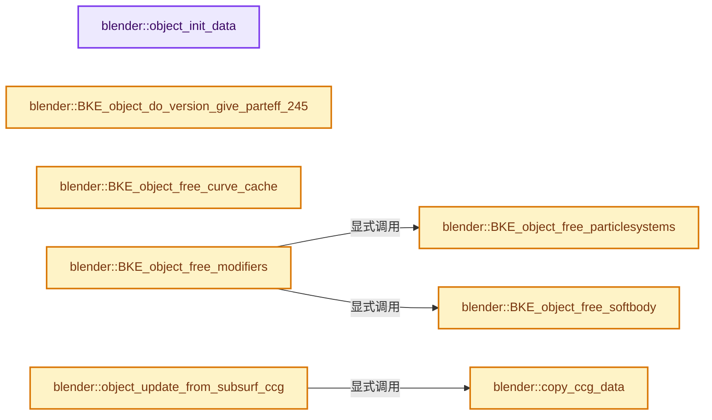
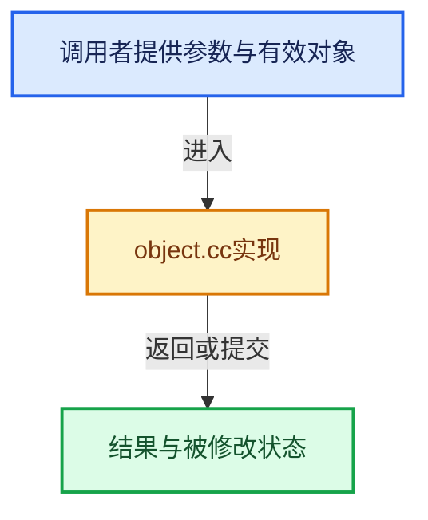

# 实现依赖专题：source/blender/blenkernel/intern/object.cc

[实现依赖导航](../../README.md) · [符号索引](../../../00-课程指南/02-源码与提交索引/符号依赖与实现索引.md)

本专题从正文实际调用进入，集中保存共享实现。函数有稳定锚点，可从调用处直接跳到对应完整函数；递归与互相调用通过回链组织。

## 本文件的实现关系






## 完整成员与函数实现

<a id="f-19d02b221559fdb2"></a>

### `blender::object_init_data`

实现位置：[source/blender/blenkernel/intern/object.cc](../../../../../../../source/blender/blenkernel/intern/object.cc) · L176—L187。

接口参数：

- `ID *id`

**教学注释版**

<!-- annotated:9ca37b9c38e1d0 -->

```cpp
static void object_init_data(ID *id)
{
  Object *ob = id_cast<Object *>(id);
  INIT_DEFAULT_STRUCT_AFTER(ob, id);

  ob->type = OB_EMPTY;

  ob->runtime = MEM_new<bke::ObjectRuntime>(__func__);

  /* Animation Visualization defaults */
  bke::animviz::settings_init(&ob->avs);
}
```

<details>
<summary>核对原始源码：source/blender/blenkernel/intern/object.cc · L176—L187</summary>

<!-- original:9ca37b9c38e1d0:source/blender/blenkernel/intern/object.cc:176:187 -->

```cpp
static void object_init_data(ID *id)
{
  Object *ob = id_cast<Object *>(id);
  INIT_DEFAULT_STRUCT_AFTER(ob, id);

  ob->type = OB_EMPTY;

  ob->runtime = MEM_new<bke::ObjectRuntime>(__func__);

  /* Animation Visualization defaults */
  bke::animviz::settings_init(&ob->avs);
}
```

</details>

**沿实际写入检查状态**

- `ob->type = OB_EMPTY;`
- `ob->runtime = MEM_new<bke::ObjectRuntime>(__func__);`

**继续追踪实现**

- `id_cast<Object *>` → [blender::id_cast · L1417](../../08-其他Blender模块/makesdna/DNA_ID.h.md#f-6c8ac6412850ac5a)。
- `INIT_DEFAULT_STRUCT_AFTER` → [INIT_DEFAULT_STRUCT_AFTER · L422](../../01-BLI基础库/BLI_utildefines.hh.md#m-30b1f74075b1)。宏定义由构建条件选择。
- `MEM_new<bke::ObjectRuntime>` → [MEM_new · L351](../../07-Intern运行时与平台/guardedalloc/MEM_guardedalloc.h.md#f-115f9b6784f89912)。
- `bke::animviz::settings_init` → [blender::bke::animviz::settings_init · L28](anim_visualization.cc.md#f-a39b9f2503968c85)。

<a id="f-2101f35ed15c27db"></a>

### `blender::BKE_object_do_version_give_parteff_245`

实现位置：[source/blender/blenkernel/intern/object.cc](../../../../../../../source/blender/blenkernel/intern/object.cc) · L1162—L1174。

接口参数：

- `Object *ob`

**教学注释版**

<!-- annotated:2d969f73af3b20 -->

```cpp
PartEff *BKE_object_do_version_give_parteff_245(Object *ob)
{
  PartEff *paf;

  paf = ob->effect.first_as<PartEff>();
  while (paf) {
    if (paf->type == EFF_PARTICLE) {
      return paf;
    }
    paf = paf->next;
  }
  return nullptr;
}
```

<details>
<summary>核对原始源码：source/blender/blenkernel/intern/object.cc · L1162—L1174</summary>

<!-- original:2d969f73af3b20:source/blender/blenkernel/intern/object.cc:1162:1174 -->

```cpp
PartEff *BKE_object_do_version_give_parteff_245(Object *ob)
{
  PartEff *paf;

  paf = ob->effect.first_as<PartEff>();
  while (paf) {
    if (paf->type == EFF_PARTICLE) {
      return paf;
    }
    paf = paf->next;
  }
  return nullptr;
}
```

</details>

**沿实际写入检查状态**

- `paf = ob->effect.first_as<PartEff>();`
- `paf = paf->next;`

**结果出口**

- `return paf;`
- `return nullptr;`

**继续追踪实现**

- `ob->effect.first_as<PartEff>` → [调用协议](../../../00-课程指南/01-路线与规范/模板宏与动态分派协议.md)：接收对象类型依赖auto、返回值或模板实例；不按同名猜测目标。调用位置L1166。

<a id="f-7c59d815e37d3300"></a>

### `blender::BKE_object_free_particlesystems`

实现位置：[source/blender/blenkernel/intern/object.cc](../../../../../../../source/blender/blenkernel/intern/object.cc) · L1311—L1316。

接口参数：

- `Object *ob`

**教学注释版**

<!-- annotated:e821940bbebf88 -->

```cpp
void BKE_object_free_particlesystems(Object *ob)
{
  while (ParticleSystem *psys = static_cast<ParticleSystem *>(BLI_pophead(&ob->particlesystem))) {
    psys_free(ob, psys);
  }
}
```

<details>
<summary>核对原始源码：source/blender/blenkernel/intern/object.cc · L1311—L1316</summary>

<!-- original:e821940bbebf88:source/blender/blenkernel/intern/object.cc:1311:1316 -->

```cpp
void BKE_object_free_particlesystems(Object *ob)
{
  while (ParticleSystem *psys = static_cast<ParticleSystem *>(BLI_pophead(&ob->particlesystem))) {
    psys_free(ob, psys);
  }
}
```

</details>

**继续追踪实现**

- `BLI_pophead` → [blender::BLI_pophead · L259](../../01-BLI基础库/intern/listbase.cc.md#f-c1491382e532f81c)。
- `psys_free` → [psys_free · L976](particle.cc.md#f-1397714583dd4087)。

<a id="f-fdec42792a0c0e25"></a>

### `blender::BKE_object_free_softbody`

实现位置：[source/blender/blenkernel/intern/object.cc](../../../../../../../source/blender/blenkernel/intern/object.cc) · L1318—L1321。

接口参数：

- `Object *ob`

**教学注释版**

<!-- annotated:675e092a252ff4 -->

```cpp
void BKE_object_free_softbody(Object *ob)
{
  sbFree(ob);
}
```

<details>
<summary>核对原始源码：source/blender/blenkernel/intern/object.cc · L1318—L1321</summary>

<!-- original:675e092a252ff4:source/blender/blenkernel/intern/object.cc:1318:1321 -->

```cpp
void BKE_object_free_softbody(Object *ob)
{
  sbFree(ob);
}
```

</details>

**继续追踪实现**

- `sbFree` → [blender::sbFree · L3120](softbody.cc.md#f-84eb83849ec63f1d)。

<a id="f-acd215a4edff8e3d"></a>

### `blender::BKE_object_free_curve_cache`

实现位置：[source/blender/blenkernel/intern/object.cc](../../../../../../../source/blender/blenkernel/intern/object.cc) · L1323—L1335。

接口参数：

- `Object *ob`

**教学注释版**

<!-- annotated:c1a4915242381d -->

```cpp
void BKE_object_free_curve_cache(Object *ob)
{
  if (ob->runtime->curve_cache) {
    BKE_displist_free(&ob->runtime->curve_cache->disp);
    BKE_curve_bevelList_free(&ob->runtime->curve_cache->bev);
    if (ob->runtime->curve_cache->anim_path_accum_length) {
      MEM_delete(ob->runtime->curve_cache->anim_path_accum_length);
    }
    BKE_nurbList_free(&ob->runtime->curve_cache->deformed_nurbs);
    MEM_delete(ob->runtime->curve_cache);
    ob->runtime->curve_cache = nullptr;
  }
}
```

<details>
<summary>核对原始源码：source/blender/blenkernel/intern/object.cc · L1323—L1335</summary>

<!-- original:c1a4915242381d:source/blender/blenkernel/intern/object.cc:1323:1335 -->

```cpp
void BKE_object_free_curve_cache(Object *ob)
{
  if (ob->runtime->curve_cache) {
    BKE_displist_free(&ob->runtime->curve_cache->disp);
    BKE_curve_bevelList_free(&ob->runtime->curve_cache->bev);
    if (ob->runtime->curve_cache->anim_path_accum_length) {
      MEM_delete(ob->runtime->curve_cache->anim_path_accum_length);
    }
    BKE_nurbList_free(&ob->runtime->curve_cache->deformed_nurbs);
    MEM_delete(ob->runtime->curve_cache);
    ob->runtime->curve_cache = nullptr;
  }
}
```

</details>

**沿实际写入检查状态**

- `ob->runtime->curve_cache = nullptr;`

**继续追踪实现**

- `BKE_displist_free` → [blender::BKE_displist_free · L68](displist.cc.md#f-fe6903944ada1ff4)。
- `BKE_curve_bevelList_free` → [blender::BKE_curve_bevelList_free · L2544](curve.cc.md#f-8ce8f32b0e3f481c)。
- `MEM_delete` → [MEM_delete · L400](../../07-Intern运行时与平台/guardedalloc/MEM_guardedalloc.h.md#f-9049ffdd1682887c)。
- `BKE_nurbList_free` → [blender::BKE_nurbList_free · L619](curve.cc.md#f-f7a01a9be3ec4137)。

<a id="f-f8dd3f8f0ede989d"></a>

### `blender::BKE_object_free_modifiers`

实现位置：[source/blender/blenkernel/intern/object.cc](../../../../../../../source/blender/blenkernel/intern/object.cc) · L1337—L1356。

接口参数：

- `Object *ob`
- `const int flag`

**教学注释版**

<!-- annotated:54b7e4cb74c1e5 -->

```cpp
void BKE_object_free_modifiers(Object *ob, const int flag)
{
  while (ModifierData *md = static_cast<ModifierData *>(BLI_pophead(&ob->modifiers))) {
    BKE_modifier_free_ex(md, flag);
  }

  while (GpencilModifierData *gp_md = static_cast<GpencilModifierData *>(
             BLI_pophead(&ob->greasepencil_modifiers)))
  {
    BKE_grease_pencil_modifier_free_ex(gp_md, flag);
  }
  /* Particle modifiers were freed, so free the particle-systems as well. */
  BKE_object_free_particlesystems(ob);

  /* Same for soft-body */
  BKE_object_free_softbody(ob);

  /* modifiers may have stored data in the DM cache */
  BKE_object_free_derived_caches(ob);
}
```

<details>
<summary>核对原始源码：source/blender/blenkernel/intern/object.cc · L1337—L1356</summary>

<!-- original:54b7e4cb74c1e5:source/blender/blenkernel/intern/object.cc:1337:1356 -->

```cpp
void BKE_object_free_modifiers(Object *ob, const int flag)
{
  while (ModifierData *md = static_cast<ModifierData *>(BLI_pophead(&ob->modifiers))) {
    BKE_modifier_free_ex(md, flag);
  }

  while (GpencilModifierData *gp_md = static_cast<GpencilModifierData *>(
             BLI_pophead(&ob->greasepencil_modifiers)))
  {
    BKE_grease_pencil_modifier_free_ex(gp_md, flag);
  }
  /* Particle modifiers were freed, so free the particle-systems as well. */
  BKE_object_free_particlesystems(ob);

  /* Same for soft-body */
  BKE_object_free_softbody(ob);

  /* modifiers may have stored data in the DM cache */
  BKE_object_free_derived_caches(ob);
}
```

</details>

**继续追踪实现**

- `BLI_pophead` → [blender::BLI_pophead · L259](../../01-BLI基础库/intern/listbase.cc.md#f-c1491382e532f81c)。
- `BKE_modifier_free_ex` → [blender::BKE_modifier_free_ex · L186](modifier.cc.md#f-0dde8cf6191eaf0e)。
- `BKE_grease_pencil_modifier_free_ex` → [blender::BKE_grease_pencil_modifier_free_ex · L365](grease_pencil_modifiers.cc.md#f-6b63146ec372ea3e)。
- `BKE_object_free_particlesystems` → [blender::BKE_object_free_particlesystems · L1311](object.cc.md#f-7c59d815e37d3300)。
- `BKE_object_free_softbody` → [blender::BKE_object_free_softbody · L1318](object.cc.md#f-fdec42792a0c0e25)。
- `BKE_object_free_derived_caches` → [blender::BKE_object_free_derived_caches · L1810](object.cc.md#f-74071902e41326eb)。

<a id="f-41d20769fe19eccf"></a>

### `blender::copy_ccg_data`

实现位置：[source/blender/blenkernel/intern/object.cc](../../../../../../../source/blender/blenkernel/intern/object.cc) · L1692—L1707。

接口参数：

- `Mesh *mesh_dst`
- `Mesh *mesh_src`
- `const eCustomDataType layer_type`

**教学注释版**

<!-- annotated:31099964f4e849 -->

```cpp
static void copy_ccg_data(Mesh *mesh_dst, Mesh *mesh_src, const eCustomDataType layer_type)
{
  BLI_assert(mesh_dst->corners_num == mesh_src->corners_num);
  CustomData *data_dst = &mesh_dst->corner_data;
  CustomData *data_src = &mesh_src->corner_data;
  const int num_elements = mesh_src->corners_num;
  if (!CustomData_has_layer(data_src, layer_type)) {
    return;
  }
  const int layer_index = CustomData_get_layer_index(data_dst, layer_type);
  CustomData_free_layer(data_dst, layer_type, layer_index);
  BLI_assert(!CustomData_has_layer(data_dst, layer_type));
  CustomData_add_layer(data_dst, eCustomDataType(layer_type), CD_SET_DEFAULT, num_elements);
  BLI_assert(CustomData_has_layer(data_dst, layer_type));
  CustomData_copy_layer_type_data(data_src, data_dst, layer_type, 0, 0, num_elements);
}
```

<details>
<summary>核对原始源码：source/blender/blenkernel/intern/object.cc · L1692—L1707</summary>

<!-- original:31099964f4e849:source/blender/blenkernel/intern/object.cc:1692:1707 -->

```cpp
static void copy_ccg_data(Mesh *mesh_dst, Mesh *mesh_src, const eCustomDataType layer_type)
{
  BLI_assert(mesh_dst->corners_num == mesh_src->corners_num);
  CustomData *data_dst = &mesh_dst->corner_data;
  CustomData *data_src = &mesh_src->corner_data;
  const int num_elements = mesh_src->corners_num;
  if (!CustomData_has_layer(data_src, layer_type)) {
    return;
  }
  const int layer_index = CustomData_get_layer_index(data_dst, layer_type);
  CustomData_free_layer(data_dst, layer_type, layer_index);
  BLI_assert(!CustomData_has_layer(data_dst, layer_type));
  CustomData_add_layer(data_dst, eCustomDataType(layer_type), CD_SET_DEFAULT, num_elements);
  BLI_assert(CustomData_has_layer(data_dst, layer_type));
  CustomData_copy_layer_type_data(data_src, data_dst, layer_type, 0, 0, num_elements);
}
```

</details>

**继续追踪实现**

- `BLI_assert` → [BLI_assert · L48](../../01-BLI基础库/BLI_assert.hh.md#m-57a88495704d)；[BLI_assert · L63](../../01-BLI基础库/BLI_assert.hh.md#m-d07050020cb5)。宏定义由构建条件选择。
- `CustomData_has_layer` → [blender::CustomData_has_layer · L3005](customdata.cc.md#f-7333340531d48ea3)。
- `CustomData_get_layer_index` → [blender::CustomData_get_layer_index · L2556](customdata.cc.md#f-e6d99d20af929991)。
- `CustomData_free_layer` → [blender::CustomData_free_layer · L2921](customdata.cc.md#f-77b56960fe480952)。
- `CustomData_add_layer` → [blender::CustomData_add_layer · L2851](customdata.cc.md#f-4c7988e825541059)。
- `eCustomDataType` → [blender::eCustomDataType](../../08-其他Blender模块/makesdna/DNA_customdata_types.h.md#t-dfbf4a4ce0e1)。
- `CustomData_copy_layer_type_data` → [blender::CustomData_copy_layer_type_data · L3150](customdata.cc.md#f-642e6b4074b28808)。

<a id="f-a1f30f9286c63a30"></a>

### `blender::object_update_from_subsurf_ccg`

实现位置：[source/blender/blenkernel/intern/object.cc](../../../../../../../source/blender/blenkernel/intern/object.cc) · L1709—L1784。

接口参数：

- `Object *object`

**教学注释版**

<!-- annotated:4c9e8b10e7daac -->

```cpp
static void object_update_from_subsurf_ccg(Object *object)
{
  /* Currently CCG is only created for Mesh objects. */
  if (object->type != OB_MESH) {
    return;
  }
  const bke::GeometrySet *geometry_set_eval = object->runtime->geometry_set_eval;
  if (geometry_set_eval == nullptr) {
    /* Object was never evaluated, so can not have CCG subdivision surface. */
    return;
  }
  /* Check for owns_direct_data() which may reference the original mesh from before modifier
   * evaluation. In that case the mesh can't be read, because it's a separately owned ID that most
   * likely comes from the object's copy-on-eval modifier input mesh which the depsgraph free
   * destroys in an undefined order. For non read-only ownership types, the GeometrySet will have a
   * user for the mesh, so it can be safely read here. */
  const auto *mesh_component = geometry_set_eval->get_component<bke::MeshComponent>();
  if (mesh_component == nullptr || !mesh_component->owns_direct_data()) {
    return;
  }
  const Mesh *mesh_eval = mesh_component->get();
  if (mesh_eval == nullptr) {
    return;
  }
  SubdivCCG *subdiv_ccg = mesh_eval->runtime->subdiv_ccg.get();
  if (subdiv_ccg == nullptr) {
    return;
  }
  /* Check whether there is anything to be reshaped. */
  if (!subdiv_ccg->dirty.coords && !subdiv_ccg->dirty.hidden) {
    return;
  }
  const int tot_level = mesh_eval->runtime->subdiv_ccg_tot_level;
  Object *object_orig = DEG_get_original(object);
  Mesh *mesh_orig = id_cast<Mesh *>(object_orig->data);
  multiresModifier_reshapeFromCCG(tot_level, mesh_orig, subdiv_ccg);
  /* NOTE: we need to reshape into an original mesh from main database,
   * allowing:
   *
   * - Update copies of that mesh at any moment.
   * - Save the file without doing extra reshape.
   * - All the users of the mesh have updated displacement.
   *
   * However, the tricky part here is that we only know about sculpted
   * state of a mesh on an object level, and object is being updated after
   * mesh data-block is updated. This forces us to:
   *
   * - Update mesh data-block from object evaluation, which is technically
   *   forbidden, but there is no other place for this yet.
   * - Reshape to the original mesh from main database, and then copy updated
   *   layer to copy of that mesh (since copy of the mesh has decoupled
   *   custom data layers).
   *
   * All this is defeating all the designs we need to follow to allow safe
   * threaded evaluation, but this is as good as we can make it within the
   * current sculpt/evaluated mesh design. This is also how we've survived
   * with old #DerivedMesh based solutions. So, while this is all wrong and
   * needs reconsideration, doesn't seem to be a big stopper for real
   * production artists.
   */
  /* TODO(sergey): Solve this somehow, to be fully stable for threaded
   * evaluation environment.
   */
  /* NOTE: runtime.data_orig is what was before assigning mesh_eval,
   * it is orig as in what was in object_eval->data before evaluating
   * modifier stack.
   *
   * mesh_cow is a copy-on-written version of `object_orig->data`.
   */
  Mesh *mesh_cow = id_cast<Mesh *>(object->runtime->data_orig);
  copy_ccg_data(mesh_cow, mesh_orig, CD_MDISPS);
  copy_ccg_data(mesh_cow, mesh_orig, CD_GRID_PAINT_MASK);
  /* Everything is now up-to-date. */
  subdiv_ccg->dirty.coords = false;
  subdiv_ccg->dirty.hidden = false;
}
```

<details>
<summary>核对原始源码：source/blender/blenkernel/intern/object.cc · L1709—L1784</summary>

<!-- original:4c9e8b10e7daac:source/blender/blenkernel/intern/object.cc:1709:1784 -->

```cpp
static void object_update_from_subsurf_ccg(Object *object)
{
  /* Currently CCG is only created for Mesh objects. */
  if (object->type != OB_MESH) {
    return;
  }
  const bke::GeometrySet *geometry_set_eval = object->runtime->geometry_set_eval;
  if (geometry_set_eval == nullptr) {
    /* Object was never evaluated, so can not have CCG subdivision surface. */
    return;
  }
  /* Check for owns_direct_data() which may reference the original mesh from before modifier
   * evaluation. In that case the mesh can't be read, because it's a separately owned ID that most
   * likely comes from the object's copy-on-eval modifier input mesh which the depsgraph free
   * destroys in an undefined order. For non read-only ownership types, the GeometrySet will have a
   * user for the mesh, so it can be safely read here. */
  const auto *mesh_component = geometry_set_eval->get_component<bke::MeshComponent>();
  if (mesh_component == nullptr || !mesh_component->owns_direct_data()) {
    return;
  }
  const Mesh *mesh_eval = mesh_component->get();
  if (mesh_eval == nullptr) {
    return;
  }
  SubdivCCG *subdiv_ccg = mesh_eval->runtime->subdiv_ccg.get();
  if (subdiv_ccg == nullptr) {
    return;
  }
  /* Check whether there is anything to be reshaped. */
  if (!subdiv_ccg->dirty.coords && !subdiv_ccg->dirty.hidden) {
    return;
  }
  const int tot_level = mesh_eval->runtime->subdiv_ccg_tot_level;
  Object *object_orig = DEG_get_original(object);
  Mesh *mesh_orig = id_cast<Mesh *>(object_orig->data);
  multiresModifier_reshapeFromCCG(tot_level, mesh_orig, subdiv_ccg);
  /* NOTE: we need to reshape into an original mesh from main database,
   * allowing:
   *
   * - Update copies of that mesh at any moment.
   * - Save the file without doing extra reshape.
   * - All the users of the mesh have updated displacement.
   *
   * However, the tricky part here is that we only know about sculpted
   * state of a mesh on an object level, and object is being updated after
   * mesh data-block is updated. This forces us to:
   *
   * - Update mesh data-block from object evaluation, which is technically
   *   forbidden, but there is no other place for this yet.
   * - Reshape to the original mesh from main database, and then copy updated
   *   layer to copy of that mesh (since copy of the mesh has decoupled
   *   custom data layers).
   *
   * All this is defeating all the designs we need to follow to allow safe
   * threaded evaluation, but this is as good as we can make it within the
   * current sculpt/evaluated mesh design. This is also how we've survived
   * with old #DerivedMesh based solutions. So, while this is all wrong and
   * needs reconsideration, doesn't seem to be a big stopper for real
   * production artists.
   */
  /* TODO(sergey): Solve this somehow, to be fully stable for threaded
   * evaluation environment.
   */
  /* NOTE: runtime.data_orig is what was before assigning mesh_eval,
   * it is orig as in what was in object_eval->data before evaluating
   * modifier stack.
   *
   * mesh_cow is a copy-on-written version of `object_orig->data`.
   */
  Mesh *mesh_cow = id_cast<Mesh *>(object->runtime->data_orig);
  copy_ccg_data(mesh_cow, mesh_orig, CD_MDISPS);
  copy_ccg_data(mesh_cow, mesh_orig, CD_GRID_PAINT_MASK);
  /* Everything is now up-to-date. */
  subdiv_ccg->dirty.coords = false;
  subdiv_ccg->dirty.hidden = false;
}
```

</details>

**沿实际写入检查状态**

- `subdiv_ccg->dirty.coords = false;`
- `subdiv_ccg->dirty.hidden = false;`

**继续追踪实现**

- `geometry_set_eval->get_component<bke::MeshComponent>` → [blender::bke::GeometrySet::get_component · L137](../../../06-隐式共享与缓存系统/05-GeometrySet读写与复制.md#f-26f915a73bb3d7e8)。
- `mesh_component->owns_direct_data` → [调用协议](../../../00-课程指南/01-路线与规范/模板宏与动态分派协议.md)：接收对象类型依赖auto、返回值或模板实例；不按同名猜测目标。调用位置L1726。
- `mesh_component->get` → [调用协议](../../../00-课程指南/01-路线与规范/模板宏与动态分派协议.md)：接收对象类型依赖auto、返回值或模板实例；不按同名猜测目标。调用位置L1729。
- `mesh_eval->runtime->subdiv_ccg.get` → [调用协议](../../../00-课程指南/01-路线与规范/模板宏与动态分派协议.md)：接收对象类型依赖auto、返回值或模板实例；不按同名猜测目标。调用位置L1733。
- `DEG_get_original` → [blender::DEG_get_original · L128](../../06-Depsgraph依赖图/DEG_depsgraph_query.hh.md#f-79782eab82a92d86)；[blender::DEG_get_original · L134](../../06-Depsgraph依赖图/DEG_depsgraph_query.hh.md#f-c032f06e9ef8f0cb)。同名重载需按实参类型选择。
- `id_cast<Mesh *>` → [blender::id_cast · L1417](../../08-其他Blender模块/makesdna/DNA_ID.h.md#f-6c8ac6412850ac5a)。
- `multiresModifier_reshapeFromCCG` → [blender::multiresModifier_reshapeFromCCG · L129](multires_reshape.cc.md#f-9583ebfec42c6493)。
- `copy_ccg_data` → [blender::copy_ccg_data · L1692](object.cc.md#f-41d20769fe19eccf)。

<a id="f-8f43c337a2db2299"></a>

### `blender::BKE_object_eval_assign_data`

实现位置：[source/blender/blenkernel/intern/object.cc](../../../../../../../source/blender/blenkernel/intern/object.cc) · L1786—L1808。

接口参数：

- `Object *object_eval`
- `ID *data_eval`
- `bool is_owned`

**教学注释版**

<!-- annotated:bcdffcd63d4c28 -->

```cpp
void BKE_object_eval_assign_data(Object *object_eval, ID *data_eval, bool is_owned)
{
  BLI_assert(object_eval->id.tag & ID_TAG_COPIED_ON_EVAL);
  BLI_assert(object_eval->runtime->data_eval == nullptr);
  BLI_assert(data_eval->tag & ID_TAG_NO_MAIN);

  /* Assigned evaluated data. */
  object_eval->runtime->data_eval = data_eval;
  object_eval->runtime->is_data_eval_owned = is_owned;

  /* Overwrite data of evaluated object, if the data-block types match. */
  ID *data = object_eval->data;
  if (data->id_type() == data_eval->id_type()) {
    /* NOTE: we are not supposed to invoke evaluation for original objects,
     * but some areas are still being ported, so we play safe here. */
    if (object_eval->id.tag & ID_TAG_COPIED_ON_EVAL) {
      object_eval->data = data_eval;
    }
  }

  /* Is set separately currently. */
  object_eval->runtime->geometry_set_eval = nullptr;
}
```

<details>
<summary>核对原始源码：source/blender/blenkernel/intern/object.cc · L1786—L1808</summary>

<!-- original:bcdffcd63d4c28:source/blender/blenkernel/intern/object.cc:1786:1808 -->

```cpp
void BKE_object_eval_assign_data(Object *object_eval, ID *data_eval, bool is_owned)
{
  BLI_assert(object_eval->id.tag & ID_TAG_COPIED_ON_EVAL);
  BLI_assert(object_eval->runtime->data_eval == nullptr);
  BLI_assert(data_eval->tag & ID_TAG_NO_MAIN);

  /* Assigned evaluated data. */
  object_eval->runtime->data_eval = data_eval;
  object_eval->runtime->is_data_eval_owned = is_owned;

  /* Overwrite data of evaluated object, if the data-block types match. */
  ID *data = object_eval->data;
  if (data->id_type() == data_eval->id_type()) {
    /* NOTE: we are not supposed to invoke evaluation for original objects,
     * but some areas are still being ported, so we play safe here. */
    if (object_eval->id.tag & ID_TAG_COPIED_ON_EVAL) {
      object_eval->data = data_eval;
    }
  }

  /* Is set separately currently. */
  object_eval->runtime->geometry_set_eval = nullptr;
}
```

</details>

**沿实际写入检查状态**

- `object_eval->runtime->data_eval = data_eval;`
- `object_eval->runtime->is_data_eval_owned = is_owned;`
- `object_eval->data = data_eval;`
- `object_eval->runtime->geometry_set_eval = nullptr;`

**继续追踪实现**

- `BLI_assert` → [BLI_assert · L48](../../01-BLI基础库/BLI_assert.hh.md#m-57a88495704d)；[BLI_assert · L63](../../01-BLI基础库/BLI_assert.hh.md#m-d07050020cb5)。宏定义由构建条件选择。
- `data->id_type` → [blender::ID::id_type · L544](../../08-其他Blender模块/makesdna/DNA_ID.h.md#f-ee8fe63f3948aa47)。
- `data_eval->id_type` → [blender::ID::id_type · L544](../../08-其他Blender模块/makesdna/DNA_ID.h.md#f-ee8fe63f3948aa47)。

<a id="f-74071902e41326eb"></a>

### `blender::BKE_object_free_derived_caches`

实现位置：[source/blender/blenkernel/intern/object.cc](../../../../../../../source/blender/blenkernel/intern/object.cc) · L1810—L1849。

接口参数：

- `Object *ob`

**教学注释版**

<!-- annotated:a3d6dd672edeb4 -->

```cpp
void BKE_object_free_derived_caches(Object *ob)
{
  ob->runtime->bounds_eval.reset();

  object_update_from_subsurf_ccg(ob);

  if (ob->runtime->data_eval != nullptr) {
    if (ob->runtime->is_data_eval_owned) {
      ID *data_eval = ob->runtime->data_eval;
      if (data_eval->id_type() == ID_ME) {
        BKE_id_free(nullptr, id_cast<Mesh *>(data_eval));
      }
      else {
        BKE_libblock_free_data(data_eval, false);
        BKE_libblock_free_datablock(data_eval, 0);
        MEM_delete(data_eval);
      }
    }
    ob->runtime->data_eval = nullptr;
  }

  /* Restore initial pointer for copy-on-evaluation data-blocks, object->data
   * might be pointing to an evaluated data-block data was just freed above. */
  if (ob->runtime->data_orig != nullptr) {
    ob->data = ob->runtime->data_orig;
  }

  BKE_object_to_mesh_clear(ob);
  BKE_pose_backup_clear(ob);
  BKE_object_to_curve_clear(ob);
  BKE_object_free_curve_cache(ob);

  BKE_crazyspace_api_eval_clear(ob);

  if (ob->runtime->geometry_set_eval != nullptr) {
    delete ob->runtime->geometry_set_eval;
    ob->runtime->geometry_set_eval = nullptr;
    ob->runtime->contained_geometry_types = 0;
  }
}
```

<details>
<summary>核对原始源码：source/blender/blenkernel/intern/object.cc · L1810—L1849</summary>

<!-- original:a3d6dd672edeb4:source/blender/blenkernel/intern/object.cc:1810:1849 -->

```cpp
void BKE_object_free_derived_caches(Object *ob)
{
  ob->runtime->bounds_eval.reset();

  object_update_from_subsurf_ccg(ob);

  if (ob->runtime->data_eval != nullptr) {
    if (ob->runtime->is_data_eval_owned) {
      ID *data_eval = ob->runtime->data_eval;
      if (data_eval->id_type() == ID_ME) {
        BKE_id_free(nullptr, id_cast<Mesh *>(data_eval));
      }
      else {
        BKE_libblock_free_data(data_eval, false);
        BKE_libblock_free_datablock(data_eval, 0);
        MEM_delete(data_eval);
      }
    }
    ob->runtime->data_eval = nullptr;
  }

  /* Restore initial pointer for copy-on-evaluation data-blocks, object->data
   * might be pointing to an evaluated data-block data was just freed above. */
  if (ob->runtime->data_orig != nullptr) {
    ob->data = ob->runtime->data_orig;
  }

  BKE_object_to_mesh_clear(ob);
  BKE_pose_backup_clear(ob);
  BKE_object_to_curve_clear(ob);
  BKE_object_free_curve_cache(ob);

  BKE_crazyspace_api_eval_clear(ob);

  if (ob->runtime->geometry_set_eval != nullptr) {
    delete ob->runtime->geometry_set_eval;
    ob->runtime->geometry_set_eval = nullptr;
    ob->runtime->contained_geometry_types = 0;
  }
}
```

</details>

**沿实际写入检查状态**

- `ob->runtime->data_eval = nullptr;`
- `ob->data = ob->runtime->data_orig;`
- `ob->runtime->geometry_set_eval = nullptr;`
- `ob->runtime->contained_geometry_types = 0;`

**继续追踪实现**

- `ob->runtime->bounds_eval.reset` → [调用协议](../../../00-课程指南/01-路线与规范/模板宏与动态分派协议.md)：接收对象类型依赖auto、返回值或模板实例；不按同名猜测目标。调用位置L1812。
- `object_update_from_subsurf_ccg` → [blender::object_update_from_subsurf_ccg · L1709](object.cc.md#f-a1f30f9286c63a30)。
- `data_eval->id_type` → [blender::ID::id_type · L544](../../08-其他Blender模块/makesdna/DNA_ID.h.md#f-ee8fe63f3948aa47)。
- `BKE_id_free` → [blender::BKE_id_free · L224](lib_id_delete.cc.md#f-28ed02c41d0f2d5b)。
- `id_cast<Mesh *>` → [blender::id_cast · L1417](../../08-其他Blender模块/makesdna/DNA_ID.h.md#f-6c8ac6412850ac5a)。
- `BKE_libblock_free_data` → [blender::BKE_libblock_free_data · L51](lib_id_delete.cc.md#f-46dd6f10f77b69a6)。
- `BKE_libblock_free_datablock` → [blender::BKE_libblock_free_datablock · L80](lib_id_delete.cc.md#f-841dff48dde58c7f)。
- `MEM_delete` → [MEM_delete · L400](../../07-Intern运行时与平台/guardedalloc/MEM_guardedalloc.h.md#f-9049ffdd1682887c)。
- `BKE_object_to_mesh_clear` → [blender::BKE_object_to_mesh_clear · L5701](object.cc.md#f-d713f0095bb3970e)。
- `BKE_pose_backup_clear` → [blender::BKE_pose_backup_clear · L211](pose_backup.cc.md#f-3eefe40d7310ac42)。
- `BKE_object_to_curve_clear` → [blender::BKE_object_to_curve_clear · L5719](object.cc.md#f-9fa138c14d56b935)。
- `BKE_object_free_curve_cache` → [blender::BKE_object_free_curve_cache · L1323](object.cc.md#f-acd215a4edff8e3d)。
- `BKE_crazyspace_api_eval_clear` → [blender::BKE_crazyspace_api_eval_clear · L561](crazyspace.cc.md#f-74b65fc9a8ad833d)。

<a id="f-675c61a5cb33f967"></a>

### `blender::BKE_object_is_in_editmode`

实现位置：[source/blender/blenkernel/intern/object.cc](../../../../../../../source/blender/blenkernel/intern/object.cc) · L1898—L1925。

接口参数：

- `const Object *ob`

**教学注释版**

<!-- annotated:e4a6eb49967bd5 -->

```cpp
bool BKE_object_is_in_editmode(const Object *ob)
{
  if (ob->data == nullptr) {
    return false;
  }

  switch (ob->type) {
    case OB_MESH:
      return (id_cast<Mesh *>(ob->data))->runtime->edit_mesh != nullptr;
    case OB_ARMATURE:
      return (id_cast<bArmature *>(ob->data))->edbo != nullptr;
    case OB_FONT:
      return (id_cast<Curve *>(ob->data))->editfont != nullptr;
    case OB_MBALL:
      return (id_cast<MetaBall *>(ob->data))->editelems != nullptr;
    case OB_LATTICE:
      return (id_cast<Lattice *>(ob->data))->editlatt != nullptr;
    case OB_SURF:
    case OB_CURVES_LEGACY:
      return (id_cast<Curve *>(ob->data))->editnurb != nullptr;
    case OB_CURVES:
    case OB_POINTCLOUD:
    case OB_GREASE_PENCIL:
      return ob->mode == OB_MODE_EDIT;
    default:
      return false;
  }
}
```

<details>
<summary>核对原始源码：source/blender/blenkernel/intern/object.cc · L1898—L1925</summary>

<!-- original:e4a6eb49967bd5:source/blender/blenkernel/intern/object.cc:1898:1925 -->

```cpp
bool BKE_object_is_in_editmode(const Object *ob)
{
  if (ob->data == nullptr) {
    return false;
  }

  switch (ob->type) {
    case OB_MESH:
      return (id_cast<Mesh *>(ob->data))->runtime->edit_mesh != nullptr;
    case OB_ARMATURE:
      return (id_cast<bArmature *>(ob->data))->edbo != nullptr;
    case OB_FONT:
      return (id_cast<Curve *>(ob->data))->editfont != nullptr;
    case OB_MBALL:
      return (id_cast<MetaBall *>(ob->data))->editelems != nullptr;
    case OB_LATTICE:
      return (id_cast<Lattice *>(ob->data))->editlatt != nullptr;
    case OB_SURF:
    case OB_CURVES_LEGACY:
      return (id_cast<Curve *>(ob->data))->editnurb != nullptr;
    case OB_CURVES:
    case OB_POINTCLOUD:
    case OB_GREASE_PENCIL:
      return ob->mode == OB_MODE_EDIT;
    default:
      return false;
  }
}
```

</details>

**结果出口**

- `return false;`
- `return (id_cast<Mesh *>(ob->data))->runtime->edit_mesh != nullptr;`
- `return (id_cast<bArmature *>(ob->data))->edbo != nullptr;`
- `return (id_cast<Curve *>(ob->data))->editfont != nullptr;`
- `return (id_cast<MetaBall *>(ob->data))->editelems != nullptr;`
- `return (id_cast<Lattice *>(ob->data))->editlatt != nullptr;`
- `return (id_cast<Curve *>(ob->data))->editnurb != nullptr;`
- `return ob->mode == OB_MODE_EDIT;`

**继续追踪实现**

- `id_cast<Mesh *>` → [blender::id_cast · L1417](../../08-其他Blender模块/makesdna/DNA_ID.h.md#f-6c8ac6412850ac5a)。
- `id_cast<bArmature *>` → [blender::id_cast · L1417](../../08-其他Blender模块/makesdna/DNA_ID.h.md#f-6c8ac6412850ac5a)。
- `id_cast<Curve *>` → [blender::id_cast · L1417](../../08-其他Blender模块/makesdna/DNA_ID.h.md#f-6c8ac6412850ac5a)。
- `id_cast<MetaBall *>` → [blender::id_cast · L1417](../../08-其他Blender模块/makesdna/DNA_ID.h.md#f-6c8ac6412850ac5a)。
- `id_cast<Lattice *>` → [blender::id_cast · L1417](../../08-其他Blender模块/makesdna/DNA_ID.h.md#f-6c8ac6412850ac5a)。

<a id="f-fa56b3ba4ed64eaf"></a>

### `blender::BKE_object_is_in_editmode_vgroup`

实现位置：[source/blender/blenkernel/intern/object.cc](../../../../../../../source/blender/blenkernel/intern/object.cc) · L1927—L1930。

接口参数：

- `const Object *ob`

**教学注释版**

<!-- annotated:39c27d01d3d1b0 -->

```cpp
bool BKE_object_is_in_editmode_vgroup(const Object *ob)
{
  return (OB_TYPE_SUPPORT_VGROUP(ob->type) && BKE_object_is_in_editmode(ob));
}
```

<details>
<summary>核对原始源码：source/blender/blenkernel/intern/object.cc · L1927—L1930</summary>

<!-- original:39c27d01d3d1b0:source/blender/blenkernel/intern/object.cc:1927:1930 -->

```cpp
bool BKE_object_is_in_editmode_vgroup(const Object *ob)
{
  return (OB_TYPE_SUPPORT_VGROUP(ob->type) && BKE_object_is_in_editmode(ob));
}
```

</details>

**结果出口**

- `return (OB_TYPE_SUPPORT_VGROUP(ob->type) && BKE_object_is_in_editmode(ob));`

**继续追踪实现**

- `OB_TYPE_SUPPORT_VGROUP` → [OB_TYPE_SUPPORT_VGROUP · L734](../../08-其他Blender模块/makesdna/DNA_object_types.h.md#m-418d8ceae920)。宏定义由构建条件选择。
- `BKE_object_is_in_editmode` → [blender::BKE_object_is_in_editmode · L1898](object.cc.md#f-675c61a5cb33f967)。

<a id="f-44b525ac74ad9099"></a>

### `blender::BKE_object_data_is_in_editmode`

实现位置：[source/blender/blenkernel/intern/object.cc](../../../../../../../source/blender/blenkernel/intern/object.cc) · L1932—L1959。

接口参数：

- `const Object *ob`
- `const ID *id`

**教学注释版**

<!-- annotated:b3f75e420ed0df -->

```cpp
bool BKE_object_data_is_in_editmode(const Object *ob, const ID *id)
{
  const short type = id->id_type();
  BLI_assert(OB_DATA_SUPPORT_EDITMODE(type));
  switch (type) {
    case ID_ME:
      return (id_cast<const Mesh *>(id))->runtime->edit_mesh != nullptr;
    case ID_CU_LEGACY:
      return (((id_cast<const Curve *>(id))->editnurb != nullptr) ||
              ((id_cast<const Curve *>(id))->editfont != nullptr));
    case ID_MB:
      return (id_cast<const MetaBall *>(id))->editelems != nullptr;
    case ID_LT:
      return (id_cast<const Lattice *>(id))->editlatt != nullptr;
    case ID_AR:
      return (id_cast<const bArmature *>(id))->edbo != nullptr;
    case ID_CV:
    case ID_PT:
    case ID_GP:
      if (ob) {
        return BKE_object_is_in_editmode(ob);
      }
      return false;
    default:
      BLI_assert_unreachable();
      return false;
  }
}
```

<details>
<summary>核对原始源码：source/blender/blenkernel/intern/object.cc · L1932—L1959</summary>

<!-- original:b3f75e420ed0df:source/blender/blenkernel/intern/object.cc:1932:1959 -->

```cpp
bool BKE_object_data_is_in_editmode(const Object *ob, const ID *id)
{
  const short type = id->id_type();
  BLI_assert(OB_DATA_SUPPORT_EDITMODE(type));
  switch (type) {
    case ID_ME:
      return (id_cast<const Mesh *>(id))->runtime->edit_mesh != nullptr;
    case ID_CU_LEGACY:
      return (((id_cast<const Curve *>(id))->editnurb != nullptr) ||
              ((id_cast<const Curve *>(id))->editfont != nullptr));
    case ID_MB:
      return (id_cast<const MetaBall *>(id))->editelems != nullptr;
    case ID_LT:
      return (id_cast<const Lattice *>(id))->editlatt != nullptr;
    case ID_AR:
      return (id_cast<const bArmature *>(id))->edbo != nullptr;
    case ID_CV:
    case ID_PT:
    case ID_GP:
      if (ob) {
        return BKE_object_is_in_editmode(ob);
      }
      return false;
    default:
      BLI_assert_unreachable();
      return false;
  }
}
```

</details>

**结果出口**

- `return (id_cast<const Mesh *>(id))->runtime->edit_mesh != nullptr;`
- `return (((id_cast<const Curve *>(id))->editnurb != nullptr) ||`
- `return (id_cast<const MetaBall *>(id))->editelems != nullptr;`
- `return (id_cast<const Lattice *>(id))->editlatt != nullptr;`
- `return (id_cast<const bArmature *>(id))->edbo != nullptr;`
- `return BKE_object_is_in_editmode(ob);`
- `return false;`

**继续追踪实现**

- `id->id_type` → [blender::ID::id_type · L544](../../08-其他Blender模块/makesdna/DNA_ID.h.md#f-ee8fe63f3948aa47)。
- `BLI_assert` → [BLI_assert · L48](../../01-BLI基础库/BLI_assert.hh.md#m-57a88495704d)；[BLI_assert · L63](../../01-BLI基础库/BLI_assert.hh.md#m-d07050020cb5)。宏定义由构建条件选择。
- `OB_DATA_SUPPORT_EDITMODE` → [OB_DATA_SUPPORT_EDITMODE · L753](../../08-其他Blender模块/makesdna/DNA_object_types.h.md#m-568216539b9e)。宏定义由构建条件选择。
- `id_cast<const Mesh *>` → [blender::id_cast · L1417](../../08-其他Blender模块/makesdna/DNA_ID.h.md#f-6c8ac6412850ac5a)。
- `id_cast<const Curve *>` → [blender::id_cast · L1417](../../08-其他Blender模块/makesdna/DNA_ID.h.md#f-6c8ac6412850ac5a)。
- `id_cast<const MetaBall *>` → [blender::id_cast · L1417](../../08-其他Blender模块/makesdna/DNA_ID.h.md#f-6c8ac6412850ac5a)。
- `id_cast<const Lattice *>` → [blender::id_cast · L1417](../../08-其他Blender模块/makesdna/DNA_ID.h.md#f-6c8ac6412850ac5a)。
- `id_cast<const bArmature *>` → [blender::id_cast · L1417](../../08-其他Blender模块/makesdna/DNA_ID.h.md#f-6c8ac6412850ac5a)。
- `BKE_object_is_in_editmode` → [blender::BKE_object_is_in_editmode · L1898](object.cc.md#f-675c61a5cb33f967)。
- `BLI_assert_unreachable` → [BLI_assert_unreachable · L77](../../01-BLI基础库/BLI_assert.hh.md#m-7a2d91a67d8e)。宏定义由构建条件选择。

<a id="f-097dd8f6158083c2"></a>

### `blender::BKE_object_visibility`

实现位置：[source/blender/blenkernel/intern/object.cc](../../../../../../../source/blender/blenkernel/intern/object.cc) · L2063—L2099。

接口参数：

- `const Object *ob`
- `const int dag_eval_mode`

**教学注释版**

<!-- annotated:b8c19a3cef31fa -->

```cpp
int BKE_object_visibility(const Object *ob, const int dag_eval_mode)
{
  if ((ob->base_flag & BASE_ENABLED_AND_MAYBE_VISIBLE_IN_VIEWPORT) == 0) {
    return 0;
  }

  /* Test which components the object has. */
  int visibility = OB_VISIBLE_SELF;
  if (ob->particlesystem.first()) {
    visibility |= OB_VISIBLE_INSTANCES | OB_VISIBLE_PARTICLES;
  }
  else if (ob->transflag & OB_DUPLI) {
    visibility |= OB_VISIBLE_INSTANCES;
  }

  if (bke::object_has_geometry_set_instances(*ob)) {
    visibility |= OB_VISIBLE_INSTANCES;
  }

  /* Optional hiding of self if there are particles or instancers. */
  if (visibility & (OB_VISIBLE_PARTICLES | OB_VISIBLE_INSTANCES)) {
    switch (eEvaluationMode(dag_eval_mode)) {
      case DAG_EVAL_VIEWPORT:
        if (!(ob->duplicator_visibility_flag & OB_DUPLI_FLAG_VIEWPORT)) {
          visibility &= ~OB_VISIBLE_SELF;
        }
        break;
      case DAG_EVAL_RENDER:
        if (!(ob->duplicator_visibility_flag & OB_DUPLI_FLAG_RENDER)) {
          visibility &= ~OB_VISIBLE_SELF;
        }
        break;
    }
  }

  return visibility;
}
```

<details>
<summary>核对原始源码：source/blender/blenkernel/intern/object.cc · L2063—L2099</summary>

<!-- original:b8c19a3cef31fa:source/blender/blenkernel/intern/object.cc:2063:2099 -->

```cpp
int BKE_object_visibility(const Object *ob, const int dag_eval_mode)
{
  if ((ob->base_flag & BASE_ENABLED_AND_MAYBE_VISIBLE_IN_VIEWPORT) == 0) {
    return 0;
  }

  /* Test which components the object has. */
  int visibility = OB_VISIBLE_SELF;
  if (ob->particlesystem.first()) {
    visibility |= OB_VISIBLE_INSTANCES | OB_VISIBLE_PARTICLES;
  }
  else if (ob->transflag & OB_DUPLI) {
    visibility |= OB_VISIBLE_INSTANCES;
  }

  if (bke::object_has_geometry_set_instances(*ob)) {
    visibility |= OB_VISIBLE_INSTANCES;
  }

  /* Optional hiding of self if there are particles or instancers. */
  if (visibility & (OB_VISIBLE_PARTICLES | OB_VISIBLE_INSTANCES)) {
    switch (eEvaluationMode(dag_eval_mode)) {
      case DAG_EVAL_VIEWPORT:
        if (!(ob->duplicator_visibility_flag & OB_DUPLI_FLAG_VIEWPORT)) {
          visibility &= ~OB_VISIBLE_SELF;
        }
        break;
      case DAG_EVAL_RENDER:
        if (!(ob->duplicator_visibility_flag & OB_DUPLI_FLAG_RENDER)) {
          visibility &= ~OB_VISIBLE_SELF;
        }
        break;
    }
  }

  return visibility;
}
```

</details>

**沿实际写入检查状态**

- `visibility |= OB_VISIBLE_INSTANCES | OB_VISIBLE_PARTICLES;`
- `visibility |= OB_VISIBLE_INSTANCES;`
- `visibility &= ~OB_VISIBLE_SELF;`

**结果出口**

- `return 0;`
- `return visibility;`

**继续追踪实现**

- `ob->particlesystem.first` → [调用协议](../../../00-课程指南/01-路线与规范/模板宏与动态分派协议.md)：接收对象类型依赖auto、返回值或模板实例；不按同名猜测目标。调用位置L2071。
- `bke::object_has_geometry_set_instances` → [blender::bke::object_has_geometry_set_instances · L815](../../../06-隐式共享与缓存系统/05-GeometrySet读写与复制.md#f-e48d507dbfd856ee)。
- `eEvaluationMode` → [blender::io::usd::USDExportParams::eEvaluationMode](../../08-其他Blender模块/io/usd/usd.hh.md#t-05b14e5133f2)；[blender::AlembicExportParams::eEvaluationMode](../../08-其他Blender模块/io/alembic/ABC_alembic.h.md#t-fdf4229d2c22)；[blender::io::HierarchyContext::eEvaluationMode](../../08-其他Blender模块/io/common/IO_abstract_hierarchy_iterator.h.md#t-12321ba0582f)；[blender::eEvaluationMode](../../06-Depsgraph依赖图/DEG_depsgraph.hh.md#t-188b9d826739)。

<a id="f-36075524c23d51d7"></a>

### `blender::get_obdata_defname`

实现位置：[source/blender/blenkernel/intern/object.cc](../../../../../../../source/blender/blenkernel/intern/object.cc) · L2118—L2157。

接口参数：

- `ObjectType type`

**教学注释版**

<!-- annotated:9ec7dd982f0a91 -->

```cpp
static const char *get_obdata_defname(ObjectType type)
{
  switch (type) {
    case OB_MESH:
      return DATA_("Mesh");
    case OB_CURVES_LEGACY:
      return DATA_("Curve");
    case OB_SURF:
      return DATA_("Surf");
    case OB_FONT:
      return DATA_("Text");
    case OB_MBALL:
      return DATA_("Mball");
    case OB_CAMERA:
      return DATA_("Camera");
    case OB_LAMP:
      return CTX_DATA_(BLT_I18NCONTEXT_ID_LIGHT, "Light");
    case OB_LATTICE:
      return DATA_("Lattice");
    case OB_ARMATURE:
      return DATA_("Armature");
    case OB_SPEAKER:
      return DATA_("Speaker");
    case OB_CURVES:
      return DATA_("Curves");
    case OB_POINTCLOUD:
      return DATA_("PointCloud");
    case OB_VOLUME:
      return CTX_DATA_(BLT_I18NCONTEXT_ID_ID, "Volume");
    case OB_EMPTY:
      return CTX_DATA_(BLT_I18NCONTEXT_ID_ID, "Empty");
    case OB_LIGHTPROBE:
      return DATA_("LightProbe");
    case OB_GREASE_PENCIL:
      return DATA_("GreasePencil");
    default:
      CLOG_ERROR(&LOG, "Internal error, bad type: %d", type);
      return CTX_DATA_(BLT_I18NCONTEXT_ID_ID, "Empty");
  }
}
```

<details>
<summary>核对原始源码：source/blender/blenkernel/intern/object.cc · L2118—L2157</summary>

<!-- original:9ec7dd982f0a91:source/blender/blenkernel/intern/object.cc:2118:2157 -->

```cpp
static const char *get_obdata_defname(ObjectType type)
{
  switch (type) {
    case OB_MESH:
      return DATA_("Mesh");
    case OB_CURVES_LEGACY:
      return DATA_("Curve");
    case OB_SURF:
      return DATA_("Surf");
    case OB_FONT:
      return DATA_("Text");
    case OB_MBALL:
      return DATA_("Mball");
    case OB_CAMERA:
      return DATA_("Camera");
    case OB_LAMP:
      return CTX_DATA_(BLT_I18NCONTEXT_ID_LIGHT, "Light");
    case OB_LATTICE:
      return DATA_("Lattice");
    case OB_ARMATURE:
      return DATA_("Armature");
    case OB_SPEAKER:
      return DATA_("Speaker");
    case OB_CURVES:
      return DATA_("Curves");
    case OB_POINTCLOUD:
      return DATA_("PointCloud");
    case OB_VOLUME:
      return CTX_DATA_(BLT_I18NCONTEXT_ID_ID, "Volume");
    case OB_EMPTY:
      return CTX_DATA_(BLT_I18NCONTEXT_ID_ID, "Empty");
    case OB_LIGHTPROBE:
      return DATA_("LightProbe");
    case OB_GREASE_PENCIL:
      return DATA_("GreasePencil");
    default:
      CLOG_ERROR(&LOG, "Internal error, bad type: %d", type);
      return CTX_DATA_(BLT_I18NCONTEXT_ID_ID, "Empty");
  }
}
```

</details>

**结果出口**

- `return DATA_("Mesh");`
- `return DATA_("Curve");`
- `return DATA_("Surf");`
- `return DATA_("Text");`
- `return DATA_("Mball");`
- `return DATA_("Camera");`
- `return CTX_DATA_(BLT_I18NCONTEXT_ID_LIGHT, "Light");`
- `return DATA_("Lattice");`
- `return DATA_("Armature");`
- `return DATA_("Speaker");`
- `return DATA_("Curves");`
- `return DATA_("PointCloud");`
- `return CTX_DATA_(BLT_I18NCONTEXT_ID_ID, "Volume");`
- `return CTX_DATA_(BLT_I18NCONTEXT_ID_ID, "Empty");`
- `return DATA_("LightProbe");`
- `return DATA_("GreasePencil");`

**继续追踪实现**

- `DATA_` → [DATA_ · L52](../../08-其他Blender模块/blentranslation/BLT_translation.hh.md#m-178736083f83)。宏定义由构建条件选择。
- `CTX_DATA_` → [CTX_DATA_ · L56](../../08-其他Blender模块/blentranslation/BLT_translation.hh.md#m-4611dbdcc407)。宏定义由构建条件选择。
- `CLOG_ERROR` → [CLOG_ERROR · L188](../../07-Intern运行时与平台/clog/CLG_log.h.md#m-081575cdc8d0)。宏定义由构建条件选择。

<a id="f-467b0b78bd3731c6"></a>

### `blender::object_init`

实现位置：[source/blender/blenkernel/intern/object.cc](../../../../../../../source/blender/blenkernel/intern/object.cc) · L2159—L2183。

接口参数：

- `Object *ob`
- `const ObjectType ob_type`

**教学注释版**

<!-- annotated:8b0a93df358587 -->

```cpp
static void object_init(Object *ob, const ObjectType ob_type)
{
  object_init_data(&ob->id);

  ob->type = ob_type;

  if (ob->type != OB_EMPTY) {
    zero_v2(ob->ima_ofs);
  }

  if (ELEM(ob->type, OB_LAMP, OB_CAMERA, OB_SPEAKER)) {
    ob->trackflag = OB_NEGZ;
    ob->upflag = OB_POSY;
  }

  if (ob->type == OB_GREASE_PENCIL) {
    ob->dtx |= OB_USE_GPENCIL_LIGHTS;
  }

  if (ob->type == OB_LAMP) {
    /* Lights are invisible to camera rays and are assumed to be a
     * shadow catcher by default. */
    ob->visibility_flag |= OB_HIDE_CAMERA | OB_SHADOW_CATCHER;
  }
}
```

<details>
<summary>核对原始源码：source/blender/blenkernel/intern/object.cc · L2159—L2183</summary>

<!-- original:8b0a93df358587:source/blender/blenkernel/intern/object.cc:2159:2183 -->

```cpp
static void object_init(Object *ob, const ObjectType ob_type)
{
  object_init_data(&ob->id);

  ob->type = ob_type;

  if (ob->type != OB_EMPTY) {
    zero_v2(ob->ima_ofs);
  }

  if (ELEM(ob->type, OB_LAMP, OB_CAMERA, OB_SPEAKER)) {
    ob->trackflag = OB_NEGZ;
    ob->upflag = OB_POSY;
  }

  if (ob->type == OB_GREASE_PENCIL) {
    ob->dtx |= OB_USE_GPENCIL_LIGHTS;
  }

  if (ob->type == OB_LAMP) {
    /* Lights are invisible to camera rays and are assumed to be a
     * shadow catcher by default. */
    ob->visibility_flag |= OB_HIDE_CAMERA | OB_SHADOW_CATCHER;
  }
}
```

</details>

**沿实际写入检查状态**

- `ob->type = ob_type;`
- `ob->trackflag = OB_NEGZ;`
- `ob->upflag = OB_POSY;`
- `ob->dtx |= OB_USE_GPENCIL_LIGHTS;`
- `ob->visibility_flag |= OB_HIDE_CAMERA | OB_SHADOW_CATCHER;`

**继续追踪实现**

- `object_init_data` → [blender::object_init_data · L176](object.cc.md#f-19d02b221559fdb2)。
- `zero_v2` → [blender::zero_v2 · L20](../../01-BLI基础库/intern/math_vector_inline.cc.md#f-3f0f4c37141bd4f2)。
- `ELEM` → [ELEM · L88](../../07-Intern运行时与平台/ghost/intern/GHOST_utildefines.hh.md#m-d28724a15928)；[ELEM · L135](../../01-BLI基础库/BLI_utildefines.hh.md#m-d6572de7cae0)。宏定义由构建条件选择。

<a id="f-705780bc601d654a"></a>

### `blender::BKE_object_obdata_add_from_type`

实现位置：[source/blender/blenkernel/intern/object.cc](../../../../../../../source/blender/blenkernel/intern/object.cc) · L2185—L2228。

接口参数：

- `Main *bmain`
- `ObjectType type`
- `const char *name`

**教学注释版**

<!-- annotated:8e76ded2560e98 -->

```cpp
void *BKE_object_obdata_add_from_type(Main *bmain, ObjectType type, const char *name)
{
  if (name == nullptr) {
    name = get_obdata_defname(type);
  }

  switch (type) {
    case OB_MESH:
      return BKE_mesh_add(bmain, name);
    case OB_CURVES_LEGACY:
      return BKE_curve_add(bmain, name, OB_CURVES_LEGACY);
    case OB_SURF:
      return BKE_curve_add(bmain, name, OB_SURF);
    case OB_FONT:
      return BKE_curve_add(bmain, name, OB_FONT);
    case OB_MBALL:
      return BKE_mball_add(bmain, name);
    case OB_CAMERA:
      return BKE_camera_add(bmain, name);
    case OB_LAMP:
      return BKE_light_add(bmain, name);
    case OB_LATTICE:
      return BKE_lattice_add(bmain, name);
    case OB_ARMATURE:
      return BKE_armature_add(bmain, name);
    case OB_SPEAKER:
      return BKE_speaker_add(bmain, name);
    case OB_LIGHTPROBE:
      return BKE_lightprobe_add(bmain, name);
    case OB_CURVES:
      return BKE_curves_add(bmain, name);
    case OB_POINTCLOUD:
      return BKE_pointcloud_add(bmain, name);
    case OB_VOLUME:
      return BKE_volume_add(bmain, name);
    case OB_GREASE_PENCIL:
      return BKE_grease_pencil_add(bmain, name);
    case OB_EMPTY:
      return nullptr;
    default:
      CLOG_ERROR(&LOG, "Internal error, bad type: %d", type);
      return nullptr;
  }
}
```

<details>
<summary>核对原始源码：source/blender/blenkernel/intern/object.cc · L2185—L2228</summary>

<!-- original:8e76ded2560e98:source/blender/blenkernel/intern/object.cc:2185:2228 -->

```cpp
void *BKE_object_obdata_add_from_type(Main *bmain, ObjectType type, const char *name)
{
  if (name == nullptr) {
    name = get_obdata_defname(type);
  }

  switch (type) {
    case OB_MESH:
      return BKE_mesh_add(bmain, name);
    case OB_CURVES_LEGACY:
      return BKE_curve_add(bmain, name, OB_CURVES_LEGACY);
    case OB_SURF:
      return BKE_curve_add(bmain, name, OB_SURF);
    case OB_FONT:
      return BKE_curve_add(bmain, name, OB_FONT);
    case OB_MBALL:
      return BKE_mball_add(bmain, name);
    case OB_CAMERA:
      return BKE_camera_add(bmain, name);
    case OB_LAMP:
      return BKE_light_add(bmain, name);
    case OB_LATTICE:
      return BKE_lattice_add(bmain, name);
    case OB_ARMATURE:
      return BKE_armature_add(bmain, name);
    case OB_SPEAKER:
      return BKE_speaker_add(bmain, name);
    case OB_LIGHTPROBE:
      return BKE_lightprobe_add(bmain, name);
    case OB_CURVES:
      return BKE_curves_add(bmain, name);
    case OB_POINTCLOUD:
      return BKE_pointcloud_add(bmain, name);
    case OB_VOLUME:
      return BKE_volume_add(bmain, name);
    case OB_GREASE_PENCIL:
      return BKE_grease_pencil_add(bmain, name);
    case OB_EMPTY:
      return nullptr;
    default:
      CLOG_ERROR(&LOG, "Internal error, bad type: %d", type);
      return nullptr;
  }
}
```

</details>

**沿实际写入检查状态**

- `name = get_obdata_defname(type);`

**结果出口**

- `return BKE_mesh_add(bmain, name);`
- `return BKE_curve_add(bmain, name, OB_CURVES_LEGACY);`
- `return BKE_curve_add(bmain, name, OB_SURF);`
- `return BKE_curve_add(bmain, name, OB_FONT);`
- `return BKE_mball_add(bmain, name);`
- `return BKE_camera_add(bmain, name);`
- `return BKE_light_add(bmain, name);`
- `return BKE_lattice_add(bmain, name);`
- `return BKE_armature_add(bmain, name);`
- `return BKE_speaker_add(bmain, name);`
- `return BKE_lightprobe_add(bmain, name);`
- `return BKE_curves_add(bmain, name);`
- `return BKE_pointcloud_add(bmain, name);`
- `return BKE_volume_add(bmain, name);`
- `return BKE_grease_pencil_add(bmain, name);`
- `return nullptr;`

**继续追踪实现**

- `get_obdata_defname` → [blender::get_obdata_defname · L2118](object.cc.md#f-36075524c23d51d7)。
- `BKE_mesh_add` → [BKE_mesh_add · L1167](../../../05-几何存储与拓扑映射/03-MPoly迁移与兼容.md#f-33de92ce6cf34362)。
- `BKE_curve_add` → [blender::BKE_curve_add · L429](curve.cc.md#f-b2e2b523401fd47c)。
- `BKE_mball_add` → [blender::BKE_mball_add · L173](mball.cc.md#f-238032972e7ff3ee)。
- `BKE_camera_add` → [blender::BKE_camera_add · L294](camera.cc.md#f-db6d702bac3d60df)。
- `BKE_light_add` → [blender::BKE_light_add · L202](light.cc.md#f-e9ca4d2ee9e83771)。
- `BKE_lattice_add` → [blender::BKE_lattice_add · L392](lattice.cc.md#f-e60b9443d992d450)。
- `BKE_armature_add` → [blender::BKE_armature_add · L620](armature.cc.md#f-60a5db078b124cdb)。
- `BKE_speaker_add` → [blender::BKE_speaker_add · L82](speaker.cc.md#f-9e5620cf409a9d20)。
- `BKE_lightprobe_add` → [blender::BKE_lightprobe_add · L109](lightprobe.cc.md#f-89f7b18f49232726)。
- `BKE_curves_add` → [blender::BKE_curves_add · L179](curves.cc.md#f-15ebea7e8bcc307e)。
- `BKE_pointcloud_add` → [blender::BKE_pointcloud_add · L221](pointcloud.cc.md#f-5709cc4ca7632327)。
- `BKE_volume_add` → [blender::BKE_volume_add · L337](volume.cc.md#f-48114f7687b31d56)。
- `BKE_grease_pencil_add` → [blender::BKE_grease_pencil_add · L2425](grease_pencil.cc.md#f-7497431a2f7464f4)。
- `CLOG_ERROR` → [CLOG_ERROR · L188](../../07-Intern运行时与平台/clog/CLG_log.h.md#m-081575cdc8d0)。宏定义由构建条件选择。

<a id="f-679a8138427bcdef"></a>

### `blender::BKE_object_obdata_to_type`

实现位置：[source/blender/blenkernel/intern/object.cc](../../../../../../../source/blender/blenkernel/intern/object.cc) · L2230—L2263。

接口参数：

- `const ID *id`

**教学注释版**

<!-- annotated:9a95fc95cc535f -->

```cpp
int BKE_object_obdata_to_type(const ID *id)
{
  /* Keep in sync with #OB_DATA_SUPPORT_ID macro. */
  switch (id->id_type()) {
    case ID_ME:
      return OB_MESH;
    case ID_CU_LEGACY:
      return reinterpret_cast<const Curve *>(id)->ob_type;
    case ID_MB:
      return OB_MBALL;
    case ID_LA:
      return OB_LAMP;
    case ID_SPK:
      return OB_SPEAKER;
    case ID_CA:
      return OB_CAMERA;
    case ID_LT:
      return OB_LATTICE;
    case ID_AR:
      return OB_ARMATURE;
    case ID_LP:
      return OB_LIGHTPROBE;
    case ID_CV:
      return OB_CURVES;
    case ID_PT:
      return OB_POINTCLOUD;
    case ID_VO:
      return OB_VOLUME;
    case ID_GP:
      return OB_GREASE_PENCIL;
    default:
      return -1;
  }
}
```

<details>
<summary>核对原始源码：source/blender/blenkernel/intern/object.cc · L2230—L2263</summary>

<!-- original:9a95fc95cc535f:source/blender/blenkernel/intern/object.cc:2230:2263 -->

```cpp
int BKE_object_obdata_to_type(const ID *id)
{
  /* Keep in sync with #OB_DATA_SUPPORT_ID macro. */
  switch (id->id_type()) {
    case ID_ME:
      return OB_MESH;
    case ID_CU_LEGACY:
      return reinterpret_cast<const Curve *>(id)->ob_type;
    case ID_MB:
      return OB_MBALL;
    case ID_LA:
      return OB_LAMP;
    case ID_SPK:
      return OB_SPEAKER;
    case ID_CA:
      return OB_CAMERA;
    case ID_LT:
      return OB_LATTICE;
    case ID_AR:
      return OB_ARMATURE;
    case ID_LP:
      return OB_LIGHTPROBE;
    case ID_CV:
      return OB_CURVES;
    case ID_PT:
      return OB_POINTCLOUD;
    case ID_VO:
      return OB_VOLUME;
    case ID_GP:
      return OB_GREASE_PENCIL;
    default:
      return -1;
  }
}
```

</details>

**结果出口**

- `return OB_MESH;`
- `return reinterpret_cast<const Curve *>(id)->ob_type;`
- `return OB_MBALL;`
- `return OB_LAMP;`
- `return OB_SPEAKER;`
- `return OB_CAMERA;`
- `return OB_LATTICE;`
- `return OB_ARMATURE;`
- `return OB_LIGHTPROBE;`
- `return OB_CURVES;`
- `return OB_POINTCLOUD;`
- `return OB_VOLUME;`
- `return OB_GREASE_PENCIL;`
- `return -1;`

**继续追踪实现**

- `id->id_type` → [blender::ID::id_type · L544](../../08-其他Blender模块/makesdna/DNA_ID.h.md#f-ee8fe63f3948aa47)。

<a id="f-2e09c70d9279bef9"></a>

### `blender::BKE_object_add_only_object`

实现位置：[source/blender/blenkernel/intern/object.cc](../../../../../../../source/blender/blenkernel/intern/object.cc) · L2265—L2282。

接口参数：

- `Main *bmain`
- `ObjectType type`
- `const char *name`

**教学注释版**

<!-- annotated:6f3d62e963c1a6 -->

```cpp
Object *BKE_object_add_only_object(Main *bmain, ObjectType type, const char *name)
{
  if (!name) {
    name = get_obdata_defname(type);
  }

  /* We cannot use #BKE_id_new here as we need some custom initialization code. */
  Object *ob = static_cast<Object *>(
      BKE_libblock_alloc(bmain, ID_OB, name, bmain ? 0 : LIB_ID_CREATE_NO_MAIN));

  /* We increase object user count when linking to Collections. */
  id_us_min(&ob->id);

  /* default object vars */
  object_init(ob, type);

  return ob;
}
```

<details>
<summary>核对原始源码：source/blender/blenkernel/intern/object.cc · L2265—L2282</summary>

<!-- original:6f3d62e963c1a6:source/blender/blenkernel/intern/object.cc:2265:2282 -->

```cpp
Object *BKE_object_add_only_object(Main *bmain, ObjectType type, const char *name)
{
  if (!name) {
    name = get_obdata_defname(type);
  }

  /* We cannot use #BKE_id_new here as we need some custom initialization code. */
  Object *ob = static_cast<Object *>(
      BKE_libblock_alloc(bmain, ID_OB, name, bmain ? 0 : LIB_ID_CREATE_NO_MAIN));

  /* We increase object user count when linking to Collections. */
  id_us_min(&ob->id);

  /* default object vars */
  object_init(ob, type);

  return ob;
}
```

</details>

**沿实际写入检查状态**

- `name = get_obdata_defname(type);`

**结果出口**

- `return ob;`

**继续追踪实现**

- `get_obdata_defname` → [blender::get_obdata_defname · L2118](object.cc.md#f-36075524c23d51d7)。
- `BKE_libblock_alloc` → [blender::BKE_libblock_alloc · L1545](lib_id.cc.md#f-135c8eaf9ed20667)。
- `id_us_min` → [blender::id_us_min · L441](lib_id.cc.md#f-c5e5246a79962257)。
- `object_init` → [blender::object_init · L2159](object.cc.md#f-467b0b78bd3731c6)。

<a id="f-ce56bc264cd5976a"></a>

### `blender::object_add_common`

实现位置：[source/blender/blenkernel/intern/object.cc](../../../../../../../source/blender/blenkernel/intern/object.cc) · L2284—L2294。

接口参数：

- `Main *bmain`
- `const Scene *scene`
- `ViewLayer *view_layer`
- `ObjectType type`
- `const char *name`

**教学注释版**

<!-- annotated:c0ed854cc090a4 -->

```cpp
static Object *object_add_common(
    Main *bmain, const Scene *scene, ViewLayer *view_layer, ObjectType type, const char *name)
{
  Object *ob = BKE_object_add_only_object(bmain, type, name);
  ob->data = static_cast<ID *>(BKE_object_obdata_add_from_type(bmain, type, name));
  BKE_view_layer_base_deselect_all(*bmain, scene, view_layer);

  DEG_id_tag_update_ex(
      bmain, &ob->id, ID_RECALC_TRANSFORM | ID_RECALC_GEOMETRY | ID_RECALC_ANIMATION);
  return ob;
}
```

<details>
<summary>核对原始源码：source/blender/blenkernel/intern/object.cc · L2284—L2294</summary>

<!-- original:c0ed854cc090a4:source/blender/blenkernel/intern/object.cc:2284:2294 -->

```cpp
static Object *object_add_common(
    Main *bmain, const Scene *scene, ViewLayer *view_layer, ObjectType type, const char *name)
{
  Object *ob = BKE_object_add_only_object(bmain, type, name);
  ob->data = static_cast<ID *>(BKE_object_obdata_add_from_type(bmain, type, name));
  BKE_view_layer_base_deselect_all(*bmain, scene, view_layer);

  DEG_id_tag_update_ex(
      bmain, &ob->id, ID_RECALC_TRANSFORM | ID_RECALC_GEOMETRY | ID_RECALC_ANIMATION);
  return ob;
}
```

</details>

**沿实际写入检查状态**

- `ob->data = static_cast<ID *>(BKE_object_obdata_add_from_type(bmain, type, name));`

**结果出口**

- `return ob;`

**继续追踪实现**

- `BKE_object_add_only_object` → [blender::BKE_object_add_only_object · L2265](object.cc.md#f-2e09c70d9279bef9)。
- `BKE_object_obdata_add_from_type` → [blender::BKE_object_obdata_add_from_type · L2185](object.cc.md#f-705780bc601d654a)。
- `BKE_view_layer_base_deselect_all` → [blender::BKE_view_layer_base_deselect_all · L411](layer.cc.md#f-0d75e18df2b480c3)。
- `DEG_id_tag_update_ex` → [blender::DEG_id_tag_update_ex · L849](../../06-Depsgraph依赖图/intern/depsgraph_tag.cc.md#f-6396e6eeab36fb34)。

<a id="f-da1063e1bf71d9e9"></a>

### `blender::BKE_object_add`

实现位置：[source/blender/blenkernel/intern/object.cc](../../../../../../../source/blender/blenkernel/intern/object.cc) · L2296—L2313。

接口参数：

- `Main *bmain`
- `Scene *scene`
- `ViewLayer *view_layer`
- `ObjectType type`
- `const char *name`

**教学注释版**

<!-- annotated:ed5e3dc6cd9d82 -->

```cpp
Object *BKE_object_add(
    Main *bmain, Scene *scene, ViewLayer *view_layer, ObjectType type, const char *name)
{
  Object *ob = object_add_common(bmain, scene, view_layer, type, name);

  LayerCollection *layer_collection = BKE_layer_collection_get_active(view_layer);
  BKE_collection_viewlayer_object_add(bmain, view_layer, layer_collection->collection, ob);

  /* NOTE: There is no way to be sure that #BKE_collection_viewlayer_object_add will actually
   * manage to find a valid collection in given `view_layer` to add the new object to. */
  BKE_view_layer_synced_ensure(*bmain, scene, view_layer);
  Base *base = BKE_view_layer_base_find(view_layer, ob);
  if (base != nullptr) {
    BKE_view_layer_base_select_and_set_active(view_layer, base);
  }

  return ob;
}
```

<details>
<summary>核对原始源码：source/blender/blenkernel/intern/object.cc · L2296—L2313</summary>

<!-- original:ed5e3dc6cd9d82:source/blender/blenkernel/intern/object.cc:2296:2313 -->

```cpp
Object *BKE_object_add(
    Main *bmain, Scene *scene, ViewLayer *view_layer, ObjectType type, const char *name)
{
  Object *ob = object_add_common(bmain, scene, view_layer, type, name);

  LayerCollection *layer_collection = BKE_layer_collection_get_active(view_layer);
  BKE_collection_viewlayer_object_add(bmain, view_layer, layer_collection->collection, ob);

  /* NOTE: There is no way to be sure that #BKE_collection_viewlayer_object_add will actually
   * manage to find a valid collection in given `view_layer` to add the new object to. */
  BKE_view_layer_synced_ensure(*bmain, scene, view_layer);
  Base *base = BKE_view_layer_base_find(view_layer, ob);
  if (base != nullptr) {
    BKE_view_layer_base_select_and_set_active(view_layer, base);
  }

  return ob;
}
```

</details>

**结果出口**

- `return ob;`

**继续追踪实现**

- `object_add_common` → [blender::object_add_common · L2284](object.cc.md#f-ce56bc264cd5976a)。
- `BKE_layer_collection_get_active` → [blender::BKE_layer_collection_get_active · L675](layer.cc.md#f-c511f697c77e6471)。
- `BKE_collection_viewlayer_object_add` → [blender::BKE_collection_viewlayer_object_add · L1725](collection.cc.md#f-5c8d3b5a2c375085)。
- `BKE_view_layer_synced_ensure` → [blender::BKE_view_layer_synced_ensure · L1035](layer.cc.md#f-602c088654ebcb63)。
- `BKE_view_layer_base_find` → [blender::BKE_view_layer_base_find · L400](layer.cc.md#f-17d87edb9b906c67)。
- `BKE_view_layer_base_select_and_set_active` → [blender::BKE_view_layer_base_select_and_set_active · L422](layer.cc.md#f-739b729c520e25f1)。

<a id="f-fa43066c78d170dc"></a>

### `blender::BKE_object_pose_context_check`

实现位置：[source/blender/blenkernel/intern/object.cc](../../../../../../../source/blender/blenkernel/intern/object.cc) · L2498—L2505。

接口参数：

- `const Object *ob`

**教学注释版**

<!-- annotated:07cac793ed1fcc -->

```cpp
bool BKE_object_pose_context_check(const Object *ob)
{
  if ((ob) && (ob->type == OB_ARMATURE) && (ob->pose) && (ob->mode & OB_MODE_POSE)) {
    return true;
  }

  return false;
}
```

<details>
<summary>核对原始源码：source/blender/blenkernel/intern/object.cc · L2498—L2505</summary>

<!-- original:07cac793ed1fcc:source/blender/blenkernel/intern/object.cc:2498:2505 -->

```cpp
bool BKE_object_pose_context_check(const Object *ob)
{
  if ((ob) && (ob->type == OB_ARMATURE) && (ob->pose) && (ob->mode & OB_MODE_POSE)) {
    return true;
  }

  return false;
}
```

</details>

**结果出口**

- `return true;`
- `return false;`

**继续追踪实现**

本实现没有需要继续展开的显式调用；检查返回表达式、对象转换和调用者前置条件。

<a id="f-ac9a069085076f90"></a>

### `blender::BKE_object_pose_armature_get`

实现位置：[source/blender/blenkernel/intern/object.cc](../../../../../../../source/blender/blenkernel/intern/object.cc) · L2507—L2525。

接口参数：

- `Object *ob`

**教学注释版**

<!-- annotated:a3f0cfd0dd8dde -->

```cpp
Object *BKE_object_pose_armature_get(Object *ob)
{
  if (ob == nullptr) {
    return nullptr;
  }

  if (BKE_object_pose_context_check(ob)) {
    return ob;
  }

  ob = BKE_modifiers_is_deformed_by_armature(ob);

  /* Only use selected check when non-active. */
  if (BKE_object_pose_context_check(ob)) {
    return ob;
  }

  return nullptr;
}
```

<details>
<summary>核对原始源码：source/blender/blenkernel/intern/object.cc · L2507—L2525</summary>

<!-- original:a3f0cfd0dd8dde:source/blender/blenkernel/intern/object.cc:2507:2525 -->

```cpp
Object *BKE_object_pose_armature_get(Object *ob)
{
  if (ob == nullptr) {
    return nullptr;
  }

  if (BKE_object_pose_context_check(ob)) {
    return ob;
  }

  ob = BKE_modifiers_is_deformed_by_armature(ob);

  /* Only use selected check when non-active. */
  if (BKE_object_pose_context_check(ob)) {
    return ob;
  }

  return nullptr;
}
```

</details>

**沿实际写入检查状态**

- `ob = BKE_modifiers_is_deformed_by_armature(ob);`

**结果出口**

- `return nullptr;`
- `return ob;`

**继续追踪实现**

- `BKE_object_pose_context_check` → [blender::BKE_object_pose_context_check · L2498](object.cc.md#f-fa43066c78d170dc)。
- `BKE_modifiers_is_deformed_by_armature` → [blender::BKE_modifiers_is_deformed_by_armature · L663](modifier.cc.md#f-dd82d1e37f321252)。

<a id="f-3094c0a83fa287cf"></a>

### `blender::BKE_object_scale_to_mat3`

实现位置：[source/blender/blenkernel/intern/object.cc](../../../../../../../source/blender/blenkernel/intern/object.cc) · L2899—L2904。

接口参数：

- `const Object *ob`
- `float mat[3][3]`

**教学注释版**

<!-- annotated:5a80c46f81b137 -->

```cpp
void BKE_object_scale_to_mat3(const Object *ob, float mat[3][3])
{
  float3 vec;
  mul_v3_v3v3(vec, ob->scale, ob->dscale);
  size_to_mat3(mat, vec);
}
```

<details>
<summary>核对原始源码：source/blender/blenkernel/intern/object.cc · L2899—L2904</summary>

<!-- original:5a80c46f81b137:source/blender/blenkernel/intern/object.cc:2899:2904 -->

```cpp
void BKE_object_scale_to_mat3(const Object *ob, float mat[3][3])
{
  float3 vec;
  mul_v3_v3v3(vec, ob->scale, ob->dscale);
  size_to_mat3(mat, vec);
}
```

</details>

**继续追踪实现**

- `mul_v3_v3v3` → [blender::mul_v3_v3v3 · L546](../../01-BLI基础库/intern/math_vector_inline.cc.md#f-3987c10aa0e8c10e)。
- `size_to_mat3` → [blender::size_to_mat3 · L1933](../../01-BLI基础库/intern/math_matrix_c.cc.md#f-9b7724535b2651be)。

<a id="f-1a41a24dd481b2a3"></a>

### `blender::BKE_object_rot_to_mat3`

实现位置：[source/blender/blenkernel/intern/object.cc](../../../../../../../source/blender/blenkernel/intern/object.cc) · L2906—L2944。

接口参数：

- `const Object *ob`
- `float mat[3][3]`
- `bool use_drot`

**教学注释版**

<!-- annotated:1d2432ddf0dbdb -->

```cpp
void BKE_object_rot_to_mat3(const Object *ob, float mat[3][3], bool use_drot)
{
  float rmat[3][3], dmat[3][3];

  /* 'dmat' is the delta-rotation matrix, which will get (pre)multiplied
   * with the rotation matrix to yield the appropriate rotation
   */

  /* Rotations may either be quaternions, eulers (with various rotation orders), or axis-angle. */
  if (ob->rotmode > 0) {
    /* Euler rotations
     * (will cause gimbal lock, but this can be alleviated a bit with rotation orders). */
    eulO_to_mat3(rmat, ob->rot, ob->rotmode);
    eulO_to_mat3(dmat, ob->drot, ob->rotmode);
  }
  else if (ob->rotmode == ROT_MODE_AXISANGLE) {
    /* axis-angle - not really that great for 3D-changing orientations */
    axis_angle_to_mat3(rmat, ob->rotAxis, ob->rotAngle);
    axis_angle_to_mat3(dmat, ob->drotAxis, ob->drotAngle);
  }
  else {
    /* Quaternions are normalized before use to eliminate scaling issues. */
    float tquat[4];

    normalize_qt_qt(tquat, ob->quat);
    quat_to_mat3(rmat, tquat);

    normalize_qt_qt(tquat, ob->dquat);
    quat_to_mat3(dmat, tquat);
  }

  /* combine these rotations */
  if (use_drot) {
    mul_m3_m3m3(mat, dmat, rmat);
  }
  else {
    copy_m3_m3(mat, rmat);
  }
}
```

<details>
<summary>核对原始源码：source/blender/blenkernel/intern/object.cc · L2906—L2944</summary>

<!-- original:1d2432ddf0dbdb:source/blender/blenkernel/intern/object.cc:2906:2944 -->

```cpp
void BKE_object_rot_to_mat3(const Object *ob, float mat[3][3], bool use_drot)
{
  float rmat[3][3], dmat[3][3];

  /* 'dmat' is the delta-rotation matrix, which will get (pre)multiplied
   * with the rotation matrix to yield the appropriate rotation
   */

  /* Rotations may either be quaternions, eulers (with various rotation orders), or axis-angle. */
  if (ob->rotmode > 0) {
    /* Euler rotations
     * (will cause gimbal lock, but this can be alleviated a bit with rotation orders). */
    eulO_to_mat3(rmat, ob->rot, ob->rotmode);
    eulO_to_mat3(dmat, ob->drot, ob->rotmode);
  }
  else if (ob->rotmode == ROT_MODE_AXISANGLE) {
    /* axis-angle - not really that great for 3D-changing orientations */
    axis_angle_to_mat3(rmat, ob->rotAxis, ob->rotAngle);
    axis_angle_to_mat3(dmat, ob->drotAxis, ob->drotAngle);
  }
  else {
    /* Quaternions are normalized before use to eliminate scaling issues. */
    float tquat[4];

    normalize_qt_qt(tquat, ob->quat);
    quat_to_mat3(rmat, tquat);

    normalize_qt_qt(tquat, ob->dquat);
    quat_to_mat3(dmat, tquat);
  }

  /* combine these rotations */
  if (use_drot) {
    mul_m3_m3m3(mat, dmat, rmat);
  }
  else {
    copy_m3_m3(mat, rmat);
  }
}
```

</details>

**继续追踪实现**

- `eulO_to_mat3` → [blender::eulO_to_mat3 · L1710](../../01-BLI基础库/intern/math_rotation_c.cc.md#f-d7eadeedf38b621d)。
- `axis_angle_to_mat3` → [blender::axis_angle_to_mat3 · L1178](../../01-BLI基础库/intern/math_rotation_c.cc.md#f-eaceb2d9d875fb83)。
- `normalize_qt_qt` → [blender::normalize_qt_qt · L487](../../01-BLI基础库/intern/math_rotation_c.cc.md#f-31c9b1438bd6234a)。
- `quat_to_mat3` → [blender::quat_to_mat3 · L230](../../01-BLI基础库/intern/math_rotation_c.cc.md#f-0bd397cf0e2222a3)。
- `mul_m3_m3m3` → [blender::mul_m3_m3m3 · L319](../../01-BLI基础库/intern/math_matrix_c.cc.md#f-a94832ebc0ebc84d)。
- `copy_m3_m3` → [blender::copy_m3_m3 · L78](../../01-BLI基础库/intern/math_matrix_c.cc.md#f-c73aa9bdf12f5c76)。

<a id="f-2378bd2fb9635056"></a>

### `blender::BKE_object_mat3_to_rot`

实现位置：[source/blender/blenkernel/intern/object.cc](../../../../../../../source/blender/blenkernel/intern/object.cc) · L2946—L2992。

接口参数：

- `Object *ob`
- `float mat[3][3]`
- `bool use_compat`

**教学注释版**

<!-- annotated:2f52aa9b14eb06 -->

```cpp
void BKE_object_mat3_to_rot(Object *ob, float mat[3][3], bool use_compat)
{
  BLI_ASSERT_UNIT_M3(mat);

  switch (ob->rotmode) {
    case ROT_MODE_QUAT: {
      float dquat[4];
      mat3_normalized_to_quat(ob->quat, mat);
      normalize_qt_qt(dquat, ob->dquat);
      invert_qt_normalized(dquat);
      mul_qt_qtqt(ob->quat, dquat, ob->quat);
      break;
    }
    case ROT_MODE_AXISANGLE: {
      float quat[4];
      float dquat[4];

      /* Without `drot` we could apply 'mat' directly. */
      mat3_normalized_to_quat(quat, mat);
      axis_angle_to_quat(dquat, ob->drotAxis, ob->drotAngle);
      invert_qt_normalized(dquat);
      mul_qt_qtqt(quat, dquat, quat);
      quat_to_axis_angle(ob->rotAxis, &ob->rotAngle, quat);
      break;
    }
    default: /* euler */
    {
      float quat[4];
      float dquat[4];

      /* Without `drot` we could apply 'mat' directly. */
      mat3_normalized_to_quat(quat, mat);
      eulO_to_quat(dquat, ob->drot, ob->rotmode);
      invert_qt_normalized(dquat);
      mul_qt_qtqt(quat, dquat, quat);
      /* End `drot` correction. */

      if (use_compat) {
        quat_to_compatible_eulO(ob->rot, ob->rot, ob->rotmode, quat);
      }
      else {
        quat_to_eulO(ob->rot, ob->rotmode, quat);
      }
      break;
    }
  }
}
```

<details>
<summary>核对原始源码：source/blender/blenkernel/intern/object.cc · L2946—L2992</summary>

<!-- original:2f52aa9b14eb06:source/blender/blenkernel/intern/object.cc:2946:2992 -->

```cpp
void BKE_object_mat3_to_rot(Object *ob, float mat[3][3], bool use_compat)
{
  BLI_ASSERT_UNIT_M3(mat);

  switch (ob->rotmode) {
    case ROT_MODE_QUAT: {
      float dquat[4];
      mat3_normalized_to_quat(ob->quat, mat);
      normalize_qt_qt(dquat, ob->dquat);
      invert_qt_normalized(dquat);
      mul_qt_qtqt(ob->quat, dquat, ob->quat);
      break;
    }
    case ROT_MODE_AXISANGLE: {
      float quat[4];
      float dquat[4];

      /* Without `drot` we could apply 'mat' directly. */
      mat3_normalized_to_quat(quat, mat);
      axis_angle_to_quat(dquat, ob->drotAxis, ob->drotAngle);
      invert_qt_normalized(dquat);
      mul_qt_qtqt(quat, dquat, quat);
      quat_to_axis_angle(ob->rotAxis, &ob->rotAngle, quat);
      break;
    }
    default: /* euler */
    {
      float quat[4];
      float dquat[4];

      /* Without `drot` we could apply 'mat' directly. */
      mat3_normalized_to_quat(quat, mat);
      eulO_to_quat(dquat, ob->drot, ob->rotmode);
      invert_qt_normalized(dquat);
      mul_qt_qtqt(quat, dquat, quat);
      /* End `drot` correction. */

      if (use_compat) {
        quat_to_compatible_eulO(ob->rot, ob->rot, ob->rotmode, quat);
      }
      else {
        quat_to_eulO(ob->rot, ob->rotmode, quat);
      }
      break;
    }
  }
}
```

</details>

**继续追踪实现**

- `BLI_ASSERT_UNIT_M3` → [BLI_ASSERT_UNIT_M3 · L350](../../01-BLI基础库/BLI_math_base_c.hh.md#m-735f4437389d)；[BLI_ASSERT_UNIT_M3 · L363](../../01-BLI基础库/BLI_math_base_c.hh.md#m-d1d5b51e70b3)。宏定义由构建条件选择。
- `mat3_normalized_to_quat` → [blender::mat3_normalized_to_quat · L396](../../01-BLI基础库/intern/math_rotation_c.cc.md#f-002a59d928a2dc6c)。
- `normalize_qt_qt` → [blender::normalize_qt_qt · L487](../../01-BLI基础库/intern/math_rotation_c.cc.md#f-31c9b1438bd6234a)。
- `invert_qt_normalized` → [blender::invert_qt_normalized · L133](../../01-BLI基础库/intern/math_rotation_c.cc.md#f-aa50889fb1fa54a1)。
- `mul_qt_qtqt` → [blender::mul_qt_qtqt · L64](../../01-BLI基础库/intern/math_rotation_c.cc.md#f-a42c1e370be54b71)。
- `axis_angle_to_quat` → [blender::axis_angle_to_quat · L1075](../../01-BLI基础库/intern/math_rotation_c.cc.md#f-c1fc0c33fafbf227)。
- `quat_to_axis_angle` → [blender::quat_to_axis_angle · L1087](../../01-BLI基础库/intern/math_rotation_c.cc.md#f-b58b4edce4119f26)。
- `eulO_to_quat` → [blender::eulO_to_quat · L1665](../../01-BLI基础库/intern/math_rotation_c.cc.md#f-69b7d16a2b97daa3)。
- `quat_to_compatible_eulO` → [blender::quat_to_compatible_eulO · L1897](../../01-BLI基础库/intern/math_rotation_c.cc.md#f-d8d64cab960d9be2)。
- `quat_to_eulO` → [blender::quat_to_eulO · L1702](../../01-BLI基础库/intern/math_rotation_c.cc.md#f-debcfeb720c990b5)。

<a id="f-d21e7cf959cb0e94"></a>

### `blender::BKE_object_tfm_protected_backup`

实现位置：[source/blender/blenkernel/intern/object.cc](../../../../../../../source/blender/blenkernel/intern/object.cc) · L3025—L3048。

接口参数：

- `const Object *ob`
- `ObjectTfmProtectedChannels *obtfm`

**教学注释版**

<!-- annotated:4c8b0e46f6447e -->

```cpp
void BKE_object_tfm_protected_backup(const Object *ob, ObjectTfmProtectedChannels *obtfm)
{

#define TFMCPY(_v) (obtfm->_v = ob->_v)
#define TFMCPY3D(_v) copy_v3_v3(obtfm->_v, ob->_v)
#define TFMCPY4D(_v) copy_v4_v4(obtfm->_v, ob->_v)

  TFMCPY3D(loc);
  TFMCPY3D(dloc);
  TFMCPY3D(scale);
  TFMCPY3D(dscale);
  TFMCPY3D(rot);
  TFMCPY3D(drot);
  TFMCPY4D(quat);
  TFMCPY4D(dquat);
  TFMCPY3D(rotAxis);
  TFMCPY3D(drotAxis);
  TFMCPY(rotAngle);
  TFMCPY(drotAngle);

#undef TFMCPY
#undef TFMCPY3D
#undef TFMCPY4D
}
```

<details>
<summary>核对原始源码：source/blender/blenkernel/intern/object.cc · L3025—L3048</summary>

<!-- original:4c8b0e46f6447e:source/blender/blenkernel/intern/object.cc:3025:3048 -->

```cpp
void BKE_object_tfm_protected_backup(const Object *ob, ObjectTfmProtectedChannels *obtfm)
{

#define TFMCPY(_v) (obtfm->_v = ob->_v)
#define TFMCPY3D(_v) copy_v3_v3(obtfm->_v, ob->_v)
#define TFMCPY4D(_v) copy_v4_v4(obtfm->_v, ob->_v)

  TFMCPY3D(loc);
  TFMCPY3D(dloc);
  TFMCPY3D(scale);
  TFMCPY3D(dscale);
  TFMCPY3D(rot);
  TFMCPY3D(drot);
  TFMCPY4D(quat);
  TFMCPY4D(dquat);
  TFMCPY3D(rotAxis);
  TFMCPY3D(drotAxis);
  TFMCPY(rotAngle);
  TFMCPY(drotAngle);

#undef TFMCPY
#undef TFMCPY3D
#undef TFMCPY4D
}
```

</details>

**继续追踪实现**

- `TFMCPY3D` → [调用协议](../../../00-课程指南/01-路线与规范/模板宏与动态分派协议.md)：函数指针、局部可调用对象或未展开的宏；必须结合调用者环境。调用位置L3032。
- `TFMCPY4D` → [调用协议](../../../00-课程指南/01-路线与规范/模板宏与动态分派协议.md)：函数指针、局部可调用对象或未展开的宏；必须结合调用者环境。调用位置L3038。
- `TFMCPY` → [调用协议](../../../00-课程指南/01-路线与规范/模板宏与动态分派协议.md)：函数指针、局部可调用对象或未展开的宏；必须结合调用者环境。调用位置L3042。

<a id="f-db3e7936012760b0"></a>

### `blender::BKE_object_tfm_protected_restore`

实现位置：[source/blender/blenkernel/intern/object.cc](../../../../../../../source/blender/blenkernel/intern/object.cc) · L3050—L3086。

接口参数：

- `Object *ob`
- `const ObjectTfmProtectedChannels *obtfm`
- `const short protectflag`

**教学注释版**

<!-- annotated:e445ca59dfeeb3 -->

```cpp
void BKE_object_tfm_protected_restore(Object *ob,
                                      const ObjectTfmProtectedChannels *obtfm,
                                      const short protectflag)
{
  uint i;

  for (i = 0; i < 3; i++) {
    if (protectflag & (OB_LOCK_LOCX << i)) {
      ob->loc[i] = obtfm->loc[i];
      ob->dloc[i] = obtfm->dloc[i];
    }

    if (protectflag & (OB_LOCK_SCALEX << i)) {
      ob->scale[i] = obtfm->scale[i];
      ob->dscale[i] = obtfm->dscale[i];
    }

    if (protectflag & (OB_LOCK_ROTX << i)) {
      ob->rot[i] = obtfm->rot[i];
      ob->drot[i] = obtfm->drot[i];

      ob->quat[i + 1] = obtfm->quat[i + 1];
      ob->dquat[i + 1] = obtfm->dquat[i + 1];

      ob->rotAxis[i] = obtfm->rotAxis[i];
      ob->drotAxis[i] = obtfm->drotAxis[i];
    }
  }

  if ((protectflag & OB_LOCK_ROT4D) && (protectflag & OB_LOCK_ROTW)) {
    ob->quat[0] = obtfm->quat[0];
    ob->dquat[0] = obtfm->dquat[0];

    ob->rotAngle = obtfm->rotAngle;
    ob->drotAngle = obtfm->drotAngle;
  }
}
```

<details>
<summary>核对原始源码：source/blender/blenkernel/intern/object.cc · L3050—L3086</summary>

<!-- original:e445ca59dfeeb3:source/blender/blenkernel/intern/object.cc:3050:3086 -->

```cpp
void BKE_object_tfm_protected_restore(Object *ob,
                                      const ObjectTfmProtectedChannels *obtfm,
                                      const short protectflag)
{
  uint i;

  for (i = 0; i < 3; i++) {
    if (protectflag & (OB_LOCK_LOCX << i)) {
      ob->loc[i] = obtfm->loc[i];
      ob->dloc[i] = obtfm->dloc[i];
    }

    if (protectflag & (OB_LOCK_SCALEX << i)) {
      ob->scale[i] = obtfm->scale[i];
      ob->dscale[i] = obtfm->dscale[i];
    }

    if (protectflag & (OB_LOCK_ROTX << i)) {
      ob->rot[i] = obtfm->rot[i];
      ob->drot[i] = obtfm->drot[i];

      ob->quat[i + 1] = obtfm->quat[i + 1];
      ob->dquat[i + 1] = obtfm->dquat[i + 1];

      ob->rotAxis[i] = obtfm->rotAxis[i];
      ob->drotAxis[i] = obtfm->drotAxis[i];
    }
  }

  if ((protectflag & OB_LOCK_ROT4D) && (protectflag & OB_LOCK_ROTW)) {
    ob->quat[0] = obtfm->quat[0];
    ob->dquat[0] = obtfm->dquat[0];

    ob->rotAngle = obtfm->rotAngle;
    ob->drotAngle = obtfm->drotAngle;
  }
}
```

</details>

**沿实际写入检查状态**

- `ob->loc[i] = obtfm->loc[i];`
- `ob->dloc[i] = obtfm->dloc[i];`
- `ob->scale[i] = obtfm->scale[i];`
- `ob->dscale[i] = obtfm->dscale[i];`
- `ob->rot[i] = obtfm->rot[i];`
- `ob->drot[i] = obtfm->drot[i];`
- `ob->rotAxis[i] = obtfm->rotAxis[i];`
- `ob->drotAxis[i] = obtfm->drotAxis[i];`
- `ob->quat[0] = obtfm->quat[0];`
- `ob->dquat[0] = obtfm->dquat[0];`
- `ob->rotAngle = obtfm->rotAngle;`
- `ob->drotAngle = obtfm->drotAngle;`

**继续追踪实现**

本实现没有需要继续展开的显式调用；检查返回表达式、对象转换和调用者前置条件。

<a id="f-a0cd16eb6e92c1ef"></a>

### `blender::BKE_object_to_mat3`

实现位置：[source/blender/blenkernel/intern/object.cc](../../../../../../../source/blender/blenkernel/intern/object.cc) · L3112—L3123。

接口参数：

- `const Object *ob`
- `float r_mat[3][3]`

**教学注释版**

<!-- annotated:ef99c83bb6bd50 -->

```cpp
void BKE_object_to_mat3(const Object *ob, float r_mat[3][3]) /* no parent */
{
  float smat[3][3];
  float rmat[3][3];

  /* Scale. */
  BKE_object_scale_to_mat3(ob, smat);

  /* Rotation. */
  BKE_object_rot_to_mat3(ob, rmat, true);
  mul_m3_m3m3(r_mat, rmat, smat);
}
```

<details>
<summary>核对原始源码：source/blender/blenkernel/intern/object.cc · L3112—L3123</summary>

<!-- original:ef99c83bb6bd50:source/blender/blenkernel/intern/object.cc:3112:3123 -->

```cpp
void BKE_object_to_mat3(const Object *ob, float r_mat[3][3]) /* no parent */
{
  float smat[3][3];
  float rmat[3][3];

  /* Scale. */
  BKE_object_scale_to_mat3(ob, smat);

  /* Rotation. */
  BKE_object_rot_to_mat3(ob, rmat, true);
  mul_m3_m3m3(r_mat, rmat, smat);
}
```

</details>

**继续追踪实现**

- `BKE_object_scale_to_mat3` → [blender::BKE_object_scale_to_mat3 · L2899](object.cc.md#f-3094c0a83fa287cf)。
- `BKE_object_rot_to_mat3` → [blender::BKE_object_rot_to_mat3 · L2906](object.cc.md#f-1a41a24dd481b2a3)。
- `mul_m3_m3m3` → [blender::mul_m3_m3m3 · L319](../../01-BLI基础库/intern/math_matrix_c.cc.md#f-a94832ebc0ebc84d)。

<a id="f-0d3c5355d76a9941"></a>

### `blender::BKE_object_to_mat4`

实现位置：[source/blender/blenkernel/intern/object.cc](../../../../../../../source/blender/blenkernel/intern/object.cc) · L3125—L3134。

接口参数：

- `const Object *ob`
- `float r_mat[4][4]`

**教学注释版**

<!-- annotated:83f890cbfc79f5 -->

```cpp
void BKE_object_to_mat4(const Object *ob, float r_mat[4][4])
{
  float tmat[3][3];

  BKE_object_to_mat3(ob, tmat);

  copy_m4_m3(r_mat, tmat);

  add_v3_v3v3(r_mat[3], ob->loc, ob->dloc);
}
```

<details>
<summary>核对原始源码：source/blender/blenkernel/intern/object.cc · L3125—L3134</summary>

<!-- original:83f890cbfc79f5:source/blender/blenkernel/intern/object.cc:3125:3134 -->

```cpp
void BKE_object_to_mat4(const Object *ob, float r_mat[4][4])
{
  float tmat[3][3];

  BKE_object_to_mat3(ob, tmat);

  copy_m4_m3(r_mat, tmat);

  add_v3_v3v3(r_mat[3], ob->loc, ob->dloc);
}
```

</details>

**继续追踪实现**

- `BKE_object_to_mat3` → [blender::BKE_object_to_mat3 · L3112](object.cc.md#f-a0cd16eb6e92c1ef)。
- `copy_m4_m3` → [blender::copy_m4_m3 · L109](../../01-BLI基础库/intern/math_matrix_c.cc.md#f-6915e4040afabeb8)。
- `add_v3_v3v3` → [blender::add_v3_v3v3 · L300](../../01-BLI基础库/intern/math_vector_inline.cc.md#f-7343b459d0d3db69)。

<a id="f-ad228ecddb5704b9"></a>

### `blender::BKE_object_matrix_local_get`

实现位置：[source/blender/blenkernel/intern/object.cc](../../../../../../../source/blender/blenkernel/intern/object.cc) · L3136—L3148。

接口参数：

- `Object *ob`
- `float r_mat[4][4]`

**教学注释版**

<!-- annotated:d6cb04e399b5fc -->

```cpp
void BKE_object_matrix_local_get(Object *ob, float r_mat[4][4])
{
  if (ob->parent) {
    float par_imat[4][4];

    BKE_object_get_parent_matrix(ob, ob->parent, par_imat);
    invert_m4(par_imat);
    mul_m4_m4m4(r_mat, par_imat, ob->object_to_world().ptr());
  }
  else {
    copy_m4_m4(r_mat, ob->object_to_world().ptr());
  }
}
```

<details>
<summary>核对原始源码：source/blender/blenkernel/intern/object.cc · L3136—L3148</summary>

<!-- original:d6cb04e399b5fc:source/blender/blenkernel/intern/object.cc:3136:3148 -->

```cpp
void BKE_object_matrix_local_get(Object *ob, float r_mat[4][4])
{
  if (ob->parent) {
    float par_imat[4][4];

    BKE_object_get_parent_matrix(ob, ob->parent, par_imat);
    invert_m4(par_imat);
    mul_m4_m4m4(r_mat, par_imat, ob->object_to_world().ptr());
  }
  else {
    copy_m4_m4(r_mat, ob->object_to_world().ptr());
  }
}
```

</details>

**继续追踪实现**

- `BKE_object_get_parent_matrix` → [blender::BKE_object_get_parent_matrix · L3419](object.cc.md#f-09b9de98e8df903d)。
- `invert_m4` → [blender::invert_m4 · L1069](../../01-BLI基础库/intern/math_matrix_c.cc.md#f-db172dd1e3ce5867)。
- `mul_m4_m4m4` → [blender::mul_m4_m4m4 · L217](../../01-BLI基础库/intern/math_matrix_c.cc.md#f-b5272136b543b73b)。
- `ob->object_to_world().ptr` → [调用协议](../../../00-课程指南/01-路线与规范/模板宏与动态分派协议.md)：接收对象类型依赖auto、返回值或模板实例；不按同名猜测目标。调用位置L3143。
- `ob->object_to_world` → [blender::Object::object_to_world · L5761](object.cc.md#f-12fc20026327d50c)。
- `copy_m4_m4` → [blender::copy_m4_m4 · L84](../../01-BLI基础库/intern/math_matrix_c.cc.md#f-b4390cf8c94710f5)。

<a id="f-6252556ea337563f"></a>

### `blender::ob_parcurve`

实现位置：[source/blender/blenkernel/intern/object.cc](../../../../../../../source/blender/blenkernel/intern/object.cc) · L3182—L3240。

接口参数：

- `const Object *ob`
- `Object *par`
- `float r_mat[4][4]`

**教学注释版**

<!-- annotated:ce80aab46f453c -->

```cpp
static bool ob_parcurve(const Object *ob, Object *par, float r_mat[4][4])
{
  Curve *cu = id_cast<Curve *>(par->data);
  float vec[4], quat[4], radius, ctime;

  /* NOTE: Curve cache is supposed to be evaluated here already, however there
   * are cases where we can not guarantee that. This includes, for example,
   * dependency cycles. We can't correct anything from here, since that would
   * cause threading conflicts.
   *
   * TODO(sergey): Some of the legit looking cases like #56619 need to be
   * looked into, and maybe curve cache (and other dependencies) are to be
   * evaluated prior to conversion. */
  if (par->runtime->curve_cache == nullptr) {
    return false;
  }
  if (par->runtime->curve_cache->anim_path_accum_length == nullptr) {
    return false;
  }

  /* `ctime` is now a proper var setting of Curve which gets set by Animato like any other var
   * that's animated, but this will only work if it actually is animated.
   *
   * We divide the curve-time calculated in the previous step by the length of the path,
   * to get a time factor, which then gets clamped to lie within 0.0 - 1.0 range. */
  if (cu->pathlen) {
    ctime = cu->ctime / cu->pathlen;
  }
  else {
    ctime = cu->ctime;
  }

  if (cu->flag & CU_PATH_CLAMP) {
    CLAMP(ctime, 0.0f, 1.0f);
  }

  unit_m4(r_mat);

  /* vec: 4 items! */
  if (BKE_where_on_path(
          par, ctime, vec, nullptr, (cu->flag & CU_FOLLOW) ? quat : nullptr, &radius, nullptr))
  {
    if (cu->flag & CU_FOLLOW) {
      quat_apply_track(
          quat, std::clamp<short>(ob->trackflag, 0, 5), std::clamp<short>(ob->upflag, 0, 2));
      normalize_qt(quat);
      quat_to_mat4(r_mat, quat);
    }
    if (cu->flag & CU_PATH_RADIUS) {
      float tmat[4][4], rmat[4][4];
      scale_m4_fl(tmat, radius);
      mul_m4_m4m4(rmat, tmat, r_mat);
      copy_m4_m4(r_mat, rmat);
    }
    copy_v3_v3(r_mat[3], vec);
  }

  return true;
}
```

<details>
<summary>核对原始源码：source/blender/blenkernel/intern/object.cc · L3182—L3240</summary>

<!-- original:ce80aab46f453c:source/blender/blenkernel/intern/object.cc:3182:3240 -->

```cpp
static bool ob_parcurve(const Object *ob, Object *par, float r_mat[4][4])
{
  Curve *cu = id_cast<Curve *>(par->data);
  float vec[4], quat[4], radius, ctime;

  /* NOTE: Curve cache is supposed to be evaluated here already, however there
   * are cases where we can not guarantee that. This includes, for example,
   * dependency cycles. We can't correct anything from here, since that would
   * cause threading conflicts.
   *
   * TODO(sergey): Some of the legit looking cases like #56619 need to be
   * looked into, and maybe curve cache (and other dependencies) are to be
   * evaluated prior to conversion. */
  if (par->runtime->curve_cache == nullptr) {
    return false;
  }
  if (par->runtime->curve_cache->anim_path_accum_length == nullptr) {
    return false;
  }

  /* `ctime` is now a proper var setting of Curve which gets set by Animato like any other var
   * that's animated, but this will only work if it actually is animated.
   *
   * We divide the curve-time calculated in the previous step by the length of the path,
   * to get a time factor, which then gets clamped to lie within 0.0 - 1.0 range. */
  if (cu->pathlen) {
    ctime = cu->ctime / cu->pathlen;
  }
  else {
    ctime = cu->ctime;
  }

  if (cu->flag & CU_PATH_CLAMP) {
    CLAMP(ctime, 0.0f, 1.0f);
  }

  unit_m4(r_mat);

  /* vec: 4 items! */
  if (BKE_where_on_path(
          par, ctime, vec, nullptr, (cu->flag & CU_FOLLOW) ? quat : nullptr, &radius, nullptr))
  {
    if (cu->flag & CU_FOLLOW) {
      quat_apply_track(
          quat, std::clamp<short>(ob->trackflag, 0, 5), std::clamp<short>(ob->upflag, 0, 2));
      normalize_qt(quat);
      quat_to_mat4(r_mat, quat);
    }
    if (cu->flag & CU_PATH_RADIUS) {
      float tmat[4][4], rmat[4][4];
      scale_m4_fl(tmat, radius);
      mul_m4_m4m4(rmat, tmat, r_mat);
      copy_m4_m4(r_mat, rmat);
    }
    copy_v3_v3(r_mat[3], vec);
  }

  return true;
}
```

</details>

**沿实际写入检查状态**

- `ctime = cu->ctime / cu->pathlen;`
- `ctime = cu->ctime;`

**结果出口**

- `return false;`
- `return true;`

**继续追踪实现**

- `id_cast<Curve *>` → [blender::id_cast · L1417](../../08-其他Blender模块/makesdna/DNA_ID.h.md#f-6c8ac6412850ac5a)。
- `CLAMP` → [CLAMP · L200](../../01-BLI基础库/BLI_utildefines.hh.md#m-69703e497120)。宏定义由构建条件选择。
- `unit_m4` → [blender::unit_m4 · L55](../../01-BLI基础库/intern/math_matrix_c.cc.md#f-e6cd812aae119176)。
- `BKE_where_on_path` → [blender::BKE_where_on_path · L232](anim_path.cc.md#f-d78027205b64c9ed)。
- `quat_apply_track` → [blender::quat_apply_track · L2256](../../01-BLI基础库/intern/math_rotation_c.cc.md#f-d51e02d6a58d729a)。
- `std::clamp<short>` → [外部契约](https://eel.is/c++draft/)：这个边界按实际表达式及所属类型核对参数、返回值、寿命与失败行为。这里提供接口入口，不声称已解释该第三方版本的内部实现。
- `normalize_qt` → [blender::normalize_qt · L472](../../01-BLI基础库/intern/math_rotation_c.cc.md#f-375ad5b9de98fb74)。
- `quat_to_mat4` → [blender::quat_to_mat4 · L244](../../01-BLI基础库/intern/math_rotation_c.cc.md#f-bc5e4af4dfd4dff1)。
- `scale_m4_fl` → [blender::scale_m4_fl · L2098](../../01-BLI基础库/intern/math_matrix_c.cc.md#f-6f20973660a9a83e)。
- `mul_m4_m4m4` → [blender::mul_m4_m4m4 · L217](../../01-BLI基础库/intern/math_matrix_c.cc.md#f-b5272136b543b73b)。
- `copy_m4_m4` → [blender::copy_m4_m4 · L84](../../01-BLI基础库/intern/math_matrix_c.cc.md#f-b4390cf8c94710f5)。
- `copy_v3_v3` → [blender::copy_v3_v3 · L47](../../01-BLI基础库/intern/math_vector_inline.cc.md#f-037a0d5fa5060bd6)。

<a id="f-9a5de594565320cd"></a>

### `blender::ob_parbone`

实现位置：[source/blender/blenkernel/intern/object.cc](../../../../../../../source/blender/blenkernel/intern/object.cc) · L3242—L3273。

接口参数：

- `const Object *ob`
- `const Object *par`
- `float r_mat[4][4]`

**教学注释版**

<!-- annotated:030b91658be40e -->

```cpp
static void ob_parbone(const Object *ob, const Object *par, float r_mat[4][4])
{
  float3 vec;

  if (par->type != OB_ARMATURE) {
    unit_m4(r_mat);
    return;
  }

  /* Make sure the bone is still valid */
  const bPoseChannel *pchan = BKE_pose_channel_find_name(par->pose, ob->parsubstr);
  const Bone *pchan_bone = pchan ? pchan->bone_get(*par) : nullptr;
  if (!pchan || !pchan_bone) {
    CLOG_WARN(
        &LOG, "Parent Bone: '%s' for Object: '%s' doesn't exist", ob->parsubstr, ob->id.name + 2);
    unit_m4(r_mat);
    return;
  }

  /* get bone transform */
  if (pchan_bone->flag & BONE_RELATIVE_PARENTING) {
    /* the new option uses the root - expected behavior, but differs from old... */
    /* XXX check on version patching? */
    copy_m4_m4(r_mat, pchan->chan_mat);
  }
  else {
    copy_m4_m4(r_mat, pchan->pose_mat);
    copy_v3_v3(vec, r_mat[1]);
    mul_v3_fl(vec, pchan_bone->length * ob->parent_bone_head_tail_factor);
    add_v3_v3(r_mat[3], vec);
  }
}
```

<details>
<summary>核对原始源码：source/blender/blenkernel/intern/object.cc · L3242—L3273</summary>

<!-- original:030b91658be40e:source/blender/blenkernel/intern/object.cc:3242:3273 -->

```cpp
static void ob_parbone(const Object *ob, const Object *par, float r_mat[4][4])
{
  float3 vec;

  if (par->type != OB_ARMATURE) {
    unit_m4(r_mat);
    return;
  }

  /* Make sure the bone is still valid */
  const bPoseChannel *pchan = BKE_pose_channel_find_name(par->pose, ob->parsubstr);
  const Bone *pchan_bone = pchan ? pchan->bone_get(*par) : nullptr;
  if (!pchan || !pchan_bone) {
    CLOG_WARN(
        &LOG, "Parent Bone: '%s' for Object: '%s' doesn't exist", ob->parsubstr, ob->id.name + 2);
    unit_m4(r_mat);
    return;
  }

  /* get bone transform */
  if (pchan_bone->flag & BONE_RELATIVE_PARENTING) {
    /* the new option uses the root - expected behavior, but differs from old... */
    /* XXX check on version patching? */
    copy_m4_m4(r_mat, pchan->chan_mat);
  }
  else {
    copy_m4_m4(r_mat, pchan->pose_mat);
    copy_v3_v3(vec, r_mat[1]);
    mul_v3_fl(vec, pchan_bone->length * ob->parent_bone_head_tail_factor);
    add_v3_v3(r_mat[3], vec);
  }
}
```

</details>

**继续追踪实现**

- `unit_m4` → [blender::unit_m4 · L55](../../01-BLI基础库/intern/math_matrix_c.cc.md#f-e6cd812aae119176)。
- `BKE_pose_channel_find_name` → [blender::BKE_pose_channel_find_name · L895](action.cc.md#f-5997206551bfc9f9)。
- `pchan->bone_get` → [blender::bPoseChannel::bone_get · L847](action.cc.md#f-0eb8bfcf060715cf)；[blender::bPoseChannel::bone_get · L862](action.cc.md#f-ccec81f60dc65040)；[blender::bPoseChannel::bone_get · L875](action.cc.md#f-b7d34ff46210a1f3)；[blender::bPoseChannel::bone_get · L881](action.cc.md#f-0bf83e1e4d68c624)。同名重载需按实参类型选择。
- `CLOG_WARN` → [CLOG_WARN · L189](../../07-Intern运行时与平台/clog/CLG_log.h.md#m-9da21a06cdbe)。宏定义由构建条件选择。
- `copy_m4_m4` → [blender::copy_m4_m4 · L84](../../01-BLI基础库/intern/math_matrix_c.cc.md#f-b4390cf8c94710f5)。
- `copy_v3_v3` → [blender::copy_v3_v3 · L47](../../01-BLI基础库/intern/math_vector_inline.cc.md#f-037a0d5fa5060bd6)。
- `mul_v3_fl` → [blender::mul_v3_fl · L414](../../01-BLI基础库/intern/math_vector_inline.cc.md#f-00165156a06d1224)。
- `add_v3_v3` → [blender::add_v3_v3 · L286](../../01-BLI基础库/intern/math_vector_inline.cc.md#f-e7930c6fdefe462c)。

<a id="f-e95bb53f06a261a3"></a>

### `blender::give_parvert`

实现位置：[source/blender/blenkernel/intern/object.cc](../../../../../../../source/blender/blenkernel/intern/object.cc) · L3275—L3395。

接口参数：

- `const Object *par`
- `int nr`
- `float vec[3]`
- `const bool use_evaluated_indices`

**教学注释版**

<!-- annotated:de99afc0652ea1 -->

```cpp
static void give_parvert(const Object *par, int nr, float vec[3], const bool use_evaluated_indices)
{
  zero_v3(vec);

  if (par->type == OB_MESH) {
    const BMesh *bm = BKE_editmesh_bmesh_get(par);
    const Mesh *mesh_eval = (bm) ? BKE_object_get_editmesh_eval_final(par) :
                                   BKE_object_get_evaluated_mesh(par);

    if (mesh_eval) {
      const Span<float3> positions = mesh_eval->vert_positions();
      int count = 0;
      int numVerts = mesh_eval->verts_num;

      if (bm && mesh_eval->runtime->wrapper_type == ME_WRAPPER_TYPE_BMESH) {
        numVerts = bm->totvert;
        if (bm->elem_table_dirty & BM_VERT) {
#ifdef VPARENT_THREADING_HACK
          std::scoped_lock lock(vparent_lock);
          if (bm->elem_table_dirty & BM_VERT) {
            BM_mesh_elem_table_ensure(const_cast<BMesh *>(bm), BM_VERT);
          }
#else
          BLI_assert_msg(0, "Not safe for threading");
          BM_mesh_elem_table_ensure(const_cast<BMesh *>(bm), BM_VERT);
#endif
        }
        if (nr < numVerts) {
          if (mesh_eval && mesh_eval->runtime->edit_data &&
              !mesh_eval->runtime->edit_data->vert_positions.is_empty())
          {
            add_v3_v3(vec, mesh_eval->runtime->edit_data->vert_positions[nr]);
          }
          else {
            const BMVert *v = BM_vert_at_index(const_cast<BMesh *>(bm), nr);
            add_v3_v3(vec, v->co);
          }
          count++;
        }
      }
      else if (use_evaluated_indices && CustomData_has_layer(&mesh_eval->vert_data, CD_ORIGINDEX))
      {
        const int *index = static_cast<const int *>(
            CustomData_get_layer(&mesh_eval->vert_data, CD_ORIGINDEX));
        /* Get the average of all verts with (original index == nr). */
        for (int i = 0; i < numVerts; i++) {
          if (index[i] == nr) {
            add_v3_v3(vec, positions[i]);
            count++;
          }
        }
      }
      else {
        if (nr < numVerts) {
          add_v3_v3(vec, positions[nr]);
          count++;
        }
      }

      if (count == 0) {
        /* keep as 0, 0, 0 */
      }
      else if (count > 0) {
        mul_v3_fl(vec, 1.0f / count);
      }
      else {
        /* use first index if its out of range */
        if (mesh_eval->verts_num) {
          copy_v3_v3(vec, positions[0]);
        }
      }
    }
    else {
      CLOG_ERROR(&LOG,
                 "Evaluated mesh is needed to solve parenting, "
                 "object position can be wrong now");
    }
  }
  else if (ELEM(par->type, OB_CURVES_LEGACY, OB_SURF)) {
    ListBaseT<Nurb> *nurb;

    /* It is possible that a cycle in the dependency graph was resolved in a way that caused this
     * object to be evaluated before its dependencies. In this case the curve cache may be null. */
    if (par->runtime->curve_cache && par->runtime->curve_cache->deformed_nurbs.first() != nullptr)
    {
      nurb = &par->runtime->curve_cache->deformed_nurbs;
    }
    else {
      Curve *cu = id_cast<Curve *>(par->data);
      nurb = BKE_curve_nurbs_get(cu);
    }

    BKE_nurbList_index_get_co(nurb, nr, vec);
  }
  else if (par->type == OB_LATTICE) {
    Lattice *latt = id_cast<Lattice *>(par->data);
    DispList *dl = par->runtime->curve_cache ?
                       BKE_displist_find(&par->runtime->curve_cache->disp, DL_VERTS) :
                       nullptr;
    float (*co)[3] = dl ? reinterpret_cast<float (*)[3]>(dl->verts) : nullptr;
    int tot;

    if (latt->editlatt) {
      latt = latt->editlatt->latt;
    }

    tot = latt->pntsu * latt->pntsv * latt->pntsw;

    /* ensure dl is correct size */
    BLI_assert(dl == nullptr || dl->nr == tot);

    if (nr < tot) {
      if (co) {
        copy_v3_v3(vec, co[nr]);
      }
      else {
        copy_v3_v3(vec, latt->def[nr].vec);
      }
    }
  }
}
```

<details>
<summary>核对原始源码：source/blender/blenkernel/intern/object.cc · L3275—L3395</summary>

<!-- original:de99afc0652ea1:source/blender/blenkernel/intern/object.cc:3275:3395 -->

```cpp
static void give_parvert(const Object *par, int nr, float vec[3], const bool use_evaluated_indices)
{
  zero_v3(vec);

  if (par->type == OB_MESH) {
    const BMesh *bm = BKE_editmesh_bmesh_get(par);
    const Mesh *mesh_eval = (bm) ? BKE_object_get_editmesh_eval_final(par) :
                                   BKE_object_get_evaluated_mesh(par);

    if (mesh_eval) {
      const Span<float3> positions = mesh_eval->vert_positions();
      int count = 0;
      int numVerts = mesh_eval->verts_num;

      if (bm && mesh_eval->runtime->wrapper_type == ME_WRAPPER_TYPE_BMESH) {
        numVerts = bm->totvert;
        if (bm->elem_table_dirty & BM_VERT) {
#ifdef VPARENT_THREADING_HACK
          std::scoped_lock lock(vparent_lock);
          if (bm->elem_table_dirty & BM_VERT) {
            BM_mesh_elem_table_ensure(const_cast<BMesh *>(bm), BM_VERT);
          }
#else
          BLI_assert_msg(0, "Not safe for threading");
          BM_mesh_elem_table_ensure(const_cast<BMesh *>(bm), BM_VERT);
#endif
        }
        if (nr < numVerts) {
          if (mesh_eval && mesh_eval->runtime->edit_data &&
              !mesh_eval->runtime->edit_data->vert_positions.is_empty())
          {
            add_v3_v3(vec, mesh_eval->runtime->edit_data->vert_positions[nr]);
          }
          else {
            const BMVert *v = BM_vert_at_index(const_cast<BMesh *>(bm), nr);
            add_v3_v3(vec, v->co);
          }
          count++;
        }
      }
      else if (use_evaluated_indices && CustomData_has_layer(&mesh_eval->vert_data, CD_ORIGINDEX))
      {
        const int *index = static_cast<const int *>(
            CustomData_get_layer(&mesh_eval->vert_data, CD_ORIGINDEX));
        /* Get the average of all verts with (original index == nr). */
        for (int i = 0; i < numVerts; i++) {
          if (index[i] == nr) {
            add_v3_v3(vec, positions[i]);
            count++;
          }
        }
      }
      else {
        if (nr < numVerts) {
          add_v3_v3(vec, positions[nr]);
          count++;
        }
      }

      if (count == 0) {
        /* keep as 0, 0, 0 */
      }
      else if (count > 0) {
        mul_v3_fl(vec, 1.0f / count);
      }
      else {
        /* use first index if its out of range */
        if (mesh_eval->verts_num) {
          copy_v3_v3(vec, positions[0]);
        }
      }
    }
    else {
      CLOG_ERROR(&LOG,
                 "Evaluated mesh is needed to solve parenting, "
                 "object position can be wrong now");
    }
  }
  else if (ELEM(par->type, OB_CURVES_LEGACY, OB_SURF)) {
    ListBaseT<Nurb> *nurb;

    /* It is possible that a cycle in the dependency graph was resolved in a way that caused this
     * object to be evaluated before its dependencies. In this case the curve cache may be null. */
    if (par->runtime->curve_cache && par->runtime->curve_cache->deformed_nurbs.first() != nullptr)
    {
      nurb = &par->runtime->curve_cache->deformed_nurbs;
    }
    else {
      Curve *cu = id_cast<Curve *>(par->data);
      nurb = BKE_curve_nurbs_get(cu);
    }

    BKE_nurbList_index_get_co(nurb, nr, vec);
  }
  else if (par->type == OB_LATTICE) {
    Lattice *latt = id_cast<Lattice *>(par->data);
    DispList *dl = par->runtime->curve_cache ?
                       BKE_displist_find(&par->runtime->curve_cache->disp, DL_VERTS) :
                       nullptr;
    float (*co)[3] = dl ? reinterpret_cast<float (*)[3]>(dl->verts) : nullptr;
    int tot;

    if (latt->editlatt) {
      latt = latt->editlatt->latt;
    }

    tot = latt->pntsu * latt->pntsv * latt->pntsw;

    /* ensure dl is correct size */
    BLI_assert(dl == nullptr || dl->nr == tot);

    if (nr < tot) {
      if (co) {
        copy_v3_v3(vec, co[nr]);
      }
      else {
        copy_v3_v3(vec, latt->def[nr].vec);
      }
    }
  }
}
```

</details>

**沿实际写入检查状态**

- `numVerts = bm->totvert;`
- `nurb = &par->runtime->curve_cache->deformed_nurbs;`
- `nurb = BKE_curve_nurbs_get(cu);`
- `latt = latt->editlatt->latt;`
- `tot = latt->pntsu * latt->pntsv * latt->pntsw;`

**继续追踪实现**

- `zero_v3` → [blender::zero_v3 · L26](../../01-BLI基础库/intern/math_vector_inline.cc.md#f-13235b08fdecb098)。
- `BKE_editmesh_bmesh_get` → [blender::BKE_editmesh_bmesh_get · L65](editmesh.cc.md#f-2afdd2773d3f0d88)；[blender::BKE_editmesh_bmesh_get · L71](editmesh.cc.md#f-80631d704a7e9947)。同名重载需按实参类型选择。
- `BKE_object_get_editmesh_eval_final` → [blender::BKE_object_get_editmesh_eval_final · L4477](object.cc.md#f-1788f7ea6bf8faec)。
- `BKE_object_get_evaluated_mesh` → [blender::BKE_object_get_evaluated_mesh · L4436](object.cc.md#f-51b5453b29547868)。
- `mesh_eval->vert_positions` → [Mesh::vert_positions · L1193](../../../05-几何存储与拓扑映射/03-MPoly迁移与兼容.md#f-ae4177e5c5f2b371)。
- `BM_mesh_elem_table_ensure` → [blender::BM_mesh_elem_table_ensure · L565](../../08-其他Blender模块/bmesh/intern/bmesh_mesh.cc.md#f-09c6d14d1229a707)。
- `BLI_assert_msg` → [BLI_assert_msg · L55](../../01-BLI基础库/BLI_assert.hh.md#m-695eed20dceb)；[BLI_assert_msg · L64](../../01-BLI基础库/BLI_assert.hh.md#m-7de5563de4db)。宏定义由构建条件选择。
- `mesh_eval->runtime->edit_data->vert_positions.is_empty` → [调用协议](../../../00-课程指南/01-路线与规范/模板宏与动态分派协议.md)：接收对象类型依赖auto、返回值或模板实例；不按同名猜测目标。调用位置L3304。
- `add_v3_v3` → [blender::add_v3_v3 · L286](../../01-BLI基础库/intern/math_vector_inline.cc.md#f-e7930c6fdefe462c)。
- `BM_vert_at_index` → [blender::BM_vert_at_index · L110](../../08-其他Blender模块/bmesh/intern/bmesh_mesh.hh.md#f-aced0ebcd417a2f4)。
- `CustomData_has_layer` → [blender::CustomData_has_layer · L3005](customdata.cc.md#f-7333340531d48ea3)。
- `CustomData_get_layer` → [blender::CustomData_get_layer · L3308](customdata.cc.md#f-add1273f3ef3e57b)。
- `mul_v3_fl` → [blender::mul_v3_fl · L414](../../01-BLI基础库/intern/math_vector_inline.cc.md#f-00165156a06d1224)。
- `copy_v3_v3` → [blender::copy_v3_v3 · L47](../../01-BLI基础库/intern/math_vector_inline.cc.md#f-037a0d5fa5060bd6)。
- `CLOG_ERROR` → [CLOG_ERROR · L188](../../07-Intern运行时与平台/clog/CLG_log.h.md#m-081575cdc8d0)。宏定义由构建条件选择。
- `ELEM` → [ELEM · L88](../../07-Intern运行时与平台/ghost/intern/GHOST_utildefines.hh.md#m-d28724a15928)；[ELEM · L135](../../01-BLI基础库/BLI_utildefines.hh.md#m-d6572de7cae0)。宏定义由构建条件选择。
- `par->runtime->curve_cache->deformed_nurbs.first` → [调用协议](../../../00-课程指南/01-路线与规范/模板宏与动态分派协议.md)：接收对象类型依赖auto、返回值或模板实例；不按同名猜测目标。调用位置L3358。
- `id_cast<Curve *>` → [blender::id_cast · L1417](../../08-其他Blender模块/makesdna/DNA_ID.h.md#f-6c8ac6412850ac5a)。
- `BKE_curve_nurbs_get` → [blender::BKE_curve_nurbs_get · L4992](curve.cc.md#f-90d985fa1171ee8e)。
- `BKE_nurbList_index_get_co` → [blender::BKE_nurbList_index_get_co · L533](curve.cc.md#f-f8f66c77764a37ae)。
- `id_cast<Lattice *>` → [blender::id_cast · L1417](../../08-其他Blender模块/makesdna/DNA_ID.h.md#f-6c8ac6412850ac5a)。
- `BKE_displist_find` → [blender::BKE_displist_find · L75](displist.cc.md#f-64a8e45792ce7493)。
- `BLI_assert` → [BLI_assert · L48](../../01-BLI基础库/BLI_assert.hh.md#m-57a88495704d)；[BLI_assert · L63](../../01-BLI基础库/BLI_assert.hh.md#m-d07050020cb5)。宏定义由构建条件选择。

<a id="f-d285d9ec6782155f"></a>

### `blender::ob_parvert3`

实现位置：[source/blender/blenkernel/intern/object.cc](../../../../../../../source/blender/blenkernel/intern/object.cc) · L3397—L3417。

接口参数：

- `const Object *ob`
- `const Object *par`
- `float r_mat[4][4]`

**教学注释版**

<!-- annotated:bdcba4ad1d4551 -->

```cpp
static void ob_parvert3(const Object *ob, const Object *par, float r_mat[4][4])
{
  /* in local ob space */
  if (OB_TYPE_SUPPORT_PARVERT(par->type)) {
    float cmat[3][3], v1[3], v2[3], v3[3], q[4];
    const bool use_evaluated_indices = !(ob->transflag & OB_PARENT_USE_FINAL_INDICES);

    give_parvert(par, ob->par1, v1, use_evaluated_indices);
    give_parvert(par, ob->par2, v2, use_evaluated_indices);
    give_parvert(par, ob->par3, v3, use_evaluated_indices);

    tri_to_quat(q, v1, v2, v3);
    quat_to_mat3(cmat, q);
    copy_m4_m3(r_mat, cmat);

    mid_v3_v3v3v3(r_mat[3], v1, v2, v3);
  }
  else {
    unit_m4(r_mat);
  }
}
```

<details>
<summary>核对原始源码：source/blender/blenkernel/intern/object.cc · L3397—L3417</summary>

<!-- original:bdcba4ad1d4551:source/blender/blenkernel/intern/object.cc:3397:3417 -->

```cpp
static void ob_parvert3(const Object *ob, const Object *par, float r_mat[4][4])
{
  /* in local ob space */
  if (OB_TYPE_SUPPORT_PARVERT(par->type)) {
    float cmat[3][3], v1[3], v2[3], v3[3], q[4];
    const bool use_evaluated_indices = !(ob->transflag & OB_PARENT_USE_FINAL_INDICES);

    give_parvert(par, ob->par1, v1, use_evaluated_indices);
    give_parvert(par, ob->par2, v2, use_evaluated_indices);
    give_parvert(par, ob->par3, v3, use_evaluated_indices);

    tri_to_quat(q, v1, v2, v3);
    quat_to_mat3(cmat, q);
    copy_m4_m3(r_mat, cmat);

    mid_v3_v3v3v3(r_mat[3], v1, v2, v3);
  }
  else {
    unit_m4(r_mat);
  }
}
```

</details>

**继续追踪实现**

- `OB_TYPE_SUPPORT_PARVERT` → [OB_TYPE_SUPPORT_PARVERT · L749](../../08-其他Blender模块/makesdna/DNA_object_types.h.md#m-d271a33b1221)。宏定义由构建条件选择。
- `give_parvert` → [blender::give_parvert · L3275](object.cc.md#f-e95bb53f06a261a3)。
- `tri_to_quat` → [blender::tri_to_quat · L986](../../01-BLI基础库/intern/math_rotation_c.cc.md#f-1d487908eaef7ee0)。
- `quat_to_mat3` → [blender::quat_to_mat3 · L230](../../01-BLI基础库/intern/math_rotation_c.cc.md#f-0bd397cf0e2222a3)。
- `copy_m4_m3` → [blender::copy_m4_m3 · L109](../../01-BLI基础库/intern/math_matrix_c.cc.md#f-6915e4040afabeb8)。
- `mid_v3_v3v3v3` → [blender::mid_v3_v3v3v3 · L202](../../01-BLI基础库/intern/math_vector.cc.md#f-f156931a76864a2b)。
- `unit_m4` → [blender::unit_m4 · L55](../../01-BLI基础库/intern/math_matrix_c.cc.md#f-e6cd812aae119176)。

<a id="f-09b9de98e8df903d"></a>

### `blender::BKE_object_get_parent_matrix`

实现位置：[source/blender/blenkernel/intern/object.cc](../../../../../../../source/blender/blenkernel/intern/object.cc) · L3419—L3464。

接口参数：

- `const Object *ob`
- `Object *par`
- `float r_parentmat[4][4]`

**教学注释版**

<!-- annotated:65a0bc3b13085c -->

```cpp
void BKE_object_get_parent_matrix(const Object *ob, Object *par, float r_parentmat[4][4])
{
  float tmat[4][4];
  float vec[3];
  const bool use_evaluated_indices = !(ob->transflag & OB_PARENT_USE_FINAL_INDICES);
  switch (ob->partype & PARTYPE) {
    case PAROBJECT: {
      bool ok = false;
      if (par->type == OB_CURVES_LEGACY) {
        if (((id_cast<Curve *>(par->data))->flag & CU_PATH) && ob_parcurve(ob, par, tmat)) {
          ok = true;
        }
      }

      if (ok) {
        mul_m4_m4m4(r_parentmat, par->object_to_world().ptr(), tmat);
      }
      else {
        copy_m4_m4(r_parentmat, par->object_to_world().ptr());
      }

      break;
    }
    case PARBONE:
      ob_parbone(ob, par, tmat);
      mul_m4_m4m4(r_parentmat, par->object_to_world().ptr(), tmat);
      break;

    case PARVERT1:
      unit_m4(r_parentmat);
      give_parvert(par, ob->par1, vec, use_evaluated_indices);
      mul_v3_m4v3(r_parentmat[3], par->object_to_world().ptr(), vec);
      break;
    case PARVERT3:
      ob_parvert3(ob, par, tmat);

      mul_m4_m4m4(r_parentmat, par->object_to_world().ptr(), tmat);
      break;

    case PARSKEL:
      copy_m4_m4(r_parentmat, par->object_to_world().ptr());
      break;
    default:
      break;
  }
}
```

<details>
<summary>核对原始源码：source/blender/blenkernel/intern/object.cc · L3419—L3464</summary>

<!-- original:65a0bc3b13085c:source/blender/blenkernel/intern/object.cc:3419:3464 -->

```cpp
void BKE_object_get_parent_matrix(const Object *ob, Object *par, float r_parentmat[4][4])
{
  float tmat[4][4];
  float vec[3];
  const bool use_evaluated_indices = !(ob->transflag & OB_PARENT_USE_FINAL_INDICES);
  switch (ob->partype & PARTYPE) {
    case PAROBJECT: {
      bool ok = false;
      if (par->type == OB_CURVES_LEGACY) {
        if (((id_cast<Curve *>(par->data))->flag & CU_PATH) && ob_parcurve(ob, par, tmat)) {
          ok = true;
        }
      }

      if (ok) {
        mul_m4_m4m4(r_parentmat, par->object_to_world().ptr(), tmat);
      }
      else {
        copy_m4_m4(r_parentmat, par->object_to_world().ptr());
      }

      break;
    }
    case PARBONE:
      ob_parbone(ob, par, tmat);
      mul_m4_m4m4(r_parentmat, par->object_to_world().ptr(), tmat);
      break;

    case PARVERT1:
      unit_m4(r_parentmat);
      give_parvert(par, ob->par1, vec, use_evaluated_indices);
      mul_v3_m4v3(r_parentmat[3], par->object_to_world().ptr(), vec);
      break;
    case PARVERT3:
      ob_parvert3(ob, par, tmat);

      mul_m4_m4m4(r_parentmat, par->object_to_world().ptr(), tmat);
      break;

    case PARSKEL:
      copy_m4_m4(r_parentmat, par->object_to_world().ptr());
      break;
    default:
      break;
  }
}
```

</details>

**沿实际写入检查状态**

- `ok = true;`

**继续追踪实现**

- `id_cast<Curve *>` → [blender::id_cast · L1417](../../08-其他Blender模块/makesdna/DNA_ID.h.md#f-6c8ac6412850ac5a)。
- `ob_parcurve` → [blender::ob_parcurve · L3182](object.cc.md#f-6252556ea337563f)。
- `mul_m4_m4m4` → [blender::mul_m4_m4m4 · L217](../../01-BLI基础库/intern/math_matrix_c.cc.md#f-b5272136b543b73b)。
- `par->object_to_world().ptr` → [调用协议](../../../00-课程指南/01-路线与规范/模板宏与动态分派协议.md)：接收对象类型依赖auto、返回值或模板实例；不按同名猜测目标。调用位置L3434。
- `par->object_to_world` → [blender::Object::object_to_world · L5761](object.cc.md#f-12fc20026327d50c)。
- `copy_m4_m4` → [blender::copy_m4_m4 · L84](../../01-BLI基础库/intern/math_matrix_c.cc.md#f-b4390cf8c94710f5)。
- `ob_parbone` → [blender::ob_parbone · L3242](object.cc.md#f-9a5de594565320cd)。
- `unit_m4` → [blender::unit_m4 · L55](../../01-BLI基础库/intern/math_matrix_c.cc.md#f-e6cd812aae119176)。
- `give_parvert` → [blender::give_parvert · L3275](object.cc.md#f-e95bb53f06a261a3)。
- `mul_v3_m4v3` → [blender::mul_v3_m4v3 · L687](../../01-BLI基础库/intern/math_matrix_c.cc.md#f-31076c71c40783a8)。
- `ob_parvert3` → [blender::ob_parvert3 · L3397](object.cc.md#f-d285d9ec6782155f)。

<a id="f-42519193b908fba7"></a>

### `blender::solve_parenting`

实现位置：[source/blender/blenkernel/intern/object.cc](../../../../../../../source/blender/blenkernel/intern/object.cc) · L3476—L3508。

接口参数：

- `const Object *ob`
- `Object *par`
- `const bool set_origin`
- `float r_obmat[4][4]`
- `float r_originmat[3][3]`

**教学注释版**

<!-- annotated:9f66189cf96bf2 -->

```cpp
static void solve_parenting(const Object *ob,
                            Object *par,
                            const bool set_origin,
                            float r_obmat[4][4],
                            float r_originmat[3][3])
{
  float totmat[4][4];
  float tmat[4][4];
  float locmat[4][4];

  BKE_object_to_mat4(ob, locmat);

  BKE_object_get_parent_matrix(ob, par, totmat);

  /* total */
  mul_m4_m4m4(tmat, totmat, ob->parentinv);
  mul_m4_m4m4(r_obmat, tmat, locmat);

  if (r_originmat) {
    /* Usable `r_originmat`. */
    copy_m3_m4(r_originmat, tmat);
  }

  /* origin, for help line */
  if (set_origin) {
    if ((ob->partype & PARTYPE) == PARSKEL) {
      copy_v3_v3(ob->runtime->parent_display_origin, par->object_to_world().location());
    }
    else {
      copy_v3_v3(ob->runtime->parent_display_origin, totmat[3]);
    }
  }
}
```

<details>
<summary>核对原始源码：source/blender/blenkernel/intern/object.cc · L3476—L3508</summary>

<!-- original:9f66189cf96bf2:source/blender/blenkernel/intern/object.cc:3476:3508 -->

```cpp
static void solve_parenting(const Object *ob,
                            Object *par,
                            const bool set_origin,
                            float r_obmat[4][4],
                            float r_originmat[3][3])
{
  float totmat[4][4];
  float tmat[4][4];
  float locmat[4][4];

  BKE_object_to_mat4(ob, locmat);

  BKE_object_get_parent_matrix(ob, par, totmat);

  /* total */
  mul_m4_m4m4(tmat, totmat, ob->parentinv);
  mul_m4_m4m4(r_obmat, tmat, locmat);

  if (r_originmat) {
    /* Usable `r_originmat`. */
    copy_m3_m4(r_originmat, tmat);
  }

  /* origin, for help line */
  if (set_origin) {
    if ((ob->partype & PARTYPE) == PARSKEL) {
      copy_v3_v3(ob->runtime->parent_display_origin, par->object_to_world().location());
    }
    else {
      copy_v3_v3(ob->runtime->parent_display_origin, totmat[3]);
    }
  }
}
```

</details>

**继续追踪实现**

- `BKE_object_to_mat4` → [blender::BKE_object_to_mat4 · L3125](object.cc.md#f-0d3c5355d76a9941)。
- `BKE_object_get_parent_matrix` → [blender::BKE_object_get_parent_matrix · L3419](object.cc.md#f-09b9de98e8df903d)。
- `mul_m4_m4m4` → [blender::mul_m4_m4m4 · L217](../../01-BLI基础库/intern/math_matrix_c.cc.md#f-b5272136b543b73b)。
- `copy_m3_m4` → [blender::copy_m3_m4 · L94](../../01-BLI基础库/intern/math_matrix_c.cc.md#f-1141cb3624c754b0)。
- `copy_v3_v3` → [blender::copy_v3_v3 · L47](../../01-BLI基础库/intern/math_vector_inline.cc.md#f-037a0d5fa5060bd6)。
- `par->object_to_world().location` → [调用协议](../../../00-课程指南/01-路线与规范/模板宏与动态分派协议.md)：接收对象类型依赖auto、返回值或模板实例；不按同名猜测目标。调用位置L3502。
- `par->object_to_world` → [blender::Object::object_to_world · L5761](object.cc.md#f-12fc20026327d50c)。

<a id="f-772c1a94828c6005"></a>

### `blender::object_where_is_calc_ex`

实现位置：[source/blender/blenkernel/intern/object.cc](../../../../../../../source/blender/blenkernel/intern/object.cc) · L3510—L3547。

接口参数：

- `Depsgraph *depsgraph`
- `Scene *scene`
- `Object *ob`
- `float ctime`
- `RigidBodyWorld *rbw`
- `float r_originmat[3][3]`

**教学注释版**

<!-- annotated:1e9e9a1676c765 -->

```cpp
static void object_where_is_calc_ex(Depsgraph *depsgraph,
                                    Scene *scene,
                                    Object *ob,
                                    float ctime,
                                    RigidBodyWorld *rbw,
                                    float r_originmat[3][3])
{
  if (ob->parent) {
    Object *par = ob->parent;

    /* calculate parent matrix */
    solve_parenting(ob, par, true, ob->runtime->object_to_world.ptr(), r_originmat);
  }
  else {
    BKE_object_to_mat4(ob, ob->runtime->object_to_world.ptr());
  }

  /* try to fall back to the scene rigid body world if none given */
  rbw = rbw ? rbw : scene->rigidbody_world;
  /* read values pushed into RBO from sim/cache... */
  BKE_rigidbody_sync_transforms(rbw, ob, ctime);

  /* solve constraints */
  if (ob->constraints.first() && !(ob->transflag & OB_NO_CONSTRAINTS)) {
    bConstraintOb *cob;
    cob = BKE_constraints_make_evalob(depsgraph, scene, ob, nullptr, CONSTRAINT_OBTYPE_OBJECT);
    BKE_constraints_solve(depsgraph, &ob->constraints, cob, ctime);
    BKE_constraints_clear_evalob(cob);
  }

  /* set negative scale flag in object */
  if (is_negative_m4(ob->object_to_world().ptr())) {
    ob->transflag |= OB_NEG_SCALE;
  }
  else {
    ob->transflag &= ~OB_NEG_SCALE;
  }
}
```

<details>
<summary>核对原始源码：source/blender/blenkernel/intern/object.cc · L3510—L3547</summary>

<!-- original:1e9e9a1676c765:source/blender/blenkernel/intern/object.cc:3510:3547 -->

```cpp
static void object_where_is_calc_ex(Depsgraph *depsgraph,
                                    Scene *scene,
                                    Object *ob,
                                    float ctime,
                                    RigidBodyWorld *rbw,
                                    float r_originmat[3][3])
{
  if (ob->parent) {
    Object *par = ob->parent;

    /* calculate parent matrix */
    solve_parenting(ob, par, true, ob->runtime->object_to_world.ptr(), r_originmat);
  }
  else {
    BKE_object_to_mat4(ob, ob->runtime->object_to_world.ptr());
  }

  /* try to fall back to the scene rigid body world if none given */
  rbw = rbw ? rbw : scene->rigidbody_world;
  /* read values pushed into RBO from sim/cache... */
  BKE_rigidbody_sync_transforms(rbw, ob, ctime);

  /* solve constraints */
  if (ob->constraints.first() && !(ob->transflag & OB_NO_CONSTRAINTS)) {
    bConstraintOb *cob;
    cob = BKE_constraints_make_evalob(depsgraph, scene, ob, nullptr, CONSTRAINT_OBTYPE_OBJECT);
    BKE_constraints_solve(depsgraph, &ob->constraints, cob, ctime);
    BKE_constraints_clear_evalob(cob);
  }

  /* set negative scale flag in object */
  if (is_negative_m4(ob->object_to_world().ptr())) {
    ob->transflag |= OB_NEG_SCALE;
  }
  else {
    ob->transflag &= ~OB_NEG_SCALE;
  }
}
```

</details>

**沿实际写入检查状态**

- `rbw = rbw ? rbw : scene->rigidbody_world;`
- `cob = BKE_constraints_make_evalob(depsgraph, scene, ob, nullptr, CONSTRAINT_OBTYPE_OBJECT);`
- `ob->transflag |= OB_NEG_SCALE;`
- `ob->transflag &= ~OB_NEG_SCALE;`

**继续追踪实现**

- `solve_parenting` → [blender::solve_parenting · L3476](object.cc.md#f-42519193b908fba7)。
- `ob->runtime->object_to_world.ptr` → [调用协议](../../../00-课程指南/01-路线与规范/模板宏与动态分派协议.md)：接收对象类型依赖auto、返回值或模板实例；不按同名猜测目标。调用位置L3521。
- `BKE_object_to_mat4` → [blender::BKE_object_to_mat4 · L3125](object.cc.md#f-0d3c5355d76a9941)。
- `BKE_rigidbody_sync_transforms` → [blender::BKE_rigidbody_sync_transforms · L2059](rigidbody.cc.md#f-9ba1a640edce5eca)；[blender::BKE_rigidbody_sync_transforms · L2350](rigidbody.cc.md#f-4ef3740cefca4ada)。同名重载需按实参类型选择。
- `ob->constraints.first` → [调用协议](../../../00-课程指南/01-路线与规范/模板宏与动态分派协议.md)：接收对象类型依赖auto、返回值或模板实例；不按同名猜测目标。调用位置L3533。
- `BKE_constraints_make_evalob` → [blender::BKE_constraints_make_evalob · L137](constraint.cc.md#f-170ffd250a05fb45)。
- `BKE_constraints_solve` → [blender::BKE_constraints_solve · L6760](constraint.cc.md#f-c71ef9368e3c53c6)。
- `BKE_constraints_clear_evalob` → [blender::BKE_constraints_clear_evalob · L215](constraint.cc.md#f-281468190a709499)。
- `is_negative_m4` → [blender::is_negative_m4 · L2297](../../01-BLI基础库/intern/math_matrix_c.cc.md#f-96d7f70cc2200141)。
- `ob->object_to_world().ptr` → [调用协议](../../../00-课程指南/01-路线与规范/模板宏与动态分派协议.md)：接收对象类型依赖auto、返回值或模板实例；不按同名猜测目标。调用位置L3541。
- `ob->object_to_world` → [blender::Object::object_to_world · L5761](object.cc.md#f-12fc20026327d50c)。

<a id="f-e01a8c3ba2c3aa16"></a>

### `blender::BKE_object_where_is_calc_time`

实现位置：[source/blender/blenkernel/intern/object.cc](../../../../../../../source/blender/blenkernel/intern/object.cc) · L3549—L3558。

接口参数：

- `Depsgraph *depsgraph`
- `Scene *scene`
- `Object *ob`
- `float ctime`

**教学注释版**

<!-- annotated:a1ce684ffe67cb -->

```cpp
void BKE_object_where_is_calc_time(Depsgraph *depsgraph, Scene *scene, Object *ob, float ctime)
{
  /* Execute drivers and animation. */
  const bool flush_to_original = DEG_is_active(depsgraph);
  const AnimationEvalContext anim_eval_context = BKE_animsys_eval_context_construct(depsgraph,
                                                                                    ctime);
  BKE_animsys_evaluate_animdata(
      &ob->id, ob->adt, &anim_eval_context, ADT_RECALC_ALL, flush_to_original);
  object_where_is_calc_ex(depsgraph, scene, ob, ctime, nullptr, nullptr);
}
```

<details>
<summary>核对原始源码：source/blender/blenkernel/intern/object.cc · L3549—L3558</summary>

<!-- original:a1ce684ffe67cb:source/blender/blenkernel/intern/object.cc:3549:3558 -->

```cpp
void BKE_object_where_is_calc_time(Depsgraph *depsgraph, Scene *scene, Object *ob, float ctime)
{
  /* Execute drivers and animation. */
  const bool flush_to_original = DEG_is_active(depsgraph);
  const AnimationEvalContext anim_eval_context = BKE_animsys_eval_context_construct(depsgraph,
                                                                                    ctime);
  BKE_animsys_evaluate_animdata(
      &ob->id, ob->adt, &anim_eval_context, ADT_RECALC_ALL, flush_to_original);
  object_where_is_calc_ex(depsgraph, scene, ob, ctime, nullptr, nullptr);
}
```

</details>

**继续追踪实现**

- `DEG_is_active` → [blender::DEG_is_active · L324](../../06-Depsgraph依赖图/intern/depsgraph.cc.md#f-d561ff15ce03c64a)。
- `BKE_animsys_eval_context_construct` → [blender::BKE_animsys_eval_context_construct · L602](anim_sys.cc.md#f-af44793c19c0ddcc)。
- `BKE_animsys_evaluate_animdata` → [blender::BKE_animsys_evaluate_animdata · L3716](anim_sys.cc.md#f-9c68bd2f293cc66b)。
- `object_where_is_calc_ex` → [blender::object_where_is_calc_ex · L3510](object.cc.md#f-772c1a94828c6005)。

<a id="f-62bedbc0f5caa999"></a>

### `blender::BKE_object_where_is_calc_ex`

实现位置：[source/blender/blenkernel/intern/object.cc](../../../../../../../source/blender/blenkernel/intern/object.cc) · L3571—L3576。

接口参数：

- `Depsgraph *depsgraph`
- `Scene *scene`
- `RigidBodyWorld *rbw`
- `Object *ob`
- `float r_originmat[3][3]`

**教学注释版**

<!-- annotated:1fa8f9eb4e1d50 -->

```cpp
void BKE_object_where_is_calc_ex(
    Depsgraph *depsgraph, Scene *scene, RigidBodyWorld *rbw, Object *ob, float r_originmat[3][3])
{
  float ctime = DEG_get_ctime(depsgraph);
  object_where_is_calc_ex(depsgraph, scene, ob, ctime, rbw, r_originmat);
}
```

<details>
<summary>核对原始源码：source/blender/blenkernel/intern/object.cc · L3571—L3576</summary>

<!-- original:1fa8f9eb4e1d50:source/blender/blenkernel/intern/object.cc:3571:3576 -->

```cpp
void BKE_object_where_is_calc_ex(
    Depsgraph *depsgraph, Scene *scene, RigidBodyWorld *rbw, Object *ob, float r_originmat[3][3])
{
  float ctime = DEG_get_ctime(depsgraph);
  object_where_is_calc_ex(depsgraph, scene, ob, ctime, rbw, r_originmat);
}
```

</details>

**继续追踪实现**

- `DEG_get_ctime` → [blender::DEG_get_ctime · L105](../../06-Depsgraph依赖图/intern/depsgraph_query.cc.md#f-156dee0918a22f2f)。
- `object_where_is_calc_ex` → [blender::object_where_is_calc_ex · L3510](object.cc.md#f-772c1a94828c6005)。

<a id="f-b591de04435e4223"></a>

### `blender::BKE_object_apply_mat4_ex`

实现位置：[source/blender/blenkernel/intern/object.cc](../../../../../../../source/blender/blenkernel/intern/object.cc) · L3620—L3661。

接口参数：

- `Object *ob`
- `const float mat[4][4]`
- `Object *parent`
- `const float parentinv[4][4]`
- `const bool use_compat`

**教学注释版**

<!-- annotated:989e887fe4a8ea -->

```cpp
void BKE_object_apply_mat4_ex(Object *ob,
                              const float mat[4][4],
                              Object *parent,
                              const float parentinv[4][4],
                              const bool use_compat)
{
  /* see BKE_pchan_apply_mat4() for the equivalent 'pchan' function */

  float rot[3][3];

  if (parent != nullptr) {
    float rmat[4][4], diff_mat[4][4], imat[4][4], parent_mat[4][4];

    BKE_object_get_parent_matrix(ob, parent, parent_mat);

    mul_m4_m4m4(diff_mat, parent_mat, parentinv);
    invert_m4_m4(imat, diff_mat);
    mul_m4_m4m4(rmat, imat, mat); /* get the parent relative matrix */

    /* same as below, use rmat rather than mat */
    mat4_to_loc_rot_size(ob->loc, rot, ob->scale, rmat);
  }
  else {
    mat4_to_loc_rot_size(ob->loc, rot, ob->scale, mat);
  }

  BKE_object_mat3_to_rot(ob, rot, use_compat);

  sub_v3_v3(ob->loc, ob->dloc);

  if (ob->dscale[0] != 0.0f) {
    ob->scale[0] /= ob->dscale[0];
  }
  if (ob->dscale[1] != 0.0f) {
    ob->scale[1] /= ob->dscale[1];
  }
  if (ob->dscale[2] != 0.0f) {
    ob->scale[2] /= ob->dscale[2];
  }

  /* BKE_object_mat3_to_rot handles delta rotations */
}
```

<details>
<summary>核对原始源码：source/blender/blenkernel/intern/object.cc · L3620—L3661</summary>

<!-- original:989e887fe4a8ea:source/blender/blenkernel/intern/object.cc:3620:3661 -->

```cpp
void BKE_object_apply_mat4_ex(Object *ob,
                              const float mat[4][4],
                              Object *parent,
                              const float parentinv[4][4],
                              const bool use_compat)
{
  /* see BKE_pchan_apply_mat4() for the equivalent 'pchan' function */

  float rot[3][3];

  if (parent != nullptr) {
    float rmat[4][4], diff_mat[4][4], imat[4][4], parent_mat[4][4];

    BKE_object_get_parent_matrix(ob, parent, parent_mat);

    mul_m4_m4m4(diff_mat, parent_mat, parentinv);
    invert_m4_m4(imat, diff_mat);
    mul_m4_m4m4(rmat, imat, mat); /* get the parent relative matrix */

    /* same as below, use rmat rather than mat */
    mat4_to_loc_rot_size(ob->loc, rot, ob->scale, rmat);
  }
  else {
    mat4_to_loc_rot_size(ob->loc, rot, ob->scale, mat);
  }

  BKE_object_mat3_to_rot(ob, rot, use_compat);

  sub_v3_v3(ob->loc, ob->dloc);

  if (ob->dscale[0] != 0.0f) {
    ob->scale[0] /= ob->dscale[0];
  }
  if (ob->dscale[1] != 0.0f) {
    ob->scale[1] /= ob->dscale[1];
  }
  if (ob->dscale[2] != 0.0f) {
    ob->scale[2] /= ob->dscale[2];
  }

  /* BKE_object_mat3_to_rot handles delta rotations */
}
```

</details>

**继续追踪实现**

- `BKE_object_get_parent_matrix` → [blender::BKE_object_get_parent_matrix · L3419](object.cc.md#f-09b9de98e8df903d)。
- `mul_m4_m4m4` → [blender::mul_m4_m4m4 · L217](../../01-BLI基础库/intern/math_matrix_c.cc.md#f-b5272136b543b73b)。
- `invert_m4_m4` → [blender::invert_m4_m4 · L1150](../../01-BLI基础库/intern/math_matrix_c.cc.md#f-c75789f10cdd5b92)。
- `mat4_to_loc_rot_size` → [blender::mat4_to_loc_rot_size · L2031](../../01-BLI基础库/intern/math_matrix_c.cc.md#f-81e9ab2b0a191e9d)。
- `BKE_object_mat3_to_rot` → [blender::BKE_object_mat3_to_rot · L2946](object.cc.md#f-2378bd2fb9635056)。
- `sub_v3_v3` → [blender::sub_v3_v3 · L353](../../01-BLI基础库/intern/math_vector_inline.cc.md#f-da39d7342c417f4b)。

<a id="f-62f5d5579a370f40"></a>

### `blender::BKE_object_apply_mat4`

实现位置：[source/blender/blenkernel/intern/object.cc](../../../../../../../source/blender/blenkernel/intern/object.cc) · L3663—L3669。

接口参数：

- `Object *ob`
- `const float mat[4][4]`
- `const bool use_compat`
- `const bool use_parent`

**教学注释版**

<!-- annotated:5a875195332320 -->

```cpp
void BKE_object_apply_mat4(Object *ob,
                           const float mat[4][4],
                           const bool use_compat,
                           const bool use_parent)
{
  BKE_object_apply_mat4_ex(ob, mat, use_parent ? ob->parent : nullptr, ob->parentinv, use_compat);
}
```

<details>
<summary>核对原始源码：source/blender/blenkernel/intern/object.cc · L3663—L3669</summary>

<!-- original:5a875195332320:source/blender/blenkernel/intern/object.cc:3663:3669 -->

```cpp
void BKE_object_apply_mat4(Object *ob,
                           const float mat[4][4],
                           const bool use_compat,
                           const bool use_parent)
{
  BKE_object_apply_mat4_ex(ob, mat, use_parent ? ob->parent : nullptr, ob->parentinv, use_compat);
}
```

</details>

**继续追踪实现**

- `BKE_object_apply_mat4_ex` → [blender::BKE_object_apply_mat4_ex · L3620](object.cc.md#f-b591de04435e4223)。

<a id="f-481d74b53ca88ae2"></a>

### `blender::BKE_object_boundbox_get`

实现位置：[source/blender/blenkernel/intern/object.cc](../../../../../../../source/blender/blenkernel/intern/object.cc) · L3726—L3756。

接口参数：

- `const Object *ob`

**教学注释版**

<!-- annotated:69efcfd88e0df5 -->

```cpp
std::optional<Bounds<float3>> BKE_object_boundbox_get(const Object *ob)
{
  switch (ob->type) {
    case OB_MESH:
      return id_cast<const Mesh *>(ob->data)->bounds_min_max();
    case OB_CURVES_LEGACY:
    case OB_SURF:
    case OB_FONT:
      return BKE_curve_minmax(id_cast<const Curve *>(ob->data), true);
    case OB_MBALL:
      return BKE_object_evaluated_geometry_bounds(ob);
    case OB_LATTICE:
      return BKE_lattice_minmax(id_cast<const Lattice *>(ob->data));
    case OB_ARMATURE:
      return BKE_armature_min_max(ob);
    case OB_CURVES:
      return id_cast<const Curves *>(ob->data)->geometry.wrap().bounds_min_max();
    case OB_POINTCLOUD:
      return id_cast<const PointCloud *>(ob->data)->bounds_min_max();
    case OB_VOLUME:
      return BKE_volume_min_max(id_cast<const Volume *>(ob->data));
    case OB_GREASE_PENCIL:
      return id_cast<const GreasePencil *>(ob->data)->bounds_min_max_eval();
    case OB_LIGHTPROBE:
      /* Set to enable additional functionality (e.g. the Scale Cage tool in object mode). */
      return blender::Bounds(float3(-1.0f), float3(1.0f));
    default:
      break;
  }
  return std::nullopt;
}
```

<details>
<summary>核对原始源码：source/blender/blenkernel/intern/object.cc · L3726—L3756</summary>

<!-- original:69efcfd88e0df5:source/blender/blenkernel/intern/object.cc:3726:3756 -->

```cpp
std::optional<Bounds<float3>> BKE_object_boundbox_get(const Object *ob)
{
  switch (ob->type) {
    case OB_MESH:
      return id_cast<const Mesh *>(ob->data)->bounds_min_max();
    case OB_CURVES_LEGACY:
    case OB_SURF:
    case OB_FONT:
      return BKE_curve_minmax(id_cast<const Curve *>(ob->data), true);
    case OB_MBALL:
      return BKE_object_evaluated_geometry_bounds(ob);
    case OB_LATTICE:
      return BKE_lattice_minmax(id_cast<const Lattice *>(ob->data));
    case OB_ARMATURE:
      return BKE_armature_min_max(ob);
    case OB_CURVES:
      return id_cast<const Curves *>(ob->data)->geometry.wrap().bounds_min_max();
    case OB_POINTCLOUD:
      return id_cast<const PointCloud *>(ob->data)->bounds_min_max();
    case OB_VOLUME:
      return BKE_volume_min_max(id_cast<const Volume *>(ob->data));
    case OB_GREASE_PENCIL:
      return id_cast<const GreasePencil *>(ob->data)->bounds_min_max_eval();
    case OB_LIGHTPROBE:
      /* Set to enable additional functionality (e.g. the Scale Cage tool in object mode). */
      return blender::Bounds(float3(-1.0f), float3(1.0f));
    default:
      break;
  }
  return std::nullopt;
}
```

</details>

**结果出口**

- `return id_cast<const Mesh *>(ob->data)->bounds_min_max();`
- `return BKE_curve_minmax(id_cast<const Curve *>(ob->data), true);`
- `return BKE_object_evaluated_geometry_bounds(ob);`
- `return BKE_lattice_minmax(id_cast<const Lattice *>(ob->data));`
- `return BKE_armature_min_max(ob);`
- `return id_cast<const Curves *>(ob->data)->geometry.wrap().bounds_min_max();`
- `return id_cast<const PointCloud *>(ob->data)->bounds_min_max();`
- `return BKE_volume_min_max(id_cast<const Volume *>(ob->data));`
- `return id_cast<const GreasePencil *>(ob->data)->bounds_min_max_eval();`
- `return blender::Bounds(float3(-1.0f), float3(1.0f));`
- `return std::nullopt;`

**继续追踪实现**

- `id_cast<const Mesh *>(ob->data)->bounds_min_max` → [调用协议](../../../00-课程指南/01-路线与规范/模板宏与动态分派协议.md)：接收对象类型依赖auto、返回值或模板实例；不按同名猜测目标。调用位置L3730。
- `id_cast<const Mesh *>` → [blender::id_cast · L1417](../../08-其他Blender模块/makesdna/DNA_ID.h.md#f-6c8ac6412850ac5a)。
- `BKE_curve_minmax` → [blender::BKE_curve_minmax · L5131](curve.cc.md#f-07342329517fb690)。
- `id_cast<const Curve *>` → [blender::id_cast · L1417](../../08-其他Blender模块/makesdna/DNA_ID.h.md#f-6c8ac6412850ac5a)。
- `BKE_object_evaluated_geometry_bounds` → [blender::BKE_object_evaluated_geometry_bounds · L3766](object.cc.md#f-0c42236fccb702a2)。
- `BKE_lattice_minmax` → [blender::BKE_lattice_minmax · L625](lattice.cc.md#f-395b4c2d29874196)。
- `id_cast<const Lattice *>` → [blender::id_cast · L1417](../../08-其他Blender模块/makesdna/DNA_ID.h.md#f-6c8ac6412850ac5a)。
- `BKE_armature_min_max` → [blender::BKE_armature_min_max · L3315](armature.cc.md#f-c088b6615daa5740)。
- `id_cast<const Curves *>(ob->data)->geometry.wrap().bounds_min_max` → [调用协议](../../../00-课程指南/01-路线与规范/模板宏与动态分派协议.md)：接收对象类型依赖auto、返回值或模板实例；不按同名猜测目标。调用位置L3742。
- `id_cast<const Curves *>(ob->data)->geometry.wrap` → [调用协议](../../../00-课程指南/01-路线与规范/模板宏与动态分派协议.md)：接收对象类型依赖auto、返回值或模板实例；不按同名猜测目标。调用位置L3742。
- `id_cast<const Curves *>` → [blender::id_cast · L1417](../../08-其他Blender模块/makesdna/DNA_ID.h.md#f-6c8ac6412850ac5a)。
- `id_cast<const PointCloud *>(ob->data)->bounds_min_max` → [调用协议](../../../00-课程指南/01-路线与规范/模板宏与动态分派协议.md)：接收对象类型依赖auto、返回值或模板实例；不按同名猜测目标。调用位置L3744。
- `id_cast<const PointCloud *>` → [blender::id_cast · L1417](../../08-其他Blender模块/makesdna/DNA_ID.h.md#f-6c8ac6412850ac5a)。
- `BKE_volume_min_max` → [blender::BKE_volume_min_max · L627](volume.cc.md#f-0fcf2afc72eedde9)。
- `id_cast<const Volume *>` → [blender::id_cast · L1417](../../08-其他Blender模块/makesdna/DNA_ID.h.md#f-6c8ac6412850ac5a)。
- `id_cast<const GreasePencil *>(ob->data)->bounds_min_max_eval` → [调用协议](../../../00-课程指南/01-路线与规范/模板宏与动态分派协议.md)：接收对象类型依赖auto、返回值或模板实例；不按同名猜测目标。调用位置L3748。
- `id_cast<const GreasePencil *>` → [blender::id_cast · L1417](../../08-其他Blender模块/makesdna/DNA_ID.h.md#f-6c8ac6412850ac5a)。
- `blender::Bounds` → [blender::Bounds](../../01-BLI基础库/BLI_bounds_types.hh.md#t-034e001bc6d9)；[blender::Bounds](../../08-其他Blender模块/io/usd/intern/usd_writer_abstract.hh.md#t-c611d2724544)；[blender::Bounds](../../08-其他Blender模块/makesdna/DNA_mesh_types.h.md#t-3124dc634817)；[blender::draw::overlay::Bounds](../../08-其他Blender模块/draw/engines/overlay/overlay_bounds.hh.md#t-1e10f8dc8848)。
- `float3` → [float3 · L641](../../08-其他Blender模块/compositor/algorithms/intern/smaa.cc.md#m-0ea8254cfdb4)。宏定义由构建条件选择。

<a id="f-0c42236fccb702a2"></a>

### `blender::BKE_object_evaluated_geometry_bounds`

实现位置：[source/blender/blenkernel/intern/object.cc](../../../../../../../source/blender/blenkernel/intern/object.cc) · L3766—L3780。

接口参数：

- `const Object *ob`

**教学注释版**

<!-- annotated:4f8f04c6d47b19 -->

```cpp
std::optional<Bounds<float3>> BKE_object_evaluated_geometry_bounds(const Object *ob)
{
  if (const bke::GeometrySet *geometry = ob->runtime->geometry_set_eval) {
    const bool use_radius = ob->type != OB_CURVES_LEGACY;
    const bool use_subdiv = true;
    return geometry->compute_boundbox_without_instances(use_radius, use_subdiv);
  }
  if (const CurveCache *curve_cache = ob->runtime->curve_cache) {
    float3 min(std::numeric_limits<float>::max());
    float3 max(std::numeric_limits<float>::lowest());
    BKE_displist_minmax(&curve_cache->disp, min, max);
    return Bounds<float3>{min, max};
  }
  return std::nullopt;
}
```

<details>
<summary>核对原始源码：source/blender/blenkernel/intern/object.cc · L3766—L3780</summary>

<!-- original:4f8f04c6d47b19:source/blender/blenkernel/intern/object.cc:3766:3780 -->

```cpp
std::optional<Bounds<float3>> BKE_object_evaluated_geometry_bounds(const Object *ob)
{
  if (const bke::GeometrySet *geometry = ob->runtime->geometry_set_eval) {
    const bool use_radius = ob->type != OB_CURVES_LEGACY;
    const bool use_subdiv = true;
    return geometry->compute_boundbox_without_instances(use_radius, use_subdiv);
  }
  if (const CurveCache *curve_cache = ob->runtime->curve_cache) {
    float3 min(std::numeric_limits<float>::max());
    float3 max(std::numeric_limits<float>::lowest());
    BKE_displist_minmax(&curve_cache->disp, min, max);
    return Bounds<float3>{min, max};
  }
  return std::nullopt;
}
```

</details>

**结果出口**

- `return geometry->compute_boundbox_without_instances(use_radius, use_subdiv);`
- `return Bounds<float3>{min, max};`
- `return std::nullopt;`

**继续追踪实现**

- `geometry->compute_boundbox_without_instances` → [blender::bke::GeometrySet::compute_boundbox_without_instances · L183](../../../06-隐式共享与缓存系统/05-GeometrySet读写与复制.md#f-9006a5875efaaa6b)。
- `BKE_displist_minmax` → [blender::BKE_displist_minmax · L1741](displist.cc.md#f-4900455f69ce6a60)。

<a id="f-082f66d500daea73"></a>

### `blender::BKE_object_minmax_empty_drawtype`

实现位置：[source/blender/blenkernel/intern/object.cc](../../../../../../../source/blender/blenkernel/intern/object.cc) · L3934—L3997。

接口参数：

- `const Object *ob`
- `float r_min[3]`
- `float r_max[3]`

**教学注释版**

<!-- annotated:b238d40225ff7c -->

```cpp
bool BKE_object_minmax_empty_drawtype(const Object *ob, float r_min[3], float r_max[3])
{
  BLI_assert(ob->type == OB_EMPTY);
  float3 min(0), max(0);

  bool ok = false;
  const float radius = ob->empty_drawsize;

  switch (ob->empty_drawtype) {
    case OB_ARROWS: {
      max = float3(radius);
      ok = true;
      break;
    }
    case OB_PLAINAXES:
    case OB_CUBE:
    case OB_EMPTY_SPHERE: {
      min = float3(-radius);
      max = float3(radius);
      ok = true;
      break;
    }
    case OB_CIRCLE: {
      max[0] = max[2] = radius;
      min[0] = min[2] = -radius;
      ok = true;
      break;
    }
    case OB_SINGLE_ARROW: {
      max[2] = radius;
      ok = true;
      break;
    }
    case OB_EMPTY_CONE: {
      min = float3(-radius, 0.0f, -radius);
      max = float3(radius, radius * 2.0f, radius);
      ok = true;
      break;
    }
    case OB_EMPTY_IMAGE: {
      const float *ofs = ob->ima_ofs;
      /* NOTE: this is the best approximation that can be calculated without loading the image.
       */
      min[0] = ofs[0] * radius;
      min[1] = ofs[1] * radius;
      max[0] = radius + (ofs[0] * radius);
      max[1] = radius + (ofs[1] * radius);
      /* Since the image aspect can shrink the bounds towards the object origin,
       * adjust the min/max to account for that. */
      for (int i = 0; i < 2; i++) {
        CLAMP_MAX(min[i], 0.0f);
        CLAMP_MIN(max[i], 0.0f);
      }
      ok = true;
      break;
    }
  }

  if (ok) {
    copy_v3_v3(r_min, min);
    copy_v3_v3(r_max, max);
  }
  return ok;
}
```

<details>
<summary>核对原始源码：source/blender/blenkernel/intern/object.cc · L3934—L3997</summary>

<!-- original:b238d40225ff7c:source/blender/blenkernel/intern/object.cc:3934:3997 -->

```cpp
bool BKE_object_minmax_empty_drawtype(const Object *ob, float r_min[3], float r_max[3])
{
  BLI_assert(ob->type == OB_EMPTY);
  float3 min(0), max(0);

  bool ok = false;
  const float radius = ob->empty_drawsize;

  switch (ob->empty_drawtype) {
    case OB_ARROWS: {
      max = float3(radius);
      ok = true;
      break;
    }
    case OB_PLAINAXES:
    case OB_CUBE:
    case OB_EMPTY_SPHERE: {
      min = float3(-radius);
      max = float3(radius);
      ok = true;
      break;
    }
    case OB_CIRCLE: {
      max[0] = max[2] = radius;
      min[0] = min[2] = -radius;
      ok = true;
      break;
    }
    case OB_SINGLE_ARROW: {
      max[2] = radius;
      ok = true;
      break;
    }
    case OB_EMPTY_CONE: {
      min = float3(-radius, 0.0f, -radius);
      max = float3(radius, radius * 2.0f, radius);
      ok = true;
      break;
    }
    case OB_EMPTY_IMAGE: {
      const float *ofs = ob->ima_ofs;
      /* NOTE: this is the best approximation that can be calculated without loading the image.
       */
      min[0] = ofs[0] * radius;
      min[1] = ofs[1] * radius;
      max[0] = radius + (ofs[0] * radius);
      max[1] = radius + (ofs[1] * radius);
      /* Since the image aspect can shrink the bounds towards the object origin,
       * adjust the min/max to account for that. */
      for (int i = 0; i < 2; i++) {
        CLAMP_MAX(min[i], 0.0f);
        CLAMP_MIN(max[i], 0.0f);
      }
      ok = true;
      break;
    }
  }

  if (ok) {
    copy_v3_v3(r_min, min);
    copy_v3_v3(r_max, max);
  }
  return ok;
}
```

</details>

**沿实际写入检查状态**

- `max = float3(radius);`
- `ok = true;`
- `min = float3(-radius);`
- `max[0] = max[2] = radius;`
- `min[0] = min[2] = -radius;`
- `max[2] = radius;`
- `min = float3(-radius, 0.0f, -radius);`
- `max = float3(radius, radius * 2.0f, radius);`
- `min[0] = ofs[0] * radius;`
- `min[1] = ofs[1] * radius;`
- `max[0] = radius + (ofs[0] * radius);`
- `max[1] = radius + (ofs[1] * radius);`

**结果出口**

- `return ok;`

**继续追踪实现**

- `BLI_assert` → [BLI_assert · L48](../../01-BLI基础库/BLI_assert.hh.md#m-57a88495704d)；[BLI_assert · L63](../../01-BLI基础库/BLI_assert.hh.md#m-d07050020cb5)。宏定义由构建条件选择。
- `float3` → [float3 · L641](../../08-其他Blender模块/compositor/algorithms/intern/smaa.cc.md#m-0ea8254cfdb4)。宏定义由构建条件选择。
- `CLAMP_MAX` → [CLAMP_MAX · L211](../../01-BLI基础库/BLI_utildefines.hh.md#m-ff513c0bdcc5)。宏定义由构建条件选择。
- `CLAMP_MIN` → [CLAMP_MIN · L219](../../01-BLI基础库/BLI_utildefines.hh.md#m-fd63318fbafb)。宏定义由构建条件选择。
- `copy_v3_v3` → [blender::copy_v3_v3 · L47](../../01-BLI基础库/intern/math_vector_inline.cc.md#f-037a0d5fa5060bd6)。

<a id="f-7e32b77549854f5b"></a>

### `blender::BKE_object_foreach_display_point`

实现位置：[source/blender/blenkernel/intern/object.cc](../../../../../../../source/blender/blenkernel/intern/object.cc) · L4033—L4101。

接口参数：

- `Object *ob`
- `const float obmat[4][4]`
- `void (*func_cb)(const float[3], void *)`
- `const float[3]`
- `void *`
- `void *user_data`

**教学注释版**

<!-- annotated:7c3fb951424f67 -->

```cpp
void BKE_object_foreach_display_point(Object *ob,
                                      const float obmat[4][4],
                                      void (*func_cb)(const float[3], void *),
                                      void *user_data)
{
  /* TODO: volume object support. */
  const Mesh *mesh_eval = BKE_object_get_evaluated_mesh(ob);
  float3 co;

  if (mesh_eval != nullptr) {
    const Span<float3> positions = BKE_mesh_wrapper_vert_coords(mesh_eval);
    // [讲解] positions.index_range：查询视图长度或生成对应有效索引区间。
    for (const int i : positions.index_range()) {
      mul_v3_m4v3(co, obmat, positions[i]);
      func_cb(co, user_data);
    }
  }
  else if (ob->type == OB_GREASE_PENCIL) {
    using namespace blender::bke::greasepencil;
    GreasePencil &grease_pencil = *id_cast<GreasePencil *>(ob->data);
    for (const Layer *layer : grease_pencil.layers()) {
      if (!layer->is_visible()) {
        continue;
      }
      const float4x4 layer_to_world = layer->to_world_space(*ob);
      if (const Drawing *drawing = grease_pencil.get_drawing_at(*layer,
                                                                grease_pencil.runtime->eval_frame))
      {
        const bke::CurvesGeometry &curves = drawing->strokes();
        const Span<float3> positions = curves.evaluated_positions();
        threading::parallel_for(positions.index_range(), 4096, [&](const IndexRange range) {
          for (const int i : range) {
            func_cb(math::transform_point(layer_to_world, positions[i]), user_data);
          }
        });
      }
    }
  }
  else if (ob->runtime->curve_cache && ob->runtime->curve_cache->disp.first()) {
    for (DispList &dl : ob->runtime->curve_cache->disp) {
      const float *v3 = dl.verts;
      int totvert = dl.nr;
      int i;

      for (i = 0; i < totvert; i++, v3 += 3) {
        mul_v3_m4v3(co, obmat, v3);
        func_cb(co, user_data);
      }
    }
  }
  else if (ob->type == OB_POINTCLOUD) {
    PointCloud &pointcloud = *id_cast<PointCloud *>(ob->data);
    const Span<float3> positions = pointcloud.positions();
    threading::parallel_for(positions.index_range(), 4096, [&](const IndexRange range) {
      for (const int i : range) {
        func_cb(math::transform_point(float4x4(obmat), positions[i]), user_data);
      }
    });
  }
  else if (ob->type == OB_CURVES) {
    Curves &curves_id = *id_cast<Curves *>(ob->data);
    const bke::CurvesGeometry &curves = curves_id.geometry.wrap();
    const Span<float3> positions = curves.evaluated_positions();
    threading::parallel_for(positions.index_range(), 4096, [&](const IndexRange range) {
      for (const int i : range) {
        func_cb(math::transform_point(float4x4(obmat), positions[i]), user_data);
      }
    });
  }
}
```

<details>
<summary>核对原始源码：source/blender/blenkernel/intern/object.cc · L4033—L4101</summary>

<!-- original:7c3fb951424f67:source/blender/blenkernel/intern/object.cc:4033:4101 -->

```cpp
void BKE_object_foreach_display_point(Object *ob,
                                      const float obmat[4][4],
                                      void (*func_cb)(const float[3], void *),
                                      void *user_data)
{
  /* TODO: volume object support. */
  const Mesh *mesh_eval = BKE_object_get_evaluated_mesh(ob);
  float3 co;

  if (mesh_eval != nullptr) {
    const Span<float3> positions = BKE_mesh_wrapper_vert_coords(mesh_eval);
    for (const int i : positions.index_range()) {
      mul_v3_m4v3(co, obmat, positions[i]);
      func_cb(co, user_data);
    }
  }
  else if (ob->type == OB_GREASE_PENCIL) {
    using namespace blender::bke::greasepencil;
    GreasePencil &grease_pencil = *id_cast<GreasePencil *>(ob->data);
    for (const Layer *layer : grease_pencil.layers()) {
      if (!layer->is_visible()) {
        continue;
      }
      const float4x4 layer_to_world = layer->to_world_space(*ob);
      if (const Drawing *drawing = grease_pencil.get_drawing_at(*layer,
                                                                grease_pencil.runtime->eval_frame))
      {
        const bke::CurvesGeometry &curves = drawing->strokes();
        const Span<float3> positions = curves.evaluated_positions();
        threading::parallel_for(positions.index_range(), 4096, [&](const IndexRange range) {
          for (const int i : range) {
            func_cb(math::transform_point(layer_to_world, positions[i]), user_data);
          }
        });
      }
    }
  }
  else if (ob->runtime->curve_cache && ob->runtime->curve_cache->disp.first()) {
    for (DispList &dl : ob->runtime->curve_cache->disp) {
      const float *v3 = dl.verts;
      int totvert = dl.nr;
      int i;

      for (i = 0; i < totvert; i++, v3 += 3) {
        mul_v3_m4v3(co, obmat, v3);
        func_cb(co, user_data);
      }
    }
  }
  else if (ob->type == OB_POINTCLOUD) {
    PointCloud &pointcloud = *id_cast<PointCloud *>(ob->data);
    const Span<float3> positions = pointcloud.positions();
    threading::parallel_for(positions.index_range(), 4096, [&](const IndexRange range) {
      for (const int i : range) {
        func_cb(math::transform_point(float4x4(obmat), positions[i]), user_data);
      }
    });
  }
  else if (ob->type == OB_CURVES) {
    Curves &curves_id = *id_cast<Curves *>(ob->data);
    const bke::CurvesGeometry &curves = curves_id.geometry.wrap();
    const Span<float3> positions = curves.evaluated_positions();
    threading::parallel_for(positions.index_range(), 4096, [&](const IndexRange range) {
      for (const int i : range) {
        func_cb(math::transform_point(float4x4(obmat), positions[i]), user_data);
      }
    });
  }
}
```

</details>

**继续追踪实现**

- `BKE_object_get_evaluated_mesh` → [blender::BKE_object_get_evaluated_mesh · L4436](object.cc.md#f-51b5453b29547868)。
- `BKE_mesh_wrapper_vert_coords` → [blender::BKE_mesh_wrapper_vert_coords · L137](mesh_wrapper.cc.md#f-59c95b6d5cdafdfc)。
- `positions.index_range` → [blender::Span::index_range · L405](../../../01-基础容器与现代CPP/05-Span只读连续视图.md#f-caaa9b06e13e53e0)。
- `mul_v3_m4v3` → [blender::mul_v3_m4v3 · L687](../../01-BLI基础库/intern/math_matrix_c.cc.md#f-31076c71c40783a8)。
- `func_cb` → [调用协议](../../../00-课程指南/01-路线与规范/模板宏与动态分派协议.md)：局部可调用对象，须结合其初始化与捕获环境。调用位置L4046。
- `id_cast<GreasePencil *>` → [blender::id_cast · L1417](../../08-其他Blender模块/makesdna/DNA_ID.h.md#f-6c8ac6412850ac5a)。
- `grease_pencil.layers` → [blender::GreasePencil::layers · L3983](grease_pencil.cc.md#f-15d64ed11a2babc0)。
- `layer->is_visible` → [调用协议](../../../00-课程指南/01-路线与规范/模板宏与动态分派协议.md)：接收对象类型依赖auto、返回值或模板实例；不按同名猜测目标。调用位置L4053。
- `layer->to_world_space` → [调用协议](../../../00-课程指南/01-路线与规范/模板宏与动态分派协议.md)：接收对象类型依赖auto、返回值或模板实例；不按同名猜测目标。调用位置L4056。
- `grease_pencil.get_drawing_at` → [blender::GreasePencil::get_drawing_at · L3814](grease_pencil.cc.md#f-c38643507419f9ee)；[blender::GreasePencil::get_drawing_at · L3834](grease_pencil.cc.md#f-42398964c13c6abb)。同名重载需按实参类型选择。
- `drawing->strokes` → [blender::bke::greasepencil::Drawing::strokes · L1007](grease_pencil.cc.md#f-59e6522a8e8ac409)。
- `curves.evaluated_positions` → [blender::bke::CurvesGeometry::evaluated_positions · L829](curves_geometry.cc.md#f-57258eef953d0ea5)。
- `threading::parallel_for` → [blender::threading::parallel_for · L68](../../../11-Depsgraph与并行任务系统/07-任务池与TBB接入.md#f-838294754c24426c)。
- `math::transform_point` → [blender::math::transform_point · L318](../../01-BLI基础库/BLI_math_quaternion.hh.md#f-e52a2e8c12e32657)；[blender::math::transform_point · L491](../../01-BLI基础库/BLI_math_quaternion.hh.md#f-6c9f8362c60efe6c)；[blender::math::transform_point · L445](../../01-BLI基础库/BLI_math_basis_types.hh.md#f-a151fd44ae743502)。同名重载需按实参类型选择。
- `ob->runtime->curve_cache->disp.first` → [调用协议](../../../00-课程指南/01-路线与规范/模板宏与动态分派协议.md)：接收对象类型依赖auto、返回值或模板实例；不按同名猜测目标。调用位置L4070。
- `id_cast<PointCloud *>` → [blender::id_cast · L1417](../../08-其他Blender模块/makesdna/DNA_ID.h.md#f-6c8ac6412850ac5a)。
- `pointcloud.positions` → [blender::PointCloud::positions · L198](pointcloud.cc.md#f-f02364be34f558ea)。
- `float4x4` → [调用协议](../../../00-课程指南/01-路线与规范/模板宏与动态分派协议.md)：函数指针、局部可调用对象或未展开的宏；必须结合调用者环境。调用位置L4087。
- `id_cast<Curves *>` → [blender::id_cast · L1417](../../08-其他Blender模块/makesdna/DNA_ID.h.md#f-6c8ac6412850ac5a)。
- `curves_id.geometry.wrap` → [调用协议](../../../00-课程指南/01-路线与规范/模板宏与动态分派协议.md)：接收对象类型依赖auto、返回值或模板实例；不按同名猜测目标。调用位置L4093。

<a id="f-6aba465c06c9d556"></a>

### `blender::BKE_scene_foreach_display_point`

实现位置：[source/blender/blenkernel/intern/object.cc](../../../../../../../source/blender/blenkernel/intern/object.cc) · L4103—L4117。

接口参数：

- `Depsgraph *depsgraph`
- `void (*func_cb)(const float[3], void *)`
- `const float[3]`
- `void *`
- `void *user_data`

**教学注释版**

<!-- annotated:28edefa33fa4de -->

```cpp
void BKE_scene_foreach_display_point(Depsgraph *depsgraph,
                                     void (*func_cb)(const float[3], void *),
                                     void *user_data)
{
  DEGObjectIterSettings deg_iter_settings{};
  deg_iter_settings.depsgraph = depsgraph;
  deg_iter_settings.flags = DEG_ITER_OBJECT_FLAG_LINKED_DIRECTLY | DEG_ITER_OBJECT_FLAG_VISIBLE |
                            DEG_ITER_OBJECT_FLAG_DUPLI;
  DEG_OBJECT_ITER_BEGIN (&deg_iter_settings, ob) {
    if ((ob->base_flag & BASE_SELECTED) != 0) {
      BKE_object_foreach_display_point(ob, ob->object_to_world().ptr(), func_cb, user_data);
    }
  }
  DEG_OBJECT_ITER_END;
}
```

<details>
<summary>核对原始源码：source/blender/blenkernel/intern/object.cc · L4103—L4117</summary>

<!-- original:28edefa33fa4de:source/blender/blenkernel/intern/object.cc:4103:4117 -->

```cpp
void BKE_scene_foreach_display_point(Depsgraph *depsgraph,
                                     void (*func_cb)(const float[3], void *),
                                     void *user_data)
{
  DEGObjectIterSettings deg_iter_settings{};
  deg_iter_settings.depsgraph = depsgraph;
  deg_iter_settings.flags = DEG_ITER_OBJECT_FLAG_LINKED_DIRECTLY | DEG_ITER_OBJECT_FLAG_VISIBLE |
                            DEG_ITER_OBJECT_FLAG_DUPLI;
  DEG_OBJECT_ITER_BEGIN (&deg_iter_settings, ob) {
    if ((ob->base_flag & BASE_SELECTED) != 0) {
      BKE_object_foreach_display_point(ob, ob->object_to_world().ptr(), func_cb, user_data);
    }
  }
  DEG_OBJECT_ITER_END;
}
```

</details>

**沿实际写入检查状态**

- `deg_iter_settings.depsgraph = depsgraph;`
- `deg_iter_settings.flags = DEG_ITER_OBJECT_FLAG_LINKED_DIRECTLY | DEG_ITER_OBJECT_FLAG_VISIBLE |`

**继续追踪实现**

- `DEG_OBJECT_ITER_BEGIN` → [DEG_OBJECT_ITER_BEGIN · L301](../../06-Depsgraph依赖图/DEG_depsgraph_query.hh.md#m-b026ee27aef3)。宏定义由构建条件选择。
- `BKE_object_foreach_display_point` → [blender::BKE_object_foreach_display_point · L4033](object.cc.md#f-7e32b77549854f5b)。
- `ob->object_to_world().ptr` → [调用协议](../../../00-课程指南/01-路线与规范/模板宏与动态分派协议.md)：接收对象类型依赖auto、返回值或模板实例；不按同名猜测目标。调用位置L4113。
- `ob->object_to_world` → [调用协议](../../../00-课程指南/01-路线与规范/模板宏与动态分派协议.md)：接收对象类型依赖auto、返回值或模板实例；不按同名猜测目标。调用位置L4113。

<a id="f-3b43fa6c5c45c912"></a>

### `blender::BKE_object_handle_update_ex`

实现位置：[source/blender/blenkernel/intern/object.cc](../../../../../../../source/blender/blenkernel/intern/object.cc) · L4276—L4321。

接口参数：

- `Depsgraph *depsgraph`
- `Scene *scene`
- `Object *ob`
- `RigidBodyWorld *rbw`

**教学注释版**

<!-- annotated:32f357153ca432 -->

```cpp
void BKE_object_handle_update_ex(Depsgraph *depsgraph,
                                 Scene *scene,
                                 Object *ob,
                                 RigidBodyWorld *rbw)
{
  const ID *object_data = ob->data;
  const bool recalc_object = (ob->id.recalc & ID_RECALC_ALL) != 0;
  const bool recalc_data = (object_data != nullptr) ?
                               ((object_data->recalc & ID_RECALC_ALL) != 0) :
                               false;
  if (!recalc_object && !recalc_data) {
    return;
  }
  /* Speed optimization for animation lookups. */
  if (ob->pose != nullptr) {
    BKE_pose_channels_hash_ensure(ob->pose);
    if (ob->pose->flag & POSE_CONSTRAINTS_NEED_UPDATE_FLAGS) {
      BKE_pose_update_constraint_flags(*ob);
    }
  }
  if (recalc_data) {
    if (ob->type == OB_ARMATURE) {
      /* this happens for reading old files and to match library armatures
       * with poses we do it ahead of BKE_object_where_is_calc to ensure animation
       * is evaluated on the rebuilt pose, otherwise we get incorrect poses
       * on file load */
      if (ob->pose == nullptr || (ob->pose->flag & POSE_RECALC)) {
        /* No need to pass `bmain` here, we assume we do not need to rebuild DEG from here. */
        BKE_pose_rebuild(nullptr, ob, id_cast<bArmature *>(ob->data), true);
      }
    }
  }
  /* XXX new animsys warning: depsgraph tag ID_RECALC_GEOMETRY should not skip drivers,
   * which is only in BKE_object_where_is_calc now */
  /* XXX: should this case be ID_RECALC_TRANSFORM instead? */
  if (recalc_object || recalc_data) {
    if (G.debug & G_DEBUG_DEPSGRAPH_EVAL) {
      printf("recalcob %s\n", ob->id.name + 2);
    }
    BKE_object_where_is_calc_ex(depsgraph, scene, rbw, ob, nullptr);
  }

  if (recalc_data) {
    BKE_object_handle_data_update(depsgraph, scene, ob);
  }
}
```

<details>
<summary>核对原始源码：source/blender/blenkernel/intern/object.cc · L4276—L4321</summary>

<!-- original:32f357153ca432:source/blender/blenkernel/intern/object.cc:4276:4321 -->

```cpp
void BKE_object_handle_update_ex(Depsgraph *depsgraph,
                                 Scene *scene,
                                 Object *ob,
                                 RigidBodyWorld *rbw)
{
  const ID *object_data = ob->data;
  const bool recalc_object = (ob->id.recalc & ID_RECALC_ALL) != 0;
  const bool recalc_data = (object_data != nullptr) ?
                               ((object_data->recalc & ID_RECALC_ALL) != 0) :
                               false;
  if (!recalc_object && !recalc_data) {
    return;
  }
  /* Speed optimization for animation lookups. */
  if (ob->pose != nullptr) {
    BKE_pose_channels_hash_ensure(ob->pose);
    if (ob->pose->flag & POSE_CONSTRAINTS_NEED_UPDATE_FLAGS) {
      BKE_pose_update_constraint_flags(*ob);
    }
  }
  if (recalc_data) {
    if (ob->type == OB_ARMATURE) {
      /* this happens for reading old files and to match library armatures
       * with poses we do it ahead of BKE_object_where_is_calc to ensure animation
       * is evaluated on the rebuilt pose, otherwise we get incorrect poses
       * on file load */
      if (ob->pose == nullptr || (ob->pose->flag & POSE_RECALC)) {
        /* No need to pass `bmain` here, we assume we do not need to rebuild DEG from here. */
        BKE_pose_rebuild(nullptr, ob, id_cast<bArmature *>(ob->data), true);
      }
    }
  }
  /* XXX new animsys warning: depsgraph tag ID_RECALC_GEOMETRY should not skip drivers,
   * which is only in BKE_object_where_is_calc now */
  /* XXX: should this case be ID_RECALC_TRANSFORM instead? */
  if (recalc_object || recalc_data) {
    if (G.debug & G_DEBUG_DEPSGRAPH_EVAL) {
      printf("recalcob %s\n", ob->id.name + 2);
    }
    BKE_object_where_is_calc_ex(depsgraph, scene, rbw, ob, nullptr);
  }

  if (recalc_data) {
    BKE_object_handle_data_update(depsgraph, scene, ob);
  }
}
```

</details>

**继续追踪实现**

- `BKE_pose_channels_hash_ensure` → [blender::BKE_pose_channels_hash_ensure · L1248](action.cc.md#f-130a100a8cddedd0)。
- `BKE_pose_update_constraint_flags` → [blender::BKE_pose_update_constraint_flags · L1527](action.cc.md#f-9badb2235a873e05)。
- `BKE_pose_rebuild` → [blender::BKE_pose_rebuild · L3011](armature.cc.md#f-7ff4f18d4e1279e4)。
- `id_cast<bArmature *>` → [blender::id_cast · L1417](../../08-其他Blender模块/makesdna/DNA_ID.h.md#f-6c8ac6412850ac5a)。
- `printf` → [外部契约](https://eel.is/c++draft/)：这个边界按实际表达式及所属类型核对参数、返回值、寿命与失败行为。这里提供接口入口，不声称已解释该第三方版本的内部实现。
- `BKE_object_where_is_calc_ex` → [blender::BKE_object_where_is_calc_ex · L3571](object.cc.md#f-62bedbc0f5caa999)。
- `BKE_object_handle_data_update` → [blender::BKE_object_handle_data_update · L179](object_update.cc.md#f-07bd63e719dfef64)。

<a id="f-5e65f71e17a87781"></a>

### `blender::BKE_object_handle_update`

实现位置：[source/blender/blenkernel/intern/object.cc](../../../../../../../source/blender/blenkernel/intern/object.cc) · L4323—L4326。

接口参数：

- `Depsgraph *depsgraph`
- `Scene *scene`
- `Object *ob`

**教学注释版**

<!-- annotated:0336cb0fd48bb5 -->

```cpp
void BKE_object_handle_update(Depsgraph *depsgraph, Scene *scene, Object *ob)
{
  BKE_object_handle_update_ex(depsgraph, scene, ob, nullptr);
}
```

<details>
<summary>核对原始源码：source/blender/blenkernel/intern/object.cc · L4323—L4326</summary>

<!-- original:0336cb0fd48bb5:source/blender/blenkernel/intern/object.cc:4323:4326 -->

```cpp
void BKE_object_handle_update(Depsgraph *depsgraph, Scene *scene, Object *ob)
{
  BKE_object_handle_update_ex(depsgraph, scene, ob, nullptr);
}
```

</details>

**继续追踪实现**

- `BKE_object_handle_update_ex` → [blender::BKE_object_handle_update_ex · L4276](object.cc.md#f-3b43fa6c5c45c912)。

<a id="f-295e9e178b4df6bc"></a>

### `blender::BKE_object_use_sculptsession`

实现位置：[source/blender/blenkernel/intern/object.cc](../../../../../../../source/blender/blenkernel/intern/object.cc) · L4328—L4335。

接口参数：

- `eObjectMode mode`

**教学注释版**

<!-- annotated:43c2ff90a1c845 -->

```cpp
bool BKE_object_use_sculptsession(eObjectMode mode)
{
  eObjectMode allowed_modes = OB_MODE_ALL_SCULPT;
  if (USER_EXPERIMENTAL_TEST(&U, use_3d_texture_paint)) {
    allowed_modes |= OB_MODE_TEXTURE_PAINT;
  }
  return mode & allowed_modes;
}
```

<details>
<summary>核对原始源码：source/blender/blenkernel/intern/object.cc · L4328—L4335</summary>

<!-- original:43c2ff90a1c845:source/blender/blenkernel/intern/object.cc:4328:4335 -->

```cpp
bool BKE_object_use_sculptsession(eObjectMode mode)
{
  eObjectMode allowed_modes = OB_MODE_ALL_SCULPT;
  if (USER_EXPERIMENTAL_TEST(&U, use_3d_texture_paint)) {
    allowed_modes |= OB_MODE_TEXTURE_PAINT;
  }
  return mode & allowed_modes;
}
```

</details>

**沿实际写入检查状态**

- `allowed_modes |= OB_MODE_TEXTURE_PAINT;`

**结果出口**

- `return mode & allowed_modes;`

**继续追踪实现**

- `USER_EXPERIMENTAL_TEST` → [USER_EXPERIMENTAL_TEST · L924](../../08-其他Blender模块/makesdna/DNA_userdef_types.h.md#m-ecbd9ffdd68a)。宏定义由构建条件选择。

<a id="f-d6935c107c24d6fc"></a>

### `blender::BKE_object_get_evaluated_mesh_no_subsurf_unchecked`

实现位置：[source/blender/blenkernel/intern/object.cc](../../../../../../../source/blender/blenkernel/intern/object.cc) · L4392—L4417。

接口参数：

- `const Object *object`

**教学注释版**

<!-- annotated:6628cfe7cb4f80 -->

```cpp
Mesh *BKE_object_get_evaluated_mesh_no_subsurf_unchecked(const Object *object)
{
  /* First attempt to retrieve the evaluated mesh from the evaluated geometry set. Most
   * object types either store it there or add a reference to it if it's owned elsewhere. */
  bke::GeometrySet *geometry_set_eval = object->runtime->geometry_set_eval;
  if (geometry_set_eval) {
    /* Some areas expect to be able to modify the evaluated mesh in limited ways. Theoretically
     * this should be avoided, or at least protected with a lock, so a const mesh could be
     * returned from this function. We use a const_cast instead of #get_mesh_for_write, because
     * that might result in a copy of the mesh when it is shared. */
    Mesh *mesh = const_cast<Mesh *>(geometry_set_eval->get_mesh());
    if (mesh) {
      return mesh;
    }
  }

  /* Some object types do not yet add the evaluated mesh to an evaluated geometry set, if they do
   * not support evaluating to multiple data types. Eventually this should be removed, when all
   * object types use #geometry_set_eval. */
  ID *data_eval = object->runtime->data_eval;
  if (data_eval && data_eval->id_type() == ID_ME) {
    return reinterpret_cast<Mesh *>(data_eval);
  }

  return nullptr;
}
```

<details>
<summary>核对原始源码：source/blender/blenkernel/intern/object.cc · L4392—L4417</summary>

<!-- original:6628cfe7cb4f80:source/blender/blenkernel/intern/object.cc:4392:4417 -->

```cpp
Mesh *BKE_object_get_evaluated_mesh_no_subsurf_unchecked(const Object *object)
{
  /* First attempt to retrieve the evaluated mesh from the evaluated geometry set. Most
   * object types either store it there or add a reference to it if it's owned elsewhere. */
  bke::GeometrySet *geometry_set_eval = object->runtime->geometry_set_eval;
  if (geometry_set_eval) {
    /* Some areas expect to be able to modify the evaluated mesh in limited ways. Theoretically
     * this should be avoided, or at least protected with a lock, so a const mesh could be
     * returned from this function. We use a const_cast instead of #get_mesh_for_write, because
     * that might result in a copy of the mesh when it is shared. */
    Mesh *mesh = const_cast<Mesh *>(geometry_set_eval->get_mesh());
    if (mesh) {
      return mesh;
    }
  }

  /* Some object types do not yet add the evaluated mesh to an evaluated geometry set, if they do
   * not support evaluating to multiple data types. Eventually this should be removed, when all
   * object types use #geometry_set_eval. */
  ID *data_eval = object->runtime->data_eval;
  if (data_eval && data_eval->id_type() == ID_ME) {
    return reinterpret_cast<Mesh *>(data_eval);
  }

  return nullptr;
}
```

</details>

**结果出口**

- `return mesh;`
- `return reinterpret_cast<Mesh *>(data_eval);`
- `return nullptr;`

**继续追踪实现**

- `geometry_set_eval->get_mesh` → [blender::bke::GeometrySet::get_mesh · L315](../../../06-隐式共享与缓存系统/05-GeometrySet读写与复制.md#f-25151145065d998b)。
- `data_eval->id_type` → [blender::ID::id_type · L544](../../08-其他Blender模块/makesdna/DNA_ID.h.md#f-ee8fe63f3948aa47)。

<a id="f-7f352b57780250ef"></a>

### `blender::BKE_object_get_evaluated_mesh_no_subsurf`

实现位置：[source/blender/blenkernel/intern/object.cc](../../../../../../../source/blender/blenkernel/intern/object.cc) · L4419—L4425。

接口参数：

- `const Object *object`

**教学注释版**

<!-- annotated:afee0c67fdb78e -->

```cpp
Mesh *BKE_object_get_evaluated_mesh_no_subsurf(const Object *object)
{
  if (!DEG_object_geometry_is_evaluated(*object)) {
    return nullptr;
  }
  return BKE_object_get_evaluated_mesh_no_subsurf_unchecked(object);
}
```

<details>
<summary>核对原始源码：source/blender/blenkernel/intern/object.cc · L4419—L4425</summary>

<!-- original:afee0c67fdb78e:source/blender/blenkernel/intern/object.cc:4419:4425 -->

```cpp
Mesh *BKE_object_get_evaluated_mesh_no_subsurf(const Object *object)
{
  if (!DEG_object_geometry_is_evaluated(*object)) {
    return nullptr;
  }
  return BKE_object_get_evaluated_mesh_no_subsurf_unchecked(object);
}
```

</details>

**结果出口**

- `return nullptr;`
- `return BKE_object_get_evaluated_mesh_no_subsurf_unchecked(object);`

**继续追踪实现**

- `DEG_object_geometry_is_evaluated` → [blender::DEG_object_geometry_is_evaluated · L409](../../06-Depsgraph依赖图/intern/depsgraph_query.cc.md#f-a62f5fc620060b5d)。
- `BKE_object_get_evaluated_mesh_no_subsurf_unchecked` → [blender::BKE_object_get_evaluated_mesh_no_subsurf_unchecked · L4392](object.cc.md#f-d6935c107c24d6fc)。

<a id="f-a051e23076695af2"></a>

### `blender::BKE_object_get_evaluated_mesh_unchecked`

实现位置：[source/blender/blenkernel/intern/object.cc](../../../../../../../source/blender/blenkernel/intern/object.cc) · L4427—L4434。

接口参数：

- `const Object *object_eval`

**教学注释版**

<!-- annotated:a7a85246b083c5 -->

```cpp
Mesh *BKE_object_get_evaluated_mesh_unchecked(const Object *object_eval)
{
  Mesh *mesh = BKE_object_get_evaluated_mesh_no_subsurf_unchecked(object_eval);
  if (!mesh) {
    return nullptr;
  }
  return BKE_mesh_wrapper_ensure_subdivision(mesh);
}
```

<details>
<summary>核对原始源码：source/blender/blenkernel/intern/object.cc · L4427—L4434</summary>

<!-- original:a7a85246b083c5:source/blender/blenkernel/intern/object.cc:4427:4434 -->

```cpp
Mesh *BKE_object_get_evaluated_mesh_unchecked(const Object *object_eval)
{
  Mesh *mesh = BKE_object_get_evaluated_mesh_no_subsurf_unchecked(object_eval);
  if (!mesh) {
    return nullptr;
  }
  return BKE_mesh_wrapper_ensure_subdivision(mesh);
}
```

</details>

**结果出口**

- `return nullptr;`
- `return BKE_mesh_wrapper_ensure_subdivision(mesh);`

**继续追踪实现**

- `BKE_object_get_evaluated_mesh_no_subsurf_unchecked` → [blender::BKE_object_get_evaluated_mesh_no_subsurf_unchecked · L4392](object.cc.md#f-d6935c107c24d6fc)。
- `BKE_mesh_wrapper_ensure_subdivision` → [blender::BKE_mesh_wrapper_ensure_subdivision · L380](mesh_wrapper.cc.md#f-a140cbf2ffa716c8)；[blender::BKE_mesh_wrapper_ensure_subdivision · L403](mesh_wrapper.cc.md#f-3f4bc2c278da5751)。同名重载需按实参类型选择。

<a id="f-51b5453b29547868"></a>

### `blender::BKE_object_get_evaluated_mesh`

实现位置：[source/blender/blenkernel/intern/object.cc](../../../../../../../source/blender/blenkernel/intern/object.cc) · L4436—L4442。

接口参数：

- `const Object *object_eval`

**教学注释版**

<!-- annotated:34f1114f0b3cc5 -->

```cpp
Mesh *BKE_object_get_evaluated_mesh(const Object *object_eval)
{
  if (!DEG_object_geometry_is_evaluated(*object_eval)) {
    return nullptr;
  }
  return BKE_object_get_evaluated_mesh_unchecked(object_eval);
}
```

<details>
<summary>核对原始源码：source/blender/blenkernel/intern/object.cc · L4436—L4442</summary>

<!-- original:34f1114f0b3cc5:source/blender/blenkernel/intern/object.cc:4436:4442 -->

```cpp
Mesh *BKE_object_get_evaluated_mesh(const Object *object_eval)
{
  if (!DEG_object_geometry_is_evaluated(*object_eval)) {
    return nullptr;
  }
  return BKE_object_get_evaluated_mesh_unchecked(object_eval);
}
```

</details>

**结果出口**

- `return nullptr;`
- `return BKE_object_get_evaluated_mesh_unchecked(object_eval);`

**继续追踪实现**

- `DEG_object_geometry_is_evaluated` → [blender::DEG_object_geometry_is_evaluated · L409](../../06-Depsgraph依赖图/intern/depsgraph_query.cc.md#f-a62f5fc620060b5d)。
- `BKE_object_get_evaluated_mesh_unchecked` → [blender::BKE_object_get_evaluated_mesh_unchecked · L4427](object.cc.md#f-a051e23076695af2)。

<a id="f-709704bec68e5150"></a>

### `blender::BKE_object_get_pre_modified_mesh`

实现位置：[source/blender/blenkernel/intern/object.cc](../../../../../../../source/blender/blenkernel/intern/object.cc) · L4444—L4459。

接口参数：

- `const Object *object`

**教学注释版**

<!-- annotated:2d04c88ad187c8 -->

```cpp
const Mesh *BKE_object_get_pre_modified_mesh(const Object *object)
{
  BLI_assert(object->type == OB_MESH);
  if (const ID *data_orig = object->runtime->data_orig) {
    BLI_assert(object->id.tag & ID_TAG_COPIED_ON_EVAL);
    BLI_assert(object->id.orig_id != nullptr);
    BLI_assert(data_orig->orig_id == ((const Object *)object->id.orig_id)->data);
    BLI_assert((data_orig->tag & ID_TAG_COPIED_ON_EVAL) != 0);
    if (data_orig->id_type() != ID_ME) {
      return nullptr;
    }
    return reinterpret_cast<const Mesh *>(data_orig);
  }
  BLI_assert((object->id.tag & ID_TAG_COPIED_ON_EVAL) == 0);
  return id_cast<const Mesh *>(object->data);
}
```

<details>
<summary>核对原始源码：source/blender/blenkernel/intern/object.cc · L4444—L4459</summary>

<!-- original:2d04c88ad187c8:source/blender/blenkernel/intern/object.cc:4444:4459 -->

```cpp
const Mesh *BKE_object_get_pre_modified_mesh(const Object *object)
{
  BLI_assert(object->type == OB_MESH);
  if (const ID *data_orig = object->runtime->data_orig) {
    BLI_assert(object->id.tag & ID_TAG_COPIED_ON_EVAL);
    BLI_assert(object->id.orig_id != nullptr);
    BLI_assert(data_orig->orig_id == ((const Object *)object->id.orig_id)->data);
    BLI_assert((data_orig->tag & ID_TAG_COPIED_ON_EVAL) != 0);
    if (data_orig->id_type() != ID_ME) {
      return nullptr;
    }
    return reinterpret_cast<const Mesh *>(data_orig);
  }
  BLI_assert((object->id.tag & ID_TAG_COPIED_ON_EVAL) == 0);
  return id_cast<const Mesh *>(object->data);
}
```

</details>

**结果出口**

- `return nullptr;`
- `return reinterpret_cast<const Mesh *>(data_orig);`
- `return id_cast<const Mesh *>(object->data);`

**继续追踪实现**

- `BLI_assert` → [BLI_assert · L48](../../01-BLI基础库/BLI_assert.hh.md#m-57a88495704d)；[BLI_assert · L63](../../01-BLI基础库/BLI_assert.hh.md#m-d07050020cb5)。宏定义由构建条件选择。
- `data_orig->id_type` → [blender::ID::id_type · L544](../../08-其他Blender模块/makesdna/DNA_ID.h.md#f-ee8fe63f3948aa47)。
- `id_cast<const Mesh *>` → [blender::id_cast · L1417](../../08-其他Blender模块/makesdna/DNA_ID.h.md#f-6c8ac6412850ac5a)。

<a id="f-1bb566846479a899"></a>

### `blender::BKE_object_get_original_mesh`

实现位置：[source/blender/blenkernel/intern/object.cc](../../../../../../../source/blender/blenkernel/intern/object.cc) · L4461—L4475。

接口参数：

- `const Object *object`

**教学注释版**

<!-- annotated:9dd63549f4c7c3 -->

```cpp
Mesh *BKE_object_get_original_mesh(const Object *object)
{
  Mesh *result = nullptr;
  if (object->id.orig_id == nullptr) {
    BLI_assert((object->id.tag & ID_TAG_COPIED_ON_EVAL) == 0);
    result = id_cast<Mesh *>(object->data);
  }
  else {
    BLI_assert((object->id.tag & ID_TAG_COPIED_ON_EVAL) != 0);
    result = id_cast<Mesh *>((id_cast<Object *>(object->id.orig_id))->data);
  }
  BLI_assert(result != nullptr);
  BLI_assert((result->id.tag & (ID_TAG_COPIED_ON_EVAL)) == 0);
  return result;
}
```

<details>
<summary>核对原始源码：source/blender/blenkernel/intern/object.cc · L4461—L4475</summary>

<!-- original:9dd63549f4c7c3:source/blender/blenkernel/intern/object.cc:4461:4475 -->

```cpp
Mesh *BKE_object_get_original_mesh(const Object *object)
{
  Mesh *result = nullptr;
  if (object->id.orig_id == nullptr) {
    BLI_assert((object->id.tag & ID_TAG_COPIED_ON_EVAL) == 0);
    result = id_cast<Mesh *>(object->data);
  }
  else {
    BLI_assert((object->id.tag & ID_TAG_COPIED_ON_EVAL) != 0);
    result = id_cast<Mesh *>((id_cast<Object *>(object->id.orig_id))->data);
  }
  BLI_assert(result != nullptr);
  BLI_assert((result->id.tag & (ID_TAG_COPIED_ON_EVAL)) == 0);
  return result;
}
```

</details>

**沿实际写入检查状态**

- `result = id_cast<Mesh *>(object->data);`
- `result = id_cast<Mesh *>((id_cast<Object *>(object->id.orig_id))->data);`

**结果出口**

- `return result;`

**继续追踪实现**

- `BLI_assert` → [BLI_assert · L48](../../01-BLI基础库/BLI_assert.hh.md#m-57a88495704d)；[BLI_assert · L63](../../01-BLI基础库/BLI_assert.hh.md#m-d07050020cb5)。宏定义由构建条件选择。
- `id_cast<Mesh *>` → [blender::id_cast · L1417](../../08-其他Blender模块/makesdna/DNA_ID.h.md#f-6c8ac6412850ac5a)。
- `id_cast<Object *>` → [blender::id_cast · L1417](../../08-其他Blender模块/makesdna/DNA_ID.h.md#f-6c8ac6412850ac5a)。

<a id="f-1788f7ea6bf8faec"></a>

### `blender::BKE_object_get_editmesh_eval_final`

实现位置：[source/blender/blenkernel/intern/object.cc](../../../../../../../source/blender/blenkernel/intern/object.cc) · L4477—L4490。

接口参数：

- `const Object *object`

**教学注释版**

<!-- annotated:ca1e72184e44e5 -->

```cpp
const Mesh *BKE_object_get_editmesh_eval_final(const Object *object)
{
  BLI_assert(!DEG_is_original(object));
  BLI_assert(object->type == OB_MESH);

  const Mesh *mesh = id_cast<const Mesh *>(object->data);
  if (mesh->runtime->edit_mesh == nullptr) {
    /* Happens when requesting material of evaluated 3d font object: the evaluated object get
     * converted to mesh, and it does not have edit mesh. */
    return nullptr;
  }

  return reinterpret_cast<const Mesh *>(object->runtime->data_eval);
}
```

<details>
<summary>核对原始源码：source/blender/blenkernel/intern/object.cc · L4477—L4490</summary>

<!-- original:ca1e72184e44e5:source/blender/blenkernel/intern/object.cc:4477:4490 -->

```cpp
const Mesh *BKE_object_get_editmesh_eval_final(const Object *object)
{
  BLI_assert(!DEG_is_original(object));
  BLI_assert(object->type == OB_MESH);

  const Mesh *mesh = id_cast<const Mesh *>(object->data);
  if (mesh->runtime->edit_mesh == nullptr) {
    /* Happens when requesting material of evaluated 3d font object: the evaluated object get
     * converted to mesh, and it does not have edit mesh. */
    return nullptr;
  }

  return reinterpret_cast<const Mesh *>(object->runtime->data_eval);
}
```

</details>

**结果出口**

- `return nullptr;`
- `return reinterpret_cast<const Mesh *>(object->runtime->data_eval);`

**继续追踪实现**

- `BLI_assert` → [BLI_assert · L48](../../01-BLI基础库/BLI_assert.hh.md#m-57a88495704d)；[BLI_assert · L63](../../01-BLI基础库/BLI_assert.hh.md#m-d07050020cb5)。宏定义由构建条件选择。
- `DEG_is_original` → [blender::DEG_is_original · L158](../../06-Depsgraph依赖图/DEG_depsgraph_query.hh.md#f-729ea058ec76a2a8)。
- `id_cast<const Mesh *>` → [blender::id_cast · L1417](../../08-其他Blender模块/makesdna/DNA_ID.h.md#f-6c8ac6412850ac5a)。

<a id="f-af3ce5f8f219917c"></a>

### `blender::BKE_object_get_editmesh_eval_cage`

实现位置：[source/blender/blenkernel/intern/object.cc](../../../../../../../source/blender/blenkernel/intern/object.cc) · L4492—L4517。

接口参数：

- `const Object *object`

**教学注释版**

<!-- annotated:f8aadd8bb97038 -->

```cpp
const Mesh *BKE_object_get_editmesh_eval_cage(const Object *object)
{
  using namespace blender::bke;
  BLI_assert(!DEG_is_original(&object->id));
  BLI_assert(object->type == OB_MESH);

  const GeometrySet *geometry_set = object->runtime->geometry_set_eval;
  if (!geometry_set) {
    return nullptr;
  }
  const auto *component = geometry_set->get_component<GeometryComponentEditData>();
  if (!component) {
    return nullptr;
  }
  const MeshEditHints *edit_hints = component->mesh_edit_hints_.get();
  if (!edit_hints) {
    return nullptr;
  }
  BLI_assert(!edit_hints->mesh_cage ||
             edit_hints->mesh_cage->type() == bke::GeometryComponent::Type::Mesh);
  const auto *mesh_component = static_cast<const MeshComponent *>(edit_hints->mesh_cage.get());
  if (!mesh_component) {
    return nullptr;
  }
  return mesh_component->get();
}
```

<details>
<summary>核对原始源码：source/blender/blenkernel/intern/object.cc · L4492—L4517</summary>

<!-- original:f8aadd8bb97038:source/blender/blenkernel/intern/object.cc:4492:4517 -->

```cpp
const Mesh *BKE_object_get_editmesh_eval_cage(const Object *object)
{
  using namespace blender::bke;
  BLI_assert(!DEG_is_original(&object->id));
  BLI_assert(object->type == OB_MESH);

  const GeometrySet *geometry_set = object->runtime->geometry_set_eval;
  if (!geometry_set) {
    return nullptr;
  }
  const auto *component = geometry_set->get_component<GeometryComponentEditData>();
  if (!component) {
    return nullptr;
  }
  const MeshEditHints *edit_hints = component->mesh_edit_hints_.get();
  if (!edit_hints) {
    return nullptr;
  }
  BLI_assert(!edit_hints->mesh_cage ||
             edit_hints->mesh_cage->type() == bke::GeometryComponent::Type::Mesh);
  const auto *mesh_component = static_cast<const MeshComponent *>(edit_hints->mesh_cage.get());
  if (!mesh_component) {
    return nullptr;
  }
  return mesh_component->get();
}
```

</details>

**结果出口**

- `return nullptr;`
- `return mesh_component->get();`

**继续追踪实现**

- `BLI_assert` → [BLI_assert · L48](../../01-BLI基础库/BLI_assert.hh.md#m-57a88495704d)；[BLI_assert · L63](../../01-BLI基础库/BLI_assert.hh.md#m-d07050020cb5)。宏定义由构建条件选择。
- `DEG_is_original` → [blender::DEG_is_original · L158](../../06-Depsgraph依赖图/DEG_depsgraph_query.hh.md#f-729ea058ec76a2a8)。
- `geometry_set->get_component<GeometryComponentEditData>` → [blender::bke::GeometrySet::get_component · L137](../../../06-隐式共享与缓存系统/05-GeometrySet读写与复制.md#f-26f915a73bb3d7e8)。
- `component->mesh_edit_hints_.get` → [调用协议](../../../00-课程指南/01-路线与规范/模板宏与动态分派协议.md)：接收对象类型依赖auto、返回值或模板实例；不按同名猜测目标。调用位置L4506。
- `edit_hints->mesh_cage->type` → [调用协议](../../../00-课程指南/01-路线与规范/模板宏与动态分派协议.md)：接收对象类型依赖auto、返回值或模板实例；不按同名猜测目标。调用位置L4511。
- `edit_hints->mesh_cage.get` → [调用协议](../../../00-课程指南/01-路线与规范/模板宏与动态分派协议.md)：接收对象类型依赖auto、返回值或模板实例；不按同名猜测目标。调用位置L4512。
- `mesh_component->get` → [调用协议](../../../00-课程指南/01-路线与规范/模板宏与动态分派协议.md)：接收对象类型依赖auto、返回值或模板实例；不按同名猜测目标。调用位置L4516。

<a id="f-41fb97d04e1f9583"></a>

### `blender::BKE_object_get_mesh_deform_eval`

实现位置：[source/blender/blenkernel/intern/object.cc](../../../../../../../source/blender/blenkernel/intern/object.cc) · L4519—L4543。

接口参数：

- `const Object *object`

**教学注释版**

<!-- annotated:5eb2a54d795af6 -->

```cpp
const Mesh *BKE_object_get_mesh_deform_eval(const Object *object)
{
  using namespace blender::bke;
  BLI_assert(!DEG_is_original(&object->id));
  BLI_assert(object->type == OB_MESH);
  const GeometrySet *geometry_set = object->runtime->geometry_set_eval;
  if (!geometry_set) {
    return nullptr;
  }
  const auto *component = geometry_set->get_component<GeometryComponentEditData>();
  if (!component) {
    return nullptr;
  }
  const MeshEditHints *edit_hints = component->mesh_edit_hints_.get();
  if (!edit_hints) {
    return nullptr;
  }
  BLI_assert(!edit_hints->mesh_deform ||
             edit_hints->mesh_deform->type() == bke::GeometryComponent::Type::Mesh);
  const auto *mesh_component = static_cast<const MeshComponent *>(edit_hints->mesh_deform.get());
  if (!mesh_component) {
    return nullptr;
  }
  return mesh_component->get();
}
```

<details>
<summary>核对原始源码：source/blender/blenkernel/intern/object.cc · L4519—L4543</summary>

<!-- original:5eb2a54d795af6:source/blender/blenkernel/intern/object.cc:4519:4543 -->

```cpp
const Mesh *BKE_object_get_mesh_deform_eval(const Object *object)
{
  using namespace blender::bke;
  BLI_assert(!DEG_is_original(&object->id));
  BLI_assert(object->type == OB_MESH);
  const GeometrySet *geometry_set = object->runtime->geometry_set_eval;
  if (!geometry_set) {
    return nullptr;
  }
  const auto *component = geometry_set->get_component<GeometryComponentEditData>();
  if (!component) {
    return nullptr;
  }
  const MeshEditHints *edit_hints = component->mesh_edit_hints_.get();
  if (!edit_hints) {
    return nullptr;
  }
  BLI_assert(!edit_hints->mesh_deform ||
             edit_hints->mesh_deform->type() == bke::GeometryComponent::Type::Mesh);
  const auto *mesh_component = static_cast<const MeshComponent *>(edit_hints->mesh_deform.get());
  if (!mesh_component) {
    return nullptr;
  }
  return mesh_component->get();
}
```

</details>

**结果出口**

- `return nullptr;`
- `return mesh_component->get();`

**继续追踪实现**

- `BLI_assert` → [BLI_assert · L48](../../01-BLI基础库/BLI_assert.hh.md#m-57a88495704d)；[BLI_assert · L63](../../01-BLI基础库/BLI_assert.hh.md#m-d07050020cb5)。宏定义由构建条件选择。
- `DEG_is_original` → [blender::DEG_is_original · L158](../../06-Depsgraph依赖图/DEG_depsgraph_query.hh.md#f-729ea058ec76a2a8)。
- `geometry_set->get_component<GeometryComponentEditData>` → [blender::bke::GeometrySet::get_component · L137](../../../06-隐式共享与缓存系统/05-GeometrySet读写与复制.md#f-26f915a73bb3d7e8)。
- `component->mesh_edit_hints_.get` → [调用协议](../../../00-课程指南/01-路线与规范/模板宏与动态分派协议.md)：接收对象类型依赖auto、返回值或模板实例；不按同名猜测目标。调用位置L4532。
- `edit_hints->mesh_deform->type` → [调用协议](../../../00-课程指南/01-路线与规范/模板宏与动态分派协议.md)：接收对象类型依赖auto、返回值或模板实例；不按同名猜测目标。调用位置L4537。
- `edit_hints->mesh_deform.get` → [调用协议](../../../00-课程指南/01-路线与规范/模板宏与动态分派协议.md)：接收对象类型依赖auto、返回值或模板实例；不按同名猜测目标。调用位置L4538。
- `mesh_component->get` → [调用协议](../../../00-课程指南/01-路线与规范/模板宏与动态分派协议.md)：接收对象类型依赖auto、返回值或模板实例；不按同名猜测目标。调用位置L4542。

<a id="f-947a32f5c471e9ed"></a>

### `blender::BKE_object_get_lattice`

实现位置：[source/blender/blenkernel/intern/object.cc](../../../../../../../source/blender/blenkernel/intern/object.cc) · L4545—L4558。

接口参数：

- `const Object *object`

**教学注释版**

<!-- annotated:504c812d11e313 -->

```cpp
Lattice *BKE_object_get_lattice(const Object *object)
{
  ID *data = object->data;
  if (data == nullptr || data->id_type() != ID_LT) {
    return nullptr;
  }

  Lattice *lt = id_cast<Lattice *>(data);
  if (lt->editlatt) {
    return lt->editlatt->latt;
  }

  return lt;
}
```

<details>
<summary>核对原始源码：source/blender/blenkernel/intern/object.cc · L4545—L4558</summary>

<!-- original:504c812d11e313:source/blender/blenkernel/intern/object.cc:4545:4558 -->

```cpp
Lattice *BKE_object_get_lattice(const Object *object)
{
  ID *data = object->data;
  if (data == nullptr || data->id_type() != ID_LT) {
    return nullptr;
  }

  Lattice *lt = id_cast<Lattice *>(data);
  if (lt->editlatt) {
    return lt->editlatt->latt;
  }

  return lt;
}
```

</details>

**结果出口**

- `return nullptr;`
- `return lt->editlatt->latt;`
- `return lt;`

**继续追踪实现**

- `data->id_type` → [blender::ID::id_type · L544](../../08-其他Blender模块/makesdna/DNA_ID.h.md#f-ee8fe63f3948aa47)。
- `id_cast<Lattice *>` → [blender::id_cast · L1417](../../08-其他Blender模块/makesdna/DNA_ID.h.md#f-6c8ac6412850ac5a)。

<a id="f-a72732756ec4c71c"></a>

### `blender::BKE_object_get_evaluated_lattice`

实现位置：[source/blender/blenkernel/intern/object.cc](../../../../../../../source/blender/blenkernel/intern/object.cc) · L4560—L4574。

接口参数：

- `const Object *object`

**教学注释版**

<!-- annotated:3e5baa5adcb0b5 -->

```cpp
Lattice *BKE_object_get_evaluated_lattice(const Object *object)
{
  ID *data_eval = object->runtime->data_eval;

  if (data_eval == nullptr || data_eval->id_type() != ID_LT) {
    return nullptr;
  }

  Lattice *lt_eval = id_cast<Lattice *>(data_eval);
  if (lt_eval->editlatt) {
    return lt_eval->editlatt->latt;
  }

  return lt_eval;
}
```

<details>
<summary>核对原始源码：source/blender/blenkernel/intern/object.cc · L4560—L4574</summary>

<!-- original:3e5baa5adcb0b5:source/blender/blenkernel/intern/object.cc:4560:4574 -->

```cpp
Lattice *BKE_object_get_evaluated_lattice(const Object *object)
{
  ID *data_eval = object->runtime->data_eval;

  if (data_eval == nullptr || data_eval->id_type() != ID_LT) {
    return nullptr;
  }

  Lattice *lt_eval = id_cast<Lattice *>(data_eval);
  if (lt_eval->editlatt) {
    return lt_eval->editlatt->latt;
  }

  return lt_eval;
}
```

</details>

**结果出口**

- `return nullptr;`
- `return lt_eval->editlatt->latt;`
- `return lt_eval;`

**继续追踪实现**

- `data_eval->id_type` → [blender::ID::id_type · L544](../../08-其他Blender模块/makesdna/DNA_ID.h.md#f-ee8fe63f3948aa47)。
- `id_cast<Lattice *>` → [blender::id_cast · L1417](../../08-其他Blender模块/makesdna/DNA_ID.h.md#f-6c8ac6412850ac5a)。

<a id="f-8ccd8b3b975afb47"></a>

### `blender::BKE_object_insert_ptcache`

实现位置：[source/blender/blenkernel/intern/object.cc](../../../../../../../source/blender/blenkernel/intern/object.cc) · L4592—L4617。

接口参数：

- `Object *ob`

**教学注释版**

<!-- annotated:c3c177008498c6 -->

```cpp
int BKE_object_insert_ptcache(Object *ob)
{
  /* TODO: Review the usages of this function, currently with copy-on-eval it will be called for
   * orig object and then again for evaluated copies of it, think this is bad since there is no
   * guarantee that we get the same stack index in both cases? Order is important since this index
   * is used for filenames on disk. */

  LinkData *link = nullptr;
  int i = 0;

  BLI_listbase_sort(&ob->pc_ids, pc_cmp);

  for (link = ob->pc_ids.first(), i = 0; link; link = link->next, i++) {
    int index = POINTER_AS_INT(link->data);

    if (i < index) {
      break;
    }
  }

  link = MEM_new_zeroed<LinkData>("PCLink");
  link->data = POINTER_FROM_INT(i);
  BLI_addtail(&ob->pc_ids, link);

  return i;
}
```

<details>
<summary>核对原始源码：source/blender/blenkernel/intern/object.cc · L4592—L4617</summary>

<!-- original:c3c177008498c6:source/blender/blenkernel/intern/object.cc:4592:4617 -->

```cpp
int BKE_object_insert_ptcache(Object *ob)
{
  /* TODO: Review the usages of this function, currently with copy-on-eval it will be called for
   * orig object and then again for evaluated copies of it, think this is bad since there is no
   * guarantee that we get the same stack index in both cases? Order is important since this index
   * is used for filenames on disk. */

  LinkData *link = nullptr;
  int i = 0;

  BLI_listbase_sort(&ob->pc_ids, pc_cmp);

  for (link = ob->pc_ids.first(), i = 0; link; link = link->next, i++) {
    int index = POINTER_AS_INT(link->data);

    if (i < index) {
      break;
    }
  }

  link = MEM_new_zeroed<LinkData>("PCLink");
  link->data = POINTER_FROM_INT(i);
  BLI_addtail(&ob->pc_ids, link);

  return i;
}
```

</details>

**沿实际写入检查状态**

- `link = MEM_new_zeroed<LinkData>("PCLink");`
- `link->data = POINTER_FROM_INT(i);`

**结果出口**

- `return i;`

**继续追踪实现**

- `BLI_listbase_sort` → [blender::BLI_listbase_sort · L319](../../01-BLI基础库/intern/listbase.cc.md#f-03f9b3ff7a56175f)。
- `ob->pc_ids.first` → [调用协议](../../../00-课程指南/01-路线与规范/模板宏与动态分派协议.md)：接收对象类型依赖auto、返回值或模板实例；不按同名猜测目标。调用位置L4604。
- `POINTER_AS_INT` → [POINTER_AS_INT · L322](../../01-BLI基础库/BLI_utildefines.hh.md#m-5c041fdc2f74)。宏定义由构建条件选择。
- `MEM_new_zeroed<LinkData>` → [MEM_new_zeroed · L550](../../07-Intern运行时与平台/guardedalloc/MEM_guardedalloc.h.md#f-eeb1e2a7f57dd231)；[MEM_new_zeroed · L114](../../07-Intern运行时与平台/guardedalloc/intern/mallocn.cc.md#f-e04cf01c64c8b180)。同名重载需按实参类型选择。
- `POINTER_FROM_INT` → [POINTER_FROM_INT · L321](../../01-BLI基础库/BLI_utildefines.hh.md#m-17841357bb5a)。宏定义由构建条件选择。
- `BLI_addtail` → [blender::BLI_addtail · L118](../../01-BLI基础库/intern/listbase.cc.md#f-4fb027713fa3115b)。

<a id="f-3105123c9494d02c"></a>

### `blender::BKE_object_runtime_reset`

实现位置：[source/blender/blenkernel/intern/object.cc](../../../../../../../source/blender/blenkernel/intern/object.cc) · L5202—L5205。

接口参数：

- `Object *object`

**教学注释版**

<!-- annotated:a46eeb2a2d2a2e -->

```cpp
void BKE_object_runtime_reset(Object *object)
{
  *object->runtime = {};
}
```

<details>
<summary>核对原始源码：source/blender/blenkernel/intern/object.cc · L5202—L5205</summary>

<!-- original:a46eeb2a2d2a2e:source/blender/blenkernel/intern/object.cc:5202:5205 -->

```cpp
void BKE_object_runtime_reset(Object *object)
{
  *object->runtime = {};
}
```

</details>

**继续追踪实现**

本实现没有需要继续展开的显式调用；检查返回表达式、对象转换和调用者前置条件。

<a id="f-5fd92979c4e450fc"></a>

### `blender::BKE_object_runtime_free_data`

实现位置：[source/blender/blenkernel/intern/object.cc](../../../../../../../source/blender/blenkernel/intern/object.cc) · L5223—L5229。

接口参数：

- `Object *object`

**教学注释版**

<!-- annotated:b32f56f1f17432 -->

```cpp
void BKE_object_runtime_free_data(Object *object)
{
  BKE_object_free_derived_caches(object);
  BKE_sculptsession_free(object);

  BKE_object_runtime_reset(object);
}
```

<details>
<summary>核对原始源码：source/blender/blenkernel/intern/object.cc · L5223—L5229</summary>

<!-- original:b32f56f1f17432:source/blender/blenkernel/intern/object.cc:5223:5229 -->

```cpp
void BKE_object_runtime_free_data(Object *object)
{
  BKE_object_free_derived_caches(object);
  BKE_sculptsession_free(object);

  BKE_object_runtime_reset(object);
}
```

</details>

**继续追踪实现**

- `BKE_object_free_derived_caches` → [blender::BKE_object_free_derived_caches · L1810](object.cc.md#f-74071902e41326eb)。
- `BKE_sculptsession_free` → [blender::BKE_sculptsession_free · L2117](paint.cc.md#f-6338c1a58f168da6)。
- `BKE_object_runtime_reset` → [blender::BKE_object_runtime_reset · L5202](object.cc.md#f-3105123c9494d02c)。

<a id="f-d5198e5dc2b46da9"></a>

### `blender::object_cacheIgnoreClear`

实现位置：[source/blender/blenkernel/intern/object.cc](../../../../../../../source/blender/blenkernel/intern/object.cc) · L5507—L5524。

接口参数：

- `Object *ob`
- `const bool state`

**教学注释版**

<!-- annotated:b3699b73005357 -->

```cpp
static void object_cacheIgnoreClear(Object *ob, const bool state)
{
  ListBaseT<PTCacheID> pidlist;
  BKE_ptcache_ids_from_object(&pidlist, ob, nullptr, 0);

  for (PTCacheID &pid : pidlist) {
    if (pid.cache) {
      if (state) {
        pid.cache->flag |= PTCACHE_IGNORE_CLEAR;
      }
      else {
        pid.cache->flag &= ~PTCACHE_IGNORE_CLEAR;
      }
    }
  }

  pidlist.free_no_destruct();
}
```

<details>
<summary>核对原始源码：source/blender/blenkernel/intern/object.cc · L5507—L5524</summary>

<!-- original:b3699b73005357:source/blender/blenkernel/intern/object.cc:5507:5524 -->

```cpp
static void object_cacheIgnoreClear(Object *ob, const bool state)
{
  ListBaseT<PTCacheID> pidlist;
  BKE_ptcache_ids_from_object(&pidlist, ob, nullptr, 0);

  for (PTCacheID &pid : pidlist) {
    if (pid.cache) {
      if (state) {
        pid.cache->flag |= PTCACHE_IGNORE_CLEAR;
      }
      else {
        pid.cache->flag &= ~PTCACHE_IGNORE_CLEAR;
      }
    }
  }

  pidlist.free_no_destruct();
}
```

</details>

**沿实际写入检查状态**

- `pid.cache->flag |= PTCACHE_IGNORE_CLEAR;`
- `pid.cache->flag &= ~PTCACHE_IGNORE_CLEAR;`

**继续追踪实现**

- `BKE_ptcache_ids_from_object` → [blender::BKE_ptcache_ids_from_object · L1244](pointcache.cc.md#f-21449d6667ebe269)。
- `pidlist.free_no_destruct` → [blender::ListBaseT::free_no_destruct · L78](../../08-其他Blender模块/makesdna/DNA_listBase.h.md#f-8656670edd0f6b7e)。

<a id="f-0d2eefdc9cb92f10"></a>

### `blender::object_modifier_recurse_for_update_subframe`

实现位置：[source/blender/blenkernel/intern/object.cc](../../../../../../../source/blender/blenkernel/intern/object.cc) · L5541—L5608。

接口参数：

- `const ObjectModifierUpdateContext &ctx`
- `Object *ob`
- `const bool update_mesh`
- `const int parent_recursion_limit`

**教学注释版**

<!-- annotated:268a5146ed0a39 -->

```cpp
static bool object_modifier_recurse_for_update_subframe(const ObjectModifierUpdateContext &ctx,
                                                        Object *ob,
                                                        const bool update_mesh,
                                                        const int parent_recursion_limit)
{
  /* NOTE: this function must not modify the object
   * since this is used for setting up depsgraph relationships.
   *
   * Although the #ObjectModifierUpdateContext::update_or_tag_fn callback may change the object
   * as this is needed to implement #BKE_object_modifier_update_subframe. */

  /* NOTE(@ideasman42): `parent_recursion_limit` is used to prevent this function attempting to
   * scan object hierarchies infinitely, needed since constraint targets are also included.
   * A more elegant alternative may be to track which objects have been handled.
   * Since #BKE_object_modifier_update_subframe is documented not to be used
   * for new code (if possible), leave as-is. */

  ModifierData *md = BKE_modifiers_findby_type(ob, ctx.modifier_type);

  if (ctx.modifier_type == eModifierType_DynamicPaint) {
    DynamicPaintModifierData *pmd = reinterpret_cast<DynamicPaintModifierData *>(md);

    /* if other is dynamic paint canvas, don't update */
    if (pmd && pmd->canvas) {
      return true;
    }
  }
  else if (ctx.modifier_type == eModifierType_Fluid) {
    FluidModifierData *fmd = reinterpret_cast<FluidModifierData *>(md);

    if (fmd && (fmd->type & MOD_FLUID_TYPE_DOMAIN) != 0) {
      return true;
    }
  }

  /* if object has parents, update them too */
  if (parent_recursion_limit) {
    const int recursion = parent_recursion_limit - 1;
    bool no_update = false;
    if (ob->parent) {
      no_update |= object_modifier_recurse_for_update_subframe(ctx, ob->parent, false, recursion);
    }

    /* Skip sub-frame if object is parented to vertex of a dynamic paint canvas. */
    if (no_update && ELEM(ob->partype, PARVERT1, PARVERT3)) {
      return false;
    }

    /* also update constraint targets */
    for (bConstraint &con : ob->constraints) {
      ListBaseT<bConstraintTarget> targets = {nullptr, nullptr};

      if (BKE_constraint_targets_get(&con, &targets)) {
        for (bConstraintTarget &ct : targets) {
          if (ct.tar) {
            object_modifier_recurse_for_update_subframe(ctx, ct.tar, false, recursion);
          }
        }
        /* free temp targets */
        BKE_constraint_targets_flush(&con, &targets, false);
      }
    }
  }

  ctx.update_or_tag_fn(ob, update_mesh);

  return false;
}
```

<details>
<summary>核对原始源码：source/blender/blenkernel/intern/object.cc · L5541—L5608</summary>

<!-- original:268a5146ed0a39:source/blender/blenkernel/intern/object.cc:5541:5608 -->

```cpp
static bool object_modifier_recurse_for_update_subframe(const ObjectModifierUpdateContext &ctx,
                                                        Object *ob,
                                                        const bool update_mesh,
                                                        const int parent_recursion_limit)
{
  /* NOTE: this function must not modify the object
   * since this is used for setting up depsgraph relationships.
   *
   * Although the #ObjectModifierUpdateContext::update_or_tag_fn callback may change the object
   * as this is needed to implement #BKE_object_modifier_update_subframe. */

  /* NOTE(@ideasman42): `parent_recursion_limit` is used to prevent this function attempting to
   * scan object hierarchies infinitely, needed since constraint targets are also included.
   * A more elegant alternative may be to track which objects have been handled.
   * Since #BKE_object_modifier_update_subframe is documented not to be used
   * for new code (if possible), leave as-is. */

  ModifierData *md = BKE_modifiers_findby_type(ob, ctx.modifier_type);

  if (ctx.modifier_type == eModifierType_DynamicPaint) {
    DynamicPaintModifierData *pmd = reinterpret_cast<DynamicPaintModifierData *>(md);

    /* if other is dynamic paint canvas, don't update */
    if (pmd && pmd->canvas) {
      return true;
    }
  }
  else if (ctx.modifier_type == eModifierType_Fluid) {
    FluidModifierData *fmd = reinterpret_cast<FluidModifierData *>(md);

    if (fmd && (fmd->type & MOD_FLUID_TYPE_DOMAIN) != 0) {
      return true;
    }
  }

  /* if object has parents, update them too */
  if (parent_recursion_limit) {
    const int recursion = parent_recursion_limit - 1;
    bool no_update = false;
    if (ob->parent) {
      no_update |= object_modifier_recurse_for_update_subframe(ctx, ob->parent, false, recursion);
    }

    /* Skip sub-frame if object is parented to vertex of a dynamic paint canvas. */
    if (no_update && ELEM(ob->partype, PARVERT1, PARVERT3)) {
      return false;
    }

    /* also update constraint targets */
    for (bConstraint &con : ob->constraints) {
      ListBaseT<bConstraintTarget> targets = {nullptr, nullptr};

      if (BKE_constraint_targets_get(&con, &targets)) {
        for (bConstraintTarget &ct : targets) {
          if (ct.tar) {
            object_modifier_recurse_for_update_subframe(ctx, ct.tar, false, recursion);
          }
        }
        /* free temp targets */
        BKE_constraint_targets_flush(&con, &targets, false);
      }
    }
  }

  ctx.update_or_tag_fn(ob, update_mesh);

  return false;
}
```

</details>

**沿实际写入检查状态**

- `no_update |= object_modifier_recurse_for_update_subframe(ctx, ob->parent, false, recursion);`

**结果出口**

- `return true;`
- `return false;`

**继续追踪实现**

- `BKE_modifiers_findby_type` → [blender::BKE_modifiers_findby_type · L256](modifier.cc.md#f-9f6b6b9b4343d30f)。
- `object_modifier_recurse_for_update_subframe` → [blender::object_modifier_recurse_for_update_subframe · L5541](object.cc.md#f-0d2eefdc9cb92f10)。
- `ELEM` → [ELEM · L88](../../07-Intern运行时与平台/ghost/intern/GHOST_utildefines.hh.md#m-d28724a15928)；[ELEM · L135](../../01-BLI基础库/BLI_utildefines.hh.md#m-d6572de7cae0)。宏定义由构建条件选择。
- `BKE_constraint_targets_get` → [blender::BKE_constraint_targets_get · L6576](constraint.cc.md#f-df4e30e4953111a0)。
- `BKE_constraint_targets_flush` → [blender::BKE_constraint_targets_flush · L6605](constraint.cc.md#f-44b6841be1a69a72)。
- `ctx.update_or_tag_fn` → [调用协议](../../../00-课程指南/01-路线与规范/模板宏与动态分派协议.md)：由接收对象具体类型或运行时策略提供实现。调用位置L5605。

<a id="f-4cd1f6290ed1f9b5"></a>

### `blender::BKE_object_modifier_update_subframe_only_callback`

实现位置：[source/blender/blenkernel/intern/object.cc](../../../../../../../source/blender/blenkernel/intern/object.cc) · L5610—L5622。

接口参数：

- `Object *ob`
- `const bool update_mesh`
- `const int parent_recursion_limit`
- `const /*ModifierType*/ int modifier_type`
- `FunctionRef<void(Object *object, bool update_mesh)> update_or_tag_fn`
- `Object *object`
- `bool update_mesh`

**教学注释版**

<!-- annotated:372864df20aa6f -->

```cpp
void BKE_object_modifier_update_subframe_only_callback(
    Object *ob,
    const bool update_mesh,
    const int parent_recursion_limit,
    const /*ModifierType*/ int modifier_type,
    FunctionRef<void(Object *object, bool update_mesh)> update_or_tag_fn)
{
  ObjectModifierUpdateContext ctx = {
      ModifierType(modifier_type),
      update_or_tag_fn,
  };
  object_modifier_recurse_for_update_subframe(ctx, ob, update_mesh, parent_recursion_limit);
}
```

<details>
<summary>核对原始源码：source/blender/blenkernel/intern/object.cc · L5610—L5622</summary>

<!-- original:372864df20aa6f:source/blender/blenkernel/intern/object.cc:5610:5622 -->

```cpp
void BKE_object_modifier_update_subframe_only_callback(
    Object *ob,
    const bool update_mesh,
    const int parent_recursion_limit,
    const /*ModifierType*/ int modifier_type,
    FunctionRef<void(Object *object, bool update_mesh)> update_or_tag_fn)
{
  ObjectModifierUpdateContext ctx = {
      ModifierType(modifier_type),
      update_or_tag_fn,
  };
  object_modifier_recurse_for_update_subframe(ctx, ob, update_mesh, parent_recursion_limit);
}
```

</details>

**继续追踪实现**

- `ModifierType` → [blender::ModifierType](../../08-其他Blender模块/makesdna/DNA_modifier_types.h.md#t-319e36205f63)。
- `object_modifier_recurse_for_update_subframe` → [blender::object_modifier_recurse_for_update_subframe · L5541](object.cc.md#f-0d2eefdc9cb92f10)。

<a id="f-5d9368af7280d727"></a>

### `blender::BKE_object_modifier_update_subframe`

实现位置：[source/blender/blenkernel/intern/object.cc](../../../../../../../source/blender/blenkernel/intern/object.cc) · L5624—L5674。

接口参数：

- `Depsgraph *depsgraph`
- `Scene *scene`
- `Object *ob`
- `const bool update_mesh`
- `const int parent_recursion_limit`
- `const float frame`
- `const /*ModifierType*/ int modifier_type`

**教学注释版**

<!-- annotated:381cb770a468ef -->

```cpp
void BKE_object_modifier_update_subframe(Depsgraph *depsgraph,
                                         Scene *scene,
                                         Object *ob,
                                         const bool update_mesh,
                                         const int parent_recursion_limit,
                                         const float frame,
                                         const /*ModifierType*/ int modifier_type)
{
  const bool flush_to_original = DEG_is_active(depsgraph);

  auto update_or_tag_fn = [depsgraph, scene, frame, flush_to_original](Object *ob,
                                                                       const bool update_mesh) {
    /* NOTE: changes here may require updates to #DEG_add_collision_relations
     * so the depsgraph is handling updates correctly. */

    /* was originally ID_RECALC_ALL - TODO: which flags are really needed??? */
    /* TODO(sergey): What about animation? */
    const AnimationEvalContext anim_eval_context = BKE_animsys_eval_context_construct(depsgraph,
                                                                                      frame);

    ob->id.recalc |= ID_RECALC_ALL;
    if (update_mesh) {
      BKE_animsys_evaluate_animdata(
          &ob->id, ob->adt, &anim_eval_context, ADT_RECALC_ANIM, flush_to_original);
      /* Ignore cache clear during sub-frame updates to not mess up cache validity. */
      object_cacheIgnoreClear(ob, true);
      BKE_object_handle_update(depsgraph, scene, ob);
      object_cacheIgnoreClear(ob, false);
    }
    else {
      BKE_object_where_is_calc_time(depsgraph, scene, ob, frame);
    }

    /* for curve following objects, parented curve has to be updated too */
    if (ob->type == OB_CURVES_LEGACY) {
      Curve *cu = id_cast<Curve *>(ob->data);
      BKE_animsys_evaluate_animdata(
          &cu->id, cu->adt, &anim_eval_context, ADT_RECALC_ANIM, flush_to_original);
    }
    /* and armatures... */
    if (ob->type == OB_ARMATURE) {
      bArmature *arm = id_cast<bArmature *>(ob->data);
      BKE_animsys_evaluate_animdata(
          &arm->id, arm->adt, &anim_eval_context, ADT_RECALC_ANIM, flush_to_original);
      BKE_pose_where_is(depsgraph, scene, ob);
    }
  };

  BKE_object_modifier_update_subframe_only_callback(
      ob, update_mesh, parent_recursion_limit, modifier_type, update_or_tag_fn);
}
```

<details>
<summary>核对原始源码：source/blender/blenkernel/intern/object.cc · L5624—L5674</summary>

<!-- original:381cb770a468ef:source/blender/blenkernel/intern/object.cc:5624:5674 -->

```cpp
void BKE_object_modifier_update_subframe(Depsgraph *depsgraph,
                                         Scene *scene,
                                         Object *ob,
                                         const bool update_mesh,
                                         const int parent_recursion_limit,
                                         const float frame,
                                         const /*ModifierType*/ int modifier_type)
{
  const bool flush_to_original = DEG_is_active(depsgraph);

  auto update_or_tag_fn = [depsgraph, scene, frame, flush_to_original](Object *ob,
                                                                       const bool update_mesh) {
    /* NOTE: changes here may require updates to #DEG_add_collision_relations
     * so the depsgraph is handling updates correctly. */

    /* was originally ID_RECALC_ALL - TODO: which flags are really needed??? */
    /* TODO(sergey): What about animation? */
    const AnimationEvalContext anim_eval_context = BKE_animsys_eval_context_construct(depsgraph,
                                                                                      frame);

    ob->id.recalc |= ID_RECALC_ALL;
    if (update_mesh) {
      BKE_animsys_evaluate_animdata(
          &ob->id, ob->adt, &anim_eval_context, ADT_RECALC_ANIM, flush_to_original);
      /* Ignore cache clear during sub-frame updates to not mess up cache validity. */
      object_cacheIgnoreClear(ob, true);
      BKE_object_handle_update(depsgraph, scene, ob);
      object_cacheIgnoreClear(ob, false);
    }
    else {
      BKE_object_where_is_calc_time(depsgraph, scene, ob, frame);
    }

    /* for curve following objects, parented curve has to be updated too */
    if (ob->type == OB_CURVES_LEGACY) {
      Curve *cu = id_cast<Curve *>(ob->data);
      BKE_animsys_evaluate_animdata(
          &cu->id, cu->adt, &anim_eval_context, ADT_RECALC_ANIM, flush_to_original);
    }
    /* and armatures... */
    if (ob->type == OB_ARMATURE) {
      bArmature *arm = id_cast<bArmature *>(ob->data);
      BKE_animsys_evaluate_animdata(
          &arm->id, arm->adt, &anim_eval_context, ADT_RECALC_ANIM, flush_to_original);
      BKE_pose_where_is(depsgraph, scene, ob);
    }
  };

  BKE_object_modifier_update_subframe_only_callback(
      ob, update_mesh, parent_recursion_limit, modifier_type, update_or_tag_fn);
}
```

</details>

**沿实际写入检查状态**

- `ob->id.recalc |= ID_RECALC_ALL;`

**继续追踪实现**

- `DEG_is_active` → [blender::DEG_is_active · L324](../../06-Depsgraph依赖图/intern/depsgraph.cc.md#f-d561ff15ce03c64a)。
- `BKE_animsys_eval_context_construct` → [blender::BKE_animsys_eval_context_construct · L602](anim_sys.cc.md#f-af44793c19c0ddcc)。
- `BKE_animsys_evaluate_animdata` → [blender::BKE_animsys_evaluate_animdata · L3716](anim_sys.cc.md#f-9c68bd2f293cc66b)。
- `object_cacheIgnoreClear` → [blender::object_cacheIgnoreClear · L5507](object.cc.md#f-d5198e5dc2b46da9)。
- `BKE_object_handle_update` → [blender::BKE_object_handle_update · L4323](object.cc.md#f-5e65f71e17a87781)。
- `BKE_object_where_is_calc_time` → [blender::BKE_object_where_is_calc_time · L3549](object.cc.md#f-e01a8c3ba2c3aa16)。
- `id_cast<Curve *>` → [blender::id_cast · L1417](../../08-其他Blender模块/makesdna/DNA_ID.h.md#f-6c8ac6412850ac5a)。
- `id_cast<bArmature *>` → [blender::id_cast · L1417](../../08-其他Blender模块/makesdna/DNA_ID.h.md#f-6c8ac6412850ac5a)。
- `BKE_pose_where_is` → [blender::BKE_pose_where_is · L3232](armature.cc.md#f-b49866652d5cb3e9)。
- `BKE_object_modifier_update_subframe_only_callback` → [blender::BKE_object_modifier_update_subframe_only_callback · L5610](object.cc.md#f-4cd1f6290ed1f9b5)。

<a id="f-d713f0095bb3970e"></a>

### `blender::BKE_object_to_mesh_clear`

实现位置：[source/blender/blenkernel/intern/object.cc](../../../../../../../source/blender/blenkernel/intern/object.cc) · L5701—L5708。

接口参数：

- `Object *object`

**教学注释版**

<!-- annotated:ee88e7e86de519 -->

```cpp
void BKE_object_to_mesh_clear(Object *object)
{
  if (object->runtime->object_as_temp_mesh == nullptr) {
    return;
  }
  BKE_id_free(nullptr, object->runtime->object_as_temp_mesh);
  object->runtime->object_as_temp_mesh = nullptr;
}
```

<details>
<summary>核对原始源码：source/blender/blenkernel/intern/object.cc · L5701—L5708</summary>

<!-- original:ee88e7e86de519:source/blender/blenkernel/intern/object.cc:5701:5708 -->

```cpp
void BKE_object_to_mesh_clear(Object *object)
{
  if (object->runtime->object_as_temp_mesh == nullptr) {
    return;
  }
  BKE_id_free(nullptr, object->runtime->object_as_temp_mesh);
  object->runtime->object_as_temp_mesh = nullptr;
}
```

</details>

**沿实际写入检查状态**

- `object->runtime->object_as_temp_mesh = nullptr;`

**继续追踪实现**

- `BKE_id_free` → [blender::BKE_id_free · L224](lib_id_delete.cc.md#f-28ed02c41d0f2d5b)。

<a id="f-9fa138c14d56b935"></a>

### `blender::BKE_object_to_curve_clear`

实现位置：[source/blender/blenkernel/intern/object.cc](../../../../../../../source/blender/blenkernel/intern/object.cc) · L5719—L5726。

接口参数：

- `Object *object`

**教学注释版**

<!-- annotated:2813a4f6b735f0 -->

```cpp
void BKE_object_to_curve_clear(Object *object)
{
  if (object->runtime->object_as_temp_curve == nullptr) {
    return;
  }
  BKE_id_free(nullptr, object->runtime->object_as_temp_curve);
  object->runtime->object_as_temp_curve = nullptr;
}
```

<details>
<summary>核对原始源码：source/blender/blenkernel/intern/object.cc · L5719—L5726</summary>

<!-- original:2813a4f6b735f0:source/blender/blenkernel/intern/object.cc:5719:5726 -->

```cpp
void BKE_object_to_curve_clear(Object *object)
{
  if (object->runtime->object_as_temp_curve == nullptr) {
    return;
  }
  BKE_id_free(nullptr, object->runtime->object_as_temp_curve);
  object->runtime->object_as_temp_curve = nullptr;
}
```

</details>

**沿实际写入检查状态**

- `object->runtime->object_as_temp_curve = nullptr;`

**继续追踪实现**

- `BKE_id_free` → [blender::BKE_id_free · L224](lib_id_delete.cc.md#f-28ed02c41d0f2d5b)。

<a id="f-b5fb4650cb715e4a"></a>

### `blender::BKE_object_check_uids_unique_and_report`

实现位置：[source/blender/blenkernel/intern/object.cc](../../../../../../../source/blender/blenkernel/intern/object.cc) · L5728—L5731。

接口参数：

- `const Object *object`

**教学注释版**

<!-- annotated:c446f1736609a8 -->

```cpp
void BKE_object_check_uids_unique_and_report(const Object *object)
{
  BKE_pose_check_uids_unique_and_report(object->pose);
}
```

<details>
<summary>核对原始源码：source/blender/blenkernel/intern/object.cc · L5728—L5731</summary>

<!-- original:c446f1736609a8:source/blender/blenkernel/intern/object.cc:5728:5731 -->

```cpp
void BKE_object_check_uids_unique_and_report(const Object *object)
{
  BKE_pose_check_uids_unique_and_report(object->pose);
}
```

</details>

**继续追踪实现**

- `BKE_pose_check_uids_unique_and_report` → [blender::BKE_pose_check_uids_unique_and_report · L1869](action.cc.md#f-a73f53f01c3dafac)。

<a id="f-6b828c6b95e6f2e2"></a>

### `blender::BKE_object_replace_data_on_shallow_copy`

实现位置：[source/blender/blenkernel/intern/object.cc](../../../../../../../source/blender/blenkernel/intern/object.cc) · L5748—L5757。

接口参数：

- `Object *ob`
- `ID *new_data`

**教学注释版**

<!-- annotated:aefa92d9920084 -->

```cpp
void BKE_object_replace_data_on_shallow_copy(Object *ob, ID *new_data)
{
  ob->type = ObjectType(BKE_object_obdata_to_type(new_data));
  ob->data = new_data;
  ob->runtime->geometry_set_eval = nullptr;
  ob->runtime->contained_geometry_types = 0;
  ob->runtime->data_eval = new_data;
  ob->runtime->bounds_eval.reset();
  ob->id.py_instance = nullptr;
}
```

<details>
<summary>核对原始源码：source/blender/blenkernel/intern/object.cc · L5748—L5757</summary>

<!-- original:aefa92d9920084:source/blender/blenkernel/intern/object.cc:5748:5757 -->

```cpp
void BKE_object_replace_data_on_shallow_copy(Object *ob, ID *new_data)
{
  ob->type = ObjectType(BKE_object_obdata_to_type(new_data));
  ob->data = new_data;
  ob->runtime->geometry_set_eval = nullptr;
  ob->runtime->contained_geometry_types = 0;
  ob->runtime->data_eval = new_data;
  ob->runtime->bounds_eval.reset();
  ob->id.py_instance = nullptr;
}
```

</details>

**沿实际写入检查状态**

- `ob->type = ObjectType(BKE_object_obdata_to_type(new_data));`
- `ob->data = new_data;`
- `ob->runtime->geometry_set_eval = nullptr;`
- `ob->runtime->contained_geometry_types = 0;`
- `ob->runtime->data_eval = new_data;`
- `ob->id.py_instance = nullptr;`

**继续追踪实现**

- `ObjectType` → [iTaSC::Object::ObjectType](../../07-Intern运行时与平台/itasc/Object.hpp.md#t-566ab1d62e69)；[blender::ObjectType](../BKE_object.hh.md#t-7317cd7c5a01)；[blender::ObjectType](../BKE_curve.hh.md#t-7a0017ccea08)；[blender::ObjectType](../../08-其他Blender模块/makesdna/DNA_object_types.h.md#t-1ec597c07f87)。
- `BKE_object_obdata_to_type` → [blender::BKE_object_obdata_to_type · L2230](object.cc.md#f-679a8138427bcdef)。
- `ob->runtime->bounds_eval.reset` → [调用协议](../../../00-课程指南/01-路线与规范/模板宏与动态分派协议.md)：接收对象类型依赖auto、返回值或模板实例；不按同名猜测目标。调用位置L5755。

<a id="f-12fc20026327d50c"></a>

### `blender::Object::object_to_world`

实现位置：[source/blender/blenkernel/intern/object.cc](../../../../../../../source/blender/blenkernel/intern/object.cc) · L5761—L5765。

**教学注释版**

<!-- annotated:e7994195d575bf -->

```cpp
const float4x4 &Object::object_to_world() const
{
  BLI_assert(!this->runtime->is_draw_dupli_reference_tmp_object);
  return this->runtime->object_to_world;
}
```

<details>
<summary>核对原始源码：source/blender/blenkernel/intern/object.cc · L5761—L5765</summary>

<!-- original:e7994195d575bf:source/blender/blenkernel/intern/object.cc:5761:5765 -->

```cpp
const float4x4 &Object::object_to_world() const
{
  BLI_assert(!this->runtime->is_draw_dupli_reference_tmp_object);
  return this->runtime->object_to_world;
}
```

</details>

**结果出口**

- `return this->runtime->object_to_world;`

**继续追踪实现**

- `BLI_assert` → [BLI_assert · L48](../../01-BLI基础库/BLI_assert.hh.md#m-57a88495704d)；[BLI_assert · L63](../../01-BLI基础库/BLI_assert.hh.md#m-d07050020cb5)。宏定义由构建条件选择。

<a id="f-dd4d8d55d6195233"></a>

### `blender::Object::world_to_object`

实现位置：[source/blender/blenkernel/intern/object.cc](../../../../../../../source/blender/blenkernel/intern/object.cc) · L5766—L5770。

**教学注释版**

<!-- annotated:5742ef6c404d88 -->

```cpp
const float4x4 &Object::world_to_object() const
{
  BLI_assert(!this->runtime->is_draw_dupli_reference_tmp_object);
  return this->runtime->world_to_object;
}
```

<details>
<summary>核对原始源码：source/blender/blenkernel/intern/object.cc · L5766—L5770</summary>

<!-- original:5742ef6c404d88:source/blender/blenkernel/intern/object.cc:5766:5770 -->

```cpp
const float4x4 &Object::world_to_object() const
{
  BLI_assert(!this->runtime->is_draw_dupli_reference_tmp_object);
  return this->runtime->world_to_object;
}
```

</details>

**结果出口**

- `return this->runtime->world_to_object;`

**继续追踪实现**

- `BLI_assert` → [BLI_assert · L48](../../01-BLI基础库/BLI_assert.hh.md#m-57a88495704d)；[BLI_assert · L63](../../01-BLI基础库/BLI_assert.hh.md#m-d07050020cb5)。宏定义由构建条件选择。
