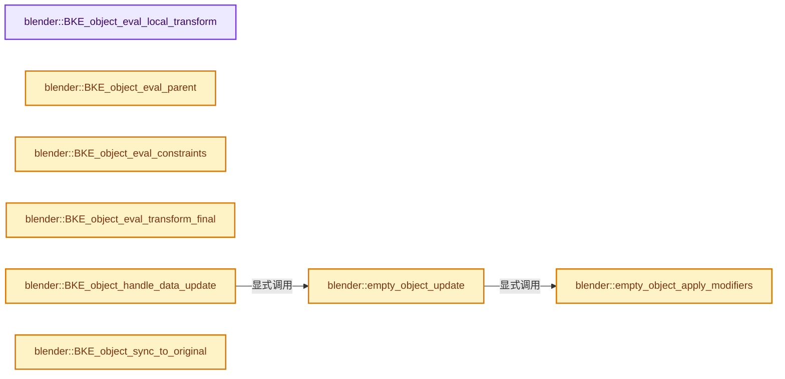
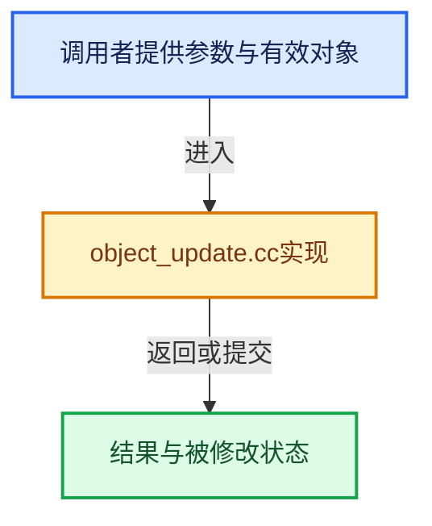

# 实现依赖专题：source/blender/blenkernel/intern/object_update.cc

[实现依赖导航](../../README.md) · [符号索引](../../../00-课程指南/02-源码与提交索引/符号依赖与实现索引.md)

本专题从正文实际调用进入，集中保存共享实现。函数有稳定锚点，可从调用处直接跳到对应完整函数；递归与互相调用通过回链组织。

## 本文件的实现关系






## 完整成员与函数实现

<a id="f-a4a8292e821cae2f"></a>

### `blender::BKE_object_eval_local_transform`

实现位置：[source/blender/blenkernel/intern/object_update.cc](../../../../../../../source/blender/blenkernel/intern/object_update.cc) · L54—L60。

接口参数：

- `Depsgraph *depsgraph`
- `Object *ob`

**教学注释版**

<!-- annotated:53a30af71416db -->

```cpp
void BKE_object_eval_local_transform(Depsgraph *depsgraph, Object *ob)
{
  DEG_debug_print_eval(depsgraph, __func__, ob->id.name, ob);

  /* calculate local matrix */
  BKE_object_to_mat4(ob, ob->runtime->object_to_world.ptr());
}
```

<details>
<summary>核对原始源码：source/blender/blenkernel/intern/object_update.cc · L54—L60</summary>

<!-- original:53a30af71416db:source/blender/blenkernel/intern/object_update.cc:54:60 -->

```cpp
void BKE_object_eval_local_transform(Depsgraph *depsgraph, Object *ob)
{
  DEG_debug_print_eval(depsgraph, __func__, ob->id.name, ob);

  /* calculate local matrix */
  BKE_object_to_mat4(ob, ob->runtime->object_to_world.ptr());
}
```

</details>

**继续追踪实现**

- `DEG_debug_print_eval` → [blender::DEG_debug_print_eval · L240](../../06-Depsgraph依赖图/intern/depsgraph_debug.cc.md#f-f2c4ea506dd14a2f)。
- `BKE_object_to_mat4` → [blender::BKE_object_to_mat4 · L3125](object.cc.md#f-0d3c5355d76a9941)。
- `ob->runtime->object_to_world.ptr` → [调用协议](../../../00-课程指南/01-路线与规范/模板宏与动态分派协议.md)：接收对象类型依赖auto、返回值或模板实例；不按同名猜测目标。调用位置L59。

<a id="f-49a639b78b13e9f1"></a>

### `blender::BKE_object_eval_parent`

实现位置：[source/blender/blenkernel/intern/object_update.cc](../../../../../../../source/blender/blenkernel/intern/object_update.cc) · L62—L92。

接口参数：

- `Depsgraph *depsgraph`
- `Object *ob`

**教学注释版**

<!-- annotated:6514fa6aaac8c8 -->

```cpp
void BKE_object_eval_parent(Depsgraph *depsgraph, Object *ob)
{
  /* NOTE: based on `solve_parenting()`, but with the cruft stripped out. */

  Object *par = ob->parent;

  float totmat[4][4];
  float tmat[4][4];
  float locmat[4][4];

  DEG_debug_print_eval(depsgraph, __func__, ob->id.name, ob);

  /* get local matrix (but don't calculate it, as that was done already!) */
  /* XXX: redundant? */
  copy_m4_m4(locmat, ob->object_to_world().ptr());

  /* get parent effect matrix */
  BKE_object_get_parent_matrix(ob, par, totmat);

  /* total */
  mul_m4_m4m4(tmat, totmat, ob->parentinv);
  mul_m4_m4m4(ob->runtime->object_to_world.ptr(), tmat, locmat);

  /* origin, for help line */
  if ((ob->partype & PARTYPE) == PARSKEL) {
    copy_v3_v3(ob->runtime->parent_display_origin, par->object_to_world().location());
  }
  else {
    copy_v3_v3(ob->runtime->parent_display_origin, totmat[3]);
  }
}
```

<details>
<summary>核对原始源码：source/blender/blenkernel/intern/object_update.cc · L62—L92</summary>

<!-- original:6514fa6aaac8c8:source/blender/blenkernel/intern/object_update.cc:62:92 -->

```cpp
void BKE_object_eval_parent(Depsgraph *depsgraph, Object *ob)
{
  /* NOTE: based on `solve_parenting()`, but with the cruft stripped out. */

  Object *par = ob->parent;

  float totmat[4][4];
  float tmat[4][4];
  float locmat[4][4];

  DEG_debug_print_eval(depsgraph, __func__, ob->id.name, ob);

  /* get local matrix (but don't calculate it, as that was done already!) */
  /* XXX: redundant? */
  copy_m4_m4(locmat, ob->object_to_world().ptr());

  /* get parent effect matrix */
  BKE_object_get_parent_matrix(ob, par, totmat);

  /* total */
  mul_m4_m4m4(tmat, totmat, ob->parentinv);
  mul_m4_m4m4(ob->runtime->object_to_world.ptr(), tmat, locmat);

  /* origin, for help line */
  if ((ob->partype & PARTYPE) == PARSKEL) {
    copy_v3_v3(ob->runtime->parent_display_origin, par->object_to_world().location());
  }
  else {
    copy_v3_v3(ob->runtime->parent_display_origin, totmat[3]);
  }
}
```

</details>

**继续追踪实现**

- `DEG_debug_print_eval` → [blender::DEG_debug_print_eval · L240](../../06-Depsgraph依赖图/intern/depsgraph_debug.cc.md#f-f2c4ea506dd14a2f)。
- `copy_m4_m4` → [blender::copy_m4_m4 · L84](../../01-BLI基础库/intern/math_matrix_c.cc.md#f-b4390cf8c94710f5)。
- `ob->object_to_world().ptr` → [调用协议](../../../00-课程指南/01-路线与规范/模板宏与动态分派协议.md)：接收对象类型依赖auto、返回值或模板实例；不按同名猜测目标。调用位置L76。
- `ob->object_to_world` → [blender::Object::object_to_world · L5761](object.cc.md#f-12fc20026327d50c)。
- `BKE_object_get_parent_matrix` → [blender::BKE_object_get_parent_matrix · L3419](object.cc.md#f-09b9de98e8df903d)。
- `mul_m4_m4m4` → [blender::mul_m4_m4m4 · L217](../../01-BLI基础库/intern/math_matrix_c.cc.md#f-b5272136b543b73b)。
- `ob->runtime->object_to_world.ptr` → [调用协议](../../../00-课程指南/01-路线与规范/模板宏与动态分派协议.md)：接收对象类型依赖auto、返回值或模板实例；不按同名猜测目标。调用位置L83。
- `copy_v3_v3` → [blender::copy_v3_v3 · L47](../../01-BLI基础库/intern/math_vector_inline.cc.md#f-037a0d5fa5060bd6)。
- `par->object_to_world().location` → [调用协议](../../../00-课程指南/01-路线与规范/模板宏与动态分派协议.md)：接收对象类型依赖auto、返回值或模板实例；不按同名猜测目标。调用位置L87。
- `par->object_to_world` → [blender::Object::object_to_world · L5761](object.cc.md#f-12fc20026327d50c)。

<a id="f-6254f5a5eb6a5382"></a>

### `blender::BKE_object_eval_constraints`

实现位置：[source/blender/blenkernel/intern/object_update.cc](../../../../../../../source/blender/blenkernel/intern/object_update.cc) · L94—L112。

接口参数：

- `Depsgraph *depsgraph`
- `Scene *scene`
- `Object *ob`

**教学注释版**

<!-- annotated:86291468c32338 -->

```cpp
void BKE_object_eval_constraints(Depsgraph *depsgraph, Scene *scene, Object *ob)
{
  bConstraintOb *cob;
  float ctime = BKE_scene_ctime_get(scene);

  DEG_debug_print_eval(depsgraph, __func__, ob->id.name, ob);

  /* evaluate constraints stack */
  /* TODO: split this into:
   * - pre (i.e. BKE_constraints_make_evalob), per-constraint (i.e.
   * - inner body of BKE_constraints_solve),
   * - post (i.e. BKE_constraints_clear_evalob)
   *
   * Not sure why, this is from Joshua - sergey
   */
  cob = BKE_constraints_make_evalob(depsgraph, scene, ob, nullptr, CONSTRAINT_OBTYPE_OBJECT);
  BKE_constraints_solve(depsgraph, &ob->constraints, cob, ctime);
  BKE_constraints_clear_evalob(cob);
}
```

<details>
<summary>核对原始源码：source/blender/blenkernel/intern/object_update.cc · L94—L112</summary>

<!-- original:86291468c32338:source/blender/blenkernel/intern/object_update.cc:94:112 -->

```cpp
void BKE_object_eval_constraints(Depsgraph *depsgraph, Scene *scene, Object *ob)
{
  bConstraintOb *cob;
  float ctime = BKE_scene_ctime_get(scene);

  DEG_debug_print_eval(depsgraph, __func__, ob->id.name, ob);

  /* evaluate constraints stack */
  /* TODO: split this into:
   * - pre (i.e. BKE_constraints_make_evalob), per-constraint (i.e.
   * - inner body of BKE_constraints_solve),
   * - post (i.e. BKE_constraints_clear_evalob)
   *
   * Not sure why, this is from Joshua - sergey
   */
  cob = BKE_constraints_make_evalob(depsgraph, scene, ob, nullptr, CONSTRAINT_OBTYPE_OBJECT);
  BKE_constraints_solve(depsgraph, &ob->constraints, cob, ctime);
  BKE_constraints_clear_evalob(cob);
}
```

</details>

**沿实际写入检查状态**

- `cob = BKE_constraints_make_evalob(depsgraph, scene, ob, nullptr, CONSTRAINT_OBTYPE_OBJECT);`

**继续追踪实现**

- `BKE_scene_ctime_get` → [blender::BKE_scene_ctime_get · L2591](scene.cc.md#f-5e28483f19a62bf5)。
- `DEG_debug_print_eval` → [blender::DEG_debug_print_eval · L240](../../06-Depsgraph依赖图/intern/depsgraph_debug.cc.md#f-f2c4ea506dd14a2f)。
- `BKE_constraints_make_evalob` → [blender::BKE_constraints_make_evalob · L137](constraint.cc.md#f-170ffd250a05fb45)。
- `BKE_constraints_solve` → [blender::BKE_constraints_solve · L6760](constraint.cc.md#f-c71ef9368e3c53c6)。
- `BKE_constraints_clear_evalob` → [blender::BKE_constraints_clear_evalob · L215](constraint.cc.md#f-281468190a709499)。

<a id="f-b025686804d85162"></a>

### `blender::BKE_object_eval_transform_final`

实现位置：[source/blender/blenkernel/intern/object_update.cc](../../../../../../../source/blender/blenkernel/intern/object_update.cc) · L114—L129。

接口参数：

- `Depsgraph *depsgraph`
- `Object *ob`

**教学注释版**

<!-- annotated:1e28b9cab6bc49 -->

```cpp
void BKE_object_eval_transform_final(Depsgraph *depsgraph, Object *ob)
{
  DEG_debug_print_eval(depsgraph, __func__, ob->id.name, ob);
  /* Make sure inverse matrix is always up to date. This way users of it
   * do not need to worry about recalculating it. */
  invert_m4_m4_safe(ob->runtime->world_to_object.ptr(), ob->object_to_world().ptr());
  /* Set negative scale flag in object. */
  if (is_negative_m4(ob->object_to_world().ptr())) {
    ob->transflag |= OB_NEG_SCALE;
  }
  else {
    ob->transflag &= ~OB_NEG_SCALE;
  }

  ob->runtime->last_update_transform = DEG_get_update_count(depsgraph);
}
```

<details>
<summary>核对原始源码：source/blender/blenkernel/intern/object_update.cc · L114—L129</summary>

<!-- original:1e28b9cab6bc49:source/blender/blenkernel/intern/object_update.cc:114:129 -->

```cpp
void BKE_object_eval_transform_final(Depsgraph *depsgraph, Object *ob)
{
  DEG_debug_print_eval(depsgraph, __func__, ob->id.name, ob);
  /* Make sure inverse matrix is always up to date. This way users of it
   * do not need to worry about recalculating it. */
  invert_m4_m4_safe(ob->runtime->world_to_object.ptr(), ob->object_to_world().ptr());
  /* Set negative scale flag in object. */
  if (is_negative_m4(ob->object_to_world().ptr())) {
    ob->transflag |= OB_NEG_SCALE;
  }
  else {
    ob->transflag &= ~OB_NEG_SCALE;
  }

  ob->runtime->last_update_transform = DEG_get_update_count(depsgraph);
}
```

</details>

**沿实际写入检查状态**

- `ob->transflag |= OB_NEG_SCALE;`
- `ob->transflag &= ~OB_NEG_SCALE;`
- `ob->runtime->last_update_transform = DEG_get_update_count(depsgraph);`

**继续追踪实现**

- `DEG_debug_print_eval` → [blender::DEG_debug_print_eval · L240](../../06-Depsgraph依赖图/intern/depsgraph_debug.cc.md#f-f2c4ea506dd14a2f)。
- `invert_m4_m4_safe` → [blender::invert_m4_m4_safe · L2902](../../01-BLI基础库/intern/math_matrix_c.cc.md#f-13b459563f5a5e8f)。
- `ob->runtime->world_to_object.ptr` → [调用协议](../../../00-课程指南/01-路线与规范/模板宏与动态分派协议.md)：接收对象类型依赖auto、返回值或模板实例；不按同名猜测目标。调用位置L119。
- `ob->object_to_world().ptr` → [调用协议](../../../00-课程指南/01-路线与规范/模板宏与动态分派协议.md)：接收对象类型依赖auto、返回值或模板实例；不按同名猜测目标。调用位置L119。
- `ob->object_to_world` → [blender::Object::object_to_world · L5761](object.cc.md#f-12fc20026327d50c)。
- `is_negative_m4` → [blender::is_negative_m4 · L2297](../../01-BLI基础库/intern/math_matrix_c.cc.md#f-96d7f70cc2200141)。
- `DEG_get_update_count` → [blender::DEG_get_update_count · L356](../../06-Depsgraph依赖图/intern/depsgraph.cc.md#f-53f32a84c1bed638)。

<a id="f-f6621f1b14b2588c"></a>

### `blender::empty_object_apply_modifiers`

实现位置：[source/blender/blenkernel/intern/object_update.cc](../../../../../../../source/blender/blenkernel/intern/object_update.cc) · L131—L158。

接口参数：

- `Depsgraph *depsgraph`
- `Scene *scene`
- `Object *object`
- `bke::GeometrySet &geometry_set`

**教学注释版**

<!-- annotated:7f874cd4abcfc7 -->

```cpp
static void empty_object_apply_modifiers(Depsgraph *depsgraph,
                                         Scene *scene,
                                         Object *object,
                                         bke::GeometrySet &geometry_set)
{
  const bool use_render = (DEG_get_mode(depsgraph) == DAG_EVAL_RENDER);
  const int required_mode = use_render ? eModifierMode_Render : eModifierMode_Realtime;
  ModifierApplyFlag apply_flag = use_render ? MOD_APPLY_RENDER : MOD_APPLY_USECACHE;
  const ModifierEvalContext mectx = {depsgraph, object, apply_flag};

  BKE_modifiers_clear_errors(object);

  VirtualModifierData virtual_modifier_data;
  ModifierData *md = BKE_modifiers_get_virtual_modifierlist(object, &virtual_modifier_data);

  /* Evaluate modifiers. */
  for (; md; md = md->next) {
    const ModifierTypeInfo *mti = BKE_modifier_get_info(md->type);

    if (!BKE_modifier_is_enabled(scene, md, required_mode)) {
      continue;
    }

    if (mti->modify_geometry_set) {
      mti->modify_geometry_set(md, &mectx, &geometry_set);
    }
  }
}
```

<details>
<summary>核对原始源码：source/blender/blenkernel/intern/object_update.cc · L131—L158</summary>

<!-- original:7f874cd4abcfc7:source/blender/blenkernel/intern/object_update.cc:131:158 -->

```cpp
static void empty_object_apply_modifiers(Depsgraph *depsgraph,
                                         Scene *scene,
                                         Object *object,
                                         bke::GeometrySet &geometry_set)
{
  const bool use_render = (DEG_get_mode(depsgraph) == DAG_EVAL_RENDER);
  const int required_mode = use_render ? eModifierMode_Render : eModifierMode_Realtime;
  ModifierApplyFlag apply_flag = use_render ? MOD_APPLY_RENDER : MOD_APPLY_USECACHE;
  const ModifierEvalContext mectx = {depsgraph, object, apply_flag};

  BKE_modifiers_clear_errors(object);

  VirtualModifierData virtual_modifier_data;
  ModifierData *md = BKE_modifiers_get_virtual_modifierlist(object, &virtual_modifier_data);

  /* Evaluate modifiers. */
  for (; md; md = md->next) {
    const ModifierTypeInfo *mti = BKE_modifier_get_info(md->type);

    if (!BKE_modifier_is_enabled(scene, md, required_mode)) {
      continue;
    }

    if (mti->modify_geometry_set) {
      mti->modify_geometry_set(md, &mectx, &geometry_set);
    }
  }
}
```

</details>

**继续追踪实现**

- `DEG_get_mode` → [blender::DEG_get_mode · L99](../../06-Depsgraph依赖图/intern/depsgraph_query.cc.md#f-fa117f51322cd95c)。
- `BKE_modifiers_clear_errors` → [blender::BKE_modifiers_clear_errors · L282](modifier.cc.md#f-aeccb28cb209861b)。
- `BKE_modifiers_get_virtual_modifierlist` → [blender::BKE_modifiers_get_virtual_modifierlist · L620](modifier.cc.md#f-47967058788364c5)。
- `BKE_modifier_get_info` → [blender::BKE_modifier_get_info · L120](modifier.cc.md#f-88218d6d450f0291)。
- `BKE_modifier_is_enabled` → [blender::BKE_modifier_is_enabled · L529](modifier.cc.md#f-1debd86d0fcbcc8e)。
- `mti->modify_geometry_set` → [blender::modify_geometry_set · L243](../../08-其他Blender模块/modifiers/intern/MOD_grease_pencil_noise.cc.md#f-230f261ee5b301b9)；[blender::modify_geometry_set · L218](../../08-其他Blender模块/modifiers/intern/MOD_grease_pencil_multiply.cc.md#f-20b39fa517056ba3)；[blender::modify_geometry_set · L184](../../08-其他Blender模块/modifiers/intern/MOD_grease_pencil_mirror.cc.md#f-3dc669ce25b45890)；[blender::modify_geometry_set · L303](../../08-其他Blender模块/modifiers/intern/MOD_volume_displace.cc.md#f-ebaffe948c472b25)；[blender::modify_geometry_set · L245](../../08-其他Blender模块/modifiers/intern/MOD_grease_pencil_length.cc.md#f-115999e601704e66)；[blender::modify_geometry_set · L127](../../08-其他Blender模块/modifiers/intern/MOD_grease_pencil_lattice.cc.md#f-08d3356602673303)；[blender::modify_geometry_set · L237](../../08-其他Blender模块/modifiers/intern/MOD_grease_pencil_hook.cc.md#f-7d8cba698be3f21f)；[blender::modify_geometry_set · L648](../../08-其他Blender模块/modifiers/intern/MOD_grease_pencil_envelope.cc.md#f-89a88be68c707af7)；[blender::modify_geometry_set · L383](../../08-其他Blender模块/modifiers/intern/MOD_grease_pencil_dash.cc.md#f-77a5c0cf948381ba)；[blender::modify_geometry_set · L186](../../08-其他Blender模块/modifiers/intern/MOD_grease_pencil_color.cc.md#f-b7d9cea51cff81d7)；[blender::modify_geometry_set · L708](../../08-其他Blender模块/modifiers/intern/MOD_grease_pencil_build.cc.md#f-5dd5fbb27a45198a)；[blender::modify_geometry_set · L256](../../08-其他Blender模块/modifiers/intern/MOD_grease_pencil_array.cc.md#f-5bbc1bf941a9346b)；[blender::modify_geometry_set · L228](../../08-其他Blender模块/modifiers/intern/MOD_grease_pencil_armature.cc.md#f-aa0222d18ac7bd5e)；[blender::modify_geometry_set · L1862](../../08-其他Blender模块/modifiers/intern/MOD_nodes.cc.md#f-2a30b7b16d4a8c31)；[blender::modify_geometry_set · L176](../../08-其他Blender模块/modifiers/intern/MOD_mesh_to_volume.cc.md#f-d3eb652ca6ad569c)；[blender::modify_geometry_set · L146](../../08-其他Blender模块/modifiers/intern/MOD_meshsequencecache.cc.md#f-293a594730db07db)；[blender::modify_geometry_set · L873](../../08-其他Blender模块/modifiers/intern/MOD_lineart.cc.md#f-5f731799aa2bb8f9)；[blender::modify_geometry_set · L212](../../08-其他Blender模块/modifiers/intern/MOD_grease_pencil_weight_proximity.cc.md#f-ea5a620d5c23e64e)；[blender::modify_geometry_set · L192](../../08-其他Blender模块/modifiers/intern/MOD_grease_pencil_weight_angle.cc.md#f-782ecf61845b0827)；[blender::modify_geometry_set · L409](../../08-其他Blender模块/modifiers/intern/MOD_grease_pencil_tint.cc.md#f-54a72eb9cf6cff28)；[blender::modify_geometry_set · L480](../../08-其他Blender模块/modifiers/intern/MOD_grease_pencil_time.cc.md#f-9ab3d6f606c2eab8)；[blender::modify_geometry_set · L150](../../08-其他Blender模块/modifiers/intern/MOD_grease_pencil_thickness.cc.md#f-4e7b0f538b12bed5)；[blender::modify_geometry_set · L276](../../08-其他Blender模块/modifiers/intern/MOD_grease_pencil_texture.cc.md#f-1ff4ec887af41ab7)；[blender::modify_geometry_set · L130](../../08-其他Blender模块/modifiers/intern/MOD_grease_pencil_subdiv.cc.md#f-931890f60d4fecdf)；[blender::modify_geometry_set · L202](../../08-其他Blender模块/modifiers/intern/MOD_grease_pencil_smooth.cc.md#f-b3cfc63152b3b8cf)；[blender::modify_geometry_set · L161](../../08-其他Blender模块/modifiers/intern/MOD_grease_pencil_simplify.cc.md#f-43ffd26310c793e0)；[blender::modify_geometry_set · L204](../../08-其他Blender模块/modifiers/intern/MOD_grease_pencil_shrinkwrap.cc.md#f-46686f6c416f5e15)；[blender::modify_geometry_set · L231](../../08-其他Blender模块/modifiers/intern/MOD_grease_pencil_outline.cc.md#f-fa4d9a8d843e52d6)；[blender::modify_geometry_set · L206](../../08-其他Blender模块/modifiers/intern/MOD_grease_pencil_opacity.cc.md#f-e612ca2075a8aa0f)；[blender::modify_geometry_set · L359](../../08-其他Blender模块/modifiers/intern/MOD_grease_pencil_offset.cc.md#f-efbe77084a15801e)。同名重载需按实参类型选择。

<a id="f-116bf33aa374e5f7"></a>

### `blender::empty_object_update`

实现位置：[source/blender/blenkernel/intern/object_update.cc](../../../../../../../source/blender/blenkernel/intern/object_update.cc) · L160—L177。

接口参数：

- `Depsgraph *depsgraph`
- `Scene *scene`
- `Object *object`

**教学注释版**

<!-- annotated:060f164d515cbb -->

```cpp
static void empty_object_update(Depsgraph *depsgraph, Scene *scene, Object *object)
{
  BKE_object_free_derived_caches(object);

  bke::GeometrySet geometry_set;
  /* If the empty is instancing a collection, create an input geometry set of this collection. */
  if (object->instance_collection != nullptr) {
    Collection &collection = *object->instance_collection;
    // [讲解] std::make_unique<bke::Instances>：创建独占拥有的对象，拥有关系可移动，get返回的借用指针不自动延长寿命。
    auto instances = std::make_unique<bke::Instances>(1);
    instances->reference_handles_for_write().first() = instances->add_reference(collection);
    instances->transforms_for_write().first() = float4x4::identity();
    // [讲解] std::move：把表达式转换成可供移动重载选择的值类别；不保证真的移动，不结束源对象寿命，对const值可能选择复制。
    geometry_set = bke::GeometrySet::from_instances(std::move(instances));
  }
  /* Evaluate modifiers. */
  empty_object_apply_modifiers(depsgraph, scene, object, geometry_set);

  object->runtime->geometry_set_eval = new bke::GeometrySet(std::move(geometry_set));
}
```

<details>
<summary>核对原始源码：source/blender/blenkernel/intern/object_update.cc · L160—L177</summary>

<!-- original:060f164d515cbb:source/blender/blenkernel/intern/object_update.cc:160:177 -->

```cpp
static void empty_object_update(Depsgraph *depsgraph, Scene *scene, Object *object)
{
  BKE_object_free_derived_caches(object);

  bke::GeometrySet geometry_set;
  /* If the empty is instancing a collection, create an input geometry set of this collection. */
  if (object->instance_collection != nullptr) {
    Collection &collection = *object->instance_collection;
    auto instances = std::make_unique<bke::Instances>(1);
    instances->reference_handles_for_write().first() = instances->add_reference(collection);
    instances->transforms_for_write().first() = float4x4::identity();
    geometry_set = bke::GeometrySet::from_instances(std::move(instances));
  }
  /* Evaluate modifiers. */
  empty_object_apply_modifiers(depsgraph, scene, object, geometry_set);

  object->runtime->geometry_set_eval = new bke::GeometrySet(std::move(geometry_set));
}
```

</details>

**沿实际写入检查状态**

- `geometry_set = bke::GeometrySet::from_instances(std::move(instances));`
- `object->runtime->geometry_set_eval = new bke::GeometrySet(std::move(geometry_set));`

**继续追踪实现**

- `BKE_object_free_derived_caches` → [blender::BKE_object_free_derived_caches · L1810](object.cc.md#f-74071902e41326eb)。
- `std::make_unique<bke::Instances>` → [外部契约](https://eel.is/c++draft/unique.ptr.create)：创建独占拥有的对象，拥有关系可移动，get返回的借用指针不自动延长寿命。
- `instances->reference_handles_for_write().first` → [调用协议](../../../00-课程指南/01-路线与规范/模板宏与动态分派协议.md)：接收对象类型依赖auto、返回值或模板实例；不按同名猜测目标。调用位置L169。
- `instances->reference_handles_for_write` → [调用协议](../../../00-课程指南/01-路线与规范/模板宏与动态分派协议.md)：接收对象类型依赖auto、返回值或模板实例；不按同名猜测目标。调用位置L169。
- `instances->add_reference` → [调用协议](../../../00-课程指南/01-路线与规范/模板宏与动态分派协议.md)：接收对象类型依赖auto、返回值或模板实例；不按同名猜测目标。调用位置L169。
- `instances->transforms_for_write().first` → [调用协议](../../../00-课程指南/01-路线与规范/模板宏与动态分派协议.md)：接收对象类型依赖auto、返回值或模板实例；不按同名猜测目标。调用位置L170。
- `instances->transforms_for_write` → [调用协议](../../../00-课程指南/01-路线与规范/模板宏与动态分派协议.md)：接收对象类型依赖auto、返回值或模板实例；不按同名猜测目标。调用位置L170。
- `float4x4::identity` → [调用协议](../../../00-课程指南/01-路线与规范/模板宏与动态分派协议.md)：函数指针、局部可调用对象或未展开的宏；必须结合调用者环境。调用位置L170。
- `bke::GeometrySet::from_instances` → [blender::bke::GeometrySet::from_instances · L455](../../../06-隐式共享与缓存系统/05-GeometrySet读写与复制.md#f-0c23a168248fb2cb)；[blender::bke::GeometrySet::from_instances · L462](../../../06-隐式共享与缓存系统/05-GeometrySet读写与复制.md#f-447a100ea7cfda47)。同名重载需按实参类型选择。
- `std::move` → [外部契约](https://eel.is/c++draft/utility.forward)：把表达式转换成可供移动重载选择的值类别；不保证真的移动，不结束源对象寿命，对const值可能选择复制。
- `empty_object_apply_modifiers` → [blender::empty_object_apply_modifiers · L131](object_update.cc.md#f-f6621f1b14b2588c)。

<a id="f-07bd63e719dfef64"></a>

### `blender::BKE_object_handle_data_update`

实现位置：[source/blender/blenkernel/intern/object_update.cc](../../../../../../../source/blender/blenkernel/intern/object_update.cc) · L179—L287。

接口参数：

- `Depsgraph *depsgraph`
- `Scene *scene`
- `Object *ob`

**教学注释版**

<!-- annotated:935fa512d83890 -->

```cpp
void BKE_object_handle_data_update(Depsgraph *depsgraph, Scene *scene, Object *ob)
{
  DEG_debug_print_eval(depsgraph, __func__, ob->id.name, ob);

  /* includes all keys and modifiers */
  switch (ob->type) {
    case OB_EMPTY: {
      empty_object_update(depsgraph, scene, ob);
      break;
    }
    case OB_MESH: {
      CustomData_MeshMasks cddata_masks = scene->customdata_mask;
      CustomData_MeshMasks_update(&cddata_masks, &CD_MASK_BAREMESH);
      /* Custom attributes should not be removed automatically. They might be used by the render
       * engine or scripts. They can still be removed explicitly using geometry nodes.
       * Vertex groups can be used in arbitrary situations with geometry nodes as well. */
      cddata_masks.vmask |= CD_MASK_PROP_ALL | CD_MASK_MDEFORMVERT;
      cddata_masks.emask |= CD_MASK_PROP_ALL;
      cddata_masks.fmask |= CD_MASK_PROP_ALL;
      cddata_masks.pmask |= CD_MASK_PROP_ALL;
      cddata_masks.lmask |= CD_MASK_PROP_ALL;
      if (DEG_get_mode(depsgraph) == DAG_EVAL_RENDER) {
        /* Always compute orcos for render. */
        cddata_masks.vmask |= CD_MASK_ORCO;
      }
      bke::mesh_data_update(*depsgraph, *scene, *ob, cddata_masks);
      break;
    }
    case OB_ARMATURE:
      BKE_pose_where_is(depsgraph, scene, ob);
      break;

    case OB_MBALL:
      BKE_mball_data_update(depsgraph, scene, ob);
      break;

    case OB_CURVES_LEGACY:
    case OB_SURF:
    case OB_FONT: {
      bool for_render = (DEG_get_mode(depsgraph) == DAG_EVAL_RENDER);
      BKE_displist_make_curveTypes(depsgraph, scene, ob, for_render);
      break;
    }

    case OB_LATTICE:
      BKE_lattice_modifiers_calc(depsgraph, scene, ob);
      break;
    case OB_CURVES:
      BKE_curves_data_update(depsgraph, scene, ob);
      break;
    case OB_POINTCLOUD:
      BKE_pointcloud_data_update(depsgraph, scene, ob);
      break;
    case OB_VOLUME:
      BKE_volume_data_update(depsgraph, scene, ob);
      break;
    case OB_GREASE_PENCIL:
      BKE_object_eval_grease_pencil(depsgraph, scene, ob);
      break;
    default:
      break;
  }

  /* particles */
  if (!(ob->mode & OB_MODE_EDIT) && ob->particlesystem.first()) {
    const bool use_render_params = (DEG_get_mode(depsgraph) == DAG_EVAL_RENDER);
    ParticleSystem *tpsys, *psys;
    ob->transflag &= ~OB_DUPLIPARTS;
    psys = ob->particlesystem.first();
    while (psys) {
      if (psys_check_enabled(ob, psys, use_render_params)) {
        /* check use of dupli objects here */
        if (psys->part && (psys->part->draw_as == PART_DRAW_REND || use_render_params) &&
            ((psys->part->ren_as == PART_DRAW_OB && psys->part->instance_object) ||
             (psys->part->ren_as == PART_DRAW_GR && psys->part->instance_collection)))
        {
          ob->transflag |= OB_DUPLIPARTS;
        }

        particle_system_update(depsgraph, scene, ob, psys, use_render_params);
        psys = psys->next;
      }
      else if (psys->flag & PSYS_DELETE) {
        tpsys = psys->next;
        BLI_remlink(&ob->particlesystem, psys);
        psys_free(ob, psys);
        psys = tpsys;
      }
      else {
        psys = psys->next;
      }
    }
  }

  /* Cache the contained geometry types of the #geometry_set_eval. */
  if (ob->runtime->geometry_set_eval) {
    ob->runtime->contained_geometry_types = 0;
    for (const bke::GeometryComponent::Type type :
         ob->runtime->geometry_set_eval->gather_component_types(true, true))
    {
      ob->runtime->contained_geometry_types |= uint16_t(1 << size_t(type));
    }
  }

  if (DEG_is_active(depsgraph)) {
    Object *object_orig = DEG_get_original(ob);
    object_orig->runtime->bounds_eval = BKE_object_evaluated_geometry_bounds(ob);
  }
}
```

<details>
<summary>核对原始源码：source/blender/blenkernel/intern/object_update.cc · L179—L287</summary>

<!-- original:935fa512d83890:source/blender/blenkernel/intern/object_update.cc:179:287 -->

```cpp
void BKE_object_handle_data_update(Depsgraph *depsgraph, Scene *scene, Object *ob)
{
  DEG_debug_print_eval(depsgraph, __func__, ob->id.name, ob);

  /* includes all keys and modifiers */
  switch (ob->type) {
    case OB_EMPTY: {
      empty_object_update(depsgraph, scene, ob);
      break;
    }
    case OB_MESH: {
      CustomData_MeshMasks cddata_masks = scene->customdata_mask;
      CustomData_MeshMasks_update(&cddata_masks, &CD_MASK_BAREMESH);
      /* Custom attributes should not be removed automatically. They might be used by the render
       * engine or scripts. They can still be removed explicitly using geometry nodes.
       * Vertex groups can be used in arbitrary situations with geometry nodes as well. */
      cddata_masks.vmask |= CD_MASK_PROP_ALL | CD_MASK_MDEFORMVERT;
      cddata_masks.emask |= CD_MASK_PROP_ALL;
      cddata_masks.fmask |= CD_MASK_PROP_ALL;
      cddata_masks.pmask |= CD_MASK_PROP_ALL;
      cddata_masks.lmask |= CD_MASK_PROP_ALL;
      if (DEG_get_mode(depsgraph) == DAG_EVAL_RENDER) {
        /* Always compute orcos for render. */
        cddata_masks.vmask |= CD_MASK_ORCO;
      }
      bke::mesh_data_update(*depsgraph, *scene, *ob, cddata_masks);
      break;
    }
    case OB_ARMATURE:
      BKE_pose_where_is(depsgraph, scene, ob);
      break;

    case OB_MBALL:
      BKE_mball_data_update(depsgraph, scene, ob);
      break;

    case OB_CURVES_LEGACY:
    case OB_SURF:
    case OB_FONT: {
      bool for_render = (DEG_get_mode(depsgraph) == DAG_EVAL_RENDER);
      BKE_displist_make_curveTypes(depsgraph, scene, ob, for_render);
      break;
    }

    case OB_LATTICE:
      BKE_lattice_modifiers_calc(depsgraph, scene, ob);
      break;
    case OB_CURVES:
      BKE_curves_data_update(depsgraph, scene, ob);
      break;
    case OB_POINTCLOUD:
      BKE_pointcloud_data_update(depsgraph, scene, ob);
      break;
    case OB_VOLUME:
      BKE_volume_data_update(depsgraph, scene, ob);
      break;
    case OB_GREASE_PENCIL:
      BKE_object_eval_grease_pencil(depsgraph, scene, ob);
      break;
    default:
      break;
  }

  /* particles */
  if (!(ob->mode & OB_MODE_EDIT) && ob->particlesystem.first()) {
    const bool use_render_params = (DEG_get_mode(depsgraph) == DAG_EVAL_RENDER);
    ParticleSystem *tpsys, *psys;
    ob->transflag &= ~OB_DUPLIPARTS;
    psys = ob->particlesystem.first();
    while (psys) {
      if (psys_check_enabled(ob, psys, use_render_params)) {
        /* check use of dupli objects here */
        if (psys->part && (psys->part->draw_as == PART_DRAW_REND || use_render_params) &&
            ((psys->part->ren_as == PART_DRAW_OB && psys->part->instance_object) ||
             (psys->part->ren_as == PART_DRAW_GR && psys->part->instance_collection)))
        {
          ob->transflag |= OB_DUPLIPARTS;
        }

        particle_system_update(depsgraph, scene, ob, psys, use_render_params);
        psys = psys->next;
      }
      else if (psys->flag & PSYS_DELETE) {
        tpsys = psys->next;
        BLI_remlink(&ob->particlesystem, psys);
        psys_free(ob, psys);
        psys = tpsys;
      }
      else {
        psys = psys->next;
      }
    }
  }

  /* Cache the contained geometry types of the #geometry_set_eval. */
  if (ob->runtime->geometry_set_eval) {
    ob->runtime->contained_geometry_types = 0;
    for (const bke::GeometryComponent::Type type :
         ob->runtime->geometry_set_eval->gather_component_types(true, true))
    {
      ob->runtime->contained_geometry_types |= uint16_t(1 << size_t(type));
    }
  }

  if (DEG_is_active(depsgraph)) {
    Object *object_orig = DEG_get_original(ob);
    object_orig->runtime->bounds_eval = BKE_object_evaluated_geometry_bounds(ob);
  }
}
```

</details>

**沿实际写入检查状态**

- `cddata_masks.vmask |= CD_MASK_PROP_ALL | CD_MASK_MDEFORMVERT;`
- `cddata_masks.emask |= CD_MASK_PROP_ALL;`
- `cddata_masks.fmask |= CD_MASK_PROP_ALL;`
- `cddata_masks.pmask |= CD_MASK_PROP_ALL;`
- `cddata_masks.lmask |= CD_MASK_PROP_ALL;`
- `cddata_masks.vmask |= CD_MASK_ORCO;`
- `ob->transflag &= ~OB_DUPLIPARTS;`
- `psys = ob->particlesystem.first();`
- `ob->transflag |= OB_DUPLIPARTS;`
- `psys = psys->next;`
- `tpsys = psys->next;`
- `psys = tpsys;`
- `ob->runtime->contained_geometry_types = 0;`
- `ob->runtime->contained_geometry_types |= uint16_t(1 << size_t(type));`
- `object_orig->runtime->bounds_eval = BKE_object_evaluated_geometry_bounds(ob);`

**继续追踪实现**

- `DEG_debug_print_eval` → [blender::DEG_debug_print_eval · L240](../../06-Depsgraph依赖图/intern/depsgraph_debug.cc.md#f-f2c4ea506dd14a2f)。
- `empty_object_update` → [blender::empty_object_update · L160](object_update.cc.md#f-116bf33aa374e5f7)。
- `CustomData_MeshMasks_update` → [blender::CustomData_MeshMasks_update · L89](customdata.cc.md#f-5a41f0d857270b16)。
- `DEG_get_mode` → [blender::DEG_get_mode · L99](../../06-Depsgraph依赖图/intern/depsgraph_query.cc.md#f-fa117f51322cd95c)。
- `bke::mesh_data_update` → [blender::bke::mesh_data_update · L1032](mesh_data_update.cc.md#f-bd12104b5aa20e05)。
- `BKE_pose_where_is` → [blender::BKE_pose_where_is · L3232](armature.cc.md#f-b49866652d5cb3e9)。
- `BKE_mball_data_update` → [blender::BKE_mball_data_update · L648](mball.cc.md#f-de222194de3f2ae2)。
- `BKE_displist_make_curveTypes` → [blender::BKE_displist_make_curveTypes · L1688](displist.cc.md#f-104e42208a4d8e29)。
- `BKE_lattice_modifiers_calc` → [blender::BKE_lattice_modifiers_calc · L528](lattice.cc.md#f-6d3ea701a0b81a03)。
- `BKE_curves_data_update` → [blender::BKE_curves_data_update · L240](curves.cc.md#f-ffea1a3f3eb5aa42)。
- `BKE_pointcloud_data_update` → [blender::BKE_pointcloud_data_update · L425](pointcloud.cc.md#f-1065bf1f49ef43f9)。
- `BKE_volume_data_update` → [blender::BKE_volume_data_update · L784](volume.cc.md#f-23cb6d4fe5fcf627)。
- `BKE_object_eval_grease_pencil` → [blender::BKE_object_eval_grease_pencil · L2715](grease_pencil.cc.md#f-ad640a293e2eaeec)。
- `ob->particlesystem.first` → [调用协议](../../../00-课程指南/01-路线与规范/模板宏与动态分派协议.md)：接收对象类型依赖auto、返回值或模板实例；不按同名猜测目标。调用位置L243。
- `psys_check_enabled` → [psys_check_enabled · L706](particle.cc.md#f-ecccf7e9e00a9741)。
- `particle_system_update` → [particle_system_update · L4786](particle_system.cc.md#f-618ea9ee01667b2d)。
- `BLI_remlink` → [blender::BLI_remlink · L138](../../01-BLI基础库/intern/listbase.cc.md#f-120d80f281ca4cb7)。
- `psys_free` → [psys_free · L976](particle.cc.md#f-1397714583dd4087)。
- `ob->runtime->geometry_set_eval->gather_component_types` → [调用协议](../../../00-课程指南/01-路线与规范/模板宏与动态分派协议.md)：接收对象类型依赖auto、返回值或模板实例；不按同名猜测目标。调用位置L277。
- `DEG_is_active` → [blender::DEG_is_active · L324](../../06-Depsgraph依赖图/intern/depsgraph.cc.md#f-d561ff15ce03c64a)。
- `DEG_get_original` → [blender::DEG_get_original · L128](../../06-Depsgraph依赖图/DEG_depsgraph_query.hh.md#f-79782eab82a92d86)；[blender::DEG_get_original · L134](../../06-Depsgraph依赖图/DEG_depsgraph_query.hh.md#f-c032f06e9ef8f0cb)。同名重载需按实参类型选择。
- `BKE_object_evaluated_geometry_bounds` → [blender::BKE_object_evaluated_geometry_bounds · L3766](object.cc.md#f-0c42236fccb702a2)。

<a id="f-f6cf0dd871abff0b"></a>

### `blender::BKE_object_sync_to_original`

实现位置：[source/blender/blenkernel/intern/object_update.cc](../../../../../../../source/blender/blenkernel/intern/object_update.cc) · L289—L327。

接口参数：

- `Depsgraph *depsgraph`
- `Object *object`

**教学注释版**

<!-- annotated:434067f04506fc -->

```cpp
void BKE_object_sync_to_original(Depsgraph *depsgraph, Object *object)
{
  if (!DEG_is_active(depsgraph)) {
    return;
  }
  Object *object_orig = DEG_get_original(object);
  /* Base flags. */
  object_orig->base_flag = object->base_flag;
  object_orig->base_local_view_bits = object->base_local_view_bits;

  /* Particle edit mode draws from the original object, so sync imat from evaluated to original
   * object so drawing uses the correct transform. */
  for (ParticleSystem *psys_eval = object->particlesystem.first(),
                      *psys_orig = object_orig->particlesystem.first();
       psys_eval && psys_orig;
       psys_eval = psys_eval->next, psys_orig = psys_orig->next)
  {
    copy_m4_m4(psys_orig->imat, psys_eval->imat);
  }

  /* Transformation flags. */
  copy_m4_m4(object_orig->runtime->object_to_world.ptr(), object->object_to_world().ptr());
  copy_m4_m4(object_orig->runtime->world_to_object.ptr(), object->world_to_object().ptr());
  copy_m4_m4(object_orig->constinv, object->constinv);
  object_orig->transflag = object->transflag;
  object_orig->flag = object->flag;

  /* Copy back error messages from modifiers. */
  for (ModifierData *md = object->modifiers.first(), *md_orig = object_orig->modifiers.first();
       md != nullptr && md_orig != nullptr;
       md = md->next, md_orig = md_orig->next)
  {
    BLI_assert(md->type == md_orig->type && STREQ(md->name, md_orig->name));
    MEM_SAFE_DELETE(md_orig->error);
    if (md->error != nullptr) {
      md_orig->error = BLI_strdup(md->error);
    }
  }
}
```

<details>
<summary>核对原始源码：source/blender/blenkernel/intern/object_update.cc · L289—L327</summary>

<!-- original:434067f04506fc:source/blender/blenkernel/intern/object_update.cc:289:327 -->

```cpp
void BKE_object_sync_to_original(Depsgraph *depsgraph, Object *object)
{
  if (!DEG_is_active(depsgraph)) {
    return;
  }
  Object *object_orig = DEG_get_original(object);
  /* Base flags. */
  object_orig->base_flag = object->base_flag;
  object_orig->base_local_view_bits = object->base_local_view_bits;

  /* Particle edit mode draws from the original object, so sync imat from evaluated to original
   * object so drawing uses the correct transform. */
  for (ParticleSystem *psys_eval = object->particlesystem.first(),
                      *psys_orig = object_orig->particlesystem.first();
       psys_eval && psys_orig;
       psys_eval = psys_eval->next, psys_orig = psys_orig->next)
  {
    copy_m4_m4(psys_orig->imat, psys_eval->imat);
  }

  /* Transformation flags. */
  copy_m4_m4(object_orig->runtime->object_to_world.ptr(), object->object_to_world().ptr());
  copy_m4_m4(object_orig->runtime->world_to_object.ptr(), object->world_to_object().ptr());
  copy_m4_m4(object_orig->constinv, object->constinv);
  object_orig->transflag = object->transflag;
  object_orig->flag = object->flag;

  /* Copy back error messages from modifiers. */
  for (ModifierData *md = object->modifiers.first(), *md_orig = object_orig->modifiers.first();
       md != nullptr && md_orig != nullptr;
       md = md->next, md_orig = md_orig->next)
  {
    BLI_assert(md->type == md_orig->type && STREQ(md->name, md_orig->name));
    MEM_SAFE_DELETE(md_orig->error);
    if (md->error != nullptr) {
      md_orig->error = BLI_strdup(md->error);
    }
  }
}
```

</details>

**沿实际写入检查状态**

- `object_orig->base_flag = object->base_flag;`
- `object_orig->base_local_view_bits = object->base_local_view_bits;`
- `psys_eval = psys_eval->next, psys_orig = psys_orig->next)`
- `object_orig->transflag = object->transflag;`
- `object_orig->flag = object->flag;`
- `md = md->next, md_orig = md_orig->next)`
- `md_orig->error = BLI_strdup(md->error);`

**继续追踪实现**

- `DEG_is_active` → [blender::DEG_is_active · L324](../../06-Depsgraph依赖图/intern/depsgraph.cc.md#f-d561ff15ce03c64a)。
- `DEG_get_original` → [blender::DEG_get_original · L128](../../06-Depsgraph依赖图/DEG_depsgraph_query.hh.md#f-79782eab82a92d86)；[blender::DEG_get_original · L134](../../06-Depsgraph依赖图/DEG_depsgraph_query.hh.md#f-c032f06e9ef8f0cb)。同名重载需按实参类型选择。
- `object->particlesystem.first` → [调用协议](../../../00-课程指南/01-路线与规范/模板宏与动态分派协议.md)：接收对象类型依赖auto、返回值或模板实例；不按同名猜测目标。调用位置L301。
- `object_orig->particlesystem.first` → [调用协议](../../../00-课程指南/01-路线与规范/模板宏与动态分派协议.md)：接收对象类型依赖auto、返回值或模板实例；不按同名猜测目标。调用位置L302。
- `copy_m4_m4` → [blender::copy_m4_m4 · L84](../../01-BLI基础库/intern/math_matrix_c.cc.md#f-b4390cf8c94710f5)。
- `object_orig->runtime->object_to_world.ptr` → [调用协议](../../../00-课程指南/01-路线与规范/模板宏与动态分派协议.md)：接收对象类型依赖auto、返回值或模板实例；不按同名猜测目标。调用位置L310。
- `object->object_to_world().ptr` → [调用协议](../../../00-课程指南/01-路线与规范/模板宏与动态分派协议.md)：接收对象类型依赖auto、返回值或模板实例；不按同名猜测目标。调用位置L310。
- `object->object_to_world` → [blender::Object::object_to_world · L5761](object.cc.md#f-12fc20026327d50c)。
- `object_orig->runtime->world_to_object.ptr` → [调用协议](../../../00-课程指南/01-路线与规范/模板宏与动态分派协议.md)：接收对象类型依赖auto、返回值或模板实例；不按同名猜测目标。调用位置L311。
- `object->world_to_object().ptr` → [调用协议](../../../00-课程指南/01-路线与规范/模板宏与动态分派协议.md)：接收对象类型依赖auto、返回值或模板实例；不按同名猜测目标。调用位置L311。
- `object->world_to_object` → [blender::Object::world_to_object · L5766](object.cc.md#f-dd4d8d55d6195233)。
- `object->modifiers.first` → [调用协议](../../../00-课程指南/01-路线与规范/模板宏与动态分派协议.md)：接收对象类型依赖auto、返回值或模板实例；不按同名猜测目标。调用位置L317。
- `object_orig->modifiers.first` → [调用协议](../../../00-课程指南/01-路线与规范/模板宏与动态分派协议.md)：接收对象类型依赖auto、返回值或模板实例；不按同名猜测目标。调用位置L317。
- `BLI_assert` → [BLI_assert · L48](../../01-BLI基础库/BLI_assert.hh.md#m-57a88495704d)；[BLI_assert · L63](../../01-BLI基础库/BLI_assert.hh.md#m-d07050020cb5)。宏定义由构建条件选择。
- `STREQ` → [STREQ · L112](../../07-Intern运行时与平台/ghost/intern/GHOST_utildefines.hh.md#m-9549fb6aafd2)；[STREQ · L451](../../01-BLI基础库/BLI_utildefines.hh.md#m-c7b745bcfad2)；[STREQ · L55](../../07-Intern运行时与平台/clog/clog.cc.md#m-96e78f386894)。宏定义由构建条件选择。
- `MEM_SAFE_DELETE` → [MEM_SAFE_DELETE · L436](../../07-Intern运行时与平台/guardedalloc/MEM_guardedalloc.h.md#m-eadb3bc5b902)。宏定义由构建条件选择。
- `BLI_strdup` → [blender::BLI_strdup · L43](../../01-BLI基础库/intern/string.cc.md#f-7e6d5c696c20c0e1)。

<a id="f-7442c0ad6aa057bb"></a>

### `blender::BKE_object_eval_uber_transform`

实现位置：[source/blender/blenkernel/intern/object_update.cc](../../../../../../../source/blender/blenkernel/intern/object_update.cc) · L329—L329。

接口参数：

- `Depsgraph *`
- `Object *`

**教学注释版**

<!-- annotated:f235e898e98133 -->

```cpp
void BKE_object_eval_uber_transform(Depsgraph * /*depsgraph*/, Object * /*object*/) {}
```

<details>
<summary>核对原始源码：source/blender/blenkernel/intern/object_update.cc · L329—L329</summary>

<!-- original:f235e898e98133:source/blender/blenkernel/intern/object_update.cc:329:329 -->

```cpp
void BKE_object_eval_uber_transform(Depsgraph * /*depsgraph*/, Object * /*object*/) {}
```

</details>

**继续追踪实现**

本实现没有需要继续展开的显式调用；检查返回表达式、对象转换和调用者前置条件。

<a id="f-baf3fb231ac79e37"></a>

### `blender::BKE_object_batch_cache_dirty_tag`

实现位置：[source/blender/blenkernel/intern/object_update.cc](../../../../../../../source/blender/blenkernel/intern/object_update.cc) · L331—L371。

接口参数：

- `Object *ob`

**教学注释版**

<!-- annotated:03361fa74b649f -->

```cpp
void BKE_object_batch_cache_dirty_tag(Object *ob)
{
  switch (ob->type) {
    case OB_MESH:
      BKE_mesh_batch_cache_dirty_tag(id_cast<Mesh *>(ob->data), BKE_MESH_BATCH_DIRTY_ALL);
      break;
    case OB_LATTICE:
      BKE_lattice_batch_cache_dirty_tag(id_cast<Lattice *>(ob->data), BKE_LATTICE_BATCH_DIRTY_ALL);
      break;
    case OB_CURVES_LEGACY:
    case OB_SURF:
    case OB_FONT:
      BKE_curve_batch_cache_dirty_tag(id_cast<Curve *>(ob->data), BKE_CURVE_BATCH_DIRTY_ALL);
      break;
    case OB_MBALL: {
      /* This function is currently called on original objects, so to properly
       * clear the actual displayed geometry, we have to tag the evaluated mesh. */
      Mesh *mesh = BKE_object_get_evaluated_mesh_no_subsurf(ob);
      if (mesh) {
        BKE_mesh_batch_cache_dirty_tag(mesh, BKE_MESH_BATCH_DIRTY_ALL);
      }
      break;
    }
    case OB_CURVES:
      BKE_curves_batch_cache_dirty_tag(id_cast<Curves *>(ob->data), BKE_CURVES_BATCH_DIRTY_ALL);
      break;
    case OB_POINTCLOUD:
      BKE_pointcloud_batch_cache_dirty_tag(id_cast<PointCloud *>(ob->data),
                                           BKE_POINTCLOUD_BATCH_DIRTY_ALL);
      break;
    case OB_VOLUME:
      BKE_volume_batch_cache_dirty_tag(id_cast<Volume *>(ob->data), BKE_VOLUME_BATCH_DIRTY_ALL);
      break;
    case OB_GREASE_PENCIL:
      BKE_grease_pencil_batch_cache_dirty_tag(id_cast<GreasePencil *>(ob->data),
                                              BKE_GREASEPENCIL_BATCH_DIRTY_ALL);
      break;
    default:
      break;
  }
}
```

<details>
<summary>核对原始源码：source/blender/blenkernel/intern/object_update.cc · L331—L371</summary>

<!-- original:03361fa74b649f:source/blender/blenkernel/intern/object_update.cc:331:371 -->

```cpp
void BKE_object_batch_cache_dirty_tag(Object *ob)
{
  switch (ob->type) {
    case OB_MESH:
      BKE_mesh_batch_cache_dirty_tag(id_cast<Mesh *>(ob->data), BKE_MESH_BATCH_DIRTY_ALL);
      break;
    case OB_LATTICE:
      BKE_lattice_batch_cache_dirty_tag(id_cast<Lattice *>(ob->data), BKE_LATTICE_BATCH_DIRTY_ALL);
      break;
    case OB_CURVES_LEGACY:
    case OB_SURF:
    case OB_FONT:
      BKE_curve_batch_cache_dirty_tag(id_cast<Curve *>(ob->data), BKE_CURVE_BATCH_DIRTY_ALL);
      break;
    case OB_MBALL: {
      /* This function is currently called on original objects, so to properly
       * clear the actual displayed geometry, we have to tag the evaluated mesh. */
      Mesh *mesh = BKE_object_get_evaluated_mesh_no_subsurf(ob);
      if (mesh) {
        BKE_mesh_batch_cache_dirty_tag(mesh, BKE_MESH_BATCH_DIRTY_ALL);
      }
      break;
    }
    case OB_CURVES:
      BKE_curves_batch_cache_dirty_tag(id_cast<Curves *>(ob->data), BKE_CURVES_BATCH_DIRTY_ALL);
      break;
    case OB_POINTCLOUD:
      BKE_pointcloud_batch_cache_dirty_tag(id_cast<PointCloud *>(ob->data),
                                           BKE_POINTCLOUD_BATCH_DIRTY_ALL);
      break;
    case OB_VOLUME:
      BKE_volume_batch_cache_dirty_tag(id_cast<Volume *>(ob->data), BKE_VOLUME_BATCH_DIRTY_ALL);
      break;
    case OB_GREASE_PENCIL:
      BKE_grease_pencil_batch_cache_dirty_tag(id_cast<GreasePencil *>(ob->data),
                                              BKE_GREASEPENCIL_BATCH_DIRTY_ALL);
      break;
    default:
      break;
  }
}
```

</details>

**继续追踪实现**

- `BKE_mesh_batch_cache_dirty_tag` → [blender::BKE_mesh_batch_cache_dirty_tag · L461](../../../06-隐式共享与缓存系统/10-局部更新与失效修复.md#f-a872bfdc8b712b65)。
- `id_cast<Mesh *>` → [blender::id_cast · L1417](../../08-其他Blender模块/makesdna/DNA_ID.h.md#f-6c8ac6412850ac5a)。
- `BKE_lattice_batch_cache_dirty_tag` → [blender::BKE_lattice_batch_cache_dirty_tag · L718](lattice.cc.md#f-de0c64e920577347)。
- `id_cast<Lattice *>` → [blender::id_cast · L1417](../../08-其他Blender模块/makesdna/DNA_ID.h.md#f-6c8ac6412850ac5a)。
- `BKE_curve_batch_cache_dirty_tag` → [blender::BKE_curve_batch_cache_dirty_tag · L5536](curve.cc.md#f-9898fb77b9cdc83f)。
- `id_cast<Curve *>` → [blender::id_cast · L1417](../../08-其他Blender模块/makesdna/DNA_ID.h.md#f-6c8ac6412850ac5a)。
- `BKE_object_get_evaluated_mesh_no_subsurf` → [blender::BKE_object_get_evaluated_mesh_no_subsurf · L4419](object.cc.md#f-7f352b57780250ef)。
- `BKE_curves_batch_cache_dirty_tag` → [blender::BKE_curves_batch_cache_dirty_tag · L277](curves.cc.md#f-bb154751fe7c690d)。
- `id_cast<Curves *>` → [blender::id_cast · L1417](../../08-其他Blender模块/makesdna/DNA_ID.h.md#f-6c8ac6412850ac5a)。
- `BKE_pointcloud_batch_cache_dirty_tag` → [blender::BKE_pointcloud_batch_cache_dirty_tag · L468](pointcloud.cc.md#f-9eb2e762fa3681ad)。
- `id_cast<PointCloud *>` → [blender::id_cast · L1417](../../08-其他Blender模块/makesdna/DNA_ID.h.md#f-6c8ac6412850ac5a)。
- `BKE_volume_batch_cache_dirty_tag` → [blender::BKE_volume_batch_cache_dirty_tag · L840](volume.cc.md#f-e746d3a970349ad4)。
- `id_cast<Volume *>` → [blender::id_cast · L1417](../../08-其他Blender模块/makesdna/DNA_ID.h.md#f-6c8ac6412850ac5a)。
- `BKE_grease_pencil_batch_cache_dirty_tag` → [blender::BKE_grease_pencil_batch_cache_dirty_tag · L3284](grease_pencil.cc.md#f-234672d9c8cf78d2)。
- `id_cast<GreasePencil *>` → [blender::id_cast · L1417](../../08-其他Blender模块/makesdna/DNA_ID.h.md#f-6c8ac6412850ac5a)。

<a id="f-b248195908c4c246"></a>

### `blender::BKE_object_eval_uber_data`

实现位置：[source/blender/blenkernel/intern/object_update.cc](../../../../../../../source/blender/blenkernel/intern/object_update.cc) · L373—L381。

接口参数：

- `Depsgraph *depsgraph`
- `Scene *scene`
- `Object *ob`

**教学注释版**

<!-- annotated:a18adfb40ddc88 -->

```cpp
void BKE_object_eval_uber_data(Depsgraph *depsgraph, Scene *scene, Object *ob)
{
  DEG_debug_print_eval(depsgraph, __func__, ob->id.name, ob);
  BLI_assert(ob->type != OB_ARMATURE);
  BKE_object_handle_data_update(depsgraph, scene, ob);
  BKE_object_batch_cache_dirty_tag(ob);

  ob->runtime->last_update_geometry = DEG_get_update_count(depsgraph);
}
```

<details>
<summary>核对原始源码：source/blender/blenkernel/intern/object_update.cc · L373—L381</summary>

<!-- original:a18adfb40ddc88:source/blender/blenkernel/intern/object_update.cc:373:381 -->

```cpp
void BKE_object_eval_uber_data(Depsgraph *depsgraph, Scene *scene, Object *ob)
{
  DEG_debug_print_eval(depsgraph, __func__, ob->id.name, ob);
  BLI_assert(ob->type != OB_ARMATURE);
  BKE_object_handle_data_update(depsgraph, scene, ob);
  BKE_object_batch_cache_dirty_tag(ob);

  ob->runtime->last_update_geometry = DEG_get_update_count(depsgraph);
}
```

</details>

**沿实际写入检查状态**

- `ob->runtime->last_update_geometry = DEG_get_update_count(depsgraph);`

**继续追踪实现**

- `DEG_debug_print_eval` → [blender::DEG_debug_print_eval · L240](../../06-Depsgraph依赖图/intern/depsgraph_debug.cc.md#f-f2c4ea506dd14a2f)。
- `BLI_assert` → [BLI_assert · L48](../../01-BLI基础库/BLI_assert.hh.md#m-57a88495704d)；[BLI_assert · L63](../../01-BLI基础库/BLI_assert.hh.md#m-d07050020cb5)。宏定义由构建条件选择。
- `BKE_object_handle_data_update` → [blender::BKE_object_handle_data_update · L179](object_update.cc.md#f-07bd63e719dfef64)。
- `BKE_object_batch_cache_dirty_tag` → [blender::BKE_object_batch_cache_dirty_tag · L331](object_update.cc.md#f-baf3fb231ac79e37)。
- `DEG_get_update_count` → [blender::DEG_get_update_count · L356](../../06-Depsgraph依赖图/intern/depsgraph.cc.md#f-53f32a84c1bed638)。

<a id="f-d7dd5e62bc439ec2"></a>

### `blender::BKE_object_eval_ptcache_reset`

实现位置：[source/blender/blenkernel/intern/object_update.cc](../../../../../../../source/blender/blenkernel/intern/object_update.cc) · L383—L387。

接口参数：

- `Depsgraph *depsgraph`
- `Scene *scene`
- `Object *object`

**教学注释版**

<!-- annotated:49e1f5778598b7 -->

```cpp
void BKE_object_eval_ptcache_reset(Depsgraph *depsgraph, Scene *scene, Object *object)
{
  DEG_debug_print_eval(depsgraph, __func__, object->id.name, object);
  BKE_ptcache_object_reset(scene, object, PTCACHE_RESET_DEPSGRAPH);
}
```

<details>
<summary>核对原始源码：source/blender/blenkernel/intern/object_update.cc · L383—L387</summary>

<!-- original:49e1f5778598b7:source/blender/blenkernel/intern/object_update.cc:383:387 -->

```cpp
void BKE_object_eval_ptcache_reset(Depsgraph *depsgraph, Scene *scene, Object *object)
{
  DEG_debug_print_eval(depsgraph, __func__, object->id.name, object);
  BKE_ptcache_object_reset(scene, object, PTCACHE_RESET_DEPSGRAPH);
}
```

</details>

**继续追踪实现**

- `DEG_debug_print_eval` → [blender::DEG_debug_print_eval · L240](../../06-Depsgraph依赖图/intern/depsgraph_debug.cc.md#f-f2c4ea506dd14a2f)。
- `BKE_ptcache_object_reset` → [blender::BKE_ptcache_object_reset · L2862](pointcache.cc.md#f-282a6d5f28263278)。

<a id="f-ed8d52733a8cd072"></a>

### `blender::BKE_object_data_select_update`

实现位置：[source/blender/blenkernel/intern/object_update.cc](../../../../../../../source/blender/blenkernel/intern/object_update.cc) · L403—L420。

接口参数：

- `Depsgraph *depsgraph`
- `ID *object_data`

**教学注释版**

<!-- annotated:7cdf94bf7bd053 -->

```cpp
void BKE_object_data_select_update(Depsgraph *depsgraph, ID *object_data)
{
  DEG_debug_print_eval(depsgraph, __func__, object_data->name, object_data);
  switch (GS(object_data->name)) {
    case ID_ME:
      BKE_mesh_batch_cache_dirty_tag(id_cast<Mesh *>(object_data), BKE_MESH_BATCH_DIRTY_SELECT);
      break;
    case ID_CU_LEGACY:
      BKE_curve_batch_cache_dirty_tag(id_cast<Curve *>(object_data), BKE_CURVE_BATCH_DIRTY_SELECT);
      break;
    case ID_LT:
      BKE_lattice_batch_cache_dirty_tag(reinterpret_cast<Lattice *>(object_data),
                                        BKE_LATTICE_BATCH_DIRTY_SELECT);
      break;
    default:
      break;
  }
}
```

<details>
<summary>核对原始源码：source/blender/blenkernel/intern/object_update.cc · L403—L420</summary>

<!-- original:7cdf94bf7bd053:source/blender/blenkernel/intern/object_update.cc:403:420 -->

```cpp
void BKE_object_data_select_update(Depsgraph *depsgraph, ID *object_data)
{
  DEG_debug_print_eval(depsgraph, __func__, object_data->name, object_data);
  switch (GS(object_data->name)) {
    case ID_ME:
      BKE_mesh_batch_cache_dirty_tag(id_cast<Mesh *>(object_data), BKE_MESH_BATCH_DIRTY_SELECT);
      break;
    case ID_CU_LEGACY:
      BKE_curve_batch_cache_dirty_tag(id_cast<Curve *>(object_data), BKE_CURVE_BATCH_DIRTY_SELECT);
      break;
    case ID_LT:
      BKE_lattice_batch_cache_dirty_tag(reinterpret_cast<Lattice *>(object_data),
                                        BKE_LATTICE_BATCH_DIRTY_SELECT);
      break;
    default:
      break;
  }
}
```

</details>

**继续追踪实现**

- `DEG_debug_print_eval` → [blender::DEG_debug_print_eval · L240](../../06-Depsgraph依赖图/intern/depsgraph_debug.cc.md#f-f2c4ea506dd14a2f)。
- `GS` → [blender::GS · L410](../../08-其他Blender模块/makesdna/DNA_ID.h.md#f-c3ff509f79f21b05)。
- `BKE_mesh_batch_cache_dirty_tag` → [blender::BKE_mesh_batch_cache_dirty_tag · L461](../../../06-隐式共享与缓存系统/10-局部更新与失效修复.md#f-a872bfdc8b712b65)。
- `id_cast<Mesh *>` → [blender::id_cast · L1417](../../08-其他Blender模块/makesdna/DNA_ID.h.md#f-6c8ac6412850ac5a)。
- `BKE_curve_batch_cache_dirty_tag` → [blender::BKE_curve_batch_cache_dirty_tag · L5536](curve.cc.md#f-9898fb77b9cdc83f)。
- `id_cast<Curve *>` → [blender::id_cast · L1417](../../08-其他Blender模块/makesdna/DNA_ID.h.md#f-6c8ac6412850ac5a)。
- `BKE_lattice_batch_cache_dirty_tag` → [blender::BKE_lattice_batch_cache_dirty_tag · L718](lattice.cc.md#f-de0c64e920577347)。

<a id="f-01078207957f56a7"></a>

### `blender::BKE_object_select_update`

实现位置：[source/blender/blenkernel/intern/object_update.cc](../../../../../../../source/blender/blenkernel/intern/object_update.cc) · L422—L433。

接口参数：

- `Depsgraph *depsgraph`
- `Object *object`

**教学注释版**

<!-- annotated:b887302b5aef7d -->

```cpp
void BKE_object_select_update(Depsgraph *depsgraph, Object *object)
{
  DEG_debug_print_eval(depsgraph, __func__, object->id.name, object);
  if (object->type == OB_MESH && !object->runtime->is_data_eval_owned) {
    Mesh *mesh_input = id_cast<Mesh *>(object->runtime->data_orig);
    std::lock_guard lock{mesh_input->runtime->eval_mutex};
    BKE_object_data_select_update(depsgraph, object->data);
  }
  else {
    BKE_object_data_select_update(depsgraph, object->data);
  }
}
```

<details>
<summary>核对原始源码：source/blender/blenkernel/intern/object_update.cc · L422—L433</summary>

<!-- original:b887302b5aef7d:source/blender/blenkernel/intern/object_update.cc:422:433 -->

```cpp
void BKE_object_select_update(Depsgraph *depsgraph, Object *object)
{
  DEG_debug_print_eval(depsgraph, __func__, object->id.name, object);
  if (object->type == OB_MESH && !object->runtime->is_data_eval_owned) {
    Mesh *mesh_input = id_cast<Mesh *>(object->runtime->data_orig);
    std::lock_guard lock{mesh_input->runtime->eval_mutex};
    BKE_object_data_select_update(depsgraph, object->data);
  }
  else {
    BKE_object_data_select_update(depsgraph, object->data);
  }
}
```

</details>

**继续追踪实现**

- `DEG_debug_print_eval` → [blender::DEG_debug_print_eval · L240](../../06-Depsgraph依赖图/intern/depsgraph_debug.cc.md#f-f2c4ea506dd14a2f)。
- `id_cast<Mesh *>` → [blender::id_cast · L1417](../../08-其他Blender模块/makesdna/DNA_ID.h.md#f-6c8ac6412850ac5a)。
- `BKE_object_data_select_update` → [blender::BKE_object_data_select_update · L403](object_update.cc.md#f-ed8d52733a8cd072)。

<a id="f-355a61bbb1855a22"></a>

### `blender::BKE_object_eval_eval_base_flags`

实现位置：[source/blender/blenkernel/intern/object_update.cc](../../../../../../../source/blender/blenkernel/intern/object_update.cc) · L435—L490。

接口参数：

- `Depsgraph *depsgraph`
- `Scene *scene`
- `const int view_layer_index`
- `Object *object`
- `int base_index`
- `const bool is_from_set`

**教学注释版**

<!-- annotated:4fe06ae205419b -->

```cpp
void BKE_object_eval_eval_base_flags(Depsgraph *depsgraph,
                                     Scene *scene,
                                     const int view_layer_index,
                                     Object *object,
                                     int base_index,
                                     const bool is_from_set)
{
  /* TODO(sergey): Avoid list lookup. */
  BLI_assert(view_layer_index >= 0);
  ViewLayer *view_layer = static_cast<ViewLayer *>(
      BLI_findlink(&scene->view_layers, view_layer_index));
  BLI_assert(view_layer != nullptr);
  BLI_assert(base_index >= 0);
  Base *base = view_layer->object_bases_array()[base_index];
  BLI_assert(base->object == object);

  DEG_debug_print_eval(depsgraph, __func__, object->id.name, object);

  /* Set base flags based on collection and object restriction. */
  BKE_base_eval_flags(base);

  /* For render, compute base visibility again since BKE_base_eval_flags
   * assumed viewport visibility. Select-ability does not matter here. */
  if (DEG_get_mode(depsgraph) == DAG_EVAL_RENDER) {
    if (base->flag & BASE_ENABLED_RENDER) {
      base->flag |= BASE_ENABLED_AND_MAYBE_VISIBLE_IN_VIEWPORT;
    }
    else {
      base->flag &= ~BASE_ENABLED_AND_MAYBE_VISIBLE_IN_VIEWPORT;
    }
  }

  /* Copy flags and settings from base. */
  object->base_flag = base->flag;
  if (is_from_set) {
    object->base_flag |= BASE_FROM_SET;
    object->base_flag &= ~(BASE_SELECTED | BASE_SELECTABLE);
  }
  object->base_local_view_bits = base->local_view_bits;
  object->runtime->local_collections_bits = base->local_collections_bits;

  if (object->mode == OB_MODE_PARTICLE_EDIT) {
    for (ParticleSystem *psys = object->particlesystem.first(); psys != nullptr; psys = psys->next)
    {
      BKE_particle_batch_cache_dirty_tag(psys, BKE_PARTICLE_BATCH_DIRTY_ALL);
    }
  }

  /* Copy base flag back to the original view layer for editing. */
  if (DEG_is_active(depsgraph) && (view_layer == DEG_get_evaluated_view_layer(depsgraph))) {
    Base *base_orig = base->base_orig;
    BLI_assert(base_orig != nullptr);
    BLI_assert(base_orig->object != nullptr);
    base_orig->flag = base->flag;
  }
}
```

<details>
<summary>核对原始源码：source/blender/blenkernel/intern/object_update.cc · L435—L490</summary>

<!-- original:4fe06ae205419b:source/blender/blenkernel/intern/object_update.cc:435:490 -->

```cpp
void BKE_object_eval_eval_base_flags(Depsgraph *depsgraph,
                                     Scene *scene,
                                     const int view_layer_index,
                                     Object *object,
                                     int base_index,
                                     const bool is_from_set)
{
  /* TODO(sergey): Avoid list lookup. */
  BLI_assert(view_layer_index >= 0);
  ViewLayer *view_layer = static_cast<ViewLayer *>(
      BLI_findlink(&scene->view_layers, view_layer_index));
  BLI_assert(view_layer != nullptr);
  BLI_assert(base_index >= 0);
  Base *base = view_layer->object_bases_array()[base_index];
  BLI_assert(base->object == object);

  DEG_debug_print_eval(depsgraph, __func__, object->id.name, object);

  /* Set base flags based on collection and object restriction. */
  BKE_base_eval_flags(base);

  /* For render, compute base visibility again since BKE_base_eval_flags
   * assumed viewport visibility. Select-ability does not matter here. */
  if (DEG_get_mode(depsgraph) == DAG_EVAL_RENDER) {
    if (base->flag & BASE_ENABLED_RENDER) {
      base->flag |= BASE_ENABLED_AND_MAYBE_VISIBLE_IN_VIEWPORT;
    }
    else {
      base->flag &= ~BASE_ENABLED_AND_MAYBE_VISIBLE_IN_VIEWPORT;
    }
  }

  /* Copy flags and settings from base. */
  object->base_flag = base->flag;
  if (is_from_set) {
    object->base_flag |= BASE_FROM_SET;
    object->base_flag &= ~(BASE_SELECTED | BASE_SELECTABLE);
  }
  object->base_local_view_bits = base->local_view_bits;
  object->runtime->local_collections_bits = base->local_collections_bits;

  if (object->mode == OB_MODE_PARTICLE_EDIT) {
    for (ParticleSystem *psys = object->particlesystem.first(); psys != nullptr; psys = psys->next)
    {
      BKE_particle_batch_cache_dirty_tag(psys, BKE_PARTICLE_BATCH_DIRTY_ALL);
    }
  }

  /* Copy base flag back to the original view layer for editing. */
  if (DEG_is_active(depsgraph) && (view_layer == DEG_get_evaluated_view_layer(depsgraph))) {
    Base *base_orig = base->base_orig;
    BLI_assert(base_orig != nullptr);
    BLI_assert(base_orig->object != nullptr);
    base_orig->flag = base->flag;
  }
}
```

</details>

**沿实际写入检查状态**

- `base->flag |= BASE_ENABLED_AND_MAYBE_VISIBLE_IN_VIEWPORT;`
- `base->flag &= ~BASE_ENABLED_AND_MAYBE_VISIBLE_IN_VIEWPORT;`
- `object->base_flag = base->flag;`
- `object->base_flag |= BASE_FROM_SET;`
- `object->base_flag &= ~(BASE_SELECTED | BASE_SELECTABLE);`
- `object->base_local_view_bits = base->local_view_bits;`
- `object->runtime->local_collections_bits = base->local_collections_bits;`
- `base_orig->flag = base->flag;`

**继续追踪实现**

- `BLI_assert` → [BLI_assert · L48](../../01-BLI基础库/BLI_assert.hh.md#m-57a88495704d)；[BLI_assert · L63](../../01-BLI基础库/BLI_assert.hh.md#m-d07050020cb5)。宏定义由构建条件选择。
- `BLI_findlink` → [blender::BLI_findlink · L541](../../01-BLI基础库/intern/listbase.cc.md#f-6d3fd65974b4e808)。
- `view_layer->object_bases_array` → [blender::ViewLayer::object_bases_array · L2441](layer.cc.md#f-07fd2b69abc6039c)。
- `DEG_debug_print_eval` → [blender::DEG_debug_print_eval · L240](../../06-Depsgraph依赖图/intern/depsgraph_debug.cc.md#f-f2c4ea506dd14a2f)。
- `BKE_base_eval_flags` → [blender::BKE_base_eval_flags · L2409](layer.cc.md#f-420e492ebf3fdc83)。
- `DEG_get_mode` → [blender::DEG_get_mode · L99](../../06-Depsgraph依赖图/intern/depsgraph_query.cc.md#f-fa117f51322cd95c)。
- `object->particlesystem.first` → [调用协议](../../../00-课程指南/01-路线与规范/模板宏与动态分派协议.md)：接收对象类型依赖auto、返回值或模板实例；不按同名猜测目标。调用位置L477。
- `BKE_particle_batch_cache_dirty_tag` → [BKE_particle_batch_cache_dirty_tag · L5547](particle.cc.md#f-7133f3855e8173ea)。
- `DEG_is_active` → [blender::DEG_is_active · L324](../../06-Depsgraph依赖图/intern/depsgraph.cc.md#f-d561ff15ce03c64a)。
- `DEG_get_evaluated_view_layer` → [blender::DEG_get_evaluated_view_layer · L222](../../06-Depsgraph依赖图/intern/depsgraph_query.cc.md#f-3962e192bc426a3c)。

<a id="f-6408b991f828718b"></a>

### `blender::BKE_object_eval_light_linking`

实现位置：[source/blender/blenkernel/intern/object_update.cc](../../../../../../../source/blender/blenkernel/intern/object_update.cc) · L492—L496。

接口参数：

- `Depsgraph *depsgraph`
- `Object *object`

**教学注释版**

<!-- annotated:13d39b6db16891 -->

```cpp
void BKE_object_eval_light_linking(Depsgraph *depsgraph, Object *object)
{
  DEG_debug_print_eval(depsgraph, __func__, object->id.name, object);
  deg::light_linking::eval_runtime_data(depsgraph, *object);
}
```

<details>
<summary>核对原始源码：source/blender/blenkernel/intern/object_update.cc · L492—L496</summary>

<!-- original:13d39b6db16891:source/blender/blenkernel/intern/object_update.cc:492:496 -->

```cpp
void BKE_object_eval_light_linking(Depsgraph *depsgraph, Object *object)
{
  DEG_debug_print_eval(depsgraph, __func__, object->id.name, object);
  deg::light_linking::eval_runtime_data(depsgraph, *object);
}
```

</details>

**继续追踪实现**

- `DEG_debug_print_eval` → [blender::DEG_debug_print_eval · L240](../../06-Depsgraph依赖图/intern/depsgraph_debug.cc.md#f-f2c4ea506dd14a2f)。
- `deg::light_linking::eval_runtime_data` → [blender::deg::light_linking::eval_runtime_data · L36](../../06-Depsgraph依赖图/intern/depsgraph_light_linking.cc.md#f-da23a41421df5f31)。

<a id="f-91dfc06e1680b20f"></a>

### `blender::BKE_object_eval_shading`

实现位置：[source/blender/blenkernel/intern/object_update.cc](../../../../../../../source/blender/blenkernel/intern/object_update.cc) · L498—L503。

接口参数：

- `Depsgraph *depsgraph`
- `Object *object`

**教学注释版**

<!-- annotated:a7356e0d2bf0d1 -->

```cpp
void BKE_object_eval_shading(Depsgraph *depsgraph, Object *object)
{
  DEG_debug_print_eval(depsgraph, __func__, object->id.name, object);

  object->runtime->last_update_shading = DEG_get_update_count(depsgraph);
}
```

<details>
<summary>核对原始源码：source/blender/blenkernel/intern/object_update.cc · L498—L503</summary>

<!-- original:a7356e0d2bf0d1:source/blender/blenkernel/intern/object_update.cc:498:503 -->

```cpp
void BKE_object_eval_shading(Depsgraph *depsgraph, Object *object)
{
  DEG_debug_print_eval(depsgraph, __func__, object->id.name, object);

  object->runtime->last_update_shading = DEG_get_update_count(depsgraph);
}
```

</details>

**沿实际写入检查状态**

- `object->runtime->last_update_shading = DEG_get_update_count(depsgraph);`

**继续追踪实现**

- `DEG_debug_print_eval` → [blender::DEG_debug_print_eval · L240](../../06-Depsgraph依赖图/intern/depsgraph_debug.cc.md#f-f2c4ea506dd14a2f)。
- `DEG_get_update_count` → [blender::DEG_get_update_count · L356](../../06-Depsgraph依赖图/intern/depsgraph.cc.md#f-53f32a84c1bed638)。
