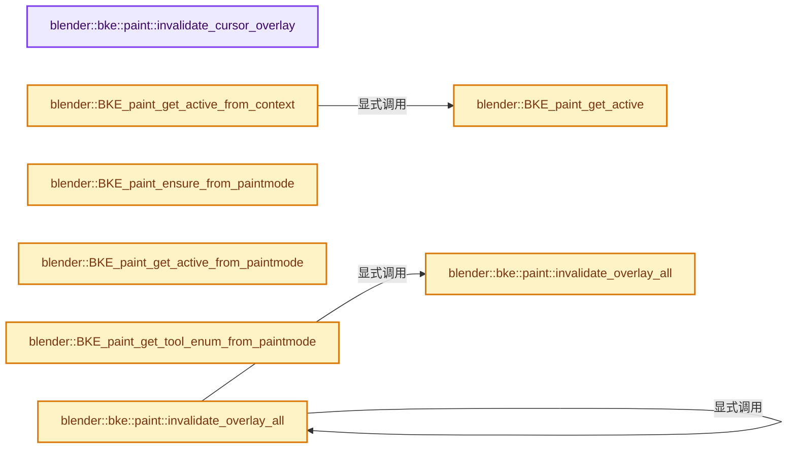
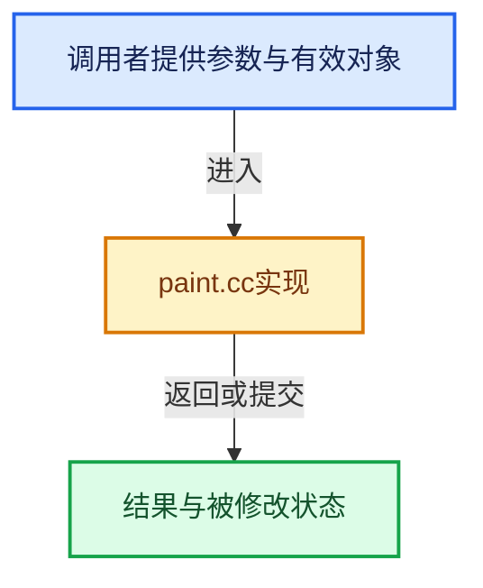

# 实现依赖专题：source/blender/blenkernel/intern/paint.cc

[实现依赖导航](../../README.md) · [符号索引](../../../00-课程指南/02-源码与提交索引/符号依赖与实现索引.md)

本专题从正文实际调用进入，集中保存共享实现。函数有稳定锚点，可从调用处直接跳到对应完整函数；递归与互相调用通过回链组织。

## 本文件的实现关系






## 完整成员与函数实现

<a id="f-d45fb86d35cec649"></a>

### `blender::bke::paint::invalidate_cursor_overlay`

实现位置：[source/blender/blenkernel/intern/paint.cc](../../../../../../../source/blender/blenkernel/intern/paint.cc) · L281—L289。

接口参数：

- `Scene &scene`
- `CurveMapping *curve`

**教学注释版**

<!-- annotated:5ba2a06ba4b1d4 -->

```cpp
void invalidate_cursor_overlay(Scene &scene, CurveMapping *curve)
{
  BKE_paint_settings_foreach_mode(scene.toolsettings, [&](Paint &paint) {
    const Brush *br = BKE_paint_brush_for_read(&paint);
    if (br && br->curve_distance_falloff == curve) {
      paint.runtime->overlay_flags |= eOverlayControlFlags::InvalidCurve;
    }
  });
}
```

<details>
<summary>核对原始源码：source/blender/blenkernel/intern/paint.cc · L281—L289</summary>

<!-- original:5ba2a06ba4b1d4:source/blender/blenkernel/intern/paint.cc:281:289 -->

```cpp
void invalidate_cursor_overlay(Scene &scene, CurveMapping *curve)
{
  BKE_paint_settings_foreach_mode(scene.toolsettings, [&](Paint &paint) {
    const Brush *br = BKE_paint_brush_for_read(&paint);
    if (br && br->curve_distance_falloff == curve) {
      paint.runtime->overlay_flags |= eOverlayControlFlags::InvalidCurve;
    }
  });
}
```

</details>

**沿实际写入检查状态**

- `paint.runtime->overlay_flags |= eOverlayControlFlags::InvalidCurve;`

**继续追踪实现**

- `BKE_paint_settings_foreach_mode` → [blender::BKE_paint_settings_foreach_mode · L1642](paint.cc.md#f-f74e7e457723c211)。
- `BKE_paint_brush_for_read` → [blender::BKE_paint_brush_for_read · L675](paint.cc.md#f-2424df4ef2a5491e)。

<a id="f-c92d9e33608ac5e6"></a>

### `blender::bke::paint::invalidate_overlay_all`

实现位置：[source/blender/blenkernel/intern/paint.cc](../../../../../../../source/blender/blenkernel/intern/paint.cc) · L291—L298。

接口参数：

- `Paint &paint`

**教学注释版**

<!-- annotated:9d8b90d0245f8c -->

```cpp
void invalidate_overlay_all(Paint &paint)
{
  const Brush *br = BKE_paint_brush_for_read(&paint);
  if (!br) {
    return;
  }
  paint.runtime->overlay_flags |= eOverlayControlFlags::InvalidMask;
}
```

<details>
<summary>核对原始源码：source/blender/blenkernel/intern/paint.cc · L291—L298</summary>

<!-- original:9d8b90d0245f8c:source/blender/blenkernel/intern/paint.cc:291:298 -->

```cpp
void invalidate_overlay_all(Paint &paint)
{
  const Brush *br = BKE_paint_brush_for_read(&paint);
  if (!br) {
    return;
  }
  paint.runtime->overlay_flags |= eOverlayControlFlags::InvalidMask;
}
```

</details>

**沿实际写入检查状态**

- `paint.runtime->overlay_flags |= eOverlayControlFlags::InvalidMask;`

**继续追踪实现**

- `BKE_paint_brush_for_read` → [blender::BKE_paint_brush_for_read · L675](paint.cc.md#f-2424df4ef2a5491e)。

<a id="f-6988f24cc09f2e7a"></a>

### `blender::bke::paint::invalidate_overlay_all`

实现位置：[source/blender/blenkernel/intern/paint.cc](../../../../../../../source/blender/blenkernel/intern/paint.cc) · L300—L304。

接口参数：

- `Scene &scene`

**教学注释版**

<!-- annotated:b6fdae5f738466 -->

```cpp
void invalidate_overlay_all(Scene &scene)
{
  BKE_paint_settings_foreach_mode(scene.toolsettings,
                                  [&](Paint &paint) { invalidate_overlay_all(paint); });
}
```

<details>
<summary>核对原始源码：source/blender/blenkernel/intern/paint.cc · L300—L304</summary>

<!-- original:b6fdae5f738466:source/blender/blenkernel/intern/paint.cc:300:304 -->

```cpp
void invalidate_overlay_all(Scene &scene)
{
  BKE_paint_settings_foreach_mode(scene.toolsettings,
                                  [&](Paint &paint) { invalidate_overlay_all(paint); });
}
```

</details>

**继续追踪实现**

- `BKE_paint_settings_foreach_mode` → [blender::BKE_paint_settings_foreach_mode · L1642](paint.cc.md#f-f74e7e457723c211)。
- `invalidate_overlay_all` → [blender::bke::paint::invalidate_overlay_all · L291](paint.cc.md#f-c92d9e33608ac5e6)；[blender::bke::paint::invalidate_overlay_all · L300](paint.cc.md#f-6988f24cc09f2e7a)。同名重载需按实参类型选择。

<a id="f-fb8b2888278a57a4"></a>

### `blender::BKE_paint_ensure_from_paintmode`

实现位置：[source/blender/blenkernel/intern/paint.cc](../../../../../../../source/blender/blenkernel/intern/paint.cc) · L359—L405。

接口参数：

- `Scene *sce`
- `PaintMode mode`

**教学注释版**

<!-- annotated:2425ba6589109e -->

```cpp
bool BKE_paint_ensure_from_paintmode(Scene *sce, PaintMode mode)
{
  ToolSettings *ts = sce->toolsettings;
  Paint **paint_ptr = nullptr;
  /* Some paint modes don't store paint settings as pointer, for these this can be set and
   * referenced by paint_ptr. */
  Paint *paint_tmp = nullptr;

  switch (mode) {
    case PaintMode::Sculpt:
      paint_ptr = reinterpret_cast<Paint **>(&ts->sculpt);
      break;
    case PaintMode::Vertex:
      paint_ptr = reinterpret_cast<Paint **>(&ts->vpaint);
      break;
    case PaintMode::Weight:
      paint_ptr = reinterpret_cast<Paint **>(&ts->wpaint);
      break;
    case PaintMode::Texture2D:
    case PaintMode::Texture3D:
      paint_tmp = reinterpret_cast<Paint *>(&ts->imapaint);
      paint_ptr = &paint_tmp;
      break;
    case PaintMode::GPencil:
      paint_ptr = reinterpret_cast<Paint **>(&ts->gp_paint);
      break;
    case PaintMode::VertexGPencil:
      paint_ptr = reinterpret_cast<Paint **>(&ts->gp_vertexpaint);
      break;
    case PaintMode::SculptGPencil:
      paint_ptr = reinterpret_cast<Paint **>(&ts->gp_sculptpaint);
      break;
    case PaintMode::WeightGPencil:
      paint_ptr = reinterpret_cast<Paint **>(&ts->gp_weightpaint);
      break;
    case PaintMode::SculptCurves:
      paint_ptr = reinterpret_cast<Paint **>(&ts->curves_sculpt);
      break;
    case PaintMode::Invalid:
      break;
  }
  if (paint_ptr) {
    BKE_paint_ensure(ts, paint_ptr);
    return true;
  }
  return false;
}
```

<details>
<summary>核对原始源码：source/blender/blenkernel/intern/paint.cc · L359—L405</summary>

<!-- original:2425ba6589109e:source/blender/blenkernel/intern/paint.cc:359:405 -->

```cpp
bool BKE_paint_ensure_from_paintmode(Scene *sce, PaintMode mode)
{
  ToolSettings *ts = sce->toolsettings;
  Paint **paint_ptr = nullptr;
  /* Some paint modes don't store paint settings as pointer, for these this can be set and
   * referenced by paint_ptr. */
  Paint *paint_tmp = nullptr;

  switch (mode) {
    case PaintMode::Sculpt:
      paint_ptr = reinterpret_cast<Paint **>(&ts->sculpt);
      break;
    case PaintMode::Vertex:
      paint_ptr = reinterpret_cast<Paint **>(&ts->vpaint);
      break;
    case PaintMode::Weight:
      paint_ptr = reinterpret_cast<Paint **>(&ts->wpaint);
      break;
    case PaintMode::Texture2D:
    case PaintMode::Texture3D:
      paint_tmp = reinterpret_cast<Paint *>(&ts->imapaint);
      paint_ptr = &paint_tmp;
      break;
    case PaintMode::GPencil:
      paint_ptr = reinterpret_cast<Paint **>(&ts->gp_paint);
      break;
    case PaintMode::VertexGPencil:
      paint_ptr = reinterpret_cast<Paint **>(&ts->gp_vertexpaint);
      break;
    case PaintMode::SculptGPencil:
      paint_ptr = reinterpret_cast<Paint **>(&ts->gp_sculptpaint);
      break;
    case PaintMode::WeightGPencil:
      paint_ptr = reinterpret_cast<Paint **>(&ts->gp_weightpaint);
      break;
    case PaintMode::SculptCurves:
      paint_ptr = reinterpret_cast<Paint **>(&ts->curves_sculpt);
      break;
    case PaintMode::Invalid:
      break;
  }
  if (paint_ptr) {
    BKE_paint_ensure(ts, paint_ptr);
    return true;
  }
  return false;
}
```

</details>

**沿实际写入检查状态**

- `paint_ptr = reinterpret_cast<Paint **>(&ts->sculpt);`
- `paint_ptr = reinterpret_cast<Paint **>(&ts->vpaint);`
- `paint_ptr = reinterpret_cast<Paint **>(&ts->wpaint);`
- `paint_tmp = reinterpret_cast<Paint *>(&ts->imapaint);`
- `paint_ptr = &paint_tmp;`
- `paint_ptr = reinterpret_cast<Paint **>(&ts->gp_paint);`
- `paint_ptr = reinterpret_cast<Paint **>(&ts->gp_vertexpaint);`
- `paint_ptr = reinterpret_cast<Paint **>(&ts->gp_sculptpaint);`
- `paint_ptr = reinterpret_cast<Paint **>(&ts->gp_weightpaint);`
- `paint_ptr = reinterpret_cast<Paint **>(&ts->curves_sculpt);`

**结果出口**

- `return true;`
- `return false;`

**继续追踪实现**

- `BKE_paint_ensure` → [blender::BKE_paint_ensure · L1436](paint.cc.md#f-ae567367315b285a)。

<a id="f-b3ec1acb5886ccd3"></a>

### `blender::BKE_paint_get_active_from_paintmode`

实现位置：[source/blender/blenkernel/intern/paint.cc](../../../../../../../source/blender/blenkernel/intern/paint.cc) · L407—L440。

接口参数：

- `Scene *sce`
- `PaintMode mode`

**教学注释版**

<!-- annotated:0e1b6c43b473c5 -->

```cpp
Paint *BKE_paint_get_active_from_paintmode(Scene *sce, PaintMode mode)
{
  if (sce) {
    ToolSettings *ts = sce->toolsettings;

    switch (mode) {
      case PaintMode::Sculpt:
        return &ts->sculpt->paint;
      case PaintMode::Vertex:
        return &ts->vpaint->paint;
      case PaintMode::Weight:
        return &ts->wpaint->paint;
      case PaintMode::Texture2D:
      case PaintMode::Texture3D:
        return &ts->imapaint.paint;
      case PaintMode::GPencil:
        return &ts->gp_paint->paint;
      case PaintMode::VertexGPencil:
        return &ts->gp_vertexpaint->paint;
      case PaintMode::SculptGPencil:
        return &ts->gp_sculptpaint->paint;
      case PaintMode::WeightGPencil:
        return &ts->gp_weightpaint->paint;
      case PaintMode::SculptCurves:
        return &ts->curves_sculpt->paint;
      case PaintMode::Invalid:
        return nullptr;
      default:
        return &ts->imapaint.paint;
    }
  }

  return nullptr;
}
```

<details>
<summary>核对原始源码：source/blender/blenkernel/intern/paint.cc · L407—L440</summary>

<!-- original:0e1b6c43b473c5:source/blender/blenkernel/intern/paint.cc:407:440 -->

```cpp
Paint *BKE_paint_get_active_from_paintmode(Scene *sce, PaintMode mode)
{
  if (sce) {
    ToolSettings *ts = sce->toolsettings;

    switch (mode) {
      case PaintMode::Sculpt:
        return &ts->sculpt->paint;
      case PaintMode::Vertex:
        return &ts->vpaint->paint;
      case PaintMode::Weight:
        return &ts->wpaint->paint;
      case PaintMode::Texture2D:
      case PaintMode::Texture3D:
        return &ts->imapaint.paint;
      case PaintMode::GPencil:
        return &ts->gp_paint->paint;
      case PaintMode::VertexGPencil:
        return &ts->gp_vertexpaint->paint;
      case PaintMode::SculptGPencil:
        return &ts->gp_sculptpaint->paint;
      case PaintMode::WeightGPencil:
        return &ts->gp_weightpaint->paint;
      case PaintMode::SculptCurves:
        return &ts->curves_sculpt->paint;
      case PaintMode::Invalid:
        return nullptr;
      default:
        return &ts->imapaint.paint;
    }
  }

  return nullptr;
}
```

</details>

**结果出口**

- `return &ts->sculpt->paint;`
- `return &ts->vpaint->paint;`
- `return &ts->wpaint->paint;`
- `return &ts->imapaint.paint;`
- `return &ts->gp_paint->paint;`
- `return &ts->gp_vertexpaint->paint;`
- `return &ts->gp_sculptpaint->paint;`
- `return &ts->gp_weightpaint->paint;`
- `return &ts->curves_sculpt->paint;`
- `return nullptr;`

**继续追踪实现**

本实现没有需要继续展开的显式调用；检查返回表达式、对象转换和调用者前置条件。

<a id="f-a1e67550e30f3205"></a>

### `blender::BKE_paint_get_tool_enum_from_paintmode`

实现位置：[source/blender/blenkernel/intern/paint.cc](../../../../../../../source/blender/blenkernel/intern/paint.cc) · L442—L468。

接口参数：

- `const PaintMode mode`

**教学注释版**

<!-- annotated:c83cbc6215abc9 -->

```cpp
const EnumPropertyItem *BKE_paint_get_tool_enum_from_paintmode(const PaintMode mode)
{
  switch (mode) {
    case PaintMode::Sculpt:
      return rna_enum_brush_sculpt_brush_type_items;
    case PaintMode::Vertex:
      return rna_enum_brush_vertex_brush_type_items;
    case PaintMode::Weight:
      return rna_enum_brush_weight_brush_type_items;
    case PaintMode::Texture2D:
    case PaintMode::Texture3D:
      return rna_enum_brush_image_brush_type_items;
    case PaintMode::GPencil:
      return rna_enum_brush_gpencil_types_items;
    case PaintMode::VertexGPencil:
      return rna_enum_brush_gpencil_vertex_types_items;
    case PaintMode::SculptGPencil:
      return rna_enum_brush_gpencil_sculpt_types_items;
    case PaintMode::WeightGPencil:
      return rna_enum_brush_gpencil_weight_types_items;
    case PaintMode::SculptCurves:
      return rna_enum_brush_curves_sculpt_brush_type_items;
    case PaintMode::Invalid:
      break;
  }
  return nullptr;
}
```

<details>
<summary>核对原始源码：source/blender/blenkernel/intern/paint.cc · L442—L468</summary>

<!-- original:c83cbc6215abc9:source/blender/blenkernel/intern/paint.cc:442:468 -->

```cpp
const EnumPropertyItem *BKE_paint_get_tool_enum_from_paintmode(const PaintMode mode)
{
  switch (mode) {
    case PaintMode::Sculpt:
      return rna_enum_brush_sculpt_brush_type_items;
    case PaintMode::Vertex:
      return rna_enum_brush_vertex_brush_type_items;
    case PaintMode::Weight:
      return rna_enum_brush_weight_brush_type_items;
    case PaintMode::Texture2D:
    case PaintMode::Texture3D:
      return rna_enum_brush_image_brush_type_items;
    case PaintMode::GPencil:
      return rna_enum_brush_gpencil_types_items;
    case PaintMode::VertexGPencil:
      return rna_enum_brush_gpencil_vertex_types_items;
    case PaintMode::SculptGPencil:
      return rna_enum_brush_gpencil_sculpt_types_items;
    case PaintMode::WeightGPencil:
      return rna_enum_brush_gpencil_weight_types_items;
    case PaintMode::SculptCurves:
      return rna_enum_brush_curves_sculpt_brush_type_items;
    case PaintMode::Invalid:
      break;
  }
  return nullptr;
}
```

</details>

**结果出口**

- `return rna_enum_brush_sculpt_brush_type_items;`
- `return rna_enum_brush_vertex_brush_type_items;`
- `return rna_enum_brush_weight_brush_type_items;`
- `return rna_enum_brush_image_brush_type_items;`
- `return rna_enum_brush_gpencil_types_items;`
- `return rna_enum_brush_gpencil_vertex_types_items;`
- `return rna_enum_brush_gpencil_sculpt_types_items;`
- `return rna_enum_brush_gpencil_weight_types_items;`
- `return rna_enum_brush_curves_sculpt_brush_type_items;`
- `return nullptr;`

**继续追踪实现**

本实现没有需要继续展开的显式调用；检查返回表达式、对象转换和调用者前置条件。

<a id="f-136db3d792b0db89"></a>

### `blender::BKE_paint_get_active`

实现位置：[source/blender/blenkernel/intern/paint.cc](../../../../../../../source/blender/blenkernel/intern/paint.cc) · L470—L507。

接口参数：

- `const Main &bmain`
- `Scene *sce`
- `ViewLayer *view_layer`

**教学注释版**

<!-- annotated:b57b114f6c69aa -->

```cpp
Paint *BKE_paint_get_active(const Main &bmain, Scene *sce, ViewLayer *view_layer)
{
  if (sce && view_layer) {
    ToolSettings *ts = sce->toolsettings;
    BKE_view_layer_synced_ensure(bmain, sce, view_layer);
    Object *actob = BKE_view_layer_active_object_get(view_layer);

    if (actob) {
      switch (actob->mode) {
        case OB_MODE_SCULPT:
          return &ts->sculpt->paint;
        case OB_MODE_VERTEX_PAINT:
          return &ts->vpaint->paint;
        case OB_MODE_WEIGHT_PAINT:
          return &ts->wpaint->paint;
        case OB_MODE_TEXTURE_PAINT:
          return &ts->imapaint.paint;
        case OB_MODE_PAINT_GREASE_PENCIL:
          return &ts->gp_paint->paint;
        case OB_MODE_VERTEX_GREASE_PENCIL:
          return &ts->gp_vertexpaint->paint;
        case OB_MODE_SCULPT_GREASE_PENCIL:
          return &ts->gp_sculptpaint->paint;
        case OB_MODE_WEIGHT_GREASE_PENCIL:
          return &ts->gp_weightpaint->paint;
        case OB_MODE_SCULPT_CURVES:
          return &ts->curves_sculpt->paint;
        default:
          break;
      }
    }

    /* default to image paint */
    return &ts->imapaint.paint;
  }

  return nullptr;
}
```

<details>
<summary>核对原始源码：source/blender/blenkernel/intern/paint.cc · L470—L507</summary>

<!-- original:b57b114f6c69aa:source/blender/blenkernel/intern/paint.cc:470:507 -->

```cpp
Paint *BKE_paint_get_active(const Main &bmain, Scene *sce, ViewLayer *view_layer)
{
  if (sce && view_layer) {
    ToolSettings *ts = sce->toolsettings;
    BKE_view_layer_synced_ensure(bmain, sce, view_layer);
    Object *actob = BKE_view_layer_active_object_get(view_layer);

    if (actob) {
      switch (actob->mode) {
        case OB_MODE_SCULPT:
          return &ts->sculpt->paint;
        case OB_MODE_VERTEX_PAINT:
          return &ts->vpaint->paint;
        case OB_MODE_WEIGHT_PAINT:
          return &ts->wpaint->paint;
        case OB_MODE_TEXTURE_PAINT:
          return &ts->imapaint.paint;
        case OB_MODE_PAINT_GREASE_PENCIL:
          return &ts->gp_paint->paint;
        case OB_MODE_VERTEX_GREASE_PENCIL:
          return &ts->gp_vertexpaint->paint;
        case OB_MODE_SCULPT_GREASE_PENCIL:
          return &ts->gp_sculptpaint->paint;
        case OB_MODE_WEIGHT_GREASE_PENCIL:
          return &ts->gp_weightpaint->paint;
        case OB_MODE_SCULPT_CURVES:
          return &ts->curves_sculpt->paint;
        default:
          break;
      }
    }

    /* default to image paint */
    return &ts->imapaint.paint;
  }

  return nullptr;
}
```

</details>

**结果出口**

- `return &ts->sculpt->paint;`
- `return &ts->vpaint->paint;`
- `return &ts->wpaint->paint;`
- `return &ts->imapaint.paint;`
- `return &ts->gp_paint->paint;`
- `return &ts->gp_vertexpaint->paint;`
- `return &ts->gp_sculptpaint->paint;`
- `return &ts->gp_weightpaint->paint;`
- `return &ts->curves_sculpt->paint;`
- `return nullptr;`

**继续追踪实现**

- `BKE_view_layer_synced_ensure` → [blender::BKE_view_layer_synced_ensure · L1035](layer.cc.md#f-602c088654ebcb63)。
- `BKE_view_layer_active_object_get` → [blender::BKE_view_layer_active_object_get · L286](layer_utils.cc.md#f-aa39df7416329726)。

<a id="f-1703df37377f7b57"></a>

### `blender::BKE_paint_get_active_from_context`

实现位置：[source/blender/blenkernel/intern/paint.cc](../../../../../../../source/blender/blenkernel/intern/paint.cc) · L509—L537。

接口参数：

- `const bContext *C`

**教学注释版**

<!-- annotated:9af063ec36c33c -->

```cpp
Paint *BKE_paint_get_active_from_context(const bContext *C)
{
  const Main *bmain = CTX_data_main(C);
  Scene *sce = CTX_data_scene(C);
  ViewLayer *view_layer = CTX_data_view_layer(C);

  if (sce && view_layer) {
    ToolSettings *ts = sce->toolsettings;
    BKE_view_layer_synced_ensure(*bmain, sce, view_layer);
    Object *obact = BKE_view_layer_active_object_get(view_layer);

    SpaceImage *sima = CTX_wm_space_image(C);
    if (sima != nullptr) {
      if (obact && obact->mode == OB_MODE_EDIT) {
        if (sima->mode == SI_MODE_PAINT) {
          return &ts->imapaint.paint;
        }
      }
      else {
        return &ts->imapaint.paint;
      }
    }
    else {
      return BKE_paint_get_active(*bmain, sce, view_layer);
    }
  }

  return nullptr;
}
```

<details>
<summary>核对原始源码：source/blender/blenkernel/intern/paint.cc · L509—L537</summary>

<!-- original:9af063ec36c33c:source/blender/blenkernel/intern/paint.cc:509:537 -->

```cpp
Paint *BKE_paint_get_active_from_context(const bContext *C)
{
  const Main *bmain = CTX_data_main(C);
  Scene *sce = CTX_data_scene(C);
  ViewLayer *view_layer = CTX_data_view_layer(C);

  if (sce && view_layer) {
    ToolSettings *ts = sce->toolsettings;
    BKE_view_layer_synced_ensure(*bmain, sce, view_layer);
    Object *obact = BKE_view_layer_active_object_get(view_layer);

    SpaceImage *sima = CTX_wm_space_image(C);
    if (sima != nullptr) {
      if (obact && obact->mode == OB_MODE_EDIT) {
        if (sima->mode == SI_MODE_PAINT) {
          return &ts->imapaint.paint;
        }
      }
      else {
        return &ts->imapaint.paint;
      }
    }
    else {
      return BKE_paint_get_active(*bmain, sce, view_layer);
    }
  }

  return nullptr;
}
```

</details>

**结果出口**

- `return &ts->imapaint.paint;`
- `return BKE_paint_get_active(*bmain, sce, view_layer);`
- `return nullptr;`

**继续追踪实现**

- `CTX_data_main` → [blender::CTX_data_main · L1313](context.cc.md#f-6d4ba24a62a80b94)。
- `CTX_data_scene` → [blender::CTX_data_scene · L1329](context.cc.md#f-6a2fb518a7aa2eee)。
- `CTX_data_view_layer` → [blender::CTX_data_view_layer · L1352](context.cc.md#f-31b9fbfc3ff836d4)。
- `BKE_view_layer_synced_ensure` → [blender::BKE_view_layer_synced_ensure · L1035](layer.cc.md#f-602c088654ebcb63)。
- `BKE_view_layer_active_object_get` → [blender::BKE_view_layer_active_object_get · L286](layer_utils.cc.md#f-aa39df7416329726)。
- `CTX_wm_space_image` → [blender::CTX_wm_space_image · L1040](context.cc.md#f-298ffbf670ec655c)。
- `BKE_paint_get_active` → [blender::BKE_paint_get_active · L470](paint.cc.md#f-136db3d792b0db89)。

<a id="f-9a276acfdd437be8"></a>

### `blender::BKE_paintmode_get_active_from_context`

实现位置：[source/blender/blenkernel/intern/paint.cc](../../../../../../../source/blender/blenkernel/intern/paint.cc) · L539—L594。

接口参数：

- `const bContext *C`

**教学注释版**

<!-- annotated:24236c25a32770 -->

```cpp
PaintMode BKE_paintmode_get_active_from_context(const bContext *C)
{
  const Main *bmain = CTX_data_main(C);
  Scene *sce = CTX_data_scene(C);
  ViewLayer *view_layer = CTX_data_view_layer(C);

  if (sce && view_layer) {
    BKE_view_layer_synced_ensure(*bmain, sce, view_layer);
    Object *obact = BKE_view_layer_active_object_get(view_layer);

    SpaceImage *sima = CTX_wm_space_image(C);
    if (sima != nullptr) {
      if (obact && obact->mode == OB_MODE_EDIT) {
        if (sima->mode == SI_MODE_PAINT) {
          return PaintMode::Texture2D;
        }
      }
      else {
        return PaintMode::Texture2D;
      }
    }
    else if (obact) {
      switch (obact->mode) {
        case OB_MODE_SCULPT:
          return PaintMode::Sculpt;
        case OB_MODE_SCULPT_GREASE_PENCIL:
          if (obact->type == OB_GREASE_PENCIL) {
            return PaintMode::SculptGPencil;
          }
          return PaintMode::Invalid;
        case OB_MODE_PAINT_GREASE_PENCIL:
          return PaintMode::GPencil;
        case OB_MODE_WEIGHT_GREASE_PENCIL:
          return PaintMode::WeightGPencil;
        case OB_MODE_VERTEX_GREASE_PENCIL:
          return PaintMode::VertexGPencil;
        case OB_MODE_VERTEX_PAINT:
          return PaintMode::Vertex;
        case OB_MODE_WEIGHT_PAINT:
          return PaintMode::Weight;
        case OB_MODE_TEXTURE_PAINT:
          return PaintMode::Texture3D;
        case OB_MODE_SCULPT_CURVES:
          return PaintMode::SculptCurves;
        default:
          return PaintMode::Texture2D;
      }
    }
    else {
      /* default to image paint */
      return PaintMode::Texture2D;
    }
  }

  return PaintMode::Invalid;
}
```

<details>
<summary>核对原始源码：source/blender/blenkernel/intern/paint.cc · L539—L594</summary>

<!-- original:24236c25a32770:source/blender/blenkernel/intern/paint.cc:539:594 -->

```cpp
PaintMode BKE_paintmode_get_active_from_context(const bContext *C)
{
  const Main *bmain = CTX_data_main(C);
  Scene *sce = CTX_data_scene(C);
  ViewLayer *view_layer = CTX_data_view_layer(C);

  if (sce && view_layer) {
    BKE_view_layer_synced_ensure(*bmain, sce, view_layer);
    Object *obact = BKE_view_layer_active_object_get(view_layer);

    SpaceImage *sima = CTX_wm_space_image(C);
    if (sima != nullptr) {
      if (obact && obact->mode == OB_MODE_EDIT) {
        if (sima->mode == SI_MODE_PAINT) {
          return PaintMode::Texture2D;
        }
      }
      else {
        return PaintMode::Texture2D;
      }
    }
    else if (obact) {
      switch (obact->mode) {
        case OB_MODE_SCULPT:
          return PaintMode::Sculpt;
        case OB_MODE_SCULPT_GREASE_PENCIL:
          if (obact->type == OB_GREASE_PENCIL) {
            return PaintMode::SculptGPencil;
          }
          return PaintMode::Invalid;
        case OB_MODE_PAINT_GREASE_PENCIL:
          return PaintMode::GPencil;
        case OB_MODE_WEIGHT_GREASE_PENCIL:
          return PaintMode::WeightGPencil;
        case OB_MODE_VERTEX_GREASE_PENCIL:
          return PaintMode::VertexGPencil;
        case OB_MODE_VERTEX_PAINT:
          return PaintMode::Vertex;
        case OB_MODE_WEIGHT_PAINT:
          return PaintMode::Weight;
        case OB_MODE_TEXTURE_PAINT:
          return PaintMode::Texture3D;
        case OB_MODE_SCULPT_CURVES:
          return PaintMode::SculptCurves;
        default:
          return PaintMode::Texture2D;
      }
    }
    else {
      /* default to image paint */
      return PaintMode::Texture2D;
    }
  }

  return PaintMode::Invalid;
}
```

</details>

**结果出口**

- `return PaintMode::Texture2D;`
- `return PaintMode::Sculpt;`
- `return PaintMode::SculptGPencil;`
- `return PaintMode::Invalid;`
- `return PaintMode::GPencil;`
- `return PaintMode::WeightGPencil;`
- `return PaintMode::VertexGPencil;`
- `return PaintMode::Vertex;`
- `return PaintMode::Weight;`
- `return PaintMode::Texture3D;`
- `return PaintMode::SculptCurves;`

**继续追踪实现**

- `CTX_data_main` → [blender::CTX_data_main · L1313](context.cc.md#f-6d4ba24a62a80b94)。
- `CTX_data_scene` → [blender::CTX_data_scene · L1329](context.cc.md#f-6a2fb518a7aa2eee)。
- `CTX_data_view_layer` → [blender::CTX_data_view_layer · L1352](context.cc.md#f-31b9fbfc3ff836d4)。
- `BKE_view_layer_synced_ensure` → [blender::BKE_view_layer_synced_ensure · L1035](layer.cc.md#f-602c088654ebcb63)。
- `BKE_view_layer_active_object_get` → [blender::BKE_view_layer_active_object_get · L286](layer_utils.cc.md#f-aa39df7416329726)。
- `CTX_wm_space_image` → [blender::CTX_wm_space_image · L1040](context.cc.md#f-298ffbf670ec655c)。

<a id="f-0bd9d6b02b928487"></a>

### `blender::BKE_paintmode_get_from_tool`

实现位置：[source/blender/blenkernel/intern/paint.cc](../../../../../../../source/blender/blenkernel/intern/paint.cc) · L596—L634。

接口参数：

- `const bToolRef *tref`

**教学注释版**

<!-- annotated:5677894c8f4504 -->

```cpp
PaintMode BKE_paintmode_get_from_tool(const bToolRef *tref)
{
  if (tref->space_type == SPACE_VIEW3D) {
    switch (tref->mode) {
      case CTX_MODE_SCULPT:
        return PaintMode::Sculpt;
      case CTX_MODE_PAINT_VERTEX:
        return PaintMode::Vertex;
      case CTX_MODE_PAINT_WEIGHT:
        return PaintMode::Weight;
      case CTX_MODE_PAINT_GPENCIL_LEGACY:
        return PaintMode::GPencil;
      case CTX_MODE_PAINT_TEXTURE:
        return PaintMode::Texture3D;
      case CTX_MODE_VERTEX_GREASE_PENCIL:
      case CTX_MODE_VERTEX_GPENCIL_LEGACY:
        return PaintMode::VertexGPencil;
      case CTX_MODE_SCULPT_GPENCIL_LEGACY:
        return PaintMode::SculptGPencil;
      case CTX_MODE_WEIGHT_GREASE_PENCIL:
      case CTX_MODE_WEIGHT_GPENCIL_LEGACY:
        return PaintMode::WeightGPencil;
      case CTX_MODE_SCULPT_CURVES:
        return PaintMode::SculptCurves;
      case CTX_MODE_PAINT_GREASE_PENCIL:
        return PaintMode::GPencil;
      case CTX_MODE_SCULPT_GREASE_PENCIL:
        return PaintMode::SculptGPencil;
    }
  }
  else if (tref->space_type == SPACE_IMAGE) {
    switch (tref->mode) {
      case SI_MODE_PAINT:
        return PaintMode::Texture2D;
    }
  }

  return PaintMode::Invalid;
}
```

<details>
<summary>核对原始源码：source/blender/blenkernel/intern/paint.cc · L596—L634</summary>

<!-- original:5677894c8f4504:source/blender/blenkernel/intern/paint.cc:596:634 -->

```cpp
PaintMode BKE_paintmode_get_from_tool(const bToolRef *tref)
{
  if (tref->space_type == SPACE_VIEW3D) {
    switch (tref->mode) {
      case CTX_MODE_SCULPT:
        return PaintMode::Sculpt;
      case CTX_MODE_PAINT_VERTEX:
        return PaintMode::Vertex;
      case CTX_MODE_PAINT_WEIGHT:
        return PaintMode::Weight;
      case CTX_MODE_PAINT_GPENCIL_LEGACY:
        return PaintMode::GPencil;
      case CTX_MODE_PAINT_TEXTURE:
        return PaintMode::Texture3D;
      case CTX_MODE_VERTEX_GREASE_PENCIL:
      case CTX_MODE_VERTEX_GPENCIL_LEGACY:
        return PaintMode::VertexGPencil;
      case CTX_MODE_SCULPT_GPENCIL_LEGACY:
        return PaintMode::SculptGPencil;
      case CTX_MODE_WEIGHT_GREASE_PENCIL:
      case CTX_MODE_WEIGHT_GPENCIL_LEGACY:
        return PaintMode::WeightGPencil;
      case CTX_MODE_SCULPT_CURVES:
        return PaintMode::SculptCurves;
      case CTX_MODE_PAINT_GREASE_PENCIL:
        return PaintMode::GPencil;
      case CTX_MODE_SCULPT_GREASE_PENCIL:
        return PaintMode::SculptGPencil;
    }
  }
  else if (tref->space_type == SPACE_IMAGE) {
    switch (tref->mode) {
      case SI_MODE_PAINT:
        return PaintMode::Texture2D;
    }
  }

  return PaintMode::Invalid;
}
```

</details>

**结果出口**

- `return PaintMode::Sculpt;`
- `return PaintMode::Vertex;`
- `return PaintMode::Weight;`
- `return PaintMode::GPencil;`
- `return PaintMode::Texture3D;`
- `return PaintMode::VertexGPencil;`
- `return PaintMode::SculptGPencil;`
- `return PaintMode::WeightGPencil;`
- `return PaintMode::SculptCurves;`
- `return PaintMode::Texture2D;`
- `return PaintMode::Invalid;`

**继续追踪实现**

本实现没有需要继续展开的显式调用；检查返回表达式、对象转换和调用者前置条件。

<a id="f-8c2061b5547f93ad"></a>

### `blender::BKE_paint_brush`

实现位置：[source/blender/blenkernel/intern/paint.cc](../../../../../../../source/blender/blenkernel/intern/paint.cc) · L670—L673。

接口参数：

- `Paint *paint`

**教学注释版**

<!-- annotated:aaedf5ff71fcfb -->

```cpp
Brush *BKE_paint_brush(Paint *paint)
{
  return paint ? paint->brush : nullptr;
}
```

<details>
<summary>核对原始源码：source/blender/blenkernel/intern/paint.cc · L670—L673</summary>

<!-- original:aaedf5ff71fcfb:source/blender/blenkernel/intern/paint.cc:670:673 -->

```cpp
Brush *BKE_paint_brush(Paint *paint)
{
  return paint ? paint->brush : nullptr;
}
```

</details>

**结果出口**

- `return paint ? paint->brush : nullptr;`

**继续追踪实现**

本实现没有需要继续展开的显式调用；检查返回表达式、对象转换和调用者前置条件。

<a id="f-2424df4ef2a5491e"></a>

### `blender::BKE_paint_brush_for_read`

实现位置：[source/blender/blenkernel/intern/paint.cc](../../../../../../../source/blender/blenkernel/intern/paint.cc) · L675—L678。

接口参数：

- `const Paint *paint`

**教学注释版**

<!-- annotated:9180570ebe2649 -->

```cpp
const Brush *BKE_paint_brush_for_read(const Paint *paint)
{
  return paint ? paint->brush : nullptr;
}
```

<details>
<summary>核对原始源码：source/blender/blenkernel/intern/paint.cc · L675—L678</summary>

<!-- original:9180570ebe2649:source/blender/blenkernel/intern/paint.cc:675:678 -->

```cpp
const Brush *BKE_paint_brush_for_read(const Paint *paint)
{
  return paint ? paint->brush : nullptr;
}
```

</details>

**结果出口**

- `return paint ? paint->brush : nullptr;`

**继续追踪实现**

本实现没有需要继续展开的显式调用；检查返回表达式、对象转换和调用者前置条件。

<a id="f-2ce5ae19812e9409"></a>

### `blender::BKE_paint_can_use_brush`

实现位置：[source/blender/blenkernel/intern/paint.cc](../../../../../../../source/blender/blenkernel/intern/paint.cc) · L680—L686。

接口参数：

- `const Paint *paint`
- `const Brush *brush`

**教学注释版**

<!-- annotated:cf58e514c44804 -->

```cpp
bool BKE_paint_can_use_brush(const Paint *paint, const Brush *brush)
{
  if (paint == nullptr) {
    return false;
  }
  return !brush || (paint->runtime->ob_mode & brush->ob_mode) != 0;
}
```

<details>
<summary>核对原始源码：source/blender/blenkernel/intern/paint.cc · L680—L686</summary>

<!-- original:cf58e514c44804:source/blender/blenkernel/intern/paint.cc:680:686 -->

```cpp
bool BKE_paint_can_use_brush(const Paint *paint, const Brush *brush)
{
  if (paint == nullptr) {
    return false;
  }
  return !brush || (paint->runtime->ob_mode & brush->ob_mode) != 0;
}
```

</details>

**结果出口**

- `return false;`
- `return !brush || (paint->runtime->ob_mode & brush->ob_mode) != 0;`

**继续追踪实现**

本实现没有需要继续展开的显式调用；检查返回表达式、对象转换和调用者前置条件。

<a id="f-a5511b01a4eb0534"></a>

### `blender::asset_reference_create_from_brush`

实现位置：[source/blender/blenkernel/intern/paint.cc](../../../../../../../source/blender/blenkernel/intern/paint.cc) · L688—L697。

接口参数：

- `Brush *brush`

**教学注释版**

<!-- annotated:f7b3c6d9e091bd -->

```cpp
static AssetWeakReference *asset_reference_create_from_brush(Brush *brush)
{
  if (std::optional<AssetWeakReference> weak_ref = bke::asset_edit_weak_reference_from_id(
          brush->id))
  {
    return MEM_new<AssetWeakReference>(__func__, *weak_ref);
  }

  return nullptr;
}
```

<details>
<summary>核对原始源码：source/blender/blenkernel/intern/paint.cc · L688—L697</summary>

<!-- original:f7b3c6d9e091bd:source/blender/blenkernel/intern/paint.cc:688:697 -->

```cpp
static AssetWeakReference *asset_reference_create_from_brush(Brush *brush)
{
  if (std::optional<AssetWeakReference> weak_ref = bke::asset_edit_weak_reference_from_id(
          brush->id))
  {
    return MEM_new<AssetWeakReference>(__func__, *weak_ref);
  }

  return nullptr;
}
```

</details>

**结果出口**

- `return MEM_new<AssetWeakReference>(__func__, *weak_ref);`
- `return nullptr;`

**继续追踪实现**

- `bke::asset_edit_weak_reference_from_id` → [blender::bke::asset_edit_weak_reference_from_id · L523](asset_edit.cc.md#f-4f7bcbac6d164056)。
- `MEM_new<AssetWeakReference>` → [MEM_new · L351](../../07-Intern运行时与平台/guardedalloc/MEM_guardedalloc.h.md#f-115f9b6784f89912)。

<a id="f-8354d15882d47a62"></a>

### `blender::BKE_paint_brush_set`

实现位置：[source/blender/blenkernel/intern/paint.cc](../../../../../../../source/blender/blenkernel/intern/paint.cc) · L699—L732。

接口参数：

- `Main *bmain`
- `Paint *paint`
- `const AssetWeakReference &brush_asset_reference`

**教学注释版**

<!-- annotated:417da161df4ab5 -->

```cpp
bool BKE_paint_brush_set(Main *bmain,
                         Paint *paint,
                         const AssetWeakReference &brush_asset_reference)
{
  /* Don't resolve this during file read, it will be done after. */
  if (bmain->is_locked_for_linking) {
    return false;
  }

  Brush *brush = reinterpret_cast<Brush *>(
      bke::asset_edit_id_from_weak_reference(*bmain, ID_BR, brush_asset_reference));
  BLI_assert(brush == nullptr || !ID_IS_LINKED(brush) ||
             bke::asset_edit_id_is_editable(brush->id));

  /* Ensure we have a brush with appropriate mode to assign.
   * Could happen if contents of asset blend were manually changed. */
  if (brush == nullptr || !BKE_paint_can_use_brush(paint, brush)) {
    return false;
  }

  /* Update the brush itself. */
  paint->brush = brush;
  /* Update the brush asset reference. */
  {
    MEM_delete(paint->brush_asset_reference);
    paint->brush_asset_reference = nullptr;
    if (brush != nullptr) {
      BLI_assert(bke::asset_edit_weak_reference_from_id(brush->id) == brush_asset_reference);
      paint->brush_asset_reference = MEM_new<AssetWeakReference>(__func__, brush_asset_reference);
    }
  }

  return true;
}
```

<details>
<summary>核对原始源码：source/blender/blenkernel/intern/paint.cc · L699—L732</summary>

<!-- original:417da161df4ab5:source/blender/blenkernel/intern/paint.cc:699:732 -->

```cpp
bool BKE_paint_brush_set(Main *bmain,
                         Paint *paint,
                         const AssetWeakReference &brush_asset_reference)
{
  /* Don't resolve this during file read, it will be done after. */
  if (bmain->is_locked_for_linking) {
    return false;
  }

  Brush *brush = reinterpret_cast<Brush *>(
      bke::asset_edit_id_from_weak_reference(*bmain, ID_BR, brush_asset_reference));
  BLI_assert(brush == nullptr || !ID_IS_LINKED(brush) ||
             bke::asset_edit_id_is_editable(brush->id));

  /* Ensure we have a brush with appropriate mode to assign.
   * Could happen if contents of asset blend were manually changed. */
  if (brush == nullptr || !BKE_paint_can_use_brush(paint, brush)) {
    return false;
  }

  /* Update the brush itself. */
  paint->brush = brush;
  /* Update the brush asset reference. */
  {
    MEM_delete(paint->brush_asset_reference);
    paint->brush_asset_reference = nullptr;
    if (brush != nullptr) {
      BLI_assert(bke::asset_edit_weak_reference_from_id(brush->id) == brush_asset_reference);
      paint->brush_asset_reference = MEM_new<AssetWeakReference>(__func__, brush_asset_reference);
    }
  }

  return true;
}
```

</details>

**沿实际写入检查状态**

- `paint->brush = brush;`
- `paint->brush_asset_reference = nullptr;`
- `paint->brush_asset_reference = MEM_new<AssetWeakReference>(__func__, brush_asset_reference);`

**结果出口**

- `return false;`
- `return true;`

**继续追踪实现**

- `bke::asset_edit_id_from_weak_reference` → [blender::bke::asset_edit_id_from_weak_reference · L482](asset_edit.cc.md#f-318c7f6e6f817f6d)。
- `BLI_assert` → [BLI_assert · L48](../../01-BLI基础库/BLI_assert.hh.md#m-57a88495704d)；[BLI_assert · L63](../../01-BLI基础库/BLI_assert.hh.md#m-d07050020cb5)。宏定义由构建条件选择。
- `ID_IS_LINKED` → [ID_IS_LINKED · L697](../../08-其他Blender模块/makesdna/DNA_ID.h.md#m-7e1e1e9b20e6)。宏定义由构建条件选择。
- `bke::asset_edit_id_is_editable` → [blender::bke::asset_edit_id_is_editable · L562](asset_edit.cc.md#f-4e2eb8bffbcc12ae)。
- `BKE_paint_can_use_brush` → [blender::BKE_paint_can_use_brush · L680](paint.cc.md#f-2ce5ae19812e9409)。
- `MEM_delete` → [MEM_delete · L400](../../07-Intern运行时与平台/guardedalloc/MEM_guardedalloc.h.md#f-9049ffdd1682887c)。
- `bke::asset_edit_weak_reference_from_id` → [blender::bke::asset_edit_weak_reference_from_id · L523](asset_edit.cc.md#f-4f7bcbac6d164056)。
- `MEM_new<AssetWeakReference>` → [MEM_new · L351](../../07-Intern运行时与平台/guardedalloc/MEM_guardedalloc.h.md#f-115f9b6784f89912)。

<a id="f-f181244e90ff4d30"></a>

### `blender::BKE_paint_brush_set`

实现位置：[source/blender/blenkernel/intern/paint.cc](../../../../../../../source/blender/blenkernel/intern/paint.cc) · L734—L751。

接口参数：

- `Paint *paint`
- `Brush *brush`

**教学注释版**

<!-- annotated:3e1391f5bcc302 -->

```cpp
bool BKE_paint_brush_set(Paint *paint, Brush *brush)
{
  if (!BKE_paint_can_use_brush(paint, brush)) {
    return false;
  }

  paint->brush = brush;

  MEM_delete(paint->brush_asset_reference);
  paint->brush_asset_reference = nullptr;
  if (brush != nullptr) {
    paint->brush_asset_reference = asset_reference_create_from_brush(brush);
  }

  bke::paint::invalidate_overlay_all(*paint);

  return true;
}
```

<details>
<summary>核对原始源码：source/blender/blenkernel/intern/paint.cc · L734—L751</summary>

<!-- original:3e1391f5bcc302:source/blender/blenkernel/intern/paint.cc:734:751 -->

```cpp
bool BKE_paint_brush_set(Paint *paint, Brush *brush)
{
  if (!BKE_paint_can_use_brush(paint, brush)) {
    return false;
  }

  paint->brush = brush;

  MEM_delete(paint->brush_asset_reference);
  paint->brush_asset_reference = nullptr;
  if (brush != nullptr) {
    paint->brush_asset_reference = asset_reference_create_from_brush(brush);
  }

  bke::paint::invalidate_overlay_all(*paint);

  return true;
}
```

</details>

**沿实际写入检查状态**

- `paint->brush = brush;`
- `paint->brush_asset_reference = nullptr;`
- `paint->brush_asset_reference = asset_reference_create_from_brush(brush);`

**结果出口**

- `return false;`
- `return true;`

**继续追踪实现**

- `BKE_paint_can_use_brush` → [blender::BKE_paint_can_use_brush · L680](paint.cc.md#f-2ce5ae19812e9409)。
- `MEM_delete` → [MEM_delete · L400](../../07-Intern运行时与平台/guardedalloc/MEM_guardedalloc.h.md#f-9049ffdd1682887c)。
- `asset_reference_create_from_brush` → [blender::asset_reference_create_from_brush · L688](paint.cc.md#f-a5511b01a4eb0534)。
- `bke::paint::invalidate_overlay_all` → [blender::bke::paint::invalidate_overlay_all · L291](paint.cc.md#f-c92d9e33608ac5e6)；[blender::bke::paint::invalidate_overlay_all · L300](paint.cc.md#f-6988f24cc09f2e7a)。同名重载需按实参类型选择。

<a id="f-ce84329094862ed9"></a>

### `blender::paint_brush_essentials_asset_file_name_from_asset_category`

实现位置：[source/blender/blenkernel/intern/paint.cc](../../../../../../../source/blender/blenkernel/intern/paint.cc) · L753—L778。

接口参数：

- `const bke::paint::AssetCategory asset_category`

**教学注释版**

<!-- annotated:b8cc3216904a71 -->

```cpp
static const char *paint_brush_essentials_asset_file_name_from_asset_category(
    const bke::paint::AssetCategory asset_category)
{
  switch (asset_category) {
    case bke::paint::AssetCategory::MeshSculpt:
      return "essentials_brushes-mesh_sculpt.blend";
    case bke::paint::AssetCategory::MeshVertex:
      return "essentials_brushes-mesh_vertex.blend";
    case bke::paint::AssetCategory::MeshWeight:
      return "essentials_brushes-mesh_weight.blend";
    case bke::paint::AssetCategory::MeshTexture:
      return "essentials_brushes-mesh_texture.blend";
    case bke::paint::AssetCategory::GPencilDraw:
      return "essentials_brushes-gp_draw.blend";
    case bke::paint::AssetCategory::GPencilSculpt:
      return "essentials_brushes-gp_sculpt.blend";
    case bke::paint::AssetCategory::GPencilWeight:
      return "essentials_brushes-gp_weight.blend";
    case bke::paint::AssetCategory::GPencilVertex:
      return "essentials_brushes-gp_vertex.blend";
    case bke::paint::AssetCategory::CurvesSculpt:
      return "essentials_brushes-curve_sculpt.blend";
    default:
      return nullptr;
  }
}
```

<details>
<summary>核对原始源码：source/blender/blenkernel/intern/paint.cc · L753—L778</summary>

<!-- original:b8cc3216904a71:source/blender/blenkernel/intern/paint.cc:753:778 -->

```cpp
static const char *paint_brush_essentials_asset_file_name_from_asset_category(
    const bke::paint::AssetCategory asset_category)
{
  switch (asset_category) {
    case bke::paint::AssetCategory::MeshSculpt:
      return "essentials_brushes-mesh_sculpt.blend";
    case bke::paint::AssetCategory::MeshVertex:
      return "essentials_brushes-mesh_vertex.blend";
    case bke::paint::AssetCategory::MeshWeight:
      return "essentials_brushes-mesh_weight.blend";
    case bke::paint::AssetCategory::MeshTexture:
      return "essentials_brushes-mesh_texture.blend";
    case bke::paint::AssetCategory::GPencilDraw:
      return "essentials_brushes-gp_draw.blend";
    case bke::paint::AssetCategory::GPencilSculpt:
      return "essentials_brushes-gp_sculpt.blend";
    case bke::paint::AssetCategory::GPencilWeight:
      return "essentials_brushes-gp_weight.blend";
    case bke::paint::AssetCategory::GPencilVertex:
      return "essentials_brushes-gp_vertex.blend";
    case bke::paint::AssetCategory::CurvesSculpt:
      return "essentials_brushes-curve_sculpt.blend";
    default:
      return nullptr;
  }
}
```

</details>

**结果出口**

- `return "essentials_brushes-mesh_sculpt.blend";`
- `return "essentials_brushes-mesh_vertex.blend";`
- `return "essentials_brushes-mesh_weight.blend";`
- `return "essentials_brushes-mesh_texture.blend";`
- `return "essentials_brushes-gp_draw.blend";`
- `return "essentials_brushes-gp_sculpt.blend";`
- `return "essentials_brushes-gp_weight.blend";`
- `return "essentials_brushes-gp_vertex.blend";`
- `return "essentials_brushes-curve_sculpt.blend";`
- `return nullptr;`

**继续追踪实现**

本实现没有需要继续展开的显式调用；检查返回表达式、对象转换和调用者前置条件。

<a id="f-2976dc244da6a3fc"></a>

### `blender::paint_brush_asset_reference_ptr_from_essentials`

实现位置：[source/blender/blenkernel/intern/paint.cc](../../../../../../../source/blender/blenkernel/intern/paint.cc) · L780—L795。

接口参数：

- `const char *name`
- `const bke::paint::AssetCategory asset_category`

**教学注释版**

<!-- annotated:f8c4e6a32b1bf1 -->

```cpp
static AssetWeakReference *paint_brush_asset_reference_ptr_from_essentials(
    const char *name, const bke::paint::AssetCategory asset_category)
{
  const char *essentials_file_name = paint_brush_essentials_asset_file_name_from_asset_category(
      asset_category);
  if (!essentials_file_name) {
    return nullptr;
  }

  AssetWeakReference *weak_ref = MEM_new<AssetWeakReference>(__func__);
  weak_ref->asset_library_type = eAssetLibraryType::ASSET_LIBRARY_ESSENTIALS;
  weak_ref->asset_library_identifier = nullptr;
  weak_ref->relative_asset_identifier = BLI_sprintfN(
      "brushes/%s/Brush/%s", essentials_file_name, name);
  return weak_ref;
}
```

<details>
<summary>核对原始源码：source/blender/blenkernel/intern/paint.cc · L780—L795</summary>

<!-- original:f8c4e6a32b1bf1:source/blender/blenkernel/intern/paint.cc:780:795 -->

```cpp
static AssetWeakReference *paint_brush_asset_reference_ptr_from_essentials(
    const char *name, const bke::paint::AssetCategory asset_category)
{
  const char *essentials_file_name = paint_brush_essentials_asset_file_name_from_asset_category(
      asset_category);
  if (!essentials_file_name) {
    return nullptr;
  }

  AssetWeakReference *weak_ref = MEM_new<AssetWeakReference>(__func__);
  weak_ref->asset_library_type = eAssetLibraryType::ASSET_LIBRARY_ESSENTIALS;
  weak_ref->asset_library_identifier = nullptr;
  weak_ref->relative_asset_identifier = BLI_sprintfN(
      "brushes/%s/Brush/%s", essentials_file_name, name);
  return weak_ref;
}
```

</details>

**沿实际写入检查状态**

- `weak_ref->asset_library_type = eAssetLibraryType::ASSET_LIBRARY_ESSENTIALS;`
- `weak_ref->asset_library_identifier = nullptr;`
- `weak_ref->relative_asset_identifier = BLI_sprintfN(`

**结果出口**

- `return nullptr;`
- `return weak_ref;`

**继续追踪实现**

- `paint_brush_essentials_asset_file_name_from_asset_category` → [blender::paint_brush_essentials_asset_file_name_from_asset_category · L753](paint.cc.md#f-ce84329094862ed9)。
- `MEM_new<AssetWeakReference>` → [MEM_new · L351](../../07-Intern运行时与平台/guardedalloc/MEM_guardedalloc.h.md#f-115f9b6784f89912)。
- `BLI_sprintfN` → [blender::BLI_sprintfN · L296](../../01-BLI基础库/intern/string.cc.md#f-bfbc2f7076298fc0)。

<a id="f-a53a95eda786dd76"></a>

### `blender::paint_brush_asset_reference_from_essentials`

实现位置：[source/blender/blenkernel/intern/paint.cc](../../../../../../../source/blender/blenkernel/intern/paint.cc) · L797—L812。

接口参数：

- `const char *name`
- `const bke::paint::AssetCategory asset_category`

**教学注释版**

<!-- annotated:1efe6ef8944928 -->

```cpp
static std::optional<AssetWeakReference> paint_brush_asset_reference_from_essentials(
    const char *name, const bke::paint::AssetCategory asset_category)
{
  const char *essentials_file_name = paint_brush_essentials_asset_file_name_from_asset_category(
      asset_category);
  if (!essentials_file_name) {
    return {};
  }

  AssetWeakReference weak_ref;
  weak_ref.asset_library_type = eAssetLibraryType::ASSET_LIBRARY_ESSENTIALS;
  weak_ref.asset_library_identifier = nullptr;
  weak_ref.relative_asset_identifier = BLI_sprintfN(
      "brushes/%s/Brush/%s", essentials_file_name, name);
  return weak_ref;
}
```

<details>
<summary>核对原始源码：source/blender/blenkernel/intern/paint.cc · L797—L812</summary>

<!-- original:1efe6ef8944928:source/blender/blenkernel/intern/paint.cc:797:812 -->

```cpp
static std::optional<AssetWeakReference> paint_brush_asset_reference_from_essentials(
    const char *name, const bke::paint::AssetCategory asset_category)
{
  const char *essentials_file_name = paint_brush_essentials_asset_file_name_from_asset_category(
      asset_category);
  if (!essentials_file_name) {
    return {};
  }

  AssetWeakReference weak_ref;
  weak_ref.asset_library_type = eAssetLibraryType::ASSET_LIBRARY_ESSENTIALS;
  weak_ref.asset_library_identifier = nullptr;
  weak_ref.relative_asset_identifier = BLI_sprintfN(
      "brushes/%s/Brush/%s", essentials_file_name, name);
  return weak_ref;
}
```

</details>

**沿实际写入检查状态**

- `weak_ref.asset_library_type = eAssetLibraryType::ASSET_LIBRARY_ESSENTIALS;`
- `weak_ref.asset_library_identifier = nullptr;`
- `weak_ref.relative_asset_identifier = BLI_sprintfN(`

**结果出口**

- `return {};`
- `return weak_ref;`

**继续追踪实现**

- `paint_brush_essentials_asset_file_name_from_asset_category` → [blender::paint_brush_essentials_asset_file_name_from_asset_category · L753](paint.cc.md#f-ce84329094862ed9)。
- `BLI_sprintfN` → [blender::BLI_sprintfN · L296](../../01-BLI基础库/intern/string.cc.md#f-bfbc2f7076298fc0)。

<a id="f-40152eb31a66e98e"></a>

### `blender::paint_brush_set_essentials_reference`

实现位置：[source/blender/blenkernel/intern/paint.cc](../../../../../../../source/blender/blenkernel/intern/paint.cc) · L828—L837。

接口参数：

- `Paint *paint`
- `const char *name`

**教学注释版**

<!-- annotated:6ceea58d6c05d0 -->

```cpp
static void paint_brush_set_essentials_reference(Paint *paint, const char *name)
{
  /* Set brush asset reference to a named brush in the essentials asset library. */
  MEM_delete(paint->brush_asset_reference);

  BLI_assert(paint->runtime->initialized);
  paint->brush_asset_reference = paint_brush_asset_reference_ptr_from_essentials(
      name, paint->runtime->asset_category);
  paint->brush = nullptr;
}
```

<details>
<summary>核对原始源码：source/blender/blenkernel/intern/paint.cc · L828—L837</summary>

<!-- original:6ceea58d6c05d0:source/blender/blenkernel/intern/paint.cc:828:837 -->

```cpp
static void paint_brush_set_essentials_reference(Paint *paint, const char *name)
{
  /* Set brush asset reference to a named brush in the essentials asset library. */
  MEM_delete(paint->brush_asset_reference);

  BLI_assert(paint->runtime->initialized);
  paint->brush_asset_reference = paint_brush_asset_reference_ptr_from_essentials(
      name, paint->runtime->asset_category);
  paint->brush = nullptr;
}
```

</details>

**沿实际写入检查状态**

- `paint->brush_asset_reference = paint_brush_asset_reference_ptr_from_essentials(`
- `paint->brush = nullptr;`

**继续追踪实现**

- `MEM_delete` → [MEM_delete · L400](../../07-Intern运行时与平台/guardedalloc/MEM_guardedalloc.h.md#f-9049ffdd1682887c)。
- `BLI_assert` → [BLI_assert · L48](../../01-BLI基础库/BLI_assert.hh.md#m-57a88495704d)；[BLI_assert · L63](../../01-BLI基础库/BLI_assert.hh.md#m-d07050020cb5)。宏定义由构建条件选择。
- `paint_brush_asset_reference_ptr_from_essentials` → [blender::paint_brush_asset_reference_ptr_from_essentials · L780](paint.cc.md#f-2976dc244da6a3fc)。

<a id="f-4531364deb3f41df"></a>

### `blender::paint_brush_default_essentials_name_get`

实现位置：[source/blender/blenkernel/intern/paint.cc](../../../../../../../source/blender/blenkernel/intern/paint.cc) · L839—L1037。

接口参数：

- `const bke::paint::AssetCategory asset_category`
- `std::optional<int> brush_type`
- `StringRefNull *r_name`

**教学注释版**

<!-- annotated:d43ed1ad50f799 -->

```cpp
static void paint_brush_default_essentials_name_get(const bke::paint::AssetCategory asset_category,
                                                    std::optional<int> brush_type,
                                                    StringRefNull *r_name)
{
  const char *name = "";

  switch (asset_category) {
    case bke::paint::AssetCategory::MeshSculpt:
      name = "Draw";
      if (brush_type) {
        switch (eBrushSculptType(*brush_type)) {
          case SCULPT_BRUSH_TYPE_MASK:
            name = "Mask";
            break;
          case SCULPT_BRUSH_TYPE_DRAW_FACE_SETS:
            name = "Face Set Paint";
            break;
          case SCULPT_BRUSH_TYPE_PAINT:
            name = "Paint Hard";
            break;
          case SCULPT_BRUSH_TYPE_SIMPLIFY:
            name = "Density";
            break;
          case SCULPT_BRUSH_TYPE_DISPLACEMENT_ERASER:
            name = "Erase Multires Displacement";
            break;
          case SCULPT_BRUSH_TYPE_DISPLACEMENT_SMEAR:
            name = "Smear Multires Displacement";
            break;
          default:
            break;
        }
      }
      break;
    case bke::paint::AssetCategory::MeshVertex:
      name = "Paint Hard";
      if (brush_type) {
        switch (eBrushVertexPaintType(*brush_type)) {
          case VPAINT_BRUSH_TYPE_BLUR:
            name = "Blur";
            break;
          case VPAINT_BRUSH_TYPE_AVERAGE:
            name = "Average";
            break;
          case VPAINT_BRUSH_TYPE_SMEAR:
            name = "Smear";
            break;
          case VPAINT_BRUSH_TYPE_DRAW:
            /* Use default, don't override. */
            break;
        }
      }
      break;
    case bke::paint::AssetCategory::MeshWeight:
      name = "Add Weight";
      if (brush_type) {
        switch (eBrushWeightPaintType(*brush_type)) {
          case WPAINT_BRUSH_TYPE_BLUR:
            name = "Blur";
            break;
          case WPAINT_BRUSH_TYPE_AVERAGE:
            name = "Average";
            break;
          case WPAINT_BRUSH_TYPE_SMEAR:
            name = "Smear";
            break;
          case WPAINT_BRUSH_TYPE_DRAW:
            /* Use default, don't override. */
            break;
        }
      }
      break;
    case bke::paint::AssetCategory::MeshTexture:
      name = "Paint Hard";
      if (brush_type) {
        switch (eBrushImagePaintType(*brush_type)) {
          case IMAGE_PAINT_BRUSH_TYPE_SOFTEN:
            name = "Blur";
            break;
          case IMAGE_PAINT_BRUSH_TYPE_SMEAR:
            name = "Smear";
            break;
          case IMAGE_PAINT_BRUSH_TYPE_FILL:
            name = "Fill";
            break;
          case IMAGE_PAINT_BRUSH_TYPE_MASK:
            name = "Mask";
            break;
          case IMAGE_PAINT_BRUSH_TYPE_CLONE:
            name = "Clone";
            break;
          case IMAGE_PAINT_BRUSH_TYPE_DRAW:
            break;
        }
      }
      break;
    case bke::paint::AssetCategory::CurvesSculpt:
      name = "Comb";
      if (brush_type) {
        switch (eBrushCurvesSculptType(*brush_type)) {
          case CURVES_SCULPT_BRUSH_TYPE_ADD:
            name = "Add";
            break;
          case CURVES_SCULPT_BRUSH_TYPE_DELETE:
            name = "Delete";
            break;
          case CURVES_SCULPT_BRUSH_TYPE_DENSITY:
            name = "Density";
            break;
          case CURVES_SCULPT_BRUSH_TYPE_SELECTION_PAINT:
            name = "Select";
            break;
          default:
            break;
        }
      }
      break;
    case bke::paint::AssetCategory::GPencilDraw:
      name = "Pencil";
      /* Different default brush for some brush types. */
      if (brush_type) {
        switch (eBrushGPaintType(*brush_type)) {
          case GPAINT_BRUSH_TYPE_ERASE:
            name = "Eraser Hard";
            break;
          case GPAINT_BRUSH_TYPE_FILL:
            name = "Fill";
            break;
          case GPAINT_BRUSH_TYPE_DRAW:
          case GPAINT_BRUSH_TYPE_TINT:
            /* Use default, don't override. */
            break;
        }
      }
      break;
    case bke::paint::AssetCategory::GPencilVertex:
      name = "Paint";
      if (brush_type) {
        switch (eBrushGPVertexType(*brush_type)) {
          case GPVERTEX_BRUSH_TYPE_BLUR:
            name = "Blur";
            break;
          case GPVERTEX_BRUSH_TYPE_AVERAGE:
            name = "Average";
            break;
          case GPVERTEX_BRUSH_TYPE_SMEAR:
            name = "Smear";
            break;
          case GPVERTEX_BRUSH_TYPE_REPLACE:
            name = "Replace";
            break;
          case GPVERTEX_BRUSH_TYPE_DRAW:
            /* Use default, don't override. */
            break;
          case GPVERTEX_BRUSH_TYPE_TINT:
            /* Unused brush type. */
            BLI_assert_unreachable();
            break;
        }
      }
      break;
    case bke::paint::AssetCategory::GPencilSculpt:
      name = "Smooth";
      if (brush_type) {
        switch (eBrushGPSculptType(*brush_type)) {
          case GPSCULPT_BRUSH_TYPE_CLONE:
            name = "Clone";
            break;
          default:
            break;
        }
      }
      break;
    case bke::paint::AssetCategory::GPencilWeight:
      name = "Paint";
      if (brush_type) {
        switch (eBrushGPWeightType(*brush_type)) {
          case GPWEIGHT_BRUSH_TYPE_BLUR:
            name = "Blur";
            break;
          case GPWEIGHT_BRUSH_TYPE_AVERAGE:
            name = "Average";
            break;
          case GPWEIGHT_BRUSH_TYPE_SMEAR:
            name = "Smear";
            break;
          case GPWEIGHT_BRUSH_TYPE_DRAW:
            /* Use default, don't override. */
            break;
        }
      }
      break;
    default:
      BLI_assert_unreachable();
      break;
  }

  *r_name = name;
}
```

<details>
<summary>核对原始源码：source/blender/blenkernel/intern/paint.cc · L839—L1037</summary>

<!-- original:d43ed1ad50f799:source/blender/blenkernel/intern/paint.cc:839:1037 -->

```cpp
static void paint_brush_default_essentials_name_get(const bke::paint::AssetCategory asset_category,
                                                    std::optional<int> brush_type,
                                                    StringRefNull *r_name)
{
  const char *name = "";

  switch (asset_category) {
    case bke::paint::AssetCategory::MeshSculpt:
      name = "Draw";
      if (brush_type) {
        switch (eBrushSculptType(*brush_type)) {
          case SCULPT_BRUSH_TYPE_MASK:
            name = "Mask";
            break;
          case SCULPT_BRUSH_TYPE_DRAW_FACE_SETS:
            name = "Face Set Paint";
            break;
          case SCULPT_BRUSH_TYPE_PAINT:
            name = "Paint Hard";
            break;
          case SCULPT_BRUSH_TYPE_SIMPLIFY:
            name = "Density";
            break;
          case SCULPT_BRUSH_TYPE_DISPLACEMENT_ERASER:
            name = "Erase Multires Displacement";
            break;
          case SCULPT_BRUSH_TYPE_DISPLACEMENT_SMEAR:
            name = "Smear Multires Displacement";
            break;
          default:
            break;
        }
      }
      break;
    case bke::paint::AssetCategory::MeshVertex:
      name = "Paint Hard";
      if (brush_type) {
        switch (eBrushVertexPaintType(*brush_type)) {
          case VPAINT_BRUSH_TYPE_BLUR:
            name = "Blur";
            break;
          case VPAINT_BRUSH_TYPE_AVERAGE:
            name = "Average";
            break;
          case VPAINT_BRUSH_TYPE_SMEAR:
            name = "Smear";
            break;
          case VPAINT_BRUSH_TYPE_DRAW:
            /* Use default, don't override. */
            break;
        }
      }
      break;
    case bke::paint::AssetCategory::MeshWeight:
      name = "Add Weight";
      if (brush_type) {
        switch (eBrushWeightPaintType(*brush_type)) {
          case WPAINT_BRUSH_TYPE_BLUR:
            name = "Blur";
            break;
          case WPAINT_BRUSH_TYPE_AVERAGE:
            name = "Average";
            break;
          case WPAINT_BRUSH_TYPE_SMEAR:
            name = "Smear";
            break;
          case WPAINT_BRUSH_TYPE_DRAW:
            /* Use default, don't override. */
            break;
        }
      }
      break;
    case bke::paint::AssetCategory::MeshTexture:
      name = "Paint Hard";
      if (brush_type) {
        switch (eBrushImagePaintType(*brush_type)) {
          case IMAGE_PAINT_BRUSH_TYPE_SOFTEN:
            name = "Blur";
            break;
          case IMAGE_PAINT_BRUSH_TYPE_SMEAR:
            name = "Smear";
            break;
          case IMAGE_PAINT_BRUSH_TYPE_FILL:
            name = "Fill";
            break;
          case IMAGE_PAINT_BRUSH_TYPE_MASK:
            name = "Mask";
            break;
          case IMAGE_PAINT_BRUSH_TYPE_CLONE:
            name = "Clone";
            break;
          case IMAGE_PAINT_BRUSH_TYPE_DRAW:
            break;
        }
      }
      break;
    case bke::paint::AssetCategory::CurvesSculpt:
      name = "Comb";
      if (brush_type) {
        switch (eBrushCurvesSculptType(*brush_type)) {
          case CURVES_SCULPT_BRUSH_TYPE_ADD:
            name = "Add";
            break;
          case CURVES_SCULPT_BRUSH_TYPE_DELETE:
            name = "Delete";
            break;
          case CURVES_SCULPT_BRUSH_TYPE_DENSITY:
            name = "Density";
            break;
          case CURVES_SCULPT_BRUSH_TYPE_SELECTION_PAINT:
            name = "Select";
            break;
          default:
            break;
        }
      }
      break;
    case bke::paint::AssetCategory::GPencilDraw:
      name = "Pencil";
      /* Different default brush for some brush types. */
      if (brush_type) {
        switch (eBrushGPaintType(*brush_type)) {
          case GPAINT_BRUSH_TYPE_ERASE:
            name = "Eraser Hard";
            break;
          case GPAINT_BRUSH_TYPE_FILL:
            name = "Fill";
            break;
          case GPAINT_BRUSH_TYPE_DRAW:
          case GPAINT_BRUSH_TYPE_TINT:
            /* Use default, don't override. */
            break;
        }
      }
      break;
    case bke::paint::AssetCategory::GPencilVertex:
      name = "Paint";
      if (brush_type) {
        switch (eBrushGPVertexType(*brush_type)) {
          case GPVERTEX_BRUSH_TYPE_BLUR:
            name = "Blur";
            break;
          case GPVERTEX_BRUSH_TYPE_AVERAGE:
            name = "Average";
            break;
          case GPVERTEX_BRUSH_TYPE_SMEAR:
            name = "Smear";
            break;
          case GPVERTEX_BRUSH_TYPE_REPLACE:
            name = "Replace";
            break;
          case GPVERTEX_BRUSH_TYPE_DRAW:
            /* Use default, don't override. */
            break;
          case GPVERTEX_BRUSH_TYPE_TINT:
            /* Unused brush type. */
            BLI_assert_unreachable();
            break;
        }
      }
      break;
    case bke::paint::AssetCategory::GPencilSculpt:
      name = "Smooth";
      if (brush_type) {
        switch (eBrushGPSculptType(*brush_type)) {
          case GPSCULPT_BRUSH_TYPE_CLONE:
            name = "Clone";
            break;
          default:
            break;
        }
      }
      break;
    case bke::paint::AssetCategory::GPencilWeight:
      name = "Paint";
      if (brush_type) {
        switch (eBrushGPWeightType(*brush_type)) {
          case GPWEIGHT_BRUSH_TYPE_BLUR:
            name = "Blur";
            break;
          case GPWEIGHT_BRUSH_TYPE_AVERAGE:
            name = "Average";
            break;
          case GPWEIGHT_BRUSH_TYPE_SMEAR:
            name = "Smear";
            break;
          case GPWEIGHT_BRUSH_TYPE_DRAW:
            /* Use default, don't override. */
            break;
        }
      }
      break;
    default:
      BLI_assert_unreachable();
      break;
  }

  *r_name = name;
}
```

</details>

**沿实际写入检查状态**

- `name = "Draw";`
- `name = "Mask";`
- `name = "Face Set Paint";`
- `name = "Paint Hard";`
- `name = "Density";`
- `name = "Erase Multires Displacement";`
- `name = "Smear Multires Displacement";`
- `name = "Blur";`
- `name = "Average";`
- `name = "Smear";`
- `name = "Add Weight";`
- `name = "Fill";`
- `name = "Clone";`
- `name = "Comb";`
- `name = "Add";`
- `name = "Delete";`
- `name = "Select";`
- `name = "Pencil";`
- `name = "Eraser Hard";`
- `name = "Paint";`
- `name = "Replace";`
- `name = "Smooth";`

**继续追踪实现**

- `eBrushSculptType` → [blender::eBrushSculptType](../../08-其他Blender模块/makesdna/DNA_brush_enums.h.md#t-79653e268fc9)。
- `eBrushVertexPaintType` → [blender::eBrushVertexPaintType](../../08-其他Blender模块/makesdna/DNA_brush_enums.h.md#t-4f63101759d2)。
- `eBrushWeightPaintType` → [blender::eBrushWeightPaintType](../../08-其他Blender模块/makesdna/DNA_brush_enums.h.md#t-0e7152a0c75f)。
- `eBrushImagePaintType` → [blender::eBrushImagePaintType](../../08-其他Blender模块/makesdna/DNA_brush_enums.h.md#t-534582393ac0)。
- `eBrushCurvesSculptType` → [blender::eBrushCurvesSculptType](../../08-其他Blender模块/makesdna/DNA_brush_enums.h.md#t-74039708fa04)。
- `eBrushGPaintType` → [blender::eBrushGPaintType](../../08-其他Blender模块/makesdna/DNA_brush_enums.h.md#t-0cccfb414fad)。
- `eBrushGPVertexType` → [blender::eBrushGPVertexType](../../08-其他Blender模块/makesdna/DNA_brush_enums.h.md#t-dbc32878cca0)。
- `BLI_assert_unreachable` → [BLI_assert_unreachable · L77](../../01-BLI基础库/BLI_assert.hh.md#m-7a2d91a67d8e)。宏定义由构建条件选择。
- `eBrushGPSculptType` → [blender::eBrushGPSculptType](../../08-其他Blender模块/makesdna/DNA_brush_enums.h.md#t-c72f8fa90d69)。
- `eBrushGPWeightType` → [blender::eBrushGPWeightType](../../08-其他Blender模块/makesdna/DNA_brush_enums.h.md#t-e763969ead9b)。

<a id="f-5d53ee992f449c92"></a>

### `blender::BKE_paint_brush_type_default_reference`

实现位置：[source/blender/blenkernel/intern/paint.cc](../../../../../../../source/blender/blenkernel/intern/paint.cc) · L1039—L1050。

接口参数：

- `const bke::paint::AssetCategory asset_category`
- `std::optional<int> brush_type`

**教学注释版**

<!-- annotated:7f6e033b5b9b95 -->

```cpp
std::optional<AssetWeakReference> BKE_paint_brush_type_default_reference(
    const bke::paint::AssetCategory asset_category, std::optional<int> brush_type)
{
  StringRefNull name;

  paint_brush_default_essentials_name_get(asset_category, brush_type, &name);
  if (name.is_empty()) {
    return {};
  }

  return paint_brush_asset_reference_from_essentials(name.c_str(), asset_category);
}
```

<details>
<summary>核对原始源码：source/blender/blenkernel/intern/paint.cc · L1039—L1050</summary>

<!-- original:7f6e033b5b9b95:source/blender/blenkernel/intern/paint.cc:1039:1050 -->

```cpp
std::optional<AssetWeakReference> BKE_paint_brush_type_default_reference(
    const bke::paint::AssetCategory asset_category, std::optional<int> brush_type)
{
  StringRefNull name;

  paint_brush_default_essentials_name_get(asset_category, brush_type, &name);
  if (name.is_empty()) {
    return {};
  }

  return paint_brush_asset_reference_from_essentials(name.c_str(), asset_category);
}
```

</details>

**结果出口**

- `return {};`
- `return paint_brush_asset_reference_from_essentials(name.c_str(), asset_category);`

**继续追踪实现**

- `paint_brush_default_essentials_name_get` → [blender::paint_brush_default_essentials_name_get · L839](paint.cc.md#f-4531364deb3f41df)。
- `name.is_empty` → [blender::Bounds<T>::is_empty · L533](../../../12-空间数据结构与几何算法/07-Bounds与BVH对比.md#f-55ac376b3d0a0944)；[blender::GVArrayCommon::is_empty · L767](../../../04-虚拟数组与索引选择/05-GVArray运行时类型.md#f-c1da602ffc5555f9)；[blender::StringRefBase::is_empty · L201](../../../01-基础容器与现代CPP/15-StringRef字符串视图.md#f-9f6c3d2da1cb1796)；[blender::KDTreeNew<T>::is_empty · L498](../../../12-空间数据结构与几何算法/05-K近邻与范围查询.md#f-67f0ff91cf00b00b)。同名重载需按实参类型选择。
- `paint_brush_asset_reference_from_essentials` → [blender::paint_brush_asset_reference_from_essentials · L797](paint.cc.md#f-a53a95eda786dd76)。
- `name.c_str` → [blender::StringRefNull::c_str · L544](../../../01-基础容器与现代CPP/15-StringRef字符串视图.md#f-4a8bbfe1e6d00757)。

<a id="f-768be47e0b4302e0"></a>

### `blender::paint_brush_set_default_reference`

实现位置：[source/blender/blenkernel/intern/paint.cc](../../../../../../../source/blender/blenkernel/intern/paint.cc) · L1052—L1067。

接口参数：

- `Paint *paint`
- `const bool do_regular = true`

**教学注释版**

<!-- annotated:daca7bdbfa9533 -->

```cpp
static void paint_brush_set_default_reference(Paint *paint, const bool do_regular = true)
{
  if (!paint->runtime || !paint->runtime->initialized) {
    /* Can happen when loading old file where toolsettings are created in versioning, without
     * calling #paint_runtime_init(). Will be done later when necessary. */
    return;
  }

  StringRefNull name;

  paint_brush_default_essentials_name_get(paint->runtime->asset_category, std::nullopt, &name);

  if (do_regular && !name.is_empty()) {
    paint_brush_set_essentials_reference(paint, name.c_str());
  }
}
```

<details>
<summary>核对原始源码：source/blender/blenkernel/intern/paint.cc · L1052—L1067</summary>

<!-- original:daca7bdbfa9533:source/blender/blenkernel/intern/paint.cc:1052:1067 -->

```cpp
static void paint_brush_set_default_reference(Paint *paint, const bool do_regular = true)
{
  if (!paint->runtime || !paint->runtime->initialized) {
    /* Can happen when loading old file where toolsettings are created in versioning, without
     * calling #paint_runtime_init(). Will be done later when necessary. */
    return;
  }

  StringRefNull name;

  paint_brush_default_essentials_name_get(paint->runtime->asset_category, std::nullopt, &name);

  if (do_regular && !name.is_empty()) {
    paint_brush_set_essentials_reference(paint, name.c_str());
  }
}
```

</details>

**继续追踪实现**

- `paint_brush_default_essentials_name_get` → [blender::paint_brush_default_essentials_name_get · L839](paint.cc.md#f-4531364deb3f41df)。
- `name.is_empty` → [blender::Bounds<T>::is_empty · L533](../../../12-空间数据结构与几何算法/07-Bounds与BVH对比.md#f-55ac376b3d0a0944)；[blender::GVArrayCommon::is_empty · L767](../../../04-虚拟数组与索引选择/05-GVArray运行时类型.md#f-c1da602ffc5555f9)；[blender::StringRefBase::is_empty · L201](../../../01-基础容器与现代CPP/15-StringRef字符串视图.md#f-9f6c3d2da1cb1796)；[blender::KDTreeNew<T>::is_empty · L498](../../../12-空间数据结构与几何算法/05-K近邻与范围查询.md#f-67f0ff91cf00b00b)。同名重载需按实参类型选择。
- `paint_brush_set_essentials_reference` → [blender::paint_brush_set_essentials_reference · L828](paint.cc.md#f-40152eb31a66e98e)。
- `name.c_str` → [blender::StringRefNull::c_str · L544](../../../01-基础容器与现代CPP/15-StringRef字符串视图.md#f-4a8bbfe1e6d00757)。

<a id="f-691ed56f9f773c11"></a>

### `blender::BKE_paint_brushes_set_default_references`

实现位置：[source/blender/blenkernel/intern/paint.cc](../../../../../../../source/blender/blenkernel/intern/paint.cc) · L1069—L1096。

接口参数：

- `ToolSettings *ts`

**教学注释版**

<!-- annotated:55fa3fe89b2e24 -->

```cpp
void BKE_paint_brushes_set_default_references(ToolSettings *ts)
{
  if (ts->sculpt) {
    paint_brush_set_default_reference(&ts->sculpt->paint);
  }
  if (ts->curves_sculpt) {
    paint_brush_set_default_reference(&ts->curves_sculpt->paint);
  }
  if (ts->wpaint) {
    paint_brush_set_default_reference(&ts->wpaint->paint);
  }
  if (ts->vpaint) {
    paint_brush_set_default_reference(&ts->vpaint->paint);
  }
  if (ts->gp_paint) {
    paint_brush_set_default_reference(&ts->gp_paint->paint);
  }
  if (ts->gp_vertexpaint) {
    paint_brush_set_default_reference(&ts->gp_vertexpaint->paint);
  }
  if (ts->gp_sculptpaint) {
    paint_brush_set_default_reference(&ts->gp_sculptpaint->paint);
  }
  if (ts->gp_weightpaint) {
    paint_brush_set_default_reference(&ts->gp_weightpaint->paint);
  }
  paint_brush_set_default_reference(&ts->imapaint.paint);
}
```

<details>
<summary>核对原始源码：source/blender/blenkernel/intern/paint.cc · L1069—L1096</summary>

<!-- original:55fa3fe89b2e24:source/blender/blenkernel/intern/paint.cc:1069:1096 -->

```cpp
void BKE_paint_brushes_set_default_references(ToolSettings *ts)
{
  if (ts->sculpt) {
    paint_brush_set_default_reference(&ts->sculpt->paint);
  }
  if (ts->curves_sculpt) {
    paint_brush_set_default_reference(&ts->curves_sculpt->paint);
  }
  if (ts->wpaint) {
    paint_brush_set_default_reference(&ts->wpaint->paint);
  }
  if (ts->vpaint) {
    paint_brush_set_default_reference(&ts->vpaint->paint);
  }
  if (ts->gp_paint) {
    paint_brush_set_default_reference(&ts->gp_paint->paint);
  }
  if (ts->gp_vertexpaint) {
    paint_brush_set_default_reference(&ts->gp_vertexpaint->paint);
  }
  if (ts->gp_sculptpaint) {
    paint_brush_set_default_reference(&ts->gp_sculptpaint->paint);
  }
  if (ts->gp_weightpaint) {
    paint_brush_set_default_reference(&ts->gp_weightpaint->paint);
  }
  paint_brush_set_default_reference(&ts->imapaint.paint);
}
```

</details>

**继续追踪实现**

- `paint_brush_set_default_reference` → [blender::paint_brush_set_default_reference · L1052](paint.cc.md#f-768be47e0b4302e0)。

<a id="f-bfde7b968cfefdd0"></a>

### `blender::BKE_paint_previous_asset_reference_clear`

实现位置：[source/blender/blenkernel/intern/paint.cc](../../../../../../../source/blender/blenkernel/intern/paint.cc) · L1119—L1122。

接口参数：

- `Paint *paint`

**教学注释版**

<!-- annotated:06f996b0afd747 -->

```cpp
void BKE_paint_previous_asset_reference_clear(Paint *paint)
{
  MEM_SAFE_DELETE(paint->runtime->previous_active_brush_reference);
}
```

<details>
<summary>核对原始源码：source/blender/blenkernel/intern/paint.cc · L1119—L1122</summary>

<!-- original:06f996b0afd747:source/blender/blenkernel/intern/paint.cc:1119:1122 -->

```cpp
void BKE_paint_previous_asset_reference_clear(Paint *paint)
{
  MEM_SAFE_DELETE(paint->runtime->previous_active_brush_reference);
}
```

</details>

**继续追踪实现**

- `MEM_SAFE_DELETE` → [MEM_SAFE_DELETE · L436](../../07-Intern运行时与平台/guardedalloc/MEM_guardedalloc.h.md#m-eadb3bc5b902)。宏定义由构建条件选择。

<a id="f-80ec0209ca2058cb"></a>

### `blender::paint_runtime_init`

实现位置：[source/blender/blenkernel/intern/paint.cc](../../../../../../../source/blender/blenkernel/intern/paint.cc) · L1157—L1207。

接口参数：

- `const ToolSettings *ts`
- `Paint *paint`

**教学注释版**

<!-- annotated:f9cee22f3dd205 -->

```cpp
static void paint_runtime_init(const ToolSettings *ts, Paint *paint)
{
  if (!paint->runtime) {
    paint->runtime = MEM_new<bke::PaintRuntime>(__func__);
  }

  if (paint == &ts->imapaint.paint) {
    paint->runtime->ob_mode = OB_MODE_TEXTURE_PAINT;
    paint->runtime->asset_category = bke::paint::AssetCategory::MeshTexture;
  }
  else if (ts->sculpt && paint == &ts->sculpt->paint) {
    paint->runtime->ob_mode = OB_MODE_SCULPT;
    paint->runtime->asset_category = bke::paint::AssetCategory::MeshSculpt;
  }
  else if (ts->vpaint && paint == &ts->vpaint->paint) {
    paint->runtime->ob_mode = OB_MODE_VERTEX_PAINT;
    paint->runtime->asset_category = bke::paint::AssetCategory::MeshVertex;
  }
  else if (ts->wpaint && paint == &ts->wpaint->paint) {
    paint->runtime->ob_mode = OB_MODE_WEIGHT_PAINT;
    paint->runtime->asset_category = bke::paint::AssetCategory::MeshWeight;
  }
  else if (ts->gp_paint && paint == &ts->gp_paint->paint) {
    paint->runtime->ob_mode = OB_MODE_PAINT_GREASE_PENCIL;
    paint->runtime->asset_category = bke::paint::AssetCategory::GPencilDraw;
  }
  else if (ts->gp_vertexpaint && paint == &ts->gp_vertexpaint->paint) {
    paint->runtime->ob_mode = OB_MODE_VERTEX_GREASE_PENCIL;
    paint->runtime->asset_category = bke::paint::AssetCategory::GPencilVertex;
  }
  else if (ts->gp_sculptpaint && paint == &ts->gp_sculptpaint->paint) {
    paint->runtime->ob_mode = OB_MODE_SCULPT_GREASE_PENCIL;
    paint->runtime->asset_category = bke::paint::AssetCategory::GPencilSculpt;
  }
  else if (ts->gp_weightpaint && paint == &ts->gp_weightpaint->paint) {
    paint->runtime->ob_mode = OB_MODE_WEIGHT_GREASE_PENCIL;
    paint->runtime->asset_category = bke::paint::AssetCategory::GPencilWeight;
  }
  else if (ts->curves_sculpt && paint == &ts->curves_sculpt->paint) {
    paint->runtime->ob_mode = OB_MODE_SCULPT_CURVES;
    paint->runtime->asset_category = bke::paint::AssetCategory::CurvesSculpt;
  }
  else {
    BLI_assert_unreachable();
  }

  // [讲解] std::make_unique<bke::paint::TexSnapshot>：创建独占拥有的对象，拥有关系可移动，get返回的借用指针不自动延长寿命。
  paint->runtime->primary_snap = std::make_unique<bke::paint::TexSnapshot>();
  paint->runtime->secondary_snap = std::make_unique<bke::paint::TexSnapshot>();
  paint->runtime->cursor_snap = std::make_unique<bke::paint::CursorSnapshot>();
  paint->runtime->initialized = true;
}
```

<details>
<summary>核对原始源码：source/blender/blenkernel/intern/paint.cc · L1157—L1207</summary>

<!-- original:f9cee22f3dd205:source/blender/blenkernel/intern/paint.cc:1157:1207 -->

```cpp
static void paint_runtime_init(const ToolSettings *ts, Paint *paint)
{
  if (!paint->runtime) {
    paint->runtime = MEM_new<bke::PaintRuntime>(__func__);
  }

  if (paint == &ts->imapaint.paint) {
    paint->runtime->ob_mode = OB_MODE_TEXTURE_PAINT;
    paint->runtime->asset_category = bke::paint::AssetCategory::MeshTexture;
  }
  else if (ts->sculpt && paint == &ts->sculpt->paint) {
    paint->runtime->ob_mode = OB_MODE_SCULPT;
    paint->runtime->asset_category = bke::paint::AssetCategory::MeshSculpt;
  }
  else if (ts->vpaint && paint == &ts->vpaint->paint) {
    paint->runtime->ob_mode = OB_MODE_VERTEX_PAINT;
    paint->runtime->asset_category = bke::paint::AssetCategory::MeshVertex;
  }
  else if (ts->wpaint && paint == &ts->wpaint->paint) {
    paint->runtime->ob_mode = OB_MODE_WEIGHT_PAINT;
    paint->runtime->asset_category = bke::paint::AssetCategory::MeshWeight;
  }
  else if (ts->gp_paint && paint == &ts->gp_paint->paint) {
    paint->runtime->ob_mode = OB_MODE_PAINT_GREASE_PENCIL;
    paint->runtime->asset_category = bke::paint::AssetCategory::GPencilDraw;
  }
  else if (ts->gp_vertexpaint && paint == &ts->gp_vertexpaint->paint) {
    paint->runtime->ob_mode = OB_MODE_VERTEX_GREASE_PENCIL;
    paint->runtime->asset_category = bke::paint::AssetCategory::GPencilVertex;
  }
  else if (ts->gp_sculptpaint && paint == &ts->gp_sculptpaint->paint) {
    paint->runtime->ob_mode = OB_MODE_SCULPT_GREASE_PENCIL;
    paint->runtime->asset_category = bke::paint::AssetCategory::GPencilSculpt;
  }
  else if (ts->gp_weightpaint && paint == &ts->gp_weightpaint->paint) {
    paint->runtime->ob_mode = OB_MODE_WEIGHT_GREASE_PENCIL;
    paint->runtime->asset_category = bke::paint::AssetCategory::GPencilWeight;
  }
  else if (ts->curves_sculpt && paint == &ts->curves_sculpt->paint) {
    paint->runtime->ob_mode = OB_MODE_SCULPT_CURVES;
    paint->runtime->asset_category = bke::paint::AssetCategory::CurvesSculpt;
  }
  else {
    BLI_assert_unreachable();
  }

  paint->runtime->primary_snap = std::make_unique<bke::paint::TexSnapshot>();
  paint->runtime->secondary_snap = std::make_unique<bke::paint::TexSnapshot>();
  paint->runtime->cursor_snap = std::make_unique<bke::paint::CursorSnapshot>();
  paint->runtime->initialized = true;
}
```

</details>

**沿实际写入检查状态**

- `paint->runtime = MEM_new<bke::PaintRuntime>(__func__);`
- `paint->runtime->ob_mode = OB_MODE_TEXTURE_PAINT;`
- `paint->runtime->asset_category = bke::paint::AssetCategory::MeshTexture;`
- `paint->runtime->ob_mode = OB_MODE_SCULPT;`
- `paint->runtime->asset_category = bke::paint::AssetCategory::MeshSculpt;`
- `paint->runtime->ob_mode = OB_MODE_VERTEX_PAINT;`
- `paint->runtime->asset_category = bke::paint::AssetCategory::MeshVertex;`
- `paint->runtime->ob_mode = OB_MODE_WEIGHT_PAINT;`
- `paint->runtime->asset_category = bke::paint::AssetCategory::MeshWeight;`
- `paint->runtime->ob_mode = OB_MODE_PAINT_GREASE_PENCIL;`
- `paint->runtime->asset_category = bke::paint::AssetCategory::GPencilDraw;`
- `paint->runtime->ob_mode = OB_MODE_VERTEX_GREASE_PENCIL;`
- `paint->runtime->asset_category = bke::paint::AssetCategory::GPencilVertex;`
- `paint->runtime->ob_mode = OB_MODE_SCULPT_GREASE_PENCIL;`
- `paint->runtime->asset_category = bke::paint::AssetCategory::GPencilSculpt;`
- `paint->runtime->ob_mode = OB_MODE_WEIGHT_GREASE_PENCIL;`
- `paint->runtime->asset_category = bke::paint::AssetCategory::GPencilWeight;`
- `paint->runtime->ob_mode = OB_MODE_SCULPT_CURVES;`
- `paint->runtime->asset_category = bke::paint::AssetCategory::CurvesSculpt;`
- `paint->runtime->primary_snap = std::make_unique<bke::paint::TexSnapshot>();`
- `paint->runtime->secondary_snap = std::make_unique<bke::paint::TexSnapshot>();`
- `paint->runtime->cursor_snap = std::make_unique<bke::paint::CursorSnapshot>();`
- `paint->runtime->initialized = true;`

**继续追踪实现**

- `MEM_new<bke::PaintRuntime>` → [MEM_new · L351](../../07-Intern运行时与平台/guardedalloc/MEM_guardedalloc.h.md#f-115f9b6784f89912)。
- `BLI_assert_unreachable` → [BLI_assert_unreachable · L77](../../01-BLI基础库/BLI_assert.hh.md#m-7a2d91a67d8e)。宏定义由构建条件选择。
- `std::make_unique<bke::paint::TexSnapshot>` → [外部契约](https://eel.is/c++draft/unique.ptr.create)：创建独占拥有的对象，拥有关系可移动，get返回的借用指针不自动延长寿命。
- `std::make_unique<bke::paint::CursorSnapshot>` → [外部契约](https://eel.is/c++draft/unique.ptr.create)：创建独占拥有的对象，拥有关系可移动，get返回的借用指针不自动延长寿命。

<a id="f-8a979d674bf9811e"></a>

### `blender::BKE_palette_color_remove`

实现位置：[source/blender/blenkernel/intern/paint.cc](../../../../../../../source/blender/blenkernel/intern/paint.cc) · L1291—L1305。

接口参数：

- `Palette *palette`
- `PaletteColor *color`

**教学注释版**

<!-- annotated:fcd2d301dfd818 -->

```cpp
void BKE_palette_color_remove(Palette *palette, PaletteColor *color)
{
  if (BLI_listbase_count_at_most(&palette->colors, palette->active_color) == palette->active_color)
  {
    palette->active_color--;
  }

  BLI_remlink(&palette->colors, color);

  if (palette->active_color < 0 && !palette->colors.is_empty()) {
    palette->active_color = 0;
  }

  MEM_delete(color);
}
```

<details>
<summary>核对原始源码：source/blender/blenkernel/intern/paint.cc · L1291—L1305</summary>

<!-- original:fcd2d301dfd818:source/blender/blenkernel/intern/paint.cc:1291:1305 -->

```cpp
void BKE_palette_color_remove(Palette *palette, PaletteColor *color)
{
  if (BLI_listbase_count_at_most(&palette->colors, palette->active_color) == palette->active_color)
  {
    palette->active_color--;
  }

  BLI_remlink(&palette->colors, color);

  if (palette->active_color < 0 && !palette->colors.is_empty()) {
    palette->active_color = 0;
  }

  MEM_delete(color);
}
```

</details>

**沿实际写入检查状态**

- `palette->active_color = 0;`

**继续追踪实现**

- `BLI_listbase_count_at_most` → [blender::BLI_listbase_count_at_most · L518](../../01-BLI基础库/intern/listbase.cc.md#f-8e9896af547c33c3)。
- `BLI_remlink` → [blender::BLI_remlink · L138](../../01-BLI基础库/intern/listbase.cc.md#f-120d80f281ca4cb7)。
- `palette->colors.is_empty` → [调用协议](../../../00-课程指南/01-路线与规范/模板宏与动态分派协议.md)：接收对象类型依赖auto、返回值或模板实例；不按同名猜测目标。调用位置L1300。
- `MEM_delete` → [MEM_delete · L400](../../07-Intern运行时与平台/guardedalloc/MEM_guardedalloc.h.md#f-9049ffdd1682887c)。

<a id="f-88693f174981b193"></a>

### `blender::BKE_paint_select_face_test`

实现位置：[source/blender/blenkernel/intern/paint.cc](../../../../../../../source/blender/blenkernel/intern/paint.cc) · L1337—L1342。

接口参数：

- `const Object *ob`

**教学注释版**

<!-- annotated:baaf07ca03e217 -->

```cpp
bool BKE_paint_select_face_test(const Object *ob)
{
  return ((ob != nullptr) && (ob->type == OB_MESH) && (ob->data != nullptr) &&
          ((id_cast<Mesh *>(ob->data))->editflag & ME_EDIT_PAINT_FACE_SEL) &&
          (ob->mode & (OB_MODE_VERTEX_PAINT | OB_MODE_WEIGHT_PAINT | OB_MODE_TEXTURE_PAINT)));
}
```

<details>
<summary>核对原始源码：source/blender/blenkernel/intern/paint.cc · L1337—L1342</summary>

<!-- original:baaf07ca03e217:source/blender/blenkernel/intern/paint.cc:1337:1342 -->

```cpp
bool BKE_paint_select_face_test(const Object *ob)
{
  return ((ob != nullptr) && (ob->type == OB_MESH) && (ob->data != nullptr) &&
          ((id_cast<Mesh *>(ob->data))->editflag & ME_EDIT_PAINT_FACE_SEL) &&
          (ob->mode & (OB_MODE_VERTEX_PAINT | OB_MODE_WEIGHT_PAINT | OB_MODE_TEXTURE_PAINT)));
}
```

</details>

**结果出口**

- `return ((ob != nullptr) && (ob->type == OB_MESH) && (ob->data != nullptr) &&`

**继续追踪实现**

- `id_cast<Mesh *>` → [blender::id_cast · L1417](../../08-其他Blender模块/makesdna/DNA_ID.h.md#f-6c8ac6412850ac5a)。

<a id="f-b1396ed872e175fd"></a>

### `blender::paint_init_data`

实现位置：[source/blender/blenkernel/intern/paint.cc](../../../../../../../source/blender/blenkernel/intern/paint.cc) · L1414—L1434。

接口参数：

- `Paint &paint`

**教学注释版**

<!-- annotated:c9e9ef62a7e01c -->

```cpp
static void paint_init_data(Paint &paint)
{
  const UnifiedPaintSettings &default_ups = UnifiedPaintSettings();
  paint.unified_paint_settings.size = default_ups.size;
  paint.unified_paint_settings.input_samples = default_ups.input_samples;
  paint.unified_paint_settings.unprojected_size = default_ups.unprojected_size;
  paint.unified_paint_settings.alpha = default_ups.alpha;
  paint.unified_paint_settings.weight = default_ups.weight;
  paint.unified_paint_settings.flag = default_ups.flag;
  if (!paint.unified_paint_settings.curve_rand_hue) {
    paint.unified_paint_settings.curve_rand_hue = BKE_paint_default_curve();
  }
  if (!paint.unified_paint_settings.curve_rand_saturation) {
    paint.unified_paint_settings.curve_rand_saturation = BKE_paint_default_curve();
  }
  if (!paint.unified_paint_settings.curve_rand_value) {
    paint.unified_paint_settings.curve_rand_value = BKE_paint_default_curve();
  }
  copy_v3_v3(paint.unified_paint_settings.color, default_ups.color);
  copy_v3_v3(paint.unified_paint_settings.secondary_color, default_ups.secondary_color);
}
```

<details>
<summary>核对原始源码：source/blender/blenkernel/intern/paint.cc · L1414—L1434</summary>

<!-- original:c9e9ef62a7e01c:source/blender/blenkernel/intern/paint.cc:1414:1434 -->

```cpp
static void paint_init_data(Paint &paint)
{
  const UnifiedPaintSettings &default_ups = UnifiedPaintSettings();
  paint.unified_paint_settings.size = default_ups.size;
  paint.unified_paint_settings.input_samples = default_ups.input_samples;
  paint.unified_paint_settings.unprojected_size = default_ups.unprojected_size;
  paint.unified_paint_settings.alpha = default_ups.alpha;
  paint.unified_paint_settings.weight = default_ups.weight;
  paint.unified_paint_settings.flag = default_ups.flag;
  if (!paint.unified_paint_settings.curve_rand_hue) {
    paint.unified_paint_settings.curve_rand_hue = BKE_paint_default_curve();
  }
  if (!paint.unified_paint_settings.curve_rand_saturation) {
    paint.unified_paint_settings.curve_rand_saturation = BKE_paint_default_curve();
  }
  if (!paint.unified_paint_settings.curve_rand_value) {
    paint.unified_paint_settings.curve_rand_value = BKE_paint_default_curve();
  }
  copy_v3_v3(paint.unified_paint_settings.color, default_ups.color);
  copy_v3_v3(paint.unified_paint_settings.secondary_color, default_ups.secondary_color);
}
```

</details>

**沿实际写入检查状态**

- `paint.unified_paint_settings.size = default_ups.size;`
- `paint.unified_paint_settings.input_samples = default_ups.input_samples;`
- `paint.unified_paint_settings.unprojected_size = default_ups.unprojected_size;`
- `paint.unified_paint_settings.alpha = default_ups.alpha;`
- `paint.unified_paint_settings.weight = default_ups.weight;`
- `paint.unified_paint_settings.flag = default_ups.flag;`
- `paint.unified_paint_settings.curve_rand_hue = BKE_paint_default_curve();`
- `paint.unified_paint_settings.curve_rand_saturation = BKE_paint_default_curve();`
- `paint.unified_paint_settings.curve_rand_value = BKE_paint_default_curve();`

**继续追踪实现**

- `UnifiedPaintSettings` → [blender::UnifiedPaintSettings](../BKE_paint.hh.md#t-3d6f45e7a3da)；[blender::UnifiedPaintSettings](../BKE_brush.hh.md#t-204e9b83466f)；[blender::UnifiedPaintSettings](../../08-其他Blender模块/makesdna/DNA_scene_types.h.md#t-e1e751897a9d)；[blender::Paint::UnifiedPaintSettings](../../08-其他Blender模块/makesdna/DNA_scene_types.h.md#t-fc867afedd53)。
- `BKE_paint_default_curve` → [blender::BKE_paint_default_curve · L157](scene.cc.md#f-90d6e20c471079f4)。
- `copy_v3_v3` → [blender::copy_v3_v3 · L47](../../01-BLI基础库/intern/math_vector_inline.cc.md#f-037a0d5fa5060bd6)。

<a id="f-ae567367315b285a"></a>

### `blender::BKE_paint_ensure`

实现位置：[source/blender/blenkernel/intern/paint.cc](../../../../../../../source/blender/blenkernel/intern/paint.cc) · L1436—L1522。

接口参数：

- `ToolSettings *ts`
- `Paint **r_paint`

**教学注释版**

<!-- annotated:28506ab49476ca -->

```cpp
bool BKE_paint_ensure(ToolSettings *ts, Paint **r_paint)
{
  Paint *paint = nullptr;
  if (*r_paint) {
    if (!(*r_paint)->runtime) {
      (*r_paint)->runtime = MEM_new<bke::PaintRuntime>(__func__);
    }
    if (!(*r_paint)->runtime->initialized && *r_paint == reinterpret_cast<Paint *>(&ts->imapaint))
    {
      paint_runtime_init(ts, *r_paint);
    }
    else {
      BLI_assert(ELEM(*r_paint,
                      /* Cast is annoying, but prevent nullptr-pointer access. */
                      (Paint *)ts->gp_paint,
                      (Paint *)ts->gp_vertexpaint,
                      (Paint *)ts->gp_sculptpaint,
                      (Paint *)ts->gp_weightpaint,
                      (Paint *)ts->sculpt,
                      (Paint *)ts->vpaint,
                      (Paint *)ts->wpaint,
                      (Paint *)ts->curves_sculpt,
                      (Paint *)&ts->imapaint));
#ifndef NDEBUG
      Paint paint_test = dna::shallow_copy(**r_paint);
      paint_runtime_init(ts, *r_paint);
      /* Swap so debug doesn't hide errors when release fails. */
      dna::shallow_swap(**r_paint, paint_test);
      BLI_assert(paint_test.runtime->ob_mode == (*r_paint)->runtime->ob_mode);
#endif
    }
    return true;
  }

  if ((reinterpret_cast<VPaint **>(r_paint) == &ts->vpaint) ||
      (reinterpret_cast<VPaint **>(r_paint) == &ts->wpaint))
  {
    VPaint *data = MEM_new<VPaint>(__func__);
    paint = &data->paint;
    paint_init_data(*paint);
    BKE_paint_mesh_automasking_settings_ensure(*paint);
  }
  else if (reinterpret_cast<Sculpt **>(r_paint) == &ts->sculpt) {
    Sculpt *data = MEM_new<Sculpt>(__func__);

    paint = &data->paint;
    paint_init_data(*paint);
    BKE_paint_mesh_automasking_settings_ensure(*paint);
  }
  else if (reinterpret_cast<GpPaint **>(r_paint) == &ts->gp_paint) {
    GpPaint *data = MEM_new<GpPaint>(__func__);
    paint = &data->paint;
    paint_init_data(*paint);
  }
  else if (reinterpret_cast<GpVertexPaint **>(r_paint) == &ts->gp_vertexpaint) {
    GpVertexPaint *data = MEM_new<GpVertexPaint>(__func__);
    paint = &data->paint;
    paint_init_data(*paint);
  }
  else if (reinterpret_cast<GpSculptPaint **>(r_paint) == &ts->gp_sculptpaint) {
    GpSculptPaint *data = MEM_new<GpSculptPaint>(__func__);
    paint = &data->paint;
    paint_init_data(*paint);
  }
  else if (reinterpret_cast<GpWeightPaint **>(r_paint) == &ts->gp_weightpaint) {
    GpWeightPaint *data = MEM_new<GpWeightPaint>(__func__);
    paint = &data->paint;
    paint_init_data(*paint);
  }
  else if (reinterpret_cast<CurvesSculpt **>(r_paint) == &ts->curves_sculpt) {
    CurvesSculpt *data = MEM_new<CurvesSculpt>(__func__);
    paint = &data->paint;
    paint_init_data(*paint);
  }
  else if (*r_paint == &ts->imapaint.paint) {
    paint = &ts->imapaint.paint;
    paint_init_data(*paint);
  }

  paint->flags |= PAINT_SHOW_BRUSH;

  *r_paint = paint;

  paint_runtime_init(ts, paint);

  return false;
}
```

<details>
<summary>核对原始源码：source/blender/blenkernel/intern/paint.cc · L1436—L1522</summary>

<!-- original:28506ab49476ca:source/blender/blenkernel/intern/paint.cc:1436:1522 -->

```cpp
bool BKE_paint_ensure(ToolSettings *ts, Paint **r_paint)
{
  Paint *paint = nullptr;
  if (*r_paint) {
    if (!(*r_paint)->runtime) {
      (*r_paint)->runtime = MEM_new<bke::PaintRuntime>(__func__);
    }
    if (!(*r_paint)->runtime->initialized && *r_paint == reinterpret_cast<Paint *>(&ts->imapaint))
    {
      paint_runtime_init(ts, *r_paint);
    }
    else {
      BLI_assert(ELEM(*r_paint,
                      /* Cast is annoying, but prevent nullptr-pointer access. */
                      (Paint *)ts->gp_paint,
                      (Paint *)ts->gp_vertexpaint,
                      (Paint *)ts->gp_sculptpaint,
                      (Paint *)ts->gp_weightpaint,
                      (Paint *)ts->sculpt,
                      (Paint *)ts->vpaint,
                      (Paint *)ts->wpaint,
                      (Paint *)ts->curves_sculpt,
                      (Paint *)&ts->imapaint));
#ifndef NDEBUG
      Paint paint_test = dna::shallow_copy(**r_paint);
      paint_runtime_init(ts, *r_paint);
      /* Swap so debug doesn't hide errors when release fails. */
      dna::shallow_swap(**r_paint, paint_test);
      BLI_assert(paint_test.runtime->ob_mode == (*r_paint)->runtime->ob_mode);
#endif
    }
    return true;
  }

  if ((reinterpret_cast<VPaint **>(r_paint) == &ts->vpaint) ||
      (reinterpret_cast<VPaint **>(r_paint) == &ts->wpaint))
  {
    VPaint *data = MEM_new<VPaint>(__func__);
    paint = &data->paint;
    paint_init_data(*paint);
    BKE_paint_mesh_automasking_settings_ensure(*paint);
  }
  else if (reinterpret_cast<Sculpt **>(r_paint) == &ts->sculpt) {
    Sculpt *data = MEM_new<Sculpt>(__func__);

    paint = &data->paint;
    paint_init_data(*paint);
    BKE_paint_mesh_automasking_settings_ensure(*paint);
  }
  else if (reinterpret_cast<GpPaint **>(r_paint) == &ts->gp_paint) {
    GpPaint *data = MEM_new<GpPaint>(__func__);
    paint = &data->paint;
    paint_init_data(*paint);
  }
  else if (reinterpret_cast<GpVertexPaint **>(r_paint) == &ts->gp_vertexpaint) {
    GpVertexPaint *data = MEM_new<GpVertexPaint>(__func__);
    paint = &data->paint;
    paint_init_data(*paint);
  }
  else if (reinterpret_cast<GpSculptPaint **>(r_paint) == &ts->gp_sculptpaint) {
    GpSculptPaint *data = MEM_new<GpSculptPaint>(__func__);
    paint = &data->paint;
    paint_init_data(*paint);
  }
  else if (reinterpret_cast<GpWeightPaint **>(r_paint) == &ts->gp_weightpaint) {
    GpWeightPaint *data = MEM_new<GpWeightPaint>(__func__);
    paint = &data->paint;
    paint_init_data(*paint);
  }
  else if (reinterpret_cast<CurvesSculpt **>(r_paint) == &ts->curves_sculpt) {
    CurvesSculpt *data = MEM_new<CurvesSculpt>(__func__);
    paint = &data->paint;
    paint_init_data(*paint);
  }
  else if (*r_paint == &ts->imapaint.paint) {
    paint = &ts->imapaint.paint;
    paint_init_data(*paint);
  }

  paint->flags |= PAINT_SHOW_BRUSH;

  *r_paint = paint;

  paint_runtime_init(ts, paint);

  return false;
}
```

</details>

**沿实际写入检查状态**

- `paint = &data->paint;`
- `paint = &ts->imapaint.paint;`
- `paint->flags |= PAINT_SHOW_BRUSH;`

**结果出口**

- `return true;`
- `return false;`

**继续追踪实现**

- `MEM_new<bke::PaintRuntime>` → [MEM_new · L351](../../07-Intern运行时与平台/guardedalloc/MEM_guardedalloc.h.md#f-115f9b6784f89912)。
- `paint_runtime_init` → [blender::paint_runtime_init · L1157](paint.cc.md#f-80ec0209ca2058cb)。
- `BLI_assert` → [BLI_assert · L48](../../01-BLI基础库/BLI_assert.hh.md#m-57a88495704d)；[BLI_assert · L63](../../01-BLI基础库/BLI_assert.hh.md#m-d07050020cb5)。宏定义由构建条件选择。
- `ELEM` → [ELEM · L88](../../07-Intern运行时与平台/ghost/intern/GHOST_utildefines.hh.md#m-d28724a15928)；[ELEM · L135](../../01-BLI基础库/BLI_utildefines.hh.md#m-d6572de7cae0)。宏定义由构建条件选择。
- `dna::shallow_copy` → [blender::dna::shallow_copy · L146](../../08-其他Blender模块/makesdna/DNA_defs.h.md#f-84b6eda95a1c994c)。
- `dna::shallow_swap` → [blender::dna::shallow_swap · L164](../../08-其他Blender模块/makesdna/DNA_defs.h.md#f-4b29c88a79f2a6a7)。
- `MEM_new<VPaint>` → [MEM_new · L351](../../07-Intern运行时与平台/guardedalloc/MEM_guardedalloc.h.md#f-115f9b6784f89912)。
- `paint_init_data` → [blender::paint_init_data · L1414](paint.cc.md#f-b1396ed872e175fd)。
- `BKE_paint_mesh_automasking_settings_ensure` → [blender::BKE_paint_mesh_automasking_settings_ensure · L1535](paint.cc.md#f-58d993c29efac052)。
- `MEM_new<Sculpt>` → [MEM_new · L351](../../07-Intern运行时与平台/guardedalloc/MEM_guardedalloc.h.md#f-115f9b6784f89912)。
- `MEM_new<GpPaint>` → [MEM_new · L351](../../07-Intern运行时与平台/guardedalloc/MEM_guardedalloc.h.md#f-115f9b6784f89912)。
- `MEM_new<GpVertexPaint>` → [MEM_new · L351](../../07-Intern运行时与平台/guardedalloc/MEM_guardedalloc.h.md#f-115f9b6784f89912)。
- `MEM_new<GpSculptPaint>` → [MEM_new · L351](../../07-Intern运行时与平台/guardedalloc/MEM_guardedalloc.h.md#f-115f9b6784f89912)。
- `MEM_new<GpWeightPaint>` → [MEM_new · L351](../../07-Intern运行时与平台/guardedalloc/MEM_guardedalloc.h.md#f-115f9b6784f89912)。
- `MEM_new<CurvesSculpt>` → [MEM_new · L351](../../07-Intern运行时与平台/guardedalloc/MEM_guardedalloc.h.md#f-115f9b6784f89912)。

<a id="f-58d993c29efac052"></a>

### `blender::BKE_paint_mesh_automasking_settings_ensure`

实现位置：[source/blender/blenkernel/intern/paint.cc](../../../../../../../source/blender/blenkernel/intern/paint.cc) · L1535—L1542。

接口参数：

- `Paint &paint`

**教学注释版**

<!-- annotated:4e09fbf0cac811 -->

```cpp
void BKE_paint_mesh_automasking_settings_ensure(Paint &paint)
{
  if (!paint.mesh_automasking_settings) {
    paint.mesh_automasking_settings = MEM_new<MeshAutomaskingSettings>(__func__);
    paint.mesh_automasking_settings->cavity_curve = BKE_sculpt_default_cavity_curve();
    paint.mesh_automasking_settings->cavity_curve_op = BKE_sculpt_default_cavity_curve();
  }
}
```

<details>
<summary>核对原始源码：source/blender/blenkernel/intern/paint.cc · L1535—L1542</summary>

<!-- original:4e09fbf0cac811:source/blender/blenkernel/intern/paint.cc:1535:1542 -->

```cpp
void BKE_paint_mesh_automasking_settings_ensure(Paint &paint)
{
  if (!paint.mesh_automasking_settings) {
    paint.mesh_automasking_settings = MEM_new<MeshAutomaskingSettings>(__func__);
    paint.mesh_automasking_settings->cavity_curve = BKE_sculpt_default_cavity_curve();
    paint.mesh_automasking_settings->cavity_curve_op = BKE_sculpt_default_cavity_curve();
  }
}
```

</details>

**沿实际写入检查状态**

- `paint.mesh_automasking_settings = MEM_new<MeshAutomaskingSettings>(__func__);`
- `paint.mesh_automasking_settings->cavity_curve = BKE_sculpt_default_cavity_curve();`
- `paint.mesh_automasking_settings->cavity_curve_op = BKE_sculpt_default_cavity_curve();`

**继续追踪实现**

- `MEM_new<MeshAutomaskingSettings>` → [MEM_new · L351](../../07-Intern运行时与平台/guardedalloc/MEM_guardedalloc.h.md#f-115f9b6784f89912)。
- `BKE_sculpt_default_cavity_curve` → [blender::BKE_sculpt_default_cavity_curve · L142](scene.cc.md#f-40f769dceab05d08)。

<a id="f-f74e7e457723c211"></a>

### `blender::BKE_paint_settings_foreach_mode`

实现位置：[source/blender/blenkernel/intern/paint.cc](../../../../../../../source/blender/blenkernel/intern/paint.cc) · L1642—L1669。

接口参数：

- `ToolSettings *ts`
- `FunctionRef<void(Paint &paint)> fn`
- `Paint &paint`

**教学注释版**

<!-- annotated:a44c36fc434f3a -->

```cpp
void BKE_paint_settings_foreach_mode(ToolSettings *ts, FunctionRef<void(Paint &paint)> fn)
{
  if (ts->vpaint) {
    fn(*reinterpret_cast<Paint *>(ts->vpaint));
  }
  if (ts->wpaint) {
    fn(*reinterpret_cast<Paint *>(ts->wpaint));
  }
  if (ts->sculpt) {
    fn(*reinterpret_cast<Paint *>(ts->sculpt));
  }
  if (ts->gp_paint) {
    fn(*reinterpret_cast<Paint *>(ts->gp_paint));
  }
  if (ts->gp_vertexpaint) {
    fn(*reinterpret_cast<Paint *>(ts->gp_vertexpaint));
  }
  if (ts->gp_sculptpaint) {
    fn(*reinterpret_cast<Paint *>(ts->gp_sculptpaint));
  }
  if (ts->gp_weightpaint) {
    fn(*reinterpret_cast<Paint *>(ts->gp_weightpaint));
  }
  if (ts->curves_sculpt) {
    fn(*reinterpret_cast<Paint *>(ts->curves_sculpt));
  }
  fn(*reinterpret_cast<Paint *>(&ts->imapaint));
}
```

<details>
<summary>核对原始源码：source/blender/blenkernel/intern/paint.cc · L1642—L1669</summary>

<!-- original:a44c36fc434f3a:source/blender/blenkernel/intern/paint.cc:1642:1669 -->

```cpp
void BKE_paint_settings_foreach_mode(ToolSettings *ts, FunctionRef<void(Paint &paint)> fn)
{
  if (ts->vpaint) {
    fn(*reinterpret_cast<Paint *>(ts->vpaint));
  }
  if (ts->wpaint) {
    fn(*reinterpret_cast<Paint *>(ts->wpaint));
  }
  if (ts->sculpt) {
    fn(*reinterpret_cast<Paint *>(ts->sculpt));
  }
  if (ts->gp_paint) {
    fn(*reinterpret_cast<Paint *>(ts->gp_paint));
  }
  if (ts->gp_vertexpaint) {
    fn(*reinterpret_cast<Paint *>(ts->gp_vertexpaint));
  }
  if (ts->gp_sculptpaint) {
    fn(*reinterpret_cast<Paint *>(ts->gp_sculptpaint));
  }
  if (ts->gp_weightpaint) {
    fn(*reinterpret_cast<Paint *>(ts->gp_weightpaint));
  }
  if (ts->curves_sculpt) {
    fn(*reinterpret_cast<Paint *>(ts->curves_sculpt));
  }
  fn(*reinterpret_cast<Paint *>(&ts->imapaint));
}
```

</details>

**继续追踪实现**

- `fn` → [调用协议](../../../00-课程指南/01-路线与规范/模板宏与动态分派协议.md)：局部可调用对象，须结合其初始化与捕获环境。调用位置L1645。

<a id="f-15d7b648e978aab4"></a>

### `blender::BKE_sculptsession_free_deformMats`

实现位置：[source/blender/blenkernel/intern/paint.cc](../../../../../../../source/blender/blenkernel/intern/paint.cc) · L2062—L2068。

接口参数：

- `SculptSession *ss`

**教学注释版**

<!-- annotated:104d847afe0351 -->

```cpp
void BKE_sculptsession_free_deformMats(SculptSession *ss)
{
  ss->deform_cos = {};
  ss->deform_imats = {};
  ss->vert_normals_deform = {};
  ss->face_normals_deform = {};
}
```

<details>
<summary>核对原始源码：source/blender/blenkernel/intern/paint.cc · L2062—L2068</summary>

<!-- original:104d847afe0351:source/blender/blenkernel/intern/paint.cc:2062:2068 -->

```cpp
void BKE_sculptsession_free_deformMats(SculptSession *ss)
{
  ss->deform_cos = {};
  ss->deform_imats = {};
  ss->vert_normals_deform = {};
  ss->face_normals_deform = {};
}
```

</details>

**沿实际写入检查状态**

- `ss->deform_cos = {};`
- `ss->deform_imats = {};`
- `ss->vert_normals_deform = {};`
- `ss->face_normals_deform = {};`

**继续追踪实现**

本实现没有需要继续展开的显式调用；检查返回表达式、对象转换和调用者前置条件。

<a id="f-468b7e138485bb72"></a>

### `blender::sculptsession_bm_to_me_update_data_only`

实现位置：[source/blender/blenkernel/intern/paint.cc](../../../../../../../source/blender/blenkernel/intern/paint.cc) · L2073—L2084。

接口参数：

- `Object *ob`

**教学注释版**

<!-- annotated:440cb385022536 -->

```cpp
static void sculptsession_bm_to_me_update_data_only(Object *ob)
{
  SculptSession &ss = *ob->runtime->sculpt_session;

  if (ss.bm) {
    if (ob->data) {
      BMeshToMeshParams params{};
      params.calc_object_remap = false;
      BM_mesh_bm_to_me(nullptr, ss.bm, id_cast<Mesh *>(ob->data), &params);
    }
  }
}
```

<details>
<summary>核对原始源码：source/blender/blenkernel/intern/paint.cc · L2073—L2084</summary>

<!-- original:440cb385022536:source/blender/blenkernel/intern/paint.cc:2073:2084 -->

```cpp
static void sculptsession_bm_to_me_update_data_only(Object *ob)
{
  SculptSession &ss = *ob->runtime->sculpt_session;

  if (ss.bm) {
    if (ob->data) {
      BMeshToMeshParams params{};
      params.calc_object_remap = false;
      BM_mesh_bm_to_me(nullptr, ss.bm, id_cast<Mesh *>(ob->data), &params);
    }
  }
}
```

</details>

**沿实际写入检查状态**

- `params.calc_object_remap = false;`

**继续追踪实现**

- `BM_mesh_bm_to_me` → [blender::BM_mesh_bm_to_me · L1668](../../08-其他Blender模块/bmesh/intern/bmesh_mesh_convert.cc.md#f-32502224f5928f98)。
- `id_cast<Mesh *>` → [blender::id_cast · L1417](../../08-其他Blender模块/makesdna/DNA_ID.h.md#f-6c8ac6412850ac5a)。

<a id="f-78ac2141e99137bf"></a>

### `blender::BKE_sculptsession_bm_to_me`

实现位置：[source/blender/blenkernel/intern/paint.cc](../../../../../../../source/blender/blenkernel/intern/paint.cc) · L2086—L2091。

接口参数：

- `Object *ob`

**教学注释版**

<!-- annotated:ba427a06489bd6 -->

```cpp
void BKE_sculptsession_bm_to_me(Object *ob)
{
  if (ob && ob->runtime->sculpt_session) {
    sculptsession_bm_to_me_update_data_only(ob);
  }
}
```

<details>
<summary>核对原始源码：source/blender/blenkernel/intern/paint.cc · L2086—L2091</summary>

<!-- original:ba427a06489bd6:source/blender/blenkernel/intern/paint.cc:2086:2091 -->

```cpp
void BKE_sculptsession_bm_to_me(Object *ob)
{
  if (ob && ob->runtime->sculpt_session) {
    sculptsession_bm_to_me_update_data_only(ob);
  }
}
```

</details>

**继续追踪实现**

- `sculptsession_bm_to_me_update_data_only` → [blender::sculptsession_bm_to_me_update_data_only · L2073](paint.cc.md#f-468b7e138485bb72)。

<a id="f-202b843e9efcbfb4"></a>

### `blender::BKE_sculptsession_free_pbvh`

实现位置：[source/blender/blenkernel/intern/paint.cc](../../../../../../../source/blender/blenkernel/intern/paint.cc) · L2093—L2115。

接口参数：

- `Object &object`

**教学注释版**

<!-- annotated:2c69581919ba51 -->

```cpp
void BKE_sculptsession_free_pbvh(Object &object)
{
  SculptSession *ss = object.runtime->sculpt_session;
  if (!ss) {
    return;
  }

  ss->pbvh.reset();
  ss->edge_to_face_offsets = {};
  ss->edge_to_face_indices = {};
  ss->edge_to_face_map = {};
  ss->vert_to_edge_offsets = {};
  ss->vert_to_edge_indices = {};
  ss->vert_to_edge_map = {};

  ss->preview_verts = {};

  ss->boundary_info_cache.reset();
  ss->fake_neighbors.fake_neighbor_index = {};
  ss->topology_island_cache.reset();

  ss->clear_active_elements(false);
}
```

<details>
<summary>核对原始源码：source/blender/blenkernel/intern/paint.cc · L2093—L2115</summary>

<!-- original:2c69581919ba51:source/blender/blenkernel/intern/paint.cc:2093:2115 -->

```cpp
void BKE_sculptsession_free_pbvh(Object &object)
{
  SculptSession *ss = object.runtime->sculpt_session;
  if (!ss) {
    return;
  }

  ss->pbvh.reset();
  ss->edge_to_face_offsets = {};
  ss->edge_to_face_indices = {};
  ss->edge_to_face_map = {};
  ss->vert_to_edge_offsets = {};
  ss->vert_to_edge_indices = {};
  ss->vert_to_edge_map = {};

  ss->preview_verts = {};

  ss->boundary_info_cache.reset();
  ss->fake_neighbors.fake_neighbor_index = {};
  ss->topology_island_cache.reset();

  ss->clear_active_elements(false);
}
```

</details>

**沿实际写入检查状态**

- `ss->edge_to_face_offsets = {};`
- `ss->edge_to_face_indices = {};`
- `ss->edge_to_face_map = {};`
- `ss->vert_to_edge_offsets = {};`
- `ss->vert_to_edge_indices = {};`
- `ss->vert_to_edge_map = {};`
- `ss->preview_verts = {};`
- `ss->fake_neighbors.fake_neighbor_index = {};`

**继续追踪实现**

- `ss->pbvh.reset` → [调用协议](../../../00-课程指南/01-路线与规范/模板宏与动态分派协议.md)：接收对象类型依赖auto、返回值或模板实例；不按同名猜测目标。调用位置L2100。
- `ss->boundary_info_cache.reset` → [调用协议](../../../00-课程指南/01-路线与规范/模板宏与动态分派协议.md)：接收对象类型依赖auto、返回值或模板实例；不按同名猜测目标。调用位置L2110。
- `ss->topology_island_cache.reset` → [调用协议](../../../00-课程指南/01-路线与规范/模板宏与动态分派协议.md)：接收对象类型依赖auto、返回值或模板实例；不按同名猜测目标。调用位置L2112。
- `ss->clear_active_elements` → [blender::SculptSession::clear_active_elements · L2203](paint.cc.md#f-aaa845480db06630)。

<a id="f-6338c1a58f168da6"></a>

### `blender::BKE_sculptsession_free`

实现位置：[source/blender/blenkernel/intern/paint.cc](../../../../../../../source/blender/blenkernel/intern/paint.cc) · L2117—L2134。

接口参数：

- `Object *ob`

**教学注释版**

<!-- annotated:b201d66ea43312 -->

```cpp
void BKE_sculptsession_free(Object *ob)
{
  if (ob && ob->runtime->sculpt_session) {
    SculptSession *ss = ob->runtime->sculpt_session;

    if (ss->bm) {
      BKE_sculptsession_bm_to_me(ob);
      DEG_id_tag_update(&ob->id, ID_RECALC_GEOMETRY);
      BM_mesh_free(ss->bm);
    }

    BKE_sculptsession_free_pbvh(*ob);

    MEM_delete(ss);

    ob->runtime->sculpt_session = nullptr;
  }
}
```

<details>
<summary>核对原始源码：source/blender/blenkernel/intern/paint.cc · L2117—L2134</summary>

<!-- original:b201d66ea43312:source/blender/blenkernel/intern/paint.cc:2117:2134 -->

```cpp
void BKE_sculptsession_free(Object *ob)
{
  if (ob && ob->runtime->sculpt_session) {
    SculptSession *ss = ob->runtime->sculpt_session;

    if (ss->bm) {
      BKE_sculptsession_bm_to_me(ob);
      DEG_id_tag_update(&ob->id, ID_RECALC_GEOMETRY);
      BM_mesh_free(ss->bm);
    }

    BKE_sculptsession_free_pbvh(*ob);

    MEM_delete(ss);

    ob->runtime->sculpt_session = nullptr;
  }
}
```

</details>

**沿实际写入检查状态**

- `ob->runtime->sculpt_session = nullptr;`

**继续追踪实现**

- `BKE_sculptsession_bm_to_me` → [blender::BKE_sculptsession_bm_to_me · L2086](paint.cc.md#f-78ac2141e99137bf)。
- `DEG_id_tag_update` → [blender::DEG_id_tag_update · L844](../../06-Depsgraph依赖图/intern/depsgraph_tag.cc.md#f-62d2949dd168bb81)。
- `BM_mesh_free` → [blender::BM_mesh_free · L264](../../08-其他Blender模块/bmesh/intern/bmesh_mesh.cc.md#f-3871ddd58daba48c)。
- `BKE_sculptsession_free_pbvh` → [blender::BKE_sculptsession_free_pbvh · L2093](paint.cc.md#f-202b843e9efcbfb4)。
- `MEM_delete` → [MEM_delete · L400](../../07-Intern运行时与平台/guardedalloc/MEM_guardedalloc.h.md#f-9049ffdd1682887c)。

<a id="f-aaa845480db06630"></a>

### `blender::SculptSession::clear_active_elements`

实现位置：[source/blender/blenkernel/intern/paint.cc](../../../../../../../source/blender/blenkernel/intern/paint.cc) · L2203—L2216。

接口参数：

- `bool persist_last_active`

**教学注释版**

<!-- annotated:2f56e2c473128d -->

```cpp
void SculptSession::clear_active_elements(bool persist_last_active)
{
  if (persist_last_active) {
    if (!std::holds_alternative<std::monostate>(active_vert_)) {
      last_active_vert_ = active_vert_;
    }
  }
  else {
    last_active_vert_ = {};
  }
  active_vert_ = {};
  active_grid_index.reset();
  active_face_index.reset();
}
```

<details>
<summary>核对原始源码：source/blender/blenkernel/intern/paint.cc · L2203—L2216</summary>

<!-- original:2f56e2c473128d:source/blender/blenkernel/intern/paint.cc:2203:2216 -->

```cpp
void SculptSession::clear_active_elements(bool persist_last_active)
{
  if (persist_last_active) {
    if (!std::holds_alternative<std::monostate>(active_vert_)) {
      last_active_vert_ = active_vert_;
    }
  }
  else {
    last_active_vert_ = {};
  }
  active_vert_ = {};
  active_grid_index.reset();
  active_face_index.reset();
}
```

</details>

**沿实际写入检查状态**

- `last_active_vert_ = active_vert_;`
- `last_active_vert_ = {};`
- `active_vert_ = {};`

**继续追踪实现**

- `std::holds_alternative<std::monostate>` → [外部契约](https://eel.is/c++draft/)：这个边界按实际表达式及所属类型核对参数、返回值、寿命与失败行为。这里提供接口入口，不声称已解释该第三方版本的内部实现。
- `active_grid_index.reset` → [调用协议](../../../00-课程指南/01-路线与规范/模板宏与动态分派协议.md)：接收对象类型依赖auto、返回值或模板实例；不按同名猜测目标。调用位置L2214。
- `active_face_index.reset` → [调用协议](../../../00-课程指南/01-路线与规范/模板宏与动态分派协议.md)：接收对象类型依赖auto、返回值或模板实例；不按同名猜测目标。调用位置L2215。

<a id="f-1b5719d718b35899"></a>

### `blender::sculpt_multires_modifier_get`

实现位置：[source/blender/blenkernel/intern/paint.cc](../../../../../../../source/blender/blenkernel/intern/paint.cc) · L2241—L2292。

接口参数：

- `const Scene *scene`
- `Object *ob`
- `const bool auto_create_mdisps`

**教学注释版**

<!-- annotated:ed5f26cce843eb -->

```cpp
static MultiresModifierData *sculpt_multires_modifier_get(const Scene *scene,
                                                          Object *ob,
                                                          const bool auto_create_mdisps)
{
  Mesh &mesh = *id_cast<Mesh *>(ob->data);

  if (ob->runtime->sculpt_session && ob->runtime->sculpt_session->bm) {
    /* Can't combine multires and dynamic topology. */
    return nullptr;
  }

  bool need_mdisps = false;

  if (!CustomData_get_layer(&mesh.corner_data, CD_MDISPS)) {
    if (!auto_create_mdisps) {
      /* Multires can't work without displacement layer. */
      return nullptr;
    }
    need_mdisps = true;
  }

  /* Weight paint operates on original vertices, and needs to treat multires as regular modifier
   * to make it so that pbvh::Tree vertices are at the multires surface. */
  if ((ob->mode & OB_MODE_SCULPT) == 0) {
    return nullptr;
  }

  VirtualModifierData virtual_modifier_data;
  for (ModifierData *md = BKE_modifiers_get_virtual_modifierlist(ob, &virtual_modifier_data); md;
       md = md->next)
  {
    if (md->type == eModifierType_Multires) {
      MultiresModifierData *mmd = reinterpret_cast<MultiresModifierData *>(md);

      if (!BKE_modifier_is_enabled(scene, md, eModifierMode_Realtime)) {
        continue;
      }

      if (mmd->sculptlvl > 0 && !(mmd->flags & eMultiresModifierFlag_UseSculptBaseMesh)) {
        if (need_mdisps) {
          CustomData_add_layer(&mesh.corner_data, CD_MDISPS, CD_SET_DEFAULT, mesh.corners_num);
        }

        return mmd;
      }

      return nullptr;
    }
  }

  return nullptr;
}
```

<details>
<summary>核对原始源码：source/blender/blenkernel/intern/paint.cc · L2241—L2292</summary>

<!-- original:ed5f26cce843eb:source/blender/blenkernel/intern/paint.cc:2241:2292 -->

```cpp
static MultiresModifierData *sculpt_multires_modifier_get(const Scene *scene,
                                                          Object *ob,
                                                          const bool auto_create_mdisps)
{
  Mesh &mesh = *id_cast<Mesh *>(ob->data);

  if (ob->runtime->sculpt_session && ob->runtime->sculpt_session->bm) {
    /* Can't combine multires and dynamic topology. */
    return nullptr;
  }

  bool need_mdisps = false;

  if (!CustomData_get_layer(&mesh.corner_data, CD_MDISPS)) {
    if (!auto_create_mdisps) {
      /* Multires can't work without displacement layer. */
      return nullptr;
    }
    need_mdisps = true;
  }

  /* Weight paint operates on original vertices, and needs to treat multires as regular modifier
   * to make it so that pbvh::Tree vertices are at the multires surface. */
  if ((ob->mode & OB_MODE_SCULPT) == 0) {
    return nullptr;
  }

  VirtualModifierData virtual_modifier_data;
  for (ModifierData *md = BKE_modifiers_get_virtual_modifierlist(ob, &virtual_modifier_data); md;
       md = md->next)
  {
    if (md->type == eModifierType_Multires) {
      MultiresModifierData *mmd = reinterpret_cast<MultiresModifierData *>(md);

      if (!BKE_modifier_is_enabled(scene, md, eModifierMode_Realtime)) {
        continue;
      }

      if (mmd->sculptlvl > 0 && !(mmd->flags & eMultiresModifierFlag_UseSculptBaseMesh)) {
        if (need_mdisps) {
          CustomData_add_layer(&mesh.corner_data, CD_MDISPS, CD_SET_DEFAULT, mesh.corners_num);
        }

        return mmd;
      }

      return nullptr;
    }
  }

  return nullptr;
}
```

</details>

**沿实际写入检查状态**

- `need_mdisps = true;`
- `md = md->next)`

**结果出口**

- `return nullptr;`
- `return mmd;`

**继续追踪实现**

- `id_cast<Mesh *>` → [blender::id_cast · L1417](../../08-其他Blender模块/makesdna/DNA_ID.h.md#f-6c8ac6412850ac5a)。
- `CustomData_get_layer` → [blender::CustomData_get_layer · L3308](customdata.cc.md#f-add1273f3ef3e57b)。
- `BKE_modifiers_get_virtual_modifierlist` → [blender::BKE_modifiers_get_virtual_modifierlist · L620](modifier.cc.md#f-47967058788364c5)。
- `BKE_modifier_is_enabled` → [blender::BKE_modifier_is_enabled · L529](modifier.cc.md#f-1debd86d0fcbcc8e)。
- `CustomData_add_layer` → [blender::CustomData_add_layer · L2851](customdata.cc.md#f-4c7988e825541059)。

<a id="f-37b97be91628c221"></a>

### `blender::BKE_sculpt_multires_active`

实现位置：[source/blender/blenkernel/intern/paint.cc](../../../../../../../source/blender/blenkernel/intern/paint.cc) · L2294—L2297。

接口参数：

- `const Scene *scene`
- `Object *ob`

**教学注释版**

<!-- annotated:755cda2bad17f9 -->

```cpp
MultiresModifierData *BKE_sculpt_multires_active(const Scene *scene, Object *ob)
{
  return sculpt_multires_modifier_get(scene, ob, false);
}
```

<details>
<summary>核对原始源码：source/blender/blenkernel/intern/paint.cc · L2294—L2297</summary>

<!-- original:755cda2bad17f9:source/blender/blenkernel/intern/paint.cc:2294:2297 -->

```cpp
MultiresModifierData *BKE_sculpt_multires_active(const Scene *scene, Object *ob)
{
  return sculpt_multires_modifier_get(scene, ob, false);
}
```

</details>

**结果出口**

- `return sculpt_multires_modifier_get(scene, ob, false);`

**继续追踪实现**

- `sculpt_multires_modifier_get` → [blender::sculpt_multires_modifier_get · L2241](paint.cc.md#f-1b5719d718b35899)。

<a id="f-f6b84eb6497ffe26"></a>

### `blender::BKE_sculpt_get_grid_num_verts`

实现位置：[source/blender/blenkernel/intern/paint.cc](../../../../../../../source/blender/blenkernel/intern/paint.cc) · L2299—L2305。

接口参数：

- `const Object &object`

**教学注释版**

<!-- annotated:cb7a08469fbd74 -->

```cpp
int BKE_sculpt_get_grid_num_verts(const Object &object)
{
  const SculptSession &ss = *object.runtime->sculpt_session;
  BLI_assert(bke::object::pbvh_get(object)->type() == bke::pbvh::Type::Grids);
  const CCGKey key = BKE_subdiv_ccg_key_top_level(*ss.subdiv_ccg);
  return ss.subdiv_ccg->grids_num * key.grid_area;
}
```

<details>
<summary>核对原始源码：source/blender/blenkernel/intern/paint.cc · L2299—L2305</summary>

<!-- original:cb7a08469fbd74:source/blender/blenkernel/intern/paint.cc:2299:2305 -->

```cpp
int BKE_sculpt_get_grid_num_verts(const Object &object)
{
  const SculptSession &ss = *object.runtime->sculpt_session;
  BLI_assert(bke::object::pbvh_get(object)->type() == bke::pbvh::Type::Grids);
  const CCGKey key = BKE_subdiv_ccg_key_top_level(*ss.subdiv_ccg);
  return ss.subdiv_ccg->grids_num * key.grid_area;
}
```

</details>

**结果出口**

- `return ss.subdiv_ccg->grids_num * key.grid_area;`

**继续追踪实现**

- `BLI_assert` → [BLI_assert · L48](../../01-BLI基础库/BLI_assert.hh.md#m-57a88495704d)；[BLI_assert · L63](../../01-BLI基础库/BLI_assert.hh.md#m-d07050020cb5)。宏定义由构建条件选择。
- `bke::object::pbvh_get(object)->type` → [调用协议](../../../00-课程指南/01-路线与规范/模板宏与动态分派协议.md)：接收对象类型依赖auto、返回值或模板实例；不按同名猜测目标。调用位置L2302。
- `bke::object::pbvh_get` → [blender::bke::object::pbvh_get · L2727](paint.cc.md#f-39f0e75a118b3d6a)；[blender::bke::object::pbvh_get · L2735](paint.cc.md#f-bf5e56d6c516443a)。同名重载需按实参类型选择。
- `BKE_subdiv_ccg_key_top_level` → [blender::BKE_subdiv_ccg_key_top_level · L466](subdiv_ccg.cc.md#f-2ead292e3dd583bd)。

<a id="f-bb573aae2c547ae0"></a>

### `blender::BKE_sculpt_get_grid_num_faces`

实现位置：[source/blender/blenkernel/intern/paint.cc](../../../../../../../source/blender/blenkernel/intern/paint.cc) · L2307—L2313。

接口参数：

- `const Object &object`

**教学注释版**

<!-- annotated:98ca9ce39907e2 -->

```cpp
int BKE_sculpt_get_grid_num_faces(const Object &object)
{
  const SculptSession &ss = *object.runtime->sculpt_session;
  BLI_assert(bke::object::pbvh_get(object)->type() == bke::pbvh::Type::Grids);
  const CCGKey key = BKE_subdiv_ccg_key_top_level(*ss.subdiv_ccg);
  return ss.subdiv_ccg->grids_num * square_i(key.grid_size - 1);
}
```

<details>
<summary>核对原始源码：source/blender/blenkernel/intern/paint.cc · L2307—L2313</summary>

<!-- original:98ca9ce39907e2:source/blender/blenkernel/intern/paint.cc:2307:2313 -->

```cpp
int BKE_sculpt_get_grid_num_faces(const Object &object)
{
  const SculptSession &ss = *object.runtime->sculpt_session;
  BLI_assert(bke::object::pbvh_get(object)->type() == bke::pbvh::Type::Grids);
  const CCGKey key = BKE_subdiv_ccg_key_top_level(*ss.subdiv_ccg);
  return ss.subdiv_ccg->grids_num * square_i(key.grid_size - 1);
}
```

</details>

**结果出口**

- `return ss.subdiv_ccg->grids_num * square_i(key.grid_size - 1);`

**继续追踪实现**

- `BLI_assert` → [BLI_assert · L48](../../01-BLI基础库/BLI_assert.hh.md#m-57a88495704d)；[BLI_assert · L63](../../01-BLI基础库/BLI_assert.hh.md#m-d07050020cb5)。宏定义由构建条件选择。
- `bke::object::pbvh_get(object)->type` → [调用协议](../../../00-课程指南/01-路线与规范/模板宏与动态分派协议.md)：接收对象类型依赖auto、返回值或模板实例；不按同名猜测目标。调用位置L2310。
- `bke::object::pbvh_get` → [blender::bke::object::pbvh_get · L2727](paint.cc.md#f-39f0e75a118b3d6a)；[blender::bke::object::pbvh_get · L2735](paint.cc.md#f-bf5e56d6c516443a)。同名重载需按实参类型选择。
- `BKE_subdiv_ccg_key_top_level` → [blender::BKE_subdiv_ccg_key_top_level · L466](subdiv_ccg.cc.md#f-2ead292e3dd583bd)。
- `square_i` → [blender::square_i · L292](../../01-BLI基础库/intern/math_base_inline.cc.md#f-ef9d2eb2b611097e)。

<a id="f-89609e9bacaec890"></a>

### `blender::sculpt_modifiers_active`

实现位置：[source/blender/blenkernel/intern/paint.cc](../../../../../../../source/blender/blenkernel/intern/paint.cc) · L2316—L2357。

接口参数：

- `const Scene *scene`
- `const Sculpt *sd`
- `Object *ob`

**教学注释版**

<!-- annotated:1a201e335de8b4 -->

```cpp
static bool sculpt_modifiers_active(const Scene *scene, const Sculpt *sd, Object *ob)
{
  const Mesh &mesh = *id_cast<Mesh *>(ob->data);

  if (ob->runtime->sculpt_session->bm || BKE_sculpt_multires_active(scene, ob)) {
    return false;
  }

  /* Non-locked shape keys could be handled in the same way as deformed mesh. */
  if ((ob->shapeflag & OB_SHAPE_LOCK) == 0 && mesh.key && ob->shapenr) {
    return true;
  }

  VirtualModifierData virtual_modifier_data;
  for (ModifierData *md = BKE_modifiers_get_virtual_modifierlist(ob, &virtual_modifier_data); md;
       md = md->next)
  {
    const ModifierTypeInfo *mti = BKE_modifier_get_info(md->type);
    if (!BKE_modifier_is_enabled(scene, md, eModifierMode_Realtime)) {
      continue;
    }
    if (md->type == eModifierType_Multires && (ob->mode & OB_MODE_SCULPT)) {
      MultiresModifierData *mmd = reinterpret_cast<MultiresModifierData *>(md);
      if (!(mmd->flags & eMultiresModifierFlag_UseSculptBaseMesh)) {
        continue;
      }
    }
    /* Exception for shape keys because we can edit those. */
    if (md->type == eModifierType_ShapeKey) {
      continue;
    }

    if (mti->type == ModifierTypeType::OnlyDeform) {
      return true;
    }
    if (sd == nullptr || (sd->flags & SCULPT_ONLY_DEFORM) == 0) {
      return true;
    }
  }

  return false;
}
```

<details>
<summary>核对原始源码：source/blender/blenkernel/intern/paint.cc · L2316—L2357</summary>

<!-- original:1a201e335de8b4:source/blender/blenkernel/intern/paint.cc:2316:2357 -->

```cpp
static bool sculpt_modifiers_active(const Scene *scene, const Sculpt *sd, Object *ob)
{
  const Mesh &mesh = *id_cast<Mesh *>(ob->data);

  if (ob->runtime->sculpt_session->bm || BKE_sculpt_multires_active(scene, ob)) {
    return false;
  }

  /* Non-locked shape keys could be handled in the same way as deformed mesh. */
  if ((ob->shapeflag & OB_SHAPE_LOCK) == 0 && mesh.key && ob->shapenr) {
    return true;
  }

  VirtualModifierData virtual_modifier_data;
  for (ModifierData *md = BKE_modifiers_get_virtual_modifierlist(ob, &virtual_modifier_data); md;
       md = md->next)
  {
    const ModifierTypeInfo *mti = BKE_modifier_get_info(md->type);
    if (!BKE_modifier_is_enabled(scene, md, eModifierMode_Realtime)) {
      continue;
    }
    if (md->type == eModifierType_Multires && (ob->mode & OB_MODE_SCULPT)) {
      MultiresModifierData *mmd = reinterpret_cast<MultiresModifierData *>(md);
      if (!(mmd->flags & eMultiresModifierFlag_UseSculptBaseMesh)) {
        continue;
      }
    }
    /* Exception for shape keys because we can edit those. */
    if (md->type == eModifierType_ShapeKey) {
      continue;
    }

    if (mti->type == ModifierTypeType::OnlyDeform) {
      return true;
    }
    if (sd == nullptr || (sd->flags & SCULPT_ONLY_DEFORM) == 0) {
      return true;
    }
  }

  return false;
}
```

</details>

**沿实际写入检查状态**

- `md = md->next)`

**结果出口**

- `return false;`
- `return true;`

**继续追踪实现**

- `id_cast<Mesh *>` → [blender::id_cast · L1417](../../08-其他Blender模块/makesdna/DNA_ID.h.md#f-6c8ac6412850ac5a)。
- `BKE_sculpt_multires_active` → [blender::BKE_sculpt_multires_active · L2294](paint.cc.md#f-37b97be91628c221)。
- `BKE_modifiers_get_virtual_modifierlist` → [blender::BKE_modifiers_get_virtual_modifierlist · L620](modifier.cc.md#f-47967058788364c5)。
- `BKE_modifier_get_info` → [blender::BKE_modifier_get_info · L120](modifier.cc.md#f-88218d6d450f0291)。
- `BKE_modifier_is_enabled` → [blender::BKE_modifier_is_enabled · L529](modifier.cc.md#f-1debd86d0fcbcc8e)。

<a id="f-a4b83190e28d47ae"></a>

### `blender::sculptsession_update`

实现位置：[source/blender/blenkernel/intern/paint.cc](../../../../../../../source/blender/blenkernel/intern/paint.cc) · L2359—L2468。

接口参数：

- `Depsgraph *depsgraph`
- `Object *ob`
- `Object *ob_eval`
- `bool is_paint_tool`

**教学注释版**

<!-- annotated:b404d90fb71ffe -->

```cpp
static void sculptsession_update(Depsgraph *depsgraph,
                                 Object *ob,
                                 Object *ob_eval,
                                 bool is_paint_tool)
{
  using namespace blender::bke;
  Scene *scene = DEG_get_input_scene(depsgraph);
  Sculpt *sd = scene->toolsettings->sculpt;
  SculptSession &ss = *ob->runtime->sculpt_session;
  Mesh *mesh_orig = BKE_object_get_original_mesh(ob);
  /* Use the "unchecked" function, because this code also runs as part of the depsgraph node that
   * evaluates the object's geometry. So from perspective of the depsgraph, the mesh is not fully
   * evaluated yet. */
  Mesh *mesh_eval = BKE_object_get_evaluated_mesh_unchecked(ob_eval);
  MultiresModifierData *mmd = sculpt_multires_modifier_get(scene, ob, true);

  BLI_assert(mesh_eval != nullptr);

  /* This is for handling a newly opened file with no object visible,
   * causing `mesh_eval == nullptr`. */
  if (mesh_eval == nullptr) {
    return;
  }

  ss.deform_modifiers_active = sculpt_modifiers_active(scene, sd, ob);

  ss.shapekey_active = (mmd == nullptr && ss.bm == nullptr) ? BKE_keyblock_from_object(ob) :
                                                              nullptr;

  ss.multires_modifier = mmd;

  ss.subdiv_ccg = mesh_eval->runtime->subdiv_ccg.get();

  pbvh::Tree &pbvh = object::pbvh_ensure(*depsgraph, *ob);

  if (ss.deform_modifiers_active) {
    /* Painting doesn't need crazyspace, use already evaluated mesh coordinates if possible. */
    bool used_me_eval = false;

    if (ob->mode & (OB_MODE_VERTEX_PAINT | OB_MODE_WEIGHT_PAINT | OB_MODE_TEXTURE_PAINT)) {
      const Mesh *me_eval_deform = BKE_object_get_mesh_deform_eval(ob_eval);
      BLI_assert(me_eval_deform != nullptr);
      /* If the fully evaluated mesh has the same topology as the deform-only version, use it.
       * This matters because crazyspace evaluation is very restrictive and excludes even modifiers
       * that simply recompute vertex weights (which can even include Geometry Nodes). */
      if (me_eval_deform->faces_num == mesh_eval->faces_num &&
          me_eval_deform->corners_num == mesh_eval->corners_num &&
          me_eval_deform->verts_num == mesh_eval->verts_num)
      {
        BKE_sculptsession_free_deformMats(&ss);

        BLI_assert(me_eval_deform->verts_num == mesh_orig->verts_num);

        ss.deform_cos = mesh_eval->vert_positions();
        BKE_pbvh_vert_coords_apply(pbvh, ss.deform_cos);

        used_me_eval = true;
      }
    }

    /* We depend on the deform coordinates not being updated in the middle of a stroke. This array
     * eventually gets cleared inside BKE_sculpt_update_object_before_eval.
     * See #126713 for more information. */
    if (ss.deform_cos.is_empty() && !used_me_eval) {
      BKE_sculptsession_free_deformMats(&ss);

      BKE_crazyspace_build_sculpt(depsgraph, scene, ob, ss.deform_imats, ss.deform_cos);
      BKE_pbvh_vert_coords_apply(pbvh, ss.deform_cos);

      for (float3x3 &matrix : ss.deform_imats) {
        matrix = math::invert(matrix);
      }
    }
  }
  else {
    BKE_sculptsession_free_deformMats(&ss);
  }

  if (ss.shapekey_active != nullptr && ss.deform_cos.is_empty()) {
    ss.deform_cos = Span(static_cast<const float3 *>(ss.shapekey_active->data),
                         mesh_orig->verts_num);
    if (!ss.deform_cos.is_empty()) {
      BKE_pbvh_vert_coords_apply(pbvh, ss.deform_cos);
    }
  }

  if (is_paint_tool) {
    /* We should rebuild the PBVH_pixels when painting canvas changes.
     *
     * The relevant changes are stored/encoded in the paint canvas key.
     * These include the active uv map, and resolutions. */
    if (USER_EXPERIMENTAL_TEST(&U, use_3d_texture_paint)) {
      std::string paint_canvas_key = BKE_paint_canvas_key_get(scene->toolsettings->imapaint, ob);
      if (!ss.last_paint_canvas_key || paint_canvas_key != ss.last_paint_canvas_key) {
        ss.last_paint_canvas_key = paint_canvas_key;
        BKE_pbvh_mark_rebuild_pixels(pbvh);
      }
    }

    /* Ensure attributes are correctly updated in the UI. */
    if (ob->mode & OB_MODE_SCULPT) {
      BKE_texpaint_slots_refresh_object(scene, ob);
    }
  }

  /* This solves a crash when running a sculpt brush in background mode, because there is no redraw
   * after entering sculpt mode to make sure normals are allocated. Recalculating normals with
   * every brush step is too expensive currently. */
  bke::pbvh::update_normals(*depsgraph, *ob, pbvh);
}
```

<details>
<summary>核对原始源码：source/blender/blenkernel/intern/paint.cc · L2359—L2468</summary>

<!-- original:b404d90fb71ffe:source/blender/blenkernel/intern/paint.cc:2359:2468 -->

```cpp
static void sculptsession_update(Depsgraph *depsgraph,
                                 Object *ob,
                                 Object *ob_eval,
                                 bool is_paint_tool)
{
  using namespace blender::bke;
  Scene *scene = DEG_get_input_scene(depsgraph);
  Sculpt *sd = scene->toolsettings->sculpt;
  SculptSession &ss = *ob->runtime->sculpt_session;
  Mesh *mesh_orig = BKE_object_get_original_mesh(ob);
  /* Use the "unchecked" function, because this code also runs as part of the depsgraph node that
   * evaluates the object's geometry. So from perspective of the depsgraph, the mesh is not fully
   * evaluated yet. */
  Mesh *mesh_eval = BKE_object_get_evaluated_mesh_unchecked(ob_eval);
  MultiresModifierData *mmd = sculpt_multires_modifier_get(scene, ob, true);

  BLI_assert(mesh_eval != nullptr);

  /* This is for handling a newly opened file with no object visible,
   * causing `mesh_eval == nullptr`. */
  if (mesh_eval == nullptr) {
    return;
  }

  ss.deform_modifiers_active = sculpt_modifiers_active(scene, sd, ob);

  ss.shapekey_active = (mmd == nullptr && ss.bm == nullptr) ? BKE_keyblock_from_object(ob) :
                                                              nullptr;

  ss.multires_modifier = mmd;

  ss.subdiv_ccg = mesh_eval->runtime->subdiv_ccg.get();

  pbvh::Tree &pbvh = object::pbvh_ensure(*depsgraph, *ob);

  if (ss.deform_modifiers_active) {
    /* Painting doesn't need crazyspace, use already evaluated mesh coordinates if possible. */
    bool used_me_eval = false;

    if (ob->mode & (OB_MODE_VERTEX_PAINT | OB_MODE_WEIGHT_PAINT | OB_MODE_TEXTURE_PAINT)) {
      const Mesh *me_eval_deform = BKE_object_get_mesh_deform_eval(ob_eval);
      BLI_assert(me_eval_deform != nullptr);
      /* If the fully evaluated mesh has the same topology as the deform-only version, use it.
       * This matters because crazyspace evaluation is very restrictive and excludes even modifiers
       * that simply recompute vertex weights (which can even include Geometry Nodes). */
      if (me_eval_deform->faces_num == mesh_eval->faces_num &&
          me_eval_deform->corners_num == mesh_eval->corners_num &&
          me_eval_deform->verts_num == mesh_eval->verts_num)
      {
        BKE_sculptsession_free_deformMats(&ss);

        BLI_assert(me_eval_deform->verts_num == mesh_orig->verts_num);

        ss.deform_cos = mesh_eval->vert_positions();
        BKE_pbvh_vert_coords_apply(pbvh, ss.deform_cos);

        used_me_eval = true;
      }
    }

    /* We depend on the deform coordinates not being updated in the middle of a stroke. This array
     * eventually gets cleared inside BKE_sculpt_update_object_before_eval.
     * See #126713 for more information. */
    if (ss.deform_cos.is_empty() && !used_me_eval) {
      BKE_sculptsession_free_deformMats(&ss);

      BKE_crazyspace_build_sculpt(depsgraph, scene, ob, ss.deform_imats, ss.deform_cos);
      BKE_pbvh_vert_coords_apply(pbvh, ss.deform_cos);

      for (float3x3 &matrix : ss.deform_imats) {
        matrix = math::invert(matrix);
      }
    }
  }
  else {
    BKE_sculptsession_free_deformMats(&ss);
  }

  if (ss.shapekey_active != nullptr && ss.deform_cos.is_empty()) {
    ss.deform_cos = Span(static_cast<const float3 *>(ss.shapekey_active->data),
                         mesh_orig->verts_num);
    if (!ss.deform_cos.is_empty()) {
      BKE_pbvh_vert_coords_apply(pbvh, ss.deform_cos);
    }
  }

  if (is_paint_tool) {
    /* We should rebuild the PBVH_pixels when painting canvas changes.
     *
     * The relevant changes are stored/encoded in the paint canvas key.
     * These include the active uv map, and resolutions. */
    if (USER_EXPERIMENTAL_TEST(&U, use_3d_texture_paint)) {
      std::string paint_canvas_key = BKE_paint_canvas_key_get(scene->toolsettings->imapaint, ob);
      if (!ss.last_paint_canvas_key || paint_canvas_key != ss.last_paint_canvas_key) {
        ss.last_paint_canvas_key = paint_canvas_key;
        BKE_pbvh_mark_rebuild_pixels(pbvh);
      }
    }

    /* Ensure attributes are correctly updated in the UI. */
    if (ob->mode & OB_MODE_SCULPT) {
      BKE_texpaint_slots_refresh_object(scene, ob);
    }
  }

  /* This solves a crash when running a sculpt brush in background mode, because there is no redraw
   * after entering sculpt mode to make sure normals are allocated. Recalculating normals with
   * every brush step is too expensive currently. */
  bke::pbvh::update_normals(*depsgraph, *ob, pbvh);
}
```

</details>

**沿实际写入检查状态**

- `ss.deform_modifiers_active = sculpt_modifiers_active(scene, sd, ob);`
- `ss.shapekey_active = (mmd == nullptr && ss.bm == nullptr) ? BKE_keyblock_from_object(ob) :`
- `ss.multires_modifier = mmd;`
- `ss.subdiv_ccg = mesh_eval->runtime->subdiv_ccg.get();`
- `ss.deform_cos = mesh_eval->vert_positions();`
- `used_me_eval = true;`
- `matrix = math::invert(matrix);`
- `ss.deform_cos = Span(static_cast<const float3 *>(ss.shapekey_active->data),`
- `ss.last_paint_canvas_key = paint_canvas_key;`

**继续追踪实现**

- `DEG_get_input_scene` → [blender::DEG_get_input_scene · L81](../../06-Depsgraph依赖图/intern/depsgraph_query.cc.md#f-674b6004195dc1ed)。
- `BKE_object_get_original_mesh` → [blender::BKE_object_get_original_mesh · L4461](object.cc.md#f-1bb566846479a899)。
- `BKE_object_get_evaluated_mesh_unchecked` → [blender::BKE_object_get_evaluated_mesh_unchecked · L4427](object.cc.md#f-a051e23076695af2)。
- `sculpt_multires_modifier_get` → [blender::sculpt_multires_modifier_get · L2241](paint.cc.md#f-1b5719d718b35899)。
- `BLI_assert` → [BLI_assert · L48](../../01-BLI基础库/BLI_assert.hh.md#m-57a88495704d)；[BLI_assert · L63](../../01-BLI基础库/BLI_assert.hh.md#m-d07050020cb5)。宏定义由构建条件选择。
- `sculpt_modifiers_active` → [blender::sculpt_modifiers_active · L2316](paint.cc.md#f-89609e9bacaec890)。
- `BKE_keyblock_from_object` → [blender::BKE_keyblock_from_object · L1407](key.cc.md#f-0b20126f099723f9)。
- `mesh_eval->runtime->subdiv_ccg.get` → [调用协议](../../../00-课程指南/01-路线与规范/模板宏与动态分派协议.md)：接收对象类型依赖auto、返回值或模板实例；不按同名猜测目标。调用位置L2390。
- `object::pbvh_ensure` → [blender::bke::object::pbvh_ensure · L2700](paint.cc.md#f-80b7911287102719)。
- `BKE_object_get_mesh_deform_eval` → [blender::BKE_object_get_mesh_deform_eval · L4519](object.cc.md#f-41fb97d04e1f9583)。
- `BKE_sculptsession_free_deformMats` → [blender::BKE_sculptsession_free_deformMats · L2062](paint.cc.md#f-15d7b648e978aab4)。
- `mesh_eval->vert_positions` → [Mesh::vert_positions · L1193](../../../05-几何存储与拓扑映射/03-MPoly迁移与兼容.md#f-ae4177e5c5f2b371)。
- `BKE_pbvh_vert_coords_apply` → [blender::BKE_pbvh_vert_coords_apply · L2428](pbvh.cc.md#f-ea65df223a951ac2)。
- `ss.deform_cos.is_empty` → [调用协议](../../../00-课程指南/01-路线与规范/模板宏与动态分派协议.md)：接收对象类型依赖auto、返回值或模板实例；不按同名猜测目标。调用位置L2422。
- `BKE_crazyspace_build_sculpt` → [blender::BKE_crazyspace_build_sculpt · L405](crazyspace.cc.md#f-17dc2c1d003c55f3)。
- `math::invert` → [blender::math::invert · L202](../../01-BLI基础库/intern/math_matrix.cc.md#f-222be9a4cab433f5)；[blender::math::invert · L234](../../01-BLI基础库/BLI_math_quaternion.hh.md#f-7ba965075f461895)；[blender::math::invert · L648](../../01-BLI基础库/BLI_math_matrix.hh.md#f-2b50b5262b2a9121)；[blender::math::invert · L460](../../01-BLI基础库/BLI_math_basis_types.hh.md#f-76b56b37f151208d)。同名重载需按实参类型选择。
- `Span` → [blender::Span · L214](../../../01-基础容器与现代CPP/15-StringRef字符串视图.md#f-eea723436ab634ed)。
- `USER_EXPERIMENTAL_TEST` → [USER_EXPERIMENTAL_TEST · L924](../../08-其他Blender模块/makesdna/DNA_userdef_types.h.md#m-ecbd9ffdd68a)。宏定义由构建条件选择。
- `BKE_paint_canvas_key_get` → [blender::BKE_paint_canvas_key_get · L116](paint_canvas.cc.md#f-0ae5c9050c1e7b8f)。
- `BKE_pbvh_mark_rebuild_pixels` → [blender::BKE_pbvh_mark_rebuild_pixels · L1606](pbvh.cc.md#f-f26af7f6072ce3ab)。
- `BKE_texpaint_slots_refresh_object` → [blender::BKE_texpaint_slots_refresh_object · L1838](material.cc.md#f-36837f2d11b9057c)。
- `bke::pbvh::update_normals` → [blender::bke::pbvh::update_normals · L1179](pbvh.cc.md#f-4dd6265b50971917)。

<a id="f-01c403ff637bc020"></a>

### `blender::BKE_sculptsession_update_before_eval`

实现位置：[source/blender/blenkernel/intern/paint.cc](../../../../../../../source/blender/blenkernel/intern/paint.cc) · L2470—L2504。

接口参数：

- `Object *ob_eval`

**教学注释版**

<!-- annotated:2a78c8ba24ae64 -->

```cpp
void BKE_sculptsession_update_before_eval(Object *ob_eval)
{
  /* Update before mesh evaluation in the dependency graph. */
  Object *ob_orig = DEG_get_original(ob_eval);
  SculptSession *ss = ob_orig->runtime->sculpt_session;
  if (!ss) {
    return;
  }

  bke::pbvh::Tree *pbvh = bke::object::pbvh_get(*ob_orig);

  if (!ss->cache && !ss->filter_cache && !ss->expand_cache) {
    /* Avoid performing the following normal update for Multires, as it causes race conditions
     * and other intermittent crashes with shared meshes.
     * See !125268 and #125157 for more information. */
    if (pbvh && pbvh->type() != bke::pbvh::Type::Grids) {
      /* pbvh::Tree nodes may contain dirty normal tags. To avoid losing that information when
       * the pbvh::Tree is deleted, make sure all tagged geometry normals are up to date.
       * See #122947 for more information. */
      bke::pbvh::update_normals_from_eval(*ob_eval, *pbvh);
    }
    /* We free pbvh on changes, except in the middle of drawing a stroke
     * since it can't deal with changing PVBH node organization, we hope
     * topology does not change in the meantime .. weak. */
    BKE_sculptsession_free_pbvh(*ob_orig);

    BKE_sculptsession_free_deformMats(ss);
  }
  else if (pbvh) {
    IndexMaskMemory memory;
    const IndexMask node_mask = bke::pbvh::all_leaf_nodes(*pbvh, memory);
    pbvh->tag_positions_changed(node_mask);
    BKE_pbvh_mark_rebuild_pixels(*pbvh);
  }
}
```

<details>
<summary>核对原始源码：source/blender/blenkernel/intern/paint.cc · L2470—L2504</summary>

<!-- original:2a78c8ba24ae64:source/blender/blenkernel/intern/paint.cc:2470:2504 -->

```cpp
void BKE_sculptsession_update_before_eval(Object *ob_eval)
{
  /* Update before mesh evaluation in the dependency graph. */
  Object *ob_orig = DEG_get_original(ob_eval);
  SculptSession *ss = ob_orig->runtime->sculpt_session;
  if (!ss) {
    return;
  }

  bke::pbvh::Tree *pbvh = bke::object::pbvh_get(*ob_orig);

  if (!ss->cache && !ss->filter_cache && !ss->expand_cache) {
    /* Avoid performing the following normal update for Multires, as it causes race conditions
     * and other intermittent crashes with shared meshes.
     * See !125268 and #125157 for more information. */
    if (pbvh && pbvh->type() != bke::pbvh::Type::Grids) {
      /* pbvh::Tree nodes may contain dirty normal tags. To avoid losing that information when
       * the pbvh::Tree is deleted, make sure all tagged geometry normals are up to date.
       * See #122947 for more information. */
      bke::pbvh::update_normals_from_eval(*ob_eval, *pbvh);
    }
    /* We free pbvh on changes, except in the middle of drawing a stroke
     * since it can't deal with changing PVBH node organization, we hope
     * topology does not change in the meantime .. weak. */
    BKE_sculptsession_free_pbvh(*ob_orig);

    BKE_sculptsession_free_deformMats(ss);
  }
  else if (pbvh) {
    IndexMaskMemory memory;
    const IndexMask node_mask = bke::pbvh::all_leaf_nodes(*pbvh, memory);
    pbvh->tag_positions_changed(node_mask);
    BKE_pbvh_mark_rebuild_pixels(*pbvh);
  }
}
```

</details>

**继续追踪实现**

- `DEG_get_original` → [blender::DEG_get_original · L128](../../06-Depsgraph依赖图/DEG_depsgraph_query.hh.md#f-79782eab82a92d86)；[blender::DEG_get_original · L134](../../06-Depsgraph依赖图/DEG_depsgraph_query.hh.md#f-c032f06e9ef8f0cb)。同名重载需按实参类型选择。
- `bke::object::pbvh_get` → [blender::bke::object::pbvh_get · L2727](paint.cc.md#f-39f0e75a118b3d6a)；[blender::bke::object::pbvh_get · L2735](paint.cc.md#f-bf5e56d6c516443a)。同名重载需按实参类型选择。
- `pbvh->type` → [blender::bke::pbvh::Tree::type · L673](../BKE_paint_bvh.hh.md#f-137ce3483b4da62c)。
- `bke::pbvh::update_normals_from_eval` → [blender::bke::pbvh::update_normals_from_eval · L1186](pbvh.cc.md#f-a037a9ea0440f339)。
- `BKE_sculptsession_free_pbvh` → [blender::BKE_sculptsession_free_pbvh · L2093](paint.cc.md#f-202b843e9efcbfb4)。
- `BKE_sculptsession_free_deformMats` → [blender::BKE_sculptsession_free_deformMats · L2062](paint.cc.md#f-15d7b648e978aab4)。
- `bke::pbvh::all_leaf_nodes` → [blender::bke::pbvh::all_leaf_nodes · L2522](pbvh.cc.md#f-3d16c9e7efc3509c)。
- `pbvh->tag_positions_changed` → [blender::bke::pbvh::Tree::tag_positions_changed · L614](pbvh.cc.md#f-89cd60ad894dff8b)。
- `BKE_pbvh_mark_rebuild_pixels` → [blender::BKE_pbvh_mark_rebuild_pixels · L1606](pbvh.cc.md#f-f26af7f6072ce3ab)。

<a id="f-0d0791936f67a7d5"></a>

### `blender::BKE_sculptsession_update_after_eval`

实现位置：[source/blender/blenkernel/intern/paint.cc](../../../../../../../source/blender/blenkernel/intern/paint.cc) · L2506—L2513。

接口参数：

- `Depsgraph *depsgraph`
- `Object *ob_eval`

**教学注释版**

<!-- annotated:51e3f6c6b5b005 -->

```cpp
void BKE_sculptsession_update_after_eval(Depsgraph *depsgraph, Object *ob_eval)
{
  /* Update after mesh evaluation in the dependency graph, to rebuild pbvh::Tree or
   * other data when modifiers change the mesh. */
  Object *ob_orig = DEG_get_original(ob_eval);

  sculptsession_update(depsgraph, ob_orig, ob_eval, false);
}
```

<details>
<summary>核对原始源码：source/blender/blenkernel/intern/paint.cc · L2506—L2513</summary>

<!-- original:51e3f6c6b5b005:source/blender/blenkernel/intern/paint.cc:2506:2513 -->

```cpp
void BKE_sculptsession_update_after_eval(Depsgraph *depsgraph, Object *ob_eval)
{
  /* Update after mesh evaluation in the dependency graph, to rebuild pbvh::Tree or
   * other data when modifiers change the mesh. */
  Object *ob_orig = DEG_get_original(ob_eval);

  sculptsession_update(depsgraph, ob_orig, ob_eval, false);
}
```

</details>

**继续追踪实现**

- `DEG_get_original` → [blender::DEG_get_original · L128](../../06-Depsgraph依赖图/DEG_depsgraph_query.hh.md#f-79782eab82a92d86)；[blender::DEG_get_original · L134](../../06-Depsgraph依赖图/DEG_depsgraph_query.hh.md#f-c032f06e9ef8f0cb)。同名重载需按实参类型选择。
- `sculptsession_update` → [blender::sculptsession_update · L2359](paint.cc.md#f-a4b83190e28d47ae)。

<a id="f-6b6be29d02c33359"></a>

### `blender::check_sculpt_object_deformed`

实现位置：[source/blender/blenkernel/intern/paint.cc](../../../../../../../source/blender/blenkernel/intern/paint.cc) · L2614—L2635。

接口参数：

- `Object *object`
- `const bool for_construction`

**教学注释版**

<!-- annotated:cc20f7aa63e9a6 -->

```cpp
static bool check_sculpt_object_deformed(Object *object, const bool for_construction)
{
  bool deformed = false;

  /* Active modifiers means extra deformation, which can't be handled correct
   * on birth of pbvh::Tree and sculpt "layer" levels, so use pbvh::Tree only for internal brush
   * stuff and show final evaluated mesh so user would see actual object shape. */
  deformed |= object->runtime->sculpt_session->deform_modifiers_active;

  if (for_construction) {
    deformed |= object->runtime->sculpt_session->shapekey_active != nullptr;
  }
  else {
    /* As in case with modifiers, we can't synchronize deformation made against
     * pbvh::Tree and non-locked keyblock, so also use pbvh::Tree only for brushes and
     * final DM to give final result to user. */
    deformed |= object->runtime->sculpt_session->shapekey_active &&
                (object->shapeflag & OB_SHAPE_LOCK) == 0;
  }

  return deformed;
}
```

<details>
<summary>核对原始源码：source/blender/blenkernel/intern/paint.cc · L2614—L2635</summary>

<!-- original:cc20f7aa63e9a6:source/blender/blenkernel/intern/paint.cc:2614:2635 -->

```cpp
static bool check_sculpt_object_deformed(Object *object, const bool for_construction)
{
  bool deformed = false;

  /* Active modifiers means extra deformation, which can't be handled correct
   * on birth of pbvh::Tree and sculpt "layer" levels, so use pbvh::Tree only for internal brush
   * stuff and show final evaluated mesh so user would see actual object shape. */
  deformed |= object->runtime->sculpt_session->deform_modifiers_active;

  if (for_construction) {
    deformed |= object->runtime->sculpt_session->shapekey_active != nullptr;
  }
  else {
    /* As in case with modifiers, we can't synchronize deformation made against
     * pbvh::Tree and non-locked keyblock, so also use pbvh::Tree only for brushes and
     * final DM to give final result to user. */
    deformed |= object->runtime->sculpt_session->shapekey_active &&
                (object->shapeflag & OB_SHAPE_LOCK) == 0;
  }

  return deformed;
}
```

</details>

**沿实际写入检查状态**

- `deformed |= object->runtime->sculpt_session->deform_modifiers_active;`
- `deformed |= object->runtime->sculpt_session->shapekey_active != nullptr;`
- `deformed |= object->runtime->sculpt_session->shapekey_active &&`

**结果出口**

- `return deformed;`

**继续追踪实现**

本实现没有需要继续展开的显式调用；检查返回表达式、对象转换和调用者前置条件。

<a id="f-2b3759ddbbf13c58"></a>

### `blender::BKE_sculpt_sync_face_visibility_to_grids`

实现位置：[source/blender/blenkernel/intern/paint.cc](../../../../../../../source/blender/blenkernel/intern/paint.cc) · L2637—L2661。

接口参数：

- `const Mesh &mesh`
- `SubdivCCG &subdiv_ccg`

**教学注释版**

<!-- annotated:226d57a1e6cbaa -->

```cpp
void BKE_sculpt_sync_face_visibility_to_grids(const Mesh &mesh, SubdivCCG &subdiv_ccg)
{
  using namespace blender::bke;

  const AttributeAccessor attributes = mesh.attributes();
  const VArray<bool> hide_poly = *attributes.lookup_or_default<bool>(
      ".hide_poly", AttrDomain::Face, false);
  if (hide_poly.is_single() && !hide_poly.get_internal_single()) {
    BKE_subdiv_ccg_grid_hidden_free(subdiv_ccg);
    return;
  }

  const OffsetIndices<int> faces = mesh.faces();

  const VArraySpan<bool> hide_poly_span(hide_poly);
  BitGroupVector<> &grid_hidden = BKE_subdiv_ccg_grid_hidden_ensure(subdiv_ccg);
  threading::parallel_for(faces.index_range(), 1024, [&](const IndexRange range) {
    for (const int i : range) {
      const bool face_hidden = hide_poly_span[i];
      for (const int corner : faces[i]) {
        grid_hidden[corner].set_all(face_hidden);
      }
    }
  });
}
```

<details>
<summary>核对原始源码：source/blender/blenkernel/intern/paint.cc · L2637—L2661</summary>

<!-- original:226d57a1e6cbaa:source/blender/blenkernel/intern/paint.cc:2637:2661 -->

```cpp
void BKE_sculpt_sync_face_visibility_to_grids(const Mesh &mesh, SubdivCCG &subdiv_ccg)
{
  using namespace blender::bke;

  const AttributeAccessor attributes = mesh.attributes();
  const VArray<bool> hide_poly = *attributes.lookup_or_default<bool>(
      ".hide_poly", AttrDomain::Face, false);
  if (hide_poly.is_single() && !hide_poly.get_internal_single()) {
    BKE_subdiv_ccg_grid_hidden_free(subdiv_ccg);
    return;
  }

  const OffsetIndices<int> faces = mesh.faces();

  const VArraySpan<bool> hide_poly_span(hide_poly);
  BitGroupVector<> &grid_hidden = BKE_subdiv_ccg_grid_hidden_ensure(subdiv_ccg);
  threading::parallel_for(faces.index_range(), 1024, [&](const IndexRange range) {
    for (const int i : range) {
      const bool face_hidden = hide_poly_span[i];
      for (const int corner : faces[i]) {
        grid_hidden[corner].set_all(face_hidden);
      }
    }
  });
}
```

</details>

**继续追踪实现**

- `mesh.attributes` → [Mesh::attributes · L1298](../../../05-几何存储与拓扑映射/03-MPoly迁移与兼容.md#f-607bbfe3e57cfc7f)。
- `attributes.lookup_or_default<bool>` → [blender::bke::AttributeAccessor::lookup_or_default · L415](attribute_access.cc.md#f-a0cc3e316f1da4bd)。
- `hide_poly.is_single` → [blender::GVArrayCommon::is_single · L596](../../../04-虚拟数组与索引选择/05-GVArray运行时类型.md#f-12dadf2e2bd191c4)。
- `hide_poly.get_internal_single` → [blender::GVArrayCommon::get_internal_single · L602](../../../04-虚拟数组与索引选择/05-GVArray运行时类型.md#f-88fec63a67b9e1c4)。
- `BKE_subdiv_ccg_grid_hidden_free` → [blender::BKE_subdiv_ccg_grid_hidden_free · L1545](subdiv_ccg.cc.md#f-69be39ba9a314ce7)。
- `mesh.faces` → [Mesh::faces · L1217](../../../05-几何存储与拓扑映射/03-MPoly迁移与兼容.md#f-ea444760154e17b2)。
- `BKE_subdiv_ccg_grid_hidden_ensure` → [blender::BKE_subdiv_ccg_grid_hidden_ensure · L1536](subdiv_ccg.cc.md#f-0f2ae712fd13f079)。
- `threading::parallel_for` → [blender::threading::parallel_for · L68](../../../11-Depsgraph与并行任务系统/07-任务池与TBB接入.md#f-838294754c24426c)。
- `faces.index_range` → [blender::offset_indices::OffsetIndices::index_range · L77](../../../05-几何存储与拓扑映射/02-OffsetIndices完整接口.md#f-19b5ca1456de007d)。
- `grid_hidden[corner].set_all` → [调用协议](../../../00-课程指南/01-路线与规范/模板宏与动态分派协议.md)：接收对象类型依赖auto、返回值或模板实例；不按同名猜测目标。调用位置L2657。

<a id="f-54796edf7c4844c6"></a>

### `blender::bke::build_pbvh_for_dynamic_topology`

实现位置：[source/blender/blenkernel/intern/paint.cc](../../../../../../../source/blender/blenkernel/intern/paint.cc) · L2665—L2672。

接口参数：

- `Object *ob`

**教学注释版**

<!-- annotated:148ec83f3d3a1f -->

```cpp
static std::unique_ptr<pbvh::Tree> build_pbvh_for_dynamic_topology(Object *ob)
{
  BMesh &bm = *ob->runtime->sculpt_session->bm;
  BM_data_layer_ensure_named(&bm, &bm.vdata, CD_PROP_INT32, ".sculpt_dyntopo_node_id_vertex");
  BM_data_layer_ensure_named(&bm, &bm.pdata, CD_PROP_INT32, ".sculpt_dyntopo_node_id_face");

  // [讲解] std::make_unique<pbvh::Tree>：创建独占拥有的对象，拥有关系可移动，get返回的借用指针不自动延长寿命。
  return std::make_unique<pbvh::Tree>(pbvh::Tree::from_bmesh(bm));
}
```

<details>
<summary>核对原始源码：source/blender/blenkernel/intern/paint.cc · L2665—L2672</summary>

<!-- original:148ec83f3d3a1f:source/blender/blenkernel/intern/paint.cc:2665:2672 -->

```cpp
static std::unique_ptr<pbvh::Tree> build_pbvh_for_dynamic_topology(Object *ob)
{
  BMesh &bm = *ob->runtime->sculpt_session->bm;
  BM_data_layer_ensure_named(&bm, &bm.vdata, CD_PROP_INT32, ".sculpt_dyntopo_node_id_vertex");
  BM_data_layer_ensure_named(&bm, &bm.pdata, CD_PROP_INT32, ".sculpt_dyntopo_node_id_face");

  return std::make_unique<pbvh::Tree>(pbvh::Tree::from_bmesh(bm));
}
```

</details>

**结果出口**

- `return std::make_unique<pbvh::Tree>(pbvh::Tree::from_bmesh(bm));`

**继续追踪实现**

- `BM_data_layer_ensure_named` → [blender::BM_data_layer_ensure_named · L881](../../08-其他Blender模块/bmesh/intern/bmesh_interp.cc.md#f-360417ac0fc76876)。
- `std::make_unique<pbvh::Tree>` → [外部契约](https://eel.is/c++draft/unique.ptr.create)：创建独占拥有的对象，拥有关系可移动，get返回的借用指针不自动延长寿命。
- `pbvh::Tree::from_bmesh` → [blender::bke::pbvh::Tree::from_bmesh · L2108](pbvh_bmesh.cc.md#f-1c9649e2b4cf9b8c)。

<a id="f-8d9edbcb974e0615"></a>

### `blender::bke::build_pbvh_from_regular_mesh`

实现位置：[source/blender/blenkernel/intern/paint.cc](../../../../../../../source/blender/blenkernel/intern/paint.cc) · L2674—L2686。

接口参数：

- `Object *ob`
- `const Mesh *me_eval_deform`

**教学注释版**

<!-- annotated:53876e01593254 -->

```cpp
static std::unique_ptr<pbvh::Tree> build_pbvh_from_regular_mesh(Object *ob,
                                                                const Mesh *me_eval_deform)
{
  const Mesh &mesh = *BKE_object_get_original_mesh(ob);
  // [讲解] std::make_unique<pbvh::Tree>：创建独占拥有的对象，拥有关系可移动，get返回的借用指针不自动延长寿命。
  std::unique_ptr<pbvh::Tree> pbvh = std::make_unique<pbvh::Tree>(pbvh::Tree::from_mesh(mesh));

  const bool is_deformed = check_sculpt_object_deformed(ob, true);
  if (is_deformed && me_eval_deform != nullptr) {
    BKE_pbvh_vert_coords_apply(*pbvh, me_eval_deform->vert_positions());
  }

  return pbvh;
}
```

<details>
<summary>核对原始源码：source/blender/blenkernel/intern/paint.cc · L2674—L2686</summary>

<!-- original:53876e01593254:source/blender/blenkernel/intern/paint.cc:2674:2686 -->

```cpp
static std::unique_ptr<pbvh::Tree> build_pbvh_from_regular_mesh(Object *ob,
                                                                const Mesh *me_eval_deform)
{
  const Mesh &mesh = *BKE_object_get_original_mesh(ob);
  std::unique_ptr<pbvh::Tree> pbvh = std::make_unique<pbvh::Tree>(pbvh::Tree::from_mesh(mesh));

  const bool is_deformed = check_sculpt_object_deformed(ob, true);
  if (is_deformed && me_eval_deform != nullptr) {
    BKE_pbvh_vert_coords_apply(*pbvh, me_eval_deform->vert_positions());
  }

  return pbvh;
}
```

</details>

**结果出口**

- `return pbvh;`

**继续追踪实现**

- `BKE_object_get_original_mesh` → [blender::BKE_object_get_original_mesh · L4461](object.cc.md#f-1bb566846479a899)。
- `std::make_unique<pbvh::Tree>` → [外部契约](https://eel.is/c++draft/unique.ptr.create)：创建独占拥有的对象，拥有关系可移动，get返回的借用指针不自动延长寿命。
- `pbvh::Tree::from_mesh` → [blender::bke::pbvh::Tree::from_mesh · L304](pbvh.cc.md#f-fb1858830e3611d6)。
- `check_sculpt_object_deformed` → [blender::check_sculpt_object_deformed · L2614](paint.cc.md#f-6b6be29d02c33359)。
- `BKE_pbvh_vert_coords_apply` → [blender::BKE_pbvh_vert_coords_apply · L2428](pbvh.cc.md#f-ea65df223a951ac2)。
- `me_eval_deform->vert_positions` → [Mesh::vert_positions · L1193](../../../05-几何存储与拓扑映射/03-MPoly迁移与兼容.md#f-ae4177e5c5f2b371)。

<a id="f-7597b61f6c82bc27"></a>

### `blender::bke::build_pbvh_from_ccg`

实现位置：[source/blender/blenkernel/intern/paint.cc](../../../../../../../source/blender/blenkernel/intern/paint.cc) · L2688—L2694。

接口参数：

- `Object *ob`
- `SubdivCCG &subdiv_ccg`

**教学注释版**

<!-- annotated:884ec0a39191dc -->

```cpp
static std::unique_ptr<pbvh::Tree> build_pbvh_from_ccg(Object *ob, SubdivCCG &subdiv_ccg)
{
  const Mesh &base_mesh = *BKE_mesh_from_object(ob);
  BKE_sculpt_sync_face_visibility_to_grids(base_mesh, subdiv_ccg);

  // [讲解] std::make_unique<pbvh::Tree>：创建独占拥有的对象，拥有关系可移动，get返回的借用指针不自动延长寿命。
  return std::make_unique<pbvh::Tree>(pbvh::Tree::from_grids(base_mesh, subdiv_ccg));
}
```

<details>
<summary>核对原始源码：source/blender/blenkernel/intern/paint.cc · L2688—L2694</summary>

<!-- original:884ec0a39191dc:source/blender/blenkernel/intern/paint.cc:2688:2694 -->

```cpp
static std::unique_ptr<pbvh::Tree> build_pbvh_from_ccg(Object *ob, SubdivCCG &subdiv_ccg)
{
  const Mesh &base_mesh = *BKE_mesh_from_object(ob);
  BKE_sculpt_sync_face_visibility_to_grids(base_mesh, subdiv_ccg);

  return std::make_unique<pbvh::Tree>(pbvh::Tree::from_grids(base_mesh, subdiv_ccg));
}
```

</details>

**结果出口**

- `return std::make_unique<pbvh::Tree>(pbvh::Tree::from_grids(base_mesh, subdiv_ccg));`

**继续追踪实现**

- `BKE_mesh_from_object` → [BKE_mesh_from_object · L1779](../../../05-几何存储与拓扑映射/03-MPoly迁移与兼容.md#f-b61ea0a2928af719)。
- `BKE_sculpt_sync_face_visibility_to_grids` → [blender::BKE_sculpt_sync_face_visibility_to_grids · L2637](paint.cc.md#f-2b3759ddbbf13c58)。
- `std::make_unique<pbvh::Tree>` → [外部契约](https://eel.is/c++draft/unique.ptr.create)：创建独占拥有的对象，拥有关系可移动，get返回的借用指针不自动延长寿命。
- `pbvh::Tree::from_grids` → [blender::bke::pbvh::Tree::from_grids · L465](pbvh.cc.md#f-465ebca66d5a0e5e)。

<a id="f-80b7911287102719"></a>

### `blender::bke::object::pbvh_ensure`

实现位置：[source/blender/blenkernel/intern/paint.cc](../../../../../../../source/blender/blenkernel/intern/paint.cc) · L2700—L2725。

接口参数：

- `Depsgraph &depsgraph`
- `Object &object`

**教学注释版**

<!-- annotated:7b209d2e6ce3e9 -->

```cpp
pbvh::Tree &pbvh_ensure(Depsgraph &depsgraph, Object &object)
{
  if (pbvh::Tree *pbvh = pbvh_get(object)) {
    return *pbvh;
  }
  BLI_assert(object.runtime->sculpt_session != nullptr);
  SculptSession &ss = *object.runtime->sculpt_session;

  if (ss.bm != nullptr) {
    /* Sculpting on a BMesh (dynamic-topology) gets a special pbvh::Tree. */
    ss.pbvh = build_pbvh_for_dynamic_topology(&object);
  }
  else {
    Object *object_eval = DEG_get_evaluated(&depsgraph, &object);
    Mesh *mesh_eval = id_cast<Mesh *>(object_eval->data);
    if (mesh_eval->runtime->subdiv_ccg != nullptr) {
      ss.pbvh = build_pbvh_from_ccg(&object, *mesh_eval->runtime->subdiv_ccg);
    }
    else {
      const Mesh *me_eval_deform = BKE_object_get_mesh_deform_eval(object_eval);
      ss.pbvh = build_pbvh_from_regular_mesh(&object, me_eval_deform);
    }
  }

  return *object::pbvh_get(object);
}
```

<details>
<summary>核对原始源码：source/blender/blenkernel/intern/paint.cc · L2700—L2725</summary>

<!-- original:7b209d2e6ce3e9:source/blender/blenkernel/intern/paint.cc:2700:2725 -->

```cpp
pbvh::Tree &pbvh_ensure(Depsgraph &depsgraph, Object &object)
{
  if (pbvh::Tree *pbvh = pbvh_get(object)) {
    return *pbvh;
  }
  BLI_assert(object.runtime->sculpt_session != nullptr);
  SculptSession &ss = *object.runtime->sculpt_session;

  if (ss.bm != nullptr) {
    /* Sculpting on a BMesh (dynamic-topology) gets a special pbvh::Tree. */
    ss.pbvh = build_pbvh_for_dynamic_topology(&object);
  }
  else {
    Object *object_eval = DEG_get_evaluated(&depsgraph, &object);
    Mesh *mesh_eval = id_cast<Mesh *>(object_eval->data);
    if (mesh_eval->runtime->subdiv_ccg != nullptr) {
      ss.pbvh = build_pbvh_from_ccg(&object, *mesh_eval->runtime->subdiv_ccg);
    }
    else {
      const Mesh *me_eval_deform = BKE_object_get_mesh_deform_eval(object_eval);
      ss.pbvh = build_pbvh_from_regular_mesh(&object, me_eval_deform);
    }
  }

  return *object::pbvh_get(object);
}
```

</details>

**沿实际写入检查状态**

- `ss.pbvh = build_pbvh_for_dynamic_topology(&object);`
- `ss.pbvh = build_pbvh_from_ccg(&object, *mesh_eval->runtime->subdiv_ccg);`
- `ss.pbvh = build_pbvh_from_regular_mesh(&object, me_eval_deform);`

**结果出口**

- `return *pbvh;`
- `return *object::pbvh_get(object);`

**继续追踪实现**

- `pbvh_get` → [blender::bke::object::pbvh_get · L2727](paint.cc.md#f-39f0e75a118b3d6a)；[blender::bke::object::pbvh_get · L2735](paint.cc.md#f-bf5e56d6c516443a)。同名重载需按实参类型选择。
- `BLI_assert` → [BLI_assert · L48](../../01-BLI基础库/BLI_assert.hh.md#m-57a88495704d)；[BLI_assert · L63](../../01-BLI基础库/BLI_assert.hh.md#m-d07050020cb5)。宏定义由构建条件选择。
- `build_pbvh_for_dynamic_topology` → [blender::bke::build_pbvh_for_dynamic_topology · L2665](paint.cc.md#f-54796edf7c4844c6)。
- `DEG_get_evaluated` → [blender::DEG_get_evaluated · L106](../../06-Depsgraph依赖图/DEG_depsgraph_query.hh.md#f-e70143fa875363bf)；[blender::DEG_get_evaluated · L112](../../06-Depsgraph依赖图/DEG_depsgraph_query.hh.md#f-129df72cfb5a1bad)。同名重载需按实参类型选择。
- `id_cast<Mesh *>` → [blender::id_cast · L1417](../../08-其他Blender模块/makesdna/DNA_ID.h.md#f-6c8ac6412850ac5a)。
- `build_pbvh_from_ccg` → [blender::bke::build_pbvh_from_ccg · L2688](paint.cc.md#f-7597b61f6c82bc27)。
- `BKE_object_get_mesh_deform_eval` → [blender::BKE_object_get_mesh_deform_eval · L4519](object.cc.md#f-41fb97d04e1f9583)。
- `build_pbvh_from_regular_mesh` → [blender::bke::build_pbvh_from_regular_mesh · L2674](paint.cc.md#f-8d9edbcb974e0615)。
- `object::pbvh_get` → [blender::bke::object::pbvh_get · L2727](paint.cc.md#f-39f0e75a118b3d6a)；[blender::bke::object::pbvh_get · L2735](paint.cc.md#f-bf5e56d6c516443a)。同名重载需按实参类型选择。

<a id="f-39f0e75a118b3d6a"></a>

### `blender::bke::object::pbvh_get`

实现位置：[source/blender/blenkernel/intern/paint.cc](../../../../../../../source/blender/blenkernel/intern/paint.cc) · L2727—L2733。

接口参数：

- `const Object &object`

**教学注释版**

<!-- annotated:5b5f02cc76a20e -->

```cpp
const pbvh::Tree *pbvh_get(const Object &object)
{
  if (!object.runtime->sculpt_session) {
    return nullptr;
  }
  return object.runtime->sculpt_session->pbvh.get();
}
```

<details>
<summary>核对原始源码：source/blender/blenkernel/intern/paint.cc · L2727—L2733</summary>

<!-- original:5b5f02cc76a20e:source/blender/blenkernel/intern/paint.cc:2727:2733 -->

```cpp
const pbvh::Tree *pbvh_get(const Object &object)
{
  if (!object.runtime->sculpt_session) {
    return nullptr;
  }
  return object.runtime->sculpt_session->pbvh.get();
}
```

</details>

**结果出口**

- `return nullptr;`
- `return object.runtime->sculpt_session->pbvh.get();`

**继续追踪实现**

- `object.runtime->sculpt_session->pbvh.get` → [调用协议](../../../00-课程指南/01-路线与规范/模板宏与动态分派协议.md)：接收对象类型依赖auto、返回值或模板实例；不按同名猜测目标。调用位置L2732。

<a id="f-bf5e56d6c516443a"></a>

### `blender::bke::object::pbvh_get`

实现位置：[source/blender/blenkernel/intern/paint.cc](../../../../../../../source/blender/blenkernel/intern/paint.cc) · L2735—L2742。

接口参数：

- `Object &object`

**教学注释版**

<!-- annotated:0e1209428b739d -->

```cpp
pbvh::Tree *pbvh_get(Object &object)
{
  BLI_assert(object.type == OB_MESH);
  if (!object.runtime->sculpt_session) {
    return nullptr;
  }
  return object.runtime->sculpt_session->pbvh.get();
}
```

<details>
<summary>核对原始源码：source/blender/blenkernel/intern/paint.cc · L2735—L2742</summary>

<!-- original:0e1209428b739d:source/blender/blenkernel/intern/paint.cc:2735:2742 -->

```cpp
pbvh::Tree *pbvh_get(Object &object)
{
  BLI_assert(object.type == OB_MESH);
  if (!object.runtime->sculpt_session) {
    return nullptr;
  }
  return object.runtime->sculpt_session->pbvh.get();
}
```

</details>

**结果出口**

- `return nullptr;`
- `return object.runtime->sculpt_session->pbvh.get();`

**继续追踪实现**

- `BLI_assert` → [BLI_assert · L48](../../01-BLI基础库/BLI_assert.hh.md#m-57a88495704d)；[BLI_assert · L63](../../01-BLI基础库/BLI_assert.hh.md#m-d07050020cb5)。宏定义由构建条件选择。
- `object.runtime->sculpt_session->pbvh.get` → [调用协议](../../../00-课程指南/01-路线与规范/模板宏与动态分派协议.md)：接收对象类型依赖auto、返回值或模板实例；不按同名猜测目标。调用位置L2741。

<a id="f-2a4645777369d8d9"></a>

### `blender::BKE_sculptsession_use_pbvh_draw`

实现位置：[source/blender/blenkernel/intern/paint.cc](../../../../../../../source/blender/blenkernel/intern/paint.cc) · L2751—L2779。

接口参数：

- `const Object *ob`
- `const RegionView3D *rv3d`

**教学注释版**

<!-- annotated:465e0b0e7a7e4b -->

```cpp
bool BKE_sculptsession_use_pbvh_draw(const Object *ob, const RegionView3D *rv3d)
{
  SculptSession *ss = ob->runtime->sculpt_session;
  if (ss == nullptr || ss->mode_type != OB_MODE_SCULPT) {
    return false;
  }
  const bke::pbvh::Tree *pbvh = bke::object::pbvh_get(*ob);
  if (!pbvh) {
    return false;
  }

  /* External render engines like Cycles do not have access to the pbvh::Tree
   * like Eevee does, and need evaluated mesh geometry to render from. */
  const bool external_engine = rv3d && rv3d->view_render != nullptr;

  if (pbvh->type() == bke::pbvh::Type::Mesh) {
    /* Regular mesh only draws from pbvh::Tree without modifiers and shape keys,
     * and without external render engine. */
    return !(ss->shapekey_active || ss->deform_modifiers_active || external_engine);
  }

  if (pbvh->type() == bke::pbvh::Type::BMesh) {
    /* Dyntopo draws from pbvh::Tree, except for external render engines. */
    return !external_engine;
  }

  /* Multires always draws directly from the pbvh::Tree. */
  return true;
}
```

<details>
<summary>核对原始源码：source/blender/blenkernel/intern/paint.cc · L2751—L2779</summary>

<!-- original:465e0b0e7a7e4b:source/blender/blenkernel/intern/paint.cc:2751:2779 -->

```cpp
bool BKE_sculptsession_use_pbvh_draw(const Object *ob, const RegionView3D *rv3d)
{
  SculptSession *ss = ob->runtime->sculpt_session;
  if (ss == nullptr || ss->mode_type != OB_MODE_SCULPT) {
    return false;
  }
  const bke::pbvh::Tree *pbvh = bke::object::pbvh_get(*ob);
  if (!pbvh) {
    return false;
  }

  /* External render engines like Cycles do not have access to the pbvh::Tree
   * like Eevee does, and need evaluated mesh geometry to render from. */
  const bool external_engine = rv3d && rv3d->view_render != nullptr;

  if (pbvh->type() == bke::pbvh::Type::Mesh) {
    /* Regular mesh only draws from pbvh::Tree without modifiers and shape keys,
     * and without external render engine. */
    return !(ss->shapekey_active || ss->deform_modifiers_active || external_engine);
  }

  if (pbvh->type() == bke::pbvh::Type::BMesh) {
    /* Dyntopo draws from pbvh::Tree, except for external render engines. */
    return !external_engine;
  }

  /* Multires always draws directly from the pbvh::Tree. */
  return true;
}
```

</details>

**结果出口**

- `return false;`
- `return !(ss->shapekey_active || ss->deform_modifiers_active || external_engine);`
- `return !external_engine;`
- `return true;`

**继续追踪实现**

- `bke::object::pbvh_get` → [blender::bke::object::pbvh_get · L2727](paint.cc.md#f-39f0e75a118b3d6a)；[blender::bke::object::pbvh_get · L2735](paint.cc.md#f-bf5e56d6c516443a)。同名重载需按实参类型选择。
- `pbvh->type` → [blender::bke::pbvh::Tree::type · L673](../BKE_paint_bvh.hh.md#f-137ce3483b4da62c)。

<a id="f-5a0b84737fe7a33f"></a>

### `blender::BKE_paint_face_set_overlay_color_get`

实现位置：[source/blender/blenkernel/intern/paint.cc](../../../../../../../source/blender/blenkernel/intern/paint.cc) · L2783—L2797。

接口参数：

- `const int face_set`
- `const int seed`
- `uchar r_color[4]`

**教学注释版**

<!-- annotated:2e5e0e5a16e376 -->

```cpp
void BKE_paint_face_set_overlay_color_get(const int face_set, const int seed, uchar r_color[4])
{
  float rgba[4];
  float random_mod_hue = GOLDEN_RATIO_CONJUGATE * (face_set + (seed % 10));
  random_mod_hue = random_mod_hue - floorf(random_mod_hue);
  const float random_mod_sat = BLI_hash_int_01(face_set + seed + 1);
  const float random_mod_val = BLI_hash_int_01(face_set + seed + 2);
  hsv_to_rgb(random_mod_hue,
             0.6f + (random_mod_sat * 0.25f),
             1.0f - (random_mod_val * 0.35f),
             &rgba[0],
             &rgba[1],
             &rgba[2]);
  rgba_float_to_uchar(r_color, rgba);
}
```

<details>
<summary>核对原始源码：source/blender/blenkernel/intern/paint.cc · L2783—L2797</summary>

<!-- original:2e5e0e5a16e376:source/blender/blenkernel/intern/paint.cc:2783:2797 -->

```cpp
void BKE_paint_face_set_overlay_color_get(const int face_set, const int seed, uchar r_color[4])
{
  float rgba[4];
  float random_mod_hue = GOLDEN_RATIO_CONJUGATE * (face_set + (seed % 10));
  random_mod_hue = random_mod_hue - floorf(random_mod_hue);
  const float random_mod_sat = BLI_hash_int_01(face_set + seed + 1);
  const float random_mod_val = BLI_hash_int_01(face_set + seed + 2);
  hsv_to_rgb(random_mod_hue,
             0.6f + (random_mod_sat * 0.25f),
             1.0f - (random_mod_val * 0.35f),
             &rgba[0],
             &rgba[1],
             &rgba[2]);
  rgba_float_to_uchar(r_color, rgba);
}
```

</details>

**沿实际写入检查状态**

- `random_mod_hue = random_mod_hue - floorf(random_mod_hue);`

**继续追踪实现**

- `floorf` → [floorf · L22](../../07-Intern运行时与平台/cycles/kernel/svm/radial_tiling_shared.h.md#m-fb64dda1b0f0)；[floorf · L44](../../07-Intern运行时与平台/cycles/kernel/svm/radial_tiling_shared.h.md#m-25e4a157b53d)；[floorf · L75](../../07-Intern运行时与平台/cycles/kernel/svm/radial_tiling_shared.h.md#m-e128f662cbe8)；[floorf · L26](../../01-BLI基础库/intern/radial_tiling_shared.hh.md#m-ebadf845d492)；[floorf · L48](../../01-BLI基础库/intern/radial_tiling_shared.hh.md#m-efe0b148573a)；[floorf · L79](../../01-BLI基础库/intern/radial_tiling_shared.hh.md#m-9df2f26758e8)；[floorf · L22](../../07-Intern运行时与平台/cycles/kernel/osl/shaders/node_radial_tiling_shared.h.md#m-6b2e29ad4b19)；[floorf · L44](../../07-Intern运行时与平台/cycles/kernel/osl/shaders/node_radial_tiling_shared.h.md#m-f90222d9b445)；[floorf · L75](../../07-Intern运行时与平台/cycles/kernel/osl/shaders/node_radial_tiling_shared.h.md#m-938380992bb5)；[floorf · L172](../../07-Intern运行时与平台/cycles/kernel/device/oneapi/compat.h.md#m-176475a253a6)；[floorf · L270](../../07-Intern运行时与平台/cycles/kernel/device/metal/compat.h.md#m-fb37dbc77698)；[floorf · L49](../../08-其他Blender模块/gpu/GPU_shader_shared_utils.hh.md#m-e7115fdd7560)；[floorf · L70](../../08-其他Blender模块/gpu/GPU_shader_shared_utils.hh.md#m-aee5f6a438e4)。宏定义由构建条件选择。
- `BLI_hash_int_01` → [blender::BLI_hash_int_01 · L94](../../01-BLI基础库/BLI_hash_c.hh.md#f-5f15d616cd371045)。
- `hsv_to_rgb` → [blender::hsv_to_rgb · L25](../../01-BLI基础库/intern/math_color.cc.md#f-49356c91ef668f40)。
- `rgba_float_to_uchar` → [blender::rgba_float_to_uchar · L150](../../01-BLI基础库/intern/math_color_inline.cc.md#f-00fd745fcb2e3dd8)。
