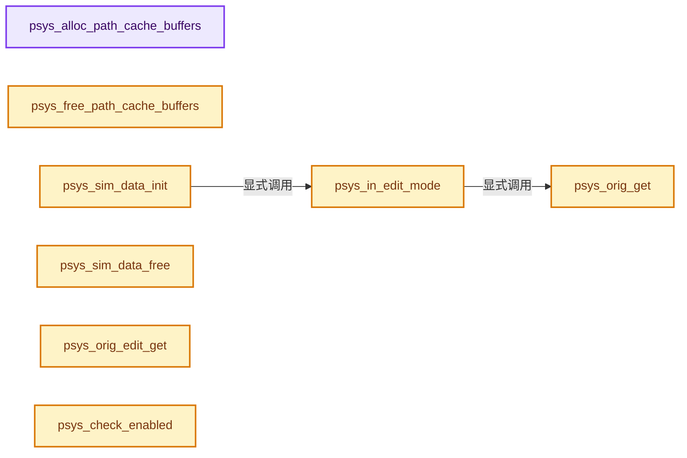
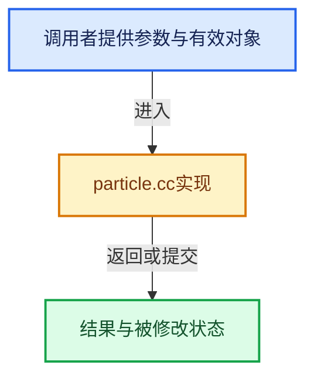

# 实现依赖专题：source/blender/blenkernel/intern/particle.cc

[实现依赖导航](../../README.md) · [符号索引](../../../00-课程指南/02-源码与提交索引/符号依赖与实现索引.md)

本专题从正文实际调用进入，集中保存共享实现。函数有稳定锚点，可从调用处直接跳到对应完整函数；递归与互相调用通过回链组织。

## 本文件的实现关系






<a id="m-c71c47cf018d"></a>

## 宏 `SET_PARTICLE_TEXTURE`

<!-- annotated:4be2692e10751a -->

```cpp
#define SET_PARTICLE_TEXTURE(type, pvalue, texfac) \
  if ((event & mtex->mapto) & type) { \
    pvalue = texture_value_blend(def, pvalue, value, texfac, blend); \
  } \
  (void)0

```

<details>
<summary>核对原始源码：source/blender/blenkernel/intern/particle.cc · L4225—L4230</summary>

<!-- original:4be2692e10751a:source/blender/blenkernel/intern/particle.cc:4225:4230 -->

```cpp
#define SET_PARTICLE_TEXTURE(type, pvalue, texfac) \
  if ((event & mtex->mapto) & type) { \
    pvalue = texture_value_blend(def, pvalue, value, texfac, blend); \
  } \
  (void)0

```

</details>

宏在预处理阶段展开，参数替换、重复求值和条件编译应直接从该定义检查。与普通函数不同，宏不会自动提供参数类型检查；构建配置选择哪个定义需结合外围条件。

<a id="m-1f266d49f5ca"></a>

## 宏 `CLAMP_PARTICLE_TEXTURE_POS`

<!-- annotated:1c215aabd93549 -->

```cpp
#define CLAMP_PARTICLE_TEXTURE_POS(type, pvalue) \
  if (event & type) { \
    CLAMP(pvalue, 0.0f, 1.0f); \
  } \
  (void)0

```

<details>
<summary>核对原始源码：source/blender/blenkernel/intern/particle.cc · L4231—L4236</summary>

<!-- original:1c215aabd93549:source/blender/blenkernel/intern/particle.cc:4231:4236 -->

```cpp
#define CLAMP_PARTICLE_TEXTURE_POS(type, pvalue) \
  if (event & type) { \
    CLAMP(pvalue, 0.0f, 1.0f); \
  } \
  (void)0

```

</details>

宏在预处理阶段展开，参数替换、重复求值和条件编译应直接从该定义检查。与普通函数不同，宏不会自动提供参数类型检查；构建配置选择哪个定义需结合外围条件。

<a id="m-8343f4fe065e"></a>

## 宏 `CLAMP_WARP_PARTICLE_TEXTURE_POS`

<!-- annotated:9187100c932bb8 -->

```cpp
#define CLAMP_WARP_PARTICLE_TEXTURE_POS(type, pvalue) \
  if (event & type) { \
    if (pvalue < 0.0f) { \
      pvalue = 1.0f + pvalue; \
    } \
    CLAMP(pvalue, 0.0f, 1.0f); \
  } \
  (void)0

```

<details>
<summary>核对原始源码：source/blender/blenkernel/intern/particle.cc · L4237—L4245</summary>

<!-- original:9187100c932bb8:source/blender/blenkernel/intern/particle.cc:4237:4245 -->

```cpp
#define CLAMP_WARP_PARTICLE_TEXTURE_POS(type, pvalue) \
  if (event & type) { \
    if (pvalue < 0.0f) { \
      pvalue = 1.0f + pvalue; \
    } \
    CLAMP(pvalue, 0.0f, 1.0f); \
  } \
  (void)0

```

</details>

宏在预处理阶段展开，参数替换、重复求值和条件编译应直接从该定义检查。与普通函数不同，宏不会自动提供参数类型检查；构建配置选择哪个定义需结合外围条件。

<a id="m-36393849b69b"></a>

## 宏 `CLAMP_PARTICLE_TEXTURE_POSNEG`

<!-- annotated:efe8f6d2b06b79 -->

```cpp
#define CLAMP_PARTICLE_TEXTURE_POSNEG(type, pvalue) \
  if (event & type) { \
    CLAMP(pvalue, -1.0f, 1.0f); \
  } \
  (void)0

```

<details>
<summary>核对原始源码：source/blender/blenkernel/intern/particle.cc · L4246—L4251</summary>

<!-- original:efe8f6d2b06b79:source/blender/blenkernel/intern/particle.cc:4246:4251 -->

```cpp
#define CLAMP_PARTICLE_TEXTURE_POSNEG(type, pvalue) \
  if (event & type) { \
    CLAMP(pvalue, -1.0f, 1.0f); \
  } \
  (void)0

```

</details>

宏在预处理阶段展开，参数替换、重复求值和条件编译应直接从该定义检查。与普通函数不同，宏不会自动提供参数类型检查；构建配置选择哪个定义需结合外围条件。

## 完整成员与函数实现

<a id="f-c5ea9cd204ba6b23"></a>

### `psys_alloc_path_cache_buffers`

实现位置：[source/blender/blenkernel/intern/particle.cc](../../../../../../../source/blender/blenkernel/intern/particle.cc) · L493—L520。

接口参数：

- `ListBaseT<LinkData> *bufs`
- `int tot`
- `int totkeys`

**教学注释版**

<!-- annotated:46734b72b82625 -->

```cpp
static ParticleCacheKey **psys_alloc_path_cache_buffers(ListBaseT<LinkData> *bufs,
                                                        int tot,
                                                        int totkeys)
{
  LinkData *buf;
  ParticleCacheKey **cache;
  int i, totkey, totbufkey;

  // [讲解] std::max：按比较关系选取较大值。本讲解中的增长公式同时满足最低请求和几何增长；若保存返回引用，还需注意实参寿命。
  tot = std::max(tot, 1);
  totkey = 0;
  cache = MEM_new_array_zeroed<ParticleCacheKey *>(tot, "PathCacheArray");

  while (totkey < tot) {
    // [讲解] std::min：按比较关系选取较小值；截断范围时还需先满足非负和可表示范围，min本身不会证明边界安全。
    totbufkey = std::min(tot - totkey, PATH_CACHE_BUF_SIZE);
    buf = MEM_new_zeroed<LinkData>("PathCacheLinkData");
    buf->data = MEM_new_array_zeroed<ParticleCacheKey>(size_t(totbufkey) * size_t(totkeys),
                                                       "ParticleCacheKey");

    for (i = 0; i < totbufkey; i++) {
      cache[totkey + i] = (static_cast<ParticleCacheKey *>(buf->data)) + i * totkeys;
    }

    totkey += totbufkey;
    BLI_addtail(bufs, buf);
  }

  return cache;
}
```

<details>
<summary>核对原始源码：source/blender/blenkernel/intern/particle.cc · L493—L520</summary>

<!-- original:46734b72b82625:source/blender/blenkernel/intern/particle.cc:493:520 -->

```cpp
static ParticleCacheKey **psys_alloc_path_cache_buffers(ListBaseT<LinkData> *bufs,
                                                        int tot,
                                                        int totkeys)
{
  LinkData *buf;
  ParticleCacheKey **cache;
  int i, totkey, totbufkey;

  tot = std::max(tot, 1);
  totkey = 0;
  cache = MEM_new_array_zeroed<ParticleCacheKey *>(tot, "PathCacheArray");

  while (totkey < tot) {
    totbufkey = std::min(tot - totkey, PATH_CACHE_BUF_SIZE);
    buf = MEM_new_zeroed<LinkData>("PathCacheLinkData");
    buf->data = MEM_new_array_zeroed<ParticleCacheKey>(size_t(totbufkey) * size_t(totkeys),
                                                       "ParticleCacheKey");

    for (i = 0; i < totbufkey; i++) {
      cache[totkey + i] = (static_cast<ParticleCacheKey *>(buf->data)) + i * totkeys;
    }

    totkey += totbufkey;
    BLI_addtail(bufs, buf);
  }

  return cache;
}
```

</details>

**沿实际写入检查状态**

- `tot = std::max(tot, 1);`
- `totkey = 0;`
- `cache = MEM_new_array_zeroed<ParticleCacheKey *>(tot, "PathCacheArray");`
- `totbufkey = std::min(tot - totkey, PATH_CACHE_BUF_SIZE);`
- `buf = MEM_new_zeroed<LinkData>("PathCacheLinkData");`
- `buf->data = MEM_new_array_zeroed<ParticleCacheKey>(size_t(totbufkey) * size_t(totkeys),`
- `totkey += totbufkey;`

**结果出口**

- `return cache;`

**继续追踪实现**

- `std::max` → [外部契约](https://eel.is/c++draft/alg.min.max)：按比较关系选取较大值。本讲解中的增长公式同时满足最低请求和几何增长；若保存返回引用，还需注意实参寿命。
- `MEM_new_array_zeroed<ParticleCacheKey *>` → [MEM_new_array_zeroed · L566](../../07-Intern运行时与平台/guardedalloc/MEM_guardedalloc.h.md#f-3a0cf63fb5216500)；[MEM_new_array_zeroed · L119](../../07-Intern运行时与平台/guardedalloc/intern/mallocn.cc.md#f-6825557da566fdbe)。同名重载需按实参类型选择。
- `std::min` → [外部契约](https://eel.is/c++draft/alg.min.max)：按比较关系选取较小值；截断范围时还需先满足非负和可表示范围，min本身不会证明边界安全。
- `MEM_new_zeroed<LinkData>` → [MEM_new_zeroed · L550](../../07-Intern运行时与平台/guardedalloc/MEM_guardedalloc.h.md#f-eeb1e2a7f57dd231)；[MEM_new_zeroed · L114](../../07-Intern运行时与平台/guardedalloc/intern/mallocn.cc.md#f-e04cf01c64c8b180)。同名重载需按实参类型选择。
- `MEM_new_array_zeroed<ParticleCacheKey>` → [MEM_new_array_zeroed · L566](../../07-Intern运行时与平台/guardedalloc/MEM_guardedalloc.h.md#f-3a0cf63fb5216500)；[MEM_new_array_zeroed · L119](../../07-Intern运行时与平台/guardedalloc/intern/mallocn.cc.md#f-6825557da566fdbe)。同名重载需按实参类型选择。
- `BLI_addtail` → [blender::BLI_addtail · L118](../../01-BLI基础库/intern/listbase.cc.md#f-4fb027713fa3115b)。

<a id="f-8be9e1c6a60da5ad"></a>

### `psys_free_path_cache_buffers`

实现位置：[source/blender/blenkernel/intern/particle.cc](../../../../../../../source/blender/blenkernel/intern/particle.cc) · L522—L532。

接口参数：

- `ParticleCacheKey **cache`
- `ListBaseT<LinkData> *bufs`

**教学注释版**

<!-- annotated:9d55447676b825 -->

```cpp
static void psys_free_path_cache_buffers(ParticleCacheKey **cache, ListBaseT<LinkData> *bufs)
{
  if (cache) {
    MEM_delete(cache);
  }

  for (LinkData &buf : *bufs) {
    MEM_delete(static_cast<ParticleCacheKey *>(buf.data));
  }
  bufs->free_no_destruct();
}
```

<details>
<summary>核对原始源码：source/blender/blenkernel/intern/particle.cc · L522—L532</summary>

<!-- original:9d55447676b825:source/blender/blenkernel/intern/particle.cc:522:532 -->

```cpp
static void psys_free_path_cache_buffers(ParticleCacheKey **cache, ListBaseT<LinkData> *bufs)
{
  if (cache) {
    MEM_delete(cache);
  }

  for (LinkData &buf : *bufs) {
    MEM_delete(static_cast<ParticleCacheKey *>(buf.data));
  }
  bufs->free_no_destruct();
}
```

</details>

**继续追踪实现**

- `MEM_delete` → [MEM_delete · L400](../../07-Intern运行时与平台/guardedalloc/MEM_guardedalloc.h.md#f-9049ffdd1682887c)。
- `bufs->free_no_destruct` → [blender::ListBaseT::free_no_destruct · L78](../../08-其他Blender模块/makesdna/DNA_listBase.h.md#f-8656670edd0f6b7e)。

<a id="f-872abe6c35893054"></a>

### `psys_sim_data_init`

实现位置：[source/blender/blenkernel/intern/particle.cc](../../../../../../../source/blender/blenkernel/intern/particle.cc) · L588—L627。

接口参数：

- `ParticleSimulationData *sim`

**教学注释版**

<!-- annotated:824ed564ae0b2e -->

```cpp
void psys_sim_data_init(ParticleSimulationData *sim)
{
  ParticleSystem *psys = sim->psys;
  ParticleSettings *part = psys->part;

  /* Prepare lattice deform. */
  psys->lattice_deform_data = nullptr;
  if (psys_in_edit_mode(sim->depsgraph, sim->psys) == 0) {
    Object *lattice = nullptr;
    ModifierData *md = reinterpret_cast<ModifierData *>(psys_get_modifier(sim->ob, sim->psys));
    bool for_render = DEG_get_mode(sim->depsgraph) == DAG_EVAL_RENDER;
    int mode = for_render ? eModifierMode_Render : eModifierMode_Realtime;

    for (; md; md = md->next) {
      if (md->type == eModifierType_Lattice) {
        if (md->mode & mode) {
          LatticeModifierData *lmd = reinterpret_cast<LatticeModifierData *>(md);
          lattice = lmd->object;
          psys->lattice_strength = lmd->strength;
        }

        break;
      }
    }
    if (lattice && lattice->type == OB_LATTICE) {
      psys->lattice_deform_data = BKE_lattice_deform_data_create(lattice, nullptr);
    }
  }

  /* Prepare curvemapping tables. */
  if ((part->child_flag & PART_CHILD_USE_CLUMP_CURVE) && part->clumpcurve) {
    BKE_curvemapping_init(part->clumpcurve);
  }
  if ((part->child_flag & PART_CHILD_USE_ROUGH_CURVE) && part->roughcurve) {
    BKE_curvemapping_init(part->roughcurve);
  }
  if ((part->child_flag & PART_CHILD_USE_TWIST_CURVE) && part->twistcurve) {
    BKE_curvemapping_init(part->twistcurve);
  }
}
```

<details>
<summary>核对原始源码：source/blender/blenkernel/intern/particle.cc · L588—L627</summary>

<!-- original:824ed564ae0b2e:source/blender/blenkernel/intern/particle.cc:588:627 -->

```cpp
void psys_sim_data_init(ParticleSimulationData *sim)
{
  ParticleSystem *psys = sim->psys;
  ParticleSettings *part = psys->part;

  /* Prepare lattice deform. */
  psys->lattice_deform_data = nullptr;
  if (psys_in_edit_mode(sim->depsgraph, sim->psys) == 0) {
    Object *lattice = nullptr;
    ModifierData *md = reinterpret_cast<ModifierData *>(psys_get_modifier(sim->ob, sim->psys));
    bool for_render = DEG_get_mode(sim->depsgraph) == DAG_EVAL_RENDER;
    int mode = for_render ? eModifierMode_Render : eModifierMode_Realtime;

    for (; md; md = md->next) {
      if (md->type == eModifierType_Lattice) {
        if (md->mode & mode) {
          LatticeModifierData *lmd = reinterpret_cast<LatticeModifierData *>(md);
          lattice = lmd->object;
          psys->lattice_strength = lmd->strength;
        }

        break;
      }
    }
    if (lattice && lattice->type == OB_LATTICE) {
      psys->lattice_deform_data = BKE_lattice_deform_data_create(lattice, nullptr);
    }
  }

  /* Prepare curvemapping tables. */
  if ((part->child_flag & PART_CHILD_USE_CLUMP_CURVE) && part->clumpcurve) {
    BKE_curvemapping_init(part->clumpcurve);
  }
  if ((part->child_flag & PART_CHILD_USE_ROUGH_CURVE) && part->roughcurve) {
    BKE_curvemapping_init(part->roughcurve);
  }
  if ((part->child_flag & PART_CHILD_USE_TWIST_CURVE) && part->twistcurve) {
    BKE_curvemapping_init(part->twistcurve);
  }
}
```

</details>

**沿实际写入检查状态**

- `psys->lattice_deform_data = nullptr;`
- `lattice = lmd->object;`
- `psys->lattice_strength = lmd->strength;`
- `psys->lattice_deform_data = BKE_lattice_deform_data_create(lattice, nullptr);`

**继续追踪实现**

- `psys_in_edit_mode` → [psys_in_edit_mode · L688](particle.cc.md#f-12f91aada00d3acc)。
- `psys_get_modifier` → [psys_get_modifier · L2157](particle.cc.md#f-5e2a73eb0484900c)。
- `DEG_get_mode` → [blender::DEG_get_mode · L99](../../06-Depsgraph依赖图/intern/depsgraph_query.cc.md#f-fa117f51322cd95c)。
- `BKE_lattice_deform_data_create` → [blender::BKE_lattice_deform_data_create · L59](lattice_deform.cc.md#f-931964727c2c33b2)。
- `BKE_curvemapping_init` → [blender::BKE_curvemapping_init · L1441](colortools.cc.md#f-f7d75fd7ad2a5ee6)。

<a id="f-6580337f40740928"></a>

### `psys_sim_data_free`

实现位置：[source/blender/blenkernel/intern/particle.cc](../../../../../../../source/blender/blenkernel/intern/particle.cc) · L629—L637。

接口参数：

- `ParticleSimulationData *sim`

**教学注释版**

<!-- annotated:c1e19091f97147 -->

```cpp
void psys_sim_data_free(ParticleSimulationData *sim)
{
  ParticleSystem *psys = sim->psys;

  if (psys->lattice_deform_data) {
    BKE_lattice_deform_data_destroy(psys->lattice_deform_data);
    psys->lattice_deform_data = nullptr;
  }
}
```

<details>
<summary>核对原始源码：source/blender/blenkernel/intern/particle.cc · L629—L637</summary>

<!-- original:c1e19091f97147:source/blender/blenkernel/intern/particle.cc:629:637 -->

```cpp
void psys_sim_data_free(ParticleSimulationData *sim)
{
  ParticleSystem *psys = sim->psys;

  if (psys->lattice_deform_data) {
    BKE_lattice_deform_data_destroy(psys->lattice_deform_data);
    psys->lattice_deform_data = nullptr;
  }
}
```

</details>

**沿实际写入检查状态**

- `psys->lattice_deform_data = nullptr;`

**继续追踪实现**

- `BKE_lattice_deform_data_destroy` → [blender::BKE_lattice_deform_data_destroy · L279](lattice_deform.cc.md#f-099172e0b236fb3c)。

<a id="f-f8f1f3b8cec95981"></a>

### `psys_orig_get`

实现位置：[source/blender/blenkernel/intern/particle.cc](../../../../../../../source/blender/blenkernel/intern/particle.cc) · L656—L662。

接口参数：

- `ParticleSystem *psys`

**教学注释版**

<!-- annotated:04250eeb5a08be -->

```cpp
ParticleSystem *psys_orig_get(ParticleSystem *psys)
{
  if (psys->orig_psys == nullptr) {
    return psys;
  }
  return psys->orig_psys;
}
```

<details>
<summary>核对原始源码：source/blender/blenkernel/intern/particle.cc · L656—L662</summary>

<!-- original:04250eeb5a08be:source/blender/blenkernel/intern/particle.cc:656:662 -->

```cpp
ParticleSystem *psys_orig_get(ParticleSystem *psys)
{
  if (psys->orig_psys == nullptr) {
    return psys;
  }
  return psys->orig_psys;
}
```

</details>

**结果出口**

- `return psys;`
- `return psys->orig_psys;`

**继续追踪实现**

本实现没有需要继续展开的显式调用；检查返回表达式、对象转换和调用者前置条件。

<a id="f-d75c91b906203796"></a>

### `psys_orig_edit_get`

实现位置：[source/blender/blenkernel/intern/particle.cc](../../../../../../../source/blender/blenkernel/intern/particle.cc) · L680—L686。

接口参数：

- `ParticleSystem *psys`

**教学注释版**

<!-- annotated:3b8fbfd27cdeb1 -->

```cpp
static PTCacheEdit *psys_orig_edit_get(ParticleSystem *psys)
{
  if (psys->orig_psys == nullptr) {
    return psys->edit;
  }
  return psys->orig_psys->edit;
}
```

<details>
<summary>核对原始源码：source/blender/blenkernel/intern/particle.cc · L680—L686</summary>

<!-- original:3b8fbfd27cdeb1:source/blender/blenkernel/intern/particle.cc:680:686 -->

```cpp
static PTCacheEdit *psys_orig_edit_get(ParticleSystem *psys)
{
  if (psys->orig_psys == nullptr) {
    return psys->edit;
  }
  return psys->orig_psys->edit;
}
```

</details>

**结果出口**

- `return psys->edit;`
- `return psys->orig_psys->edit;`

**继续追踪实现**

本实现没有需要继续展开的显式调用；检查返回表达式、对象转换和调用者前置条件。

<a id="f-12f91aada00d3acc"></a>

### `psys_in_edit_mode`

实现位置：[source/blender/blenkernel/intern/particle.cc](../../../../../../../source/blender/blenkernel/intern/particle.cc) · L688—L704。

接口参数：

- `Depsgraph *depsgraph`
- `const ParticleSystem *psys`

**教学注释版**

<!-- annotated:29c301c7baa8fa -->

```cpp
bool psys_in_edit_mode(Depsgraph *depsgraph, const ParticleSystem *psys)
{
  const Scene *scene = DEG_get_input_scene(depsgraph);
  ViewLayer *view_layer = DEG_get_input_view_layer(depsgraph);
  BKE_view_layer_synced_ensure(*DEG_get_bmain(depsgraph), scene, view_layer);
  const Object *object = BKE_view_layer_active_object_get(view_layer);
  if (object == nullptr) {
    /* TODO(sergey): Needs double-check with multi-object edit. */
    return false;
  }
  const bool use_render_params = (DEG_get_mode(depsgraph) == DAG_EVAL_RENDER);
  if (object->mode != OB_MODE_PARTICLE_EDIT) {
    return false;
  }
  const ParticleSystem *psys_orig = psys_orig_get(const_cast<ParticleSystem *>(psys));
  return (psys_orig->edit || psys->pointcache->edit) && (use_render_params == false);
}
```

<details>
<summary>核对原始源码：source/blender/blenkernel/intern/particle.cc · L688—L704</summary>

<!-- original:29c301c7baa8fa:source/blender/blenkernel/intern/particle.cc:688:704 -->

```cpp
bool psys_in_edit_mode(Depsgraph *depsgraph, const ParticleSystem *psys)
{
  const Scene *scene = DEG_get_input_scene(depsgraph);
  ViewLayer *view_layer = DEG_get_input_view_layer(depsgraph);
  BKE_view_layer_synced_ensure(*DEG_get_bmain(depsgraph), scene, view_layer);
  const Object *object = BKE_view_layer_active_object_get(view_layer);
  if (object == nullptr) {
    /* TODO(sergey): Needs double-check with multi-object edit. */
    return false;
  }
  const bool use_render_params = (DEG_get_mode(depsgraph) == DAG_EVAL_RENDER);
  if (object->mode != OB_MODE_PARTICLE_EDIT) {
    return false;
  }
  const ParticleSystem *psys_orig = psys_orig_get(const_cast<ParticleSystem *>(psys));
  return (psys_orig->edit || psys->pointcache->edit) && (use_render_params == false);
}
```

</details>

**结果出口**

- `return false;`
- `return (psys_orig->edit || psys->pointcache->edit) && (use_render_params == false);`

**继续追踪实现**

- `DEG_get_input_scene` → [blender::DEG_get_input_scene · L81](../../06-Depsgraph依赖图/intern/depsgraph_query.cc.md#f-674b6004195dc1ed)。
- `DEG_get_input_view_layer` → [blender::DEG_get_input_view_layer · L87](../../06-Depsgraph依赖图/intern/depsgraph_query.cc.md#f-ee9cdeb518197b8c)。
- `BKE_view_layer_synced_ensure` → [blender::BKE_view_layer_synced_ensure · L1035](layer.cc.md#f-602c088654ebcb63)。
- `DEG_get_bmain` → [blender::DEG_get_bmain · L93](../../06-Depsgraph依赖图/intern/depsgraph_query.cc.md#f-9dfed3e433db8080)。
- `BKE_view_layer_active_object_get` → [blender::BKE_view_layer_active_object_get · L286](layer_utils.cc.md#f-aa39df7416329726)。
- `DEG_get_mode` → [blender::DEG_get_mode · L99](../../06-Depsgraph依赖图/intern/depsgraph_query.cc.md#f-fa117f51322cd95c)。
- `psys_orig_get` → [psys_orig_get · L656](particle.cc.md#f-f8f1f3b8cec95981)。

<a id="f-ecccf7e9e00a9741"></a>

### `psys_check_enabled`

实现位置：[source/blender/blenkernel/intern/particle.cc](../../../../../../../source/blender/blenkernel/intern/particle.cc) · L706—L730。

接口参数：

- `Object *ob`
- `ParticleSystem *psys`
- `const bool use_render_params`

**教学注释版**

<!-- annotated:884c0f792c7d8e -->

```cpp
bool psys_check_enabled(Object *ob, ParticleSystem *psys, const bool use_render_params)
{
  ParticleSystemModifierData *psmd;

  if (psys->flag & PSYS_DISABLED || psys->flag & PSYS_DELETE || !psys->part) {
    return false;
  }

  psmd = psys_get_modifier(ob, psys);

  if (!psmd) {
    return false;
  }

  if (use_render_params) {
    if (!(psmd->modifier.mode & eModifierMode_Render)) {
      return false;
    }
  }
  else if (!(psmd->modifier.mode & eModifierMode_Realtime)) {
    return false;
  }

  return true;
}
```

<details>
<summary>核对原始源码：source/blender/blenkernel/intern/particle.cc · L706—L730</summary>

<!-- original:884c0f792c7d8e:source/blender/blenkernel/intern/particle.cc:706:730 -->

```cpp
bool psys_check_enabled(Object *ob, ParticleSystem *psys, const bool use_render_params)
{
  ParticleSystemModifierData *psmd;

  if (psys->flag & PSYS_DISABLED || psys->flag & PSYS_DELETE || !psys->part) {
    return false;
  }

  psmd = psys_get_modifier(ob, psys);

  if (!psmd) {
    return false;
  }

  if (use_render_params) {
    if (!(psmd->modifier.mode & eModifierMode_Render)) {
      return false;
    }
  }
  else if (!(psmd->modifier.mode & eModifierMode_Realtime)) {
    return false;
  }

  return true;
}
```

</details>

**沿实际写入检查状态**

- `psmd = psys_get_modifier(ob, psys);`

**结果出口**

- `return false;`
- `return true;`

**继续追踪实现**

- `psys_get_modifier` → [psys_get_modifier · L2157](particle.cc.md#f-5e2a73eb0484900c)。

<a id="f-54d6d67b32c31ca0"></a>

### `free_hair`

实现位置：[source/blender/blenkernel/intern/particle.cc](../../../../../../../source/blender/blenkernel/intern/particle.cc) · L844—L852。

接口参数：

- `Object *object`
- `ParticleSystem *psys`
- `int dynamics`

**教学注释版**

<!-- annotated:842c5f719f393b -->

```cpp
void free_hair(Object *object, ParticleSystem *psys, int dynamics)
{
  PARTICLE_P;

  LOOP_PARTICLES
  {
    MEM_SAFE_DELETE(pa->hair);
    pa->totkey = 0;
  }
```

<details>
<summary>核对原始源码：source/blender/blenkernel/intern/particle.cc · L844—L852</summary>

<!-- original:842c5f719f393b:source/blender/blenkernel/intern/particle.cc:844:852 -->

```cpp
void free_hair(Object *object, ParticleSystem *psys, int dynamics)
{
  PARTICLE_P;

  LOOP_PARTICLES
  {
    MEM_SAFE_DELETE(pa->hair);
    pa->totkey = 0;
  }
```

</details>

**沿实际写入检查状态**

- `pa->totkey = 0;`

**继续追踪实现**

- `MEM_SAFE_DELETE` → [MEM_SAFE_DELETE · L436](../../07-Intern运行时与平台/guardedalloc/MEM_guardedalloc.h.md#m-eadb3bc5b902)。宏定义由构建条件选择。

<a id="f-8d44bab4c528b89f"></a>

### `free_keyed_keys`

实现位置：[source/blender/blenkernel/intern/particle.cc](../../../../../../../source/blender/blenkernel/intern/particle.cc) · L879—L898。

接口参数：

- `ParticleSystem *psys`

**教学注释版**

<!-- annotated:f13868f74e5979 -->

```cpp
void free_keyed_keys(ParticleSystem *psys)
{
  PARTICLE_P;

  if (psys->part->type == PART_HAIR) {
    return;
  }

  if (psys->particles && psys->particles->keys) {
    MEM_delete(psys->particles->keys);

    LOOP_PARTICLES
    {
      if (pa->keys) {
        pa->keys = nullptr;
        pa->totkey = 0;
      }
    }
  }
}
```

<details>
<summary>核对原始源码：source/blender/blenkernel/intern/particle.cc · L879—L898</summary>

<!-- original:f13868f74e5979:source/blender/blenkernel/intern/particle.cc:879:898 -->

```cpp
void free_keyed_keys(ParticleSystem *psys)
{
  PARTICLE_P;

  if (psys->part->type == PART_HAIR) {
    return;
  }

  if (psys->particles && psys->particles->keys) {
    MEM_delete(psys->particles->keys);

    LOOP_PARTICLES
    {
      if (pa->keys) {
        pa->keys = nullptr;
        pa->totkey = 0;
      }
    }
  }
}
```

</details>

**沿实际写入检查状态**

- `pa->keys = nullptr;`
- `pa->totkey = 0;`

**继续追踪实现**

- `MEM_delete` → [MEM_delete · L400](../../07-Intern运行时与平台/guardedalloc/MEM_guardedalloc.h.md#f-9049ffdd1682887c)。
- `if` → [if · L262](../../01-BLI基础库/tests/BLI_path_utils_test.cc.md#m-e5db1d122630)。宏定义由构建条件选择。

<a id="f-01bf94c432123ba4"></a>

### `free_child_path_cache`

实现位置：[source/blender/blenkernel/intern/particle.cc](../../../../../../../source/blender/blenkernel/intern/particle.cc) · L899—L904。

接口参数：

- `ParticleSystem *psys`

**教学注释版**

<!-- annotated:09a38e5d13536e -->

```cpp
static void free_child_path_cache(ParticleSystem *psys)
{
  psys_free_path_cache_buffers(psys->childcache, &psys->childcachebufs);
  psys->childcache = nullptr;
  psys->totchildcache = 0;
}
```

<details>
<summary>核对原始源码：source/blender/blenkernel/intern/particle.cc · L899—L904</summary>

<!-- original:09a38e5d13536e:source/blender/blenkernel/intern/particle.cc:899:904 -->

```cpp
static void free_child_path_cache(ParticleSystem *psys)
{
  psys_free_path_cache_buffers(psys->childcache, &psys->childcachebufs);
  psys->childcache = nullptr;
  psys->totchildcache = 0;
}
```

</details>

**沿实际写入检查状态**

- `psys->childcache = nullptr;`
- `psys->totchildcache = 0;`

**继续追踪实现**

- `psys_free_path_cache_buffers` → [psys_free_path_cache_buffers · L522](particle.cc.md#f-8be9e1c6a60da5ad)。

<a id="f-e6459bda678abcc9"></a>

### `psys_free_path_cache`

实现位置：[source/blender/blenkernel/intern/particle.cc](../../../../../../../source/blender/blenkernel/intern/particle.cc) · L905—L919。

接口参数：

- `ParticleSystem *psys`
- `PTCacheEdit *edit`

**教学注释版**

<!-- annotated:47b02c5f3e8b82 -->

```cpp
void psys_free_path_cache(ParticleSystem *psys, PTCacheEdit *edit)
{
  if (edit) {
    psys_free_path_cache_buffers(edit->pathcache, &edit->pathcachebufs);
    edit->pathcache = nullptr;
    edit->totcached = 0;
  }
  if (psys) {
    psys_free_path_cache_buffers(psys->pathcache, &psys->pathcachebufs);
    psys->pathcache = nullptr;
    psys->totcached = 0;

    free_child_path_cache(psys);
  }
}
```

<details>
<summary>核对原始源码：source/blender/blenkernel/intern/particle.cc · L905—L919</summary>

<!-- original:47b02c5f3e8b82:source/blender/blenkernel/intern/particle.cc:905:919 -->

```cpp
void psys_free_path_cache(ParticleSystem *psys, PTCacheEdit *edit)
{
  if (edit) {
    psys_free_path_cache_buffers(edit->pathcache, &edit->pathcachebufs);
    edit->pathcache = nullptr;
    edit->totcached = 0;
  }
  if (psys) {
    psys_free_path_cache_buffers(psys->pathcache, &psys->pathcachebufs);
    psys->pathcache = nullptr;
    psys->totcached = 0;

    free_child_path_cache(psys);
  }
}
```

</details>

**沿实际写入检查状态**

- `edit->pathcache = nullptr;`
- `edit->totcached = 0;`
- `psys->pathcache = nullptr;`
- `psys->totcached = 0;`

**继续追踪实现**

- `psys_free_path_cache_buffers` → [psys_free_path_cache_buffers · L522](particle.cc.md#f-8be9e1c6a60da5ad)。
- `free_child_path_cache` → [free_child_path_cache · L899](particle.cc.md#f-01bf94c432123ba4)。

<a id="f-3eb06bdd69e3f363"></a>

### `psys_free_children`

实现位置：[source/blender/blenkernel/intern/particle.cc](../../../../../../../source/blender/blenkernel/intern/particle.cc) · L920—L929。

接口参数：

- `ParticleSystem *psys`

**教学注释版**

<!-- annotated:5d80d2d099ec62 -->

```cpp
void psys_free_children(ParticleSystem *psys)
{
  if (psys->child) {
    MEM_delete(psys->child);
    psys->child = nullptr;
    psys->totchild = 0;
  }

  free_child_path_cache(psys);
}
```

<details>
<summary>核对原始源码：source/blender/blenkernel/intern/particle.cc · L920—L929</summary>

<!-- original:5d80d2d099ec62:source/blender/blenkernel/intern/particle.cc:920:929 -->

```cpp
void psys_free_children(ParticleSystem *psys)
{
  if (psys->child) {
    MEM_delete(psys->child);
    psys->child = nullptr;
    psys->totchild = 0;
  }

  free_child_path_cache(psys);
}
```

</details>

**沿实际写入检查状态**

- `psys->child = nullptr;`
- `psys->totchild = 0;`

**继续追踪实现**

- `MEM_delete` → [MEM_delete · L400](../../07-Intern运行时与平台/guardedalloc/MEM_guardedalloc.h.md#f-9049ffdd1682887c)。
- `free_child_path_cache` → [free_child_path_cache · L899](particle.cc.md#f-01bf94c432123ba4)。

<a id="f-3e3a1bd8e92e303b"></a>

### `psys_free_particles`

实现位置：[source/blender/blenkernel/intern/particle.cc](../../../../../../../source/blender/blenkernel/intern/particle.cc) · L930—L959。

接口参数：

- `ParticleSystem *psys`

**教学注释版**

<!-- annotated:4314da0bd0b7a2 -->

```cpp
void psys_free_particles(ParticleSystem *psys)
{
  PARTICLE_P;

  if (psys->particles) {
    /* Even though psys->part should never be nullptr,
     * this can happen as an exception during deletion.
     * See ID_REMAP_SKIP/FORCE/FLAG_NEVER_NULL_USAGE in BKE_library_remap. */
    if (psys->part && psys->part->type == PART_HAIR) {
      LOOP_PARTICLES
      {
        if (pa->hair) {
          MEM_delete(pa->hair);
        }
      }
    }

    if (psys->particles->keys) {
      MEM_delete(psys->particles->keys);
    }

    if (psys->particles->boid) {
      MEM_delete(psys->particles->boid);
    }

    MEM_delete(psys->particles);
    psys->particles = nullptr;
    psys->totpart = 0;
  }
}
```

<details>
<summary>核对原始源码：source/blender/blenkernel/intern/particle.cc · L930—L959</summary>

<!-- original:4314da0bd0b7a2:source/blender/blenkernel/intern/particle.cc:930:959 -->

```cpp
void psys_free_particles(ParticleSystem *psys)
{
  PARTICLE_P;

  if (psys->particles) {
    /* Even though psys->part should never be nullptr,
     * this can happen as an exception during deletion.
     * See ID_REMAP_SKIP/FORCE/FLAG_NEVER_NULL_USAGE in BKE_library_remap. */
    if (psys->part && psys->part->type == PART_HAIR) {
      LOOP_PARTICLES
      {
        if (pa->hair) {
          MEM_delete(pa->hair);
        }
      }
    }

    if (psys->particles->keys) {
      MEM_delete(psys->particles->keys);
    }

    if (psys->particles->boid) {
      MEM_delete(psys->particles->boid);
    }

    MEM_delete(psys->particles);
    psys->particles = nullptr;
    psys->totpart = 0;
  }
}
```

</details>

**沿实际写入检查状态**

- `psys->particles = nullptr;`
- `psys->totpart = 0;`

**继续追踪实现**

- `if` → [if · L262](../../01-BLI基础库/tests/BLI_path_utils_test.cc.md#m-e5db1d122630)。宏定义由构建条件选择。
- `MEM_delete` → [MEM_delete · L400](../../07-Intern运行时与平台/guardedalloc/MEM_guardedalloc.h.md#f-9049ffdd1682887c)。

<a id="f-61a7250c950df4c1"></a>

### `psys_free_pdd`

实现位置：[source/blender/blenkernel/intern/particle.cc](../../../../../../../source/blender/blenkernel/intern/particle.cc) · L960—L975。

接口参数：

- `ParticleSystem *psys`

**教学注释版**

<!-- annotated:c572ec7b01092b -->

```cpp
void psys_free_pdd(ParticleSystem *psys)
{
  if (psys->pdd) {
    MEM_SAFE_DELETE(psys->pdd->cdata);

    MEM_SAFE_DELETE(psys->pdd->vdata);

    MEM_SAFE_DELETE(psys->pdd->ndata);

    MEM_SAFE_DELETE(psys->pdd->vedata);

    psys->pdd->totpoint = 0;
    psys->pdd->totpart = 0;
    psys->pdd->partsize = 0;
  }
}
```

<details>
<summary>核对原始源码：source/blender/blenkernel/intern/particle.cc · L960—L975</summary>

<!-- original:c572ec7b01092b:source/blender/blenkernel/intern/particle.cc:960:975 -->

```cpp
void psys_free_pdd(ParticleSystem *psys)
{
  if (psys->pdd) {
    MEM_SAFE_DELETE(psys->pdd->cdata);

    MEM_SAFE_DELETE(psys->pdd->vdata);

    MEM_SAFE_DELETE(psys->pdd->ndata);

    MEM_SAFE_DELETE(psys->pdd->vedata);

    psys->pdd->totpoint = 0;
    psys->pdd->totpart = 0;
    psys->pdd->partsize = 0;
  }
}
```

</details>

**沿实际写入检查状态**

- `psys->pdd->totpoint = 0;`
- `psys->pdd->totpart = 0;`
- `psys->pdd->partsize = 0;`

**继续追踪实现**

- `MEM_SAFE_DELETE` → [MEM_SAFE_DELETE · L436](../../07-Intern运行时与平台/guardedalloc/MEM_guardedalloc.h.md#m-eadb3bc5b902)。宏定义由构建条件选择。

<a id="f-1397714583dd4087"></a>

### `psys_free`

实现位置：[source/blender/blenkernel/intern/particle.cc](../../../../../../../source/blender/blenkernel/intern/particle.cc) · L976—L1052。

接口参数：

- `Object *ob`
- `ParticleSystem *psys`

**教学注释版**

<!-- annotated:aafbce10307fcd -->

```cpp
void psys_free(Object *ob, ParticleSystem *psys)
{
  if (psys) {
    int nr = 0;

    psys_free_path_cache(psys, nullptr);

    /* NOTE: We pass dynamics=0 to free_hair() to prevent it from doing an
     * unneeded clear of the cache. But for historical reason that code path
     * was only clearing cloth part of modifier data.
     *
     * Part of the story there is that particle evaluation is trying to not
     * re-allocate thew ModifierData itself, and limits all allocations to
     * the cloth part of it.
     *
     * Why evaluation is relying on hair_free() and in some specific code
     * paths there is beyond me.
     */
    free_hair(ob, psys, 0);
    if (psys->clmd != nullptr) {
      BKE_modifier_free(reinterpret_cast<ModifierData *>(psys->clmd));
    }

    psys_free_particles(psys);

    if (psys->edit && psys->free_edit) {
      psys->free_edit(psys->edit);
    }

    if (psys->child) {
      MEM_delete(psys->child);
      psys->child = nullptr;
      psys->totchild = 0;
    }

    /* check if we are last non-visible particle system */
    for (ParticleSystem &tpsys : ob->particlesystem) {
      if (tpsys.part) {
        if (ELEM(tpsys.part->ren_as, PART_DRAW_OB, PART_DRAW_GR)) {
          nr++;
          break;
        }
      }
    }
    /* clear do-not-draw-flag */
    if (!nr) {
      ob->transflag &= ~OB_DUPLIPARTS;
    }

    psys->part = nullptr;

    if ((psys->flag & PSYS_SHARED_CACHES) == 0) {
      BKE_ptcache_free_list(&psys->ptcaches);
    }
    psys->pointcache = nullptr;

    psys->targets.free_no_destruct();

    BLI_bvhtree_free(psys->bvhtree);
    kdtree_free<float3>(psys->tree);

    if (psys->fluid_springs) {
      MEM_delete(psys->fluid_springs);
    }

    BKE_effectors_free(psys->effectors);

    if (psys->pdd) {
      psys_free_pdd(psys);
      MEM_delete(psys->pdd);
    }

    BKE_particle_batch_cache_free(psys);

    MEM_delete(psys);
  }
}
```

<details>
<summary>核对原始源码：source/blender/blenkernel/intern/particle.cc · L976—L1052</summary>

<!-- original:aafbce10307fcd:source/blender/blenkernel/intern/particle.cc:976:1052 -->

```cpp
void psys_free(Object *ob, ParticleSystem *psys)
{
  if (psys) {
    int nr = 0;

    psys_free_path_cache(psys, nullptr);

    /* NOTE: We pass dynamics=0 to free_hair() to prevent it from doing an
     * unneeded clear of the cache. But for historical reason that code path
     * was only clearing cloth part of modifier data.
     *
     * Part of the story there is that particle evaluation is trying to not
     * re-allocate thew ModifierData itself, and limits all allocations to
     * the cloth part of it.
     *
     * Why evaluation is relying on hair_free() and in some specific code
     * paths there is beyond me.
     */
    free_hair(ob, psys, 0);
    if (psys->clmd != nullptr) {
      BKE_modifier_free(reinterpret_cast<ModifierData *>(psys->clmd));
    }

    psys_free_particles(psys);

    if (psys->edit && psys->free_edit) {
      psys->free_edit(psys->edit);
    }

    if (psys->child) {
      MEM_delete(psys->child);
      psys->child = nullptr;
      psys->totchild = 0;
    }

    /* check if we are last non-visible particle system */
    for (ParticleSystem &tpsys : ob->particlesystem) {
      if (tpsys.part) {
        if (ELEM(tpsys.part->ren_as, PART_DRAW_OB, PART_DRAW_GR)) {
          nr++;
          break;
        }
      }
    }
    /* clear do-not-draw-flag */
    if (!nr) {
      ob->transflag &= ~OB_DUPLIPARTS;
    }

    psys->part = nullptr;

    if ((psys->flag & PSYS_SHARED_CACHES) == 0) {
      BKE_ptcache_free_list(&psys->ptcaches);
    }
    psys->pointcache = nullptr;

    psys->targets.free_no_destruct();

    BLI_bvhtree_free(psys->bvhtree);
    kdtree_free<float3>(psys->tree);

    if (psys->fluid_springs) {
      MEM_delete(psys->fluid_springs);
    }

    BKE_effectors_free(psys->effectors);

    if (psys->pdd) {
      psys_free_pdd(psys);
      MEM_delete(psys->pdd);
    }

    BKE_particle_batch_cache_free(psys);

    MEM_delete(psys);
  }
}
```

</details>

**沿实际写入检查状态**

- `psys->child = nullptr;`
- `psys->totchild = 0;`
- `ob->transflag &= ~OB_DUPLIPARTS;`
- `psys->part = nullptr;`
- `psys->pointcache = nullptr;`

**继续追踪实现**

- `psys_free_path_cache` → [psys_free_path_cache · L905](particle.cc.md#f-e6459bda678abcc9)。
- `free_hair` → [free_hair · L844](particle.cc.md#f-54d6d67b32c31ca0)。
- `BKE_modifier_free` → [blender::BKE_modifier_free · L209](modifier.cc.md#f-20e0a8c815d6dfe5)。
- `psys_free_particles` → [psys_free_particles · L930](particle.cc.md#f-3e3a1bd8e92e303b)。
- `psys->free_edit` → [调用协议](../../../00-课程指南/01-路线与规范/模板宏与动态分派协议.md)：由接收对象具体类型或运行时策略提供实现。调用位置L1002。
- `MEM_delete` → [MEM_delete · L400](../../07-Intern运行时与平台/guardedalloc/MEM_guardedalloc.h.md#f-9049ffdd1682887c)。
- `ELEM` → [ELEM · L88](../../07-Intern运行时与平台/ghost/intern/GHOST_utildefines.hh.md#m-d28724a15928)；[ELEM · L135](../../01-BLI基础库/BLI_utildefines.hh.md#m-d6572de7cae0)。宏定义由构建条件选择。
- `BKE_ptcache_free_list` → [blender::BKE_ptcache_free_list · L2984](pointcache.cc.md#f-991629cc4fbaa5d7)。
- `psys->targets.free_no_destruct` → [调用协议](../../../00-课程指南/01-路线与规范/模板宏与动态分派协议.md)：接收对象类型依赖auto、返回值或模板实例；不按同名猜测目标。调用位置L1032。
- `BLI_bvhtree_free` → [blender::BLI_bvhtree_free · L935](../../01-BLI基础库/intern/BLI_kdopbvh.cc.md#f-7dcbdb0a7d2476fe)。
- `kdtree_free<float3>` → [blender::kdtree_free · L84](../../01-BLI基础库/BLI_kdtree.hh.md#f-29e79484de22f4be)。
- `BKE_effectors_free` → [blender::BKE_effectors_free · L371](effect.cc.md#f-f2d6b72c063db590)。
- `psys_free_pdd` → [psys_free_pdd · L960](particle.cc.md#f-61a7250c950df4c1)。
- `BKE_particle_batch_cache_free` → [BKE_particle_batch_cache_free · L5553](particle.cc.md#f-4c8b19980b887812)。

<a id="f-a146be1c246e8f69"></a>

### `interpolate_particle_value`

实现位置：[source/blender/blenkernel/intern/particle.cc](../../../../../../../source/blender/blenkernel/intern/particle.cc) · L1125—L1138。

接口参数：

- `float v1`
- `float v2`
- `float v3`
- `float v4`
- `const float w[4]`
- `int four`

**教学注释版**

<!-- annotated:f0a1aa7928b3eb -->

```cpp
static float interpolate_particle_value(
    float v1, float v2, float v3, float v4, const float w[4], int four)
{
  float value;

  value = w[0] * v1 + w[1] * v2 + w[2] * v3;
  if (four) {
    value += w[3] * v4;
  }

  CLAMP(value, 0.0f, 1.0f);

  return value;
}
```

<details>
<summary>核对原始源码：source/blender/blenkernel/intern/particle.cc · L1125—L1138</summary>

<!-- original:f0a1aa7928b3eb:source/blender/blenkernel/intern/particle.cc:1125:1138 -->

```cpp
static float interpolate_particle_value(
    float v1, float v2, float v3, float v4, const float w[4], int four)
{
  float value;

  value = w[0] * v1 + w[1] * v2 + w[2] * v3;
  if (four) {
    value += w[3] * v4;
  }

  CLAMP(value, 0.0f, 1.0f);

  return value;
}
```

</details>

**沿实际写入检查状态**

- `value = w[0] * v1 + w[1] * v2 + w[2] * v3;`
- `value += w[3] * v4;`

**结果出口**

- `return value;`

**继续追踪实现**

- `CLAMP` → [CLAMP · L200](../../01-BLI基础库/BLI_utildefines.hh.md#m-69703e497120)。宏定义由构建条件选择。

<a id="f-302c7ec844dbc217"></a>

### `psys_interpolate_particle`

实现位置：[source/blender/blenkernel/intern/particle.cc](../../../../../../../source/blender/blenkernel/intern/particle.cc) · L1140—L1168。

接口参数：

- `short type`
- `ParticleKey keys[4]`
- `float dt`
- `ParticleKey *result`
- `bool velocity`

**教学注释版**

<!-- annotated:4c75775847b80d -->

```cpp
void psys_interpolate_particle(
    short type, ParticleKey keys[4], float dt, ParticleKey *result, bool velocity)
{
  float t[4];

  if (type < 0) {
    interp_cubic_v3(result->co, result->vel, keys[1].co, keys[1].vel, keys[2].co, keys[2].vel, dt);
  }
  else {
    key_curve_position_weights(dt, t, KeyInterpolationType(type));

    interp_v3_v3v3v3v3(result->co, keys[0].co, keys[1].co, keys[2].co, keys[3].co, t);

    if (velocity) {
      float temp[3];

      if (dt > 0.999f) {
        key_curve_position_weights(dt - 0.001f, t, KeyInterpolationType(type));
        interp_v3_v3v3v3v3(temp, keys[0].co, keys[1].co, keys[2].co, keys[3].co, t);
        sub_v3_v3v3(result->vel, result->co, temp);
      }
      else {
        key_curve_position_weights(dt + 0.001f, t, KeyInterpolationType(type));
        interp_v3_v3v3v3v3(temp, keys[0].co, keys[1].co, keys[2].co, keys[3].co, t);
        sub_v3_v3v3(result->vel, temp, result->co);
      }
    }
  }
}
```

<details>
<summary>核对原始源码：source/blender/blenkernel/intern/particle.cc · L1140—L1168</summary>

<!-- original:4c75775847b80d:source/blender/blenkernel/intern/particle.cc:1140:1168 -->

```cpp
void psys_interpolate_particle(
    short type, ParticleKey keys[4], float dt, ParticleKey *result, bool velocity)
{
  float t[4];

  if (type < 0) {
    interp_cubic_v3(result->co, result->vel, keys[1].co, keys[1].vel, keys[2].co, keys[2].vel, dt);
  }
  else {
    key_curve_position_weights(dt, t, KeyInterpolationType(type));

    interp_v3_v3v3v3v3(result->co, keys[0].co, keys[1].co, keys[2].co, keys[3].co, t);

    if (velocity) {
      float temp[3];

      if (dt > 0.999f) {
        key_curve_position_weights(dt - 0.001f, t, KeyInterpolationType(type));
        interp_v3_v3v3v3v3(temp, keys[0].co, keys[1].co, keys[2].co, keys[3].co, t);
        sub_v3_v3v3(result->vel, result->co, temp);
      }
      else {
        key_curve_position_weights(dt + 0.001f, t, KeyInterpolationType(type));
        interp_v3_v3v3v3v3(temp, keys[0].co, keys[1].co, keys[2].co, keys[3].co, t);
        sub_v3_v3v3(result->vel, temp, result->co);
      }
    }
  }
}
```

</details>

**继续追踪实现**

- `interp_cubic_v3` → [blender::interp_cubic_v3 · L4447](../../01-BLI基础库/intern/math_geom.cc.md#f-f9cdbbabd24ee082)。
- `key_curve_position_weights` → [blender::key_curve_position_weights · L310](key.cc.md#f-afb0f795e30f80db)。
- `KeyInterpolationType` → [blender::KeyInterpolationType](../../08-其他Blender模块/makesdna/DNA_key_types.h.md#t-9992054eaf23)。
- `interp_v3_v3v3v3v3` → [blender::interp_v3_v3v3v3v3 · L132](../../01-BLI基础库/intern/math_vector.cc.md#f-44d0171aa9d69326)。
- `sub_v3_v3v3` → [blender::sub_v3_v3v3 · L360](../../01-BLI基础库/intern/math_vector_inline.cc.md#f-23781c252db8b30c)。

<a id="f-6967939709ee85bc"></a>

### `get_pointcache_keys_for_time`

实现位置：[source/blender/blenkernel/intern/particle.cc](../../../../../../../source/blender/blenkernel/intern/particle.cc) · L1196—L1246。

接口参数：

- `Object *`
- `PointCache *cache`
- `PTCacheMem **cur`
- `int index`
- `float t`
- `ParticleKey *key1`
- `ParticleKey *key2`

**教学注释版**

<!-- annotated:d861b5dfd0dd74 -->

```cpp
static void get_pointcache_keys_for_time(Object * /*ob*/,
                                         PointCache *cache,
                                         PTCacheMem **cur,
                                         int index,
                                         float t,
                                         ParticleKey *key1,
                                         ParticleKey *key2)
{
  static PTCacheMem *pm = nullptr;
  int index1, index2;

  if (index < 0) { /* initialize */
    *cur = cache->mem_cache.first();

    if (*cur) {
      *cur = (*cur)->next;
    }
  }
  else {
    if (*cur) {
      while (*cur && (*cur)->next && float((*cur)->frame) < t) {
        *cur = (*cur)->next;
      }

      pm = *cur;

      index2 = BKE_ptcache_mem_index_find(pm, index);
      index1 = BKE_ptcache_mem_index_find(pm->prev, index);
      if (index2 < 0) {
        return;
      }

      BKE_ptcache_make_particle_key(key2, index2, pm->data, float(pm->frame));
      if (index1 < 0) {
        copy_particle_key(key1, key2, 1);
      }
      else {
        BKE_ptcache_make_particle_key(key1, index1, pm->prev->data, float(pm->prev->frame));
      }
    }
    else if (cache->mem_cache.first()) {
      pm = cache->mem_cache.first();
      index2 = BKE_ptcache_mem_index_find(pm, index);
      if (index2 < 0) {
        return;
      }
      BKE_ptcache_make_particle_key(key2, index2, pm->data, float(pm->frame));
      copy_particle_key(key1, key2, 1);
    }
  }
}
```

<details>
<summary>核对原始源码：source/blender/blenkernel/intern/particle.cc · L1196—L1246</summary>

<!-- original:d861b5dfd0dd74:source/blender/blenkernel/intern/particle.cc:1196:1246 -->

```cpp
static void get_pointcache_keys_for_time(Object * /*ob*/,
                                         PointCache *cache,
                                         PTCacheMem **cur,
                                         int index,
                                         float t,
                                         ParticleKey *key1,
                                         ParticleKey *key2)
{
  static PTCacheMem *pm = nullptr;
  int index1, index2;

  if (index < 0) { /* initialize */
    *cur = cache->mem_cache.first();

    if (*cur) {
      *cur = (*cur)->next;
    }
  }
  else {
    if (*cur) {
      while (*cur && (*cur)->next && float((*cur)->frame) < t) {
        *cur = (*cur)->next;
      }

      pm = *cur;

      index2 = BKE_ptcache_mem_index_find(pm, index);
      index1 = BKE_ptcache_mem_index_find(pm->prev, index);
      if (index2 < 0) {
        return;
      }

      BKE_ptcache_make_particle_key(key2, index2, pm->data, float(pm->frame));
      if (index1 < 0) {
        copy_particle_key(key1, key2, 1);
      }
      else {
        BKE_ptcache_make_particle_key(key1, index1, pm->prev->data, float(pm->prev->frame));
      }
    }
    else if (cache->mem_cache.first()) {
      pm = cache->mem_cache.first();
      index2 = BKE_ptcache_mem_index_find(pm, index);
      if (index2 < 0) {
        return;
      }
      BKE_ptcache_make_particle_key(key2, index2, pm->data, float(pm->frame));
      copy_particle_key(key1, key2, 1);
    }
  }
}
```

</details>

**沿实际写入检查状态**

- `pm = *cur;`
- `index2 = BKE_ptcache_mem_index_find(pm, index);`
- `index1 = BKE_ptcache_mem_index_find(pm->prev, index);`
- `pm = cache->mem_cache.first();`

**继续追踪实现**

- `cache->mem_cache.first` → [调用协议](../../../00-课程指南/01-路线与规范/模板宏与动态分派协议.md)：接收对象类型依赖auto、返回值或模板实例；不按同名猜测目标。调用位置L1208。
- `BKE_ptcache_mem_index_find` → [blender::BKE_ptcache_mem_index_find · L1681](pointcache.cc.md#f-d0cdb41d2d9094b3)。
- `BKE_ptcache_make_particle_key` → [blender::BKE_ptcache_make_particle_key · L258](pointcache.cc.md#f-bbf294c8cf9cf71b)。
- `copy_particle_key` → [copy_particle_key · L3745](particle.cc.md#f-83b36ed62e3a76fd)。

<a id="f-9f6cf4c9770f501e"></a>

### `get_pointcache_times_for_particle`

实现位置：[source/blender/blenkernel/intern/particle.cc](../../../../../../../source/blender/blenkernel/intern/particle.cc) · L1247—L1272。

接口参数：

- `PointCache *cache`
- `int index`
- `float *r_start`
- `float *r_dietime`

**教学注释版**

<!-- annotated:fc64d6391952b8 -->

```cpp
static int get_pointcache_times_for_particle(PointCache *cache,
                                             int index,
                                             float *r_start,
                                             float *r_dietime)
{
  int ret = 0;

  for (PTCacheMem &pm : cache->mem_cache) {
    if (BKE_ptcache_mem_index_find(&pm, index) >= 0) {
      *r_start = pm.frame;
      ret++;
      break;
    }
  }

  for (PTCacheMem &pm : cache->mem_cache.items_reversed()) {
    if (BKE_ptcache_mem_index_find(&pm, index) >= 0) {
      /* Die *after* the last available frame. */
      *r_dietime = pm.frame + 1;
      ret++;
      break;
    }
  }

  return ret == 2;
}
```

<details>
<summary>核对原始源码：source/blender/blenkernel/intern/particle.cc · L1247—L1272</summary>

<!-- original:fc64d6391952b8:source/blender/blenkernel/intern/particle.cc:1247:1272 -->

```cpp
static int get_pointcache_times_for_particle(PointCache *cache,
                                             int index,
                                             float *r_start,
                                             float *r_dietime)
{
  int ret = 0;

  for (PTCacheMem &pm : cache->mem_cache) {
    if (BKE_ptcache_mem_index_find(&pm, index) >= 0) {
      *r_start = pm.frame;
      ret++;
      break;
    }
  }

  for (PTCacheMem &pm : cache->mem_cache.items_reversed()) {
    if (BKE_ptcache_mem_index_find(&pm, index) >= 0) {
      /* Die *after* the last available frame. */
      *r_dietime = pm.frame + 1;
      ret++;
      break;
    }
  }

  return ret == 2;
}
```

</details>

**结果出口**

- `return ret == 2;`

**继续追踪实现**

- `BKE_ptcache_mem_index_find` → [blender::BKE_ptcache_mem_index_find · L1681](pointcache.cc.md#f-d0cdb41d2d9094b3)。
- `cache->mem_cache.items_reversed` → [调用协议](../../../00-课程指南/01-路线与规范/模板宏与动态分派协议.md)：接收对象类型依赖auto、返回值或模板实例；不按同名猜测目标。调用位置L1262。

<a id="f-01649b4a1f881b78"></a>

### `psys_get_dietime_from_cache`

实现位置：[source/blender/blenkernel/intern/particle.cc](../../../../../../../source/blender/blenkernel/intern/particle.cc) · L1274—L1287。

接口参数：

- `PointCache *cache`
- `int index`

**教学注释版**

<!-- annotated:1a92ff213691e7 -->

```cpp
float psys_get_dietime_from_cache(PointCache *cache, int index)
{
  int dietime = 10000000; /* some max value so that we can default to pa->time+lifetime */

  for (PTCacheMem &pm : cache->mem_cache.items_reversed()) {
    if (BKE_ptcache_mem_index_find(&pm, index) >= 0) {
      /* Die *after* the last available frame. */
      dietime = pm.frame + 1;
      break;
    }
  }

  return float(dietime);
}
```

<details>
<summary>核对原始源码：source/blender/blenkernel/intern/particle.cc · L1274—L1287</summary>

<!-- original:1a92ff213691e7:source/blender/blenkernel/intern/particle.cc:1274:1287 -->

```cpp
float psys_get_dietime_from_cache(PointCache *cache, int index)
{
  int dietime = 10000000; /* some max value so that we can default to pa->time+lifetime */

  for (PTCacheMem &pm : cache->mem_cache.items_reversed()) {
    if (BKE_ptcache_mem_index_find(&pm, index) >= 0) {
      /* Die *after* the last available frame. */
      dietime = pm.frame + 1;
      break;
    }
  }

  return float(dietime);
}
```

</details>

**沿实际写入检查状态**

- `dietime = pm.frame + 1;`

**结果出口**

- `return float(dietime);`

**继续追踪实现**

- `cache->mem_cache.items_reversed` → [调用协议](../../../00-课程指南/01-路线与规范/模板宏与动态分派协议.md)：接收对象类型依赖auto、返回值或模板实例；不按同名猜测目标。调用位置L1278。
- `BKE_ptcache_mem_index_find` → [blender::BKE_ptcache_mem_index_find · L1681](pointcache.cc.md#f-d0cdb41d2d9094b3)。

<a id="f-4b65c940f023549a"></a>

### `init_particle_interpolation`

实现位置：[source/blender/blenkernel/intern/particle.cc](../../../../../../../source/blender/blenkernel/intern/particle.cc) · L1289—L1337。

接口参数：

- `Object *ob`
- `ParticleSystem *psys`
- `ParticleData *pa`
- `ParticleInterpolationData *pind`

**教学注释版**

<!-- annotated:78b7675715f109 -->

```cpp
static void init_particle_interpolation(Object *ob,
                                        ParticleSystem *psys,
                                        ParticleData *pa,
                                        ParticleInterpolationData *pind)
{

  if (pind->epoint) {
    PTCacheEditPoint *point = pind->epoint;

    pind->ekey[0] = point->keys;
    pind->ekey[1] = point->totkey > 1 ? point->keys + 1 : nullptr;

    pind->birthtime = *(point->keys->time);
    pind->dietime = *((point->keys + point->totkey - 1)->time);
  }
  else if (pind->keyed) {
    ParticleKey *key = pa->keys;
    pind->kkey[0] = key;
    pind->kkey[1] = pa->totkey > 1 ? key + 1 : nullptr;

    pind->birthtime = key->time;
    pind->dietime = (key + pa->totkey - 1)->time;
  }
  else if (pind->cache) {
    float start = 0.0f, dietime = 0.0f;
    get_pointcache_keys_for_time(ob, pind->cache, &pind->pm, -1, 0.0f, nullptr, nullptr);
    pind->birthtime = pa ? pa->time : pind->cache->startframe;
    pind->dietime = pa ? pa->dietime : (pind->cache->endframe + 1);

    if (get_pointcache_times_for_particle(pind->cache, pa - psys->particles, &start, &dietime)) {
      // [讲解] std::max：按比较关系选取较大值。本讲解中的增长公式同时满足最低请求和几何增长；若保存返回引用，还需注意实参寿命。
      pind->birthtime = std::max(pind->birthtime, start);
      // [讲解] std::min：按比较关系选取较小值；截断范围时还需先满足非负和可表示范围，min本身不会证明边界安全。
      pind->dietime = std::min(pind->dietime, dietime);
    }
  }
  else {
    HairKey *key = pa->hair;
    pind->hkey[0] = key;
    pind->hkey[1] = key + 1;

    pind->birthtime = key->time;
    pind->dietime = (key + pa->totkey - 1)->time;

    if (pind->mesh) {
      float3 *positions = pind->mesh->vert_positions_for_write().data();
      pind->vert_positions[0] = &positions[pa->hair_index];
      pind->vert_positions[1] = pind->vert_positions[0] + 1;
    }
  }
}
```

<details>
<summary>核对原始源码：source/blender/blenkernel/intern/particle.cc · L1289—L1337</summary>

<!-- original:78b7675715f109:source/blender/blenkernel/intern/particle.cc:1289:1337 -->

```cpp
static void init_particle_interpolation(Object *ob,
                                        ParticleSystem *psys,
                                        ParticleData *pa,
                                        ParticleInterpolationData *pind)
{

  if (pind->epoint) {
    PTCacheEditPoint *point = pind->epoint;

    pind->ekey[0] = point->keys;
    pind->ekey[1] = point->totkey > 1 ? point->keys + 1 : nullptr;

    pind->birthtime = *(point->keys->time);
    pind->dietime = *((point->keys + point->totkey - 1)->time);
  }
  else if (pind->keyed) {
    ParticleKey *key = pa->keys;
    pind->kkey[0] = key;
    pind->kkey[1] = pa->totkey > 1 ? key + 1 : nullptr;

    pind->birthtime = key->time;
    pind->dietime = (key + pa->totkey - 1)->time;
  }
  else if (pind->cache) {
    float start = 0.0f, dietime = 0.0f;
    get_pointcache_keys_for_time(ob, pind->cache, &pind->pm, -1, 0.0f, nullptr, nullptr);
    pind->birthtime = pa ? pa->time : pind->cache->startframe;
    pind->dietime = pa ? pa->dietime : (pind->cache->endframe + 1);

    if (get_pointcache_times_for_particle(pind->cache, pa - psys->particles, &start, &dietime)) {
      pind->birthtime = std::max(pind->birthtime, start);
      pind->dietime = std::min(pind->dietime, dietime);
    }
  }
  else {
    HairKey *key = pa->hair;
    pind->hkey[0] = key;
    pind->hkey[1] = key + 1;

    pind->birthtime = key->time;
    pind->dietime = (key + pa->totkey - 1)->time;

    if (pind->mesh) {
      float3 *positions = pind->mesh->vert_positions_for_write().data();
      pind->vert_positions[0] = &positions[pa->hair_index];
      pind->vert_positions[1] = pind->vert_positions[0] + 1;
    }
  }
}
```

</details>

**沿实际写入检查状态**

- `pind->ekey[0] = point->keys;`
- `pind->ekey[1] = point->totkey > 1 ? point->keys + 1 : nullptr;`
- `pind->birthtime = *(point->keys->time);`
- `pind->dietime = *((point->keys + point->totkey - 1)->time);`
- `pind->kkey[0] = key;`
- `pind->kkey[1] = pa->totkey > 1 ? key + 1 : nullptr;`
- `pind->birthtime = key->time;`
- `pind->dietime = (key + pa->totkey - 1)->time;`
- `pind->birthtime = pa ? pa->time : pind->cache->startframe;`
- `pind->dietime = pa ? pa->dietime : (pind->cache->endframe + 1);`
- `pind->birthtime = std::max(pind->birthtime, start);`
- `pind->dietime = std::min(pind->dietime, dietime);`
- `pind->hkey[0] = key;`
- `pind->hkey[1] = key + 1;`
- `pind->vert_positions[0] = &positions[pa->hair_index];`
- `pind->vert_positions[1] = pind->vert_positions[0] + 1;`

**继续追踪实现**

- `get_pointcache_keys_for_time` → [get_pointcache_keys_for_time · L1196](particle.cc.md#f-6967939709ee85bc)。
- `get_pointcache_times_for_particle` → [get_pointcache_times_for_particle · L1247](particle.cc.md#f-9f6cf4c9770f501e)。
- `std::max` → [外部契约](https://eel.is/c++draft/alg.min.max)：按比较关系选取较大值。本讲解中的增长公式同时满足最低请求和几何增长；若保存返回引用，还需注意实参寿命。
- `std::min` → [外部契约](https://eel.is/c++draft/alg.min.max)：按比较关系选取较小值；截断范围时还需先满足非负和可表示范围，min本身不会证明边界安全。
- `pind->mesh->vert_positions_for_write().data` → [调用协议](../../../00-课程指南/01-路线与规范/模板宏与动态分派协议.md)：接收对象类型依赖auto、返回值或模板实例；不按同名猜测目标。调用位置L1332。
- `pind->mesh->vert_positions_for_write` → [调用协议](../../../00-课程指南/01-路线与规范/模板宏与动态分派协议.md)：接收对象类型依赖auto、返回值或模板实例；不按同名猜测目标。调用位置L1332。

<a id="f-29701b4016b4c646"></a>

### `edit_to_particle`

实现位置：[source/blender/blenkernel/intern/particle.cc](../../../../../../../source/blender/blenkernel/intern/particle.cc) · L1338—L1345。

接口参数：

- `ParticleKey *key`
- `PTCacheEditKey *ekey`

**教学注释版**

<!-- annotated:0748a58ab4f9da -->

```cpp
static void edit_to_particle(ParticleKey *key, PTCacheEditKey *ekey)
{
  copy_v3_v3(key->co, ekey->co);
  if (ekey->vel) {
    copy_v3_v3(key->vel, ekey->vel);
  }
  key->time = *(ekey->time);
}
```

<details>
<summary>核对原始源码：source/blender/blenkernel/intern/particle.cc · L1338—L1345</summary>

<!-- original:0748a58ab4f9da:source/blender/blenkernel/intern/particle.cc:1338:1345 -->

```cpp
static void edit_to_particle(ParticleKey *key, PTCacheEditKey *ekey)
{
  copy_v3_v3(key->co, ekey->co);
  if (ekey->vel) {
    copy_v3_v3(key->vel, ekey->vel);
  }
  key->time = *(ekey->time);
}
```

</details>

**沿实际写入检查状态**

- `key->time = *(ekey->time);`

**继续追踪实现**

- `copy_v3_v3` → [copy_v3_v3 · L828](../../07-Intern运行时与平台/cycles/util/math_float3.h.md#f-5c67e0fefe437332)。

<a id="f-5235c51874028401"></a>

### `hair_to_particle`

实现位置：[source/blender/blenkernel/intern/particle.cc](../../../../../../../source/blender/blenkernel/intern/particle.cc) · L1346—L1350。

接口参数：

- `ParticleKey *key`
- `HairKey *hkey`

**教学注释版**

<!-- annotated:ca57c03c56e6a7 -->

```cpp
static void hair_to_particle(ParticleKey *key, HairKey *hkey)
{
  copy_v3_v3(key->co, hkey->co);
  key->time = hkey->time;
}
```

<details>
<summary>核对原始源码：source/blender/blenkernel/intern/particle.cc · L1346—L1350</summary>

<!-- original:ca57c03c56e6a7:source/blender/blenkernel/intern/particle.cc:1346:1350 -->

```cpp
static void hair_to_particle(ParticleKey *key, HairKey *hkey)
{
  copy_v3_v3(key->co, hkey->co);
  key->time = hkey->time;
}
```

</details>

**沿实际写入检查状态**

- `key->time = hkey->time;`

**继续追踪实现**

- `copy_v3_v3` → [copy_v3_v3 · L828](../../07-Intern运行时与平台/cycles/util/math_float3.h.md#f-5c67e0fefe437332)。

<a id="f-8a039dd2375a4d99"></a>

### `mvert_to_particle`

实现位置：[source/blender/blenkernel/intern/particle.cc](../../../../../../../source/blender/blenkernel/intern/particle.cc) · L1352—L1356。

接口参数：

- `ParticleKey *key`
- `float3 *position`
- `HairKey *hkey`

**教学注释版**

<!-- annotated:efdb28a7715575 -->

```cpp
static void mvert_to_particle(ParticleKey *key, float3 *position, HairKey *hkey)
{
  copy_v3_v3(key->co, *position);
  key->time = hkey->time;
}
```

<details>
<summary>核对原始源码：source/blender/blenkernel/intern/particle.cc · L1352—L1356</summary>

<!-- original:efdb28a7715575:source/blender/blenkernel/intern/particle.cc:1352:1356 -->

```cpp
static void mvert_to_particle(ParticleKey *key, float3 *position, HairKey *hkey)
{
  copy_v3_v3(key->co, *position);
  key->time = hkey->time;
}
```

</details>

**沿实际写入检查状态**

- `key->time = hkey->time;`

**继续追踪实现**

- `copy_v3_v3` → [copy_v3_v3 · L828](../../07-Intern运行时与平台/cycles/util/math_float3.h.md#f-5c67e0fefe437332)。

<a id="f-5803fd385f690768"></a>

### `do_particle_interpolation`

实现位置：[source/blender/blenkernel/intern/particle.cc](../../../../../../../source/blender/blenkernel/intern/particle.cc) · L1358—L1560。

接口参数：

- `ParticleSystem *psys`
- `int p`
- `ParticleData *pa`
- `float t`
- `ParticleInterpolationData *pind`
- `ParticleKey *result`

**教学注释版**

<!-- annotated:b16215e309302e -->

```cpp
static void do_particle_interpolation(ParticleSystem *psys,
                                      int p,
                                      ParticleData *pa,
                                      float t,
                                      ParticleInterpolationData *pind,
                                      ParticleKey *result)
{
  PTCacheEditPoint *point = pind->epoint;
  int point_vel = (point && point->keys->vel);
  float real_t, dfra, keytime, invdt = 1.0f;

  /* billboards won't fill in all of these, so start cleared */
  ParticleKey keys[4] = {};

  /* interpret timing and find keys */
  if (point) {
    if (result->time < 0.0f) {
      real_t = -result->time;
    }
    else {
      real_t = *(pind->ekey[0]->time) +
               t * (*(pind->ekey[0][point->totkey - 1].time) - *(pind->ekey[0]->time));
    }

    while (*(pind->ekey[1]->time) < real_t) {
      pind->ekey[1]++;
    }

    pind->ekey[0] = pind->ekey[1] - 1;
  }
  else if (pind->keyed) {
    /* we have only one key, so let's use that */
    if (pind->kkey[1] == nullptr) {
      copy_particle_key(result, pind->kkey[0], 1);
      return;
    }

    if (result->time < 0.0f) {
      real_t = -result->time;
    }
    else {
      real_t = pind->kkey[0]->time +
               t * (pind->kkey[0][pa->totkey - 1].time - pind->kkey[0]->time);
    }

    if (psys->part->phystype == PART_PHYS_KEYED && psys->flag & PSYS_KEYED_TIMING) {
      ParticleTarget *pt = psys->targets.first();

      pt = pt->next;

      while (pt && pa->time + pt->time < real_t) {
        pt = pt->next;
      }

      if (pt) {
        pt = pt->prev;

        if (pa->time + pt->time + pt->duration > real_t) {
          real_t = pa->time + pt->time;
        }
      }
      else {
        real_t = pa->time + (psys->targets.last())->time;
      }
    }

    CLAMP(real_t, pa->time, pa->dietime);

    while (pind->kkey[1]->time < real_t) {
      pind->kkey[1]++;
    }

    pind->kkey[0] = pind->kkey[1] - 1;
  }
  else if (pind->cache) {
    if (result->time < 0.0f) { /* flag for time in frames */
      real_t = -result->time;
    }
    else {
      real_t = pa->time + t * (pa->dietime - pa->time);
    }
  }
  else {
    if (result->time < 0.0f) {
      real_t = -result->time;
    }
    else {
      real_t = pind->hkey[0]->time +
               t * (pind->hkey[0][pa->totkey - 1].time - pind->hkey[0]->time);
    }

    while (pind->hkey[1]->time < real_t) {
      pind->hkey[1]++;
      if (pind->mesh) {
        pind->vert_positions[1]++;
      }
    }

    pind->hkey[0] = pind->hkey[1] - 1;
  }

  /* set actual interpolation keys */
  if (point) {
    edit_to_particle(keys + 1, pind->ekey[0]);
    edit_to_particle(keys + 2, pind->ekey[1]);
  }
  else if (pind->mesh) {
    pind->vert_positions[0] = pind->vert_positions[1] - 1;
    mvert_to_particle(keys + 1, pind->vert_positions[0], pind->hkey[0]);
    mvert_to_particle(keys + 2, pind->vert_positions[1], pind->hkey[1]);
  }
  else if (pind->keyed) {
    // [讲解] memcpy：复制字节，源与目标不应重叠。类型生命周期、对齐和可复制表示须由调用者证明，不是任意对象的复制构造。
    memcpy(keys + 1, pind->kkey[0], sizeof(ParticleKey));
    memcpy(keys + 2, pind->kkey[1], sizeof(ParticleKey));
  }
  else if (pind->cache) {
    get_pointcache_keys_for_time(nullptr, pind->cache, &pind->pm, p, real_t, keys + 1, keys + 2);
  }
  else {
    hair_to_particle(keys + 1, pind->hkey[0]);
    hair_to_particle(keys + 2, pind->hkey[1]);
  }

  /* set secondary interpolation keys for hair */
  if (!pind->keyed && !pind->cache && !point_vel) {
    if (point) {
      if (pind->ekey[0] != point->keys) {
        edit_to_particle(keys, pind->ekey[0] - 1);
      }
      else {
        edit_to_particle(keys, pind->ekey[0]);
      }
    }
    else if (pind->mesh) {
      if (pind->hkey[0] != pa->hair) {
        mvert_to_particle(keys, pind->vert_positions[0] - 1, pind->hkey[0] - 1);
      }
      else {
        mvert_to_particle(keys, pind->vert_positions[0], pind->hkey[0]);
      }
    }
    else {
      if (pind->hkey[0] != pa->hair) {
        hair_to_particle(keys, pind->hkey[0] - 1);
      }
      else {
        hair_to_particle(keys, pind->hkey[0]);
      }
    }

    if (point) {
      if (pind->ekey[1] != point->keys + point->totkey - 1) {
        edit_to_particle(keys + 3, pind->ekey[1] + 1);
      }
      else {
        edit_to_particle(keys + 3, pind->ekey[1]);
      }
    }
    else if (pind->mesh) {
      if (pind->hkey[1] != pa->hair + pa->totkey - 1) {
        mvert_to_particle(keys + 3, pind->vert_positions[1] + 1, pind->hkey[1] + 1);
      }
      else {
        mvert_to_particle(keys + 3, pind->vert_positions[1], pind->hkey[1]);
      }
    }
    else {
      if (pind->hkey[1] != pa->hair + pa->totkey - 1) {
        hair_to_particle(keys + 3, pind->hkey[1] + 1);
      }
      else {
        hair_to_particle(keys + 3, pind->hkey[1]);
      }
    }
  }

  dfra = keys[2].time - keys[1].time;
  keytime = (real_t - keys[1].time) / dfra;

  /* Convert velocity to time-step size. */
  if (pind->keyed || pind->cache || point_vel) {
    invdt = dfra * 0.04f * (psys ? psys->part->timetweak : 1.0f);
    mul_v3_fl(keys[1].vel, invdt);
    mul_v3_fl(keys[2].vel, invdt);
    interp_qt_qtqt(result->rot, keys[1].rot, keys[2].rot, keytime);
  }

  /* Now we should have in chronological order k1<=k2<=t<=k3<=k4 with key-time between
   * [0, 1]->[k2, k3] (k1 & k4 used for cardinal & b-spline interpolation). */
  psys_interpolate_particle((pind->keyed || pind->cache || point_vel) ?
                                -1 /* signal for cubic interpolation */
                                :
                                (pind->bspline ? KEY_BSPLINE : KEY_CARDINAL),
                            keys,
                            keytime,
                            result,
                            true);

  /* the velocity needs to be converted back from cubic interpolation */
  if (pind->keyed || pind->cache || point_vel) {
    mul_v3_fl(result->vel, 1.0f / invdt);
  }
}
```

<details>
<summary>核对原始源码：source/blender/blenkernel/intern/particle.cc · L1358—L1560</summary>

<!-- original:b16215e309302e:source/blender/blenkernel/intern/particle.cc:1358:1560 -->

```cpp
static void do_particle_interpolation(ParticleSystem *psys,
                                      int p,
                                      ParticleData *pa,
                                      float t,
                                      ParticleInterpolationData *pind,
                                      ParticleKey *result)
{
  PTCacheEditPoint *point = pind->epoint;
  int point_vel = (point && point->keys->vel);
  float real_t, dfra, keytime, invdt = 1.0f;

  /* billboards won't fill in all of these, so start cleared */
  ParticleKey keys[4] = {};

  /* interpret timing and find keys */
  if (point) {
    if (result->time < 0.0f) {
      real_t = -result->time;
    }
    else {
      real_t = *(pind->ekey[0]->time) +
               t * (*(pind->ekey[0][point->totkey - 1].time) - *(pind->ekey[0]->time));
    }

    while (*(pind->ekey[1]->time) < real_t) {
      pind->ekey[1]++;
    }

    pind->ekey[0] = pind->ekey[1] - 1;
  }
  else if (pind->keyed) {
    /* we have only one key, so let's use that */
    if (pind->kkey[1] == nullptr) {
      copy_particle_key(result, pind->kkey[0], 1);
      return;
    }

    if (result->time < 0.0f) {
      real_t = -result->time;
    }
    else {
      real_t = pind->kkey[0]->time +
               t * (pind->kkey[0][pa->totkey - 1].time - pind->kkey[0]->time);
    }

    if (psys->part->phystype == PART_PHYS_KEYED && psys->flag & PSYS_KEYED_TIMING) {
      ParticleTarget *pt = psys->targets.first();

      pt = pt->next;

      while (pt && pa->time + pt->time < real_t) {
        pt = pt->next;
      }

      if (pt) {
        pt = pt->prev;

        if (pa->time + pt->time + pt->duration > real_t) {
          real_t = pa->time + pt->time;
        }
      }
      else {
        real_t = pa->time + (psys->targets.last())->time;
      }
    }

    CLAMP(real_t, pa->time, pa->dietime);

    while (pind->kkey[1]->time < real_t) {
      pind->kkey[1]++;
    }

    pind->kkey[0] = pind->kkey[1] - 1;
  }
  else if (pind->cache) {
    if (result->time < 0.0f) { /* flag for time in frames */
      real_t = -result->time;
    }
    else {
      real_t = pa->time + t * (pa->dietime - pa->time);
    }
  }
  else {
    if (result->time < 0.0f) {
      real_t = -result->time;
    }
    else {
      real_t = pind->hkey[0]->time +
               t * (pind->hkey[0][pa->totkey - 1].time - pind->hkey[0]->time);
    }

    while (pind->hkey[1]->time < real_t) {
      pind->hkey[1]++;
      if (pind->mesh) {
        pind->vert_positions[1]++;
      }
    }

    pind->hkey[0] = pind->hkey[1] - 1;
  }

  /* set actual interpolation keys */
  if (point) {
    edit_to_particle(keys + 1, pind->ekey[0]);
    edit_to_particle(keys + 2, pind->ekey[1]);
  }
  else if (pind->mesh) {
    pind->vert_positions[0] = pind->vert_positions[1] - 1;
    mvert_to_particle(keys + 1, pind->vert_positions[0], pind->hkey[0]);
    mvert_to_particle(keys + 2, pind->vert_positions[1], pind->hkey[1]);
  }
  else if (pind->keyed) {
    memcpy(keys + 1, pind->kkey[0], sizeof(ParticleKey));
    memcpy(keys + 2, pind->kkey[1], sizeof(ParticleKey));
  }
  else if (pind->cache) {
    get_pointcache_keys_for_time(nullptr, pind->cache, &pind->pm, p, real_t, keys + 1, keys + 2);
  }
  else {
    hair_to_particle(keys + 1, pind->hkey[0]);
    hair_to_particle(keys + 2, pind->hkey[1]);
  }

  /* set secondary interpolation keys for hair */
  if (!pind->keyed && !pind->cache && !point_vel) {
    if (point) {
      if (pind->ekey[0] != point->keys) {
        edit_to_particle(keys, pind->ekey[0] - 1);
      }
      else {
        edit_to_particle(keys, pind->ekey[0]);
      }
    }
    else if (pind->mesh) {
      if (pind->hkey[0] != pa->hair) {
        mvert_to_particle(keys, pind->vert_positions[0] - 1, pind->hkey[0] - 1);
      }
      else {
        mvert_to_particle(keys, pind->vert_positions[0], pind->hkey[0]);
      }
    }
    else {
      if (pind->hkey[0] != pa->hair) {
        hair_to_particle(keys, pind->hkey[0] - 1);
      }
      else {
        hair_to_particle(keys, pind->hkey[0]);
      }
    }

    if (point) {
      if (pind->ekey[1] != point->keys + point->totkey - 1) {
        edit_to_particle(keys + 3, pind->ekey[1] + 1);
      }
      else {
        edit_to_particle(keys + 3, pind->ekey[1]);
      }
    }
    else if (pind->mesh) {
      if (pind->hkey[1] != pa->hair + pa->totkey - 1) {
        mvert_to_particle(keys + 3, pind->vert_positions[1] + 1, pind->hkey[1] + 1);
      }
      else {
        mvert_to_particle(keys + 3, pind->vert_positions[1], pind->hkey[1]);
      }
    }
    else {
      if (pind->hkey[1] != pa->hair + pa->totkey - 1) {
        hair_to_particle(keys + 3, pind->hkey[1] + 1);
      }
      else {
        hair_to_particle(keys + 3, pind->hkey[1]);
      }
    }
  }

  dfra = keys[2].time - keys[1].time;
  keytime = (real_t - keys[1].time) / dfra;

  /* Convert velocity to time-step size. */
  if (pind->keyed || pind->cache || point_vel) {
    invdt = dfra * 0.04f * (psys ? psys->part->timetweak : 1.0f);
    mul_v3_fl(keys[1].vel, invdt);
    mul_v3_fl(keys[2].vel, invdt);
    interp_qt_qtqt(result->rot, keys[1].rot, keys[2].rot, keytime);
  }

  /* Now we should have in chronological order k1<=k2<=t<=k3<=k4 with key-time between
   * [0, 1]->[k2, k3] (k1 & k4 used for cardinal & b-spline interpolation). */
  psys_interpolate_particle((pind->keyed || pind->cache || point_vel) ?
                                -1 /* signal for cubic interpolation */
                                :
                                (pind->bspline ? KEY_BSPLINE : KEY_CARDINAL),
                            keys,
                            keytime,
                            result,
                            true);

  /* the velocity needs to be converted back from cubic interpolation */
  if (pind->keyed || pind->cache || point_vel) {
    mul_v3_fl(result->vel, 1.0f / invdt);
  }
}
```

</details>

**沿实际写入检查状态**

- `real_t = -result->time;`
- `real_t = *(pind->ekey[0]->time) +`
- `pind->ekey[0] = pind->ekey[1] - 1;`
- `real_t = pind->kkey[0]->time +`
- `pt = pt->next;`
- `pt = pt->prev;`
- `real_t = pa->time + pt->time;`
- `real_t = pa->time + (psys->targets.last())->time;`
- `pind->kkey[0] = pind->kkey[1] - 1;`
- `real_t = pa->time + t * (pa->dietime - pa->time);`
- `real_t = pind->hkey[0]->time +`
- `pind->hkey[0] = pind->hkey[1] - 1;`
- `pind->vert_positions[0] = pind->vert_positions[1] - 1;`
- `dfra = keys[2].time - keys[1].time;`
- `keytime = (real_t - keys[1].time) / dfra;`
- `invdt = dfra * 0.04f * (psys ? psys->part->timetweak : 1.0f);`

**继续追踪实现**

- `copy_particle_key` → [copy_particle_key · L3745](particle.cc.md#f-83b36ed62e3a76fd)。
- `psys->targets.first` → [调用协议](../../../00-课程指南/01-路线与规范/模板宏与动态分派协议.md)：接收对象类型依赖auto、返回值或模板实例；不按同名猜测目标。调用位置L1404。
- `psys->targets.last` → [调用协议](../../../00-课程指南/01-路线与规范/模板宏与动态分派协议.md)：接收对象类型依赖auto、返回值或模板实例；不按同名猜测目标。调用位置L1420。
- `CLAMP` → [CLAMP · L200](../../01-BLI基础库/BLI_utildefines.hh.md#m-69703e497120)。宏定义由构建条件选择。
- `edit_to_particle` → [edit_to_particle · L1338](particle.cc.md#f-29701b4016b4c646)。
- `mvert_to_particle` → [mvert_to_particle · L1352](particle.cc.md#f-8a039dd2375a4d99)。
- `memcpy` → [外部契约](https://eel.is/c++draft/cstring.syn)：复制字节，源与目标不应重叠。类型生命周期、对齐和可复制表示须由调用者证明，不是任意对象的复制构造。
- `get_pointcache_keys_for_time` → [get_pointcache_keys_for_time · L1196](particle.cc.md#f-6967939709ee85bc)。
- `hair_to_particle` → [hair_to_particle · L1346](particle.cc.md#f-5235c51874028401)。
- `mul_v3_fl` → [blender::mul_v3_fl · L414](../../01-BLI基础库/intern/math_vector_inline.cc.md#f-00165156a06d1224)。
- `interp_qt_qtqt` → [blender::interp_qt_qtqt · L900](../../01-BLI基础库/intern/math_rotation_c.cc.md#f-f74c2afc010cc3f9)。
- `psys_interpolate_particle` → [psys_interpolate_particle · L1140](particle.cc.md#f-302c7ec844dbc217)。

<a id="f-c613c48b626d1b98"></a>

### `interpolate_pathcache`

实现位置：[source/blender/blenkernel/intern/particle.cc](../../../../../../../source/blender/blenkernel/intern/particle.cc) · L1562—L1592。

接口参数：

- `ParticleCacheKey *first`
- `float t`
- `ParticleCacheKey *result`

**教学注释版**

<!-- annotated:de83742577157e -->

```cpp
static void interpolate_pathcache(ParticleCacheKey *first, float t, ParticleCacheKey *result)
{
  int i = 0;
  ParticleCacheKey *cur = first;

  /* scale the requested time to fit the entire path even if the path is cut early */
  t *= (first + first->segments)->time;

  while (i < first->segments && cur->time < t) {
    cur++;
  }

  if (cur->time == t) {
    *result = *cur;
  }
  else {
    float dt = (t - (cur - 1)->time) / (cur->time - (cur - 1)->time);
    interp_v3_v3v3(result->co, (cur - 1)->co, cur->co, dt);
    interp_v3_v3v3(result->vel, (cur - 1)->vel, cur->vel, dt);
    interp_qt_qtqt(result->rot, (cur - 1)->rot, cur->rot, dt);
    result->time = t;
  }

  /* first is actual base rotation, others are incremental from first */
  if (cur == first || cur - 1 == first) {
    copy_qt_qt(result->rot, first->rot);
  }
  else {
    mul_qt_qtqt(result->rot, first->rot, result->rot);
  }
}
```

<details>
<summary>核对原始源码：source/blender/blenkernel/intern/particle.cc · L1562—L1592</summary>

<!-- original:de83742577157e:source/blender/blenkernel/intern/particle.cc:1562:1592 -->

```cpp
static void interpolate_pathcache(ParticleCacheKey *first, float t, ParticleCacheKey *result)
{
  int i = 0;
  ParticleCacheKey *cur = first;

  /* scale the requested time to fit the entire path even if the path is cut early */
  t *= (first + first->segments)->time;

  while (i < first->segments && cur->time < t) {
    cur++;
  }

  if (cur->time == t) {
    *result = *cur;
  }
  else {
    float dt = (t - (cur - 1)->time) / (cur->time - (cur - 1)->time);
    interp_v3_v3v3(result->co, (cur - 1)->co, cur->co, dt);
    interp_v3_v3v3(result->vel, (cur - 1)->vel, cur->vel, dt);
    interp_qt_qtqt(result->rot, (cur - 1)->rot, cur->rot, dt);
    result->time = t;
  }

  /* first is actual base rotation, others are incremental from first */
  if (cur == first || cur - 1 == first) {
    copy_qt_qt(result->rot, first->rot);
  }
  else {
    mul_qt_qtqt(result->rot, first->rot, result->rot);
  }
}
```

</details>

**沿实际写入检查状态**

- `t *= (first + first->segments)->time;`
- `result->time = t;`

**继续追踪实现**

- `interp_v3_v3v3` → [blender::interp_v3_v3v3 · L41](../../01-BLI基础库/intern/math_vector.cc.md#f-18251c70c00824d7)。
- `interp_qt_qtqt` → [blender::interp_qt_qtqt · L900](../../01-BLI基础库/intern/math_rotation_c.cc.md#f-f74c2afc010cc3f9)。
- `copy_qt_qt` → [blender::copy_qt_qt · L51](../../01-BLI基础库/intern/math_rotation_c.cc.md#f-503531a8e10b755b)。
- `mul_qt_qtqt` → [blender::mul_qt_qtqt · L64](../../01-BLI基础库/intern/math_rotation_c.cc.md#f-a42c1e370be54b71)。

<a id="f-dffa6cc094cd07fa"></a>

### `psys_interpolate_face`

实现位置：[source/blender/blenkernel/intern/particle.cc](../../../../../../../source/blender/blenkernel/intern/particle.cc) · L1600—L1727。

接口参数：

- `Mesh *mesh`
- `const float (*vert_positions)[3]`
- `const float (*vert_normals)[3]`
- `const MFace *mface`
- `MTFace *tface`
- `const float (*orcodata)[3]`
- `float w[4]`
- `float vec[3]`
- `float nor[3]`
- `float utan[3]`
- `float vtan[3]`
- `float orco[3]`

**教学注释版**

<!-- annotated:a3841b393cb709 -->

```cpp
void psys_interpolate_face(Mesh *mesh,
                           const float (*vert_positions)[3],
                           const float (*vert_normals)[3],
                           const MFace *mface,
                           MTFace *tface,
                           const float (*orcodata)[3],
                           float w[4],
                           float vec[3],
                           float nor[3],
                           float utan[3],
                           float vtan[3],
                           float orco[3])
{
  const float *v1 = nullptr, *v2 = nullptr, *v3 = nullptr, *v4 = nullptr;
  float e1[3], e2[3], s1, s2, t1, t2;
  float *uv1, *uv2, *uv3, *uv4;
  float n1[3], n2[3], n3[3], n4[3];
  float tuv[4][2];
  const float *o1, *o2, *o3, *o4;

  v1 = vert_positions[mface->v1];
  v2 = vert_positions[mface->v2];
  v3 = vert_positions[mface->v3];

  copy_v3_v3(n1, vert_normals[mface->v1]);
  copy_v3_v3(n2, vert_normals[mface->v2]);
  copy_v3_v3(n3, vert_normals[mface->v3]);

  if (mface->v4) {
    v4 = vert_positions[mface->v4];
    copy_v3_v3(n4, vert_normals[mface->v4]);

    interp_v3_v3v3v3v3(vec, v1, v2, v3, v4, w);

    if (nor) {
      if (mface->flag & ME_SMOOTH) {
        interp_v3_v3v3v3v3(nor, n1, n2, n3, n4, w);
      }
      else {
        normal_quad_v3(nor, v1, v2, v3, v4);
      }
    }
  }
  else {
    interp_v3_v3v3v3(vec, v1, v2, v3, w);

    if (nor) {
      if (mface->flag & ME_SMOOTH) {
        interp_v3_v3v3v3(nor, n1, n2, n3, w);
      }
      else {
        normal_tri_v3(nor, v1, v2, v3);
      }
    }
  }

  /* calculate tangent vectors */
  if (utan && vtan) {
    if (tface) {
      uv1 = tface->uv[0];
      uv2 = tface->uv[1];
      uv3 = tface->uv[2];
      uv4 = tface->uv[3];
    }
    else {
      uv1 = tuv[0];
      uv2 = tuv[1];
      uv3 = tuv[2];
      uv4 = tuv[3];
      map_to_sphere(uv1, uv1 + 1, v1[0], v1[1], v1[2]);
      map_to_sphere(uv2, uv2 + 1, v2[0], v2[1], v2[2]);
      map_to_sphere(uv3, uv3 + 1, v3[0], v3[1], v3[2]);
      if (v4) {
        map_to_sphere(uv4, uv4 + 1, v4[0], v4[1], v4[2]);
      }
    }

    if (v4) {
      s1 = uv3[0] - uv1[0];
      s2 = uv4[0] - uv1[0];

      t1 = uv3[1] - uv1[1];
      t2 = uv4[1] - uv1[1];

      sub_v3_v3v3(e1, v3, v1);
      sub_v3_v3v3(e2, v4, v1);
    }
    else {
      s1 = uv2[0] - uv1[0];
      s2 = uv3[0] - uv1[0];

      t1 = uv2[1] - uv1[1];
      t2 = uv3[1] - uv1[1];

      sub_v3_v3v3(e1, v2, v1);
      sub_v3_v3v3(e2, v3, v1);
    }

    vtan[0] = (s1 * e2[0] - s2 * e1[0]);
    vtan[1] = (s1 * e2[1] - s2 * e1[1]);
    vtan[2] = (s1 * e2[2] - s2 * e1[2]);

    utan[0] = (t1 * e2[0] - t2 * e1[0]);
    utan[1] = (t1 * e2[1] - t2 * e1[1]);
    utan[2] = (t1 * e2[2] - t2 * e1[2]);
  }

  if (orco) {
    if (orcodata) {
      o1 = orcodata[mface->v1];
      o2 = orcodata[mface->v2];
      o3 = orcodata[mface->v3];

      if (mface->v4) {
        o4 = orcodata[mface->v4];

        interp_v3_v3v3v3v3(orco, o1, o2, o3, o4, w);
      }
      else {
        interp_v3_v3v3v3(orco, o1, o2, o3, w);
      }
      BKE_mesh_orco_verts_transform(mesh, reinterpret_cast<float (*)[3]>(orco), 1, true);
    }
    else {
      copy_v3_v3(orco, vec);
    }
  }
}
```

<details>
<summary>核对原始源码：source/blender/blenkernel/intern/particle.cc · L1600—L1727</summary>

<!-- original:a3841b393cb709:source/blender/blenkernel/intern/particle.cc:1600:1727 -->

```cpp
void psys_interpolate_face(Mesh *mesh,
                           const float (*vert_positions)[3],
                           const float (*vert_normals)[3],
                           const MFace *mface,
                           MTFace *tface,
                           const float (*orcodata)[3],
                           float w[4],
                           float vec[3],
                           float nor[3],
                           float utan[3],
                           float vtan[3],
                           float orco[3])
{
  const float *v1 = nullptr, *v2 = nullptr, *v3 = nullptr, *v4 = nullptr;
  float e1[3], e2[3], s1, s2, t1, t2;
  float *uv1, *uv2, *uv3, *uv4;
  float n1[3], n2[3], n3[3], n4[3];
  float tuv[4][2];
  const float *o1, *o2, *o3, *o4;

  v1 = vert_positions[mface->v1];
  v2 = vert_positions[mface->v2];
  v3 = vert_positions[mface->v3];

  copy_v3_v3(n1, vert_normals[mface->v1]);
  copy_v3_v3(n2, vert_normals[mface->v2]);
  copy_v3_v3(n3, vert_normals[mface->v3]);

  if (mface->v4) {
    v4 = vert_positions[mface->v4];
    copy_v3_v3(n4, vert_normals[mface->v4]);

    interp_v3_v3v3v3v3(vec, v1, v2, v3, v4, w);

    if (nor) {
      if (mface->flag & ME_SMOOTH) {
        interp_v3_v3v3v3v3(nor, n1, n2, n3, n4, w);
      }
      else {
        normal_quad_v3(nor, v1, v2, v3, v4);
      }
    }
  }
  else {
    interp_v3_v3v3v3(vec, v1, v2, v3, w);

    if (nor) {
      if (mface->flag & ME_SMOOTH) {
        interp_v3_v3v3v3(nor, n1, n2, n3, w);
      }
      else {
        normal_tri_v3(nor, v1, v2, v3);
      }
    }
  }

  /* calculate tangent vectors */
  if (utan && vtan) {
    if (tface) {
      uv1 = tface->uv[0];
      uv2 = tface->uv[1];
      uv3 = tface->uv[2];
      uv4 = tface->uv[3];
    }
    else {
      uv1 = tuv[0];
      uv2 = tuv[1];
      uv3 = tuv[2];
      uv4 = tuv[3];
      map_to_sphere(uv1, uv1 + 1, v1[0], v1[1], v1[2]);
      map_to_sphere(uv2, uv2 + 1, v2[0], v2[1], v2[2]);
      map_to_sphere(uv3, uv3 + 1, v3[0], v3[1], v3[2]);
      if (v4) {
        map_to_sphere(uv4, uv4 + 1, v4[0], v4[1], v4[2]);
      }
    }

    if (v4) {
      s1 = uv3[0] - uv1[0];
      s2 = uv4[0] - uv1[0];

      t1 = uv3[1] - uv1[1];
      t2 = uv4[1] - uv1[1];

      sub_v3_v3v3(e1, v3, v1);
      sub_v3_v3v3(e2, v4, v1);
    }
    else {
      s1 = uv2[0] - uv1[0];
      s2 = uv3[0] - uv1[0];

      t1 = uv2[1] - uv1[1];
      t2 = uv3[1] - uv1[1];

      sub_v3_v3v3(e1, v2, v1);
      sub_v3_v3v3(e2, v3, v1);
    }

    vtan[0] = (s1 * e2[0] - s2 * e1[0]);
    vtan[1] = (s1 * e2[1] - s2 * e1[1]);
    vtan[2] = (s1 * e2[2] - s2 * e1[2]);

    utan[0] = (t1 * e2[0] - t2 * e1[0]);
    utan[1] = (t1 * e2[1] - t2 * e1[1]);
    utan[2] = (t1 * e2[2] - t2 * e1[2]);
  }

  if (orco) {
    if (orcodata) {
      o1 = orcodata[mface->v1];
      o2 = orcodata[mface->v2];
      o3 = orcodata[mface->v3];

      if (mface->v4) {
        o4 = orcodata[mface->v4];

        interp_v3_v3v3v3v3(orco, o1, o2, o3, o4, w);
      }
      else {
        interp_v3_v3v3v3(orco, o1, o2, o3, w);
      }
      BKE_mesh_orco_verts_transform(mesh, reinterpret_cast<float (*)[3]>(orco), 1, true);
    }
    else {
      copy_v3_v3(orco, vec);
    }
  }
}
```

</details>

**沿实际写入检查状态**

- `v1 = vert_positions[mface->v1];`
- `v2 = vert_positions[mface->v2];`
- `v3 = vert_positions[mface->v3];`
- `v4 = vert_positions[mface->v4];`
- `uv1 = tface->uv[0];`
- `uv2 = tface->uv[1];`
- `uv3 = tface->uv[2];`
- `uv4 = tface->uv[3];`
- `uv1 = tuv[0];`
- `uv2 = tuv[1];`
- `uv3 = tuv[2];`
- `uv4 = tuv[3];`
- `s1 = uv3[0] - uv1[0];`
- `s2 = uv4[0] - uv1[0];`
- `t1 = uv3[1] - uv1[1];`
- `t2 = uv4[1] - uv1[1];`
- `s1 = uv2[0] - uv1[0];`
- `s2 = uv3[0] - uv1[0];`
- `t1 = uv2[1] - uv1[1];`
- `t2 = uv3[1] - uv1[1];`
- `vtan[0] = (s1 * e2[0] - s2 * e1[0]);`
- `vtan[1] = (s1 * e2[1] - s2 * e1[1]);`
- `vtan[2] = (s1 * e2[2] - s2 * e1[2]);`
- `utan[0] = (t1 * e2[0] - t2 * e1[0]);`
- `utan[1] = (t1 * e2[1] - t2 * e1[1]);`
- `utan[2] = (t1 * e2[2] - t2 * e1[2]);`
- `o1 = orcodata[mface->v1];`
- `o2 = orcodata[mface->v2];`
- `o3 = orcodata[mface->v3];`
- `o4 = orcodata[mface->v4];`

**继续追踪实现**

- `copy_v3_v3` → [copy_v3_v3 · L828](../../07-Intern运行时与平台/cycles/util/math_float3.h.md#f-5c67e0fefe437332)。
- `interp_v3_v3v3v3v3` → [blender::interp_v3_v3v3v3v3 · L132](../../01-BLI基础库/intern/math_vector.cc.md#f-44d0171aa9d69326)。
- `normal_quad_v3` → [blender::normal_quad_v3 · L62](../../01-BLI基础库/intern/math_geom.cc.md#f-edc1a63efd858f34)。
- `interp_v3_v3v3v3` → [blender::interp_v3_v3v3v3 · L124](../../01-BLI基础库/intern/math_vector.cc.md#f-0fb20179582c2218)。
- `normal_tri_v3` → [blender::normal_tri_v3 · L45](../../01-BLI基础库/intern/math_geom.cc.md#f-f574cdfe156b33d2)。
- `map_to_sphere` → [map_to_sphere · L808](../../07-Intern运行时与平台/cycles/util/math_float3.h.md#f-4ab202e36a60d5be)；[map_to_sphere · L418](../../07-Intern运行时与平台/cycles/util/math_dual.h.md#f-c5a487ded3424f96)。同名重载需按实参类型选择。
- `sub_v3_v3v3` → [blender::sub_v3_v3v3 · L360](../../01-BLI基础库/intern/math_vector_inline.cc.md#f-23781c252db8b30c)。
- `BKE_mesh_orco_verts_transform` → [BKE_mesh_orco_verts_transform · L1737](../../../05-几何存储与拓扑映射/03-MPoly迁移与兼容.md#f-0310af64073b6afe)；[BKE_mesh_orco_verts_transform · L1760](../../../05-几何存储与拓扑映射/03-MPoly迁移与兼容.md#f-1e12235ffe4ed6d7)。同名重载需按实参类型选择。

<a id="f-c7e6a50e72442a71"></a>

### `psys_interpolate_uvs`

实现位置：[source/blender/blenkernel/intern/particle.cc](../../../../../../../source/blender/blenkernel/intern/particle.cc) · L1728—L1749。

接口参数：

- `const MTFace *tface`
- `int quad`
- `const float w[4]`
- `float r_uv[2]`

**教学注释版**

<!-- annotated:b5ea2029b43bd5 -->

```cpp
void psys_interpolate_uvs(const MTFace *tface, int quad, const float w[4], float r_uv[2])
{
  float v10 = tface->uv[0][0];
  float v11 = tface->uv[0][1];
  float v20 = tface->uv[1][0];
  float v21 = tface->uv[1][1];
  float v30 = tface->uv[2][0];
  float v31 = tface->uv[2][1];
  float v40, v41;

  if (quad) {
    v40 = tface->uv[3][0];
    v41 = tface->uv[3][1];

    r_uv[0] = w[0] * v10 + w[1] * v20 + w[2] * v30 + w[3] * v40;
    r_uv[1] = w[0] * v11 + w[1] * v21 + w[2] * v31 + w[3] * v41;
  }
  else {
    r_uv[0] = w[0] * v10 + w[1] * v20 + w[2] * v30;
    r_uv[1] = w[0] * v11 + w[1] * v21 + w[2] * v31;
  }
}
```

<details>
<summary>核对原始源码：source/blender/blenkernel/intern/particle.cc · L1728—L1749</summary>

<!-- original:b5ea2029b43bd5:source/blender/blenkernel/intern/particle.cc:1728:1749 -->

```cpp
void psys_interpolate_uvs(const MTFace *tface, int quad, const float w[4], float r_uv[2])
{
  float v10 = tface->uv[0][0];
  float v11 = tface->uv[0][1];
  float v20 = tface->uv[1][0];
  float v21 = tface->uv[1][1];
  float v30 = tface->uv[2][0];
  float v31 = tface->uv[2][1];
  float v40, v41;

  if (quad) {
    v40 = tface->uv[3][0];
    v41 = tface->uv[3][1];

    r_uv[0] = w[0] * v10 + w[1] * v20 + w[2] * v30 + w[3] * v40;
    r_uv[1] = w[0] * v11 + w[1] * v21 + w[2] * v31 + w[3] * v41;
  }
  else {
    r_uv[0] = w[0] * v10 + w[1] * v20 + w[2] * v30;
    r_uv[1] = w[0] * v11 + w[1] * v21 + w[2] * v31;
  }
}
```

</details>

**沿实际写入检查状态**

- `v40 = tface->uv[3][0];`
- `v41 = tface->uv[3][1];`
- `r_uv[0] = w[0] * v10 + w[1] * v20 + w[2] * v30 + w[3] * v40;`
- `r_uv[1] = w[0] * v11 + w[1] * v21 + w[2] * v31 + w[3] * v41;`
- `r_uv[0] = w[0] * v10 + w[1] * v20 + w[2] * v30;`
- `r_uv[1] = w[0] * v11 + w[1] * v21 + w[2] * v31;`

**继续追踪实现**

本实现没有需要继续展开的显式调用；检查返回表达式、对象转换和调用者前置条件。

<a id="f-759d1a0898fbd77c"></a>

### `psys_interpolate_value_from_verts`

实现位置：[source/blender/blenkernel/intern/particle.cc](../../../../../../../source/blender/blenkernel/intern/particle.cc) · L1777—L1797。

接口参数：

- `Mesh *mesh`
- `short from`
- `int index`
- `const float fw[4]`
- `const float *values`

**教学注释版**

<!-- annotated:5642ce3ed712be -->

```cpp
static float psys_interpolate_value_from_verts(
    Mesh *mesh, short from, int index, const float fw[4], const float *values)
{
  if (values == nullptr || index == -1) {
    return 0.0;
  }

  switch (from) {
    case PART_FROM_VERT:
      return values[index];
    case PART_FROM_FACE:
    case PART_FROM_VOLUME: {
      MFace *mfaces = static_cast<MFace *>(
          CustomData_get_layer_for_write(&mesh->fdata_legacy, CD_MFACE, mesh->totface_legacy));
      MFace *mf = &mfaces[index];
      return interpolate_particle_value(
          values[mf->v1], values[mf->v2], values[mf->v3], values[mf->v4], fw, mf->v4);
    }
  }
  return 0.0f;
}
```

<details>
<summary>核对原始源码：source/blender/blenkernel/intern/particle.cc · L1777—L1797</summary>

<!-- original:5642ce3ed712be:source/blender/blenkernel/intern/particle.cc:1777:1797 -->

```cpp
static float psys_interpolate_value_from_verts(
    Mesh *mesh, short from, int index, const float fw[4], const float *values)
{
  if (values == nullptr || index == -1) {
    return 0.0;
  }

  switch (from) {
    case PART_FROM_VERT:
      return values[index];
    case PART_FROM_FACE:
    case PART_FROM_VOLUME: {
      MFace *mfaces = static_cast<MFace *>(
          CustomData_get_layer_for_write(&mesh->fdata_legacy, CD_MFACE, mesh->totface_legacy));
      MFace *mf = &mfaces[index];
      return interpolate_particle_value(
          values[mf->v1], values[mf->v2], values[mf->v3], values[mf->v4], fw, mf->v4);
    }
  }
  return 0.0f;
}
```

</details>

**结果出口**

- `return 0.0;`
- `return values[index];`
- `return interpolate_particle_value(`
- `return 0.0f;`

**继续追踪实现**

- `CustomData_get_layer_for_write` → [blender::CustomData_get_layer_for_write · L3318](customdata.cc.md#f-6af158905e2c1274)。
- `interpolate_particle_value` → [interpolate_particle_value · L1125](particle.cc.md#f-a146be1c246e8f69)。

<a id="f-0d485446ad809fb6"></a>

### `psys_w_to_origspace`

实现位置：[source/blender/blenkernel/intern/particle.cc](../../../../../../../source/blender/blenkernel/intern/particle.cc) · L1800—L1804。

接口参数：

- `const float w[4]`
- `float uv[2]`

**教学注释版**

<!-- annotated:e2fe98beb4224b -->

```cpp
static void psys_w_to_origspace(const float w[4], float uv[2])
{
  uv[0] = w[1] + w[2];
  uv[1] = w[2] + w[3];
}
```

<details>
<summary>核对原始源码：source/blender/blenkernel/intern/particle.cc · L1800—L1804</summary>

<!-- original:e2fe98beb4224b:source/blender/blenkernel/intern/particle.cc:1800:1804 -->

```cpp
static void psys_w_to_origspace(const float w[4], float uv[2])
{
  uv[0] = w[1] + w[2];
  uv[1] = w[2] + w[3];
}
```

</details>

**沿实际写入检查状态**

- `uv[0] = w[1] + w[2];`
- `uv[1] = w[2] + w[3];`

**继续追踪实现**

本实现没有需要继续展开的显式调用；检查返回表达式、对象转换和调用者前置条件。

<a id="f-18dc73653593c6b6"></a>

### `psys_origspace_to_w`

实现位置：[source/blender/blenkernel/intern/particle.cc](../../../../../../../source/blender/blenkernel/intern/particle.cc) · L1807—L1834。

接口参数：

- `OrigSpaceFace *osface`
- `int quad`
- `const float w[4]`
- `float neww[4]`

**教学注释版**

<!-- annotated:300b64ed9b274c -->

```cpp
static void psys_origspace_to_w(OrigSpaceFace *osface, int quad, const float w[4], float neww[4])
{
  float v[4][3], co[3];

  v[0][0] = osface->uv[0][0];
  v[0][1] = osface->uv[0][1];
  v[0][2] = 0.0f;
  v[1][0] = osface->uv[1][0];
  v[1][1] = osface->uv[1][1];
  v[1][2] = 0.0f;
  v[2][0] = osface->uv[2][0];
  v[2][1] = osface->uv[2][1];
  v[2][2] = 0.0f;

  psys_w_to_origspace(w, co);
  co[2] = 0.0f;

  if (quad) {
    v[3][0] = osface->uv[3][0];
    v[3][1] = osface->uv[3][1];
    v[3][2] = 0.0f;
    interp_weights_poly_v3(neww, v, 4, co);
  }
  else {
    interp_weights_poly_v3(neww, v, 3, co);
    neww[3] = 0.0f;
  }
}
```

<details>
<summary>核对原始源码：source/blender/blenkernel/intern/particle.cc · L1807—L1834</summary>

<!-- original:300b64ed9b274c:source/blender/blenkernel/intern/particle.cc:1807:1834 -->

```cpp
static void psys_origspace_to_w(OrigSpaceFace *osface, int quad, const float w[4], float neww[4])
{
  float v[4][3], co[3];

  v[0][0] = osface->uv[0][0];
  v[0][1] = osface->uv[0][1];
  v[0][2] = 0.0f;
  v[1][0] = osface->uv[1][0];
  v[1][1] = osface->uv[1][1];
  v[1][2] = 0.0f;
  v[2][0] = osface->uv[2][0];
  v[2][1] = osface->uv[2][1];
  v[2][2] = 0.0f;

  psys_w_to_origspace(w, co);
  co[2] = 0.0f;

  if (quad) {
    v[3][0] = osface->uv[3][0];
    v[3][1] = osface->uv[3][1];
    v[3][2] = 0.0f;
    interp_weights_poly_v3(neww, v, 4, co);
  }
  else {
    interp_weights_poly_v3(neww, v, 3, co);
    neww[3] = 0.0f;
  }
}
```

</details>

**沿实际写入检查状态**

- `v[0][0] = osface->uv[0][0];`
- `v[0][1] = osface->uv[0][1];`
- `v[0][2] = 0.0f;`
- `v[1][0] = osface->uv[1][0];`
- `v[1][1] = osface->uv[1][1];`
- `v[1][2] = 0.0f;`
- `v[2][0] = osface->uv[2][0];`
- `v[2][1] = osface->uv[2][1];`
- `v[2][2] = 0.0f;`
- `co[2] = 0.0f;`
- `v[3][0] = osface->uv[3][0];`
- `v[3][1] = osface->uv[3][1];`
- `v[3][2] = 0.0f;`
- `neww[3] = 0.0f;`

**继续追踪实现**

- `psys_w_to_origspace` → [psys_w_to_origspace · L1800](particle.cc.md#f-0d485446ad809fb6)。
- `interp_weights_poly_v3` → [blender::interp_weights_poly_v3 · L4265](../../01-BLI基础库/intern/math_geom.cc.md#f-784eb6b0f217c7ff)。

<a id="f-7c214c492739c12e"></a>

### `psys_particle_dm_face_lookup`

实现位置：[source/blender/blenkernel/intern/particle.cc](../../../../../../../source/blender/blenkernel/intern/particle.cc) · L1836—L1948。

接口参数：

- `Mesh *mesh_final`
- `Mesh *mesh_original`
- `int findex_orig`
- `const float fw[4]`
- `LinkNode **poly_nodes`

**教学注释版**

<!-- annotated:de567ee2d0d7d3 -->

```cpp
int psys_particle_dm_face_lookup(Mesh *mesh_final,
                                 Mesh *mesh_original,
                                 int findex_orig,
                                 const float fw[4],
                                 LinkNode **poly_nodes)
{
  MFace *mtessface_final;
  const OrigSpaceFace *osface_final;
  int pindex_orig;
  float uv[2];
  const float (*faceuv)[2];

  const int *index_mf_to_mpoly_deformed = nullptr;
  const int *index_mf_to_mpoly = nullptr;
  const int *index_mp_to_orig = nullptr;

  const int totface_final = mesh_final->totface_legacy;
  const int totface_deformed = mesh_original ? mesh_original->totface_legacy : totface_final;

  if (ELEM(0, totface_final, totface_deformed)) {
    return DMCACHE_NOTFOUND;
  }

  index_mf_to_mpoly = static_cast<const int *>(
      CustomData_get_layer(&mesh_final->fdata_legacy, CD_ORIGINDEX));
  index_mp_to_orig = static_cast<const int *>(
      CustomData_get_layer(&mesh_final->face_data, CD_ORIGINDEX));
  BLI_assert(index_mf_to_mpoly);

  if (mesh_original) {
    index_mf_to_mpoly_deformed = static_cast<const int *>(
        CustomData_get_layer(&mesh_original->fdata_legacy, CD_ORIGINDEX));
  }
  else {
    BLI_assert(mesh_final->runtime->deformed_only);
    index_mf_to_mpoly_deformed = index_mf_to_mpoly;
  }
  BLI_assert(index_mf_to_mpoly_deformed);

  pindex_orig = index_mf_to_mpoly_deformed[findex_orig];

  if (mesh_original == nullptr) {
    mesh_original = mesh_final;
  }

  index_mf_to_mpoly_deformed = nullptr;

  mtessface_final = static_cast<MFace *>(CustomData_get_layer_for_write(
      &mesh_final->fdata_legacy, CD_MFACE, mesh_final->totface_legacy));
  osface_final = static_cast<OrigSpaceFace *>(CustomData_get_layer_for_write(
      &mesh_final->fdata_legacy, CD_ORIGSPACE, mesh_final->totface_legacy));

  if (osface_final == nullptr) {
    /* Assume we don't need osface_final data, and we get a direct 1-1 mapping... */
    if (findex_orig < totface_final) {
      // printf("\tNO CD_ORIGSPACE, assuming not needed\n");
      return findex_orig;
    }

    printf("\tNO CD_ORIGSPACE, error out of range\n");
    return DMCACHE_NOTFOUND;
  }
  if (findex_orig >= mesh_original->totface_legacy) {
    return DMCACHE_NOTFOUND; /* index not in the original mesh */
  }

  psys_w_to_origspace(fw, uv);

  if (poly_nodes) {
    /* we can have a restricted linked list of faces to check, faster! */
    LinkNode *tessface_node = poly_nodes[pindex_orig];

    for (; tessface_node; tessface_node = tessface_node->next) {
      int findex_dst = POINTER_AS_INT(tessface_node->link);
      faceuv = osface_final[findex_dst].uv;

      /* check that this intersects - Its possible this misses :/ -
       * could also check its not between */
      if (mtessface_final[findex_dst].v4) {
        if (isect_point_quad_v2(uv, faceuv[0], faceuv[1], faceuv[2], faceuv[3])) {
          return findex_dst;
        }
      }
      else if (isect_point_tri_v2(uv, faceuv[0], faceuv[1], faceuv[2])) {
        return findex_dst;
      }
    }
  }
  else { /* if we have no node, try every face */
    for (int findex_dst = 0; findex_dst < totface_final; findex_dst++) {
      /* If current tessface from 'final' DM and orig tessface (given by index)
       * map to the same orig poly. */
      if (BKE_mesh_origindex_mface_mpoly(index_mf_to_mpoly, index_mp_to_orig, findex_dst) ==
          pindex_orig)
      {
        faceuv = osface_final[findex_dst].uv;

        /* check that this intersects - Its possible this misses :/ -
         * could also check its not between */
        if (mtessface_final[findex_dst].v4) {
          if (isect_point_quad_v2(uv, faceuv[0], faceuv[1], faceuv[2], faceuv[3])) {
            return findex_dst;
          }
        }
        else if (isect_point_tri_v2(uv, faceuv[0], faceuv[1], faceuv[2])) {
          return findex_dst;
        }
      }
    }
  }

  return DMCACHE_NOTFOUND;
}
```

<details>
<summary>核对原始源码：source/blender/blenkernel/intern/particle.cc · L1836—L1948</summary>

<!-- original:de567ee2d0d7d3:source/blender/blenkernel/intern/particle.cc:1836:1948 -->

```cpp
int psys_particle_dm_face_lookup(Mesh *mesh_final,
                                 Mesh *mesh_original,
                                 int findex_orig,
                                 const float fw[4],
                                 LinkNode **poly_nodes)
{
  MFace *mtessface_final;
  const OrigSpaceFace *osface_final;
  int pindex_orig;
  float uv[2];
  const float (*faceuv)[2];

  const int *index_mf_to_mpoly_deformed = nullptr;
  const int *index_mf_to_mpoly = nullptr;
  const int *index_mp_to_orig = nullptr;

  const int totface_final = mesh_final->totface_legacy;
  const int totface_deformed = mesh_original ? mesh_original->totface_legacy : totface_final;

  if (ELEM(0, totface_final, totface_deformed)) {
    return DMCACHE_NOTFOUND;
  }

  index_mf_to_mpoly = static_cast<const int *>(
      CustomData_get_layer(&mesh_final->fdata_legacy, CD_ORIGINDEX));
  index_mp_to_orig = static_cast<const int *>(
      CustomData_get_layer(&mesh_final->face_data, CD_ORIGINDEX));
  BLI_assert(index_mf_to_mpoly);

  if (mesh_original) {
    index_mf_to_mpoly_deformed = static_cast<const int *>(
        CustomData_get_layer(&mesh_original->fdata_legacy, CD_ORIGINDEX));
  }
  else {
    BLI_assert(mesh_final->runtime->deformed_only);
    index_mf_to_mpoly_deformed = index_mf_to_mpoly;
  }
  BLI_assert(index_mf_to_mpoly_deformed);

  pindex_orig = index_mf_to_mpoly_deformed[findex_orig];

  if (mesh_original == nullptr) {
    mesh_original = mesh_final;
  }

  index_mf_to_mpoly_deformed = nullptr;

  mtessface_final = static_cast<MFace *>(CustomData_get_layer_for_write(
      &mesh_final->fdata_legacy, CD_MFACE, mesh_final->totface_legacy));
  osface_final = static_cast<OrigSpaceFace *>(CustomData_get_layer_for_write(
      &mesh_final->fdata_legacy, CD_ORIGSPACE, mesh_final->totface_legacy));

  if (osface_final == nullptr) {
    /* Assume we don't need osface_final data, and we get a direct 1-1 mapping... */
    if (findex_orig < totface_final) {
      // printf("\tNO CD_ORIGSPACE, assuming not needed\n");
      return findex_orig;
    }

    printf("\tNO CD_ORIGSPACE, error out of range\n");
    return DMCACHE_NOTFOUND;
  }
  if (findex_orig >= mesh_original->totface_legacy) {
    return DMCACHE_NOTFOUND; /* index not in the original mesh */
  }

  psys_w_to_origspace(fw, uv);

  if (poly_nodes) {
    /* we can have a restricted linked list of faces to check, faster! */
    LinkNode *tessface_node = poly_nodes[pindex_orig];

    for (; tessface_node; tessface_node = tessface_node->next) {
      int findex_dst = POINTER_AS_INT(tessface_node->link);
      faceuv = osface_final[findex_dst].uv;

      /* check that this intersects - Its possible this misses :/ -
       * could also check its not between */
      if (mtessface_final[findex_dst].v4) {
        if (isect_point_quad_v2(uv, faceuv[0], faceuv[1], faceuv[2], faceuv[3])) {
          return findex_dst;
        }
      }
      else if (isect_point_tri_v2(uv, faceuv[0], faceuv[1], faceuv[2])) {
        return findex_dst;
      }
    }
  }
  else { /* if we have no node, try every face */
    for (int findex_dst = 0; findex_dst < totface_final; findex_dst++) {
      /* If current tessface from 'final' DM and orig tessface (given by index)
       * map to the same orig poly. */
      if (BKE_mesh_origindex_mface_mpoly(index_mf_to_mpoly, index_mp_to_orig, findex_dst) ==
          pindex_orig)
      {
        faceuv = osface_final[findex_dst].uv;

        /* check that this intersects - Its possible this misses :/ -
         * could also check its not between */
        if (mtessface_final[findex_dst].v4) {
          if (isect_point_quad_v2(uv, faceuv[0], faceuv[1], faceuv[2], faceuv[3])) {
            return findex_dst;
          }
        }
        else if (isect_point_tri_v2(uv, faceuv[0], faceuv[1], faceuv[2])) {
          return findex_dst;
        }
      }
    }
  }

  return DMCACHE_NOTFOUND;
}
```

</details>

**沿实际写入检查状态**

- `index_mf_to_mpoly = static_cast<const int *>(`
- `index_mp_to_orig = static_cast<const int *>(`
- `index_mf_to_mpoly_deformed = static_cast<const int *>(`
- `index_mf_to_mpoly_deformed = index_mf_to_mpoly;`
- `pindex_orig = index_mf_to_mpoly_deformed[findex_orig];`
- `mesh_original = mesh_final;`
- `index_mf_to_mpoly_deformed = nullptr;`
- `mtessface_final = static_cast<MFace *>(CustomData_get_layer_for_write(`
- `osface_final = static_cast<OrigSpaceFace *>(CustomData_get_layer_for_write(`
- `faceuv = osface_final[findex_dst].uv;`

**结果出口**

- `return DMCACHE_NOTFOUND;`
- `return findex_orig;`
- `return DMCACHE_NOTFOUND; /* index not in the original mesh */`
- `return findex_dst;`

**继续追踪实现**

- `ELEM` → [ELEM · L88](../../07-Intern运行时与平台/ghost/intern/GHOST_utildefines.hh.md#m-d28724a15928)；[ELEM · L135](../../01-BLI基础库/BLI_utildefines.hh.md#m-d6572de7cae0)。宏定义由构建条件选择。
- `CustomData_get_layer` → [blender::CustomData_get_layer · L3308](customdata.cc.md#f-add1273f3ef3e57b)。
- `BLI_assert` → [BLI_assert · L48](../../01-BLI基础库/BLI_assert.hh.md#m-57a88495704d)；[BLI_assert · L63](../../01-BLI基础库/BLI_assert.hh.md#m-d07050020cb5)。宏定义由构建条件选择。
- `CustomData_get_layer_for_write` → [blender::CustomData_get_layer_for_write · L3318](customdata.cc.md#f-6af158905e2c1274)。
- `printf` → [外部契约](https://eel.is/c++draft/)：这个边界按实际表达式及所属类型核对参数、返回值、寿命与失败行为。这里提供接口入口，不声称已解释该第三方版本的内部实现。
- `psys_w_to_origspace` → [psys_w_to_origspace · L1800](particle.cc.md#f-0d485446ad809fb6)。
- `POINTER_AS_INT` → [POINTER_AS_INT · L322](../../01-BLI基础库/BLI_utildefines.hh.md#m-5c041fdc2f74)。宏定义由构建条件选择。
- `isect_point_quad_v2` → [blender::isect_point_quad_v2 · L1649](../../01-BLI基础库/intern/math_geom.cc.md#f-69c233adaa7ed380)。
- `isect_point_tri_v2` → [blender::isect_point_tri_v2 · L1634](../../01-BLI基础库/intern/math_geom.cc.md#f-c026776bcc4fefd2)。
- `BKE_mesh_origindex_mface_mpoly` → [blender::BKE_mesh_origindex_mface_mpoly · L144](../BKE_mesh_legacy_convert.hh.md#f-ae5184907676fdc2)。

<a id="f-dac90359024d42d1"></a>

### `psys_map_index_on_dm`

实现位置：[source/blender/blenkernel/intern/particle.cc](../../../../../../../source/blender/blenkernel/intern/particle.cc) · L1950—L2021。

接口参数：

- `Mesh *mesh`
- `int from`
- `int index`
- `int index_dmcache`
- `const float fw[4]`
- `float`
- `int *mapindex`
- `float mapfw[4]`

**教学注释版**

<!-- annotated:de421b0bff5537 -->

```cpp
static int psys_map_index_on_dm(Mesh *mesh,
                                int from,
                                int index,
                                int index_dmcache,
                                const float fw[4],
                                float /*foffset*/,
                                int *mapindex,
                                float mapfw[4])
{
  if (index < 0) {
    return 0;
  }

  if (mesh->runtime->deformed_only || index_dmcache == DMCACHE_ISCHILD) {
    /* for meshes that are either only deformed or for child particles, the
     * index and fw do not require any mapping, so we can directly use it */
    if (from == PART_FROM_VERT) {
      if (index >= mesh->verts_num) {
        return 0;
      }

      *mapindex = index;
    }
    else { /* FROM_FACE/FROM_VOLUME */
      if (index >= mesh->totface_legacy) {
        return 0;
      }

      *mapindex = index;
      copy_v4_v4(mapfw, fw);
    }
  }
  else {
    /* for other meshes that have been modified, we try to map the particle
     * to their new location, which means a different index, and for faces
     * also a new face interpolation weights */
    if (from == PART_FROM_VERT) {
      if (index_dmcache == DMCACHE_NOTFOUND || index_dmcache >= mesh->verts_num) {
        return 0;
      }

      *mapindex = index_dmcache;
    }
    else { /* FROM_FACE/FROM_VOLUME */
           /* find a face on the derived mesh that uses this face */
      int i = index_dmcache;

      if (i == DMCACHE_NOTFOUND || i >= mesh->totface_legacy) {
        return 0;
      }

      *mapindex = i;

      /* modify the original weights to become
       * weights for the derived mesh face */
      OrigSpaceFace *osface = static_cast<OrigSpaceFace *>(
          CustomData_get_layer_for_write(&mesh->fdata_legacy, CD_ORIGSPACE, mesh->totface_legacy));
      const MFace *mfaces = static_cast<const MFace *>(
          CustomData_get_layer(&mesh->fdata_legacy, CD_MFACE));
      const MFace *mface = &mfaces[i];

      if (osface == nullptr) {
        mapfw[0] = mapfw[1] = mapfw[2] = mapfw[3] = 0.0f;
      }
      else {
        psys_origspace_to_w(&osface[i], mface->v4, fw, mapfw);
      }
    }
  }

  return 1;
}
```

<details>
<summary>核对原始源码：source/blender/blenkernel/intern/particle.cc · L1950—L2021</summary>

<!-- original:de421b0bff5537:source/blender/blenkernel/intern/particle.cc:1950:2021 -->

```cpp
static int psys_map_index_on_dm(Mesh *mesh,
                                int from,
                                int index,
                                int index_dmcache,
                                const float fw[4],
                                float /*foffset*/,
                                int *mapindex,
                                float mapfw[4])
{
  if (index < 0) {
    return 0;
  }

  if (mesh->runtime->deformed_only || index_dmcache == DMCACHE_ISCHILD) {
    /* for meshes that are either only deformed or for child particles, the
     * index and fw do not require any mapping, so we can directly use it */
    if (from == PART_FROM_VERT) {
      if (index >= mesh->verts_num) {
        return 0;
      }

      *mapindex = index;
    }
    else { /* FROM_FACE/FROM_VOLUME */
      if (index >= mesh->totface_legacy) {
        return 0;
      }

      *mapindex = index;
      copy_v4_v4(mapfw, fw);
    }
  }
  else {
    /* for other meshes that have been modified, we try to map the particle
     * to their new location, which means a different index, and for faces
     * also a new face interpolation weights */
    if (from == PART_FROM_VERT) {
      if (index_dmcache == DMCACHE_NOTFOUND || index_dmcache >= mesh->verts_num) {
        return 0;
      }

      *mapindex = index_dmcache;
    }
    else { /* FROM_FACE/FROM_VOLUME */
           /* find a face on the derived mesh that uses this face */
      int i = index_dmcache;

      if (i == DMCACHE_NOTFOUND || i >= mesh->totface_legacy) {
        return 0;
      }

      *mapindex = i;

      /* modify the original weights to become
       * weights for the derived mesh face */
      OrigSpaceFace *osface = static_cast<OrigSpaceFace *>(
          CustomData_get_layer_for_write(&mesh->fdata_legacy, CD_ORIGSPACE, mesh->totface_legacy));
      const MFace *mfaces = static_cast<const MFace *>(
          CustomData_get_layer(&mesh->fdata_legacy, CD_MFACE));
      const MFace *mface = &mfaces[i];

      if (osface == nullptr) {
        mapfw[0] = mapfw[1] = mapfw[2] = mapfw[3] = 0.0f;
      }
      else {
        psys_origspace_to_w(&osface[i], mface->v4, fw, mapfw);
      }
    }
  }

  return 1;
}
```

</details>

**沿实际写入检查状态**

- `mapfw[0] = mapfw[1] = mapfw[2] = mapfw[3] = 0.0f;`

**结果出口**

- `return 0;`
- `return 1;`

**继续追踪实现**

- `copy_v4_v4` → [copy_v4_v4 · L666](../../07-Intern运行时与平台/cycles/util/math_float4.h.md#f-b54003768ffb0606)。
- `CustomData_get_layer_for_write` → [blender::CustomData_get_layer_for_write · L3318](customdata.cc.md#f-6af158905e2c1274)。
- `CustomData_get_layer` → [blender::CustomData_get_layer · L3308](customdata.cc.md#f-add1273f3ef3e57b)。
- `psys_origspace_to_w` → [psys_origspace_to_w · L1807](particle.cc.md#f-18dc73653593c6b6)。

<a id="f-48429f3f43d570a2"></a>

### `psys_particle_on_dm`

实现位置：[source/blender/blenkernel/intern/particle.cc](../../../../../../../source/blender/blenkernel/intern/particle.cc) · L2023—L2141。

接口参数：

- `Mesh *mesh_final`
- `int from`
- `int index`
- `int index_dmcache`
- `const float fw[4]`
- `float foffset`
- `float vec[3]`
- `float nor[3]`
- `float utan[3]`
- `float vtan[3]`
- `float orco[3]`

**教学注释版**

<!-- annotated:f7fec3fda92989 -->

```cpp
void psys_particle_on_dm(Mesh *mesh_final,
                         int from,
                         int index,
                         int index_dmcache,
                         const float fw[4],
                         float foffset,
                         float vec[3],
                         float nor[3],
                         float utan[3],
                         float vtan[3],
                         float orco[3])
{
  float tmpnor[3], mapfw[4];
  const float (*orcodata)[3];
  int mapindex;

  if (!psys_map_index_on_dm(mesh_final, from, index, index_dmcache, fw, foffset, &mapindex, mapfw))
  {
    if (vec) {
      vec[0] = vec[1] = vec[2] = 0.0;
    }
    if (nor) {
      nor[0] = nor[1] = 0.0;
      nor[2] = 1.0;
    }
    if (orco) {
      orco[0] = orco[1] = orco[2] = 0.0;
    }
    if (utan) {
      utan[0] = utan[1] = utan[2] = 0.0;
    }
    if (vtan) {
      vtan[0] = vtan[1] = vtan[2] = 0.0;
    }

    return;
  }

  orcodata = static_cast<const float (*)[3]>(
      CustomData_get_layer(&mesh_final->vert_data, CD_ORCO));
  const Span<float3> vert_normals = mesh_final->vert_normals();

  if (from == PART_FROM_VERT) {
    const Span<float3> vert_positions = mesh_final->vert_positions();
    copy_v3_v3(vec, vert_positions[mapindex]);

    if (nor) {
      copy_v3_v3(nor, vert_normals[mapindex]);
    }

    if (orco) {
      if (orcodata) {
        copy_v3_v3(orco, orcodata[mapindex]);
        BKE_mesh_orco_verts_transform(mesh_final, reinterpret_cast<float (*)[3]>(orco), 1, true);
      }
      else {
        copy_v3_v3(orco, vec);
      }
    }

    if (utan && vtan) {
      utan[0] = utan[1] = utan[2] = 0.0f;
      vtan[0] = vtan[1] = vtan[2] = 0.0f;
    }
  }
  else { /* PART_FROM_FACE / PART_FROM_VOLUME */
    MFace *mface;
    MTFace *mtface;

    MFace *mfaces = static_cast<MFace *>(CustomData_get_layer_for_write(
        &mesh_final->fdata_legacy, CD_MFACE, mesh_final->totface_legacy));
    mface = &mfaces[mapindex];
    const Span<float3> vert_positions = mesh_final->vert_positions();
    mtface = static_cast<MTFace *>(CustomData_get_layer_for_write(
        &mesh_final->fdata_legacy, CD_MTFACE, mesh_final->totface_legacy));

    if (mtface) {
      mtface += mapindex;
    }

    if (from == PART_FROM_VOLUME) {
      psys_interpolate_face(mesh_final,
                            // [讲解] vert_positions.data：返回借用范围的地址。
                            reinterpret_cast<const float (*)[3]>(vert_positions.data()),
                            reinterpret_cast<const float (*)[3]>(vert_normals.data()),
                            mface,
                            mtface,
                            orcodata,
                            mapfw,
                            vec,
                            tmpnor,
                            utan,
                            vtan,
                            orco);
      if (nor) {
        copy_v3_v3(nor, tmpnor);
      }

      /* XXX Why not normalize tmpnor before copying it into nor??? -- mont29 */
      normalize_v3(tmpnor);

      mul_v3_fl(tmpnor, -foffset);
      add_v3_v3(vec, tmpnor);
    }
    else {
      psys_interpolate_face(mesh_final,
                            reinterpret_cast<const float (*)[3]>(vert_positions.data()),
                            reinterpret_cast<const float (*)[3]>(vert_normals.data()),
                            mface,
                            mtface,
                            orcodata,
                            mapfw,
                            vec,
                            nor,
                            utan,
                            vtan,
                            orco);
    }
  }
}
```

<details>
<summary>核对原始源码：source/blender/blenkernel/intern/particle.cc · L2023—L2141</summary>

<!-- original:f7fec3fda92989:source/blender/blenkernel/intern/particle.cc:2023:2141 -->

```cpp
void psys_particle_on_dm(Mesh *mesh_final,
                         int from,
                         int index,
                         int index_dmcache,
                         const float fw[4],
                         float foffset,
                         float vec[3],
                         float nor[3],
                         float utan[3],
                         float vtan[3],
                         float orco[3])
{
  float tmpnor[3], mapfw[4];
  const float (*orcodata)[3];
  int mapindex;

  if (!psys_map_index_on_dm(mesh_final, from, index, index_dmcache, fw, foffset, &mapindex, mapfw))
  {
    if (vec) {
      vec[0] = vec[1] = vec[2] = 0.0;
    }
    if (nor) {
      nor[0] = nor[1] = 0.0;
      nor[2] = 1.0;
    }
    if (orco) {
      orco[0] = orco[1] = orco[2] = 0.0;
    }
    if (utan) {
      utan[0] = utan[1] = utan[2] = 0.0;
    }
    if (vtan) {
      vtan[0] = vtan[1] = vtan[2] = 0.0;
    }

    return;
  }

  orcodata = static_cast<const float (*)[3]>(
      CustomData_get_layer(&mesh_final->vert_data, CD_ORCO));
  const Span<float3> vert_normals = mesh_final->vert_normals();

  if (from == PART_FROM_VERT) {
    const Span<float3> vert_positions = mesh_final->vert_positions();
    copy_v3_v3(vec, vert_positions[mapindex]);

    if (nor) {
      copy_v3_v3(nor, vert_normals[mapindex]);
    }

    if (orco) {
      if (orcodata) {
        copy_v3_v3(orco, orcodata[mapindex]);
        BKE_mesh_orco_verts_transform(mesh_final, reinterpret_cast<float (*)[3]>(orco), 1, true);
      }
      else {
        copy_v3_v3(orco, vec);
      }
    }

    if (utan && vtan) {
      utan[0] = utan[1] = utan[2] = 0.0f;
      vtan[0] = vtan[1] = vtan[2] = 0.0f;
    }
  }
  else { /* PART_FROM_FACE / PART_FROM_VOLUME */
    MFace *mface;
    MTFace *mtface;

    MFace *mfaces = static_cast<MFace *>(CustomData_get_layer_for_write(
        &mesh_final->fdata_legacy, CD_MFACE, mesh_final->totface_legacy));
    mface = &mfaces[mapindex];
    const Span<float3> vert_positions = mesh_final->vert_positions();
    mtface = static_cast<MTFace *>(CustomData_get_layer_for_write(
        &mesh_final->fdata_legacy, CD_MTFACE, mesh_final->totface_legacy));

    if (mtface) {
      mtface += mapindex;
    }

    if (from == PART_FROM_VOLUME) {
      psys_interpolate_face(mesh_final,
                            reinterpret_cast<const float (*)[3]>(vert_positions.data()),
                            reinterpret_cast<const float (*)[3]>(vert_normals.data()),
                            mface,
                            mtface,
                            orcodata,
                            mapfw,
                            vec,
                            tmpnor,
                            utan,
                            vtan,
                            orco);
      if (nor) {
        copy_v3_v3(nor, tmpnor);
      }

      /* XXX Why not normalize tmpnor before copying it into nor??? -- mont29 */
      normalize_v3(tmpnor);

      mul_v3_fl(tmpnor, -foffset);
      add_v3_v3(vec, tmpnor);
    }
    else {
      psys_interpolate_face(mesh_final,
                            reinterpret_cast<const float (*)[3]>(vert_positions.data()),
                            reinterpret_cast<const float (*)[3]>(vert_normals.data()),
                            mface,
                            mtface,
                            orcodata,
                            mapfw,
                            vec,
                            nor,
                            utan,
                            vtan,
                            orco);
    }
  }
}
```

</details>

**沿实际写入检查状态**

- `vec[0] = vec[1] = vec[2] = 0.0;`
- `nor[0] = nor[1] = 0.0;`
- `nor[2] = 1.0;`
- `orco[0] = orco[1] = orco[2] = 0.0;`
- `utan[0] = utan[1] = utan[2] = 0.0;`
- `vtan[0] = vtan[1] = vtan[2] = 0.0;`
- `orcodata = static_cast<const float (*)[3]>(`
- `utan[0] = utan[1] = utan[2] = 0.0f;`
- `vtan[0] = vtan[1] = vtan[2] = 0.0f;`
- `mface = &mfaces[mapindex];`
- `mtface = static_cast<MTFace *>(CustomData_get_layer_for_write(`
- `mtface += mapindex;`

**继续追踪实现**

- `psys_map_index_on_dm` → [psys_map_index_on_dm · L1950](particle.cc.md#f-dac90359024d42d1)。
- `CustomData_get_layer` → [blender::CustomData_get_layer · L3308](customdata.cc.md#f-add1273f3ef3e57b)。
- `mesh_final->vert_normals` → [blender::Mesh::vert_normals · L349](../../../06-隐式共享与缓存系统/08-法线缓存的真实依赖.md#f-e9a9d50dc8e15fba)。
- `mesh_final->vert_positions` → [Mesh::vert_positions · L1193](../../../05-几何存储与拓扑映射/03-MPoly迁移与兼容.md#f-ae4177e5c5f2b371)。
- `copy_v3_v3` → [copy_v3_v3 · L828](../../07-Intern运行时与平台/cycles/util/math_float3.h.md#f-5c67e0fefe437332)。
- `BKE_mesh_orco_verts_transform` → [BKE_mesh_orco_verts_transform · L1737](../../../05-几何存储与拓扑映射/03-MPoly迁移与兼容.md#f-0310af64073b6afe)；[BKE_mesh_orco_verts_transform · L1760](../../../05-几何存储与拓扑映射/03-MPoly迁移与兼容.md#f-1e12235ffe4ed6d7)。同名重载需按实参类型选择。
- `CustomData_get_layer_for_write` → [blender::CustomData_get_layer_for_write · L3318](customdata.cc.md#f-6af158905e2c1274)。
- `psys_interpolate_face` → [psys_interpolate_face · L1600](particle.cc.md#f-dffa6cc094cd07fa)。
- `vert_positions.data` → [blender::Span::data · L219](../../../01-基础容器与现代CPP/05-Span只读连续视图.md#f-10c5889198935800)。
- `vert_normals.data` → [blender::Span::data · L219](../../../01-基础容器与现代CPP/05-Span只读连续视图.md#f-10c5889198935800)。
- `normalize_v3` → [blender::normalize_v3 · L933](../../01-BLI基础库/intern/math_vector_inline.cc.md#f-5f3257e657ef732c)。
- `mul_v3_fl` → [blender::mul_v3_fl · L414](../../01-BLI基础库/intern/math_vector_inline.cc.md#f-00165156a06d1224)。
- `add_v3_v3` → [blender::add_v3_v3 · L286](../../01-BLI基础库/intern/math_vector_inline.cc.md#f-e7930c6fdefe462c)。

<a id="f-a62c861ecbcf292c"></a>

### `psys_particle_value_from_verts`

实现位置：[source/blender/blenkernel/intern/particle.cc](../../../../../../../source/blender/blenkernel/intern/particle.cc) · L2143—L2155。

接口参数：

- `Mesh *mesh`
- `short from`
- `ParticleData *pa`
- `float *values`

**教学注释版**

<!-- annotated:01b6197ab53a09 -->

```cpp
float psys_particle_value_from_verts(Mesh *mesh, short from, ParticleData *pa, float *values)
{
  float mapfw[4];
  int mapindex;

  if (!psys_map_index_on_dm(
          mesh, from, pa->num, pa->num_dmcache, pa->fuv, pa->foffset, &mapindex, mapfw))
  {
    return 0.0f;
  }

  return psys_interpolate_value_from_verts(mesh, from, mapindex, mapfw, values);
}
```

<details>
<summary>核对原始源码：source/blender/blenkernel/intern/particle.cc · L2143—L2155</summary>

<!-- original:01b6197ab53a09:source/blender/blenkernel/intern/particle.cc:2143:2155 -->

```cpp
float psys_particle_value_from_verts(Mesh *mesh, short from, ParticleData *pa, float *values)
{
  float mapfw[4];
  int mapindex;

  if (!psys_map_index_on_dm(
          mesh, from, pa->num, pa->num_dmcache, pa->fuv, pa->foffset, &mapindex, mapfw))
  {
    return 0.0f;
  }

  return psys_interpolate_value_from_verts(mesh, from, mapindex, mapfw, values);
}
```

</details>

**结果出口**

- `return 0.0f;`
- `return psys_interpolate_value_from_verts(mesh, from, mapindex, mapfw, values);`

**继续追踪实现**

- `psys_map_index_on_dm` → [psys_map_index_on_dm · L1950](particle.cc.md#f-dac90359024d42d1)。
- `psys_interpolate_value_from_verts` → [psys_interpolate_value_from_verts · L1777](particle.cc.md#f-759d1a0898fbd77c)。

<a id="f-5e2a73eb0484900c"></a>

### `psys_get_modifier`

实现位置：[source/blender/blenkernel/intern/particle.cc](../../../../../../../source/blender/blenkernel/intern/particle.cc) · L2157—L2170。

接口参数：

- `Object *ob`
- `ParticleSystem *psys`

**教学注释版**

<!-- annotated:328cf4b96a13ed -->

```cpp
ParticleSystemModifierData *psys_get_modifier(Object *ob, ParticleSystem *psys)
{
  ParticleSystemModifierData *psmd;

  for (ModifierData &md : ob->modifiers) {
    if (md.type == eModifierType_ParticleSystem) {
      psmd = reinterpret_cast<ParticleSystemModifierData *>(&md);
      if (psmd->psys == psys) {
        return psmd;
      }
    }
  }
  return nullptr;
}
```

<details>
<summary>核对原始源码：source/blender/blenkernel/intern/particle.cc · L2157—L2170</summary>

<!-- original:328cf4b96a13ed:source/blender/blenkernel/intern/particle.cc:2157:2170 -->

```cpp
ParticleSystemModifierData *psys_get_modifier(Object *ob, ParticleSystem *psys)
{
  ParticleSystemModifierData *psmd;

  for (ModifierData &md : ob->modifiers) {
    if (md.type == eModifierType_ParticleSystem) {
      psmd = reinterpret_cast<ParticleSystemModifierData *>(&md);
      if (psmd->psys == psys) {
        return psmd;
      }
    }
  }
  return nullptr;
}
```

</details>

**沿实际写入检查状态**

- `psmd = reinterpret_cast<ParticleSystemModifierData *>(&md);`

**结果出口**

- `return psmd;`
- `return nullptr;`

**继续追踪实现**

本实现没有需要继续展开的显式调用；检查返回表达式、对象转换和调用者前置条件。

<a id="f-5b167285cd4c32e4"></a>

### `psys_particle_on_shape`

实现位置：[source/blender/blenkernel/intern/particle.cc](../../../../../../../source/blender/blenkernel/intern/particle.cc) · L2179—L2205。

接口参数：

- `int`
- `int`
- `float *`
- `float vec[3]`
- `float nor[3]`
- `float utan[3]`
- `float vtan[3]`
- `float orco[3]`

**教学注释版**

<!-- annotated:3b7e4bff5a5b4f -->

```cpp
static void psys_particle_on_shape(int /*distr*/,
                                   int /*index*/,
                                   float * /*fuv*/,
                                   float vec[3],
                                   float nor[3],
                                   float utan[3],
                                   float vtan[3],
                                   float orco[3])
{
  /* TODO */
  const float zerovec[3] = {0.0f, 0.0f, 0.0f};
  if (vec) {
    copy_v3_v3(vec, zerovec);
  }
  if (nor) {
    copy_v3_v3(nor, zerovec);
  }
  if (utan) {
    copy_v3_v3(utan, zerovec);
  }
  if (vtan) {
    copy_v3_v3(vtan, zerovec);
  }
  if (orco) {
    copy_v3_v3(orco, zerovec);
  }
}
```

<details>
<summary>核对原始源码：source/blender/blenkernel/intern/particle.cc · L2179—L2205</summary>

<!-- original:3b7e4bff5a5b4f:source/blender/blenkernel/intern/particle.cc:2179:2205 -->

```cpp
static void psys_particle_on_shape(int /*distr*/,
                                   int /*index*/,
                                   float * /*fuv*/,
                                   float vec[3],
                                   float nor[3],
                                   float utan[3],
                                   float vtan[3],
                                   float orco[3])
{
  /* TODO */
  const float zerovec[3] = {0.0f, 0.0f, 0.0f};
  if (vec) {
    copy_v3_v3(vec, zerovec);
  }
  if (nor) {
    copy_v3_v3(nor, zerovec);
  }
  if (utan) {
    copy_v3_v3(utan, zerovec);
  }
  if (vtan) {
    copy_v3_v3(vtan, zerovec);
  }
  if (orco) {
    copy_v3_v3(orco, zerovec);
  }
}
```

</details>

**继续追踪实现**

- `copy_v3_v3` → [copy_v3_v3 · L828](../../07-Intern运行时与平台/cycles/util/math_float3.h.md#f-5c67e0fefe437332)。

<a id="f-bf0b9a3fdadf4a4d"></a>

### `psys_emitter_customdata_mask`

实现位置：[source/blender/blenkernel/intern/particle.cc](../../../../../../../source/blender/blenkernel/intern/particle.cc) · L2213—L2250。

接口参数：

- `ParticleSystem *psys`
- `CustomData_MeshMasks *r_cddata_masks`

**教学注释版**

<!-- annotated:f6ff1a8a84fd95 -->

```cpp
void psys_emitter_customdata_mask(ParticleSystem *psys, CustomData_MeshMasks *r_cddata_masks)
{
  MTex *mtex;
  int i;

  if (!psys->part) {
    return;
  }

  for (i = 0; i < MAX_MTEX; i++) {
    mtex = psys->part->mtex[i];
    if (mtex && mtex->mapto && (mtex->texco & TEXCO_UV)) {
      r_cddata_masks->fmask |= CD_MASK_MTFACE;
    }
  }

  if (psys->part->tanfac != 0.0f) {
    r_cddata_masks->fmask |= CD_MASK_MTFACE;
  }

  /* Ask for vertex-groups if we need them. */
  for (i = 0; i < PSYS_TOT_VG; i++) {
    if (psys->vgroup[i]) {
      r_cddata_masks->vmask |= CD_MASK_MDEFORMVERT;
      break;
    }
  }

  /* particles only need this if they are after a non deform modifier, and
   * the modifier stack will only create them in that case. */
  r_cddata_masks->lmask |= CD_MASK_ORIGSPACE_MLOOP;
  /* XXX Check we do need all those? */
  r_cddata_masks->vmask |= CD_MASK_ORIGINDEX;
  r_cddata_masks->emask |= CD_MASK_ORIGINDEX;
  r_cddata_masks->pmask |= CD_MASK_ORIGINDEX;

  r_cddata_masks->vmask |= CD_MASK_ORCO;
}
```

<details>
<summary>核对原始源码：source/blender/blenkernel/intern/particle.cc · L2213—L2250</summary>

<!-- original:f6ff1a8a84fd95:source/blender/blenkernel/intern/particle.cc:2213:2250 -->

```cpp
void psys_emitter_customdata_mask(ParticleSystem *psys, CustomData_MeshMasks *r_cddata_masks)
{
  MTex *mtex;
  int i;

  if (!psys->part) {
    return;
  }

  for (i = 0; i < MAX_MTEX; i++) {
    mtex = psys->part->mtex[i];
    if (mtex && mtex->mapto && (mtex->texco & TEXCO_UV)) {
      r_cddata_masks->fmask |= CD_MASK_MTFACE;
    }
  }

  if (psys->part->tanfac != 0.0f) {
    r_cddata_masks->fmask |= CD_MASK_MTFACE;
  }

  /* Ask for vertex-groups if we need them. */
  for (i = 0; i < PSYS_TOT_VG; i++) {
    if (psys->vgroup[i]) {
      r_cddata_masks->vmask |= CD_MASK_MDEFORMVERT;
      break;
    }
  }

  /* particles only need this if they are after a non deform modifier, and
   * the modifier stack will only create them in that case. */
  r_cddata_masks->lmask |= CD_MASK_ORIGSPACE_MLOOP;
  /* XXX Check we do need all those? */
  r_cddata_masks->vmask |= CD_MASK_ORIGINDEX;
  r_cddata_masks->emask |= CD_MASK_ORIGINDEX;
  r_cddata_masks->pmask |= CD_MASK_ORIGINDEX;

  r_cddata_masks->vmask |= CD_MASK_ORCO;
}
```

</details>

**沿实际写入检查状态**

- `mtex = psys->part->mtex[i];`
- `r_cddata_masks->fmask |= CD_MASK_MTFACE;`
- `r_cddata_masks->vmask |= CD_MASK_MDEFORMVERT;`
- `r_cddata_masks->lmask |= CD_MASK_ORIGSPACE_MLOOP;`
- `r_cddata_masks->vmask |= CD_MASK_ORIGINDEX;`
- `r_cddata_masks->emask |= CD_MASK_ORIGINDEX;`
- `r_cddata_masks->pmask |= CD_MASK_ORIGINDEX;`
- `r_cddata_masks->vmask |= CD_MASK_ORCO;`

**继续追踪实现**

本实现没有需要继续展开的显式调用；检查返回表达式、对象转换和调用者前置条件。

<a id="f-8f457781875a8df6"></a>

### `psys_particle_on_emitter`

实现位置：[source/blender/blenkernel/intern/particle.cc](../../../../../../../source/blender/blenkernel/intern/particle.cc) · L2252—L2282。

接口参数：

- `ParticleSystemModifierData *psmd`
- `int from`
- `int index`
- `int index_dmcache`
- `float fuv[4]`
- `float foffset`
- `float vec[3]`
- `float nor[3]`
- `float utan[3]`
- `float vtan[3]`
- `float orco[3]`

**教学注释版**

<!-- annotated:51306e67ca0023 -->

```cpp
void psys_particle_on_emitter(ParticleSystemModifierData *psmd,
                              int from,
                              int index,
                              int index_dmcache,
                              float fuv[4],
                              float foffset,
                              float vec[3],
                              float nor[3],
                              float utan[3],
                              float vtan[3],
                              float orco[3])
{
  if (psmd && psmd->mesh_final) {
    if (psmd->psys->part->distr == PART_DISTR_GRID && psmd->psys->part->from != PART_FROM_VERT) {
      if (vec) {
        copy_v3_v3(vec, fuv);
      }

      if (orco) {
        copy_v3_v3(orco, fuv);
      }
      return;
    }
    /* we can't use the num_dmcache */
    psys_particle_on_dm(
        psmd->mesh_final, from, index, index_dmcache, fuv, foffset, vec, nor, utan, vtan, orco);
  }
  else {
    psys_particle_on_shape(from, index, fuv, vec, nor, utan, vtan, orco);
  }
}
```

<details>
<summary>核对原始源码：source/blender/blenkernel/intern/particle.cc · L2252—L2282</summary>

<!-- original:51306e67ca0023:source/blender/blenkernel/intern/particle.cc:2252:2282 -->

```cpp
void psys_particle_on_emitter(ParticleSystemModifierData *psmd,
                              int from,
                              int index,
                              int index_dmcache,
                              float fuv[4],
                              float foffset,
                              float vec[3],
                              float nor[3],
                              float utan[3],
                              float vtan[3],
                              float orco[3])
{
  if (psmd && psmd->mesh_final) {
    if (psmd->psys->part->distr == PART_DISTR_GRID && psmd->psys->part->from != PART_FROM_VERT) {
      if (vec) {
        copy_v3_v3(vec, fuv);
      }

      if (orco) {
        copy_v3_v3(orco, fuv);
      }
      return;
    }
    /* we can't use the num_dmcache */
    psys_particle_on_dm(
        psmd->mesh_final, from, index, index_dmcache, fuv, foffset, vec, nor, utan, vtan, orco);
  }
  else {
    psys_particle_on_shape(from, index, fuv, vec, nor, utan, vtan, orco);
  }
}
```

</details>

**继续追踪实现**

- `copy_v3_v3` → [copy_v3_v3 · L828](../../07-Intern运行时与平台/cycles/util/math_float3.h.md#f-5c67e0fefe437332)。
- `psys_particle_on_dm` → [psys_particle_on_dm · L2023](particle.cc.md#f-48429f3f43d570a2)。
- `psys_particle_on_shape` → [psys_particle_on_shape · L2179](particle.cc.md#f-5b167285cd4c32e4)。

<a id="f-caa4232ed8a3376c"></a>

### `do_guides`

实现位置：[source/blender/blenkernel/intern/particle.cc](../../../../../../../source/blender/blenkernel/intern/particle.cc) · L2345—L2510。

接口参数：

- `Depsgraph *depsgraph`
- `ParticleSettings *part`
- `ListBaseT<EffectorCache> *effectors`
- `ParticleKey *state`
- `int index`
- `float time`

**教学注释版**

<!-- annotated:294878ef044059 -->

```cpp
bool do_guides(Depsgraph *depsgraph,
               ParticleSettings *part,
               ListBaseT<EffectorCache> *effectors,
               ParticleKey *state,
               int index,
               float time)
{
  CurveMapping *clumpcurve = (part->child_flag & PART_CHILD_USE_CLUMP_CURVE) ? part->clumpcurve :
                                                                               nullptr;
  CurveMapping *roughcurve = (part->child_flag & PART_CHILD_USE_ROUGH_CURVE) ? part->roughcurve :
                                                                               nullptr;
  PartDeflect *pd;
  Curve *cu;
  GuideEffectorData *data;

  float effect[3] = {0.0f, 0.0f, 0.0f}, veffect[3] = {0.0f, 0.0f, 0.0f};
  float guidevec[4], guidedir[3], rot2[4], temp[3];
  float guidetime, radius, weight, angle, totstrength = 0.0f;
  float vec_to_point[3];

  if (effectors) {
    for (EffectorCache &eff : *effectors) {
      pd = eff.pd;

      if (pd->forcefield != PFIELD_GUIDE) {
        continue;
      }

      data = eff.guide_data + index;

      if (data->strength <= 0.0f) {
        continue;
      }

      guidetime = time / (1.0f - pd->free_end);

      if (guidetime > 1.0f) {
        continue;
      }

      cu = id_cast<Curve *>(eff.ob->data);

      if (pd->flag & PFIELD_GUIDE_PATH_ADD) {
        if (BKE_where_on_path(eff.ob,
                              data->strength * guidetime,
                              guidevec,
                              guidedir,
                              nullptr,
                              &radius,
                              &weight) == 0)
        {
          return false;
        }
      }
      else {
        if (BKE_where_on_path(eff.ob, guidetime, guidevec, guidedir, nullptr, &radius, &weight) ==
            0)
        {
          return false;
        }
      }

      mul_m4_v3(eff.ob->object_to_world().ptr(), guidevec);
      mul_mat3_m4_v3(eff.ob->object_to_world().ptr(), guidedir);

      normalize_v3(guidedir);

      copy_v3_v3(vec_to_point, data->vec_to_point);

      if (guidetime != 0.0f) {
        /* curve direction */
        cross_v3_v3v3(temp, eff.guide_dir, guidedir);
        angle = dot_v3v3(eff.guide_dir, guidedir) / len_v3(eff.guide_dir);
        angle = safe_acosf(angle);
        axis_angle_to_quat(rot2, temp, angle);
        mul_qt_v3(rot2, vec_to_point);

        /* curve tilt */
        axis_angle_to_quat(rot2, guidedir, guidevec[3] - eff.guide_loc[3]);
        mul_qt_v3(rot2, vec_to_point);
      }

      /* curve taper */
      if (cu->taperobj) {
        mul_v3_fl(vec_to_point,
                  BKE_displist_calc_taper(depsgraph,
                                          eff.scene,
                                          cu->taperobj,
                                          int(data->strength * guidetime * 100.0f),
                                          100));
      }
      else { /* Curve size. */
        if (cu->flag & CU_PATH_RADIUS) {
          mul_v3_fl(vec_to_point, radius);
        }
      }

      if (clumpcurve) {
        BKE_curvemapping_changed_all(clumpcurve);
      }
      if (roughcurve) {
        BKE_curvemapping_changed_all(roughcurve);
      }

      {
        ParticleKey key;
        const float par_co[3] = {0.0f, 0.0f, 0.0f};
        const float par_vel[3] = {0.0f, 0.0f, 0.0f};
        const float par_rot[4] = {1.0f, 0.0f, 0.0f, 0.0f};
        const float orco_offset[3] = {0.0f, 0.0f, 0.0f};

        copy_v3_v3(key.co, vec_to_point);
        do_kink(&key,
                par_co,
                par_vel,
                par_rot,
                guidetime,
                pd->kink_freq,
                pd->kink_shape,
                pd->kink_amp,
                0.0f,
                pd->kink,
                pd->kink_axis,
                nullptr,
                0);
        do_clump(&key,
                 par_co,
                 guidetime,
                 orco_offset,
                 pd->clump_fac,
                 pd->clump_pow,
                 1.0f,
                 part->child_flag & PART_CHILD_USE_CLUMP_NOISE,
                 part->clump_noise_size,
                 clumpcurve);
        copy_v3_v3(vec_to_point, key.co);
      }

      add_v3_v3(vec_to_point, guidevec);

      // sub_v3_v3v3(pa_loc, pa_loc, pa_zero);
      madd_v3_v3fl(effect, vec_to_point, data->strength);
      madd_v3_v3fl(veffect, guidedir, data->strength);
      totstrength += data->strength;

      if (pd->flag & PFIELD_GUIDE_PATH_WEIGHT) {
        totstrength *= weight;
      }
    }
  }

  if (totstrength != 0.0f) {
    if (totstrength > 1.0f) {
      mul_v3_fl(effect, 1.0f / totstrength);
    }
    CLAMP(totstrength, 0.0f, 1.0f);
    // add_v3_v3(effect, pa_zero);
    interp_v3_v3v3(state->co, state->co, effect, totstrength);

    normalize_v3(veffect);
    mul_v3_fl(veffect, len_v3(state->vel));
    copy_v3_v3(state->vel, veffect);
    return true;
  }
  return false;
}
```

<details>
<summary>核对原始源码：source/blender/blenkernel/intern/particle.cc · L2345—L2510</summary>

<!-- original:294878ef044059:source/blender/blenkernel/intern/particle.cc:2345:2510 -->

```cpp
bool do_guides(Depsgraph *depsgraph,
               ParticleSettings *part,
               ListBaseT<EffectorCache> *effectors,
               ParticleKey *state,
               int index,
               float time)
{
  CurveMapping *clumpcurve = (part->child_flag & PART_CHILD_USE_CLUMP_CURVE) ? part->clumpcurve :
                                                                               nullptr;
  CurveMapping *roughcurve = (part->child_flag & PART_CHILD_USE_ROUGH_CURVE) ? part->roughcurve :
                                                                               nullptr;
  PartDeflect *pd;
  Curve *cu;
  GuideEffectorData *data;

  float effect[3] = {0.0f, 0.0f, 0.0f}, veffect[3] = {0.0f, 0.0f, 0.0f};
  float guidevec[4], guidedir[3], rot2[4], temp[3];
  float guidetime, radius, weight, angle, totstrength = 0.0f;
  float vec_to_point[3];

  if (effectors) {
    for (EffectorCache &eff : *effectors) {
      pd = eff.pd;

      if (pd->forcefield != PFIELD_GUIDE) {
        continue;
      }

      data = eff.guide_data + index;

      if (data->strength <= 0.0f) {
        continue;
      }

      guidetime = time / (1.0f - pd->free_end);

      if (guidetime > 1.0f) {
        continue;
      }

      cu = id_cast<Curve *>(eff.ob->data);

      if (pd->flag & PFIELD_GUIDE_PATH_ADD) {
        if (BKE_where_on_path(eff.ob,
                              data->strength * guidetime,
                              guidevec,
                              guidedir,
                              nullptr,
                              &radius,
                              &weight) == 0)
        {
          return false;
        }
      }
      else {
        if (BKE_where_on_path(eff.ob, guidetime, guidevec, guidedir, nullptr, &radius, &weight) ==
            0)
        {
          return false;
        }
      }

      mul_m4_v3(eff.ob->object_to_world().ptr(), guidevec);
      mul_mat3_m4_v3(eff.ob->object_to_world().ptr(), guidedir);

      normalize_v3(guidedir);

      copy_v3_v3(vec_to_point, data->vec_to_point);

      if (guidetime != 0.0f) {
        /* curve direction */
        cross_v3_v3v3(temp, eff.guide_dir, guidedir);
        angle = dot_v3v3(eff.guide_dir, guidedir) / len_v3(eff.guide_dir);
        angle = safe_acosf(angle);
        axis_angle_to_quat(rot2, temp, angle);
        mul_qt_v3(rot2, vec_to_point);

        /* curve tilt */
        axis_angle_to_quat(rot2, guidedir, guidevec[3] - eff.guide_loc[3]);
        mul_qt_v3(rot2, vec_to_point);
      }

      /* curve taper */
      if (cu->taperobj) {
        mul_v3_fl(vec_to_point,
                  BKE_displist_calc_taper(depsgraph,
                                          eff.scene,
                                          cu->taperobj,
                                          int(data->strength * guidetime * 100.0f),
                                          100));
      }
      else { /* Curve size. */
        if (cu->flag & CU_PATH_RADIUS) {
          mul_v3_fl(vec_to_point, radius);
        }
      }

      if (clumpcurve) {
        BKE_curvemapping_changed_all(clumpcurve);
      }
      if (roughcurve) {
        BKE_curvemapping_changed_all(roughcurve);
      }

      {
        ParticleKey key;
        const float par_co[3] = {0.0f, 0.0f, 0.0f};
        const float par_vel[3] = {0.0f, 0.0f, 0.0f};
        const float par_rot[4] = {1.0f, 0.0f, 0.0f, 0.0f};
        const float orco_offset[3] = {0.0f, 0.0f, 0.0f};

        copy_v3_v3(key.co, vec_to_point);
        do_kink(&key,
                par_co,
                par_vel,
                par_rot,
                guidetime,
                pd->kink_freq,
                pd->kink_shape,
                pd->kink_amp,
                0.0f,
                pd->kink,
                pd->kink_axis,
                nullptr,
                0);
        do_clump(&key,
                 par_co,
                 guidetime,
                 orco_offset,
                 pd->clump_fac,
                 pd->clump_pow,
                 1.0f,
                 part->child_flag & PART_CHILD_USE_CLUMP_NOISE,
                 part->clump_noise_size,
                 clumpcurve);
        copy_v3_v3(vec_to_point, key.co);
      }

      add_v3_v3(vec_to_point, guidevec);

      // sub_v3_v3v3(pa_loc, pa_loc, pa_zero);
      madd_v3_v3fl(effect, vec_to_point, data->strength);
      madd_v3_v3fl(veffect, guidedir, data->strength);
      totstrength += data->strength;

      if (pd->flag & PFIELD_GUIDE_PATH_WEIGHT) {
        totstrength *= weight;
      }
    }
  }

  if (totstrength != 0.0f) {
    if (totstrength > 1.0f) {
      mul_v3_fl(effect, 1.0f / totstrength);
    }
    CLAMP(totstrength, 0.0f, 1.0f);
    // add_v3_v3(effect, pa_zero);
    interp_v3_v3v3(state->co, state->co, effect, totstrength);

    normalize_v3(veffect);
    mul_v3_fl(veffect, len_v3(state->vel));
    copy_v3_v3(state->vel, veffect);
    return true;
  }
  return false;
}
```

</details>

**沿实际写入检查状态**

- `pd = eff.pd;`
- `data = eff.guide_data + index;`
- `guidetime = time / (1.0f - pd->free_end);`
- `cu = id_cast<Curve *>(eff.ob->data);`
- `angle = dot_v3v3(eff.guide_dir, guidedir) / len_v3(eff.guide_dir);`
- `angle = safe_acosf(angle);`
- `totstrength += data->strength;`
- `totstrength *= weight;`

**结果出口**

- `return false;`
- `return true;`

**继续追踪实现**

- `id_cast<Curve *>` → [blender::id_cast · L1417](../../08-其他Blender模块/makesdna/DNA_ID.h.md#f-6c8ac6412850ac5a)。
- `BKE_where_on_path` → [blender::BKE_where_on_path · L232](anim_path.cc.md#f-d78027205b64c9ed)。
- `mul_m4_v3` → [blender::mul_m4_v3 · L677](../../01-BLI基础库/intern/math_matrix_c.cc.md#f-14a8c267710d47a3)。
- `eff.ob->object_to_world().ptr` → [调用协议](../../../00-课程指南/01-路线与规范/模板宏与动态分派协议.md)：接收对象类型依赖auto、返回值或模板实例；不按同名猜测目标。调用位置L2407。
- `eff.ob->object_to_world` → [调用协议](../../../00-课程指南/01-路线与规范/模板宏与动态分派协议.md)：接收对象类型依赖auto、返回值或模板实例；不按同名猜测目标。调用位置L2407。
- `mul_mat3_m4_v3` → [blender::mul_mat3_m4_v3 · L738](../../01-BLI基础库/intern/math_matrix_c.cc.md#f-85a92f87ede557ca)。
- `normalize_v3` → [blender::normalize_v3 · L933](../../01-BLI基础库/intern/math_vector_inline.cc.md#f-5f3257e657ef732c)。
- `copy_v3_v3` → [copy_v3_v3 · L828](../../07-Intern运行时与平台/cycles/util/math_float3.h.md#f-5c67e0fefe437332)。
- `cross_v3_v3v3` → [blender::cross_v3_v3v3 · L690](../../01-BLI基础库/intern/math_vector_inline.cc.md#f-ac8d04405fb5dad4)。
- `dot_v3v3` → [blender::dot_v3v3 · L646](../../01-BLI基础库/intern/math_vector_inline.cc.md#f-c88befa67d07591a)。
- `len_v3` → [blender::len_v3 · L781](../../01-BLI基础库/intern/math_vector_inline.cc.md#f-4ad88eb0aa8d70ab)。
- `safe_acosf` → [safe_acosf · L590](../../07-Intern运行时与平台/cycles/util/math_base.h.md#f-b0596b05c81b9418)。
- `axis_angle_to_quat` → [blender::axis_angle_to_quat · L1075](../../01-BLI基础库/intern/math_rotation_c.cc.md#f-c1fc0c33fafbf227)。
- `mul_qt_v3` → [blender::mul_qt_v3 · L77](../../01-BLI基础库/intern/math_rotation_c.cc.md#f-de1eaa8cb3a56e7b)。
- `mul_v3_fl` → [blender::mul_v3_fl · L414](../../01-BLI基础库/intern/math_vector_inline.cc.md#f-00165156a06d1224)。
- `BKE_displist_calc_taper` → [blender::BKE_displist_calc_taper · L848](displist.cc.md#f-10e920f54e563d82)。
- `BKE_curvemapping_changed_all` → [blender::BKE_curvemapping_changed_all · L1134](colortools.cc.md#f-45d21facf6ed4053)。
- `do_kink` → [blender::do_kink · L387](particle_child.cc.md#f-1b72986c4eefd1fe)。
- `do_clump` → [blender::do_clump · L600](particle_child.cc.md#f-95ac35dca684869a)。
- `add_v3_v3` → [blender::add_v3_v3 · L286](../../01-BLI基础库/intern/math_vector_inline.cc.md#f-e7930c6fdefe462c)。
- `madd_v3_v3fl` → [blender::madd_v3_v3fl · L501](../../01-BLI基础库/intern/math_vector_inline.cc.md#f-4f81667c5d595c80)。
- `CLAMP` → [CLAMP · L200](../../01-BLI基础库/BLI_utildefines.hh.md#m-69703e497120)。宏定义由构建条件选择。
- `interp_v3_v3v3` → [blender::interp_v3_v3v3 · L41](../../01-BLI基础库/intern/math_vector.cc.md#f-18251c70c00824d7)。

<a id="f-87df1f167ac0375f"></a>

### `do_path_effectors`

实现位置：[source/blender/blenkernel/intern/particle.cc](../../../../../../../source/blender/blenkernel/intern/particle.cc) · L2512—L2563。

接口参数：

- `ParticleSimulationData *sim`
- `int i`
- `ParticleCacheKey *ca`
- `int k`
- `int steps`
- `float *`
- `float effector`
- `float`
- `float`
- `float *length`
- `float *vec`

**教学注释版**

<!-- annotated:91a5ad54159efe -->

```cpp
static void do_path_effectors(ParticleSimulationData *sim,
                              int i,
                              ParticleCacheKey *ca,
                              int k,
                              int steps,
                              float * /*rootco*/,
                              float effector,
                              float /*dfra*/,
                              float /*cfra*/,
                              float *length,
                              float *vec)
{
  float force[3] = {0.0f, 0.0f, 0.0f};
  ParticleKey eff_key;
  EffectedPoint epoint;

  /* Don't apply effectors for dynamic hair, otherwise the effectors don't get applied twice. */
  if (sim->psys->flag & PSYS_HAIR_DYNAMICS) {
    return;
  }

  copy_v3_v3(eff_key.co, (ca - 1)->co);
  copy_v3_v3(eff_key.vel, (ca - 1)->vel);
  copy_qt_qt(eff_key.rot, (ca - 1)->rot);

  pd_point_from_particle(sim, sim->psys->particles + i, &eff_key, &epoint);
  BKE_effectors_apply(sim->psys->effectors,
                      sim->colliders,
                      sim->psys->part->effector_weights,
                      &epoint,
                      force,
                      nullptr,
                      nullptr);

  mul_v3_fl(force,
            effector * powf(float(k) / float(steps), 100.0f * sim->psys->part->eff_hair) /
                float(steps));

  add_v3_v3(force, vec);

  normalize_v3(force);

  if (k < steps) {
    sub_v3_v3v3(vec, (ca + 1)->co, ca->co);
  }

  madd_v3_v3v3fl(ca->co, (ca - 1)->co, force, *length);

  if (k < steps) {
    *length = len_v3(vec);
  }
}
```

<details>
<summary>核对原始源码：source/blender/blenkernel/intern/particle.cc · L2512—L2563</summary>

<!-- original:91a5ad54159efe:source/blender/blenkernel/intern/particle.cc:2512:2563 -->

```cpp
static void do_path_effectors(ParticleSimulationData *sim,
                              int i,
                              ParticleCacheKey *ca,
                              int k,
                              int steps,
                              float * /*rootco*/,
                              float effector,
                              float /*dfra*/,
                              float /*cfra*/,
                              float *length,
                              float *vec)
{
  float force[3] = {0.0f, 0.0f, 0.0f};
  ParticleKey eff_key;
  EffectedPoint epoint;

  /* Don't apply effectors for dynamic hair, otherwise the effectors don't get applied twice. */
  if (sim->psys->flag & PSYS_HAIR_DYNAMICS) {
    return;
  }

  copy_v3_v3(eff_key.co, (ca - 1)->co);
  copy_v3_v3(eff_key.vel, (ca - 1)->vel);
  copy_qt_qt(eff_key.rot, (ca - 1)->rot);

  pd_point_from_particle(sim, sim->psys->particles + i, &eff_key, &epoint);
  BKE_effectors_apply(sim->psys->effectors,
                      sim->colliders,
                      sim->psys->part->effector_weights,
                      &epoint,
                      force,
                      nullptr,
                      nullptr);

  mul_v3_fl(force,
            effector * powf(float(k) / float(steps), 100.0f * sim->psys->part->eff_hair) /
                float(steps));

  add_v3_v3(force, vec);

  normalize_v3(force);

  if (k < steps) {
    sub_v3_v3v3(vec, (ca + 1)->co, ca->co);
  }

  madd_v3_v3v3fl(ca->co, (ca - 1)->co, force, *length);

  if (k < steps) {
    *length = len_v3(vec);
  }
}
```

</details>

**继续追踪实现**

- `copy_v3_v3` → [copy_v3_v3 · L828](../../07-Intern运行时与平台/cycles/util/math_float3.h.md#f-5c67e0fefe437332)。
- `copy_qt_qt` → [blender::copy_qt_qt · L51](../../01-BLI基础库/intern/math_rotation_c.cc.md#f-503531a8e10b755b)。
- `pd_point_from_particle` → [blender::pd_point_from_particle · L388](effect.cc.md#f-a29862c2d3f8ec6a)。
- `BKE_effectors_apply` → [blender::BKE_effectors_apply · L1134](effect.cc.md#f-4cbe970efb58ee4f)。
- `mul_v3_fl` → [blender::mul_v3_fl · L414](../../01-BLI基础库/intern/math_vector_inline.cc.md#f-00165156a06d1224)。
- `powf` → [powf · L188](../../07-Intern运行时与平台/cycles/kernel/device/oneapi/compat.h.md#m-d8a2a165b5d3)；[powf · L264](../../07-Intern运行时与平台/cycles/kernel/device/metal/compat.h.md#m-3de6a9230b53)；[powf · L95](../../07-Intern运行时与平台/cycles/kernel/device/hip/compat.h.md#m-22a964b66221)；[powf · L93](../../07-Intern运行时与平台/cycles/kernel/device/cuda/compat.h.md#m-64340c9f6eb3)。宏定义由构建条件选择。
- `add_v3_v3` → [blender::add_v3_v3 · L286](../../01-BLI基础库/intern/math_vector_inline.cc.md#f-e7930c6fdefe462c)。
- `normalize_v3` → [blender::normalize_v3 · L933](../../01-BLI基础库/intern/math_vector_inline.cc.md#f-5f3257e657ef732c)。
- `sub_v3_v3v3` → [blender::sub_v3_v3v3 · L360](../../01-BLI基础库/intern/math_vector_inline.cc.md#f-23781c252db8b30c)。
- `madd_v3_v3v3fl` → [blender::madd_v3_v3v3fl · L514](../../01-BLI基础库/intern/math_vector_inline.cc.md#f-862faf7c108f3bb8)。
- `len_v3` → [blender::len_v3 · L781](../../01-BLI基础库/intern/math_vector_inline.cc.md#f-4ad88eb0aa8d70ab)。

<a id="f-d471634b9b7c4fca"></a>

### `offset_child`

实现位置：[source/blender/blenkernel/intern/particle.cc](../../../../../../../source/blender/blenkernel/intern/particle.cc) · L2564—L2587。

接口参数：

- `ChildParticle *cpa`
- `ParticleKey *par`
- `float *par_rot`
- `ParticleKey *child`
- `float flat`
- `float radius`

**教学注释版**

<!-- annotated:8129e5fdd0c90d -->

```cpp
static void offset_child(ChildParticle *cpa,
                         ParticleKey *par,
                         float *par_rot,
                         ParticleKey *child,
                         float flat,
                         float radius)
{
  copy_v3_v3(child->co, cpa->fuv);
  mul_v3_fl(child->co, radius);

  child->co[0] *= flat;

  copy_v3_v3(child->vel, par->vel);

  if (par_rot) {
    mul_qt_v3(par_rot, child->co);
    copy_qt_qt(child->rot, par_rot);
  }
  else {
    unit_qt(child->rot);
  }

  add_v3_v3(child->co, par->co);
}
```

<details>
<summary>核对原始源码：source/blender/blenkernel/intern/particle.cc · L2564—L2587</summary>

<!-- original:8129e5fdd0c90d:source/blender/blenkernel/intern/particle.cc:2564:2587 -->

```cpp
static void offset_child(ChildParticle *cpa,
                         ParticleKey *par,
                         float *par_rot,
                         ParticleKey *child,
                         float flat,
                         float radius)
{
  copy_v3_v3(child->co, cpa->fuv);
  mul_v3_fl(child->co, radius);

  child->co[0] *= flat;

  copy_v3_v3(child->vel, par->vel);

  if (par_rot) {
    mul_qt_v3(par_rot, child->co);
    copy_qt_qt(child->rot, par_rot);
  }
  else {
    unit_qt(child->rot);
  }

  add_v3_v3(child->co, par->co);
}
```

</details>

**沿实际写入检查状态**

- `child->co[0] *= flat;`

**继续追踪实现**

- `copy_v3_v3` → [copy_v3_v3 · L828](../../07-Intern运行时与平台/cycles/util/math_float3.h.md#f-5c67e0fefe437332)。
- `mul_v3_fl` → [blender::mul_v3_fl · L414](../../01-BLI基础库/intern/math_vector_inline.cc.md#f-00165156a06d1224)。
- `mul_qt_v3` → [blender::mul_qt_v3 · L77](../../01-BLI基础库/intern/math_rotation_c.cc.md#f-de1eaa8cb3a56e7b)。
- `copy_qt_qt` → [blender::copy_qt_qt · L51](../../01-BLI基础库/intern/math_rotation_c.cc.md#f-503531a8e10b755b)。
- `unit_qt` → [blender::unit_qt · L45](../../01-BLI基础库/intern/math_rotation_c.cc.md#f-6323eadd66d3989a)。
- `add_v3_v3` → [blender::add_v3_v3 · L286](../../01-BLI基础库/intern/math_vector_inline.cc.md#f-e7930c6fdefe462c)。

<a id="f-a9542467ee5aaa49"></a>

### `psys_cache_vgroup`

实现位置：[source/blender/blenkernel/intern/particle.cc](../../../../../../../source/blender/blenkernel/intern/particle.cc) · L2588—L2613。

接口参数：

- `Mesh *mesh`
- `ParticleSystem *psys`
- `int vgroup`

**教学注释版**

<!-- annotated:2d7b0a2304ab5d -->

```cpp
float *psys_cache_vgroup(Mesh *mesh, ParticleSystem *psys, int vgroup)
{
  float *vg = nullptr;

  if (vgroup < 0) {
    /* hair dynamics pinning vgroup */
  }
  else if (psys->vgroup[vgroup]) {
    const MDeformVert *dvert = mesh->deform_verts().data();
    if (dvert) {
      int totvert = mesh->verts_num, i;
      vg = MEM_new_array_zeroed<float>(totvert, "vg_cache");
      if (psys->vg_neg & (1 << vgroup)) {
        for (i = 0; i < totvert; i++) {
          vg[i] = 1.0f - BKE_defvert_find_weight(&dvert[i], psys->vgroup[vgroup] - 1);
        }
      }
      else {
        for (i = 0; i < totvert; i++) {
          vg[i] = BKE_defvert_find_weight(&dvert[i], psys->vgroup[vgroup] - 1);
        }
      }
    }
  }
  return vg;
}
```

<details>
<summary>核对原始源码：source/blender/blenkernel/intern/particle.cc · L2588—L2613</summary>

<!-- original:2d7b0a2304ab5d:source/blender/blenkernel/intern/particle.cc:2588:2613 -->

```cpp
float *psys_cache_vgroup(Mesh *mesh, ParticleSystem *psys, int vgroup)
{
  float *vg = nullptr;

  if (vgroup < 0) {
    /* hair dynamics pinning vgroup */
  }
  else if (psys->vgroup[vgroup]) {
    const MDeformVert *dvert = mesh->deform_verts().data();
    if (dvert) {
      int totvert = mesh->verts_num, i;
      vg = MEM_new_array_zeroed<float>(totvert, "vg_cache");
      if (psys->vg_neg & (1 << vgroup)) {
        for (i = 0; i < totvert; i++) {
          vg[i] = 1.0f - BKE_defvert_find_weight(&dvert[i], psys->vgroup[vgroup] - 1);
        }
      }
      else {
        for (i = 0; i < totvert; i++) {
          vg[i] = BKE_defvert_find_weight(&dvert[i], psys->vgroup[vgroup] - 1);
        }
      }
    }
  }
  return vg;
}
```

</details>

**沿实际写入检查状态**

- `vg = MEM_new_array_zeroed<float>(totvert, "vg_cache");`
- `vg[i] = 1.0f - BKE_defvert_find_weight(&dvert[i], psys->vgroup[vgroup] - 1);`
- `vg[i] = BKE_defvert_find_weight(&dvert[i], psys->vgroup[vgroup] - 1);`

**结果出口**

- `return vg;`

**继续追踪实现**

- `mesh->deform_verts().data` → [调用协议](../../../00-课程指南/01-路线与规范/模板宏与动态分派协议.md)：接收对象类型依赖auto、返回值或模板实例；不按同名猜测目标。调用位置L2596。
- `mesh->deform_verts` → [Mesh::deform_verts · L1266](../../../05-几何存储与拓扑映射/03-MPoly迁移与兼容.md#f-4c0433aad24aa301)。
- `MEM_new_array_zeroed<float>` → [MEM_new_array_zeroed · L566](../../07-Intern运行时与平台/guardedalloc/MEM_guardedalloc.h.md#f-3a0cf63fb5216500)；[MEM_new_array_zeroed · L119](../../07-Intern运行时与平台/guardedalloc/intern/mallocn.cc.md#f-6825557da566fdbe)。同名重载需按实参类型选择。
- `BKE_defvert_find_weight` → [blender::BKE_defvert_find_weight · L779](deform.cc.md#f-c117fcd05c4fd453)。

<a id="f-96e5b4e77af69863"></a>

### `psys_find_parents`

实现位置：[source/blender/blenkernel/intern/particle.cc](../../../../../../../source/blender/blenkernel/intern/particle.cc) · L2614—L2685。

接口参数：

- `ParticleSimulationData *sim`
- `const bool use_render_params`

**教学注释版**

<!-- annotated:2eceadcf2537e2 -->

```cpp
void psys_find_parents(ParticleSimulationData *sim, const bool use_render_params)
{
  ParticleSystem *psys = sim->psys;
  ParticleSettings *part = sim->psys->part;
  KDTree<float3> *tree;
  ChildParticle *cpa;
  ParticleTexture ptex;
  int p, totparent, totchild = sim->psys->totchild;
  float co[3], orco[3];
  int from = PART_FROM_FACE;
  totparent = int(totchild * part->parents * 0.3f);

  if (use_render_params && part->child_percent && part->child_render_percent) {
    totparent *= float(part->child_percent) / float(part->child_render_percent);
  }

  /* hard limit, workaround for it being ignored above */
  // [讲解] std::min：按比较关系选取较小值；截断范围时还需先满足非负和可表示范围，min本身不会证明边界安全。
  totparent = std::min(sim->psys->totpart, totparent);

  tree = kdtree_new<float3>(totparent);

  for (p = 0, cpa = sim->psys->child; p < totparent; p++, cpa++) {
    psys_particle_on_emitter(sim->psmd,
                             from,
                             cpa->num,
                             DMCACHE_ISCHILD,
                             cpa->fuv,
                             cpa->foffset,
                             co,
                             nullptr,
                             nullptr,
                             nullptr,
                             orco);

    /* Check if particle doesn't exist because of texture influence.
     * Insert only existing particles into kdtree. */
    get_cpa_texture(sim->psmd->mesh_final,
                    psys,
                    part,
                    psys->particles + cpa->pa[0],
                    p,
                    cpa->num,
                    cpa->fuv,
                    orco,
                    &ptex,
                    PAMAP_DENS | PAMAP_CHILD,
                    psys->cfra);

    if (ptex.exist >= psys_frand(psys, p + 24)) {
      kdtree_insert<float3>(tree, p, orco);
    }
  }

  kdtree_balance<float3>(tree);

  for (; p < totchild; p++, cpa++) {
    psys_particle_on_emitter(sim->psmd,
                             from,
                             cpa->num,
                             DMCACHE_ISCHILD,
                             cpa->fuv,
                             cpa->foffset,
                             co,
                             nullptr,
                             nullptr,
                             nullptr,
                             orco);
    cpa->parent = kdtree_find_nearest<float3>(tree, orco, nullptr);
  }

  kdtree_free<float3>(tree);
}
```

<details>
<summary>核对原始源码：source/blender/blenkernel/intern/particle.cc · L2614—L2685</summary>

<!-- original:2eceadcf2537e2:source/blender/blenkernel/intern/particle.cc:2614:2685 -->

```cpp
void psys_find_parents(ParticleSimulationData *sim, const bool use_render_params)
{
  ParticleSystem *psys = sim->psys;
  ParticleSettings *part = sim->psys->part;
  KDTree<float3> *tree;
  ChildParticle *cpa;
  ParticleTexture ptex;
  int p, totparent, totchild = sim->psys->totchild;
  float co[3], orco[3];
  int from = PART_FROM_FACE;
  totparent = int(totchild * part->parents * 0.3f);

  if (use_render_params && part->child_percent && part->child_render_percent) {
    totparent *= float(part->child_percent) / float(part->child_render_percent);
  }

  /* hard limit, workaround for it being ignored above */
  totparent = std::min(sim->psys->totpart, totparent);

  tree = kdtree_new<float3>(totparent);

  for (p = 0, cpa = sim->psys->child; p < totparent; p++, cpa++) {
    psys_particle_on_emitter(sim->psmd,
                             from,
                             cpa->num,
                             DMCACHE_ISCHILD,
                             cpa->fuv,
                             cpa->foffset,
                             co,
                             nullptr,
                             nullptr,
                             nullptr,
                             orco);

    /* Check if particle doesn't exist because of texture influence.
     * Insert only existing particles into kdtree. */
    get_cpa_texture(sim->psmd->mesh_final,
                    psys,
                    part,
                    psys->particles + cpa->pa[0],
                    p,
                    cpa->num,
                    cpa->fuv,
                    orco,
                    &ptex,
                    PAMAP_DENS | PAMAP_CHILD,
                    psys->cfra);

    if (ptex.exist >= psys_frand(psys, p + 24)) {
      kdtree_insert<float3>(tree, p, orco);
    }
  }

  kdtree_balance<float3>(tree);

  for (; p < totchild; p++, cpa++) {
    psys_particle_on_emitter(sim->psmd,
                             from,
                             cpa->num,
                             DMCACHE_ISCHILD,
                             cpa->fuv,
                             cpa->foffset,
                             co,
                             nullptr,
                             nullptr,
                             nullptr,
                             orco);
    cpa->parent = kdtree_find_nearest<float3>(tree, orco, nullptr);
  }

  kdtree_free<float3>(tree);
}
```

</details>

**沿实际写入检查状态**

- `totparent = int(totchild * part->parents * 0.3f);`
- `totparent *= float(part->child_percent) / float(part->child_render_percent);`
- `totparent = std::min(sim->psys->totpart, totparent);`
- `tree = kdtree_new<float3>(totparent);`
- `cpa->parent = kdtree_find_nearest<float3>(tree, orco, nullptr);`

**继续追踪实现**

- `std::min` → [外部契约](https://eel.is/c++draft/alg.min.max)：按比较关系选取较小值；截断范围时还需先满足非负和可表示范围，min本身不会证明边界安全。
- `kdtree_new<float3>` → [blender::kdtree_new · L65](../../01-BLI基础库/BLI_kdtree.hh.md#f-46a3316dfd09a49e)。
- `psys_particle_on_emitter` → [psys_particle_on_emitter · L2252](particle.cc.md#f-8f457781875a8df6)。
- `get_cpa_texture` → [get_cpa_texture · L4252](particle.cc.md#f-38e8294e95a18608)。
- `psys_frand` → [blender::psys_frand · L256](../BKE_particle.h.md#f-0374069a50cd2f66)。
- `kdtree_insert<float3>` → [blender::kdtree_insert · L95](../../01-BLI基础库/BLI_kdtree.hh.md#f-ed9cb6449add9ae9)。
- `kdtree_balance<float3>` → [调用协议](../../../00-课程指南/01-路线与规范/模板宏与动态分派协议.md)：函数指针、局部可调用对象或未展开的宏；必须结合调用者环境。调用位置L2667。
- `kdtree_find_nearest<float3>` → [blender::kdtree_find_nearest · L303](../../01-BLI基础库/BLI_kdtree.hh.md#f-3b06f2cb2fa18fa7)。
- `kdtree_free<float3>` → [blender::kdtree_free · L84](../../01-BLI基础库/BLI_kdtree.hh.md#f-29e79484de22f4be)。

<a id="f-4d79a73cc76f3d02"></a>

### `psys_thread_context_init_path`

实现位置：[source/blender/blenkernel/intern/particle.cc](../../../../../../../source/blender/blenkernel/intern/particle.cc) · L2687—L2792。

接口参数：

- `ParticleThreadContext *ctx`
- `ParticleSimulationData *sim`
- `Scene *scene`
- `float cfra`
- `const bool editupdate`
- `const bool use_render_params`

**教学注释版**

<!-- annotated:97c2c1e49ebfee -->

```cpp
static bool psys_thread_context_init_path(ParticleThreadContext *ctx,
                                          ParticleSimulationData *sim,
                                          Scene *scene,
                                          float cfra,
                                          const bool editupdate,
                                          const bool use_render_params)
{
  ParticleSystem *psys = sim->psys;
  ParticleSettings *part = psys->part;
  int totparent = 0, between = 0;
  int segments = 1 << part->draw_step;
  int totchild = psys->totchild;

  psys_thread_context_init(ctx, sim);

  /*---start figuring out what is actually wanted---*/
  if (psys_in_edit_mode(sim->depsgraph, psys)) {
    ParticleEditSettings *pset = &scene->toolsettings->particle;

    if ((use_render_params == 0) &&
        (psys_orig_edit_get(psys) == nullptr || pset->flag & PE_DRAW_PART) == 0)
    {
      totchild = 0;
    }

    segments = 1 << pset->draw_step;
  }

  if (totchild && part->childtype == PART_CHILD_FACES) {
    totparent = int(totchild * part->parents * 0.3f);

    if (use_render_params && part->child_percent && part->child_render_percent) {
      totparent *= float(part->child_percent) / float(part->child_render_percent);
    }

    /* part->parents could still be 0 so we can't test with totparent */
    between = 1;
  }

  if (use_render_params) {
    segments = 1 << part->ren_step;
  }
  else {
    totchild = int(float(totchild) * float(part->disp) / 100.0f);
  }

  // [讲解] std::min：按比较关系选取较小值；截断范围时还需先满足非负和可表示范围，min本身不会证明边界安全。
  totparent = std::min(totparent, totchild);

  if (totchild == 0) {
    return false;
  }

  /* fill context values */
  ctx->between = between;
  ctx->segments = segments;
  if (ELEM(part->kink, PART_KINK_SPIRAL)) {
    ctx->extra_segments = max_ii(part->kink_extra_steps, 1);
  }
  else {
    ctx->extra_segments = 0;
  }
  ctx->totchild = totchild;
  ctx->totparent = totparent;
  ctx->parent_pass = 0;
  ctx->cfra = cfra;
  ctx->editupdate = editupdate;

  psys_sim_data_init(&ctx->sim);

  /* cache all relevant vertex groups if they exist */
  ctx->vg_length = psys_cache_vgroup(ctx->mesh, psys, PSYS_VG_LENGTH);
  ctx->vg_clump = psys_cache_vgroup(ctx->mesh, psys, PSYS_VG_CLUMP);
  ctx->vg_kink = psys_cache_vgroup(ctx->mesh, psys, PSYS_VG_KINK);
  ctx->vg_rough1 = psys_cache_vgroup(ctx->mesh, psys, PSYS_VG_ROUGH1);
  ctx->vg_rough2 = psys_cache_vgroup(ctx->mesh, psys, PSYS_VG_ROUGH2);
  ctx->vg_roughe = psys_cache_vgroup(ctx->mesh, psys, PSYS_VG_ROUGHE);
  ctx->vg_twist = psys_cache_vgroup(ctx->mesh, psys, PSYS_VG_TWIST);
  if (psys->part->flag & PART_CHILD_EFFECT) {
    ctx->vg_effector = psys_cache_vgroup(ctx->mesh, psys, PSYS_VG_EFFECTOR);
  }

  /* prepare curvemapping tables */
  if ((part->child_flag & PART_CHILD_USE_CLUMP_CURVE) && part->clumpcurve) {
    ctx->clumpcurve = BKE_curvemapping_copy(part->clumpcurve);
    BKE_curvemapping_changed_all(ctx->clumpcurve);
  }
  else {
    ctx->clumpcurve = nullptr;
  }
  if ((part->child_flag & PART_CHILD_USE_ROUGH_CURVE) && part->roughcurve) {
    ctx->roughcurve = BKE_curvemapping_copy(part->roughcurve);
    BKE_curvemapping_changed_all(ctx->roughcurve);
  }
  else {
    ctx->roughcurve = nullptr;
  }
  if ((part->child_flag & PART_CHILD_USE_TWIST_CURVE) && part->twistcurve) {
    ctx->twistcurve = BKE_curvemapping_copy(part->twistcurve);
    BKE_curvemapping_changed_all(ctx->twistcurve);
  }
  else {
    ctx->twistcurve = nullptr;
  }

  return true;
}
```

<details>
<summary>核对原始源码：source/blender/blenkernel/intern/particle.cc · L2687—L2792</summary>

<!-- original:97c2c1e49ebfee:source/blender/blenkernel/intern/particle.cc:2687:2792 -->

```cpp
static bool psys_thread_context_init_path(ParticleThreadContext *ctx,
                                          ParticleSimulationData *sim,
                                          Scene *scene,
                                          float cfra,
                                          const bool editupdate,
                                          const bool use_render_params)
{
  ParticleSystem *psys = sim->psys;
  ParticleSettings *part = psys->part;
  int totparent = 0, between = 0;
  int segments = 1 << part->draw_step;
  int totchild = psys->totchild;

  psys_thread_context_init(ctx, sim);

  /*---start figuring out what is actually wanted---*/
  if (psys_in_edit_mode(sim->depsgraph, psys)) {
    ParticleEditSettings *pset = &scene->toolsettings->particle;

    if ((use_render_params == 0) &&
        (psys_orig_edit_get(psys) == nullptr || pset->flag & PE_DRAW_PART) == 0)
    {
      totchild = 0;
    }

    segments = 1 << pset->draw_step;
  }

  if (totchild && part->childtype == PART_CHILD_FACES) {
    totparent = int(totchild * part->parents * 0.3f);

    if (use_render_params && part->child_percent && part->child_render_percent) {
      totparent *= float(part->child_percent) / float(part->child_render_percent);
    }

    /* part->parents could still be 0 so we can't test with totparent */
    between = 1;
  }

  if (use_render_params) {
    segments = 1 << part->ren_step;
  }
  else {
    totchild = int(float(totchild) * float(part->disp) / 100.0f);
  }

  totparent = std::min(totparent, totchild);

  if (totchild == 0) {
    return false;
  }

  /* fill context values */
  ctx->between = between;
  ctx->segments = segments;
  if (ELEM(part->kink, PART_KINK_SPIRAL)) {
    ctx->extra_segments = max_ii(part->kink_extra_steps, 1);
  }
  else {
    ctx->extra_segments = 0;
  }
  ctx->totchild = totchild;
  ctx->totparent = totparent;
  ctx->parent_pass = 0;
  ctx->cfra = cfra;
  ctx->editupdate = editupdate;

  psys_sim_data_init(&ctx->sim);

  /* cache all relevant vertex groups if they exist */
  ctx->vg_length = psys_cache_vgroup(ctx->mesh, psys, PSYS_VG_LENGTH);
  ctx->vg_clump = psys_cache_vgroup(ctx->mesh, psys, PSYS_VG_CLUMP);
  ctx->vg_kink = psys_cache_vgroup(ctx->mesh, psys, PSYS_VG_KINK);
  ctx->vg_rough1 = psys_cache_vgroup(ctx->mesh, psys, PSYS_VG_ROUGH1);
  ctx->vg_rough2 = psys_cache_vgroup(ctx->mesh, psys, PSYS_VG_ROUGH2);
  ctx->vg_roughe = psys_cache_vgroup(ctx->mesh, psys, PSYS_VG_ROUGHE);
  ctx->vg_twist = psys_cache_vgroup(ctx->mesh, psys, PSYS_VG_TWIST);
  if (psys->part->flag & PART_CHILD_EFFECT) {
    ctx->vg_effector = psys_cache_vgroup(ctx->mesh, psys, PSYS_VG_EFFECTOR);
  }

  /* prepare curvemapping tables */
  if ((part->child_flag & PART_CHILD_USE_CLUMP_CURVE) && part->clumpcurve) {
    ctx->clumpcurve = BKE_curvemapping_copy(part->clumpcurve);
    BKE_curvemapping_changed_all(ctx->clumpcurve);
  }
  else {
    ctx->clumpcurve = nullptr;
  }
  if ((part->child_flag & PART_CHILD_USE_ROUGH_CURVE) && part->roughcurve) {
    ctx->roughcurve = BKE_curvemapping_copy(part->roughcurve);
    BKE_curvemapping_changed_all(ctx->roughcurve);
  }
  else {
    ctx->roughcurve = nullptr;
  }
  if ((part->child_flag & PART_CHILD_USE_TWIST_CURVE) && part->twistcurve) {
    ctx->twistcurve = BKE_curvemapping_copy(part->twistcurve);
    BKE_curvemapping_changed_all(ctx->twistcurve);
  }
  else {
    ctx->twistcurve = nullptr;
  }

  return true;
}
```

</details>

**沿实际写入检查状态**

- `totchild = 0;`
- `segments = 1 << pset->draw_step;`
- `totparent = int(totchild * part->parents * 0.3f);`
- `totparent *= float(part->child_percent) / float(part->child_render_percent);`
- `between = 1;`
- `segments = 1 << part->ren_step;`
- `totchild = int(float(totchild) * float(part->disp) / 100.0f);`
- `totparent = std::min(totparent, totchild);`
- `ctx->between = between;`
- `ctx->segments = segments;`
- `ctx->extra_segments = max_ii(part->kink_extra_steps, 1);`
- `ctx->extra_segments = 0;`
- `ctx->totchild = totchild;`
- `ctx->totparent = totparent;`
- `ctx->parent_pass = 0;`
- `ctx->cfra = cfra;`
- `ctx->editupdate = editupdate;`
- `ctx->vg_length = psys_cache_vgroup(ctx->mesh, psys, PSYS_VG_LENGTH);`
- `ctx->vg_clump = psys_cache_vgroup(ctx->mesh, psys, PSYS_VG_CLUMP);`
- `ctx->vg_kink = psys_cache_vgroup(ctx->mesh, psys, PSYS_VG_KINK);`
- `ctx->vg_rough1 = psys_cache_vgroup(ctx->mesh, psys, PSYS_VG_ROUGH1);`
- `ctx->vg_rough2 = psys_cache_vgroup(ctx->mesh, psys, PSYS_VG_ROUGH2);`
- `ctx->vg_roughe = psys_cache_vgroup(ctx->mesh, psys, PSYS_VG_ROUGHE);`
- `ctx->vg_twist = psys_cache_vgroup(ctx->mesh, psys, PSYS_VG_TWIST);`
- `ctx->vg_effector = psys_cache_vgroup(ctx->mesh, psys, PSYS_VG_EFFECTOR);`
- `ctx->clumpcurve = BKE_curvemapping_copy(part->clumpcurve);`
- `ctx->clumpcurve = nullptr;`
- `ctx->roughcurve = BKE_curvemapping_copy(part->roughcurve);`
- `ctx->roughcurve = nullptr;`
- `ctx->twistcurve = BKE_curvemapping_copy(part->twistcurve);`
- `ctx->twistcurve = nullptr;`

**结果出口**

- `return false;`
- `return true;`

**继续追踪实现**

- `psys_thread_context_init` → [psys_thread_context_init · L442](particle_system.cc.md#f-57f0a0e50d7df192)。
- `psys_in_edit_mode` → [psys_in_edit_mode · L688](particle.cc.md#f-12f91aada00d3acc)。
- `psys_orig_edit_get` → [psys_orig_edit_get · L680](particle.cc.md#f-d75c91b906203796)。
- `std::min` → [外部契约](https://eel.is/c++draft/alg.min.max)：按比较关系选取较小值；截断范围时还需先满足非负和可表示范围，min本身不会证明边界安全。
- `ELEM` → [ELEM · L88](../../07-Intern运行时与平台/ghost/intern/GHOST_utildefines.hh.md#m-d28724a15928)；[ELEM · L135](../../01-BLI基础库/BLI_utildefines.hh.md#m-d6572de7cae0)。宏定义由构建条件选择。
- `max_ii` → [blender::max_ii · L368](../../01-BLI基础库/intern/math_base_inline.cc.md#f-c45aa7b373adb94c)。
- `psys_sim_data_init` → [psys_sim_data_init · L588](particle.cc.md#f-872abe6c35893054)。
- `psys_cache_vgroup` → [psys_cache_vgroup · L2588](particle.cc.md#f-a9542467ee5aaa49)。
- `BKE_curvemapping_copy` → [blender::BKE_curvemapping_copy · L175](colortools.cc.md#f-06fdd8ce5d9a5b10)。
- `BKE_curvemapping_changed_all` → [blender::BKE_curvemapping_changed_all · L1134](colortools.cc.md#f-45d21facf6ed4053)。

<a id="f-20333e9dfedaea8b"></a>

### `psys_task_init_path`

实现位置：[source/blender/blenkernel/intern/particle.cc](../../../../../../../source/blender/blenkernel/intern/particle.cc) · L2794—L2800。

接口参数：

- `ParticleTask *task`
- `ParticleSimulationData *sim`

**教学注释版**

<!-- annotated:21198597d954f0 -->

```cpp
static void psys_task_init_path(ParticleTask *task, ParticleSimulationData *sim)
{
  /* init random number generator */
  int seed = 31415926 + sim->psys->seed;

  task->rng_path = BLI_rng_new(seed);
}
```

<details>
<summary>核对原始源码：source/blender/blenkernel/intern/particle.cc · L2794—L2800</summary>

<!-- original:21198597d954f0:source/blender/blenkernel/intern/particle.cc:2794:2800 -->

```cpp
static void psys_task_init_path(ParticleTask *task, ParticleSimulationData *sim)
{
  /* init random number generator */
  int seed = 31415926 + sim->psys->seed;

  task->rng_path = BLI_rng_new(seed);
}
```

</details>

**沿实际写入检查状态**

- `task->rng_path = BLI_rng_new(seed);`

**继续追踪实现**

- `BLI_rng_new` → [调用协议](../../../00-课程指南/01-路线与规范/模板宏与动态分派协议.md)：函数指针、局部可调用对象或未展开的宏；必须结合调用者环境。调用位置L2799。

<a id="f-92f9f8c34a34c3ec"></a>

### `psys_cache_child_paths`

实现位置：[source/blender/blenkernel/intern/particle.cc](../../../../../../../source/blender/blenkernel/intern/particle.cc) · L3159—L3214。

接口参数：

- `ParticleSimulationData *sim`
- `float cfra`
- `const bool editupdate`
- `const bool use_render_params`

**教学注释版**

<!-- annotated:d303d93331ca19 -->

```cpp
void psys_cache_child_paths(ParticleSimulationData *sim,
                            float cfra,
                            const bool editupdate,
                            const bool use_render_params)
{
  if (sim->psys->flag & PSYS_GLOBAL_HAIR) {
    return;
  }

  /* create a task pool for child path tasks */
  ParticleThreadContext ctx;
  if (!psys_thread_context_init_path(&ctx, sim, sim->scene, cfra, editupdate, use_render_params)) {
    return;
  }

  TaskPool *task_pool = BLI_task_pool_create(&ctx, TASK_PRIORITY_HIGH);
  const int totchild = ctx.totchild;
  const int totparent = ctx.totparent;

  if (editupdate && sim->psys->childcache && totchild == sim->psys->totchildcache) {
    /* just overwrite the existing cache */
  }
  else {
    /* clear out old and create new empty path cache */
    free_child_path_cache(sim->psys);

    sim->psys->childcache = psys_alloc_path_cache_buffers(
        &sim->psys->childcachebufs, totchild, ctx.segments + ctx.extra_segments + 1);
    sim->psys->totchildcache = totchild;
  }

  /* cache parent paths */
  ctx.parent_pass = 1;
  Vector<ParticleTask> tasks_parent = psys_tasks_create(&ctx, 0, totparent);
  for (ParticleTask &task : tasks_parent) {
    psys_task_init_path(&task, sim);
    BLI_task_pool_push(task_pool, exec_child_path_cache, &task, false, nullptr);
  }
  BLI_task_pool_work_and_wait(task_pool);

  /* cache child paths */
  ctx.parent_pass = 0;
  Vector<ParticleTask> tasks_child = psys_tasks_create(&ctx, totparent, totchild);
  for (ParticleTask &task : tasks_child) {
    psys_task_init_path(&task, sim);
    BLI_task_pool_push(task_pool, exec_child_path_cache, &task, false, nullptr);
  }
  BLI_task_pool_work_and_wait(task_pool);

  BLI_task_pool_free(task_pool);

  psys_tasks_free(tasks_parent);
  psys_tasks_free(tasks_child);

  psys_thread_context_free(&ctx);
}
```

<details>
<summary>核对原始源码：source/blender/blenkernel/intern/particle.cc · L3159—L3214</summary>

<!-- original:d303d93331ca19:source/blender/blenkernel/intern/particle.cc:3159:3214 -->

```cpp
void psys_cache_child_paths(ParticleSimulationData *sim,
                            float cfra,
                            const bool editupdate,
                            const bool use_render_params)
{
  if (sim->psys->flag & PSYS_GLOBAL_HAIR) {
    return;
  }

  /* create a task pool for child path tasks */
  ParticleThreadContext ctx;
  if (!psys_thread_context_init_path(&ctx, sim, sim->scene, cfra, editupdate, use_render_params)) {
    return;
  }

  TaskPool *task_pool = BLI_task_pool_create(&ctx, TASK_PRIORITY_HIGH);
  const int totchild = ctx.totchild;
  const int totparent = ctx.totparent;

  if (editupdate && sim->psys->childcache && totchild == sim->psys->totchildcache) {
    /* just overwrite the existing cache */
  }
  else {
    /* clear out old and create new empty path cache */
    free_child_path_cache(sim->psys);

    sim->psys->childcache = psys_alloc_path_cache_buffers(
        &sim->psys->childcachebufs, totchild, ctx.segments + ctx.extra_segments + 1);
    sim->psys->totchildcache = totchild;
  }

  /* cache parent paths */
  ctx.parent_pass = 1;
  Vector<ParticleTask> tasks_parent = psys_tasks_create(&ctx, 0, totparent);
  for (ParticleTask &task : tasks_parent) {
    psys_task_init_path(&task, sim);
    BLI_task_pool_push(task_pool, exec_child_path_cache, &task, false, nullptr);
  }
  BLI_task_pool_work_and_wait(task_pool);

  /* cache child paths */
  ctx.parent_pass = 0;
  Vector<ParticleTask> tasks_child = psys_tasks_create(&ctx, totparent, totchild);
  for (ParticleTask &task : tasks_child) {
    psys_task_init_path(&task, sim);
    BLI_task_pool_push(task_pool, exec_child_path_cache, &task, false, nullptr);
  }
  BLI_task_pool_work_and_wait(task_pool);

  BLI_task_pool_free(task_pool);

  psys_tasks_free(tasks_parent);
  psys_tasks_free(tasks_child);

  psys_thread_context_free(&ctx);
}
```

</details>

**沿实际写入检查状态**

- `sim->psys->childcache = psys_alloc_path_cache_buffers(`
- `sim->psys->totchildcache = totchild;`
- `ctx.parent_pass = 1;`
- `ctx.parent_pass = 0;`

**继续追踪实现**

- `psys_thread_context_init_path` → [psys_thread_context_init_path · L2687](particle.cc.md#f-4d79a73cc76f3d02)。
- `BLI_task_pool_create` → [BLI_task_pool_create · L404](../../../11-Depsgraph与并行任务系统/07-任务池与TBB接入.md#f-1bbb9c0703fd163c)。
- `free_child_path_cache` → [free_child_path_cache · L899](particle.cc.md#f-01bf94c432123ba4)。
- `psys_alloc_path_cache_buffers` → [psys_alloc_path_cache_buffers · L493](particle.cc.md#f-c5ea9cd204ba6b23)。
- `psys_tasks_create` → [psys_tasks_create · L450](particle_system.cc.md#f-40d90a2807eb481e)。
- `psys_task_init_path` → [psys_task_init_path · L2794](particle.cc.md#f-20333e9dfedaea8b)。
- `BLI_task_pool_push` → [BLI_task_pool_push · L446](../../../11-Depsgraph与并行任务系统/07-任务池与TBB接入.md#f-16c248b3ea6653d2)。
- `BLI_task_pool_work_and_wait` → [BLI_task_pool_work_and_wait · L455](../../../11-Depsgraph与并行任务系统/07-任务池与TBB接入.md#f-cece9e6aa22a9121)。
- `BLI_task_pool_free` → [BLI_task_pool_free · L441](../../../11-Depsgraph与并行任务系统/07-任务池与TBB接入.md#f-b9af08e8b1362aaa)。
- `psys_tasks_free` → [psys_tasks_free · L474](particle_system.cc.md#f-4db1f3a663e72e4c)。
- `psys_thread_context_free` → [psys_thread_context_free · L489](particle_system.cc.md#f-b32fc5fabed7cf2b)。

<a id="f-ec93ab9ba80cfb1b"></a>

### `cache_key_incremental_rotation`

实现位置：[source/blender/blenkernel/intern/particle.cc](../../../../../../../source/blender/blenkernel/intern/particle.cc) · L3217—L3256。

接口参数：

- `ParticleCacheKey *key0`
- `ParticleCacheKey *key1`
- `ParticleCacheKey *key2`
- `float *prev_tangent`
- `int i`

**教学注释版**

<!-- annotated:30446a1f119fd6 -->

```cpp
static void cache_key_incremental_rotation(ParticleCacheKey *key0,
                                           ParticleCacheKey *key1,
                                           ParticleCacheKey *key2,
                                           float *prev_tangent,
                                           int i)
{
  float cosangle, angle, tangent[3], normal[3], q[4];

  switch (i) {
    case 0:
      /* start from second key */
      break;
    case 1:
      /* calculate initial tangent for incremental rotations */
      sub_v3_v3v3(prev_tangent, key0->co, key1->co);
      normalize_v3(prev_tangent);
      unit_qt(key1->rot);
      break;
    default:
      sub_v3_v3v3(tangent, key0->co, key1->co);
      normalize_v3(tangent);

      cosangle = dot_v3v3(tangent, prev_tangent);

      /* note we do the comparison on cosangle instead of
       * angle, since floating point accuracy makes it give
       * different results across platforms */
      if (cosangle > 0.999999f) {
        copy_v4_v4(key1->rot, key2->rot);
      }
      else {
        angle = safe_acosf(cosangle);
        cross_v3_v3v3(normal, prev_tangent, tangent);
        axis_angle_to_quat(q, normal, angle);
        mul_qt_qtqt(key1->rot, q, key2->rot);
      }

      copy_v3_v3(prev_tangent, tangent);
  }
}
```

<details>
<summary>核对原始源码：source/blender/blenkernel/intern/particle.cc · L3217—L3256</summary>

<!-- original:30446a1f119fd6:source/blender/blenkernel/intern/particle.cc:3217:3256 -->

```cpp
static void cache_key_incremental_rotation(ParticleCacheKey *key0,
                                           ParticleCacheKey *key1,
                                           ParticleCacheKey *key2,
                                           float *prev_tangent,
                                           int i)
{
  float cosangle, angle, tangent[3], normal[3], q[4];

  switch (i) {
    case 0:
      /* start from second key */
      break;
    case 1:
      /* calculate initial tangent for incremental rotations */
      sub_v3_v3v3(prev_tangent, key0->co, key1->co);
      normalize_v3(prev_tangent);
      unit_qt(key1->rot);
      break;
    default:
      sub_v3_v3v3(tangent, key0->co, key1->co);
      normalize_v3(tangent);

      cosangle = dot_v3v3(tangent, prev_tangent);

      /* note we do the comparison on cosangle instead of
       * angle, since floating point accuracy makes it give
       * different results across platforms */
      if (cosangle > 0.999999f) {
        copy_v4_v4(key1->rot, key2->rot);
      }
      else {
        angle = safe_acosf(cosangle);
        cross_v3_v3v3(normal, prev_tangent, tangent);
        axis_angle_to_quat(q, normal, angle);
        mul_qt_qtqt(key1->rot, q, key2->rot);
      }

      copy_v3_v3(prev_tangent, tangent);
  }
}
```

</details>

**沿实际写入检查状态**

- `cosangle = dot_v3v3(tangent, prev_tangent);`
- `angle = safe_acosf(cosangle);`

**继续追踪实现**

- `sub_v3_v3v3` → [blender::sub_v3_v3v3 · L360](../../01-BLI基础库/intern/math_vector_inline.cc.md#f-23781c252db8b30c)。
- `normalize_v3` → [blender::normalize_v3 · L933](../../01-BLI基础库/intern/math_vector_inline.cc.md#f-5f3257e657ef732c)。
- `unit_qt` → [blender::unit_qt · L45](../../01-BLI基础库/intern/math_rotation_c.cc.md#f-6323eadd66d3989a)。
- `dot_v3v3` → [blender::dot_v3v3 · L646](../../01-BLI基础库/intern/math_vector_inline.cc.md#f-c88befa67d07591a)。
- `copy_v4_v4` → [copy_v4_v4 · L666](../../07-Intern运行时与平台/cycles/util/math_float4.h.md#f-b54003768ffb0606)。
- `safe_acosf` → [safe_acosf · L590](../../07-Intern运行时与平台/cycles/util/math_base.h.md#f-b0596b05c81b9418)。
- `cross_v3_v3v3` → [blender::cross_v3_v3v3 · L690](../../01-BLI基础库/intern/math_vector_inline.cc.md#f-ac8d04405fb5dad4)。
- `axis_angle_to_quat` → [blender::axis_angle_to_quat · L1075](../../01-BLI基础库/intern/math_rotation_c.cc.md#f-c1fc0c33fafbf227)。
- `mul_qt_qtqt` → [blender::mul_qt_qtqt · L64](../../01-BLI基础库/intern/math_rotation_c.cc.md#f-a42c1e370be54b71)。
- `copy_v3_v3` → [copy_v3_v3 · L828](../../07-Intern运行时与平台/cycles/util/math_float3.h.md#f-5c67e0fefe437332)。

<a id="f-80c8639393db3110"></a>

### `psys_cache_paths`

实现位置：[source/blender/blenkernel/intern/particle.cc](../../../../../../../source/blender/blenkernel/intern/particle.cc) · L3258—L3474。

接口参数：

- `ParticleSimulationData *sim`
- `float cfra`
- `const bool use_render_params`

**教学注释版**

<!-- annotated:c62c8e1d2b582a -->

```cpp
void psys_cache_paths(ParticleSimulationData *sim, float cfra, const bool use_render_params)
{
  PARTICLE_PSMD;
  ParticleEditSettings *pset = &sim->scene->toolsettings->particle;
  ParticleSystem *psys = sim->psys;
  ParticleSettings *part = psys->part;
  ParticleCacheKey *ca, **cache;

  Mesh *hair_mesh = (psys->part->type == PART_HAIR && psys->flag & PSYS_HAIR_DYNAMICS) ?
                        psys->hair_out_mesh :
                        nullptr;

  ParticleKey result;

  Material *ma;
  ParticleInterpolationData pind;
  ParticleTexture ptex;

  PARTICLE_P;

  float birthtime = 0.0, dietime = 0.0;
  float t, time = 0.0, dfra = 1.0;
  float col[4] = {0.5f, 0.5f, 0.5f, 1.0f};
  float prev_tangent[3] = {0.0f, 0.0f, 0.0f}, hairmat[4][4];
  float rotmat[3][3];
  int k;
  int segments = int(pow(2.0, double((use_render_params) ? part->ren_step : part->draw_step)));
  int totpart = psys->totpart;
  float length, vec[3];
  float *vg_effector = nullptr;
  float *vg_length = nullptr, pa_length = 1.0f;
  int keyed, baked;

  /* we don't have anything valid to create paths from so let's quit here */
  if ((psys->flag & PSYS_HAIR_DONE || psys->flag & PSYS_KEYED || psys->pointcache) == 0) {
    return;
  }

  if (psys_in_edit_mode(sim->depsgraph, psys)) {
    if ((psys->edit == nullptr || pset->flag & PE_DRAW_PART) == 0) {
      return;
    }
  }

  keyed = psys->flag & PSYS_KEYED;
  baked = psys->pointcache->mem_cache.first() && psys->part->type != PART_HAIR;

  /* clear out old and create new empty path cache */
  psys_free_path_cache(psys, psys->edit);
  cache = psys->pathcache = psys_alloc_path_cache_buffers(
      &psys->pathcachebufs, totpart, segments + 1);

  psys_sim_data_init(sim);
  ma = BKE_object_material_get(sim->ob, psys->part->omat);
  if (ma && (psys->part->draw_col == PART_DRAW_COL_MAT)) {
    copy_v3_v3(col, &ma->r);
  }

  if ((psys->flag & PSYS_GLOBAL_HAIR) == 0) {
    if ((psys->part->flag & PART_CHILD_EFFECT) == 0) {
      vg_effector = psys_cache_vgroup(psmd->mesh_final, psys, PSYS_VG_EFFECTOR);
    }

    if (!psys->totchild) {
      vg_length = psys_cache_vgroup(psmd->mesh_final, psys, PSYS_VG_LENGTH);
    }
  }

  /* ensure we have tessfaces to be used for mapping */
  if (part->from != PART_FROM_VERT) {
    BKE_mesh_tessface_ensure(psmd->mesh_final);
  }

  /*---first main loop: create all actual particles' paths---*/
  LOOP_PARTICLES
  {
    if (!psys->totchild) {
      psys_get_texture(sim, pa, &ptex, PAMAP_LENGTH, 0.0f);
      pa_length = ptex.length * (1.0f - part->randlength * psys_frand(psys, psys->seed + p));
      if (vg_length) {
        pa_length *= psys_particle_value_from_verts(psmd->mesh_final, part->from, pa, vg_length);
      }
    }

    pind.keyed = keyed;
    pind.cache = baked ? psys->pointcache : nullptr;
    pind.epoint = nullptr;
    pind.bspline = (psys->part->flag & PART_HAIR_BSPLINE);
    pind.mesh = hair_mesh;

    // [讲解] memset：填充字节，不调用T构造函数，也不保证任意类型的全零表示是合法或期望值。
    memset(cache[p], 0, sizeof(*cache[p]) * (segments + 1));

    cache[p]->segments = segments;

    /*--get the first data points--*/
    init_particle_interpolation(sim->ob, sim->psys, pa, &pind);

    /* 'hairmat' is needed for non-hair particle too so we get proper rotations. */
    psys_mat_hair_to_global(sim->ob, psmd->mesh_final, psys->part->from, pa, hairmat);
    copy_v3_v3(rotmat[0], hairmat[2]);
    copy_v3_v3(rotmat[1], hairmat[1]);
    copy_v3_v3(rotmat[2], hairmat[0]);

    if (part->draw & PART_ABS_PATH_TIME) {
      // [讲解] std::max：按比较关系选取较大值。本讲解中的增长公式同时满足最低请求和几何增长；若保存返回引用，还需注意实参寿命。
      birthtime = std::max(pind.birthtime, part->path_start);
      // [讲解] std::min：按比较关系选取较小值；截断范围时还需先满足非负和可表示范围，min本身不会证明边界安全。
      dietime = std::min(pind.dietime, part->path_end);
    }
    else {
      float tb = pind.birthtime;
      birthtime = tb + part->path_start * (pind.dietime - tb);
      dietime = tb + part->path_end * (pind.dietime - tb);
    }

    if (birthtime >= dietime) {
      cache[p]->segments = -1;
      continue;
    }

    dietime = birthtime + pa_length * (dietime - birthtime);

    /*--interpolate actual path from data points--*/
    for (k = 0, ca = cache[p]; k <= segments; k++, ca++) {
      time = float(k) / float(segments);
      t = birthtime + time * (dietime - birthtime);
      result.time = -t;
      do_particle_interpolation(psys, p, pa, t, &pind, &result);
      copy_v3_v3(ca->co, result.co);

      /* dynamic hair is in object space */
      /* keyed and baked are already in global space */
      if (hair_mesh) {
        mul_m4_v3(sim->ob->object_to_world().ptr(), ca->co);
      }
      else if (!keyed && !baked && !(psys->flag & PSYS_GLOBAL_HAIR)) {
        mul_m4_v3(hairmat, ca->co);
      }

      copy_v3_v3(ca->col, col);
    }

    if (part->type == PART_HAIR) {
      HairKey *hkey;

      for (k = 0, hkey = pa->hair; k < pa->totkey; k++, hkey++) {
        mul_v3_m4v3(hkey->world_co, hairmat, hkey->co);
      }
    }

    /*--modify paths and calculate rotation & velocity--*/

    if (!(psys->flag & PSYS_GLOBAL_HAIR)) {
      /* apply effectors */
      if ((psys->part->flag & PART_CHILD_EFFECT) == 0) {
        float effector = 1.0f;
        if (vg_effector) {
          effector *= psys_particle_value_from_verts(
              psmd->mesh_final, psys->part->from, pa, vg_effector);
        }

        sub_v3_v3v3(vec, (cache[p] + 1)->co, cache[p]->co);
        length = len_v3(vec);

        for (k = 1, ca = cache[p] + 1; k <= segments; k++, ca++) {
          do_path_effectors(
              sim, p, ca, k, segments, cache[p]->co, effector, dfra, cfra, &length, vec);
        }
      }

      /* apply guide curves to path data */
      if (sim->psys->effectors && (psys->part->flag & PART_CHILD_EFFECT) == 0) {
        for (k = 0, ca = cache[p]; k <= segments; k++, ca++) {
          /* ca is safe to cast, since only co and vel are used */
          do_guides(sim->depsgraph,
                    sim->psys->part,
                    sim->psys->effectors,
                    reinterpret_cast<ParticleKey *>(ca),
                    p,
                    float(k) / float(segments));
        }
      }

      /* Lattices have to be calculated separately to avoid mix-ups between effector calculations.
       */
      if (psys->lattice_deform_data) {
        for (k = 0, ca = cache[p]; k <= segments; k++, ca++) {
          BKE_lattice_deform_data_eval_co(
              psys->lattice_deform_data, ca->co, psys->lattice_strength);
        }
      }
    }

    /* finally do rotation & velocity */
    for (k = 1, ca = cache[p] + 1; k <= segments; k++, ca++) {
      cache_key_incremental_rotation(ca, ca - 1, ca - 2, prev_tangent, k);

      if (k == segments) {
        copy_qt_qt(ca->rot, (ca - 1)->rot);
      }

      /* set velocity */
      sub_v3_v3v3(ca->vel, ca->co, (ca - 1)->co);

      if (k == 1) {
        copy_v3_v3((ca - 1)->vel, ca->vel);
      }

      ca->time = float(k) / float(segments);
    }
    /* First rotation is based on emitting face orientation.
     * This is way better than having flipping rotations resulting
     * from using a global axis as a rotation pole (vec_to_quat()).
     * It's not an ideal solution though since it disregards the
     * initial tangent, but taking that in to account will allow
     * the possibility of flipping again. -jahka
     */
    mat3_to_quat_legacy(cache[p]->rot, rotmat);
  }
```

<details>
<summary>核对原始源码：source/blender/blenkernel/intern/particle.cc · L3258—L3474</summary>

<!-- original:c62c8e1d2b582a:source/blender/blenkernel/intern/particle.cc:3258:3474 -->

```cpp
void psys_cache_paths(ParticleSimulationData *sim, float cfra, const bool use_render_params)
{
  PARTICLE_PSMD;
  ParticleEditSettings *pset = &sim->scene->toolsettings->particle;
  ParticleSystem *psys = sim->psys;
  ParticleSettings *part = psys->part;
  ParticleCacheKey *ca, **cache;

  Mesh *hair_mesh = (psys->part->type == PART_HAIR && psys->flag & PSYS_HAIR_DYNAMICS) ?
                        psys->hair_out_mesh :
                        nullptr;

  ParticleKey result;

  Material *ma;
  ParticleInterpolationData pind;
  ParticleTexture ptex;

  PARTICLE_P;

  float birthtime = 0.0, dietime = 0.0;
  float t, time = 0.0, dfra = 1.0;
  float col[4] = {0.5f, 0.5f, 0.5f, 1.0f};
  float prev_tangent[3] = {0.0f, 0.0f, 0.0f}, hairmat[4][4];
  float rotmat[3][3];
  int k;
  int segments = int(pow(2.0, double((use_render_params) ? part->ren_step : part->draw_step)));
  int totpart = psys->totpart;
  float length, vec[3];
  float *vg_effector = nullptr;
  float *vg_length = nullptr, pa_length = 1.0f;
  int keyed, baked;

  /* we don't have anything valid to create paths from so let's quit here */
  if ((psys->flag & PSYS_HAIR_DONE || psys->flag & PSYS_KEYED || psys->pointcache) == 0) {
    return;
  }

  if (psys_in_edit_mode(sim->depsgraph, psys)) {
    if ((psys->edit == nullptr || pset->flag & PE_DRAW_PART) == 0) {
      return;
    }
  }

  keyed = psys->flag & PSYS_KEYED;
  baked = psys->pointcache->mem_cache.first() && psys->part->type != PART_HAIR;

  /* clear out old and create new empty path cache */
  psys_free_path_cache(psys, psys->edit);
  cache = psys->pathcache = psys_alloc_path_cache_buffers(
      &psys->pathcachebufs, totpart, segments + 1);

  psys_sim_data_init(sim);
  ma = BKE_object_material_get(sim->ob, psys->part->omat);
  if (ma && (psys->part->draw_col == PART_DRAW_COL_MAT)) {
    copy_v3_v3(col, &ma->r);
  }

  if ((psys->flag & PSYS_GLOBAL_HAIR) == 0) {
    if ((psys->part->flag & PART_CHILD_EFFECT) == 0) {
      vg_effector = psys_cache_vgroup(psmd->mesh_final, psys, PSYS_VG_EFFECTOR);
    }

    if (!psys->totchild) {
      vg_length = psys_cache_vgroup(psmd->mesh_final, psys, PSYS_VG_LENGTH);
    }
  }

  /* ensure we have tessfaces to be used for mapping */
  if (part->from != PART_FROM_VERT) {
    BKE_mesh_tessface_ensure(psmd->mesh_final);
  }

  /*---first main loop: create all actual particles' paths---*/
  LOOP_PARTICLES
  {
    if (!psys->totchild) {
      psys_get_texture(sim, pa, &ptex, PAMAP_LENGTH, 0.0f);
      pa_length = ptex.length * (1.0f - part->randlength * psys_frand(psys, psys->seed + p));
      if (vg_length) {
        pa_length *= psys_particle_value_from_verts(psmd->mesh_final, part->from, pa, vg_length);
      }
    }

    pind.keyed = keyed;
    pind.cache = baked ? psys->pointcache : nullptr;
    pind.epoint = nullptr;
    pind.bspline = (psys->part->flag & PART_HAIR_BSPLINE);
    pind.mesh = hair_mesh;

    memset(cache[p], 0, sizeof(*cache[p]) * (segments + 1));

    cache[p]->segments = segments;

    /*--get the first data points--*/
    init_particle_interpolation(sim->ob, sim->psys, pa, &pind);

    /* 'hairmat' is needed for non-hair particle too so we get proper rotations. */
    psys_mat_hair_to_global(sim->ob, psmd->mesh_final, psys->part->from, pa, hairmat);
    copy_v3_v3(rotmat[0], hairmat[2]);
    copy_v3_v3(rotmat[1], hairmat[1]);
    copy_v3_v3(rotmat[2], hairmat[0]);

    if (part->draw & PART_ABS_PATH_TIME) {
      birthtime = std::max(pind.birthtime, part->path_start);
      dietime = std::min(pind.dietime, part->path_end);
    }
    else {
      float tb = pind.birthtime;
      birthtime = tb + part->path_start * (pind.dietime - tb);
      dietime = tb + part->path_end * (pind.dietime - tb);
    }

    if (birthtime >= dietime) {
      cache[p]->segments = -1;
      continue;
    }

    dietime = birthtime + pa_length * (dietime - birthtime);

    /*--interpolate actual path from data points--*/
    for (k = 0, ca = cache[p]; k <= segments; k++, ca++) {
      time = float(k) / float(segments);
      t = birthtime + time * (dietime - birthtime);
      result.time = -t;
      do_particle_interpolation(psys, p, pa, t, &pind, &result);
      copy_v3_v3(ca->co, result.co);

      /* dynamic hair is in object space */
      /* keyed and baked are already in global space */
      if (hair_mesh) {
        mul_m4_v3(sim->ob->object_to_world().ptr(), ca->co);
      }
      else if (!keyed && !baked && !(psys->flag & PSYS_GLOBAL_HAIR)) {
        mul_m4_v3(hairmat, ca->co);
      }

      copy_v3_v3(ca->col, col);
    }

    if (part->type == PART_HAIR) {
      HairKey *hkey;

      for (k = 0, hkey = pa->hair; k < pa->totkey; k++, hkey++) {
        mul_v3_m4v3(hkey->world_co, hairmat, hkey->co);
      }
    }

    /*--modify paths and calculate rotation & velocity--*/

    if (!(psys->flag & PSYS_GLOBAL_HAIR)) {
      /* apply effectors */
      if ((psys->part->flag & PART_CHILD_EFFECT) == 0) {
        float effector = 1.0f;
        if (vg_effector) {
          effector *= psys_particle_value_from_verts(
              psmd->mesh_final, psys->part->from, pa, vg_effector);
        }

        sub_v3_v3v3(vec, (cache[p] + 1)->co, cache[p]->co);
        length = len_v3(vec);

        for (k = 1, ca = cache[p] + 1; k <= segments; k++, ca++) {
          do_path_effectors(
              sim, p, ca, k, segments, cache[p]->co, effector, dfra, cfra, &length, vec);
        }
      }

      /* apply guide curves to path data */
      if (sim->psys->effectors && (psys->part->flag & PART_CHILD_EFFECT) == 0) {
        for (k = 0, ca = cache[p]; k <= segments; k++, ca++) {
          /* ca is safe to cast, since only co and vel are used */
          do_guides(sim->depsgraph,
                    sim->psys->part,
                    sim->psys->effectors,
                    reinterpret_cast<ParticleKey *>(ca),
                    p,
                    float(k) / float(segments));
        }
      }

      /* Lattices have to be calculated separately to avoid mix-ups between effector calculations.
       */
      if (psys->lattice_deform_data) {
        for (k = 0, ca = cache[p]; k <= segments; k++, ca++) {
          BKE_lattice_deform_data_eval_co(
              psys->lattice_deform_data, ca->co, psys->lattice_strength);
        }
      }
    }

    /* finally do rotation & velocity */
    for (k = 1, ca = cache[p] + 1; k <= segments; k++, ca++) {
      cache_key_incremental_rotation(ca, ca - 1, ca - 2, prev_tangent, k);

      if (k == segments) {
        copy_qt_qt(ca->rot, (ca - 1)->rot);
      }

      /* set velocity */
      sub_v3_v3v3(ca->vel, ca->co, (ca - 1)->co);

      if (k == 1) {
        copy_v3_v3((ca - 1)->vel, ca->vel);
      }

      ca->time = float(k) / float(segments);
    }
    /* First rotation is based on emitting face orientation.
     * This is way better than having flipping rotations resulting
     * from using a global axis as a rotation pole (vec_to_quat()).
     * It's not an ideal solution though since it disregards the
     * initial tangent, but taking that in to account will allow
     * the possibility of flipping again. -jahka
     */
    mat3_to_quat_legacy(cache[p]->rot, rotmat);
  }
```

</details>

**沿实际写入检查状态**

- `keyed = psys->flag & PSYS_KEYED;`
- `baked = psys->pointcache->mem_cache.first() && psys->part->type != PART_HAIR;`
- `cache = psys->pathcache = psys_alloc_path_cache_buffers(`
- `ma = BKE_object_material_get(sim->ob, psys->part->omat);`
- `vg_effector = psys_cache_vgroup(psmd->mesh_final, psys, PSYS_VG_EFFECTOR);`
- `vg_length = psys_cache_vgroup(psmd->mesh_final, psys, PSYS_VG_LENGTH);`
- `pa_length = ptex.length * (1.0f - part->randlength * psys_frand(psys, psys->seed + p));`
- `pa_length *= psys_particle_value_from_verts(psmd->mesh_final, part->from, pa, vg_length);`
- `pind.keyed = keyed;`
- `pind.cache = baked ? psys->pointcache : nullptr;`
- `pind.epoint = nullptr;`
- `pind.bspline = (psys->part->flag & PART_HAIR_BSPLINE);`
- `pind.mesh = hair_mesh;`
- `cache[p]->segments = segments;`
- `birthtime = std::max(pind.birthtime, part->path_start);`
- `dietime = std::min(pind.dietime, part->path_end);`
- `birthtime = tb + part->path_start * (pind.dietime - tb);`
- `dietime = tb + part->path_end * (pind.dietime - tb);`
- `cache[p]->segments = -1;`
- `dietime = birthtime + pa_length * (dietime - birthtime);`
- `time = float(k) / float(segments);`
- `t = birthtime + time * (dietime - birthtime);`
- `result.time = -t;`
- `effector *= psys_particle_value_from_verts(`
- `length = len_v3(vec);`
- `ca->time = float(k) / float(segments);`

**继续追踪实现**

- `pow` → [外部契约](https://eel.is/c++draft/)：这个边界按实际表达式及所属类型核对参数、返回值、寿命与失败行为。这里提供接口入口，不声称已解释该第三方版本的内部实现。
- `psys_in_edit_mode` → [psys_in_edit_mode · L688](particle.cc.md#f-12f91aada00d3acc)。
- `psys->pointcache->mem_cache.first` → [调用协议](../../../00-课程指南/01-路线与规范/模板宏与动态分派协议.md)：接收对象类型依赖auto、返回值或模板实例；不按同名猜测目标。调用位置L3303。
- `psys_free_path_cache` → [psys_free_path_cache · L905](particle.cc.md#f-e6459bda678abcc9)。
- `psys_alloc_path_cache_buffers` → [psys_alloc_path_cache_buffers · L493](particle.cc.md#f-c5ea9cd204ba6b23)。
- `psys_sim_data_init` → [psys_sim_data_init · L588](particle.cc.md#f-872abe6c35893054)。
- `BKE_object_material_get` → [blender::BKE_object_material_get · L759](material.cc.md#f-9e9ad276ccef84b3)。
- `copy_v3_v3` → [copy_v3_v3 · L828](../../07-Intern运行时与平台/cycles/util/math_float3.h.md#f-5c67e0fefe437332)。
- `psys_cache_vgroup` → [psys_cache_vgroup · L2588](particle.cc.md#f-a9542467ee5aaa49)。
- `BKE_mesh_tessface_ensure` → [BKE_mesh_tessface_ensure · L1246](mesh_legacy_convert.cc.md#f-75cbf0000e6885fb)。
- `if` → [if · L262](../../01-BLI基础库/tests/BLI_path_utils_test.cc.md#m-e5db1d122630)。宏定义由构建条件选择。
- `psys_get_texture` → [psys_get_texture · L4347](particle.cc.md#f-2c6d6422f0fe2b9e)。
- `pa_length = ptex.length * (1.0f - part->randlength * psys_frand(psys, psys->seed + p))` → [调用协议](../../../00-课程指南/01-路线与规范/模板宏与动态分派协议.md)：函数指针、局部可调用对象或未展开的宏；必须结合调用者环境。调用位置L3336。
- `psys_frand` → [blender::psys_frand · L256](../BKE_particle.h.md#f-0374069a50cd2f66)。
- `psys_particle_value_from_verts` → [psys_particle_value_from_verts · L2143](particle.cc.md#f-a62c861ecbcf292c)。
- `memset` → [外部契约](https://eel.is/c++draft/cstring.syn)：填充字节，不调用T构造函数，也不保证任意类型的全零表示是合法或期望值。
- `init_particle_interpolation` → [init_particle_interpolation · L1289](particle.cc.md#f-4b65c940f023549a)。
- `psys_mat_hair_to_global` → [psys_mat_hair_to_global · L3911](particle.cc.md#f-8d7e06c64a61bbb3)。
- `std::max` → [外部契约](https://eel.is/c++draft/alg.min.max)：按比较关系选取较大值。本讲解中的增长公式同时满足最低请求和几何增长；若保存返回引用，还需注意实参寿命。
- `std::min` → [外部契约](https://eel.is/c++draft/alg.min.max)：按比较关系选取较小值；截断范围时还需先满足非负和可表示范围，min本身不会证明边界安全。
- `do_particle_interpolation` → [do_particle_interpolation · L1358](particle.cc.md#f-5803fd385f690768)。
- `mul_m4_v3` → [blender::mul_m4_v3 · L677](../../01-BLI基础库/intern/math_matrix_c.cc.md#f-14a8c267710d47a3)。
- `sim->ob->object_to_world().ptr` → [调用协议](../../../00-课程指南/01-路线与规范/模板宏与动态分派协议.md)：接收对象类型依赖auto、返回值或模板实例；不按同名猜测目标。调用位置L3389。
- `sim->ob->object_to_world` → [调用协议](../../../00-课程指南/01-路线与规范/模板宏与动态分派协议.md)：接收对象类型依赖auto、返回值或模板实例；不按同名猜测目标。调用位置L3389。
- `mul_v3_m4v3` → [blender::mul_v3_m4v3 · L687](../../01-BLI基础库/intern/math_matrix_c.cc.md#f-31076c71c40783a8)。
- `sub_v3_v3v3` → [blender::sub_v3_v3v3 · L360](../../01-BLI基础库/intern/math_vector_inline.cc.md#f-23781c252db8b30c)。
- `len_v3` → [blender::len_v3 · L781](../../01-BLI基础库/intern/math_vector_inline.cc.md#f-4ad88eb0aa8d70ab)。
- `do_path_effectors` → [do_path_effectors · L2512](particle.cc.md#f-87df1f167ac0375f)。
- `do_guides` → [do_guides · L2345](particle.cc.md#f-caa4232ed8a3376c)。
- `BKE_lattice_deform_data_eval_co` → [blender::BKE_lattice_deform_data_eval_co · L167](lattice_deform.cc.md#f-9e3b9b7cdfecb125)。
- `cache_key_incremental_rotation` → [cache_key_incremental_rotation · L3217](particle.cc.md#f-ec93ab9ba80cfb1b)。
- `copy_qt_qt` → [blender::copy_qt_qt · L51](../../01-BLI基础库/intern/math_rotation_c.cc.md#f-503531a8e10b755b)。
- `mat3_to_quat_legacy` → [blender::mat3_to_quat_legacy · L425](../../01-BLI基础库/intern/math_rotation_c.cc.md#f-57e8a82f14c7d0ab)。

<a id="f-83b36ed62e3a76fd"></a>

### `copy_particle_key`

实现位置：[source/blender/blenkernel/intern/particle.cc](../../../../../../../source/blender/blenkernel/intern/particle.cc) · L3745—L3755。

接口参数：

- `ParticleKey *to`
- `ParticleKey *from`
- `int time`

**教学注释版**

<!-- annotated:8b5d6028685bcf -->

```cpp
void copy_particle_key(ParticleKey *to, ParticleKey *from, int time)
{
  if (time) {
    // [讲解] memcpy：复制字节，源与目标不应重叠。类型生命周期、对齐和可复制表示须由调用者证明，不是任意对象的复制构造。
    memcpy(to, from, sizeof(ParticleKey));
  }
  else {
    float to_time = to->time;
    memcpy(to, from, sizeof(ParticleKey));
    to->time = to_time;
  }
}
```

<details>
<summary>核对原始源码：source/blender/blenkernel/intern/particle.cc · L3745—L3755</summary>

<!-- original:8b5d6028685bcf:source/blender/blenkernel/intern/particle.cc:3745:3755 -->

```cpp
void copy_particle_key(ParticleKey *to, ParticleKey *from, int time)
{
  if (time) {
    memcpy(to, from, sizeof(ParticleKey));
  }
  else {
    float to_time = to->time;
    memcpy(to, from, sizeof(ParticleKey));
    to->time = to_time;
  }
}
```

</details>

**沿实际写入检查状态**

- `to->time = to_time;`

**继续追踪实现**

- `memcpy` → [外部契约](https://eel.is/c++draft/cstring.syn)：复制字节，源与目标不应重叠。类型生命周期、对齐和可复制表示须由调用者证明，不是任意对象的复制构造。

<a id="f-bf41268c404f1ba8"></a>

### `triatomat`

实现位置：[source/blender/blenkernel/intern/particle.cc](../../../../../../../source/blender/blenkernel/intern/particle.cc) · L3772—L3812。

接口参数：

- `float *v1`
- `float *v2`
- `float *v3`
- `const float (*uv)[2]`
- `float mat[4][4]`

**教学注释版**

<!-- annotated:9812b521bc7645 -->

```cpp
static void triatomat(float *v1, float *v2, float *v3, const float (*uv)[2], float mat[4][4])
{
  float det, w1, w2, d1[2], d2[2];

  // [讲解] memset：填充字节，不调用T构造函数，也不保证任意类型的全零表示是合法或期望值。
  memset(mat, 0, sizeof(float[4][4]));
  mat[3][3] = 1.0f;

  /* first axis is the normal */
  normal_tri_v3(mat[2], v1, v2, v3);

  /* second axis along (1, 0) in uv space */
  if (uv) {
    d1[0] = uv[1][0] - uv[0][0];
    d1[1] = uv[1][1] - uv[0][1];
    d2[0] = uv[2][0] - uv[0][0];
    d2[1] = uv[2][1] - uv[0][1];

    det = d2[0] * d1[1] - d2[1] * d1[0];

    if (det != 0.0f) {
      det = 1.0f / det;
      w1 = -d2[1] * det;
      w2 = d1[1] * det;

      mat[1][0] = w1 * (v2[0] - v1[0]) + w2 * (v3[0] - v1[0]);
      mat[1][1] = w1 * (v2[1] - v1[1]) + w2 * (v3[1] - v1[1]);
      mat[1][2] = w1 * (v2[2] - v1[2]) + w2 * (v3[2] - v1[2]);
      normalize_v3(mat[1]);
    }
    else {
      mat[1][0] = mat[1][1] = mat[1][2] = 0.0f;
    }
  }
  else {
    sub_v3_v3v3(mat[1], v2, v1);
    normalize_v3(mat[1]);
  }

  /* third as a cross product */
  cross_v3_v3v3(mat[0], mat[1], mat[2]);
}
```

<details>
<summary>核对原始源码：source/blender/blenkernel/intern/particle.cc · L3772—L3812</summary>

<!-- original:9812b521bc7645:source/blender/blenkernel/intern/particle.cc:3772:3812 -->

```cpp
static void triatomat(float *v1, float *v2, float *v3, const float (*uv)[2], float mat[4][4])
{
  float det, w1, w2, d1[2], d2[2];

  memset(mat, 0, sizeof(float[4][4]));
  mat[3][3] = 1.0f;

  /* first axis is the normal */
  normal_tri_v3(mat[2], v1, v2, v3);

  /* second axis along (1, 0) in uv space */
  if (uv) {
    d1[0] = uv[1][0] - uv[0][0];
    d1[1] = uv[1][1] - uv[0][1];
    d2[0] = uv[2][0] - uv[0][0];
    d2[1] = uv[2][1] - uv[0][1];

    det = d2[0] * d1[1] - d2[1] * d1[0];

    if (det != 0.0f) {
      det = 1.0f / det;
      w1 = -d2[1] * det;
      w2 = d1[1] * det;

      mat[1][0] = w1 * (v2[0] - v1[0]) + w2 * (v3[0] - v1[0]);
      mat[1][1] = w1 * (v2[1] - v1[1]) + w2 * (v3[1] - v1[1]);
      mat[1][2] = w1 * (v2[2] - v1[2]) + w2 * (v3[2] - v1[2]);
      normalize_v3(mat[1]);
    }
    else {
      mat[1][0] = mat[1][1] = mat[1][2] = 0.0f;
    }
  }
  else {
    sub_v3_v3v3(mat[1], v2, v1);
    normalize_v3(mat[1]);
  }

  /* third as a cross product */
  cross_v3_v3v3(mat[0], mat[1], mat[2]);
}
```

</details>

**沿实际写入检查状态**

- `mat[3][3] = 1.0f;`
- `d1[0] = uv[1][0] - uv[0][0];`
- `d1[1] = uv[1][1] - uv[0][1];`
- `d2[0] = uv[2][0] - uv[0][0];`
- `d2[1] = uv[2][1] - uv[0][1];`
- `det = d2[0] * d1[1] - d2[1] * d1[0];`
- `det = 1.0f / det;`
- `w1 = -d2[1] * det;`
- `w2 = d1[1] * det;`
- `mat[1][0] = w1 * (v2[0] - v1[0]) + w2 * (v3[0] - v1[0]);`
- `mat[1][1] = w1 * (v2[1] - v1[1]) + w2 * (v3[1] - v1[1]);`
- `mat[1][2] = w1 * (v2[2] - v1[2]) + w2 * (v3[2] - v1[2]);`
- `mat[1][0] = mat[1][1] = mat[1][2] = 0.0f;`

**继续追踪实现**

- `memset` → [外部契约](https://eel.is/c++draft/cstring.syn)：填充字节，不调用T构造函数，也不保证任意类型的全零表示是合法或期望值。
- `normal_tri_v3` → [blender::normal_tri_v3 · L45](../../01-BLI基础库/intern/math_geom.cc.md#f-f574cdfe156b33d2)。
- `normalize_v3` → [blender::normalize_v3 · L933](../../01-BLI基础库/intern/math_vector_inline.cc.md#f-5f3257e657ef732c)。
- `sub_v3_v3v3` → [blender::sub_v3_v3v3 · L360](../../01-BLI基础库/intern/math_vector_inline.cc.md#f-23781c252db8b30c)。
- `cross_v3_v3v3` → [blender::cross_v3_v3v3 · L690](../../01-BLI基础库/intern/math_vector_inline.cc.md#f-ac8d04405fb5dad4)。

<a id="f-27edc6f4b4430af9"></a>

### `psys_face_mat`

实现位置：[source/blender/blenkernel/intern/particle.cc](../../../../../../../source/blender/blenkernel/intern/particle.cc) · L3814—L3853。

接口参数：

- `Object *ob`
- `Mesh *mesh`
- `ParticleData *pa`
- `float mat[4][4]`
- `int orco`

**教学注释版**

<!-- annotated:27562c23682dea -->

```cpp
static void psys_face_mat(Object *ob, Mesh *mesh, ParticleData *pa, float mat[4][4], int orco)
{
  float v[3][3];
  MFace *mface;
  const float (*orcodata)[3];

  int i = ELEM(pa->num_dmcache, DMCACHE_ISCHILD, DMCACHE_NOTFOUND) ? pa->num : pa->num_dmcache;
  if (i == -1 || i >= mesh->totface_legacy) {
    unit_m4(mat);
    return;
  }

  MFace *mfaces = static_cast<MFace *>(
      CustomData_get_layer_for_write(&mesh->fdata_legacy, CD_MFACE, mesh->totface_legacy));
  mface = &mfaces[i];
  const OrigSpaceFace *osface = static_cast<const OrigSpaceFace *>(
      CustomData_get_for_write(&mesh->fdata_legacy, i, CD_ORIGSPACE, mesh->totface_legacy));

  if (orco && (orcodata = static_cast<const float (*)[3]>(
                   CustomData_get_layer(&mesh->vert_data, CD_ORCO))))
  {
    copy_v3_v3(v[0], orcodata[mface->v1]);
    copy_v3_v3(v[1], orcodata[mface->v2]);
    copy_v3_v3(v[2], orcodata[mface->v3]);

    /* ugly hack to use non-transformed orcos, since only those
     * give symmetric results for mirroring in particle mode */
    if (CustomData_get_layer(&mesh->vert_data, CD_ORIGINDEX)) {
      BKE_mesh_orco_verts_transform(id_cast<Mesh *>(ob->data), v, 3, true);
    }
  }
  else {
    const Span<float3> vert_positions = mesh->vert_positions();
    copy_v3_v3(v[0], vert_positions[mface->v1]);
    copy_v3_v3(v[1], vert_positions[mface->v2]);
    copy_v3_v3(v[2], vert_positions[mface->v3]);
  }

  triatomat(v[0], v[1], v[2], (osface) ? osface->uv : nullptr, mat);
}
```

<details>
<summary>核对原始源码：source/blender/blenkernel/intern/particle.cc · L3814—L3853</summary>

<!-- original:27562c23682dea:source/blender/blenkernel/intern/particle.cc:3814:3853 -->

```cpp
static void psys_face_mat(Object *ob, Mesh *mesh, ParticleData *pa, float mat[4][4], int orco)
{
  float v[3][3];
  MFace *mface;
  const float (*orcodata)[3];

  int i = ELEM(pa->num_dmcache, DMCACHE_ISCHILD, DMCACHE_NOTFOUND) ? pa->num : pa->num_dmcache;
  if (i == -1 || i >= mesh->totface_legacy) {
    unit_m4(mat);
    return;
  }

  MFace *mfaces = static_cast<MFace *>(
      CustomData_get_layer_for_write(&mesh->fdata_legacy, CD_MFACE, mesh->totface_legacy));
  mface = &mfaces[i];
  const OrigSpaceFace *osface = static_cast<const OrigSpaceFace *>(
      CustomData_get_for_write(&mesh->fdata_legacy, i, CD_ORIGSPACE, mesh->totface_legacy));

  if (orco && (orcodata = static_cast<const float (*)[3]>(
                   CustomData_get_layer(&mesh->vert_data, CD_ORCO))))
  {
    copy_v3_v3(v[0], orcodata[mface->v1]);
    copy_v3_v3(v[1], orcodata[mface->v2]);
    copy_v3_v3(v[2], orcodata[mface->v3]);

    /* ugly hack to use non-transformed orcos, since only those
     * give symmetric results for mirroring in particle mode */
    if (CustomData_get_layer(&mesh->vert_data, CD_ORIGINDEX)) {
      BKE_mesh_orco_verts_transform(id_cast<Mesh *>(ob->data), v, 3, true);
    }
  }
  else {
    const Span<float3> vert_positions = mesh->vert_positions();
    copy_v3_v3(v[0], vert_positions[mface->v1]);
    copy_v3_v3(v[1], vert_positions[mface->v2]);
    copy_v3_v3(v[2], vert_positions[mface->v3]);
  }

  triatomat(v[0], v[1], v[2], (osface) ? osface->uv : nullptr, mat);
}
```

</details>

**沿实际写入检查状态**

- `mface = &mfaces[i];`

**继续追踪实现**

- `ELEM` → [ELEM · L88](../../07-Intern运行时与平台/ghost/intern/GHOST_utildefines.hh.md#m-d28724a15928)；[ELEM · L135](../../01-BLI基础库/BLI_utildefines.hh.md#m-d6572de7cae0)。宏定义由构建条件选择。
- `unit_m4` → [blender::unit_m4 · L55](../../01-BLI基础库/intern/math_matrix_c.cc.md#f-e6cd812aae119176)。
- `CustomData_get_layer_for_write` → [blender::CustomData_get_layer_for_write · L3318](customdata.cc.md#f-6af158905e2c1274)。
- `CustomData_get_for_write` → [blender::CustomData_get_for_write · L3283](customdata.cc.md#f-414ddd34f4a44a07)。
- `CustomData_get_layer` → [blender::CustomData_get_layer · L3308](customdata.cc.md#f-add1273f3ef3e57b)。
- `copy_v3_v3` → [copy_v3_v3 · L828](../../07-Intern运行时与平台/cycles/util/math_float3.h.md#f-5c67e0fefe437332)。
- `BKE_mesh_orco_verts_transform` → [BKE_mesh_orco_verts_transform · L1737](../../../05-几何存储与拓扑映射/03-MPoly迁移与兼容.md#f-0310af64073b6afe)；[BKE_mesh_orco_verts_transform · L1760](../../../05-几何存储与拓扑映射/03-MPoly迁移与兼容.md#f-1e12235ffe4ed6d7)。同名重载需按实参类型选择。
- `id_cast<Mesh *>` → [blender::id_cast · L1417](../../08-其他Blender模块/makesdna/DNA_ID.h.md#f-6c8ac6412850ac5a)。
- `mesh->vert_positions` → [Mesh::vert_positions · L1193](../../../05-几何存储与拓扑映射/03-MPoly迁移与兼容.md#f-ae4177e5c5f2b371)。
- `triatomat` → [triatomat · L3772](particle.cc.md#f-bf41268c404f1ba8)。

<a id="f-cad3a79871e5ee2c"></a>

### `psys_mat_hair_to_object`

实现位置：[source/blender/blenkernel/intern/particle.cc](../../../../../../../source/blender/blenkernel/intern/particle.cc) · L3855—L3879。

接口参数：

- `Object *`
- `Mesh *mesh`
- `short from`
- `ParticleData *pa`
- `float hairmat[4][4]`

**教学注释版**

<!-- annotated:512cde879fc155 -->

```cpp
void psys_mat_hair_to_object(
    Object * /*ob*/, Mesh *mesh, short from, ParticleData *pa, float hairmat[4][4])
{
  float vec[3];

  /* can happen when called from a different object's modifier */
  if (!mesh) {
    unit_m4(hairmat);
    return;
  }

  psys_face_mat(nullptr, mesh, pa, hairmat, 0);
  psys_particle_on_dm(mesh,
                      from,
                      pa->num,
                      pa->num_dmcache,
                      pa->fuv,
                      pa->foffset,
                      vec,
                      nullptr,
                      nullptr,
                      nullptr,
                      nullptr);
  copy_v3_v3(hairmat[3], vec);
}
```

<details>
<summary>核对原始源码：source/blender/blenkernel/intern/particle.cc · L3855—L3879</summary>

<!-- original:512cde879fc155:source/blender/blenkernel/intern/particle.cc:3855:3879 -->

```cpp
void psys_mat_hair_to_object(
    Object * /*ob*/, Mesh *mesh, short from, ParticleData *pa, float hairmat[4][4])
{
  float vec[3];

  /* can happen when called from a different object's modifier */
  if (!mesh) {
    unit_m4(hairmat);
    return;
  }

  psys_face_mat(nullptr, mesh, pa, hairmat, 0);
  psys_particle_on_dm(mesh,
                      from,
                      pa->num,
                      pa->num_dmcache,
                      pa->fuv,
                      pa->foffset,
                      vec,
                      nullptr,
                      nullptr,
                      nullptr,
                      nullptr);
  copy_v3_v3(hairmat[3], vec);
}
```

</details>

**继续追踪实现**

- `unit_m4` → [blender::unit_m4 · L55](../../01-BLI基础库/intern/math_matrix_c.cc.md#f-e6cd812aae119176)。
- `psys_face_mat` → [psys_face_mat · L3814](particle.cc.md#f-27edc6f4b4430af9)。
- `psys_particle_on_dm` → [psys_particle_on_dm · L2023](particle.cc.md#f-48429f3f43d570a2)。
- `copy_v3_v3` → [copy_v3_v3 · L828](../../07-Intern运行时与平台/cycles/util/math_float3.h.md#f-5c67e0fefe437332)。

<a id="f-283fe1f517adf702"></a>

### `psys_vec_rot_to_face`

实现位置：[source/blender/blenkernel/intern/particle.cc](../../../../../../../source/blender/blenkernel/intern/particle.cc) · L3902—L3909。

接口参数：

- `Mesh *mesh`
- `ParticleData *pa`
- `float vec[3]`

**教学注释版**

<!-- annotated:1277cf7ca00993 -->

```cpp
void psys_vec_rot_to_face(Mesh *mesh, ParticleData *pa, float vec[3])
{
  float mat[4][4];

  psys_face_mat(nullptr, mesh, pa, mat, 0);
  transpose_m4(mat); /* cheap inverse for rotation matrix */
  mul_mat3_m4_v3(mat, vec);
}
```

<details>
<summary>核对原始源码：source/blender/blenkernel/intern/particle.cc · L3902—L3909</summary>

<!-- original:1277cf7ca00993:source/blender/blenkernel/intern/particle.cc:3902:3909 -->

```cpp
void psys_vec_rot_to_face(Mesh *mesh, ParticleData *pa, float vec[3])
{
  float mat[4][4];

  psys_face_mat(nullptr, mesh, pa, mat, 0);
  transpose_m4(mat); /* cheap inverse for rotation matrix */
  mul_mat3_m4_v3(mat, vec);
}
```

</details>

**继续追踪实现**

- `psys_face_mat` → [psys_face_mat · L3814](particle.cc.md#f-27edc6f4b4430af9)。
- `transpose_m4` → [blender::transpose_m4 · L1244](../../01-BLI基础库/intern/math_matrix_c.cc.md#f-21ae38279292b2d6)。
- `mul_mat3_m4_v3` → [blender::mul_mat3_m4_v3 · L738](../../01-BLI基础库/intern/math_matrix_c.cc.md#f-85a92f87ede557ca)。

<a id="f-8d7e06c64a61bbb3"></a>

### `psys_mat_hair_to_global`

实现位置：[source/blender/blenkernel/intern/particle.cc](../../../../../../../source/blender/blenkernel/intern/particle.cc) · L3911—L3919。

接口参数：

- `Object *ob`
- `Mesh *mesh`
- `short from`
- `ParticleData *pa`
- `float hairmat[4][4]`

**教学注释版**

<!-- annotated:909b3d115180f4 -->

```cpp
void psys_mat_hair_to_global(
    Object *ob, Mesh *mesh, short from, ParticleData *pa, float hairmat[4][4])
{
  float facemat[4][4];

  psys_mat_hair_to_object(ob, mesh, from, pa, facemat);

  mul_m4_m4m4(hairmat, ob->object_to_world().ptr(), facemat);
}
```

<details>
<summary>核对原始源码：source/blender/blenkernel/intern/particle.cc · L3911—L3919</summary>

<!-- original:909b3d115180f4:source/blender/blenkernel/intern/particle.cc:3911:3919 -->

```cpp
void psys_mat_hair_to_global(
    Object *ob, Mesh *mesh, short from, ParticleData *pa, float hairmat[4][4])
{
  float facemat[4][4];

  psys_mat_hair_to_object(ob, mesh, from, pa, facemat);

  mul_m4_m4m4(hairmat, ob->object_to_world().ptr(), facemat);
}
```

</details>

**继续追踪实现**

- `psys_mat_hair_to_object` → [psys_mat_hair_to_object · L3855](particle.cc.md#f-cad3a79871e5ee2c)。
- `mul_m4_m4m4` → [blender::mul_m4_m4m4 · L217](../../01-BLI基础库/intern/math_matrix_c.cc.md#f-b5272136b543b73b)。
- `ob->object_to_world().ptr` → [调用协议](../../../00-课程指南/01-路线与规范/模板宏与动态分派协议.md)：接收对象类型依赖auto、返回值或模板实例；不按同名猜测目标。调用位置L3918。
- `ob->object_to_world` → [blender::Object::object_to_world · L5761](object.cc.md#f-12fc20026327d50c)。

<a id="f-4c1a995c1706dec6"></a>

### `BKE_particlesettings_add`

实现位置：[source/blender/blenkernel/intern/particle.cc](../../../../../../../source/blender/blenkernel/intern/particle.cc) · L4102—L4109。

接口参数：

- `Main *bmain`
- `const char *name`

**教学注释版**

<!-- annotated:744b89d545e9b0 -->

```cpp
ParticleSettings *BKE_particlesettings_add(Main *bmain, const char *name)
{
  ParticleSettings *part;

  part = BKE_id_new<ParticleSettings>(bmain, name);

  return part;
}
```

<details>
<summary>核对原始源码：source/blender/blenkernel/intern/particle.cc · L4102—L4109</summary>

<!-- original:744b89d545e9b0:source/blender/blenkernel/intern/particle.cc:4102:4109 -->

```cpp
ParticleSettings *BKE_particlesettings_add(Main *bmain, const char *name)
{
  ParticleSettings *part;

  part = BKE_id_new<ParticleSettings>(bmain, name);

  return part;
}
```

</details>

**沿实际写入检查状态**

- `part = BKE_id_new<ParticleSettings>(bmain, name);`

**结果出口**

- `return part;`

**继续追踪实现**

- `BKE_id_new<ParticleSettings>` → [blender::BKE_id_new · L1612](lib_id.cc.md#f-5335c97ce0a8fbc8)。

<a id="f-ff5855627a378369"></a>

### `get_particle_uv`

实现位置：[source/blender/blenkernel/intern/particle.cc](../../../../../../../source/blender/blenkernel/intern/particle.cc) · L4159—L4223。

接口参数：

- `Mesh *mesh`
- `ParticleData *pa`
- `int index`
- `const float fuv[4]`
- `const char *name`
- `float *texco`
- `bool from_vert`

**教学注释版**

<!-- annotated:63106f905ad072 -->

```cpp
static int get_particle_uv(Mesh *mesh,
                           ParticleData *pa,
                           int index,
                           const float fuv[4],
                           const char *name,
                           float *texco,
                           bool from_vert)
{
  MFace *mfaces = static_cast<MFace *>(
      CustomData_get_layer_for_write(&mesh->fdata_legacy, CD_MFACE, mesh->totface_legacy));
  MFace *mf;
  const MTFace *tf;
  int i;

  tf = static_cast<const MTFace *>(
      CustomData_get_layer_named(&mesh->fdata_legacy, CD_MTFACE, name));
  if (tf == nullptr) {
    tf = static_cast<const MTFace *>(CustomData_get_layer(&mesh->fdata_legacy, CD_MTFACE));
  }
  if (tf == nullptr) {
    return 0;
  }

  if (pa) {
    i = ELEM(pa->num_dmcache, DMCACHE_NOTFOUND, DMCACHE_ISCHILD) ? pa->num : pa->num_dmcache;
    if ((!from_vert && i >= mesh->totface_legacy) || (from_vert && i >= mesh->verts_num)) {
      i = -1;
    }
  }
  else {
    i = index;
  }

  if (i == -1) {
    texco[0] = 0.0f;
    texco[1] = 0.0f;
    texco[2] = 0.0f;
  }
  else {
    if (from_vert) {
      mf = mfaces;

      /* This finds the first face to contain the emitting vertex,
       * this is not ideal, but is mostly fine as UV seams generally
       * map to equal-colored parts of a texture */
      for (int j = 0; j < mesh->totface_legacy; j++, mf++) {
        if (ELEM(i, mf->v1, mf->v2, mf->v3, mf->v4)) {
          i = j;
          break;
        }
      }
    }
    else {
      mf = &mfaces[i];
    }

    psys_interpolate_uvs(&tf[i], mf->v4, fuv, texco);

    texco[0] = texco[0] * 2.0f - 1.0f;
    texco[1] = texco[1] * 2.0f - 1.0f;
    texco[2] = 0.0f;
  }

  return 1;
}
```

<details>
<summary>核对原始源码：source/blender/blenkernel/intern/particle.cc · L4159—L4223</summary>

<!-- original:63106f905ad072:source/blender/blenkernel/intern/particle.cc:4159:4223 -->

```cpp
static int get_particle_uv(Mesh *mesh,
                           ParticleData *pa,
                           int index,
                           const float fuv[4],
                           const char *name,
                           float *texco,
                           bool from_vert)
{
  MFace *mfaces = static_cast<MFace *>(
      CustomData_get_layer_for_write(&mesh->fdata_legacy, CD_MFACE, mesh->totface_legacy));
  MFace *mf;
  const MTFace *tf;
  int i;

  tf = static_cast<const MTFace *>(
      CustomData_get_layer_named(&mesh->fdata_legacy, CD_MTFACE, name));
  if (tf == nullptr) {
    tf = static_cast<const MTFace *>(CustomData_get_layer(&mesh->fdata_legacy, CD_MTFACE));
  }
  if (tf == nullptr) {
    return 0;
  }

  if (pa) {
    i = ELEM(pa->num_dmcache, DMCACHE_NOTFOUND, DMCACHE_ISCHILD) ? pa->num : pa->num_dmcache;
    if ((!from_vert && i >= mesh->totface_legacy) || (from_vert && i >= mesh->verts_num)) {
      i = -1;
    }
  }
  else {
    i = index;
  }

  if (i == -1) {
    texco[0] = 0.0f;
    texco[1] = 0.0f;
    texco[2] = 0.0f;
  }
  else {
    if (from_vert) {
      mf = mfaces;

      /* This finds the first face to contain the emitting vertex,
       * this is not ideal, but is mostly fine as UV seams generally
       * map to equal-colored parts of a texture */
      for (int j = 0; j < mesh->totface_legacy; j++, mf++) {
        if (ELEM(i, mf->v1, mf->v2, mf->v3, mf->v4)) {
          i = j;
          break;
        }
      }
    }
    else {
      mf = &mfaces[i];
    }

    psys_interpolate_uvs(&tf[i], mf->v4, fuv, texco);

    texco[0] = texco[0] * 2.0f - 1.0f;
    texco[1] = texco[1] * 2.0f - 1.0f;
    texco[2] = 0.0f;
  }

  return 1;
}
```

</details>

**沿实际写入检查状态**

- `tf = static_cast<const MTFace *>(`
- `tf = static_cast<const MTFace *>(CustomData_get_layer(&mesh->fdata_legacy, CD_MTFACE));`
- `i = ELEM(pa->num_dmcache, DMCACHE_NOTFOUND, DMCACHE_ISCHILD) ? pa->num : pa->num_dmcache;`
- `i = -1;`
- `i = index;`
- `texco[0] = 0.0f;`
- `texco[1] = 0.0f;`
- `texco[2] = 0.0f;`
- `mf = mfaces;`
- `i = j;`
- `mf = &mfaces[i];`
- `texco[0] = texco[0] * 2.0f - 1.0f;`
- `texco[1] = texco[1] * 2.0f - 1.0f;`

**结果出口**

- `return 0;`
- `return 1;`

**继续追踪实现**

- `CustomData_get_layer_for_write` → [blender::CustomData_get_layer_for_write · L3318](customdata.cc.md#f-6af158905e2c1274)。
- `CustomData_get_layer_named` → [blender::CustomData_get_layer_named · L3354](customdata.cc.md#f-f519d69d5f872718)。
- `CustomData_get_layer` → [blender::CustomData_get_layer · L3308](customdata.cc.md#f-add1273f3ef3e57b)。
- `ELEM` → [ELEM · L88](../../07-Intern运行时与平台/ghost/intern/GHOST_utildefines.hh.md#m-d28724a15928)；[ELEM · L135](../../01-BLI基础库/BLI_utildefines.hh.md#m-d6572de7cae0)。宏定义由构建条件选择。
- `psys_interpolate_uvs` → [psys_interpolate_uvs · L1728](particle.cc.md#f-c7e6a50e72442a71)。

<a id="f-38e8294e95a18608"></a>

### `get_cpa_texture`

实现位置：[source/blender/blenkernel/intern/particle.cc](../../../../../../../source/blender/blenkernel/intern/particle.cc) · L4252—L4346。

接口参数：

- `Mesh *mesh`
- `ParticleSystem *psys`
- `ParticleSettings *part`
- `ParticleData *par`
- `int child_index`
- `int face_index`
- `const float fw[4]`
- `float *orco`
- `ParticleTexture *ptex`
- `int event`
- `float cfra`

**教学注释版**

<!-- annotated:1b1de0e75c9f36 -->

```cpp
static void get_cpa_texture(Mesh *mesh,
                            ParticleSystem *psys,
                            ParticleSettings *part,
                            ParticleData *par,
                            int child_index,
                            int face_index,
                            const float fw[4],
                            float *orco,
                            ParticleTexture *ptex,
                            int event,
                            float cfra)
{
  MTex *mtex, **mtexp = part->mtex;
  int m;
  float value, rgba[4], texvec[3];

  ptex->ivel = ptex->life = ptex->exist = ptex->size = ptex->damp = ptex->gravity = ptex->field =
      ptex->time = ptex->clump = ptex->kink_freq = ptex->kink_amp = ptex->effector = ptex->rough1 =
          ptex->rough2 = ptex->roughe = 1.0f;
  ptex->twist = 1.0f;

  ptex->length = 1.0f - part->randlength * psys_frand(psys, child_index + 26);
  ptex->length *= part->clength_thres < psys_frand(psys, child_index + 27) ? part->clength : 1.0f;

  for (m = 0; m < MAX_MTEX; m++, mtexp++) {
    mtex = *mtexp;
    if (mtex && mtex->tex && mtex->mapto) {
      float def = mtex->def_var;
      short blend = mtex->blendtype;
      short texco = mtex->texco;

      if (ELEM(texco, TEXCO_UV, TEXCO_ORCO) &&
          (ELEM(part->from, PART_FROM_FACE, PART_FROM_VOLUME) == 0 ||
           part->distr == PART_DISTR_GRID))
      {
        texco = TEXCO_GLOB;
      }

      switch (texco) {
        case TEXCO_GLOB:
          copy_v3_v3(texvec, par->state.co);
          break;
        case TEXCO_OBJECT:
          copy_v3_v3(texvec, par->state.co);
          if (mtex->object) {
            mul_m4_v3(mtex->object->world_to_object().ptr(), texvec);
          }
          break;
        case TEXCO_UV:
          if (fw && get_particle_uv(mesh,
                                    nullptr,
                                    face_index,
                                    fw,
                                    mtex->uvname,
                                    texvec,
                                    (part->from == PART_FROM_VERT)))
          {
            break;
          }
          /* no break, failed to get uv's, so let's try orco's */
          ATTR_FALLTHROUGH;
        case TEXCO_ORCO:
          copy_v3_v3(texvec, orco);
          break;
        case TEXCO_PARTICLE:
          /* texture coordinates in range [-1, 1] */
          texvec[0] = 2.0f * (cfra - par->time) / (par->dietime - par->time) - 1.0f;
          texvec[1] = 0.0f;
          texvec[2] = 0.0f;
          break;
      }

      RE_texture_evaluate(mtex, texvec, 0, nullptr, false, false, &value, rgba);

      if ((event & mtex->mapto) & PAMAP_ROUGH) {
        ptex->rough1 = ptex->rough2 = ptex->roughe = texture_value_blend(
            def, ptex->rough1, value, mtex->roughfac, blend);
      }

      SET_PARTICLE_TEXTURE(PAMAP_LENGTH, ptex->length, mtex->lengthfac);
      SET_PARTICLE_TEXTURE(PAMAP_CLUMP, ptex->clump, mtex->clumpfac);
      SET_PARTICLE_TEXTURE(PAMAP_KINK_AMP, ptex->kink_amp, mtex->kinkampfac);
      SET_PARTICLE_TEXTURE(PAMAP_KINK_FREQ, ptex->kink_freq, mtex->kinkfac);
      SET_PARTICLE_TEXTURE(PAMAP_DENS, ptex->exist, mtex->padensfac);
      SET_PARTICLE_TEXTURE(PAMAP_TWIST, ptex->twist, mtex->twistfac);
    }
  }

  CLAMP_PARTICLE_TEXTURE_POS(PAMAP_LENGTH, ptex->length);
  CLAMP_WARP_PARTICLE_TEXTURE_POS(PAMAP_CLUMP, ptex->clump);
  CLAMP_WARP_PARTICLE_TEXTURE_POS(PAMAP_KINK_AMP, ptex->kink_amp);
  CLAMP_WARP_PARTICLE_TEXTURE_POS(PAMAP_KINK_FREQ, ptex->kink_freq);
  CLAMP_WARP_PARTICLE_TEXTURE_POS(PAMAP_ROUGH, ptex->rough1);
  CLAMP_WARP_PARTICLE_TEXTURE_POS(PAMAP_DENS, ptex->exist);
}
```

<details>
<summary>核对原始源码：source/blender/blenkernel/intern/particle.cc · L4252—L4346</summary>

<!-- original:1b1de0e75c9f36:source/blender/blenkernel/intern/particle.cc:4252:4346 -->

```cpp
static void get_cpa_texture(Mesh *mesh,
                            ParticleSystem *psys,
                            ParticleSettings *part,
                            ParticleData *par,
                            int child_index,
                            int face_index,
                            const float fw[4],
                            float *orco,
                            ParticleTexture *ptex,
                            int event,
                            float cfra)
{
  MTex *mtex, **mtexp = part->mtex;
  int m;
  float value, rgba[4], texvec[3];

  ptex->ivel = ptex->life = ptex->exist = ptex->size = ptex->damp = ptex->gravity = ptex->field =
      ptex->time = ptex->clump = ptex->kink_freq = ptex->kink_amp = ptex->effector = ptex->rough1 =
          ptex->rough2 = ptex->roughe = 1.0f;
  ptex->twist = 1.0f;

  ptex->length = 1.0f - part->randlength * psys_frand(psys, child_index + 26);
  ptex->length *= part->clength_thres < psys_frand(psys, child_index + 27) ? part->clength : 1.0f;

  for (m = 0; m < MAX_MTEX; m++, mtexp++) {
    mtex = *mtexp;
    if (mtex && mtex->tex && mtex->mapto) {
      float def = mtex->def_var;
      short blend = mtex->blendtype;
      short texco = mtex->texco;

      if (ELEM(texco, TEXCO_UV, TEXCO_ORCO) &&
          (ELEM(part->from, PART_FROM_FACE, PART_FROM_VOLUME) == 0 ||
           part->distr == PART_DISTR_GRID))
      {
        texco = TEXCO_GLOB;
      }

      switch (texco) {
        case TEXCO_GLOB:
          copy_v3_v3(texvec, par->state.co);
          break;
        case TEXCO_OBJECT:
          copy_v3_v3(texvec, par->state.co);
          if (mtex->object) {
            mul_m4_v3(mtex->object->world_to_object().ptr(), texvec);
          }
          break;
        case TEXCO_UV:
          if (fw && get_particle_uv(mesh,
                                    nullptr,
                                    face_index,
                                    fw,
                                    mtex->uvname,
                                    texvec,
                                    (part->from == PART_FROM_VERT)))
          {
            break;
          }
          /* no break, failed to get uv's, so let's try orco's */
          ATTR_FALLTHROUGH;
        case TEXCO_ORCO:
          copy_v3_v3(texvec, orco);
          break;
        case TEXCO_PARTICLE:
          /* texture coordinates in range [-1, 1] */
          texvec[0] = 2.0f * (cfra - par->time) / (par->dietime - par->time) - 1.0f;
          texvec[1] = 0.0f;
          texvec[2] = 0.0f;
          break;
      }

      RE_texture_evaluate(mtex, texvec, 0, nullptr, false, false, &value, rgba);

      if ((event & mtex->mapto) & PAMAP_ROUGH) {
        ptex->rough1 = ptex->rough2 = ptex->roughe = texture_value_blend(
            def, ptex->rough1, value, mtex->roughfac, blend);
      }

      SET_PARTICLE_TEXTURE(PAMAP_LENGTH, ptex->length, mtex->lengthfac);
      SET_PARTICLE_TEXTURE(PAMAP_CLUMP, ptex->clump, mtex->clumpfac);
      SET_PARTICLE_TEXTURE(PAMAP_KINK_AMP, ptex->kink_amp, mtex->kinkampfac);
      SET_PARTICLE_TEXTURE(PAMAP_KINK_FREQ, ptex->kink_freq, mtex->kinkfac);
      SET_PARTICLE_TEXTURE(PAMAP_DENS, ptex->exist, mtex->padensfac);
      SET_PARTICLE_TEXTURE(PAMAP_TWIST, ptex->twist, mtex->twistfac);
    }
  }

  CLAMP_PARTICLE_TEXTURE_POS(PAMAP_LENGTH, ptex->length);
  CLAMP_WARP_PARTICLE_TEXTURE_POS(PAMAP_CLUMP, ptex->clump);
  CLAMP_WARP_PARTICLE_TEXTURE_POS(PAMAP_KINK_AMP, ptex->kink_amp);
  CLAMP_WARP_PARTICLE_TEXTURE_POS(PAMAP_KINK_FREQ, ptex->kink_freq);
  CLAMP_WARP_PARTICLE_TEXTURE_POS(PAMAP_ROUGH, ptex->rough1);
  CLAMP_WARP_PARTICLE_TEXTURE_POS(PAMAP_DENS, ptex->exist);
}
```

</details>

**沿实际写入检查状态**

- `ptex->ivel = ptex->life = ptex->exist = ptex->size = ptex->damp = ptex->gravity = ptex->field =`
- `ptex->time = ptex->clump = ptex->kink_freq = ptex->kink_amp = ptex->effector = ptex->rough1 =`
- `ptex->rough2 = ptex->roughe = 1.0f;`
- `ptex->twist = 1.0f;`
- `ptex->length = 1.0f - part->randlength * psys_frand(psys, child_index + 26);`
- `ptex->length *= part->clength_thres < psys_frand(psys, child_index + 27) ? part->clength : 1.0f;`
- `mtex = *mtexp;`
- `texco = TEXCO_GLOB;`
- `texvec[0] = 2.0f * (cfra - par->time) / (par->dietime - par->time) - 1.0f;`
- `texvec[1] = 0.0f;`
- `texvec[2] = 0.0f;`
- `ptex->rough1 = ptex->rough2 = ptex->roughe = texture_value_blend(`

**继续追踪实现**

- `psys_frand` → [blender::psys_frand · L256](../BKE_particle.h.md#f-0374069a50cd2f66)。
- `ELEM` → [ELEM · L88](../../07-Intern运行时与平台/ghost/intern/GHOST_utildefines.hh.md#m-d28724a15928)；[ELEM · L135](../../01-BLI基础库/BLI_utildefines.hh.md#m-d6572de7cae0)。宏定义由构建条件选择。
- `copy_v3_v3` → [copy_v3_v3 · L828](../../07-Intern运行时与平台/cycles/util/math_float3.h.md#f-5c67e0fefe437332)。
- `mul_m4_v3` → [blender::mul_m4_v3 · L677](../../01-BLI基础库/intern/math_matrix_c.cc.md#f-14a8c267710d47a3)。
- `mtex->object->world_to_object().ptr` → [调用协议](../../../00-课程指南/01-路线与规范/模板宏与动态分派协议.md)：接收对象类型依赖auto、返回值或模板实例；不按同名猜测目标。调用位置L4297。
- `mtex->object->world_to_object` → [调用协议](../../../00-课程指南/01-路线与规范/模板宏与动态分派协议.md)：接收对象类型依赖auto、返回值或模板实例；不按同名猜测目标。调用位置L4297。
- `get_particle_uv` → [get_particle_uv · L4159](particle.cc.md#f-ff5855627a378369)。
- `RE_texture_evaluate` → [blender::RE_texture_evaluate · L1040](../../08-其他Blender模块/render/intern/texture_procedural.cc.md#f-101578976095963c)。
- `texture_value_blend` → [blender::texture_value_blend · L957](../../08-其他Blender模块/render/intern/texture_procedural.cc.md#f-c61bb48d74c74bd6)。
- `SET_PARTICLE_TEXTURE` → [SET_PARTICLE_TEXTURE · L4225](particle.cc.md#m-c71c47cf018d)。宏定义由构建条件选择。
- `CLAMP_PARTICLE_TEXTURE_POS` → [CLAMP_PARTICLE_TEXTURE_POS · L4231](particle.cc.md#m-1f266d49f5ca)。宏定义由构建条件选择。
- `CLAMP_WARP_PARTICLE_TEXTURE_POS` → [CLAMP_WARP_PARTICLE_TEXTURE_POS · L4237](particle.cc.md#m-8343f4fe065e)。宏定义由构建条件选择。

<a id="f-2c6d6422f0fe2b9e"></a>

### `psys_get_texture`

实现位置：[source/blender/blenkernel/intern/particle.cc](../../../../../../../source/blender/blenkernel/intern/particle.cc) · L4347—L4477。

接口参数：

- `ParticleSimulationData *sim`
- `ParticleData *pa`
- `ParticleTexture *ptex`
- `int event`
- `float cfra`

**教学注释版**

<!-- annotated:76bee3909b9691 -->

```cpp
void psys_get_texture(
    ParticleSimulationData *sim, ParticleData *pa, ParticleTexture *ptex, int event, float cfra)
{
  Object *ob = sim->ob;
  Mesh *mesh = id_cast<Mesh *>(ob->data);
  ParticleSettings *part = sim->psys->part;
  MTex **mtexp = part->mtex;
  MTex *mtex;
  int m;
  float value, rgba[4], co[3], texvec[3];
  int setvars = 0;

  /* initialize ptex */
  ptex->ivel = ptex->life = ptex->exist = ptex->size = ptex->damp = ptex->gravity = ptex->field =
      ptex->length = ptex->clump = ptex->kink_freq = ptex->kink_amp = ptex->effector =
          ptex->rough1 = ptex->rough2 = ptex->roughe = 1.0f;
  ptex->twist = 1.0f;

  ptex->time = float(pa - sim->psys->particles) / float(sim->psys->totpart);

  for (m = 0; m < MAX_MTEX; m++, mtexp++) {
    mtex = *mtexp;
    if (mtex && mtex->tex && mtex->mapto) {
      float def = mtex->def_var;
      short blend = mtex->blendtype;
      short texco = mtex->texco;

      if (texco == TEXCO_UV && (ELEM(part->from, PART_FROM_FACE, PART_FROM_VOLUME) == 0 ||
                                part->distr == PART_DISTR_GRID))
      {
        texco = TEXCO_GLOB;
      }

      switch (texco) {
        case TEXCO_GLOB:
          copy_v3_v3(texvec, pa->state.co);
          break;
        case TEXCO_OBJECT:
          copy_v3_v3(texvec, pa->state.co);
          if (mtex->object) {
            mul_m4_v3(mtex->object->world_to_object().ptr(), texvec);
          }
          break;
        case TEXCO_UV:
          if (get_particle_uv(sim->psmd->mesh_final,
                              pa,
                              0,
                              pa->fuv,
                              mtex->uvname,
                              texvec,
                              (part->from == PART_FROM_VERT)))
          {
            break;
          }
          /* no break, failed to get uv's, so let's try orco's */
          ATTR_FALLTHROUGH;
        case TEXCO_ORCO:
          psys_particle_on_emitter(sim->psmd,
                                   sim->psys->part->from,
                                   pa->num,
                                   pa->num_dmcache,
                                   pa->fuv,
                                   pa->foffset,
                                   co,
                                   nullptr,
                                   nullptr,
                                   nullptr,
                                   texvec);

          BKE_mesh_texspace_ensure(mesh);
          sub_v3_v3(texvec, mesh->texspace_location);
          if (mesh->texspace_size[0] != 0.0f) {
            texvec[0] /= mesh->texspace_size[0];
          }
          if (mesh->texspace_size[1] != 0.0f) {
            texvec[1] /= mesh->texspace_size[1];
          }
          if (mesh->texspace_size[2] != 0.0f) {
            texvec[2] /= mesh->texspace_size[2];
          }
          break;
        case TEXCO_PARTICLE:
          /* texture coordinates in range [-1, 1] */
          texvec[0] = 2.0f * (cfra - pa->time) / (pa->dietime - pa->time) - 1.0f;
          if (sim->psys->totpart > 0) {
            texvec[1] = 2.0f * float(pa - sim->psys->particles) / float(sim->psys->totpart) - 1.0f;
          }
          else {
            texvec[1] = 0.0f;
          }
          texvec[2] = 0.0f;
          break;
      }

      RE_texture_evaluate(mtex, texvec, 0, nullptr, false, false, &value, rgba);

      if ((event & mtex->mapto) & PAMAP_TIME) {
        /* the first time has to set the base value for time regardless of blend mode */
        if ((setvars & PAMAP_TIME) == 0) {
          int flip = (mtex->timefac < 0.0f);
          float timefac = fabsf(mtex->timefac);
          ptex->time *= 1.0f - timefac;
          ptex->time += timefac * ((flip) ? 1.0f - value : value);
          setvars |= PAMAP_TIME;
        }
        else {
          ptex->time = texture_value_blend(def, ptex->time, value, mtex->timefac, blend);
        }
      }
      SET_PARTICLE_TEXTURE(PAMAP_LIFE, ptex->life, mtex->lifefac);
      SET_PARTICLE_TEXTURE(PAMAP_DENS, ptex->exist, mtex->padensfac);
      SET_PARTICLE_TEXTURE(PAMAP_SIZE, ptex->size, mtex->sizefac);
      SET_PARTICLE_TEXTURE(PAMAP_IVEL, ptex->ivel, mtex->ivelfac);
      SET_PARTICLE_TEXTURE(PAMAP_FIELD, ptex->field, mtex->fieldfac);
      SET_PARTICLE_TEXTURE(PAMAP_GRAVITY, ptex->gravity, mtex->gravityfac);
      SET_PARTICLE_TEXTURE(PAMAP_DAMP, ptex->damp, mtex->dampfac);
      SET_PARTICLE_TEXTURE(PAMAP_LENGTH, ptex->length, mtex->lengthfac);
      SET_PARTICLE_TEXTURE(PAMAP_TWIST, ptex->twist, mtex->twistfac);
    }
  }

  CLAMP_WARP_PARTICLE_TEXTURE_POS(PAMAP_TIME, ptex->time);
  CLAMP_WARP_PARTICLE_TEXTURE_POS(PAMAP_LIFE, ptex->life);
  CLAMP_WARP_PARTICLE_TEXTURE_POS(PAMAP_DENS, ptex->exist);
  CLAMP_PARTICLE_TEXTURE_POS(PAMAP_SIZE, ptex->size);
  CLAMP_PARTICLE_TEXTURE_POSNEG(PAMAP_IVEL, ptex->ivel);
  CLAMP_PARTICLE_TEXTURE_POSNEG(PAMAP_FIELD, ptex->field);
  CLAMP_PARTICLE_TEXTURE_POSNEG(PAMAP_GRAVITY, ptex->gravity);
  CLAMP_WARP_PARTICLE_TEXTURE_POS(PAMAP_DAMP, ptex->damp);
  CLAMP_PARTICLE_TEXTURE_POS(PAMAP_LENGTH, ptex->length);
}
```

<details>
<summary>核对原始源码：source/blender/blenkernel/intern/particle.cc · L4347—L4477</summary>

<!-- original:76bee3909b9691:source/blender/blenkernel/intern/particle.cc:4347:4477 -->

```cpp
void psys_get_texture(
    ParticleSimulationData *sim, ParticleData *pa, ParticleTexture *ptex, int event, float cfra)
{
  Object *ob = sim->ob;
  Mesh *mesh = id_cast<Mesh *>(ob->data);
  ParticleSettings *part = sim->psys->part;
  MTex **mtexp = part->mtex;
  MTex *mtex;
  int m;
  float value, rgba[4], co[3], texvec[3];
  int setvars = 0;

  /* initialize ptex */
  ptex->ivel = ptex->life = ptex->exist = ptex->size = ptex->damp = ptex->gravity = ptex->field =
      ptex->length = ptex->clump = ptex->kink_freq = ptex->kink_amp = ptex->effector =
          ptex->rough1 = ptex->rough2 = ptex->roughe = 1.0f;
  ptex->twist = 1.0f;

  ptex->time = float(pa - sim->psys->particles) / float(sim->psys->totpart);

  for (m = 0; m < MAX_MTEX; m++, mtexp++) {
    mtex = *mtexp;
    if (mtex && mtex->tex && mtex->mapto) {
      float def = mtex->def_var;
      short blend = mtex->blendtype;
      short texco = mtex->texco;

      if (texco == TEXCO_UV && (ELEM(part->from, PART_FROM_FACE, PART_FROM_VOLUME) == 0 ||
                                part->distr == PART_DISTR_GRID))
      {
        texco = TEXCO_GLOB;
      }

      switch (texco) {
        case TEXCO_GLOB:
          copy_v3_v3(texvec, pa->state.co);
          break;
        case TEXCO_OBJECT:
          copy_v3_v3(texvec, pa->state.co);
          if (mtex->object) {
            mul_m4_v3(mtex->object->world_to_object().ptr(), texvec);
          }
          break;
        case TEXCO_UV:
          if (get_particle_uv(sim->psmd->mesh_final,
                              pa,
                              0,
                              pa->fuv,
                              mtex->uvname,
                              texvec,
                              (part->from == PART_FROM_VERT)))
          {
            break;
          }
          /* no break, failed to get uv's, so let's try orco's */
          ATTR_FALLTHROUGH;
        case TEXCO_ORCO:
          psys_particle_on_emitter(sim->psmd,
                                   sim->psys->part->from,
                                   pa->num,
                                   pa->num_dmcache,
                                   pa->fuv,
                                   pa->foffset,
                                   co,
                                   nullptr,
                                   nullptr,
                                   nullptr,
                                   texvec);

          BKE_mesh_texspace_ensure(mesh);
          sub_v3_v3(texvec, mesh->texspace_location);
          if (mesh->texspace_size[0] != 0.0f) {
            texvec[0] /= mesh->texspace_size[0];
          }
          if (mesh->texspace_size[1] != 0.0f) {
            texvec[1] /= mesh->texspace_size[1];
          }
          if (mesh->texspace_size[2] != 0.0f) {
            texvec[2] /= mesh->texspace_size[2];
          }
          break;
        case TEXCO_PARTICLE:
          /* texture coordinates in range [-1, 1] */
          texvec[0] = 2.0f * (cfra - pa->time) / (pa->dietime - pa->time) - 1.0f;
          if (sim->psys->totpart > 0) {
            texvec[1] = 2.0f * float(pa - sim->psys->particles) / float(sim->psys->totpart) - 1.0f;
          }
          else {
            texvec[1] = 0.0f;
          }
          texvec[2] = 0.0f;
          break;
      }

      RE_texture_evaluate(mtex, texvec, 0, nullptr, false, false, &value, rgba);

      if ((event & mtex->mapto) & PAMAP_TIME) {
        /* the first time has to set the base value for time regardless of blend mode */
        if ((setvars & PAMAP_TIME) == 0) {
          int flip = (mtex->timefac < 0.0f);
          float timefac = fabsf(mtex->timefac);
          ptex->time *= 1.0f - timefac;
          ptex->time += timefac * ((flip) ? 1.0f - value : value);
          setvars |= PAMAP_TIME;
        }
        else {
          ptex->time = texture_value_blend(def, ptex->time, value, mtex->timefac, blend);
        }
      }
      SET_PARTICLE_TEXTURE(PAMAP_LIFE, ptex->life, mtex->lifefac);
      SET_PARTICLE_TEXTURE(PAMAP_DENS, ptex->exist, mtex->padensfac);
      SET_PARTICLE_TEXTURE(PAMAP_SIZE, ptex->size, mtex->sizefac);
      SET_PARTICLE_TEXTURE(PAMAP_IVEL, ptex->ivel, mtex->ivelfac);
      SET_PARTICLE_TEXTURE(PAMAP_FIELD, ptex->field, mtex->fieldfac);
      SET_PARTICLE_TEXTURE(PAMAP_GRAVITY, ptex->gravity, mtex->gravityfac);
      SET_PARTICLE_TEXTURE(PAMAP_DAMP, ptex->damp, mtex->dampfac);
      SET_PARTICLE_TEXTURE(PAMAP_LENGTH, ptex->length, mtex->lengthfac);
      SET_PARTICLE_TEXTURE(PAMAP_TWIST, ptex->twist, mtex->twistfac);
    }
  }

  CLAMP_WARP_PARTICLE_TEXTURE_POS(PAMAP_TIME, ptex->time);
  CLAMP_WARP_PARTICLE_TEXTURE_POS(PAMAP_LIFE, ptex->life);
  CLAMP_WARP_PARTICLE_TEXTURE_POS(PAMAP_DENS, ptex->exist);
  CLAMP_PARTICLE_TEXTURE_POS(PAMAP_SIZE, ptex->size);
  CLAMP_PARTICLE_TEXTURE_POSNEG(PAMAP_IVEL, ptex->ivel);
  CLAMP_PARTICLE_TEXTURE_POSNEG(PAMAP_FIELD, ptex->field);
  CLAMP_PARTICLE_TEXTURE_POSNEG(PAMAP_GRAVITY, ptex->gravity);
  CLAMP_WARP_PARTICLE_TEXTURE_POS(PAMAP_DAMP, ptex->damp);
  CLAMP_PARTICLE_TEXTURE_POS(PAMAP_LENGTH, ptex->length);
}
```

</details>

**沿实际写入检查状态**

- `ptex->ivel = ptex->life = ptex->exist = ptex->size = ptex->damp = ptex->gravity = ptex->field =`
- `ptex->length = ptex->clump = ptex->kink_freq = ptex->kink_amp = ptex->effector =`
- `ptex->rough1 = ptex->rough2 = ptex->roughe = 1.0f;`
- `ptex->twist = 1.0f;`
- `ptex->time = float(pa - sim->psys->particles) / float(sim->psys->totpart);`
- `mtex = *mtexp;`
- `texco = TEXCO_GLOB;`
- `texvec[0] = 2.0f * (cfra - pa->time) / (pa->dietime - pa->time) - 1.0f;`
- `texvec[1] = 2.0f * float(pa - sim->psys->particles) / float(sim->psys->totpart) - 1.0f;`
- `texvec[1] = 0.0f;`
- `texvec[2] = 0.0f;`
- `ptex->time *= 1.0f - timefac;`
- `ptex->time += timefac * ((flip) ? 1.0f - value : value);`
- `setvars |= PAMAP_TIME;`
- `ptex->time = texture_value_blend(def, ptex->time, value, mtex->timefac, blend);`

**继续追踪实现**

- `id_cast<Mesh *>` → [blender::id_cast · L1417](../../08-其他Blender模块/makesdna/DNA_ID.h.md#f-6c8ac6412850ac5a)。
- `ELEM` → [ELEM · L88](../../07-Intern运行时与平台/ghost/intern/GHOST_utildefines.hh.md#m-d28724a15928)；[ELEM · L135](../../01-BLI基础库/BLI_utildefines.hh.md#m-d6572de7cae0)。宏定义由构建条件选择。
- `copy_v3_v3` → [copy_v3_v3 · L828](../../07-Intern运行时与平台/cycles/util/math_float3.h.md#f-5c67e0fefe437332)。
- `mul_m4_v3` → [blender::mul_m4_v3 · L677](../../01-BLI基础库/intern/math_matrix_c.cc.md#f-14a8c267710d47a3)。
- `mtex->object->world_to_object().ptr` → [调用协议](../../../00-课程指南/01-路线与规范/模板宏与动态分派协议.md)：接收对象类型依赖auto、返回值或模板实例；不按同名猜测目标。调用位置L4387。
- `mtex->object->world_to_object` → [调用协议](../../../00-课程指南/01-路线与规范/模板宏与动态分派协议.md)：接收对象类型依赖auto、返回值或模板实例；不按同名猜测目标。调用位置L4387。
- `get_particle_uv` → [get_particle_uv · L4159](particle.cc.md#f-ff5855627a378369)。
- `psys_particle_on_emitter` → [psys_particle_on_emitter · L2252](particle.cc.md#f-8f457781875a8df6)。
- `BKE_mesh_texspace_ensure` → [BKE_mesh_texspace_ensure · L1685](../../../05-几何存储与拓扑映射/03-MPoly迁移与兼容.md#f-a6adaa6cf1c082d5)。
- `sub_v3_v3` → [blender::sub_v3_v3 · L353](../../01-BLI基础库/intern/math_vector_inline.cc.md#f-da39d7342c417f4b)。
- `RE_texture_evaluate` → [blender::RE_texture_evaluate · L1040](../../08-其他Blender模块/render/intern/texture_procedural.cc.md#f-101578976095963c)。
- `fabsf` → [fabsf · L21](../../07-Intern运行时与平台/cycles/kernel/svm/radial_tiling_shared.h.md#m-02cc4c69cfb3)；[fabsf · L43](../../07-Intern运行时与平台/cycles/kernel/svm/radial_tiling_shared.h.md#m-04effe61803b)；[fabsf · L74](../../07-Intern运行时与平台/cycles/kernel/svm/radial_tiling_shared.h.md#m-927dd4eba7dc)；[fabsf · L25](../../01-BLI基础库/intern/radial_tiling_shared.hh.md#m-8348d6b3d08f)；[fabsf · L47](../../01-BLI基础库/intern/radial_tiling_shared.hh.md#m-13b7e0b6d84f)；[fabsf · L78](../../01-BLI基础库/intern/radial_tiling_shared.hh.md#m-326c83464a0d)；[fabsf · L21](../../07-Intern运行时与平台/cycles/kernel/osl/shaders/node_radial_tiling_shared.h.md#m-7c3ee12fc119)；[fabsf · L43](../../07-Intern运行时与平台/cycles/kernel/osl/shaders/node_radial_tiling_shared.h.md#m-9112db0e2dd1)；[fabsf · L74](../../07-Intern运行时与平台/cycles/kernel/osl/shaders/node_radial_tiling_shared.h.md#m-ee4e61908a6f)；[fabsf · L167](../../07-Intern运行时与平台/cycles/kernel/device/oneapi/compat.h.md#m-b039ee6c1601)；[fabsf · L265](../../07-Intern运行时与平台/cycles/kernel/device/metal/compat.h.md#m-6b21869e9f3f)。宏定义由构建条件选择。
- `texture_value_blend` → [blender::texture_value_blend · L957](../../08-其他Blender模块/render/intern/texture_procedural.cc.md#f-c61bb48d74c74bd6)。
- `SET_PARTICLE_TEXTURE` → [SET_PARTICLE_TEXTURE · L4225](particle.cc.md#m-c71c47cf018d)。宏定义由构建条件选择。
- `CLAMP_WARP_PARTICLE_TEXTURE_POS` → [CLAMP_WARP_PARTICLE_TEXTURE_POS · L4237](particle.cc.md#m-8343f4fe065e)。宏定义由构建条件选择。
- `CLAMP_PARTICLE_TEXTURE_POS` → [CLAMP_PARTICLE_TEXTURE_POS · L4231](particle.cc.md#m-1f266d49f5ca)。宏定义由构建条件选择。
- `CLAMP_PARTICLE_TEXTURE_POSNEG` → [CLAMP_PARTICLE_TEXTURE_POSNEG · L4246](particle.cc.md#m-36393849b69b)。宏定义由构建条件选择。

<a id="f-da326b8185e150b0"></a>

### `psys_get_timestep`

实现位置：[source/blender/blenkernel/intern/particle.cc](../../../../../../../source/blender/blenkernel/intern/particle.cc) · L4485—L4488。

接口参数：

- `ParticleSimulationData *sim`

**教学注释版**

<!-- annotated:67e40ba1986bf3 -->

```cpp
float psys_get_timestep(ParticleSimulationData *sim)
{
  return 0.04f * sim->psys->part->timetweak;
}
```

<details>
<summary>核对原始源码：source/blender/blenkernel/intern/particle.cc · L4485—L4488</summary>

<!-- original:67e40ba1986bf3:source/blender/blenkernel/intern/particle.cc:4485:4488 -->

```cpp
float psys_get_timestep(ParticleSimulationData *sim)
{
  return 0.04f * sim->psys->part->timetweak;
}
```

</details>

**结果出口**

- `return 0.04f * sim->psys->part->timetweak;`

**继续追踪实现**

本实现没有需要继续展开的显式调用；检查返回表达式、对象转换和调用者前置条件。

<a id="f-05b5afdfb510d58c"></a>

### `psys_get_child_time`

实现位置：[source/blender/blenkernel/intern/particle.cc](../../../../../../../source/blender/blenkernel/intern/particle.cc) · L4489—L4520。

接口参数：

- `ParticleSystem *psys`
- `ChildParticle *cpa`
- `float cfra`
- `float *birthtime`
- `float *dietime`

**教学注释版**

<!-- annotated:94b0727cd6577b -->

```cpp
float psys_get_child_time(
    ParticleSystem *psys, ChildParticle *cpa, float cfra, float *birthtime, float *dietime)
{
  ParticleSettings *part = psys->part;
  float time, life;

  if (part->childtype == PART_CHILD_FACES) {
    int w = 0;
    time = 0.0;
    while (w < 4 && cpa->pa[w] >= 0) {
      time += cpa->w[w] * (psys->particles + cpa->pa[w])->time;
      w++;
    }

    life = part->lifetime * (1.0f - part->randlife * psys_frand(psys, cpa - psys->child + 25));
  }
  else {
    ParticleData *pa = psys->particles + cpa->parent;

    time = pa->time;
    life = pa->lifetime;
  }

  if (birthtime) {
    *birthtime = time;
  }
  if (dietime) {
    *dietime = time + life;
  }

  return (cfra - time) / life;
}
```

<details>
<summary>核对原始源码：source/blender/blenkernel/intern/particle.cc · L4489—L4520</summary>

<!-- original:94b0727cd6577b:source/blender/blenkernel/intern/particle.cc:4489:4520 -->

```cpp
float psys_get_child_time(
    ParticleSystem *psys, ChildParticle *cpa, float cfra, float *birthtime, float *dietime)
{
  ParticleSettings *part = psys->part;
  float time, life;

  if (part->childtype == PART_CHILD_FACES) {
    int w = 0;
    time = 0.0;
    while (w < 4 && cpa->pa[w] >= 0) {
      time += cpa->w[w] * (psys->particles + cpa->pa[w])->time;
      w++;
    }

    life = part->lifetime * (1.0f - part->randlife * psys_frand(psys, cpa - psys->child + 25));
  }
  else {
    ParticleData *pa = psys->particles + cpa->parent;

    time = pa->time;
    life = pa->lifetime;
  }

  if (birthtime) {
    *birthtime = time;
  }
  if (dietime) {
    *dietime = time + life;
  }

  return (cfra - time) / life;
}
```

</details>

**沿实际写入检查状态**

- `time = 0.0;`
- `time += cpa->w[w] * (psys->particles + cpa->pa[w])->time;`
- `life = part->lifetime * (1.0f - part->randlife * psys_frand(psys, cpa - psys->child + 25));`
- `time = pa->time;`
- `life = pa->lifetime;`

**结果出口**

- `return (cfra - time) / life;`

**继续追踪实现**

- `psys_frand` → [blender::psys_frand · L256](../BKE_particle.h.md#f-0374069a50cd2f66)。

<a id="f-9483bcee40c263ff"></a>

### `psys_get_child_size`

实现位置：[source/blender/blenkernel/intern/particle.cc](../../../../../../../source/blender/blenkernel/intern/particle.cc) · L4521—L4548。

接口参数：

- `ParticleSystem *psys`
- `ChildParticle *cpa`
- `float`
- `float *`

**教学注释版**

<!-- annotated:cca2caae607a47 -->

```cpp
float psys_get_child_size(ParticleSystem *psys,
                          ChildParticle *cpa,
                          float /*cfra*/,
                          float * /*pa_time*/)
{
  ParticleSettings *part = psys->part;
  float size; /* time XXX */

  if (part->childtype == PART_CHILD_FACES) {
    int w = 0;
    size = 0.0;
    while (w < 4 && cpa->pa[w] >= 0) {
      size += cpa->w[w] * (psys->particles + cpa->pa[w])->size;
      w++;
    }
  }
  else {
    size = psys->particles[cpa->parent].size;
  }

  size *= part->childsize;

  if (part->childrandsize != 0.0f) {
    size *= 1.0f - part->childrandsize * psys_frand(psys, cpa - psys->child + 26);
  }

  return size;
}
```

<details>
<summary>核对原始源码：source/blender/blenkernel/intern/particle.cc · L4521—L4548</summary>

<!-- original:cca2caae607a47:source/blender/blenkernel/intern/particle.cc:4521:4548 -->

```cpp
float psys_get_child_size(ParticleSystem *psys,
                          ChildParticle *cpa,
                          float /*cfra*/,
                          float * /*pa_time*/)
{
  ParticleSettings *part = psys->part;
  float size; /* time XXX */

  if (part->childtype == PART_CHILD_FACES) {
    int w = 0;
    size = 0.0;
    while (w < 4 && cpa->pa[w] >= 0) {
      size += cpa->w[w] * (psys->particles + cpa->pa[w])->size;
      w++;
    }
  }
  else {
    size = psys->particles[cpa->parent].size;
  }

  size *= part->childsize;

  if (part->childrandsize != 0.0f) {
    size *= 1.0f - part->childrandsize * psys_frand(psys, cpa - psys->child + 26);
  }

  return size;
}
```

</details>

**沿实际写入检查状态**

- `size = 0.0;`
- `size += cpa->w[w] * (psys->particles + cpa->pa[w])->size;`
- `size = psys->particles[cpa->parent].size;`
- `size *= part->childsize;`
- `size *= 1.0f - part->childrandsize * psys_frand(psys, cpa - psys->child + 26);`

**结果出口**

- `return size;`

**继续追踪实现**

- `psys_frand` → [blender::psys_frand · L256](../BKE_particle.h.md#f-0374069a50cd2f66)。

<a id="f-179e26901007097e"></a>

### `get_child_modifier_parameters`

实现位置：[source/blender/blenkernel/intern/particle.cc](../../../../../../../source/blender/blenkernel/intern/particle.cc) · L4549—L4609。

接口参数：

- `ParticleSettings *part`
- `ParticleThreadContext *ctx`
- `ChildParticle *cpa`
- `short cpa_from`
- `int cpa_num`
- `float *cpa_fuv`
- `float *orco`
- `ParticleTexture *ptex`

**教学注释版**

<!-- annotated:51340eeed36495 -->

```cpp
static void get_child_modifier_parameters(ParticleSettings *part,
                                          ParticleThreadContext *ctx,
                                          ChildParticle *cpa,
                                          short cpa_from,
                                          int cpa_num,
                                          float *cpa_fuv,
                                          float *orco,
                                          ParticleTexture *ptex)
{
  ParticleSystem *psys = ctx->sim.psys;
  int i = cpa - psys->child;

  get_cpa_texture(ctx->mesh,
                  psys,
                  part,
                  psys->particles + cpa->pa[0],
                  i,
                  cpa_num,
                  cpa_fuv,
                  orco,
                  ptex,
                  PAMAP_DENS | PAMAP_CHILD,
                  psys->cfra);

  if (ptex->exist < psys_frand(psys, i + 24)) {
    return;
  }

  if (ctx->vg_length) {
    ptex->length *= psys_interpolate_value_from_verts(
        ctx->mesh, cpa_from, cpa_num, cpa_fuv, ctx->vg_length);
  }
  if (ctx->vg_clump) {
    ptex->clump *= psys_interpolate_value_from_verts(
        ctx->mesh, cpa_from, cpa_num, cpa_fuv, ctx->vg_clump);
  }
  if (ctx->vg_kink) {
    ptex->kink_freq *= psys_interpolate_value_from_verts(
        ctx->mesh, cpa_from, cpa_num, cpa_fuv, ctx->vg_kink);
  }
  if (ctx->vg_rough1) {
    ptex->rough1 *= psys_interpolate_value_from_verts(
        ctx->mesh, cpa_from, cpa_num, cpa_fuv, ctx->vg_rough1);
  }
  if (ctx->vg_rough2) {
    ptex->rough2 *= psys_interpolate_value_from_verts(
        ctx->mesh, cpa_from, cpa_num, cpa_fuv, ctx->vg_rough2);
  }
  if (ctx->vg_roughe) {
    ptex->roughe *= psys_interpolate_value_from_verts(
        ctx->mesh, cpa_from, cpa_num, cpa_fuv, ctx->vg_roughe);
  }
  if (ctx->vg_effector) {
    ptex->effector *= psys_interpolate_value_from_verts(
        ctx->mesh, cpa_from, cpa_num, cpa_fuv, ctx->vg_effector);
  }
  if (ctx->vg_twist) {
    ptex->twist *= psys_interpolate_value_from_verts(
        ctx->mesh, cpa_from, cpa_num, cpa_fuv, ctx->vg_twist);
  }
}
```

<details>
<summary>核对原始源码：source/blender/blenkernel/intern/particle.cc · L4549—L4609</summary>

<!-- original:51340eeed36495:source/blender/blenkernel/intern/particle.cc:4549:4609 -->

```cpp
static void get_child_modifier_parameters(ParticleSettings *part,
                                          ParticleThreadContext *ctx,
                                          ChildParticle *cpa,
                                          short cpa_from,
                                          int cpa_num,
                                          float *cpa_fuv,
                                          float *orco,
                                          ParticleTexture *ptex)
{
  ParticleSystem *psys = ctx->sim.psys;
  int i = cpa - psys->child;

  get_cpa_texture(ctx->mesh,
                  psys,
                  part,
                  psys->particles + cpa->pa[0],
                  i,
                  cpa_num,
                  cpa_fuv,
                  orco,
                  ptex,
                  PAMAP_DENS | PAMAP_CHILD,
                  psys->cfra);

  if (ptex->exist < psys_frand(psys, i + 24)) {
    return;
  }

  if (ctx->vg_length) {
    ptex->length *= psys_interpolate_value_from_verts(
        ctx->mesh, cpa_from, cpa_num, cpa_fuv, ctx->vg_length);
  }
  if (ctx->vg_clump) {
    ptex->clump *= psys_interpolate_value_from_verts(
        ctx->mesh, cpa_from, cpa_num, cpa_fuv, ctx->vg_clump);
  }
  if (ctx->vg_kink) {
    ptex->kink_freq *= psys_interpolate_value_from_verts(
        ctx->mesh, cpa_from, cpa_num, cpa_fuv, ctx->vg_kink);
  }
  if (ctx->vg_rough1) {
    ptex->rough1 *= psys_interpolate_value_from_verts(
        ctx->mesh, cpa_from, cpa_num, cpa_fuv, ctx->vg_rough1);
  }
  if (ctx->vg_rough2) {
    ptex->rough2 *= psys_interpolate_value_from_verts(
        ctx->mesh, cpa_from, cpa_num, cpa_fuv, ctx->vg_rough2);
  }
  if (ctx->vg_roughe) {
    ptex->roughe *= psys_interpolate_value_from_verts(
        ctx->mesh, cpa_from, cpa_num, cpa_fuv, ctx->vg_roughe);
  }
  if (ctx->vg_effector) {
    ptex->effector *= psys_interpolate_value_from_verts(
        ctx->mesh, cpa_from, cpa_num, cpa_fuv, ctx->vg_effector);
  }
  if (ctx->vg_twist) {
    ptex->twist *= psys_interpolate_value_from_verts(
        ctx->mesh, cpa_from, cpa_num, cpa_fuv, ctx->vg_twist);
  }
}
```

</details>

**沿实际写入检查状态**

- `ptex->length *= psys_interpolate_value_from_verts(`
- `ptex->clump *= psys_interpolate_value_from_verts(`
- `ptex->kink_freq *= psys_interpolate_value_from_verts(`
- `ptex->rough1 *= psys_interpolate_value_from_verts(`
- `ptex->rough2 *= psys_interpolate_value_from_verts(`
- `ptex->roughe *= psys_interpolate_value_from_verts(`
- `ptex->effector *= psys_interpolate_value_from_verts(`
- `ptex->twist *= psys_interpolate_value_from_verts(`

**继续追踪实现**

- `get_cpa_texture` → [get_cpa_texture · L4252](particle.cc.md#f-38e8294e95a18608)。
- `psys_frand` → [blender::psys_frand · L256](../BKE_particle.h.md#f-0374069a50cd2f66)。
- `psys_interpolate_value_from_verts` → [psys_interpolate_value_from_verts · L1777](particle.cc.md#f-759d1a0898fbd77c)。

<a id="f-c6a755c949091e5d"></a>

### `psys_get_particle_on_path`

实现位置：[source/blender/blenkernel/intern/particle.cc](../../../../../../../source/blender/blenkernel/intern/particle.cc) · L4610—L4895。

接口参数：

- `ParticleSimulationData *sim`
- `int p`
- `ParticleKey *state`
- `const bool vel`

**教学注释版**

<!-- annotated:33b54915b08fb9 -->

```cpp
void psys_get_particle_on_path(ParticleSimulationData *sim,
                               int p,
                               ParticleKey *state,
                               const bool vel)
{
  PARTICLE_PSMD;
  ParticleSystem *psys = sim->psys;
  ParticleSettings *part = sim->psys->part;
  Material *ma = BKE_object_material_get(sim->ob, part->omat);
  ParticleData *pa;
  ChildParticle *cpa;
  ParticleTexture ptex;
  ParticleKey *par = nullptr, tstate;
  ParticleThreadContext ctx; /* fake thread context for child modifiers */
  ParticleInterpolationData pind;

  float t;
  float co[3], orco[3];
  float hairmat[4][4];
  int totpart = psys->totpart;
  int totchild = psys->totchild;
  short between = 0, edit = 0;

  int keyed = part->phystype & PART_PHYS_KEYED && psys->flag & PSYS_KEYED;
  int cached = !keyed && part->type != PART_HAIR;

  float *cpa_fuv;
  int cpa_num;
  short cpa_from;

  /* initialize keys to zero */
  ParticleKey keys[4] = {};

  t = state->time;
  CLAMP(t, 0.0f, 1.0f);

  if (p < totpart) {
    /* interpolate pathcache directly if it exist */
    if (psys->pathcache) {
      ParticleCacheKey result;
      interpolate_pathcache(psys->pathcache[p], t, &result);
      copy_v3_v3(state->co, result.co);
      copy_v3_v3(state->vel, result.vel);
      copy_qt_qt(state->rot, result.rot);
    }
    /* otherwise interpolate with other means */
    else {
      pa = psys->particles + p;

      pind.keyed = keyed;
      pind.cache = cached ? psys->pointcache : nullptr;
      pind.epoint = nullptr;
      pind.bspline = (psys->part->flag & PART_HAIR_BSPLINE);
      /* `pind.dm` disabled in edit-mode means we don't get effectors taken into
       * account when subdividing for instance. */
      pind.mesh = psys_in_edit_mode(sim->depsgraph, psys) ?
                      nullptr :
                      psys->hair_out_mesh; /* XXX(@sybren): EEK. */
      init_particle_interpolation(sim->ob, psys, pa, &pind);
      do_particle_interpolation(psys, p, pa, t, &pind, state);

      if (pind.mesh) {
        mul_m4_v3(sim->ob->object_to_world().ptr(), state->co);
        mul_mat3_m4_v3(sim->ob->object_to_world().ptr(), state->vel);
      }
      else if (!keyed && !cached && !(psys->flag & PSYS_GLOBAL_HAIR)) {
        if ((pa->flag & PARS_REKEY) == 0) {
          psys_mat_hair_to_global(sim->ob, sim->psmd->mesh_final, part->from, pa, hairmat);
          mul_m4_v3(hairmat, state->co);
          mul_mat3_m4_v3(hairmat, state->vel);

          if (sim->psys->effectors && (part->flag & PART_CHILD_GUIDE) == 0) {
            do_guides(
                sim->depsgraph, sim->psys->part, sim->psys->effectors, state, p, state->time);
            /* TODO: proper velocity handling */
          }

          if (psys->lattice_deform_data && edit == 0) {
            BKE_lattice_deform_data_eval_co(
                psys->lattice_deform_data, state->co, psys->lattice_strength);
          }
        }
      }
    }
  }
  else if (totchild) {
    // invert_m4_m4(imat, ob->object_to_world().ptr());

    /* interpolate childcache directly if it exists */
    if (psys->childcache) {
      ParticleCacheKey result;
      interpolate_pathcache(psys->childcache[p - totpart], t, &result);
      copy_v3_v3(state->co, result.co);
      copy_v3_v3(state->vel, result.vel);
      copy_qt_qt(state->rot, result.rot);
    }
    else {
      float par_co[3], par_orco[3];

      cpa = psys->child + p - totpart;

      if (state->time < 0.0f) {
        t = psys_get_child_time(psys, cpa, -state->time, nullptr, nullptr);
      }

      if (part->childtype == PART_CHILD_FACES) {
        /* part->parents could still be 0 so we can't test with totparent */
        between = 1;
      }
      if (between) {
        int w = 0;
        float foffset;

        /* get parent states */
        while (w < 4 && cpa->pa[w] >= 0) {
          keys[w].time = state->time;
          psys_get_particle_on_path(sim, cpa->pa[w], keys + w, true);
          w++;
        }

        /* get the original coordinates (orco) for texture usage */
        cpa_num = cpa->num;

        foffset = cpa->foffset;
        cpa_fuv = cpa->fuv;
        cpa_from = PART_FROM_FACE;

        psys_particle_on_emitter(psmd,
                                 cpa_from,
                                 cpa_num,
                                 DMCACHE_ISCHILD,
                                 cpa->fuv,
                                 foffset,
                                 co,
                                 nullptr,
                                 nullptr,
                                 nullptr,
                                 orco);

        /* We need to save the actual root position of the child for
         * positioning it accurately to the surface of the emitter. */
        // copy_v3_v3(cpa_1st, co);

        // mul_m4_v3(ob->object_to_world().ptr(), cpa_1st);

        pa = psys->particles + cpa->parent;

        psys_particle_on_emitter(psmd,
                                 part->from,
                                 pa->num,
                                 pa->num_dmcache,
                                 pa->fuv,
                                 pa->foffset,
                                 par_co,
                                 nullptr,
                                 nullptr,
                                 nullptr,
                                 par_orco);
        if (part->type == PART_HAIR) {
          psys_mat_hair_to_global(sim->ob, sim->psmd->mesh_final, psys->part->from, pa, hairmat);
        }
        else {
          unit_m4(hairmat);
        }

        pa = nullptr;
      }
      else {
        /* get the parent state */
        keys->time = state->time;
        psys_get_particle_on_path(sim, cpa->parent, keys, true);

        /* get the original coordinates (orco) for texture usage */
        pa = psys->particles + cpa->parent;

        cpa_from = part->from;
        cpa_num = pa->num;
        cpa_fuv = pa->fuv;

        psys_particle_on_emitter(psmd,
                                 part->from,
                                 pa->num,
                                 pa->num_dmcache,
                                 pa->fuv,
                                 pa->foffset,
                                 par_co,
                                 nullptr,
                                 nullptr,
                                 nullptr,
                                 par_orco);
        if (part->type == PART_HAIR) {
          psys_particle_on_emitter(psmd,
                                   cpa_from,
                                   cpa_num,
                                   DMCACHE_ISCHILD,
                                   cpa_fuv,
                                   pa->foffset,
                                   co,
                                   nullptr,
                                   nullptr,
                                   nullptr,
                                   orco);
          psys_mat_hair_to_global(sim->ob, sim->psmd->mesh_final, psys->part->from, pa, hairmat);
        }
        else {
          copy_v3_v3(orco, cpa->fuv);
          unit_m4(hairmat);
        }
      }

      /* get different child parameters from textures & vgroups */
      // [讲解] memset：填充字节，不调用T构造函数，也不保证任意类型的全零表示是合法或期望值。
      memset(&ctx, 0, sizeof(ParticleThreadContext));
      ctx.sim = *sim;
      ctx.mesh = psmd->mesh_final;
      ctx.ma = ma;
      /* TODO: assign vertex groups */
      get_child_modifier_parameters(part, &ctx, cpa, cpa_from, cpa_num, cpa_fuv, orco, &ptex);

      if (between) {
        int w = 0;

        state->co[0] = state->co[1] = state->co[2] = 0.0f;
        state->vel[0] = state->vel[1] = state->vel[2] = 0.0f;

        /* child position is the weighted sum of parent positions */
        while (w < 4 && cpa->pa[w] >= 0) {
          state->co[0] += cpa->w[w] * keys[w].co[0];
          state->co[1] += cpa->w[w] * keys[w].co[1];
          state->co[2] += cpa->w[w] * keys[w].co[2];

          state->vel[0] += cpa->w[w] * keys[w].vel[0];
          state->vel[1] += cpa->w[w] * keys[w].vel[1];
          state->vel[2] += cpa->w[w] * keys[w].vel[2];
          w++;
        }
        /* apply offset for correct positioning */
        // add_v3_v3(state->co, cpa_1st);
      }
      else {
        /* offset the child from the parent position */
        offset_child(cpa, keys, keys->rot, state, part->childflat, part->childrad);
      }

      par = keys;

      if (vel) {
        copy_particle_key(&tstate, state, 1);
      }

      /* apply different deformations to the child path */
      ParticleChildModifierContext modifier_ctx = {nullptr};
      modifier_ctx.thread_ctx = nullptr;
      modifier_ctx.sim = sim;
      modifier_ctx.ptex = &ptex;
      modifier_ctx.cpa = cpa;
      modifier_ctx.orco = orco;
      modifier_ctx.par_co = par->co;
      modifier_ctx.par_vel = par->vel;
      modifier_ctx.par_rot = par->rot;
      modifier_ctx.par_orco = par_orco;
      modifier_ctx.parent_keys = psys->childcache ? psys->childcache[p - totpart] : nullptr;
      do_child_modifiers(&modifier_ctx, hairmat, state, t);

      /* try to estimate correct velocity */
      if (vel) {
        ParticleKey tstate_tmp;
        float length = len_v3(state->vel);

        if (t >= 0.001f) {
          tstate_tmp.time = t - 0.001f;
          psys_get_particle_on_path(sim, p, &tstate_tmp, false);
          sub_v3_v3v3(state->vel, state->co, tstate_tmp.co);
          normalize_v3(state->vel);
        }
        else {
          tstate_tmp.time = t + 0.001f;
          psys_get_particle_on_path(sim, p, &tstate_tmp, false);
          sub_v3_v3v3(state->vel, tstate_tmp.co, state->co);
          normalize_v3(state->vel);
        }

        mul_v3_fl(state->vel, length);
      }
    }
  }
}
```

<details>
<summary>核对原始源码：source/blender/blenkernel/intern/particle.cc · L4610—L4895</summary>

<!-- original:33b54915b08fb9:source/blender/blenkernel/intern/particle.cc:4610:4895 -->

```cpp
void psys_get_particle_on_path(ParticleSimulationData *sim,
                               int p,
                               ParticleKey *state,
                               const bool vel)
{
  PARTICLE_PSMD;
  ParticleSystem *psys = sim->psys;
  ParticleSettings *part = sim->psys->part;
  Material *ma = BKE_object_material_get(sim->ob, part->omat);
  ParticleData *pa;
  ChildParticle *cpa;
  ParticleTexture ptex;
  ParticleKey *par = nullptr, tstate;
  ParticleThreadContext ctx; /* fake thread context for child modifiers */
  ParticleInterpolationData pind;

  float t;
  float co[3], orco[3];
  float hairmat[4][4];
  int totpart = psys->totpart;
  int totchild = psys->totchild;
  short between = 0, edit = 0;

  int keyed = part->phystype & PART_PHYS_KEYED && psys->flag & PSYS_KEYED;
  int cached = !keyed && part->type != PART_HAIR;

  float *cpa_fuv;
  int cpa_num;
  short cpa_from;

  /* initialize keys to zero */
  ParticleKey keys[4] = {};

  t = state->time;
  CLAMP(t, 0.0f, 1.0f);

  if (p < totpart) {
    /* interpolate pathcache directly if it exist */
    if (psys->pathcache) {
      ParticleCacheKey result;
      interpolate_pathcache(psys->pathcache[p], t, &result);
      copy_v3_v3(state->co, result.co);
      copy_v3_v3(state->vel, result.vel);
      copy_qt_qt(state->rot, result.rot);
    }
    /* otherwise interpolate with other means */
    else {
      pa = psys->particles + p;

      pind.keyed = keyed;
      pind.cache = cached ? psys->pointcache : nullptr;
      pind.epoint = nullptr;
      pind.bspline = (psys->part->flag & PART_HAIR_BSPLINE);
      /* `pind.dm` disabled in edit-mode means we don't get effectors taken into
       * account when subdividing for instance. */
      pind.mesh = psys_in_edit_mode(sim->depsgraph, psys) ?
                      nullptr :
                      psys->hair_out_mesh; /* XXX(@sybren): EEK. */
      init_particle_interpolation(sim->ob, psys, pa, &pind);
      do_particle_interpolation(psys, p, pa, t, &pind, state);

      if (pind.mesh) {
        mul_m4_v3(sim->ob->object_to_world().ptr(), state->co);
        mul_mat3_m4_v3(sim->ob->object_to_world().ptr(), state->vel);
      }
      else if (!keyed && !cached && !(psys->flag & PSYS_GLOBAL_HAIR)) {
        if ((pa->flag & PARS_REKEY) == 0) {
          psys_mat_hair_to_global(sim->ob, sim->psmd->mesh_final, part->from, pa, hairmat);
          mul_m4_v3(hairmat, state->co);
          mul_mat3_m4_v3(hairmat, state->vel);

          if (sim->psys->effectors && (part->flag & PART_CHILD_GUIDE) == 0) {
            do_guides(
                sim->depsgraph, sim->psys->part, sim->psys->effectors, state, p, state->time);
            /* TODO: proper velocity handling */
          }

          if (psys->lattice_deform_data && edit == 0) {
            BKE_lattice_deform_data_eval_co(
                psys->lattice_deform_data, state->co, psys->lattice_strength);
          }
        }
      }
    }
  }
  else if (totchild) {
    // invert_m4_m4(imat, ob->object_to_world().ptr());

    /* interpolate childcache directly if it exists */
    if (psys->childcache) {
      ParticleCacheKey result;
      interpolate_pathcache(psys->childcache[p - totpart], t, &result);
      copy_v3_v3(state->co, result.co);
      copy_v3_v3(state->vel, result.vel);
      copy_qt_qt(state->rot, result.rot);
    }
    else {
      float par_co[3], par_orco[3];

      cpa = psys->child + p - totpart;

      if (state->time < 0.0f) {
        t = psys_get_child_time(psys, cpa, -state->time, nullptr, nullptr);
      }

      if (part->childtype == PART_CHILD_FACES) {
        /* part->parents could still be 0 so we can't test with totparent */
        between = 1;
      }
      if (between) {
        int w = 0;
        float foffset;

        /* get parent states */
        while (w < 4 && cpa->pa[w] >= 0) {
          keys[w].time = state->time;
          psys_get_particle_on_path(sim, cpa->pa[w], keys + w, true);
          w++;
        }

        /* get the original coordinates (orco) for texture usage */
        cpa_num = cpa->num;

        foffset = cpa->foffset;
        cpa_fuv = cpa->fuv;
        cpa_from = PART_FROM_FACE;

        psys_particle_on_emitter(psmd,
                                 cpa_from,
                                 cpa_num,
                                 DMCACHE_ISCHILD,
                                 cpa->fuv,
                                 foffset,
                                 co,
                                 nullptr,
                                 nullptr,
                                 nullptr,
                                 orco);

        /* We need to save the actual root position of the child for
         * positioning it accurately to the surface of the emitter. */
        // copy_v3_v3(cpa_1st, co);

        // mul_m4_v3(ob->object_to_world().ptr(), cpa_1st);

        pa = psys->particles + cpa->parent;

        psys_particle_on_emitter(psmd,
                                 part->from,
                                 pa->num,
                                 pa->num_dmcache,
                                 pa->fuv,
                                 pa->foffset,
                                 par_co,
                                 nullptr,
                                 nullptr,
                                 nullptr,
                                 par_orco);
        if (part->type == PART_HAIR) {
          psys_mat_hair_to_global(sim->ob, sim->psmd->mesh_final, psys->part->from, pa, hairmat);
        }
        else {
          unit_m4(hairmat);
        }

        pa = nullptr;
      }
      else {
        /* get the parent state */
        keys->time = state->time;
        psys_get_particle_on_path(sim, cpa->parent, keys, true);

        /* get the original coordinates (orco) for texture usage */
        pa = psys->particles + cpa->parent;

        cpa_from = part->from;
        cpa_num = pa->num;
        cpa_fuv = pa->fuv;

        psys_particle_on_emitter(psmd,
                                 part->from,
                                 pa->num,
                                 pa->num_dmcache,
                                 pa->fuv,
                                 pa->foffset,
                                 par_co,
                                 nullptr,
                                 nullptr,
                                 nullptr,
                                 par_orco);
        if (part->type == PART_HAIR) {
          psys_particle_on_emitter(psmd,
                                   cpa_from,
                                   cpa_num,
                                   DMCACHE_ISCHILD,
                                   cpa_fuv,
                                   pa->foffset,
                                   co,
                                   nullptr,
                                   nullptr,
                                   nullptr,
                                   orco);
          psys_mat_hair_to_global(sim->ob, sim->psmd->mesh_final, psys->part->from, pa, hairmat);
        }
        else {
          copy_v3_v3(orco, cpa->fuv);
          unit_m4(hairmat);
        }
      }

      /* get different child parameters from textures & vgroups */
      memset(&ctx, 0, sizeof(ParticleThreadContext));
      ctx.sim = *sim;
      ctx.mesh = psmd->mesh_final;
      ctx.ma = ma;
      /* TODO: assign vertex groups */
      get_child_modifier_parameters(part, &ctx, cpa, cpa_from, cpa_num, cpa_fuv, orco, &ptex);

      if (between) {
        int w = 0;

        state->co[0] = state->co[1] = state->co[2] = 0.0f;
        state->vel[0] = state->vel[1] = state->vel[2] = 0.0f;

        /* child position is the weighted sum of parent positions */
        while (w < 4 && cpa->pa[w] >= 0) {
          state->co[0] += cpa->w[w] * keys[w].co[0];
          state->co[1] += cpa->w[w] * keys[w].co[1];
          state->co[2] += cpa->w[w] * keys[w].co[2];

          state->vel[0] += cpa->w[w] * keys[w].vel[0];
          state->vel[1] += cpa->w[w] * keys[w].vel[1];
          state->vel[2] += cpa->w[w] * keys[w].vel[2];
          w++;
        }
        /* apply offset for correct positioning */
        // add_v3_v3(state->co, cpa_1st);
      }
      else {
        /* offset the child from the parent position */
        offset_child(cpa, keys, keys->rot, state, part->childflat, part->childrad);
      }

      par = keys;

      if (vel) {
        copy_particle_key(&tstate, state, 1);
      }

      /* apply different deformations to the child path */
      ParticleChildModifierContext modifier_ctx = {nullptr};
      modifier_ctx.thread_ctx = nullptr;
      modifier_ctx.sim = sim;
      modifier_ctx.ptex = &ptex;
      modifier_ctx.cpa = cpa;
      modifier_ctx.orco = orco;
      modifier_ctx.par_co = par->co;
      modifier_ctx.par_vel = par->vel;
      modifier_ctx.par_rot = par->rot;
      modifier_ctx.par_orco = par_orco;
      modifier_ctx.parent_keys = psys->childcache ? psys->childcache[p - totpart] : nullptr;
      do_child_modifiers(&modifier_ctx, hairmat, state, t);

      /* try to estimate correct velocity */
      if (vel) {
        ParticleKey tstate_tmp;
        float length = len_v3(state->vel);

        if (t >= 0.001f) {
          tstate_tmp.time = t - 0.001f;
          psys_get_particle_on_path(sim, p, &tstate_tmp, false);
          sub_v3_v3v3(state->vel, state->co, tstate_tmp.co);
          normalize_v3(state->vel);
        }
        else {
          tstate_tmp.time = t + 0.001f;
          psys_get_particle_on_path(sim, p, &tstate_tmp, false);
          sub_v3_v3v3(state->vel, tstate_tmp.co, state->co);
          normalize_v3(state->vel);
        }

        mul_v3_fl(state->vel, length);
      }
    }
  }
}
```

</details>

**沿实际写入检查状态**

- `t = state->time;`
- `pa = psys->particles + p;`
- `pind.keyed = keyed;`
- `pind.cache = cached ? psys->pointcache : nullptr;`
- `pind.epoint = nullptr;`
- `pind.bspline = (psys->part->flag & PART_HAIR_BSPLINE);`
- `pind.mesh = psys_in_edit_mode(sim->depsgraph, psys) ?`
- `cpa = psys->child + p - totpart;`
- `t = psys_get_child_time(psys, cpa, -state->time, nullptr, nullptr);`
- `between = 1;`
- `keys[w].time = state->time;`
- `cpa_num = cpa->num;`
- `foffset = cpa->foffset;`
- `cpa_fuv = cpa->fuv;`
- `cpa_from = PART_FROM_FACE;`
- `pa = psys->particles + cpa->parent;`
- `pa = nullptr;`
- `keys->time = state->time;`
- `cpa_from = part->from;`
- `cpa_num = pa->num;`
- `cpa_fuv = pa->fuv;`
- `ctx.sim = *sim;`
- `ctx.mesh = psmd->mesh_final;`
- `ctx.ma = ma;`
- `state->co[0] = state->co[1] = state->co[2] = 0.0f;`
- `state->vel[0] = state->vel[1] = state->vel[2] = 0.0f;`
- `state->co[0] += cpa->w[w] * keys[w].co[0];`
- `state->co[1] += cpa->w[w] * keys[w].co[1];`
- `state->co[2] += cpa->w[w] * keys[w].co[2];`
- `state->vel[0] += cpa->w[w] * keys[w].vel[0];`
- `state->vel[1] += cpa->w[w] * keys[w].vel[1];`
- `state->vel[2] += cpa->w[w] * keys[w].vel[2];`
- `par = keys;`
- `modifier_ctx.thread_ctx = nullptr;`
- `modifier_ctx.sim = sim;`
- `modifier_ctx.ptex = &ptex;`
- `modifier_ctx.cpa = cpa;`
- `modifier_ctx.orco = orco;`
- `modifier_ctx.par_co = par->co;`
- `modifier_ctx.par_vel = par->vel;`
- `modifier_ctx.par_rot = par->rot;`
- `modifier_ctx.par_orco = par_orco;`
- `modifier_ctx.parent_keys = psys->childcache ? psys->childcache[p - totpart] : nullptr;`
- `tstate_tmp.time = t - 0.001f;`
- `tstate_tmp.time = t + 0.001f;`

**继续追踪实现**

- `BKE_object_material_get` → [blender::BKE_object_material_get · L759](material.cc.md#f-9e9ad276ccef84b3)。
- `CLAMP` → [CLAMP · L200](../../01-BLI基础库/BLI_utildefines.hh.md#m-69703e497120)。宏定义由构建条件选择。
- `interpolate_pathcache` → [interpolate_pathcache · L1562](particle.cc.md#f-c613c48b626d1b98)。
- `copy_v3_v3` → [copy_v3_v3 · L828](../../07-Intern运行时与平台/cycles/util/math_float3.h.md#f-5c67e0fefe437332)。
- `copy_qt_qt` → [blender::copy_qt_qt · L51](../../01-BLI基础库/intern/math_rotation_c.cc.md#f-503531a8e10b755b)。
- `psys_in_edit_mode` → [psys_in_edit_mode · L688](particle.cc.md#f-12f91aada00d3acc)。
- `init_particle_interpolation` → [init_particle_interpolation · L1289](particle.cc.md#f-4b65c940f023549a)。
- `do_particle_interpolation` → [do_particle_interpolation · L1358](particle.cc.md#f-5803fd385f690768)。
- `mul_m4_v3` → [blender::mul_m4_v3 · L677](../../01-BLI基础库/intern/math_matrix_c.cc.md#f-14a8c267710d47a3)。
- `sim->ob->object_to_world().ptr` → [调用协议](../../../00-课程指南/01-路线与规范/模板宏与动态分派协议.md)：接收对象类型依赖auto、返回值或模板实例；不按同名猜测目标。调用位置L4672。
- `sim->ob->object_to_world` → [调用协议](../../../00-课程指南/01-路线与规范/模板宏与动态分派协议.md)：接收对象类型依赖auto、返回值或模板实例；不按同名猜测目标。调用位置L4672。
- `mul_mat3_m4_v3` → [blender::mul_mat3_m4_v3 · L738](../../01-BLI基础库/intern/math_matrix_c.cc.md#f-85a92f87ede557ca)。
- `psys_mat_hair_to_global` → [psys_mat_hair_to_global · L3911](particle.cc.md#f-8d7e06c64a61bbb3)。
- `do_guides` → [do_guides · L2345](particle.cc.md#f-caa4232ed8a3376c)。
- `BKE_lattice_deform_data_eval_co` → [blender::BKE_lattice_deform_data_eval_co · L167](lattice_deform.cc.md#f-9e3b9b7cdfecb125)。
- `psys_get_child_time` → [psys_get_child_time · L4489](particle.cc.md#f-05b5afdfb510d58c)。
- `psys_get_particle_on_path` → [psys_get_particle_on_path · L4610](particle.cc.md#f-c6a755c949091e5d)。
- `psys_particle_on_emitter` → [psys_particle_on_emitter · L2252](particle.cc.md#f-8f457781875a8df6)。
- `unit_m4` → [blender::unit_m4 · L55](../../01-BLI基础库/intern/math_matrix_c.cc.md#f-e6cd812aae119176)。
- `memset` → [外部契约](https://eel.is/c++draft/cstring.syn)：填充字节，不调用T构造函数，也不保证任意类型的全零表示是合法或期望值。
- `get_child_modifier_parameters` → [get_child_modifier_parameters · L4549](particle.cc.md#f-179e26901007097e)。
- `offset_child` → [offset_child · L2564](particle.cc.md#f-d471634b9b7c4fca)。
- `copy_particle_key` → [copy_particle_key · L3745](particle.cc.md#f-83b36ed62e3a76fd)。
- `do_child_modifiers` → [blender::do_child_modifiers · L798](particle_child.cc.md#f-cdd1395647c72e1e)。
- `len_v3` → [blender::len_v3 · L781](../../01-BLI基础库/intern/math_vector_inline.cc.md#f-4ad88eb0aa8d70ab)。
- `sub_v3_v3v3` → [blender::sub_v3_v3v3 · L360](../../01-BLI基础库/intern/math_vector_inline.cc.md#f-23781c252db8b30c)。
- `normalize_v3` → [blender::normalize_v3 · L933](../../01-BLI基础库/intern/math_vector_inline.cc.md#f-5f3257e657ef732c)。
- `mul_v3_fl` → [blender::mul_v3_fl · L414](../../01-BLI基础库/intern/math_vector_inline.cc.md#f-00165156a06d1224)。

<a id="f-1b07e801823be7b7"></a>

### `psys_get_particle_state`

实现位置：[source/blender/blenkernel/intern/particle.cc](../../../../../../../source/blender/blenkernel/intern/particle.cc) · L4897—L5065。

接口参数：

- `ParticleSimulationData *sim`
- `int p`
- `ParticleKey *state`
- `const bool always`

**教学注释版**

<!-- annotated:ff91440ea2d35b -->

```cpp
bool psys_get_particle_state(ParticleSimulationData *sim,
                             int p,
                             ParticleKey *state,
                             const bool always)
{
  ParticleSystem *psys = sim->psys;
  ParticleSettings *part = psys->part;
  ParticleData *pa = nullptr;
  ChildParticle *cpa = nullptr;
  float cfra;
  int totpart = psys->totpart;
  float timestep = psys_get_timestep(sim);

  /* negative time means "use current time" */
  cfra = state->time > 0 ? state->time : DEG_get_ctime(sim->depsgraph);

  if (p >= totpart) {
    if (!psys->totchild) {
      return false;
    }

    if (part->childtype == PART_CHILD_FACES) {
      if (!(psys->flag & PSYS_KEYED)) {
        return false;
      }

      cpa = psys->child + p - totpart;

      state->time = psys_get_child_time(psys, cpa, cfra, nullptr, nullptr);

      if (!always) {
        if ((state->time < 0.0f && !(part->flag & PART_UNBORN)) ||
            (state->time > 1.0f && !(part->flag & PART_DIED)))
        {
          return false;
        }
      }

      state->time = (cfra - (part->sta + (part->end - part->sta) * psys_frand(psys, p + 23))) /
                    (part->lifetime * psys_frand(psys, p + 24));

      psys_get_particle_on_path(sim, p, state, true);
      return true;
    }

    cpa = sim->psys->child + p - totpart;
    pa = sim->psys->particles + cpa->parent;
  }
  else {
    pa = sim->psys->particles + p;
  }

  if (pa) {
    if (!always) {
      if ((cfra < pa->time && (part->flag & PART_UNBORN) == 0) ||
          (cfra >= pa->dietime && (part->flag & PART_DIED) == 0))
      {
        return false;
      }
    }

    // [讲解] std::min：按比较关系选取较小值；截断范围时还需先满足非负和可表示范围，min本身不会证明边界安全。
    cfra = std::min(cfra, pa->dietime);
  }

  if (sim->psys->flag & PSYS_KEYED) {
    state->time = -cfra;
    psys_get_particle_on_path(sim, p, state, true);
    return true;
  }

  if (cpa) {
    float mat[4][4];
    ParticleKey *key1;
    float t = (cfra - pa->time) / pa->lifetime;
    const float par_orco[3] = {0.0f, 0.0f, 0.0f};

    key1 = &pa->state;
    offset_child(cpa, key1, key1->rot, state, part->childflat, part->childrad);

    CLAMP(t, 0.0f, 1.0f);

    unit_m4(mat);
    ParticleChildModifierContext modifier_ctx = {nullptr};
    modifier_ctx.thread_ctx = nullptr;
    modifier_ctx.sim = sim;
    modifier_ctx.ptex = nullptr;
    modifier_ctx.cpa = cpa;
    modifier_ctx.orco = cpa->fuv;
    modifier_ctx.par_co = key1->co;
    modifier_ctx.par_vel = key1->vel;
    modifier_ctx.par_rot = key1->rot;
    modifier_ctx.par_orco = par_orco;
    modifier_ctx.parent_keys = psys->childcache ? psys->childcache[p - totpart] : nullptr;

    do_child_modifiers(&modifier_ctx, mat, state, t);

    if (psys->lattice_deform_data) {
      BKE_lattice_deform_data_eval_co(
          psys->lattice_deform_data, state->co, psys->lattice_strength);
    }
  }
  else {
    if (pa->state.time == cfra || ELEM(part->phystype, PART_PHYS_NO, PART_PHYS_KEYED)) {
      copy_particle_key(state, &pa->state, 1);
    }
    else if (pa->prev_state.time == cfra) {
      copy_particle_key(state, &pa->prev_state, 1);
    }
    else {
      float dfra, frs_sec = sim->scene->r.frs_sec;
      /* let's interpolate to try to be as accurate as possible */
      if (pa->state.time + 2.0f >= state->time && pa->prev_state.time - 2.0f <= state->time) {
        if (pa->prev_state.time >= pa->state.time || pa->prev_state.time < 0.0f) {
          /* prev_state is wrong so let's not use it,
           * this can happen at frames 1, 0 or particle birth. */
          dfra = state->time - pa->state.time;

          copy_particle_key(state, &pa->state, 1);

          madd_v3_v3v3fl(state->co, state->co, state->vel, dfra / frs_sec);
        }
        else {
          ParticleKey keys[4];
          float keytime;

          copy_particle_key(keys + 1, &pa->prev_state, 1);
          copy_particle_key(keys + 2, &pa->state, 1);

          dfra = keys[2].time - keys[1].time;

          keytime = (state->time - keys[1].time) / dfra;

          /* convert velocity to timestep size */
          mul_v3_fl(keys[1].vel, dfra * timestep);
          mul_v3_fl(keys[2].vel, dfra * timestep);

          psys_interpolate_particle(-1, keys, keytime, state, true);

          /* convert back to real velocity */
          mul_v3_fl(state->vel, 1.0f / (dfra * timestep));

          interp_v3_v3v3(state->ave, keys[1].ave, keys[2].ave, keytime);
          interp_qt_qtqt(state->rot, keys[1].rot, keys[2].rot, keytime);
        }
      }
      else if (pa->state.time + 1.0f >= state->time && pa->state.time - 1.0f <= state->time) {
        /* linear interpolation using only pa->state */

        dfra = state->time - pa->state.time;

        copy_particle_key(state, &pa->state, 1);

        madd_v3_v3v3fl(state->co, state->co, state->vel, dfra / frs_sec);
      }
      else {
        /* Extrapolating over big ranges is not accurate
         * so let's just give something close to reasonable back. */
        copy_particle_key(state, &pa->state, 0);
      }
    }

    if (sim->psys->lattice_deform_data) {
      BKE_lattice_deform_data_eval_co(
          sim->psys->lattice_deform_data, state->co, psys->lattice_strength);
    }
  }

  return true;
}
```

<details>
<summary>核对原始源码：source/blender/blenkernel/intern/particle.cc · L4897—L5065</summary>

<!-- original:ff91440ea2d35b:source/blender/blenkernel/intern/particle.cc:4897:5065 -->

```cpp
bool psys_get_particle_state(ParticleSimulationData *sim,
                             int p,
                             ParticleKey *state,
                             const bool always)
{
  ParticleSystem *psys = sim->psys;
  ParticleSettings *part = psys->part;
  ParticleData *pa = nullptr;
  ChildParticle *cpa = nullptr;
  float cfra;
  int totpart = psys->totpart;
  float timestep = psys_get_timestep(sim);

  /* negative time means "use current time" */
  cfra = state->time > 0 ? state->time : DEG_get_ctime(sim->depsgraph);

  if (p >= totpart) {
    if (!psys->totchild) {
      return false;
    }

    if (part->childtype == PART_CHILD_FACES) {
      if (!(psys->flag & PSYS_KEYED)) {
        return false;
      }

      cpa = psys->child + p - totpart;

      state->time = psys_get_child_time(psys, cpa, cfra, nullptr, nullptr);

      if (!always) {
        if ((state->time < 0.0f && !(part->flag & PART_UNBORN)) ||
            (state->time > 1.0f && !(part->flag & PART_DIED)))
        {
          return false;
        }
      }

      state->time = (cfra - (part->sta + (part->end - part->sta) * psys_frand(psys, p + 23))) /
                    (part->lifetime * psys_frand(psys, p + 24));

      psys_get_particle_on_path(sim, p, state, true);
      return true;
    }

    cpa = sim->psys->child + p - totpart;
    pa = sim->psys->particles + cpa->parent;
  }
  else {
    pa = sim->psys->particles + p;
  }

  if (pa) {
    if (!always) {
      if ((cfra < pa->time && (part->flag & PART_UNBORN) == 0) ||
          (cfra >= pa->dietime && (part->flag & PART_DIED) == 0))
      {
        return false;
      }
    }

    cfra = std::min(cfra, pa->dietime);
  }

  if (sim->psys->flag & PSYS_KEYED) {
    state->time = -cfra;
    psys_get_particle_on_path(sim, p, state, true);
    return true;
  }

  if (cpa) {
    float mat[4][4];
    ParticleKey *key1;
    float t = (cfra - pa->time) / pa->lifetime;
    const float par_orco[3] = {0.0f, 0.0f, 0.0f};

    key1 = &pa->state;
    offset_child(cpa, key1, key1->rot, state, part->childflat, part->childrad);

    CLAMP(t, 0.0f, 1.0f);

    unit_m4(mat);
    ParticleChildModifierContext modifier_ctx = {nullptr};
    modifier_ctx.thread_ctx = nullptr;
    modifier_ctx.sim = sim;
    modifier_ctx.ptex = nullptr;
    modifier_ctx.cpa = cpa;
    modifier_ctx.orco = cpa->fuv;
    modifier_ctx.par_co = key1->co;
    modifier_ctx.par_vel = key1->vel;
    modifier_ctx.par_rot = key1->rot;
    modifier_ctx.par_orco = par_orco;
    modifier_ctx.parent_keys = psys->childcache ? psys->childcache[p - totpart] : nullptr;

    do_child_modifiers(&modifier_ctx, mat, state, t);

    if (psys->lattice_deform_data) {
      BKE_lattice_deform_data_eval_co(
          psys->lattice_deform_data, state->co, psys->lattice_strength);
    }
  }
  else {
    if (pa->state.time == cfra || ELEM(part->phystype, PART_PHYS_NO, PART_PHYS_KEYED)) {
      copy_particle_key(state, &pa->state, 1);
    }
    else if (pa->prev_state.time == cfra) {
      copy_particle_key(state, &pa->prev_state, 1);
    }
    else {
      float dfra, frs_sec = sim->scene->r.frs_sec;
      /* let's interpolate to try to be as accurate as possible */
      if (pa->state.time + 2.0f >= state->time && pa->prev_state.time - 2.0f <= state->time) {
        if (pa->prev_state.time >= pa->state.time || pa->prev_state.time < 0.0f) {
          /* prev_state is wrong so let's not use it,
           * this can happen at frames 1, 0 or particle birth. */
          dfra = state->time - pa->state.time;

          copy_particle_key(state, &pa->state, 1);

          madd_v3_v3v3fl(state->co, state->co, state->vel, dfra / frs_sec);
        }
        else {
          ParticleKey keys[4];
          float keytime;

          copy_particle_key(keys + 1, &pa->prev_state, 1);
          copy_particle_key(keys + 2, &pa->state, 1);

          dfra = keys[2].time - keys[1].time;

          keytime = (state->time - keys[1].time) / dfra;

          /* convert velocity to timestep size */
          mul_v3_fl(keys[1].vel, dfra * timestep);
          mul_v3_fl(keys[2].vel, dfra * timestep);

          psys_interpolate_particle(-1, keys, keytime, state, true);

          /* convert back to real velocity */
          mul_v3_fl(state->vel, 1.0f / (dfra * timestep));

          interp_v3_v3v3(state->ave, keys[1].ave, keys[2].ave, keytime);
          interp_qt_qtqt(state->rot, keys[1].rot, keys[2].rot, keytime);
        }
      }
      else if (pa->state.time + 1.0f >= state->time && pa->state.time - 1.0f <= state->time) {
        /* linear interpolation using only pa->state */

        dfra = state->time - pa->state.time;

        copy_particle_key(state, &pa->state, 1);

        madd_v3_v3v3fl(state->co, state->co, state->vel, dfra / frs_sec);
      }
      else {
        /* Extrapolating over big ranges is not accurate
         * so let's just give something close to reasonable back. */
        copy_particle_key(state, &pa->state, 0);
      }
    }

    if (sim->psys->lattice_deform_data) {
      BKE_lattice_deform_data_eval_co(
          sim->psys->lattice_deform_data, state->co, psys->lattice_strength);
    }
  }

  return true;
}
```

</details>

**沿实际写入检查状态**

- `cfra = state->time > 0 ? state->time : DEG_get_ctime(sim->depsgraph);`
- `cpa = psys->child + p - totpart;`
- `state->time = psys_get_child_time(psys, cpa, cfra, nullptr, nullptr);`
- `state->time = (cfra - (part->sta + (part->end - part->sta) * psys_frand(psys, p + 23))) /`
- `cpa = sim->psys->child + p - totpart;`
- `pa = sim->psys->particles + cpa->parent;`
- `pa = sim->psys->particles + p;`
- `cfra = std::min(cfra, pa->dietime);`
- `state->time = -cfra;`
- `key1 = &pa->state;`
- `modifier_ctx.thread_ctx = nullptr;`
- `modifier_ctx.sim = sim;`
- `modifier_ctx.ptex = nullptr;`
- `modifier_ctx.cpa = cpa;`
- `modifier_ctx.orco = cpa->fuv;`
- `modifier_ctx.par_co = key1->co;`
- `modifier_ctx.par_vel = key1->vel;`
- `modifier_ctx.par_rot = key1->rot;`
- `modifier_ctx.par_orco = par_orco;`
- `modifier_ctx.parent_keys = psys->childcache ? psys->childcache[p - totpart] : nullptr;`
- `dfra = state->time - pa->state.time;`
- `dfra = keys[2].time - keys[1].time;`
- `keytime = (state->time - keys[1].time) / dfra;`

**结果出口**

- `return false;`
- `return true;`

**继续追踪实现**

- `psys_get_timestep` → [psys_get_timestep · L4485](particle.cc.md#f-da326b8185e150b0)。
- `DEG_get_ctime` → [blender::DEG_get_ctime · L105](../../06-Depsgraph依赖图/intern/depsgraph_query.cc.md#f-156dee0918a22f2f)。
- `psys_get_child_time` → [psys_get_child_time · L4489](particle.cc.md#f-05b5afdfb510d58c)。
- `psys_frand` → [blender::psys_frand · L256](../BKE_particle.h.md#f-0374069a50cd2f66)。
- `psys_get_particle_on_path` → [psys_get_particle_on_path · L4610](particle.cc.md#f-c6a755c949091e5d)。
- `std::min` → [外部契约](https://eel.is/c++draft/alg.min.max)：按比较关系选取较小值；截断范围时还需先满足非负和可表示范围，min本身不会证明边界安全。
- `offset_child` → [offset_child · L2564](particle.cc.md#f-d471634b9b7c4fca)。
- `CLAMP` → [CLAMP · L200](../../01-BLI基础库/BLI_utildefines.hh.md#m-69703e497120)。宏定义由构建条件选择。
- `unit_m4` → [blender::unit_m4 · L55](../../01-BLI基础库/intern/math_matrix_c.cc.md#f-e6cd812aae119176)。
- `do_child_modifiers` → [blender::do_child_modifiers · L798](particle_child.cc.md#f-cdd1395647c72e1e)。
- `BKE_lattice_deform_data_eval_co` → [blender::BKE_lattice_deform_data_eval_co · L167](lattice_deform.cc.md#f-9e3b9b7cdfecb125)。
- `ELEM` → [ELEM · L88](../../07-Intern运行时与平台/ghost/intern/GHOST_utildefines.hh.md#m-d28724a15928)；[ELEM · L135](../../01-BLI基础库/BLI_utildefines.hh.md#m-d6572de7cae0)。宏定义由构建条件选择。
- `copy_particle_key` → [copy_particle_key · L3745](particle.cc.md#f-83b36ed62e3a76fd)。
- `madd_v3_v3v3fl` → [blender::madd_v3_v3v3fl · L514](../../01-BLI基础库/intern/math_vector_inline.cc.md#f-862faf7c108f3bb8)。
- `mul_v3_fl` → [blender::mul_v3_fl · L414](../../01-BLI基础库/intern/math_vector_inline.cc.md#f-00165156a06d1224)。
- `psys_interpolate_particle` → [psys_interpolate_particle · L1140](particle.cc.md#f-302c7ec844dbc217)。
- `interp_v3_v3v3` → [blender::interp_v3_v3v3 · L41](../../01-BLI基础库/intern/math_vector.cc.md#f-18251c70c00824d7)。
- `interp_qt_qtqt` → [blender::interp_qt_qtqt · L900](../../01-BLI基础库/intern/math_rotation_c.cc.md#f-f74c2afc010cc3f9)。

<a id="f-7133f3855e8173ea"></a>

### `BKE_particle_batch_cache_dirty_tag`

实现位置：[source/blender/blenkernel/intern/particle.cc](../../../../../../../source/blender/blenkernel/intern/particle.cc) · L5547—L5552。

接口参数：

- `ParticleSystem *psys`
- `int mode`

**教学注释版**

<!-- annotated:2bce63c6fd0086 -->

```cpp
void BKE_particle_batch_cache_dirty_tag(ParticleSystem *psys, int mode)
{
  if (psys->batch_cache) {
    BKE_particle_batch_cache_dirty_tag_cb(psys, mode);
  }
}
```

<details>
<summary>核对原始源码：source/blender/blenkernel/intern/particle.cc · L5547—L5552</summary>

<!-- original:2bce63c6fd0086:source/blender/blenkernel/intern/particle.cc:5547:5552 -->

```cpp
void BKE_particle_batch_cache_dirty_tag(ParticleSystem *psys, int mode)
{
  if (psys->batch_cache) {
    BKE_particle_batch_cache_dirty_tag_cb(psys, mode);
  }
}
```

</details>

**继续追踪实现**

- `BKE_particle_batch_cache_dirty_tag_cb` → [调用协议](../../../00-课程指南/01-路线与规范/模板宏与动态分派协议.md)：函数指针、局部可调用对象或未展开的宏；必须结合调用者环境。调用位置L5550。

<a id="f-4c8b19980b887812"></a>

### `BKE_particle_batch_cache_free`

实现位置：[source/blender/blenkernel/intern/particle.cc](../../../../../../../source/blender/blenkernel/intern/particle.cc) · L5553—L5558。

接口参数：

- `ParticleSystem *psys`

**教学注释版**

<!-- annotated:8fc76c34014332 -->

```cpp
void BKE_particle_batch_cache_free(ParticleSystem *psys)
{
  if (psys->batch_cache) {
    BKE_particle_batch_cache_free_cb(psys);
  }
}
```

<details>
<summary>核对原始源码：source/blender/blenkernel/intern/particle.cc · L5553—L5558</summary>

<!-- original:8fc76c34014332:source/blender/blenkernel/intern/particle.cc:5553:5558 -->

```cpp
void BKE_particle_batch_cache_free(ParticleSystem *psys)
{
  if (psys->batch_cache) {
    BKE_particle_batch_cache_free_cb(psys);
  }
}
```

</details>

**继续追踪实现**

- `BKE_particle_batch_cache_free_cb` → [调用协议](../../../00-课程指南/01-路线与规范/模板宏与动态分派协议.md)：函数指针、局部可调用对象或未展开的宏；必须结合调用者环境。调用位置L5556。
