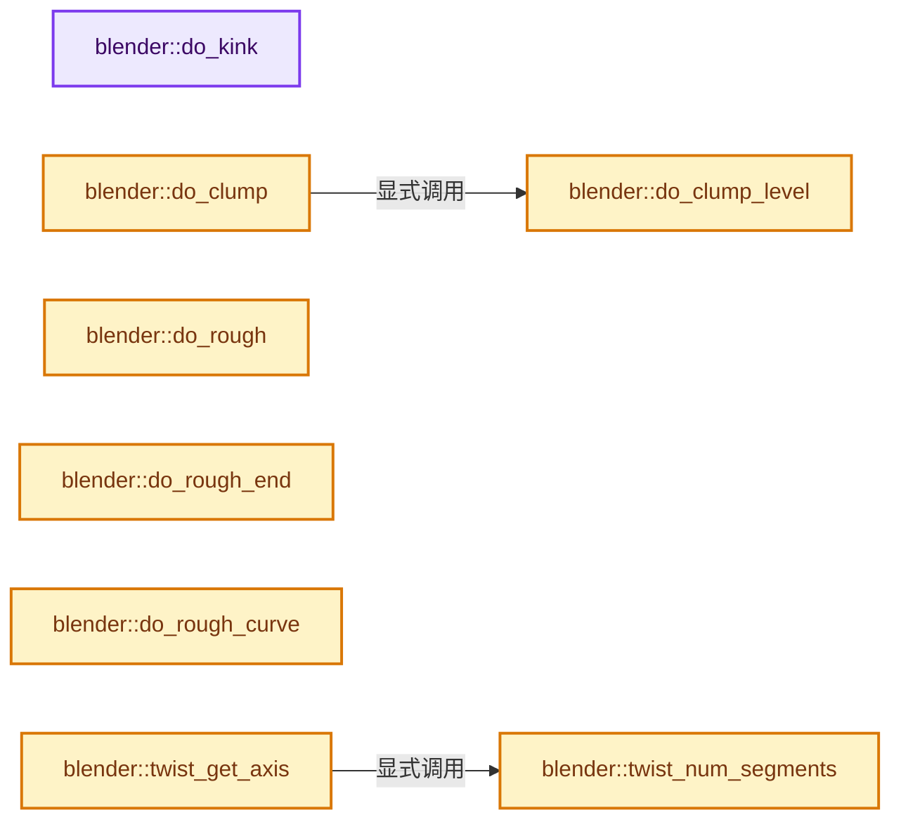
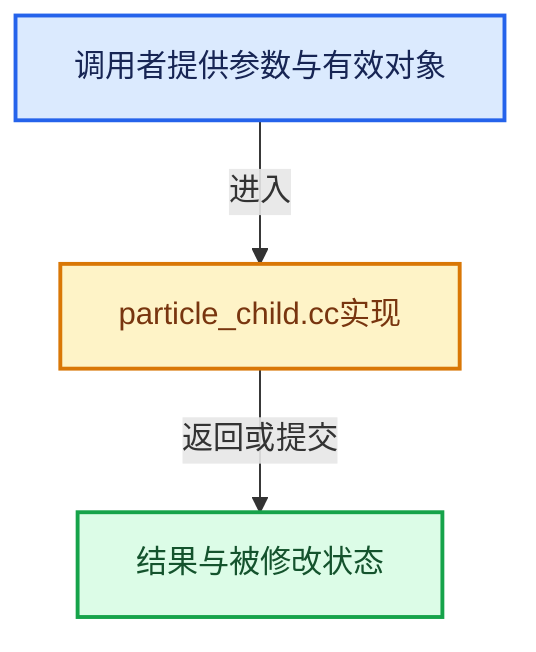

# 实现依赖专题：source/blender/blenkernel/intern/particle_child.cc

[实现依赖导航](../../README.md) · [符号索引](../../../00-课程指南/02-源码与提交索引/符号依赖与实现索引.md)

本专题从正文实际调用进入，集中保存共享实现。函数有稳定锚点，可从调用处直接跳到对应完整函数；递归与互相调用通过回链组织。

## 本文件的实现关系






## 完整成员与函数实现

<a id="f-1b72986c4eefd1fe"></a>

### `blender::do_kink`

实现位置：[source/blender/blenkernel/intern/particle_child.cc](../../../../../../../source/blender/blenkernel/intern/particle_child.cc) · L387—L558。

接口参数：

- `ParticleKey *state`
- `const float par_co[3]`
- `const float par_vel[3]`
- `const float par_rot[4]`
- `float time`
- `float freq`
- `float shape`
- `float amplitude`
- `float flat`
- `short type`
- `short axis`
- `const float obmat[4][4]`
- `int smooth_start`

**教学注释版**

<!-- annotated:d1716b4e3a78a5 -->

```cpp
void do_kink(ParticleKey *state,
             const float par_co[3],
             const float par_vel[3],
             const float par_rot[4],
             float time,
             float freq,
             float shape,
             float amplitude,
             float flat,
             short type,
             short axis,
             const float obmat[4][4],
             int smooth_start)
{
  float kink[3] = {1.0f, 0.0f, 0.0f}, par_vec[3];
  float t, dt = 1.0f, result[3];

  if (ELEM(type, PART_KINK_NO, PART_KINK_SPIRAL)) {
    return;
  }

  CLAMP(time, 0.0f, 1.0f);

  if (shape != 0.0f && !ELEM(type, PART_KINK_BRAID)) {
    if (shape < 0.0f) {
      time = pow(time, 1.0f + shape);
    }
    else {
      time = pow(time, 1.0f / (1.0f - shape));
    }
  }

  t = time * freq * float(M_PI);

  if (smooth_start) {
    dt = fabsf(t);
    /* smooth the beginning of kink */
    CLAMP(dt, 0.0f, float(M_PI));
    dt = sinf(dt / 2.0f);
  }

  if (!ELEM(type, PART_KINK_RADIAL)) {
    float temp[3];

    kink[axis] = 1.0f;

    if (obmat) {
      mul_mat3_m4_v3(obmat, kink);
    }

    mul_qt_v3(par_rot, kink);

    /* make sure kink is normal to strand */
    project_v3_v3v3(temp, kink, par_vel);
    sub_v3_v3(kink, temp);
    normalize_v3(kink);
  }

  copy_v3_v3(result, state->co);
  sub_v3_v3v3(par_vec, par_co, state->co);

  switch (type) {
    case PART_KINK_CURL: {
      float curl_offset[3];
      float q1[4] = {1.0f, 0.0f, 0.0f, 0.0f};

      /* rotate kink vector around strand tangent */
      mul_v3_v3fl(curl_offset, kink, amplitude);
      axis_angle_to_quat(q1, par_vel, t);
      mul_qt_v3(q1, curl_offset);

      interp_v3_v3v3(par_vec, state->co, par_co, flat);
      add_v3_v3v3(result, par_vec, curl_offset);
      break;
    }
    case PART_KINK_RADIAL: {
      if (flat > 0.0f) {
        float proj[3];
        /* flatten along strand */
        project_v3_v3v3(proj, par_vec, par_vel);
        madd_v3_v3fl(result, proj, flat);
      }

      madd_v3_v3fl(result, par_vec, -amplitude * sinf(t));
      break;
    }
    case PART_KINK_WAVE: {
      madd_v3_v3fl(result, kink, amplitude * sinf(t));

      if (flat > 0.0f) {
        float proj[3];
        /* flatten along wave */
        project_v3_v3v3(proj, par_vec, kink);
        madd_v3_v3fl(result, proj, flat);

        /* flatten along strand */
        project_v3_v3v3(proj, par_vec, par_vel);
        madd_v3_v3fl(result, proj, flat);
      }
      break;
    }
    case PART_KINK_BRAID: {
      float y_vec[3] = {0.0f, 1.0f, 0.0f};
      float z_vec[3] = {0.0f, 0.0f, 1.0f};
      float vec_one[3], state_co[3];
      float inp_y, inp_z, length;

      if (par_rot) {
        mul_qt_v3(par_rot, y_vec);
        mul_qt_v3(par_rot, z_vec);
      }

      negate_v3(par_vec);
      normalize_v3_v3(vec_one, par_vec);

      inp_y = dot_v3v3(y_vec, vec_one);
      inp_z = dot_v3v3(z_vec, vec_one);

      if (inp_y > 0.5f) {
        copy_v3_v3(state_co, y_vec);

        mul_v3_fl(y_vec, amplitude * cosf(t));
        mul_v3_fl(z_vec, amplitude / 2.0f * sinf(2.0f * t));
      }
      else if (inp_z > 0.0f) {
        mul_v3_v3fl(state_co, z_vec, sinf(float(M_PI) / 3.0f));
        madd_v3_v3fl(state_co, y_vec, -0.5f);

        mul_v3_fl(y_vec, -amplitude * cosf(t + float(M_PI) / 3.0f));
        mul_v3_fl(z_vec, amplitude / 2.0f * cosf(2.0f * t + float(M_PI) / 6.0f));
      }
      else {
        mul_v3_v3fl(state_co, z_vec, -sinf(float(M_PI) / 3.0f));
        madd_v3_v3fl(state_co, y_vec, -0.5f);

        mul_v3_fl(y_vec, amplitude * -sinf(t + float(M_PI) / 6.0f));
        mul_v3_fl(z_vec, amplitude / 2.0f * -sinf(2.0f * t + float(M_PI) / 3.0f));
      }

      mul_v3_fl(state_co, amplitude);
      add_v3_v3(state_co, par_co);
      sub_v3_v3v3(par_vec, state->co, state_co);

      length = normalize_v3(par_vec);
      // [讲解] std::min：按比较关系选取较小值；截断范围时还需先满足非负和可表示范围，min本身不会证明边界安全。
      mul_v3_fl(par_vec, std::min(length, amplitude / 2.0f));

      add_v3_v3v3(state_co, par_co, y_vec);
      add_v3_v3(state_co, z_vec);
      add_v3_v3(state_co, par_vec);

      shape = 2.0f * float(M_PI) * (1.0f + shape);

      if (t < shape) {
        shape = t / shape;
        shape = float(sqrt(double(shape)));
        interp_v3_v3v3(result, result, state_co, shape);
      }
      else {
        copy_v3_v3(result, state_co);
      }
      break;
    }
  }

  /* blend the start of the kink */
  if (dt < 1.0f) {
    interp_v3_v3v3(state->co, state->co, result, dt);
  }
  else {
    copy_v3_v3(state->co, result);
  }
}
```

<details>
<summary>核对原始源码：source/blender/blenkernel/intern/particle_child.cc · L387—L558</summary>

<!-- original:d1716b4e3a78a5:source/blender/blenkernel/intern/particle_child.cc:387:558 -->

```cpp
void do_kink(ParticleKey *state,
             const float par_co[3],
             const float par_vel[3],
             const float par_rot[4],
             float time,
             float freq,
             float shape,
             float amplitude,
             float flat,
             short type,
             short axis,
             const float obmat[4][4],
             int smooth_start)
{
  float kink[3] = {1.0f, 0.0f, 0.0f}, par_vec[3];
  float t, dt = 1.0f, result[3];

  if (ELEM(type, PART_KINK_NO, PART_KINK_SPIRAL)) {
    return;
  }

  CLAMP(time, 0.0f, 1.0f);

  if (shape != 0.0f && !ELEM(type, PART_KINK_BRAID)) {
    if (shape < 0.0f) {
      time = pow(time, 1.0f + shape);
    }
    else {
      time = pow(time, 1.0f / (1.0f - shape));
    }
  }

  t = time * freq * float(M_PI);

  if (smooth_start) {
    dt = fabsf(t);
    /* smooth the beginning of kink */
    CLAMP(dt, 0.0f, float(M_PI));
    dt = sinf(dt / 2.0f);
  }

  if (!ELEM(type, PART_KINK_RADIAL)) {
    float temp[3];

    kink[axis] = 1.0f;

    if (obmat) {
      mul_mat3_m4_v3(obmat, kink);
    }

    mul_qt_v3(par_rot, kink);

    /* make sure kink is normal to strand */
    project_v3_v3v3(temp, kink, par_vel);
    sub_v3_v3(kink, temp);
    normalize_v3(kink);
  }

  copy_v3_v3(result, state->co);
  sub_v3_v3v3(par_vec, par_co, state->co);

  switch (type) {
    case PART_KINK_CURL: {
      float curl_offset[3];
      float q1[4] = {1.0f, 0.0f, 0.0f, 0.0f};

      /* rotate kink vector around strand tangent */
      mul_v3_v3fl(curl_offset, kink, amplitude);
      axis_angle_to_quat(q1, par_vel, t);
      mul_qt_v3(q1, curl_offset);

      interp_v3_v3v3(par_vec, state->co, par_co, flat);
      add_v3_v3v3(result, par_vec, curl_offset);
      break;
    }
    case PART_KINK_RADIAL: {
      if (flat > 0.0f) {
        float proj[3];
        /* flatten along strand */
        project_v3_v3v3(proj, par_vec, par_vel);
        madd_v3_v3fl(result, proj, flat);
      }

      madd_v3_v3fl(result, par_vec, -amplitude * sinf(t));
      break;
    }
    case PART_KINK_WAVE: {
      madd_v3_v3fl(result, kink, amplitude * sinf(t));

      if (flat > 0.0f) {
        float proj[3];
        /* flatten along wave */
        project_v3_v3v3(proj, par_vec, kink);
        madd_v3_v3fl(result, proj, flat);

        /* flatten along strand */
        project_v3_v3v3(proj, par_vec, par_vel);
        madd_v3_v3fl(result, proj, flat);
      }
      break;
    }
    case PART_KINK_BRAID: {
      float y_vec[3] = {0.0f, 1.0f, 0.0f};
      float z_vec[3] = {0.0f, 0.0f, 1.0f};
      float vec_one[3], state_co[3];
      float inp_y, inp_z, length;

      if (par_rot) {
        mul_qt_v3(par_rot, y_vec);
        mul_qt_v3(par_rot, z_vec);
      }

      negate_v3(par_vec);
      normalize_v3_v3(vec_one, par_vec);

      inp_y = dot_v3v3(y_vec, vec_one);
      inp_z = dot_v3v3(z_vec, vec_one);

      if (inp_y > 0.5f) {
        copy_v3_v3(state_co, y_vec);

        mul_v3_fl(y_vec, amplitude * cosf(t));
        mul_v3_fl(z_vec, amplitude / 2.0f * sinf(2.0f * t));
      }
      else if (inp_z > 0.0f) {
        mul_v3_v3fl(state_co, z_vec, sinf(float(M_PI) / 3.0f));
        madd_v3_v3fl(state_co, y_vec, -0.5f);

        mul_v3_fl(y_vec, -amplitude * cosf(t + float(M_PI) / 3.0f));
        mul_v3_fl(z_vec, amplitude / 2.0f * cosf(2.0f * t + float(M_PI) / 6.0f));
      }
      else {
        mul_v3_v3fl(state_co, z_vec, -sinf(float(M_PI) / 3.0f));
        madd_v3_v3fl(state_co, y_vec, -0.5f);

        mul_v3_fl(y_vec, amplitude * -sinf(t + float(M_PI) / 6.0f));
        mul_v3_fl(z_vec, amplitude / 2.0f * -sinf(2.0f * t + float(M_PI) / 3.0f));
      }

      mul_v3_fl(state_co, amplitude);
      add_v3_v3(state_co, par_co);
      sub_v3_v3v3(par_vec, state->co, state_co);

      length = normalize_v3(par_vec);
      mul_v3_fl(par_vec, std::min(length, amplitude / 2.0f));

      add_v3_v3v3(state_co, par_co, y_vec);
      add_v3_v3(state_co, z_vec);
      add_v3_v3(state_co, par_vec);

      shape = 2.0f * float(M_PI) * (1.0f + shape);

      if (t < shape) {
        shape = t / shape;
        shape = float(sqrt(double(shape)));
        interp_v3_v3v3(result, result, state_co, shape);
      }
      else {
        copy_v3_v3(result, state_co);
      }
      break;
    }
  }

  /* blend the start of the kink */
  if (dt < 1.0f) {
    interp_v3_v3v3(state->co, state->co, result, dt);
  }
  else {
    copy_v3_v3(state->co, result);
  }
}
```

</details>

**沿实际写入检查状态**

- `time = pow(time, 1.0f + shape);`
- `time = pow(time, 1.0f / (1.0f - shape));`
- `t = time * freq * float(M_PI);`
- `dt = fabsf(t);`
- `dt = sinf(dt / 2.0f);`
- `kink[axis] = 1.0f;`
- `inp_y = dot_v3v3(y_vec, vec_one);`
- `inp_z = dot_v3v3(z_vec, vec_one);`
- `length = normalize_v3(par_vec);`
- `shape = 2.0f * float(M_PI) * (1.0f + shape);`
- `shape = t / shape;`
- `shape = float(sqrt(double(shape)));`

**继续追踪实现**

- `ELEM` → [ELEM · L88](../../07-Intern运行时与平台/ghost/intern/GHOST_utildefines.hh.md#m-d28724a15928)；[ELEM · L135](../../01-BLI基础库/BLI_utildefines.hh.md#m-d6572de7cae0)。宏定义由构建条件选择。
- `CLAMP` → [CLAMP · L200](../../01-BLI基础库/BLI_utildefines.hh.md#m-69703e497120)。宏定义由构建条件选择。
- `pow` → [外部契约](https://eel.is/c++draft/)：这个边界按实际表达式及所属类型核对参数、返回值、寿命与失败行为。这里提供接口入口，不声称已解释该第三方版本的内部实现。
- `fabsf` → [fabsf · L21](../../07-Intern运行时与平台/cycles/kernel/svm/radial_tiling_shared.h.md#m-02cc4c69cfb3)；[fabsf · L43](../../07-Intern运行时与平台/cycles/kernel/svm/radial_tiling_shared.h.md#m-04effe61803b)；[fabsf · L74](../../07-Intern运行时与平台/cycles/kernel/svm/radial_tiling_shared.h.md#m-927dd4eba7dc)；[fabsf · L25](../../01-BLI基础库/intern/radial_tiling_shared.hh.md#m-8348d6b3d08f)；[fabsf · L47](../../01-BLI基础库/intern/radial_tiling_shared.hh.md#m-13b7e0b6d84f)；[fabsf · L78](../../01-BLI基础库/intern/radial_tiling_shared.hh.md#m-326c83464a0d)；[fabsf · L21](../../07-Intern运行时与平台/cycles/kernel/osl/shaders/node_radial_tiling_shared.h.md#m-7c3ee12fc119)；[fabsf · L43](../../07-Intern运行时与平台/cycles/kernel/osl/shaders/node_radial_tiling_shared.h.md#m-9112db0e2dd1)；[fabsf · L74](../../07-Intern运行时与平台/cycles/kernel/osl/shaders/node_radial_tiling_shared.h.md#m-ee4e61908a6f)；[fabsf · L167](../../07-Intern运行时与平台/cycles/kernel/device/oneapi/compat.h.md#m-b039ee6c1601)；[fabsf · L265](../../07-Intern运行时与平台/cycles/kernel/device/metal/compat.h.md#m-6b21869e9f3f)。宏定义由构建条件选择。
- `sinf` → [sinf · L27](../../07-Intern运行时与平台/cycles/kernel/svm/radial_tiling_shared.h.md#m-40547e913688)；[sinf · L49](../../07-Intern运行时与平台/cycles/kernel/svm/radial_tiling_shared.h.md#m-8908e5f49833)；[sinf · L80](../../07-Intern运行时与平台/cycles/kernel/svm/radial_tiling_shared.h.md#m-71130f6adcc4)；[sinf · L31](../../01-BLI基础库/intern/radial_tiling_shared.hh.md#m-a51a6c88deca)；[sinf · L53](../../01-BLI基础库/intern/radial_tiling_shared.hh.md#m-9a4db95358ff)；[sinf · L84](../../01-BLI基础库/intern/radial_tiling_shared.hh.md#m-d26cdafe5b93)；[sinf · L27](../../07-Intern运行时与平台/cycles/kernel/osl/shaders/node_radial_tiling_shared.h.md#m-9f80b4d363af)；[sinf · L49](../../07-Intern运行时与平台/cycles/kernel/osl/shaders/node_radial_tiling_shared.h.md#m-f52c29b37ed1)；[sinf · L80](../../07-Intern运行时与平台/cycles/kernel/osl/shaders/node_radial_tiling_shared.h.md#m-7f1f234ef9ec)；[sinf · L187](../../07-Intern运行时与平台/cycles/kernel/device/oneapi/compat.h.md#m-aab07e522dda)；[sinf · L287](../../07-Intern运行时与平台/cycles/kernel/device/metal/compat.h.md#m-7009b99c07ca)；[sinf · L94](../../07-Intern运行时与平台/cycles/kernel/device/hip/compat.h.md#m-4a1f5d760325)；[sinf · L92](../../07-Intern运行时与平台/cycles/kernel/device/cuda/compat.h.md#m-e63872738f13)；[sinf · L44](../../08-其他Blender模块/gpu/GPU_shader_shared_utils.hh.md#m-a916f31e38c4)；[sinf · L65](../../08-其他Blender模块/gpu/GPU_shader_shared_utils.hh.md#m-268edbf6d41e)。宏定义由构建条件选择。
- `mul_mat3_m4_v3` → [blender::mul_mat3_m4_v3 · L738](../../01-BLI基础库/intern/math_matrix_c.cc.md#f-85a92f87ede557ca)。
- `mul_qt_v3` → [blender::mul_qt_v3 · L77](../../01-BLI基础库/intern/math_rotation_c.cc.md#f-de1eaa8cb3a56e7b)。
- `project_v3_v3v3` → [blender::project_v3_v3v3 · L495](../../01-BLI基础库/intern/math_vector.cc.md#f-650605f97ccd5047)。
- `sub_v3_v3` → [blender::sub_v3_v3 · L353](../../01-BLI基础库/intern/math_vector_inline.cc.md#f-da39d7342c417f4b)。
- `normalize_v3` → [blender::normalize_v3 · L933](../../01-BLI基础库/intern/math_vector_inline.cc.md#f-5f3257e657ef732c)。
- `copy_v3_v3` → [blender::copy_v3_v3 · L47](../../01-BLI基础库/intern/math_vector_inline.cc.md#f-037a0d5fa5060bd6)。
- `sub_v3_v3v3` → [blender::sub_v3_v3v3 · L360](../../01-BLI基础库/intern/math_vector_inline.cc.md#f-23781c252db8b30c)。
- `mul_v3_v3fl` → [blender::mul_v3_v3fl · L428](../../01-BLI基础库/intern/math_vector_inline.cc.md#f-c3cb822497b967a8)。
- `axis_angle_to_quat` → [blender::axis_angle_to_quat · L1075](../../01-BLI基础库/intern/math_rotation_c.cc.md#f-c1fc0c33fafbf227)。
- `interp_v3_v3v3` → [blender::interp_v3_v3v3 · L41](../../01-BLI基础库/intern/math_vector.cc.md#f-18251c70c00824d7)。
- `add_v3_v3v3` → [blender::add_v3_v3v3 · L300](../../01-BLI基础库/intern/math_vector_inline.cc.md#f-7343b459d0d3db69)。
- `madd_v3_v3fl` → [blender::madd_v3_v3fl · L501](../../01-BLI基础库/intern/math_vector_inline.cc.md#f-4f81667c5d595c80)。
- `negate_v3` → [blender::negate_v3 · L571](../../01-BLI基础库/intern/math_vector_inline.cc.md#f-10baf09f690bcba8)。
- `normalize_v3_v3` → [blender::normalize_v3_v3 · L895](../../01-BLI基础库/intern/math_vector_inline.cc.md#f-ebb89b456f034ce2)。
- `dot_v3v3` → [blender::dot_v3v3 · L646](../../01-BLI基础库/intern/math_vector_inline.cc.md#f-c88befa67d07591a)。
- `mul_v3_fl` → [blender::mul_v3_fl · L414](../../01-BLI基础库/intern/math_vector_inline.cc.md#f-00165156a06d1224)。
- `cosf` → [cosf · L20](../../07-Intern运行时与平台/cycles/kernel/svm/radial_tiling_shared.h.md#m-cee9ebf67d86)；[cosf · L42](../../07-Intern运行时与平台/cycles/kernel/svm/radial_tiling_shared.h.md#m-346533627567)；[cosf · L73](../../07-Intern运行时与平台/cycles/kernel/svm/radial_tiling_shared.h.md#m-e01b94a43b72)；[cosf · L24](../../01-BLI基础库/intern/radial_tiling_shared.hh.md#m-c317cb08dec6)；[cosf · L46](../../01-BLI基础库/intern/radial_tiling_shared.hh.md#m-93325b515297)；[cosf · L77](../../01-BLI基础库/intern/radial_tiling_shared.hh.md#m-d3058af0b490)；[cosf · L20](../../07-Intern运行时与平台/cycles/kernel/osl/shaders/node_radial_tiling_shared.h.md#m-4c6aea22a560)；[cosf · L42](../../07-Intern运行时与平台/cycles/kernel/osl/shaders/node_radial_tiling_shared.h.md#m-1fd6a5414477)；[cosf · L73](../../07-Intern运行时与平台/cycles/kernel/osl/shaders/node_radial_tiling_shared.h.md#m-de2402f85270)；[cosf · L186](../../07-Intern运行时与平台/cycles/kernel/device/oneapi/compat.h.md#m-7fdbd99009e0)；[cosf · L288](../../07-Intern运行时与平台/cycles/kernel/device/metal/compat.h.md#m-68fe984e8b68)；[cosf · L93](../../07-Intern运行时与平台/cycles/kernel/device/hip/compat.h.md#m-21bb557a23f1)；[cosf · L91](../../07-Intern运行时与平台/cycles/kernel/device/cuda/compat.h.md#m-7721be419a49)；[cosf · L43](../../08-其他Blender模块/gpu/GPU_shader_shared_utils.hh.md#m-25d02fd11b3b)；[cosf · L64](../../08-其他Blender模块/gpu/GPU_shader_shared_utils.hh.md#m-698fc51ccda3)。宏定义由构建条件选择。
- `add_v3_v3` → [blender::add_v3_v3 · L286](../../01-BLI基础库/intern/math_vector_inline.cc.md#f-e7930c6fdefe462c)。
- `std::min` → [外部契约](https://eel.is/c++draft/alg.min.max)：按比较关系选取较小值；截断范围时还需先满足非负和可表示范围，min本身不会证明边界安全。
- `sqrt` → [外部契约](https://eel.is/c++draft/)：这个边界按实际表达式及所属类型核对参数、返回值、寿命与失败行为。这里提供接口入口，不声称已解释该第三方版本的内部实现。

<a id="f-4c744531ee186b43"></a>

### `blender::do_clump_level`

实现位置：[source/blender/blenkernel/intern/particle_child.cc](../../../../../../../source/blender/blenkernel/intern/particle_child.cc) · L560—L598。

接口参数：

- `float result[3]`
- `const float co[3]`
- `const float par_co[3]`
- `float time`
- `float clumpfac`
- `float clumppow`
- `float pa_clump`
- `const CurveMapping *clumpcurve`

**教学注释版**

<!-- annotated:4b42389af4172e -->

```cpp
static float do_clump_level(float result[3],
                            const float co[3],
                            const float par_co[3],
                            float time,
                            float clumpfac,
                            float clumppow,
                            float pa_clump,
                            const CurveMapping *clumpcurve)
{
  float clump = 0.0f;

  if (clumpcurve) {
    clump = pa_clump *
            (1.0f - clamp_f(BKE_curvemapping_evaluateF(clumpcurve, 0, time), 0.0f, 1.0f));

    interp_v3_v3v3(result, co, par_co, clump);
  }
  else if (clumpfac != 0.0f) {
    float cpow;

    if (clumppow < 0.0f) {
      cpow = 1.0f + clumppow;
    }
    else {
      cpow = 1.0f + 9.0f * clumppow;
    }

    if (clumpfac < 0.0f) { /* clump roots instead of tips */
      clump = -clumpfac * pa_clump * float(pow(1.0 - double(time), double(cpow)));
    }
    else {
      clump = clumpfac * pa_clump * float(pow(double(time), double(cpow)));
    }

    interp_v3_v3v3(result, co, par_co, clump);
  }

  return clump;
}
```

<details>
<summary>核对原始源码：source/blender/blenkernel/intern/particle_child.cc · L560—L598</summary>

<!-- original:4b42389af4172e:source/blender/blenkernel/intern/particle_child.cc:560:598 -->

```cpp
static float do_clump_level(float result[3],
                            const float co[3],
                            const float par_co[3],
                            float time,
                            float clumpfac,
                            float clumppow,
                            float pa_clump,
                            const CurveMapping *clumpcurve)
{
  float clump = 0.0f;

  if (clumpcurve) {
    clump = pa_clump *
            (1.0f - clamp_f(BKE_curvemapping_evaluateF(clumpcurve, 0, time), 0.0f, 1.0f));

    interp_v3_v3v3(result, co, par_co, clump);
  }
  else if (clumpfac != 0.0f) {
    float cpow;

    if (clumppow < 0.0f) {
      cpow = 1.0f + clumppow;
    }
    else {
      cpow = 1.0f + 9.0f * clumppow;
    }

    if (clumpfac < 0.0f) { /* clump roots instead of tips */
      clump = -clumpfac * pa_clump * float(pow(1.0 - double(time), double(cpow)));
    }
    else {
      clump = clumpfac * pa_clump * float(pow(double(time), double(cpow)));
    }

    interp_v3_v3v3(result, co, par_co, clump);
  }

  return clump;
}
```

</details>

**沿实际写入检查状态**

- `clump = pa_clump *`
- `cpow = 1.0f + clumppow;`
- `cpow = 1.0f + 9.0f * clumppow;`
- `clump = -clumpfac * pa_clump * float(pow(1.0 - double(time), double(cpow)));`
- `clump = clumpfac * pa_clump * float(pow(double(time), double(cpow)));`

**结果出口**

- `return clump;`

**继续追踪实现**

- `clamp_f` → [blender::clamp_f · L405](../../01-BLI基础库/intern/math_base_inline.cc.md#f-abaf19ee32d97de2)。
- `BKE_curvemapping_evaluateF` → [blender::BKE_curvemapping_evaluateF · L1177](colortools.cc.md#f-014584e04eeb1392)。
- `interp_v3_v3v3` → [blender::interp_v3_v3v3 · L41](../../01-BLI基础库/intern/math_vector.cc.md#f-18251c70c00824d7)。
- `pow` → [外部契约](https://eel.is/c++draft/)：这个边界按实际表达式及所属类型核对参数、返回值、寿命与失败行为。这里提供接口入口，不声称已解释该第三方版本的内部实现。

<a id="f-95ac35dca684869a"></a>

### `blender::do_clump`

实现位置：[source/blender/blenkernel/intern/particle_child.cc](../../../../../../../source/blender/blenkernel/intern/particle_child.cc) · L600—L629。

接口参数：

- `ParticleKey *state`
- `const float par_co[3]`
- `float time`
- `const float orco_offset[3]`
- `float clumpfac`
- `float clumppow`
- `float pa_clump`
- `bool use_clump_noise`
- `float clump_noise_size`
- `const CurveMapping *clumpcurve`

**教学注释版**

<!-- annotated:b14a060f9b0fb3 -->

```cpp
float do_clump(ParticleKey *state,
               const float par_co[3],
               float time,
               const float orco_offset[3],
               float clumpfac,
               float clumppow,
               float pa_clump,
               bool use_clump_noise,
               float clump_noise_size,
               const CurveMapping *clumpcurve)
{
  float clump;

  if (use_clump_noise && clump_noise_size != 0.0f) {
    float center[3], noisevec[3];
    float da[4], pa[12];

    mul_v3_v3fl(noisevec, orco_offset, 1.0f / clump_noise_size);
    BLI_noise_voronoi(noisevec[0], noisevec[1], noisevec[2], da, pa, 1.0f, 0);
    mul_v3_fl(&pa[0], clump_noise_size);
    add_v3_v3v3(center, par_co, &pa[0]);

    do_clump_level(state->co, state->co, center, time, clumpfac, clumppow, pa_clump, clumpcurve);
  }

  clump = do_clump_level(
      state->co, state->co, par_co, time, clumpfac, clumppow, pa_clump, clumpcurve);

  return clump;
}
```

<details>
<summary>核对原始源码：source/blender/blenkernel/intern/particle_child.cc · L600—L629</summary>

<!-- original:b14a060f9b0fb3:source/blender/blenkernel/intern/particle_child.cc:600:629 -->

```cpp
float do_clump(ParticleKey *state,
               const float par_co[3],
               float time,
               const float orco_offset[3],
               float clumpfac,
               float clumppow,
               float pa_clump,
               bool use_clump_noise,
               float clump_noise_size,
               const CurveMapping *clumpcurve)
{
  float clump;

  if (use_clump_noise && clump_noise_size != 0.0f) {
    float center[3], noisevec[3];
    float da[4], pa[12];

    mul_v3_v3fl(noisevec, orco_offset, 1.0f / clump_noise_size);
    BLI_noise_voronoi(noisevec[0], noisevec[1], noisevec[2], da, pa, 1.0f, 0);
    mul_v3_fl(&pa[0], clump_noise_size);
    add_v3_v3v3(center, par_co, &pa[0]);

    do_clump_level(state->co, state->co, center, time, clumpfac, clumppow, pa_clump, clumpcurve);
  }

  clump = do_clump_level(
      state->co, state->co, par_co, time, clumpfac, clumppow, pa_clump, clumpcurve);

  return clump;
}
```

</details>

**沿实际写入检查状态**

- `clump = do_clump_level(`

**结果出口**

- `return clump;`

**继续追踪实现**

- `mul_v3_v3fl` → [blender::mul_v3_v3fl · L428](../../01-BLI基础库/intern/math_vector_inline.cc.md#f-c3cb822497b967a8)。
- `BLI_noise_voronoi` → [blender::BLI_noise_voronoi · L917](../../01-BLI基础库/intern/noise_c.cc.md#f-c92e23f49bb3c61d)。
- `mul_v3_fl` → [blender::mul_v3_fl · L414](../../01-BLI基础库/intern/math_vector_inline.cc.md#f-00165156a06d1224)。
- `add_v3_v3v3` → [blender::add_v3_v3v3 · L300](../../01-BLI基础库/intern/math_vector_inline.cc.md#f-7343b459d0d3db69)。
- `do_clump_level` → [blender::do_clump_level · L560](particle_child.cc.md#f-4c744531ee186b43)。

<a id="f-95bfeae6d6a321e0"></a>

### `blender::do_rough`

实现位置：[source/blender/blenkernel/intern/particle_child.cc](../../../../../../../source/blender/blenkernel/intern/particle_child.cc) · L631—L660。

接口参数：

- `const float loc[3]`
- `const float mat[4][4]`
- `float t`
- `float fac`
- `float size`
- `float thres`
- `ParticleKey *state`

**教学注释版**

<!-- annotated:624ec9ccee071d -->

```cpp
static void do_rough(const float loc[3],
                     const float mat[4][4],
                     float t,
                     float fac,
                     float size,
                     float thres,
                     ParticleKey *state)
{
  float rough[3];
  float rco[3];

  if (thres != 0.0f) {
    if (fabsf(float(-1.5f + loc[0] + loc[1] + loc[2])) < 1.5f * thres) {
      return;
    }
  }

  copy_v3_v3(rco, loc);
  mul_v3_fl(rco, t);
  rough[0] = -1.0f +
             2.0f * BLI_noise_generic_turbulence(size, rco[0], rco[1], rco[2], 2, false, 2);
  rough[1] = -1.0f +
             2.0f * BLI_noise_generic_turbulence(size, rco[1], rco[2], rco[0], 2, false, 2);
  rough[2] = -1.0f +
             2.0f * BLI_noise_generic_turbulence(size, rco[2], rco[0], rco[1], 2, false, 2);

  madd_v3_v3fl(state->co, mat[0], fac * rough[0]);
  madd_v3_v3fl(state->co, mat[1], fac * rough[1]);
  madd_v3_v3fl(state->co, mat[2], fac * rough[2]);
}
```

<details>
<summary>核对原始源码：source/blender/blenkernel/intern/particle_child.cc · L631—L660</summary>

<!-- original:624ec9ccee071d:source/blender/blenkernel/intern/particle_child.cc:631:660 -->

```cpp
static void do_rough(const float loc[3],
                     const float mat[4][4],
                     float t,
                     float fac,
                     float size,
                     float thres,
                     ParticleKey *state)
{
  float rough[3];
  float rco[3];

  if (thres != 0.0f) {
    if (fabsf(float(-1.5f + loc[0] + loc[1] + loc[2])) < 1.5f * thres) {
      return;
    }
  }

  copy_v3_v3(rco, loc);
  mul_v3_fl(rco, t);
  rough[0] = -1.0f +
             2.0f * BLI_noise_generic_turbulence(size, rco[0], rco[1], rco[2], 2, false, 2);
  rough[1] = -1.0f +
             2.0f * BLI_noise_generic_turbulence(size, rco[1], rco[2], rco[0], 2, false, 2);
  rough[2] = -1.0f +
             2.0f * BLI_noise_generic_turbulence(size, rco[2], rco[0], rco[1], 2, false, 2);

  madd_v3_v3fl(state->co, mat[0], fac * rough[0]);
  madd_v3_v3fl(state->co, mat[1], fac * rough[1]);
  madd_v3_v3fl(state->co, mat[2], fac * rough[2]);
}
```

</details>

**沿实际写入检查状态**

- `rough[0] = -1.0f +`
- `rough[1] = -1.0f +`
- `rough[2] = -1.0f +`

**继续追踪实现**

- `fabsf` → [fabsf · L21](../../07-Intern运行时与平台/cycles/kernel/svm/radial_tiling_shared.h.md#m-02cc4c69cfb3)；[fabsf · L43](../../07-Intern运行时与平台/cycles/kernel/svm/radial_tiling_shared.h.md#m-04effe61803b)；[fabsf · L74](../../07-Intern运行时与平台/cycles/kernel/svm/radial_tiling_shared.h.md#m-927dd4eba7dc)；[fabsf · L25](../../01-BLI基础库/intern/radial_tiling_shared.hh.md#m-8348d6b3d08f)；[fabsf · L47](../../01-BLI基础库/intern/radial_tiling_shared.hh.md#m-13b7e0b6d84f)；[fabsf · L78](../../01-BLI基础库/intern/radial_tiling_shared.hh.md#m-326c83464a0d)；[fabsf · L21](../../07-Intern运行时与平台/cycles/kernel/osl/shaders/node_radial_tiling_shared.h.md#m-7c3ee12fc119)；[fabsf · L43](../../07-Intern运行时与平台/cycles/kernel/osl/shaders/node_radial_tiling_shared.h.md#m-9112db0e2dd1)；[fabsf · L74](../../07-Intern运行时与平台/cycles/kernel/osl/shaders/node_radial_tiling_shared.h.md#m-ee4e61908a6f)；[fabsf · L167](../../07-Intern运行时与平台/cycles/kernel/device/oneapi/compat.h.md#m-b039ee6c1601)；[fabsf · L265](../../07-Intern运行时与平台/cycles/kernel/device/metal/compat.h.md#m-6b21869e9f3f)。宏定义由构建条件选择。
- `copy_v3_v3` → [blender::copy_v3_v3 · L47](../../01-BLI基础库/intern/math_vector_inline.cc.md#f-037a0d5fa5060bd6)。
- `mul_v3_fl` → [blender::mul_v3_fl · L414](../../01-BLI基础库/intern/math_vector_inline.cc.md#f-00165156a06d1224)。
- `BLI_noise_generic_turbulence` → [blender::BLI_noise_generic_turbulence · L1212](../../01-BLI基础库/intern/noise_c.cc.md#f-de528bb4e81cd83e)。
- `madd_v3_v3fl` → [blender::madd_v3_v3fl · L501](../../01-BLI基础库/intern/math_vector_inline.cc.md#f-4f81667c5d595c80)。

<a id="f-36620a300422ca4c"></a>

### `blender::do_rough_end`

实现位置：[source/blender/blenkernel/intern/particle_child.cc](../../../../../../../source/blender/blenkernel/intern/particle_child.cc) · L662—L676。

接口参数：

- `const float loc[3]`
- `const float mat[4][4]`
- `float t`
- `float fac`
- `float shape`
- `ParticleKey *state`

**教学注释版**

<!-- annotated:5cac21f3ae06ec -->

```cpp
static void do_rough_end(
    const float loc[3], const float mat[4][4], float t, float fac, float shape, ParticleKey *state)
{
  float rough[2];
  float roughfac;

  roughfac = fac * float(pow(double(t), shape));
  copy_v2_v2(rough, loc);
  rough[0] = -1.0f + 2.0f * rough[0];
  rough[1] = -1.0f + 2.0f * rough[1];
  mul_v2_fl(rough, roughfac);

  madd_v3_v3fl(state->co, mat[0], rough[0]);
  madd_v3_v3fl(state->co, mat[1], rough[1]);
}
```

<details>
<summary>核对原始源码：source/blender/blenkernel/intern/particle_child.cc · L662—L676</summary>

<!-- original:5cac21f3ae06ec:source/blender/blenkernel/intern/particle_child.cc:662:676 -->

```cpp
static void do_rough_end(
    const float loc[3], const float mat[4][4], float t, float fac, float shape, ParticleKey *state)
{
  float rough[2];
  float roughfac;

  roughfac = fac * float(pow(double(t), shape));
  copy_v2_v2(rough, loc);
  rough[0] = -1.0f + 2.0f * rough[0];
  rough[1] = -1.0f + 2.0f * rough[1];
  mul_v2_fl(rough, roughfac);

  madd_v3_v3fl(state->co, mat[0], rough[0]);
  madd_v3_v3fl(state->co, mat[1], rough[1]);
}
```

</details>

**沿实际写入检查状态**

- `roughfac = fac * float(pow(double(t), shape));`
- `rough[0] = -1.0f + 2.0f * rough[0];`
- `rough[1] = -1.0f + 2.0f * rough[1];`

**继续追踪实现**

- `pow` → [外部契约](https://eel.is/c++draft/)：这个边界按实际表达式及所属类型核对参数、返回值、寿命与失败行为。这里提供接口入口，不声称已解释该第三方版本的内部实现。
- `copy_v2_v2` → [blender::copy_v2_v2 · L41](../../01-BLI基础库/intern/math_vector_inline.cc.md#f-e736ee2dd71cd821)。
- `mul_v2_fl` → [blender::mul_v2_fl · L402](../../01-BLI基础库/intern/math_vector_inline.cc.md#f-01449ccd8e2e1640)。
- `madd_v3_v3fl` → [blender::madd_v3_v3fl · L501](../../01-BLI基础库/intern/math_vector_inline.cc.md#f-4f81667c5d595c80)。

<a id="f-a30a24f4587b6948"></a>

### `blender::do_rough_curve`

实现位置：[source/blender/blenkernel/intern/particle_child.cc](../../../../../../../source/blender/blenkernel/intern/particle_child.cc) · L678—L707。

接口参数：

- `const float loc[3]`
- `const float mat[4][4]`
- `float time`
- `float fac`
- `float size`
- `CurveMapping *roughcurve`
- `ParticleKey *state`

**教学注释版**

<!-- annotated:76bc88fc209947 -->

```cpp
static void do_rough_curve(const float loc[3],
                           const float mat[4][4],
                           float time,
                           float fac,
                           float size,
                           CurveMapping *roughcurve,
                           ParticleKey *state)
{
  float rough[3];
  float rco[3];

  if (!roughcurve) {
    return;
  }

  fac *= clamp_f(BKE_curvemapping_evaluateF(roughcurve, 0, time), 0.0f, 1.0f);

  copy_v3_v3(rco, loc);
  mul_v3_fl(rco, time);
  rough[0] = -1.0f +
             2.0f * BLI_noise_generic_turbulence(size, rco[0], rco[1], rco[2], 2, false, 2);
  rough[1] = -1.0f +
             2.0f * BLI_noise_generic_turbulence(size, rco[1], rco[2], rco[0], 2, false, 2);
  rough[2] = -1.0f +
             2.0f * BLI_noise_generic_turbulence(size, rco[2], rco[0], rco[1], 2, false, 2);

  madd_v3_v3fl(state->co, mat[0], fac * rough[0]);
  madd_v3_v3fl(state->co, mat[1], fac * rough[1]);
  madd_v3_v3fl(state->co, mat[2], fac * rough[2]);
}
```

<details>
<summary>核对原始源码：source/blender/blenkernel/intern/particle_child.cc · L678—L707</summary>

<!-- original:76bc88fc209947:source/blender/blenkernel/intern/particle_child.cc:678:707 -->

```cpp
static void do_rough_curve(const float loc[3],
                           const float mat[4][4],
                           float time,
                           float fac,
                           float size,
                           CurveMapping *roughcurve,
                           ParticleKey *state)
{
  float rough[3];
  float rco[3];

  if (!roughcurve) {
    return;
  }

  fac *= clamp_f(BKE_curvemapping_evaluateF(roughcurve, 0, time), 0.0f, 1.0f);

  copy_v3_v3(rco, loc);
  mul_v3_fl(rco, time);
  rough[0] = -1.0f +
             2.0f * BLI_noise_generic_turbulence(size, rco[0], rco[1], rco[2], 2, false, 2);
  rough[1] = -1.0f +
             2.0f * BLI_noise_generic_turbulence(size, rco[1], rco[2], rco[0], 2, false, 2);
  rough[2] = -1.0f +
             2.0f * BLI_noise_generic_turbulence(size, rco[2], rco[0], rco[1], 2, false, 2);

  madd_v3_v3fl(state->co, mat[0], fac * rough[0]);
  madd_v3_v3fl(state->co, mat[1], fac * rough[1]);
  madd_v3_v3fl(state->co, mat[2], fac * rough[2]);
}
```

</details>

**沿实际写入检查状态**

- `fac *= clamp_f(BKE_curvemapping_evaluateF(roughcurve, 0, time), 0.0f, 1.0f);`
- `rough[0] = -1.0f +`
- `rough[1] = -1.0f +`
- `rough[2] = -1.0f +`

**继续追踪实现**

- `clamp_f` → [blender::clamp_f · L405](../../01-BLI基础库/intern/math_base_inline.cc.md#f-abaf19ee32d97de2)。
- `BKE_curvemapping_evaluateF` → [blender::BKE_curvemapping_evaluateF · L1177](colortools.cc.md#f-014584e04eeb1392)。
- `copy_v3_v3` → [blender::copy_v3_v3 · L47](../../01-BLI基础库/intern/math_vector_inline.cc.md#f-037a0d5fa5060bd6)。
- `mul_v3_fl` → [blender::mul_v3_fl · L414](../../01-BLI基础库/intern/math_vector_inline.cc.md#f-00165156a06d1224)。
- `BLI_noise_generic_turbulence` → [blender::BLI_noise_generic_turbulence · L1212](../../01-BLI基础库/intern/noise_c.cc.md#f-de528bb4e81cd83e)。
- `madd_v3_v3fl` → [blender::madd_v3_v3fl · L501](../../01-BLI基础库/intern/math_vector_inline.cc.md#f-4f81667c5d595c80)。

<a id="f-627b0ea12fa1e452"></a>

### `blender::twist_num_segments`

实现位置：[source/blender/blenkernel/intern/particle_child.cc](../../../../../../../source/blender/blenkernel/intern/particle_child.cc) · L709—L713。

接口参数：

- `const ParticleChildModifierContext *modifier_ctx`

**教学注释版**

<!-- annotated:d7d2f58c20e79a -->

```cpp
static int twist_num_segments(const ParticleChildModifierContext *modifier_ctx)
{
  ParticleThreadContext *thread_ctx = modifier_ctx->thread_ctx;
  return (thread_ctx != nullptr) ? thread_ctx->segments : modifier_ctx->sim->psys->part->draw_step;
}
```

<details>
<summary>核对原始源码：source/blender/blenkernel/intern/particle_child.cc · L709—L713</summary>

<!-- original:d7d2f58c20e79a:source/blender/blenkernel/intern/particle_child.cc:709:713 -->

```cpp
static int twist_num_segments(const ParticleChildModifierContext *modifier_ctx)
{
  ParticleThreadContext *thread_ctx = modifier_ctx->thread_ctx;
  return (thread_ctx != nullptr) ? thread_ctx->segments : modifier_ctx->sim->psys->part->draw_step;
}
```

</details>

**结果出口**

- `return (thread_ctx != nullptr) ? thread_ctx->segments : modifier_ctx->sim->psys->part->draw_step;`

**继续追踪实现**

本实现没有需要继续展开的显式调用；检查返回表达式、对象转换和调用者前置条件。

<a id="f-16956dcab4e75aa4"></a>

### `blender::twist_get_axis`

实现位置：[source/blender/blenkernel/intern/particle_child.cc](../../../../../../../source/blender/blenkernel/intern/particle_child.cc) · L715—L729。

接口参数：

- `const ParticleChildModifierContext *modifier_ctx`
- `const float time`
- `float r_axis[3]`

**教学注释版**

<!-- annotated:6c4102a67fe8a7 -->

```cpp
static void twist_get_axis(const ParticleChildModifierContext *modifier_ctx,
                           const float time,
                           float r_axis[3])
{
  const int num_segments = twist_num_segments(modifier_ctx);
  const int index = clamp_i(time * num_segments, 0, num_segments);
  if (index > 0) {
    sub_v3_v3v3(
        r_axis, modifier_ctx->parent_keys[index].co, modifier_ctx->parent_keys[index - 1].co);
  }
  else {
    sub_v3_v3v3(
        r_axis, modifier_ctx->parent_keys[index + 1].co, modifier_ctx->parent_keys[index].co);
  }
}
```

<details>
<summary>核对原始源码：source/blender/blenkernel/intern/particle_child.cc · L715—L729</summary>

<!-- original:6c4102a67fe8a7:source/blender/blenkernel/intern/particle_child.cc:715:729 -->

```cpp
static void twist_get_axis(const ParticleChildModifierContext *modifier_ctx,
                           const float time,
                           float r_axis[3])
{
  const int num_segments = twist_num_segments(modifier_ctx);
  const int index = clamp_i(time * num_segments, 0, num_segments);
  if (index > 0) {
    sub_v3_v3v3(
        r_axis, modifier_ctx->parent_keys[index].co, modifier_ctx->parent_keys[index - 1].co);
  }
  else {
    sub_v3_v3v3(
        r_axis, modifier_ctx->parent_keys[index + 1].co, modifier_ctx->parent_keys[index].co);
  }
}
```

</details>

**继续追踪实现**

- `twist_num_segments` → [blender::twist_num_segments · L709](particle_child.cc.md#f-627b0ea12fa1e452)。
- `clamp_i` → [blender::clamp_i · L400](../../01-BLI基础库/intern/math_base_inline.cc.md#f-e9a0b16ec537d580)。
- `sub_v3_v3v3` → [blender::sub_v3_v3v3 · L360](../../01-BLI基础库/intern/math_vector_inline.cc.md#f-23781c252db8b30c)。

<a id="f-e981522f0511196a"></a>

### `blender::BKE_curvemapping_integrate_clamped`

实现位置：[source/blender/blenkernel/intern/particle_child.cc](../../../../../../../source/blender/blenkernel/intern/particle_child.cc) · L731—L746。

接口参数：

- `const CurveMapping *curve`
- `float start`
- `float end`
- `float step`

**教学注释版**

<!-- annotated:cfdc9a379ccd2e -->

```cpp
static float BKE_curvemapping_integrate_clamped(const CurveMapping *curve,
                                                float start,
                                                float end,
                                                float step)
{
  float integral = 0.0f;
  float x = start;
  while (x < end) {
    float y = BKE_curvemapping_evaluateF(curve, 0, x);
    y = clamp_f(y, 0.0f, 1.0f);
    /* TODO(sergey): Clamp last step to end. */
    integral += y * step;
    x += step;
  }
  return integral;
}
```

<details>
<summary>核对原始源码：source/blender/blenkernel/intern/particle_child.cc · L731—L746</summary>

<!-- original:cfdc9a379ccd2e:source/blender/blenkernel/intern/particle_child.cc:731:746 -->

```cpp
static float BKE_curvemapping_integrate_clamped(const CurveMapping *curve,
                                                float start,
                                                float end,
                                                float step)
{
  float integral = 0.0f;
  float x = start;
  while (x < end) {
    float y = BKE_curvemapping_evaluateF(curve, 0, x);
    y = clamp_f(y, 0.0f, 1.0f);
    /* TODO(sergey): Clamp last step to end. */
    integral += y * step;
    x += step;
  }
  return integral;
}
```

</details>

**沿实际写入检查状态**

- `y = clamp_f(y, 0.0f, 1.0f);`
- `integral += y * step;`
- `x += step;`

**结果出口**

- `return integral;`

**继续追踪实现**

- `BKE_curvemapping_evaluateF` → [blender::BKE_curvemapping_evaluateF · L1177](colortools.cc.md#f-014584e04eeb1392)。
- `clamp_f` → [blender::clamp_f · L405](../../01-BLI基础库/intern/math_base_inline.cc.md#f-abaf19ee32d97de2)。

<a id="f-33d275a9396b01b3"></a>

### `blender::do_twist`

实现位置：[source/blender/blenkernel/intern/particle_child.cc](../../../../../../../source/blender/blenkernel/intern/particle_child.cc) · L748—L796。

接口参数：

- `const ParticleChildModifierContext *modifier_ctx`
- `ParticleKey *state`
- `const float time`

**教学注释版**

<!-- annotated:749c34ae5aa366 -->

```cpp
static void do_twist(const ParticleChildModifierContext *modifier_ctx,
                     ParticleKey *state,
                     const float time)
{
  ParticleThreadContext *thread_ctx = modifier_ctx->thread_ctx;
  ParticleSimulationData *sim = modifier_ctx->sim;
  ParticleTexture *ptex = modifier_ctx->ptex;
  ParticleSettings *part = sim->psys->part;
  /* Early output checks. */
  if (modifier_ctx->parent_keys == nullptr) {
    /* Cannot get axis of rotation... */
    return;
  }
  if (part->childtype != PART_CHILD_PARTICLES) {
    /* Interpolated children behave weird with twist. */
    return;
  }
  if (part->twist == 0.0f) {
    /* No twist along the strand. */
    return;
  }
  /* Dependent on whether it's threaded update or not, curve comes
   * from different places.
   */
  CurveMapping *twist_curve = nullptr;
  if (part->child_flag & PART_CHILD_USE_TWIST_CURVE) {
    twist_curve = (thread_ctx != nullptr) ? thread_ctx->twistcurve : part->twistcurve;
  }
  /* Axis of rotation. */
  float axis[3];
  twist_get_axis(modifier_ctx, time, axis);
  /* Angle of rotation. */
  float angle = part->twist;
  if (ptex != nullptr) {
    angle *= (ptex->twist - 0.5f) * 2.0f;
  }
  if (twist_curve != nullptr) {
    const int num_segments = twist_num_segments(modifier_ctx);
    angle *= BKE_curvemapping_integrate_clamped(twist_curve, 0.0f, time, 1.0f / num_segments);
  }
  else {
    angle *= time;
  }
  /* Perform rotation around parent curve. */
  float vec[3];
  sub_v3_v3v3(vec, state->co, modifier_ctx->par_co);
  rotate_v3_v3v3fl(state->co, vec, axis, angle * 2.0f * M_PI);
  add_v3_v3(state->co, modifier_ctx->par_co);
}
```

<details>
<summary>核对原始源码：source/blender/blenkernel/intern/particle_child.cc · L748—L796</summary>

<!-- original:749c34ae5aa366:source/blender/blenkernel/intern/particle_child.cc:748:796 -->

```cpp
static void do_twist(const ParticleChildModifierContext *modifier_ctx,
                     ParticleKey *state,
                     const float time)
{
  ParticleThreadContext *thread_ctx = modifier_ctx->thread_ctx;
  ParticleSimulationData *sim = modifier_ctx->sim;
  ParticleTexture *ptex = modifier_ctx->ptex;
  ParticleSettings *part = sim->psys->part;
  /* Early output checks. */
  if (modifier_ctx->parent_keys == nullptr) {
    /* Cannot get axis of rotation... */
    return;
  }
  if (part->childtype != PART_CHILD_PARTICLES) {
    /* Interpolated children behave weird with twist. */
    return;
  }
  if (part->twist == 0.0f) {
    /* No twist along the strand. */
    return;
  }
  /* Dependent on whether it's threaded update or not, curve comes
   * from different places.
   */
  CurveMapping *twist_curve = nullptr;
  if (part->child_flag & PART_CHILD_USE_TWIST_CURVE) {
    twist_curve = (thread_ctx != nullptr) ? thread_ctx->twistcurve : part->twistcurve;
  }
  /* Axis of rotation. */
  float axis[3];
  twist_get_axis(modifier_ctx, time, axis);
  /* Angle of rotation. */
  float angle = part->twist;
  if (ptex != nullptr) {
    angle *= (ptex->twist - 0.5f) * 2.0f;
  }
  if (twist_curve != nullptr) {
    const int num_segments = twist_num_segments(modifier_ctx);
    angle *= BKE_curvemapping_integrate_clamped(twist_curve, 0.0f, time, 1.0f / num_segments);
  }
  else {
    angle *= time;
  }
  /* Perform rotation around parent curve. */
  float vec[3];
  sub_v3_v3v3(vec, state->co, modifier_ctx->par_co);
  rotate_v3_v3v3fl(state->co, vec, axis, angle * 2.0f * M_PI);
  add_v3_v3(state->co, modifier_ctx->par_co);
}
```

</details>

**沿实际写入检查状态**

- `twist_curve = (thread_ctx != nullptr) ? thread_ctx->twistcurve : part->twistcurve;`
- `angle *= (ptex->twist - 0.5f) * 2.0f;`
- `angle *= BKE_curvemapping_integrate_clamped(twist_curve, 0.0f, time, 1.0f / num_segments);`
- `angle *= time;`

**继续追踪实现**

- `twist_get_axis` → [blender::twist_get_axis · L715](particle_child.cc.md#f-16956dcab4e75aa4)。
- `twist_num_segments` → [blender::twist_num_segments · L709](particle_child.cc.md#f-627b0ea12fa1e452)。
- `BKE_curvemapping_integrate_clamped` → [blender::BKE_curvemapping_integrate_clamped · L731](particle_child.cc.md#f-e981522f0511196a)。
- `sub_v3_v3v3` → [blender::sub_v3_v3v3 · L360](../../01-BLI基础库/intern/math_vector_inline.cc.md#f-23781c252db8b30c)。
- `rotate_v3_v3v3fl` → [blender::rotate_v3_v3v3fl · L661](../../01-BLI基础库/intern/math_vector.cc.md#f-9501f9b11cf0e2c2)。
- `add_v3_v3` → [blender::add_v3_v3 · L286](../../01-BLI基础库/intern/math_vector_inline.cc.md#f-e7930c6fdefe462c)。

<a id="f-cdd1395647c72e1e"></a>

### `blender::do_child_modifiers`

实现位置：[source/blender/blenkernel/intern/particle_child.cc](../../../../../../../source/blender/blenkernel/intern/particle_child.cc) · L798—L898。

接口参数：

- `const ParticleChildModifierContext *modifier_ctx`
- `float mat[4][4]`
- `ParticleKey *state`
- `float t`

**教学注释版**

<!-- annotated:23d9e54f2ae1f9 -->

```cpp
void do_child_modifiers(const ParticleChildModifierContext *modifier_ctx,
                        float mat[4][4],
                        ParticleKey *state,
                        float t)
{
  ParticleThreadContext *ctx = modifier_ctx->thread_ctx;
  ParticleSimulationData *sim = modifier_ctx->sim;
  ParticleTexture *ptex = modifier_ctx->ptex;
  ChildParticle *cpa = modifier_ctx->cpa;
  ParticleSettings *part = sim->psys->part;
  CurveMapping *clumpcurve = nullptr, *roughcurve = nullptr;
  int i = cpa - sim->psys->child;
  int guided = 0;

  if (part->child_flag & PART_CHILD_USE_CLUMP_CURVE) {
    clumpcurve = (ctx != nullptr) ? ctx->clumpcurve : part->clumpcurve;
  }
  if (part->child_flag & PART_CHILD_USE_ROUGH_CURVE) {
    roughcurve = (ctx != nullptr) ? ctx->roughcurve : part->roughcurve;
  }

  float kink_amp = part->kink_amp;
  float kink_amp_clump = part->kink_amp_clump;
  float kink_freq = part->kink_freq;
  float rough1 = part->rough1;
  float rough2 = part->rough2;
  float rough_end = part->rough_end;
  const bool smooth_start = (sim->psys->part->childtype == PART_CHILD_FACES);

  if (ptex) {
    kink_amp *= ptex->kink_amp;
    kink_freq *= ptex->kink_freq;
    rough1 *= ptex->rough1;
    rough2 *= ptex->rough2;
    rough_end *= ptex->roughe;
  }

  do_twist(modifier_ctx, state, t);

  if (part->flag & PART_CHILD_EFFECT) {
    /* state is safe to cast, since only co and vel are used */
    guided = do_guides(
        sim->depsgraph, sim->psys->part, sim->psys->effectors, state, cpa->parent, t);
  }

  if (guided == 0) {
    float orco_offset[3];
    float clump;

    sub_v3_v3v3(orco_offset, modifier_ctx->orco, modifier_ctx->par_orco);
    clump = do_clump(state,
                     modifier_ctx->par_co,
                     t,
                     orco_offset,
                     part->clumpfac,
                     part->clumppow,
                     ptex ? ptex->clump : 1.0f,
                     part->child_flag & PART_CHILD_USE_CLUMP_NOISE,
                     part->clump_noise_size,
                     clumpcurve);

    if (kink_freq != 0.0f) {
      kink_amp *= (1.0f - kink_amp_clump * clump);

      do_kink(state,
              modifier_ctx->par_co,
              modifier_ctx->par_vel,
              modifier_ctx->par_rot,
              t,
              kink_freq,
              part->kink_shape,
              kink_amp,
              part->kink_flat,
              part->kink,
              part->kink_axis,
              sim->ob->object_to_world().ptr(),
              smooth_start);
    }
  }

  if (roughcurve) {
    do_rough_curve(modifier_ctx->orco, mat, t, rough1, part->rough1_size, roughcurve, state);
  }
  else {
    if (rough1 > 0.0f) {
      do_rough(modifier_ctx->orco, mat, t, rough1, part->rough1_size, 0.0, state);
    }

    if (rough2 > 0.0f) {
      float vec[3];
      psys_frand_vec(sim->psys, i + 27, vec);
      do_rough(vec, mat, t, rough2, part->rough2_size, part->rough2_thres, state);
    }

    if (rough_end > 0.0f) {
      float vec[3];
      psys_frand_vec(sim->psys, i + 27, vec);
      do_rough_end(vec, mat, t, rough_end, part->rough_end_shape, state);
    }
  }
}
```

<details>
<summary>核对原始源码：source/blender/blenkernel/intern/particle_child.cc · L798—L898</summary>

<!-- original:23d9e54f2ae1f9:source/blender/blenkernel/intern/particle_child.cc:798:898 -->

```cpp
void do_child_modifiers(const ParticleChildModifierContext *modifier_ctx,
                        float mat[4][4],
                        ParticleKey *state,
                        float t)
{
  ParticleThreadContext *ctx = modifier_ctx->thread_ctx;
  ParticleSimulationData *sim = modifier_ctx->sim;
  ParticleTexture *ptex = modifier_ctx->ptex;
  ChildParticle *cpa = modifier_ctx->cpa;
  ParticleSettings *part = sim->psys->part;
  CurveMapping *clumpcurve = nullptr, *roughcurve = nullptr;
  int i = cpa - sim->psys->child;
  int guided = 0;

  if (part->child_flag & PART_CHILD_USE_CLUMP_CURVE) {
    clumpcurve = (ctx != nullptr) ? ctx->clumpcurve : part->clumpcurve;
  }
  if (part->child_flag & PART_CHILD_USE_ROUGH_CURVE) {
    roughcurve = (ctx != nullptr) ? ctx->roughcurve : part->roughcurve;
  }

  float kink_amp = part->kink_amp;
  float kink_amp_clump = part->kink_amp_clump;
  float kink_freq = part->kink_freq;
  float rough1 = part->rough1;
  float rough2 = part->rough2;
  float rough_end = part->rough_end;
  const bool smooth_start = (sim->psys->part->childtype == PART_CHILD_FACES);

  if (ptex) {
    kink_amp *= ptex->kink_amp;
    kink_freq *= ptex->kink_freq;
    rough1 *= ptex->rough1;
    rough2 *= ptex->rough2;
    rough_end *= ptex->roughe;
  }

  do_twist(modifier_ctx, state, t);

  if (part->flag & PART_CHILD_EFFECT) {
    /* state is safe to cast, since only co and vel are used */
    guided = do_guides(
        sim->depsgraph, sim->psys->part, sim->psys->effectors, state, cpa->parent, t);
  }

  if (guided == 0) {
    float orco_offset[3];
    float clump;

    sub_v3_v3v3(orco_offset, modifier_ctx->orco, modifier_ctx->par_orco);
    clump = do_clump(state,
                     modifier_ctx->par_co,
                     t,
                     orco_offset,
                     part->clumpfac,
                     part->clumppow,
                     ptex ? ptex->clump : 1.0f,
                     part->child_flag & PART_CHILD_USE_CLUMP_NOISE,
                     part->clump_noise_size,
                     clumpcurve);

    if (kink_freq != 0.0f) {
      kink_amp *= (1.0f - kink_amp_clump * clump);

      do_kink(state,
              modifier_ctx->par_co,
              modifier_ctx->par_vel,
              modifier_ctx->par_rot,
              t,
              kink_freq,
              part->kink_shape,
              kink_amp,
              part->kink_flat,
              part->kink,
              part->kink_axis,
              sim->ob->object_to_world().ptr(),
              smooth_start);
    }
  }

  if (roughcurve) {
    do_rough_curve(modifier_ctx->orco, mat, t, rough1, part->rough1_size, roughcurve, state);
  }
  else {
    if (rough1 > 0.0f) {
      do_rough(modifier_ctx->orco, mat, t, rough1, part->rough1_size, 0.0, state);
    }

    if (rough2 > 0.0f) {
      float vec[3];
      psys_frand_vec(sim->psys, i + 27, vec);
      do_rough(vec, mat, t, rough2, part->rough2_size, part->rough2_thres, state);
    }

    if (rough_end > 0.0f) {
      float vec[3];
      psys_frand_vec(sim->psys, i + 27, vec);
      do_rough_end(vec, mat, t, rough_end, part->rough_end_shape, state);
    }
  }
}
```

</details>

**沿实际写入检查状态**

- `clumpcurve = (ctx != nullptr) ? ctx->clumpcurve : part->clumpcurve;`
- `roughcurve = (ctx != nullptr) ? ctx->roughcurve : part->roughcurve;`
- `kink_amp *= ptex->kink_amp;`
- `kink_freq *= ptex->kink_freq;`
- `rough1 *= ptex->rough1;`
- `rough2 *= ptex->rough2;`
- `rough_end *= ptex->roughe;`
- `guided = do_guides(`
- `clump = do_clump(state,`
- `kink_amp *= (1.0f - kink_amp_clump * clump);`

**继续追踪实现**

- `do_twist` → [blender::do_twist · L748](particle_child.cc.md#f-33d275a9396b01b3)。
- `do_guides` → [do_guides · L2345](particle.cc.md#f-caa4232ed8a3376c)。
- `sub_v3_v3v3` → [blender::sub_v3_v3v3 · L360](../../01-BLI基础库/intern/math_vector_inline.cc.md#f-23781c252db8b30c)。
- `do_clump` → [blender::do_clump · L600](particle_child.cc.md#f-95ac35dca684869a)。
- `do_kink` → [blender::do_kink · L387](particle_child.cc.md#f-1b72986c4eefd1fe)。
- `sim->ob->object_to_world().ptr` → [调用协议](../../../00-课程指南/01-路线与规范/模板宏与动态分派协议.md)：接收对象类型依赖auto、返回值或模板实例；不按同名猜测目标。调用位置L873。
- `sim->ob->object_to_world` → [调用协议](../../../00-课程指南/01-路线与规范/模板宏与动态分派协议.md)：接收对象类型依赖auto、返回值或模板实例；不按同名猜测目标。调用位置L873。
- `do_rough_curve` → [blender::do_rough_curve · L678](particle_child.cc.md#f-a30a24f4587b6948)。
- `do_rough` → [blender::do_rough · L631](particle_child.cc.md#f-95bfeae6d6a321e0)。
- `psys_frand_vec` → [blender::psys_frand_vec · L268](../BKE_particle.h.md#f-cb1f550aa8057a82)。
- `do_rough_end` → [blender::do_rough_end · L662](particle_child.cc.md#f-36620a300422ca4c)。
