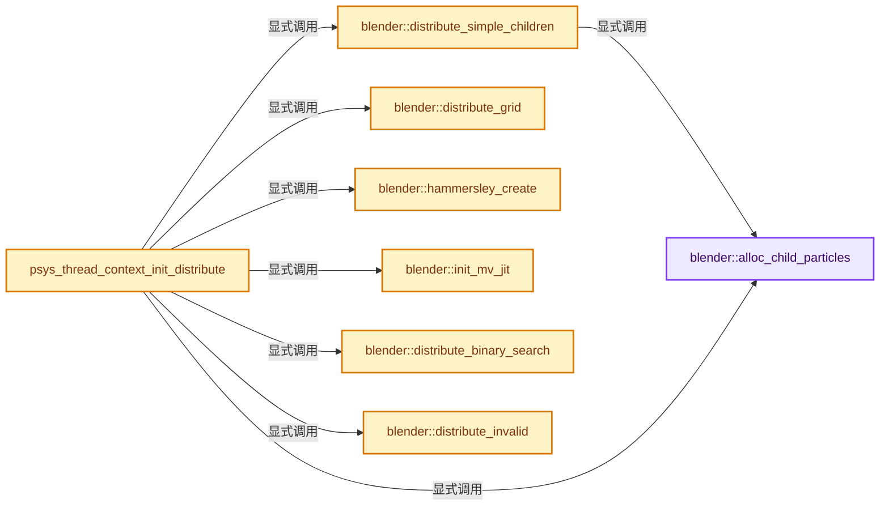
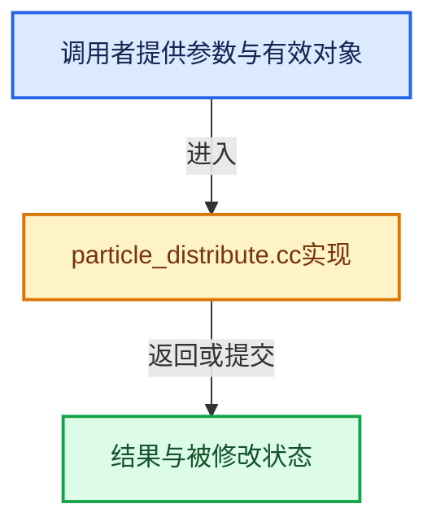

# 实现依赖专题：source/blender/blenkernel/intern/particle_distribute.cc

[实现依赖导航](../../README.md) · [符号索引](../../../00-课程指南/02-源码与提交索引/符号依赖与实现索引.md)

本专题从正文实际调用进入，集中保存共享实现。函数有稳定锚点，可从调用处直接跳到对应完整函数；递归与互相调用通过回链组织。

## 本文件的实现关系






## 完整成员与函数实现

<a id="f-3f6fb986a9b9622f"></a>

### `blender::alloc_child_particles`

实现位置：[source/blender/blenkernel/intern/particle_distribute.cc](../../../../../../../source/blender/blenkernel/intern/particle_distribute.cc) · L38—L58。

接口参数：

- `ParticleSystem *psys`
- `int tot`

**教学注释版**

<!-- annotated:83eb628d35a341 -->

```cpp
static void alloc_child_particles(ParticleSystem *psys, int tot)
{
  if (psys->child) {
    /* only re-allocate if we have to */
    if (psys->part->childtype && psys->totchild == tot) {
      std::fill_n(psys->child, tot, ChildParticle{});
      return;
    }

    MEM_delete(psys->child);
    psys->child = nullptr;
    psys->totchild = 0;
  }

  if (psys->part->childtype) {
    psys->totchild = tot;
    if (psys->totchild) {
      psys->child = MEM_new_array_zeroed<ChildParticle>(psys->totchild, "child_particles");
    }
  }
}
```

<details>
<summary>核对原始源码：source/blender/blenkernel/intern/particle_distribute.cc · L38—L58</summary>

<!-- original:83eb628d35a341:source/blender/blenkernel/intern/particle_distribute.cc:38:58 -->

```cpp
static void alloc_child_particles(ParticleSystem *psys, int tot)
{
  if (psys->child) {
    /* only re-allocate if we have to */
    if (psys->part->childtype && psys->totchild == tot) {
      std::fill_n(psys->child, tot, ChildParticle{});
      return;
    }

    MEM_delete(psys->child);
    psys->child = nullptr;
    psys->totchild = 0;
  }

  if (psys->part->childtype) {
    psys->totchild = tot;
    if (psys->totchild) {
      psys->child = MEM_new_array_zeroed<ChildParticle>(psys->totchild, "child_particles");
    }
  }
}
```

</details>

**沿实际写入检查状态**

- `psys->child = nullptr;`
- `psys->totchild = 0;`
- `psys->totchild = tot;`
- `psys->child = MEM_new_array_zeroed<ChildParticle>(psys->totchild, "child_particles");`

**继续追踪实现**

- `std::fill_n` → [外部契约](https://eel.is/c++draft/)：这个边界按实际表达式及所属类型核对参数、返回值、寿命与失败行为。这里提供接口入口，不声称已解释该第三方版本的内部实现。
- `MEM_delete` → [MEM_delete · L400](../../07-Intern运行时与平台/guardedalloc/MEM_guardedalloc.h.md#f-9049ffdd1682887c)。
- `MEM_new_array_zeroed<ChildParticle>` → [MEM_new_array_zeroed · L566](../../07-Intern运行时与平台/guardedalloc/MEM_guardedalloc.h.md#f-3a0cf63fb5216500)；[MEM_new_array_zeroed · L119](../../07-Intern运行时与平台/guardedalloc/intern/mallocn.cc.md#f-6825557da566fdbe)。同名重载需按实参类型选择。

<a id="f-2ccb936b53708d6b"></a>

### `blender::distribute_simple_children`

实现位置：[source/blender/blenkernel/intern/particle_distribute.cc](../../../../../../../source/blender/blenkernel/intern/particle_distribute.cc) · L60—L96。

接口参数：

- `Scene *scene`
- `Object *ob`
- `Mesh *final_mesh`
- `Mesh *deform_mesh`
- `ParticleSystem *psys`
- `const bool use_render_params`

**教学注释版**

<!-- annotated:5eca1783257828 -->

```cpp
static void distribute_simple_children(Scene *scene,
                                       Object *ob,
                                       Mesh *final_mesh,
                                       Mesh *deform_mesh,
                                       ParticleSystem *psys,
                                       const bool use_render_params)
{
  ChildParticle *cpa = nullptr;
  int i, p;
  const int child_num = psys_get_child_number(scene, psys, use_render_params);
  const int totpart = psys_get_tot_child(scene, psys, use_render_params);
  RNG *rng = BLI_rng_new_srandom(31415926 + psys->seed + psys->child_seed);

  alloc_child_particles(psys, totpart);

  cpa = psys->child;
  for (i = 0; i < child_num; i++) {
    for (p = 0; p < psys->totpart; p++, cpa++) {
      float length = 2.0;
      cpa->parent = p;

      /* create even spherical distribution inside unit sphere */
      while (length >= 1.0f) {
        cpa->fuv[0] = 2.0f * BLI_rng_get_float(rng) - 1.0f;
        cpa->fuv[1] = 2.0f * BLI_rng_get_float(rng) - 1.0f;
        cpa->fuv[2] = 2.0f * BLI_rng_get_float(rng) - 1.0f;
        length = len_v3(cpa->fuv);
      }

      cpa->num = -1;
    }
  }
  /* dmcache must be updated for parent particles if children from faces is used */
  psys_calc_dmcache(ob, final_mesh, deform_mesh, psys);

  BLI_rng_free(rng);
}
```

<details>
<summary>核对原始源码：source/blender/blenkernel/intern/particle_distribute.cc · L60—L96</summary>

<!-- original:5eca1783257828:source/blender/blenkernel/intern/particle_distribute.cc:60:96 -->

```cpp
static void distribute_simple_children(Scene *scene,
                                       Object *ob,
                                       Mesh *final_mesh,
                                       Mesh *deform_mesh,
                                       ParticleSystem *psys,
                                       const bool use_render_params)
{
  ChildParticle *cpa = nullptr;
  int i, p;
  const int child_num = psys_get_child_number(scene, psys, use_render_params);
  const int totpart = psys_get_tot_child(scene, psys, use_render_params);
  RNG *rng = BLI_rng_new_srandom(31415926 + psys->seed + psys->child_seed);

  alloc_child_particles(psys, totpart);

  cpa = psys->child;
  for (i = 0; i < child_num; i++) {
    for (p = 0; p < psys->totpart; p++, cpa++) {
      float length = 2.0;
      cpa->parent = p;

      /* create even spherical distribution inside unit sphere */
      while (length >= 1.0f) {
        cpa->fuv[0] = 2.0f * BLI_rng_get_float(rng) - 1.0f;
        cpa->fuv[1] = 2.0f * BLI_rng_get_float(rng) - 1.0f;
        cpa->fuv[2] = 2.0f * BLI_rng_get_float(rng) - 1.0f;
        length = len_v3(cpa->fuv);
      }

      cpa->num = -1;
    }
  }
  /* dmcache must be updated for parent particles if children from faces is used */
  psys_calc_dmcache(ob, final_mesh, deform_mesh, psys);

  BLI_rng_free(rng);
}
```

</details>

**沿实际写入检查状态**

- `cpa = psys->child;`
- `cpa->parent = p;`
- `cpa->fuv[0] = 2.0f * BLI_rng_get_float(rng) - 1.0f;`
- `cpa->fuv[1] = 2.0f * BLI_rng_get_float(rng) - 1.0f;`
- `cpa->fuv[2] = 2.0f * BLI_rng_get_float(rng) - 1.0f;`
- `length = len_v3(cpa->fuv);`
- `cpa->num = -1;`

**继续追踪实现**

- `psys_get_child_number` → [psys_get_child_number · L280](particle_system.cc.md#f-6197cf8773e5588d)。
- `psys_get_tot_child` → [psys_get_tot_child · L298](particle_system.cc.md#f-97a501e056453b9e)。
- `BLI_rng_new_srandom` → [RNG::BLI_rng_new_srandom · L48](../../01-BLI基础库/intern/rand.cc.md#f-61072c8c2d17d98d)。
- `alloc_child_particles` → [blender::alloc_child_particles · L38](particle_distribute.cc.md#f-3f6fb986a9b9622f)。
- `BLI_rng_get_float` → [RNG::BLI_rng_get_float · L90](../../01-BLI基础库/intern/rand.cc.md#f-964cd94e36f95d8f)。
- `len_v3` → [blender::len_v3 · L781](../../01-BLI基础库/intern/math_vector_inline.cc.md#f-4ad88eb0aa8d70ab)。
- `psys_calc_dmcache` → [psys_calc_dmcache · L309](particle_system.cc.md#f-c5d7777292f5b1c4)。
- `BLI_rng_free` → [RNG::BLI_rng_free · L55](../../01-BLI基础库/intern/rand.cc.md#f-366aa1dd842611e9)。

<a id="f-f28a070edf7253b1"></a>

### `blender::distribute_grid`

实现位置：[source/blender/blenkernel/intern/particle_distribute.cc](../../../../../../../source/blender/blenkernel/intern/particle_distribute.cc) · L97—L318。

接口参数：

- `Mesh *mesh`
- `ParticleSystem *psys`

**教学注释版**

<!-- annotated:cd5687ddd9c130 -->

```cpp
static void distribute_grid(Mesh *mesh, ParticleSystem *psys)
{
  ParticleData *pa = nullptr;
  float min[3], max[3], delta[3], d;
  const Span<float3> positions = mesh->vert_positions();
  int totvert = mesh->verts_num, from = psys->part->from;
  int i, j, k, p, res = psys->part->grid_res, size[3], axis;

  /* find bounding box of dm */
  if (totvert > 0) {
    INIT_MINMAX(min, max);
    for (i = 1; i < totvert; i++) {
      minmax_v3v3_v3(min, max, positions[i]);
    }
  }
  else {
    zero_v3(min);
    zero_v3(max);
  }

  sub_v3_v3v3(delta, max, min);

  /* determine major axis */
  axis = axis_dominant_v3_single(delta);

  d = delta[axis] / float(res);

  size[axis] = res;
  size[(axis + 1) % 3] = int(ceil(delta[(axis + 1) % 3] / d));
  size[(axis + 2) % 3] = int(ceil(delta[(axis + 2) % 3] / d));

  /* float errors grrr. */
  // [讲解] std::min：按比较关系选取较小值；截断范围时还需先满足非负和可表示范围，min本身不会证明边界安全。
  size[(axis + 1) % 3] = std::min(size[(axis + 1) % 3], res);
  size[(axis + 2) % 3] = std::min(size[(axis + 2) % 3], res);

  // [讲解] std::max：按比较关系选取较大值。本讲解中的增长公式同时满足最低请求和几何增长；若保存返回引用，还需注意实参寿命。
  size[0] = std::max(size[0], 1);
  size[1] = std::max(size[1], 1);
  size[2] = std::max(size[2], 1);

  /* no full offset for flat/thin objects */
  min[0] += d < delta[0] ? d / 2.0f : delta[0] / 2.0f;
  min[1] += d < delta[1] ? d / 2.0f : delta[1] / 2.0f;
  min[2] += d < delta[2] ? d / 2.0f : delta[2] / 2.0f;

  for (i = 0, p = 0, pa = psys->particles; i < res; i++) {
    for (j = 0; j < res; j++) {
      for (k = 0; k < res; k++, p++, pa++) {
        pa->fuv[0] = min[0] + float(i) * d;
        pa->fuv[1] = min[1] + float(j) * d;
        pa->fuv[2] = min[2] + float(k) * d;
        pa->flag |= PARS_UNEXIST;
        pa->hair_index = 0; /* abused in volume calculation */
      }
    }
  }

  /* enable particles near verts/edges/faces/inside surface */
  if (from == PART_FROM_VERT) {
    float vec[3];

    pa = psys->particles;

    min[0] -= d / 2.0f;
    min[1] -= d / 2.0f;
    min[2] -= d / 2.0f;

    for (i = 0; i < totvert; i++) {
      sub_v3_v3v3(vec, positions[i], min);
      vec[0] /= delta[0];
      vec[1] /= delta[1];
      vec[2] /= delta[2];
      pa[(int(vec[0] * (size[0] - 1)) * res + int(vec[1] * (size[1] - 1))) * res +
         int(vec[2] * (size[2] - 1))]
          .flag &= ~PARS_UNEXIST;
    }
  }
  else if (ELEM(from, PART_FROM_FACE, PART_FROM_VOLUME)) {
    float co1[3], co2[3];

    MFace *mface = nullptr, *mface_array;
    float v1[3], v2[3], v3[3], v4[4], lambda;
    int a, a1, a2, a0mul, a1mul, a2mul, totface;
    int amax = from == PART_FROM_FACE ? 3 : 1;

    totface = mesh->totface_legacy;
    mface = mface_array = static_cast<MFace *>(
        CustomData_get_layer_for_write(&mesh->fdata_legacy, CD_MFACE, mesh->totface_legacy));

    for (a = 0; a < amax; a++) {
      if (a == 0) {
        a0mul = res * res;
        a1mul = res;
        a2mul = 1;
      }
      else if (a == 1) {
        a0mul = res;
        a1mul = 1;
        a2mul = res * res;
      }
      else {
        a0mul = 1;
        a1mul = res * res;
        a2mul = res;
      }

      for (a1 = 0; a1 < size[(a + 1) % 3]; a1++) {
        for (a2 = 0; a2 < size[(a + 2) % 3]; a2++) {
          mface = mface_array;

          pa = psys->particles + a1 * a1mul + a2 * a2mul;
          copy_v3_v3(co1, pa->fuv);
          co1[a] -= d < delta[a] ? d / 2.0f : delta[a] / 2.0f;
          copy_v3_v3(co2, co1);
          co2[a] += delta[a] + 0.001f * d;
          co1[a] -= 0.001f * d;

          IsectRayPrecalc isect_precalc;
          float ray_direction[3];
          sub_v3_v3v3(ray_direction, co2, co1);
          isect_ray_tri_watertight_v3_precalc(&isect_precalc, ray_direction);

          /* lets intersect the faces */
          for (i = 0; i < totface; i++, mface++) {
            ParticleData *pa1 = nullptr, *pa2 = nullptr;

            copy_v3_v3(v1, positions[mface->v1]);
            copy_v3_v3(v2, positions[mface->v2]);
            copy_v3_v3(v3, positions[mface->v3]);

            bool intersects_tri = isect_ray_tri_watertight_v3(
                co1, &isect_precalc, v1, v2, v3, &lambda, nullptr);
            if (intersects_tri) {
              pa1 = (pa + int(lambda * size[a]) * a0mul);
            }

            if (mface->v4 && (!intersects_tri || from == PART_FROM_VOLUME)) {
              copy_v3_v3(v4, positions[mface->v4]);

              if (isect_ray_tri_watertight_v3(co1, &isect_precalc, v1, v3, v4, &lambda, nullptr)) {
                pa2 = (pa + int(lambda * size[a]) * a0mul);
              }
            }

            if (pa1) {
              if (from == PART_FROM_FACE) {
                pa1->flag &= ~PARS_UNEXIST;
              }
              else { /* store number of intersections */
                pa1->hair_index++;
              }
            }

            if (pa2 && pa2 != pa1) {
              if (from == PART_FROM_FACE) {
                pa2->flag &= ~PARS_UNEXIST;
              }
              else { /* store number of intersections */
                pa2->hair_index++;
              }
            }
          }

          if (from == PART_FROM_VOLUME) {
            int in = pa->hair_index % 2;
            if (in) {
              pa->hair_index++;
            }
            for (i = 0; i < size[0]; i++) {
              if (in || (pa + i * a0mul)->hair_index % 2) {
                (pa + i * a0mul)->flag &= ~PARS_UNEXIST;
              }
              /* odd intersections == in->out / out->in */
              /* even intersections -> in stays same */
              in = (in + (pa + i * a0mul)->hair_index) % 2;
            }
          }
        }
      }
    }
  }

  if (psys->part->flag & PART_GRID_HEXAGONAL) {
    for (i = 0, p = 0, pa = psys->particles; i < res; i++) {
      for (j = 0; j < res; j++) {
        for (k = 0; k < res; k++, p++, pa++) {
          if (j % 2) {
            pa->fuv[0] += d / 2.0f;
          }

          if (k % 2) {
            pa->fuv[0] += d / 2.0f;
            pa->fuv[1] += d / 2.0f;
          }
        }
      }
    }
  }

  if (psys->part->flag & PART_GRID_INVERT) {
    for (i = 0; i < size[0]; i++) {
      for (j = 0; j < size[1]; j++) {
        pa = psys->particles + res * (i * res + j);
        for (k = 0; k < size[2]; k++, pa++) {
          pa->flag ^= PARS_UNEXIST;
        }
      }
    }
  }

  if (psys->part->grid_rand > 0.0f) {
    float rfac = d * psys->part->grid_rand;
    for (p = 0, pa = psys->particles; p < psys->totpart; p++, pa++) {
      if (pa->flag & PARS_UNEXIST) {
        continue;
      }

      pa->fuv[0] += rfac * (psys_frand(psys, p + 31) - 0.5f);
      pa->fuv[1] += rfac * (psys_frand(psys, p + 32) - 0.5f);
      pa->fuv[2] += rfac * (psys_frand(psys, p + 33) - 0.5f);
    }
  }
}
```

<details>
<summary>核对原始源码：source/blender/blenkernel/intern/particle_distribute.cc · L97—L318</summary>

<!-- original:cd5687ddd9c130:source/blender/blenkernel/intern/particle_distribute.cc:97:318 -->

```cpp
static void distribute_grid(Mesh *mesh, ParticleSystem *psys)
{
  ParticleData *pa = nullptr;
  float min[3], max[3], delta[3], d;
  const Span<float3> positions = mesh->vert_positions();
  int totvert = mesh->verts_num, from = psys->part->from;
  int i, j, k, p, res = psys->part->grid_res, size[3], axis;

  /* find bounding box of dm */
  if (totvert > 0) {
    INIT_MINMAX(min, max);
    for (i = 1; i < totvert; i++) {
      minmax_v3v3_v3(min, max, positions[i]);
    }
  }
  else {
    zero_v3(min);
    zero_v3(max);
  }

  sub_v3_v3v3(delta, max, min);

  /* determine major axis */
  axis = axis_dominant_v3_single(delta);

  d = delta[axis] / float(res);

  size[axis] = res;
  size[(axis + 1) % 3] = int(ceil(delta[(axis + 1) % 3] / d));
  size[(axis + 2) % 3] = int(ceil(delta[(axis + 2) % 3] / d));

  /* float errors grrr. */
  size[(axis + 1) % 3] = std::min(size[(axis + 1) % 3], res);
  size[(axis + 2) % 3] = std::min(size[(axis + 2) % 3], res);

  size[0] = std::max(size[0], 1);
  size[1] = std::max(size[1], 1);
  size[2] = std::max(size[2], 1);

  /* no full offset for flat/thin objects */
  min[0] += d < delta[0] ? d / 2.0f : delta[0] / 2.0f;
  min[1] += d < delta[1] ? d / 2.0f : delta[1] / 2.0f;
  min[2] += d < delta[2] ? d / 2.0f : delta[2] / 2.0f;

  for (i = 0, p = 0, pa = psys->particles; i < res; i++) {
    for (j = 0; j < res; j++) {
      for (k = 0; k < res; k++, p++, pa++) {
        pa->fuv[0] = min[0] + float(i) * d;
        pa->fuv[1] = min[1] + float(j) * d;
        pa->fuv[2] = min[2] + float(k) * d;
        pa->flag |= PARS_UNEXIST;
        pa->hair_index = 0; /* abused in volume calculation */
      }
    }
  }

  /* enable particles near verts/edges/faces/inside surface */
  if (from == PART_FROM_VERT) {
    float vec[3];

    pa = psys->particles;

    min[0] -= d / 2.0f;
    min[1] -= d / 2.0f;
    min[2] -= d / 2.0f;

    for (i = 0; i < totvert; i++) {
      sub_v3_v3v3(vec, positions[i], min);
      vec[0] /= delta[0];
      vec[1] /= delta[1];
      vec[2] /= delta[2];
      pa[(int(vec[0] * (size[0] - 1)) * res + int(vec[1] * (size[1] - 1))) * res +
         int(vec[2] * (size[2] - 1))]
          .flag &= ~PARS_UNEXIST;
    }
  }
  else if (ELEM(from, PART_FROM_FACE, PART_FROM_VOLUME)) {
    float co1[3], co2[3];

    MFace *mface = nullptr, *mface_array;
    float v1[3], v2[3], v3[3], v4[4], lambda;
    int a, a1, a2, a0mul, a1mul, a2mul, totface;
    int amax = from == PART_FROM_FACE ? 3 : 1;

    totface = mesh->totface_legacy;
    mface = mface_array = static_cast<MFace *>(
        CustomData_get_layer_for_write(&mesh->fdata_legacy, CD_MFACE, mesh->totface_legacy));

    for (a = 0; a < amax; a++) {
      if (a == 0) {
        a0mul = res * res;
        a1mul = res;
        a2mul = 1;
      }
      else if (a == 1) {
        a0mul = res;
        a1mul = 1;
        a2mul = res * res;
      }
      else {
        a0mul = 1;
        a1mul = res * res;
        a2mul = res;
      }

      for (a1 = 0; a1 < size[(a + 1) % 3]; a1++) {
        for (a2 = 0; a2 < size[(a + 2) % 3]; a2++) {
          mface = mface_array;

          pa = psys->particles + a1 * a1mul + a2 * a2mul;
          copy_v3_v3(co1, pa->fuv);
          co1[a] -= d < delta[a] ? d / 2.0f : delta[a] / 2.0f;
          copy_v3_v3(co2, co1);
          co2[a] += delta[a] + 0.001f * d;
          co1[a] -= 0.001f * d;

          IsectRayPrecalc isect_precalc;
          float ray_direction[3];
          sub_v3_v3v3(ray_direction, co2, co1);
          isect_ray_tri_watertight_v3_precalc(&isect_precalc, ray_direction);

          /* lets intersect the faces */
          for (i = 0; i < totface; i++, mface++) {
            ParticleData *pa1 = nullptr, *pa2 = nullptr;

            copy_v3_v3(v1, positions[mface->v1]);
            copy_v3_v3(v2, positions[mface->v2]);
            copy_v3_v3(v3, positions[mface->v3]);

            bool intersects_tri = isect_ray_tri_watertight_v3(
                co1, &isect_precalc, v1, v2, v3, &lambda, nullptr);
            if (intersects_tri) {
              pa1 = (pa + int(lambda * size[a]) * a0mul);
            }

            if (mface->v4 && (!intersects_tri || from == PART_FROM_VOLUME)) {
              copy_v3_v3(v4, positions[mface->v4]);

              if (isect_ray_tri_watertight_v3(co1, &isect_precalc, v1, v3, v4, &lambda, nullptr)) {
                pa2 = (pa + int(lambda * size[a]) * a0mul);
              }
            }

            if (pa1) {
              if (from == PART_FROM_FACE) {
                pa1->flag &= ~PARS_UNEXIST;
              }
              else { /* store number of intersections */
                pa1->hair_index++;
              }
            }

            if (pa2 && pa2 != pa1) {
              if (from == PART_FROM_FACE) {
                pa2->flag &= ~PARS_UNEXIST;
              }
              else { /* store number of intersections */
                pa2->hair_index++;
              }
            }
          }

          if (from == PART_FROM_VOLUME) {
            int in = pa->hair_index % 2;
            if (in) {
              pa->hair_index++;
            }
            for (i = 0; i < size[0]; i++) {
              if (in || (pa + i * a0mul)->hair_index % 2) {
                (pa + i * a0mul)->flag &= ~PARS_UNEXIST;
              }
              /* odd intersections == in->out / out->in */
              /* even intersections -> in stays same */
              in = (in + (pa + i * a0mul)->hair_index) % 2;
            }
          }
        }
      }
    }
  }

  if (psys->part->flag & PART_GRID_HEXAGONAL) {
    for (i = 0, p = 0, pa = psys->particles; i < res; i++) {
      for (j = 0; j < res; j++) {
        for (k = 0; k < res; k++, p++, pa++) {
          if (j % 2) {
            pa->fuv[0] += d / 2.0f;
          }

          if (k % 2) {
            pa->fuv[0] += d / 2.0f;
            pa->fuv[1] += d / 2.0f;
          }
        }
      }
    }
  }

  if (psys->part->flag & PART_GRID_INVERT) {
    for (i = 0; i < size[0]; i++) {
      for (j = 0; j < size[1]; j++) {
        pa = psys->particles + res * (i * res + j);
        for (k = 0; k < size[2]; k++, pa++) {
          pa->flag ^= PARS_UNEXIST;
        }
      }
    }
  }

  if (psys->part->grid_rand > 0.0f) {
    float rfac = d * psys->part->grid_rand;
    for (p = 0, pa = psys->particles; p < psys->totpart; p++, pa++) {
      if (pa->flag & PARS_UNEXIST) {
        continue;
      }

      pa->fuv[0] += rfac * (psys_frand(psys, p + 31) - 0.5f);
      pa->fuv[1] += rfac * (psys_frand(psys, p + 32) - 0.5f);
      pa->fuv[2] += rfac * (psys_frand(psys, p + 33) - 0.5f);
    }
  }
}
```

</details>

**沿实际写入检查状态**

- `axis = axis_dominant_v3_single(delta);`
- `d = delta[axis] / float(res);`
- `size[axis] = res;`
- `size[0] = std::max(size[0], 1);`
- `size[1] = std::max(size[1], 1);`
- `size[2] = std::max(size[2], 1);`
- `min[0] += d < delta[0] ? d / 2.0f : delta[0] / 2.0f;`
- `min[1] += d < delta[1] ? d / 2.0f : delta[1] / 2.0f;`
- `min[2] += d < delta[2] ? d / 2.0f : delta[2] / 2.0f;`
- `pa->fuv[0] = min[0] + float(i) * d;`
- `pa->fuv[1] = min[1] + float(j) * d;`
- `pa->fuv[2] = min[2] + float(k) * d;`
- `pa->flag |= PARS_UNEXIST;`
- `pa->hair_index = 0; /* abused in volume calculation */`
- `pa = psys->particles;`
- `min[0] -= d / 2.0f;`
- `min[1] -= d / 2.0f;`
- `min[2] -= d / 2.0f;`
- `.flag &= ~PARS_UNEXIST;`
- `totface = mesh->totface_legacy;`
- `mface = mface_array = static_cast<MFace *>(`
- `a0mul = res * res;`
- `a1mul = res;`
- `a2mul = 1;`
- `a0mul = res;`
- `a1mul = 1;`
- `a2mul = res * res;`
- `a0mul = 1;`
- `a1mul = res * res;`
- `a2mul = res;`
- `mface = mface_array;`
- `pa = psys->particles + a1 * a1mul + a2 * a2mul;`
- `co1[a] -= d < delta[a] ? d / 2.0f : delta[a] / 2.0f;`
- `co2[a] += delta[a] + 0.001f * d;`
- `co1[a] -= 0.001f * d;`
- `pa1 = (pa + int(lambda * size[a]) * a0mul);`
- `pa2 = (pa + int(lambda * size[a]) * a0mul);`
- `pa1->flag &= ~PARS_UNEXIST;`
- `pa2->flag &= ~PARS_UNEXIST;`
- `in = (in + (pa + i * a0mul)->hair_index) % 2;`
- `pa->fuv[0] += d / 2.0f;`
- `pa->fuv[1] += d / 2.0f;`
- `pa = psys->particles + res * (i * res + j);`
- `pa->fuv[0] += rfac * (psys_frand(psys, p + 31) - 0.5f);`
- `pa->fuv[1] += rfac * (psys_frand(psys, p + 32) - 0.5f);`
- `pa->fuv[2] += rfac * (psys_frand(psys, p + 33) - 0.5f);`

**继续追踪实现**

- `mesh->vert_positions` → [Mesh::vert_positions · L1193](../../../05-几何存储与拓扑映射/03-MPoly迁移与兼容.md#f-ae4177e5c5f2b371)。
- `INIT_MINMAX` → [INIT_MINMAX · L31](../../01-BLI基础库/BLI_utildefines.hh.md#m-958c70eca94e)。宏定义由构建条件选择。
- `minmax_v3v3_v3` → [blender::minmax_v3v3_v3 · L716](../../01-BLI基础库/intern/math_vector.cc.md#f-9d9c3397f2360838)。
- `zero_v3` → [blender::zero_v3 · L26](../../01-BLI基础库/intern/math_vector_inline.cc.md#f-13235b08fdecb098)。
- `sub_v3_v3v3` → [blender::sub_v3_v3v3 · L360](../../01-BLI基础库/intern/math_vector_inline.cc.md#f-23781c252db8b30c)。
- `axis_dominant_v3_single` → [blender::axis_dominant_v3_single · L86](../../01-BLI基础库/intern/math_geom_inline.cc.md#f-6ecba28ecc9522c4)。
- `ceil` → [外部契约](https://eel.is/c++draft/)：这个边界按实际表达式及所属类型核对参数、返回值、寿命与失败行为。这里提供接口入口，不声称已解释该第三方版本的内部实现。
- `std::min` → [外部契约](https://eel.is/c++draft/alg.min.max)：按比较关系选取较小值；截断范围时还需先满足非负和可表示范围，min本身不会证明边界安全。
- `std::max` → [外部契约](https://eel.is/c++draft/alg.min.max)：按比较关系选取较大值。本讲解中的增长公式同时满足最低请求和几何增长；若保存返回引用，还需注意实参寿命。
- `ELEM` → [ELEM · L88](../../07-Intern运行时与平台/ghost/intern/GHOST_utildefines.hh.md#m-d28724a15928)；[ELEM · L135](../../01-BLI基础库/BLI_utildefines.hh.md#m-d6572de7cae0)。宏定义由构建条件选择。
- `CustomData_get_layer_for_write` → [blender::CustomData_get_layer_for_write · L3318](customdata.cc.md#f-6af158905e2c1274)。
- `copy_v3_v3` → [blender::copy_v3_v3 · L47](../../01-BLI基础库/intern/math_vector_inline.cc.md#f-037a0d5fa5060bd6)。
- `isect_ray_tri_watertight_v3_precalc` → [blender::isect_ray_tri_watertight_v3_precalc · L1945](../../01-BLI基础库/intern/math_geom.cc.md#f-c10872530267edab)。
- `isect_ray_tri_watertight_v3` → [blender::isect_ray_tri_watertight_v3 · L1972](../../01-BLI基础库/intern/math_geom.cc.md#f-f28795b387bf6ee2)。
- `psys_frand` → [blender::psys_frand · L256](../BKE_particle.h.md#f-0374069a50cd2f66)。

<a id="f-ac11b97b94b98a13"></a>

### `blender::hammersley_create`

实现位置：[source/blender/blenkernel/intern/particle_distribute.cc](../../../../../../../source/blender/blenkernel/intern/particle_distribute.cc) · L320—L339。

接口参数：

- `float *out`
- `int n`
- `int seed`
- `float amount`

**教学注释版**

<!-- annotated:81e2498447ef48 -->

```cpp
static void hammersley_create(float *out, int n, int seed, float amount)
{
  /* This code is originally from a modified copy from `rayshade.c`
   * (a file that's no longer included). */
  RNG *rng;

  double ofs[2], t;

  rng = BLI_rng_new(31415926 + n + seed);
  ofs[0] = BLI_rng_get_double(rng) + double(amount);
  ofs[1] = BLI_rng_get_double(rng) + double(amount);
  BLI_rng_free(rng);

  for (int k = 0; k < n; k++) {
    BLI_hammersley_1d(k, &t);

    out[2 * k + 0] = fmod(double(k) / double(n) + ofs[0], 1.0);
    out[2 * k + 1] = fmod(t + ofs[1], 1.0);
  }
}
```

<details>
<summary>核对原始源码：source/blender/blenkernel/intern/particle_distribute.cc · L320—L339</summary>

<!-- original:81e2498447ef48:source/blender/blenkernel/intern/particle_distribute.cc:320:339 -->

```cpp
static void hammersley_create(float *out, int n, int seed, float amount)
{
  /* This code is originally from a modified copy from `rayshade.c`
   * (a file that's no longer included). */
  RNG *rng;

  double ofs[2], t;

  rng = BLI_rng_new(31415926 + n + seed);
  ofs[0] = BLI_rng_get_double(rng) + double(amount);
  ofs[1] = BLI_rng_get_double(rng) + double(amount);
  BLI_rng_free(rng);

  for (int k = 0; k < n; k++) {
    BLI_hammersley_1d(k, &t);

    out[2 * k + 0] = fmod(double(k) / double(n) + ofs[0], 1.0);
    out[2 * k + 1] = fmod(t + ofs[1], 1.0);
  }
}
```

</details>

**沿实际写入检查状态**

- `rng = BLI_rng_new(31415926 + n + seed);`
- `ofs[0] = BLI_rng_get_double(rng) + double(amount);`
- `ofs[1] = BLI_rng_get_double(rng) + double(amount);`

**继续追踪实现**

- `BLI_rng_new` → [调用协议](../../../00-课程指南/01-路线与规范/模板宏与动态分派协议.md)：函数指针、局部可调用对象或未展开的宏；必须结合调用者环境。调用位置L328。
- `BLI_rng_get_double` → [RNG::BLI_rng_get_double · L85](../../01-BLI基础库/intern/rand.cc.md#f-84f75c207b68570c)。
- `BLI_rng_free` → [RNG::BLI_rng_free · L55](../../01-BLI基础库/intern/rand.cc.md#f-366aa1dd842611e9)。
- `BLI_hammersley_1d` → [RNG::BLI_hammersley_1d · L283](../../01-BLI基础库/intern/rand.cc.md#f-432b6bdfda7c0a80)。
- `fmod` → [fmod · L488](../../07-Intern运行时与平台/cycles/util/math_float4.h.md#f-0a8847d7bb4ae3b3)；[fmod · L383](../../07-Intern运行时与平台/cycles/util/math_float3.h.md#f-752e4b11eb8a06e0)；[fmod · L399](../../07-Intern运行时与平台/cycles/util/math_float3.h.md#f-cd2eb4989dc0822b)；[fmod · L231](../../07-Intern运行时与平台/cycles/util/math_float2.h.md#f-9a1d0eb1fe2260e4)。同名重载需按实参类型选择。

<a id="f-9b4018b5cb7a2d66"></a>

### `blender::init_mv_jit`

实现位置：[source/blender/blenkernel/intern/particle_distribute.cc](../../../../../../../source/blender/blenkernel/intern/particle_distribute.cc) · L342—L384。

接口参数：

- `float *jit`
- `int num`
- `int seed2`
- `float amount`

**教学注释版**

<!-- annotated:2eb27f5fd86892 -->

```cpp
static void init_mv_jit(float *jit, int num, int seed2, float amount)
{
  RNG *rng;
  float *jit2, x, rad1, rad2, rad3;
  int i, num2;

  if (num == 0) {
    return;
  }

  rad1 = (1.0f / sqrtf(float(num)));
  rad2 = (1.0f / float(num));
  rad3 = (sqrtf(float(num)) / float(num));

  rng = BLI_rng_new(31415926 + num + seed2);
  x = 0;
  num2 = 2 * num;
  for (i = 0; i < num2; i += 2) {

    jit[i] = x + amount * rad1 * (0.5f - BLI_rng_get_float(rng));
    jit[i + 1] = i / (2.0f * num) + amount * rad1 * (0.5f - BLI_rng_get_float(rng));

    jit[i] -= floor(jit[i]);
    jit[i + 1] -= floor(jit[i + 1]);

    x += rad3;
    x -= floor(x);
  }

  /* FIXME: The `+ 3` number of items does not seem to be required? */
  jit2 = MEM_new_array_uninitialized<float>(3 + 2 * size_t(num), "initjit");

  for (i = 0; i < 4; i++) {
    BLI_jitterate1(
        reinterpret_cast<float (*)[2]>(jit), reinterpret_cast<float (*)[2]>(jit2), num, rad1);
    BLI_jitterate1(
        reinterpret_cast<float (*)[2]>(jit), reinterpret_cast<float (*)[2]>(jit2), num, rad1);
    BLI_jitterate2(
        reinterpret_cast<float (*)[2]>(jit), reinterpret_cast<float (*)[2]>(jit2), num, rad2);
  }
  MEM_delete(jit2);
  BLI_rng_free(rng);
}
```

<details>
<summary>核对原始源码：source/blender/blenkernel/intern/particle_distribute.cc · L342—L384</summary>

<!-- original:2eb27f5fd86892:source/blender/blenkernel/intern/particle_distribute.cc:342:384 -->

```cpp
static void init_mv_jit(float *jit, int num, int seed2, float amount)
{
  RNG *rng;
  float *jit2, x, rad1, rad2, rad3;
  int i, num2;

  if (num == 0) {
    return;
  }

  rad1 = (1.0f / sqrtf(float(num)));
  rad2 = (1.0f / float(num));
  rad3 = (sqrtf(float(num)) / float(num));

  rng = BLI_rng_new(31415926 + num + seed2);
  x = 0;
  num2 = 2 * num;
  for (i = 0; i < num2; i += 2) {

    jit[i] = x + amount * rad1 * (0.5f - BLI_rng_get_float(rng));
    jit[i + 1] = i / (2.0f * num) + amount * rad1 * (0.5f - BLI_rng_get_float(rng));

    jit[i] -= floor(jit[i]);
    jit[i + 1] -= floor(jit[i + 1]);

    x += rad3;
    x -= floor(x);
  }

  /* FIXME: The `+ 3` number of items does not seem to be required? */
  jit2 = MEM_new_array_uninitialized<float>(3 + 2 * size_t(num), "initjit");

  for (i = 0; i < 4; i++) {
    BLI_jitterate1(
        reinterpret_cast<float (*)[2]>(jit), reinterpret_cast<float (*)[2]>(jit2), num, rad1);
    BLI_jitterate1(
        reinterpret_cast<float (*)[2]>(jit), reinterpret_cast<float (*)[2]>(jit2), num, rad1);
    BLI_jitterate2(
        reinterpret_cast<float (*)[2]>(jit), reinterpret_cast<float (*)[2]>(jit2), num, rad2);
  }
  MEM_delete(jit2);
  BLI_rng_free(rng);
}
```

</details>

**沿实际写入检查状态**

- `rad1 = (1.0f / sqrtf(float(num)));`
- `rad2 = (1.0f / float(num));`
- `rad3 = (sqrtf(float(num)) / float(num));`
- `rng = BLI_rng_new(31415926 + num + seed2);`
- `x = 0;`
- `num2 = 2 * num;`
- `jit[i] = x + amount * rad1 * (0.5f - BLI_rng_get_float(rng));`
- `jit[i] -= floor(jit[i]);`
- `x += rad3;`
- `x -= floor(x);`
- `jit2 = MEM_new_array_uninitialized<float>(3 + 2 * size_t(num), "initjit");`

**继续追踪实现**

- `sqrtf` → [外部契约](https://eel.is/c++draft/)：这个边界按实际表达式及所属类型核对参数、返回值、寿命与失败行为。这里提供接口入口，不声称已解释该第三方版本的内部实现。
- `BLI_rng_new` → [调用协议](../../../00-课程指南/01-路线与规范/模板宏与动态分派协议.md)：函数指针、局部可调用对象或未展开的宏；必须结合调用者环境。调用位置L356。
- `BLI_rng_get_float` → [RNG::BLI_rng_get_float · L90](../../01-BLI基础库/intern/rand.cc.md#f-964cd94e36f95d8f)。
- `floor` → [外部契约](https://eel.is/c++draft/)：这个边界按实际表达式及所属类型核对参数、返回值、寿命与失败行为。这里提供接口入口，不声称已解释该第三方版本的内部实现。
- `MEM_new_array_uninitialized<float>` → [MEM_new_array_uninitialized · L608](../../07-Intern运行时与平台/guardedalloc/MEM_guardedalloc.h.md#f-b7103eae8eb57b05)；[MEM_new_array_uninitialized · L129](../../07-Intern运行时与平台/guardedalloc/intern/mallocn.cc.md#f-bf6ef4ddcfb6e5df)。同名重载需按实参类型选择。
- `BLI_jitterate1` → [blender::BLI_jitterate1 · L21](../../01-BLI基础库/intern/jitter_2d.cc.md#f-448acb6346acbd67)。
- `BLI_jitterate2` → [blender::BLI_jitterate2 · L79](../../01-BLI基础库/intern/jitter_2d.cc.md#f-ea1f41c34facd5aa)。
- `MEM_delete` → [MEM_delete · L400](../../07-Intern运行时与平台/guardedalloc/MEM_guardedalloc.h.md#f-9049ffdd1682887c)。
- `BLI_rng_free` → [RNG::BLI_rng_free · L55](../../01-BLI基础库/intern/rand.cc.md#f-366aa1dd842611e9)。

<a id="f-3a2062edfd30142c"></a>

### `blender::distribute_binary_search`

实现位置：[source/blender/blenkernel/intern/particle_distribute.cc](../../../../../../../source/blender/blenkernel/intern/particle_distribute.cc) · L426—L458。

接口参数：

- `const float *sum`
- `int n`
- `float value`

**教学注释版**

<!-- annotated:450436c1c6e785 -->

```cpp
static int distribute_binary_search(const float *sum, int n, float value)
{
  int mid, low = 0, high = n - 1;

  if (high == low) {
    return low;
  }

  if (sum[low] >= value) {
    return low;
  }

  if (sum[high - 1] < value) {
    return high;
  }

  while (low < high) {
    mid = (low + high) / 2;

    if ((sum[mid] >= value) && (sum[mid - 1] < value)) {
      return mid;
    }

    if (sum[mid] > value) {
      high = mid - 1;
    }
    else {
      low = mid + 1;
    }
  }

  return low;
}
```

<details>
<summary>核对原始源码：source/blender/blenkernel/intern/particle_distribute.cc · L426—L458</summary>

<!-- original:450436c1c6e785:source/blender/blenkernel/intern/particle_distribute.cc:426:458 -->

```cpp
static int distribute_binary_search(const float *sum, int n, float value)
{
  int mid, low = 0, high = n - 1;

  if (high == low) {
    return low;
  }

  if (sum[low] >= value) {
    return low;
  }

  if (sum[high - 1] < value) {
    return high;
  }

  while (low < high) {
    mid = (low + high) / 2;

    if ((sum[mid] >= value) && (sum[mid - 1] < value)) {
      return mid;
    }

    if (sum[mid] > value) {
      high = mid - 1;
    }
    else {
      low = mid + 1;
    }
  }

  return low;
}
```

</details>

**沿实际写入检查状态**

- `mid = (low + high) / 2;`
- `high = mid - 1;`
- `low = mid + 1;`

**结果出口**

- `return low;`
- `return high;`
- `return mid;`

**继续追踪实现**

本实现没有需要继续展开的显式调用；检查返回表达式、对象转换和调用者前置条件。

<a id="f-e4a4ff35fe4497c3"></a>

### `blender::distribute_invalid`

实现位置：[source/blender/blenkernel/intern/particle_distribute.cc](../../../../../../../source/blender/blenkernel/intern/particle_distribute.cc) · L860—L888。

接口参数：

- `ParticleSimulationData *sim`
- `int from`

**教学注释版**

<!-- annotated:b00019e121f55c -->

```cpp
static void distribute_invalid(ParticleSimulationData *sim, int from)
{
  Scene *scene = sim->scene;
  ParticleSystem *psys = sim->psys;
  const bool use_render_params = (DEG_get_mode(sim->depsgraph) == DAG_EVAL_RENDER);

  if (from == PART_FROM_CHILD) {
    ChildParticle *cpa;
    int p, totchild = psys_get_tot_child(scene, psys, use_render_params);

    if (psys->child && totchild) {
      for (p = 0, cpa = psys->child; p < totchild; p++, cpa++) {
        cpa->fuv[0] = cpa->fuv[1] = cpa->fuv[2] = cpa->fuv[3] = 0.0;
        cpa->foffset = 0.0f;
        cpa->parent = 0;
        cpa->pa[0] = cpa->pa[1] = cpa->pa[2] = cpa->pa[3] = 0;
        cpa->num = -1;
      }
    }
  }
  else {
    PARTICLE_P;
    LOOP_PARTICLES
    {
      pa->fuv[0] = pa->fuv[1] = pa->fuv[2] = pa->fuv[3] = 0.0;
      pa->foffset = 0.0f;
      pa->num = -1;
    }
  }
```

<details>
<summary>核对原始源码：source/blender/blenkernel/intern/particle_distribute.cc · L860—L888</summary>

<!-- original:b00019e121f55c:source/blender/blenkernel/intern/particle_distribute.cc:860:888 -->

```cpp
static void distribute_invalid(ParticleSimulationData *sim, int from)
{
  Scene *scene = sim->scene;
  ParticleSystem *psys = sim->psys;
  const bool use_render_params = (DEG_get_mode(sim->depsgraph) == DAG_EVAL_RENDER);

  if (from == PART_FROM_CHILD) {
    ChildParticle *cpa;
    int p, totchild = psys_get_tot_child(scene, psys, use_render_params);

    if (psys->child && totchild) {
      for (p = 0, cpa = psys->child; p < totchild; p++, cpa++) {
        cpa->fuv[0] = cpa->fuv[1] = cpa->fuv[2] = cpa->fuv[3] = 0.0;
        cpa->foffset = 0.0f;
        cpa->parent = 0;
        cpa->pa[0] = cpa->pa[1] = cpa->pa[2] = cpa->pa[3] = 0;
        cpa->num = -1;
      }
    }
  }
  else {
    PARTICLE_P;
    LOOP_PARTICLES
    {
      pa->fuv[0] = pa->fuv[1] = pa->fuv[2] = pa->fuv[3] = 0.0;
      pa->foffset = 0.0f;
      pa->num = -1;
    }
  }
```

</details>

**沿实际写入检查状态**

- `cpa->fuv[0] = cpa->fuv[1] = cpa->fuv[2] = cpa->fuv[3] = 0.0;`
- `cpa->foffset = 0.0f;`
- `cpa->parent = 0;`
- `cpa->pa[0] = cpa->pa[1] = cpa->pa[2] = cpa->pa[3] = 0;`
- `cpa->num = -1;`
- `pa->fuv[0] = pa->fuv[1] = pa->fuv[2] = pa->fuv[3] = 0.0;`
- `pa->foffset = 0.0f;`
- `pa->num = -1;`

**继续追踪实现**

- `DEG_get_mode` → [blender::DEG_get_mode · L99](../../06-Depsgraph依赖图/intern/depsgraph_query.cc.md#f-fa117f51322cd95c)。
- `psys_get_tot_child` → [psys_get_tot_child · L298](particle_system.cc.md#f-97a501e056453b9e)。

<a id="f-57fcfd15570d728c"></a>

### `psys_thread_context_init_distribute`

实现位置：[source/blender/blenkernel/intern/particle_distribute.cc](../../../../../../../source/blender/blenkernel/intern/particle_distribute.cc) · L892—L1333。

接口参数：

- `ParticleThreadContext *ctx`
- `ParticleSimulationData *sim`
- `int from`

**教学注释版**

<!-- annotated:84eb03f384297a -->

```cpp
static int psys_thread_context_init_distribute(ParticleThreadContext *ctx,
                                               ParticleSimulationData *sim,
                                               int from)
{
  Scene *scene = sim->scene;
  Mesh *final_mesh = sim->psmd->mesh_final;
  Object *ob = sim->ob;
  ParticleSystem *psys = sim->psys;
  ParticleData *pa = nullptr, *tpars = nullptr;
  ParticleSettings *part;
  ParticleSeam *seams = nullptr;
  KDTree<float3> *tree = nullptr;
  Mesh *mesh = nullptr;
  float *jit = nullptr;
  int i, p = 0;
  int cfrom = 0;
  int totelem = 0, totpart, *particle_element = nullptr, children = 0, totseam = 0;
  int jitlevel = 1, distr;
  float *element_weight = nullptr, *jitter_offset = nullptr, *vweight = nullptr;
  float cur, maxweight = 0.0, tweight, totweight, inv_totweight, co[3], nor[3], orco[3];
  RNG *rng = nullptr;

  if (ELEM(nullptr, ob, psys, psys->part)) {
    return 0;
  }

  part = psys->part;
  totpart = psys->totpart;
  if (totpart == 0) {
    return 0;
  }

  if (!final_mesh->runtime->deformed_only &&
      !CustomData_get_layer(&final_mesh->fdata_legacy, CD_ORIGINDEX))
  {
    printf(
        "Can't create particles with the current modifier stack, disable destructive modifiers\n");
    // XXX error("Can't paint with the current modifier stack, disable destructive modifiers");
    return 0;
  }

  /* XXX This distribution code is totally broken in case from == PART_FROM_CHILD,
   *     it's always using `final_mesh` even if use_modifier_stack is unset...
   *     But making things consistent here break all existing edited
   *     hair systems, so better wait for complete rewrite. */

  psys_thread_context_init(ctx, sim);

  const bool use_render_params = (DEG_get_mode(sim->depsgraph) == DAG_EVAL_RENDER);

  /* First handle special cases */
  if (from == PART_FROM_CHILD) {
    /* Simple children */
    if (part->childtype != PART_CHILD_FACES) {
      distribute_simple_children(
          scene, ob, final_mesh, sim->psmd->mesh_original, psys, use_render_params);
      return 0;
    }
  }
  else {
    /* Grid distribution */
    if (part->distr == PART_DISTR_GRID && from != PART_FROM_VERT) {
      if (psys->part->use_modifier_stack) {
        mesh = final_mesh;
      }
      else {
        mesh = id_cast<Mesh *>(BKE_id_copy_ex(
            nullptr, static_cast<const ID *>(ob->data), nullptr, LIB_ID_COPY_LOCALIZE));
      }
      BKE_mesh_tessface_ensure(mesh);

      distribute_grid(mesh, psys);

      if (mesh != final_mesh) {
        BKE_id_free(nullptr, mesh);
      }

      return 0;
    }
  }

  /* After this #BKE_mesh_orco_verts_transform can be used safely from multiple threads. */
  BKE_mesh_texspace_ensure(final_mesh);

  /* Create trees and original coordinates if needed */
  if (from == PART_FROM_CHILD) {
    distr = PART_DISTR_RAND;
    rng = BLI_rng_new_srandom(31415926 + psys->seed + psys->child_seed);
    mesh = final_mesh;

    /* BMESH ONLY */
    BKE_mesh_tessface_ensure(mesh);

    children = 1;

    tree = kdtree_new<float3>(totpart);

    for (p = 0, pa = psys->particles; p < totpart; p++, pa++) {
      psys_particle_on_dm(mesh,
                          part->from,
                          pa->num,
                          pa->num_dmcache,
                          pa->fuv,
                          pa->foffset,
                          co,
                          nor,
                          nullptr,
                          nullptr,
                          orco);
      BKE_mesh_orco_verts_transform(id_cast<Mesh *>(ob->data), &orco, 1, true);
      kdtree_insert<float3>(tree, p, orco);
    }

    kdtree_balance<float3>(tree);

    totpart = psys_get_tot_child(scene, psys, use_render_params);
    cfrom = from = PART_FROM_FACE;
  }
  else {
    distr = part->distr;

    rng = BLI_rng_new_srandom(31415926 + psys->seed);

    if (psys->part->use_modifier_stack) {
      mesh = final_mesh;
    }
    else {
      mesh = id_cast<Mesh *>(BKE_id_copy_ex(
          nullptr, static_cast<const ID *>(ob->data), nullptr, LIB_ID_COPY_LOCALIZE));
    }

    BKE_mesh_tessface_ensure(mesh);

    /* we need orco for consistent distributions */
    BKE_mesh_orco_ensure(ob, mesh);

    if (from == PART_FROM_VERT) {
      const Span<float3> positions = mesh->vert_positions();
      const float (*orcodata)[3] = static_cast<const float (*)[3]>(
          CustomData_get_layer(&mesh->vert_data, CD_ORCO));
      int totvert = mesh->verts_num;

      tree = kdtree_new<float3>(totvert);

      for (p = 0; p < totvert; p++) {
        if (orcodata) {
          copy_v3_v3(co, orcodata[p]);
          BKE_mesh_orco_verts_transform(id_cast<Mesh *>(ob->data), &co, 1, true);
        }
        else {
          copy_v3_v3(co, positions[p]);
        }
        kdtree_insert<float3>(tree, p, co);
      }

      kdtree_balance<float3>(tree);
    }
  }

  /* Get total number of emission elements and allocate needed arrays */
  totelem = (from == PART_FROM_VERT) ? mesh->verts_num : mesh->totface_legacy;

  if (totelem == 0) {
    distribute_invalid(sim, children ? PART_FROM_CHILD : 0);

    if (G.debug & G_DEBUG) {
      fprintf(stderr, "Particle distribution error: Nothing to emit from!\n");
    }

    if (mesh != final_mesh) {
      BKE_id_free(nullptr, mesh);
    }

    kdtree_free<float3>(tree);
    BLI_rng_free(rng);

    return 0;
  }

  element_weight = MEM_new_array_zeroed<float>(totelem, "particle_distribution_weights");
  particle_element = MEM_new_array_zeroed<int>(totpart, "particle_distribution_indexes");
  jitter_offset = MEM_new_array_zeroed<float>(totelem, "particle_distribution_jitoff");

  /* Calculate weights from face areas */
  if ((part->flag & PART_EDISTR || children) && from != PART_FROM_VERT) {
    float totarea = 0.0f, co1[3], co2[3], co3[3], co4[3];
    const float (*orcodata)[3];

    orcodata = static_cast<const float (*)[3]>(CustomData_get_layer(&mesh->vert_data, CD_ORCO));

    MFace *mfaces = static_cast<MFace *>(
        CustomData_get_layer_for_write(&mesh->fdata_legacy, CD_MFACE, mesh->totface_legacy));
    for (i = 0; i < totelem; i++) {
      MFace *mf = &mfaces[i];

      if (orcodata) {
        /* Transform orcos from normalized 0..1 to object space. */
        copy_v3_v3(co1, orcodata[mf->v1]);
        copy_v3_v3(co2, orcodata[mf->v2]);
        copy_v3_v3(co3, orcodata[mf->v3]);
        BKE_mesh_orco_verts_transform(id_cast<Mesh *>(ob->data), &co1, 1, true);
        BKE_mesh_orco_verts_transform(id_cast<Mesh *>(ob->data), &co2, 1, true);
        BKE_mesh_orco_verts_transform(id_cast<Mesh *>(ob->data), &co3, 1, true);
        if (mf->v4) {
          copy_v3_v3(co4, orcodata[mf->v4]);
          BKE_mesh_orco_verts_transform(id_cast<Mesh *>(ob->data), &co4, 1, true);
        }
      }
      else {
        MutableSpan<float3> positions = mesh->vert_positions_for_write();
        copy_v3_v3(co1, positions[mf->v1]);
        copy_v3_v3(co2, positions[mf->v2]);
        copy_v3_v3(co3, positions[mf->v3]);
        if (mf->v4) {
          copy_v3_v3(co4, positions[mf->v4]);
        }
      }

      cur = mf->v4 ? area_quad_v3(co1, co2, co3, co4) : area_tri_v3(co1, co2, co3);

      // [讲解] std::max：按比较关系选取较大值。本讲解中的增长公式同时满足最低请求和几何增长；若保存返回引用，还需注意实参寿命。
      maxweight = std::max(cur, maxweight);

      element_weight[i] = cur;
      totarea += cur;
    }

    for (i = 0; i < totelem; i++) {
      element_weight[i] /= totarea;
    }

    maxweight /= totarea;
  }
  else {
    // [讲解] std::min：按比较关系选取较小值；截断范围时还需先满足非负和可表示范围，min本身不会证明边界安全。
    float min = 1.0f / float(std::min(totelem, totpart));
    for (i = 0; i < totelem; i++) {
      element_weight[i] = min;
    }
    maxweight = min;
  }

  /* Calculate weights from vgroup */
  vweight = psys_cache_vgroup(mesh, psys, PSYS_VG_DENSITY);

  if (vweight) {
    if (from == PART_FROM_VERT) {
      for (i = 0; i < totelem; i++) {
        element_weight[i] *= vweight[i];
      }
    }
    else { /* PART_FROM_FACE / PART_FROM_VOLUME */
      MFace *mfaces = static_cast<MFace *>(
          CustomData_get_layer_for_write(&mesh->fdata_legacy, CD_MFACE, mesh->totface_legacy));
      for (i = 0; i < totelem; i++) {
        MFace *mf = &mfaces[i];
        tweight = vweight[mf->v1] + vweight[mf->v2] + vweight[mf->v3];

        if (mf->v4) {
          tweight += vweight[mf->v4];
          tweight /= 4.0f;
        }
        else {
          tweight /= 3.0f;
        }

        element_weight[i] *= tweight;
      }
    }
    MEM_delete(vweight);
  }

  /* Calculate total weight of all elements */
  int totmapped = 0;
  totweight = 0.0f;
  for (i = 0; i < totelem; i++) {
    if (element_weight[i] > 0.0f) {
      totmapped++;
      totweight += element_weight[i];
    }
  }

  if (totmapped == 0) {
    /* We are not allowed to distribute particles anywhere... */
    if (mesh != final_mesh) {
      BKE_id_free(nullptr, mesh);
    }
    kdtree_free<float3>(tree);
    BLI_rng_free(rng);
    MEM_delete(element_weight);
    MEM_delete(particle_element);
    MEM_delete(jitter_offset);
    return 0;
  }

  inv_totweight = 1.0f / totweight;

  /* Calculate cumulative weights.
   * We remove all null-weighted elements from element_sum, and create a new mapping
   * 'activ'_elem_index -> orig_elem_index.
   * This simplifies greatly the filtering of zero-weighted items - and can be much more efficient
   * especially in random case (reducing a lot the size of binary-searched array)...
   */
  float *element_sum = MEM_new_array_uninitialized<float>(size_t(totmapped), __func__);
  int *element_map = MEM_new_array_uninitialized<int>(size_t(totmapped), __func__);
  int i_mapped = 0;

  for (i = 0; i < totelem && element_weight[i] == 0.0f; i++) {
    /* pass */
  }
  element_sum[i_mapped] = element_weight[i] * inv_totweight;
  element_map[i_mapped] = i;
  i_mapped++;
  for (i++; i < totelem; i++) {
    if (element_weight[i] > 0.0f) {
      element_sum[i_mapped] = element_sum[i_mapped - 1] + element_weight[i] * inv_totweight;
      /* Skip elements which weight is so small that it does not affect the sum. */
      if (element_sum[i_mapped] > element_sum[i_mapped - 1]) {
        element_map[i_mapped] = i;
        i_mapped++;
      }
    }
  }
  totmapped = i_mapped;

  /* Finally assign elements to particles */
  if (part->flag & PART_TRAND) {
    for (p = 0; p < totpart; p++) {
      /* In theory element_sum[totmapped - 1] should be 1.0,
       * but due to float errors this is not necessarily always true, so scale pos accordingly. */
      const float pos = BLI_rng_get_float(rng) * element_sum[totmapped - 1];
      const int eidx = distribute_binary_search(element_sum, totmapped, pos);
      particle_element[p] = element_map[eidx];
      BLI_assert(pos <= element_sum[eidx]);
      BLI_assert(eidx ? (pos > element_sum[eidx - 1]) : (pos >= 0.0f));
      jitter_offset[particle_element[p]] = pos;
    }
  }
  else {
    double step, pos;

    step = (totpart < 2) ? 0.5 : 1.0 / double(totpart);
    /* This is to address tricky issues with vertex-emitting when user tries
     * (and expects) exact 1-1 vert/part distribution (see #47983 and its two example files).
     * It allows us to consider pos as 'midpoint between v and v+1'
     * (or 'p and p+1', depending whether we have more vertices than particles or not),
     * and avoid stumbling over float impression in element_sum.
     * NOTE: moved face and volume distribution to this as well (instead of starting at zero),
     * for the same reasons, see #52682. */
    pos = (totpart < totmapped) ? 0.5 / double(totmapped) :
                                  step * 0.5; /* We choose the smaller step. */

    for (i = 0, p = 0; p < totpart; p++, pos += step) {
      for (; (i < totmapped - 1) && (pos > double(element_sum[i])); i++) {
        /* pass */
      }

      particle_element[p] = element_map[i];

      jitter_offset[particle_element[p]] = pos;
    }
  }

  MEM_delete(element_sum);
  MEM_delete(element_map);

  /* For hair, sort by #CD_ORIGINDEX (allows optimization's in rendering),
   * however with virtual parents the children need to be in random order. */
  if (part->type == PART_HAIR && !(part->childtype == PART_CHILD_FACES && part->parents != 0.0f)) {
    const int *orig_index = nullptr;

    if (from == PART_FROM_VERT) {
      if (mesh->verts_num) {
        orig_index = static_cast<const int *>(
            CustomData_get_layer(&mesh->vert_data, CD_ORIGINDEX));
      }
    }
    else {
      if (mesh->totface_legacy) {
        orig_index = static_cast<const int *>(
            CustomData_get_layer(&mesh->fdata_legacy, CD_ORIGINDEX));
      }
    }

    if (orig_index) {
      BLI_qsort_r(particle_element,
                  totpart,
                  sizeof(int),
                  distribute_compare_orig_index,
                  (void *)orig_index);
    }
  }

  /* Create jittering if needed */
  if (distr == PART_DISTR_JIT && ELEM(from, PART_FROM_FACE, PART_FROM_VOLUME)) {
    jitlevel = part->userjit;

    if (jitlevel == 0) {
      jitlevel = totpart / totelem;
      if (part->flag & PART_EDISTR) {
        jitlevel *= 2; /* looks better in general, not very scientific */
      }
      jitlevel = std::max(jitlevel, 3);
    }

    jit = MEM_new_array_zeroed<float>(2 + size_t(jitlevel * 2), "jit");

    /* for small amounts of particles we use regular jitter since it looks
     * a bit better, for larger amounts we switch to hammersley sequence
     * because it is much faster */
    if (jitlevel < 25) {
      init_mv_jit(jit, jitlevel, psys->seed, part->jitfac);
    }
    else {
      hammersley_create(jit, jitlevel + 1, psys->seed, part->jitfac);
    }
    BLI_array_randomize(
        jit, sizeof(float[2]), jitlevel, psys->seed); /* for custom jit or even distribution */
  }

  /* Setup things for threaded distribution */
  ctx->tree = tree;
  ctx->seams = seams;
  ctx->totseam = totseam;
  ctx->sim.psys = psys;
  ctx->index = particle_element;
  ctx->jit = jit;
  ctx->jitlevel = jitlevel;
  ctx->jitoff = jitter_offset;
  ctx->weight = element_weight;
  ctx->maxweight = maxweight;
  ctx->cfrom = cfrom;
  ctx->distr = distr;
  ctx->mesh = mesh;
  ctx->tpars = tpars;

  if (children) {
    alloc_child_particles(psys, totpart);
  }

  BLI_rng_free(rng);

  return 1;
}
```

<details>
<summary>核对原始源码：source/blender/blenkernel/intern/particle_distribute.cc · L892—L1333</summary>

<!-- original:84eb03f384297a:source/blender/blenkernel/intern/particle_distribute.cc:892:1333 -->

```cpp
static int psys_thread_context_init_distribute(ParticleThreadContext *ctx,
                                               ParticleSimulationData *sim,
                                               int from)
{
  Scene *scene = sim->scene;
  Mesh *final_mesh = sim->psmd->mesh_final;
  Object *ob = sim->ob;
  ParticleSystem *psys = sim->psys;
  ParticleData *pa = nullptr, *tpars = nullptr;
  ParticleSettings *part;
  ParticleSeam *seams = nullptr;
  KDTree<float3> *tree = nullptr;
  Mesh *mesh = nullptr;
  float *jit = nullptr;
  int i, p = 0;
  int cfrom = 0;
  int totelem = 0, totpart, *particle_element = nullptr, children = 0, totseam = 0;
  int jitlevel = 1, distr;
  float *element_weight = nullptr, *jitter_offset = nullptr, *vweight = nullptr;
  float cur, maxweight = 0.0, tweight, totweight, inv_totweight, co[3], nor[3], orco[3];
  RNG *rng = nullptr;

  if (ELEM(nullptr, ob, psys, psys->part)) {
    return 0;
  }

  part = psys->part;
  totpart = psys->totpart;
  if (totpart == 0) {
    return 0;
  }

  if (!final_mesh->runtime->deformed_only &&
      !CustomData_get_layer(&final_mesh->fdata_legacy, CD_ORIGINDEX))
  {
    printf(
        "Can't create particles with the current modifier stack, disable destructive modifiers\n");
    // XXX error("Can't paint with the current modifier stack, disable destructive modifiers");
    return 0;
  }

  /* XXX This distribution code is totally broken in case from == PART_FROM_CHILD,
   *     it's always using `final_mesh` even if use_modifier_stack is unset...
   *     But making things consistent here break all existing edited
   *     hair systems, so better wait for complete rewrite. */

  psys_thread_context_init(ctx, sim);

  const bool use_render_params = (DEG_get_mode(sim->depsgraph) == DAG_EVAL_RENDER);

  /* First handle special cases */
  if (from == PART_FROM_CHILD) {
    /* Simple children */
    if (part->childtype != PART_CHILD_FACES) {
      distribute_simple_children(
          scene, ob, final_mesh, sim->psmd->mesh_original, psys, use_render_params);
      return 0;
    }
  }
  else {
    /* Grid distribution */
    if (part->distr == PART_DISTR_GRID && from != PART_FROM_VERT) {
      if (psys->part->use_modifier_stack) {
        mesh = final_mesh;
      }
      else {
        mesh = id_cast<Mesh *>(BKE_id_copy_ex(
            nullptr, static_cast<const ID *>(ob->data), nullptr, LIB_ID_COPY_LOCALIZE));
      }
      BKE_mesh_tessface_ensure(mesh);

      distribute_grid(mesh, psys);

      if (mesh != final_mesh) {
        BKE_id_free(nullptr, mesh);
      }

      return 0;
    }
  }

  /* After this #BKE_mesh_orco_verts_transform can be used safely from multiple threads. */
  BKE_mesh_texspace_ensure(final_mesh);

  /* Create trees and original coordinates if needed */
  if (from == PART_FROM_CHILD) {
    distr = PART_DISTR_RAND;
    rng = BLI_rng_new_srandom(31415926 + psys->seed + psys->child_seed);
    mesh = final_mesh;

    /* BMESH ONLY */
    BKE_mesh_tessface_ensure(mesh);

    children = 1;

    tree = kdtree_new<float3>(totpart);

    for (p = 0, pa = psys->particles; p < totpart; p++, pa++) {
      psys_particle_on_dm(mesh,
                          part->from,
                          pa->num,
                          pa->num_dmcache,
                          pa->fuv,
                          pa->foffset,
                          co,
                          nor,
                          nullptr,
                          nullptr,
                          orco);
      BKE_mesh_orco_verts_transform(id_cast<Mesh *>(ob->data), &orco, 1, true);
      kdtree_insert<float3>(tree, p, orco);
    }

    kdtree_balance<float3>(tree);

    totpart = psys_get_tot_child(scene, psys, use_render_params);
    cfrom = from = PART_FROM_FACE;
  }
  else {
    distr = part->distr;

    rng = BLI_rng_new_srandom(31415926 + psys->seed);

    if (psys->part->use_modifier_stack) {
      mesh = final_mesh;
    }
    else {
      mesh = id_cast<Mesh *>(BKE_id_copy_ex(
          nullptr, static_cast<const ID *>(ob->data), nullptr, LIB_ID_COPY_LOCALIZE));
    }

    BKE_mesh_tessface_ensure(mesh);

    /* we need orco for consistent distributions */
    BKE_mesh_orco_ensure(ob, mesh);

    if (from == PART_FROM_VERT) {
      const Span<float3> positions = mesh->vert_positions();
      const float (*orcodata)[3] = static_cast<const float (*)[3]>(
          CustomData_get_layer(&mesh->vert_data, CD_ORCO));
      int totvert = mesh->verts_num;

      tree = kdtree_new<float3>(totvert);

      for (p = 0; p < totvert; p++) {
        if (orcodata) {
          copy_v3_v3(co, orcodata[p]);
          BKE_mesh_orco_verts_transform(id_cast<Mesh *>(ob->data), &co, 1, true);
        }
        else {
          copy_v3_v3(co, positions[p]);
        }
        kdtree_insert<float3>(tree, p, co);
      }

      kdtree_balance<float3>(tree);
    }
  }

  /* Get total number of emission elements and allocate needed arrays */
  totelem = (from == PART_FROM_VERT) ? mesh->verts_num : mesh->totface_legacy;

  if (totelem == 0) {
    distribute_invalid(sim, children ? PART_FROM_CHILD : 0);

    if (G.debug & G_DEBUG) {
      fprintf(stderr, "Particle distribution error: Nothing to emit from!\n");
    }

    if (mesh != final_mesh) {
      BKE_id_free(nullptr, mesh);
    }

    kdtree_free<float3>(tree);
    BLI_rng_free(rng);

    return 0;
  }

  element_weight = MEM_new_array_zeroed<float>(totelem, "particle_distribution_weights");
  particle_element = MEM_new_array_zeroed<int>(totpart, "particle_distribution_indexes");
  jitter_offset = MEM_new_array_zeroed<float>(totelem, "particle_distribution_jitoff");

  /* Calculate weights from face areas */
  if ((part->flag & PART_EDISTR || children) && from != PART_FROM_VERT) {
    float totarea = 0.0f, co1[3], co2[3], co3[3], co4[3];
    const float (*orcodata)[3];

    orcodata = static_cast<const float (*)[3]>(CustomData_get_layer(&mesh->vert_data, CD_ORCO));

    MFace *mfaces = static_cast<MFace *>(
        CustomData_get_layer_for_write(&mesh->fdata_legacy, CD_MFACE, mesh->totface_legacy));
    for (i = 0; i < totelem; i++) {
      MFace *mf = &mfaces[i];

      if (orcodata) {
        /* Transform orcos from normalized 0..1 to object space. */
        copy_v3_v3(co1, orcodata[mf->v1]);
        copy_v3_v3(co2, orcodata[mf->v2]);
        copy_v3_v3(co3, orcodata[mf->v3]);
        BKE_mesh_orco_verts_transform(id_cast<Mesh *>(ob->data), &co1, 1, true);
        BKE_mesh_orco_verts_transform(id_cast<Mesh *>(ob->data), &co2, 1, true);
        BKE_mesh_orco_verts_transform(id_cast<Mesh *>(ob->data), &co3, 1, true);
        if (mf->v4) {
          copy_v3_v3(co4, orcodata[mf->v4]);
          BKE_mesh_orco_verts_transform(id_cast<Mesh *>(ob->data), &co4, 1, true);
        }
      }
      else {
        MutableSpan<float3> positions = mesh->vert_positions_for_write();
        copy_v3_v3(co1, positions[mf->v1]);
        copy_v3_v3(co2, positions[mf->v2]);
        copy_v3_v3(co3, positions[mf->v3]);
        if (mf->v4) {
          copy_v3_v3(co4, positions[mf->v4]);
        }
      }

      cur = mf->v4 ? area_quad_v3(co1, co2, co3, co4) : area_tri_v3(co1, co2, co3);

      maxweight = std::max(cur, maxweight);

      element_weight[i] = cur;
      totarea += cur;
    }

    for (i = 0; i < totelem; i++) {
      element_weight[i] /= totarea;
    }

    maxweight /= totarea;
  }
  else {
    float min = 1.0f / float(std::min(totelem, totpart));
    for (i = 0; i < totelem; i++) {
      element_weight[i] = min;
    }
    maxweight = min;
  }

  /* Calculate weights from vgroup */
  vweight = psys_cache_vgroup(mesh, psys, PSYS_VG_DENSITY);

  if (vweight) {
    if (from == PART_FROM_VERT) {
      for (i = 0; i < totelem; i++) {
        element_weight[i] *= vweight[i];
      }
    }
    else { /* PART_FROM_FACE / PART_FROM_VOLUME */
      MFace *mfaces = static_cast<MFace *>(
          CustomData_get_layer_for_write(&mesh->fdata_legacy, CD_MFACE, mesh->totface_legacy));
      for (i = 0; i < totelem; i++) {
        MFace *mf = &mfaces[i];
        tweight = vweight[mf->v1] + vweight[mf->v2] + vweight[mf->v3];

        if (mf->v4) {
          tweight += vweight[mf->v4];
          tweight /= 4.0f;
        }
        else {
          tweight /= 3.0f;
        }

        element_weight[i] *= tweight;
      }
    }
    MEM_delete(vweight);
  }

  /* Calculate total weight of all elements */
  int totmapped = 0;
  totweight = 0.0f;
  for (i = 0; i < totelem; i++) {
    if (element_weight[i] > 0.0f) {
      totmapped++;
      totweight += element_weight[i];
    }
  }

  if (totmapped == 0) {
    /* We are not allowed to distribute particles anywhere... */
    if (mesh != final_mesh) {
      BKE_id_free(nullptr, mesh);
    }
    kdtree_free<float3>(tree);
    BLI_rng_free(rng);
    MEM_delete(element_weight);
    MEM_delete(particle_element);
    MEM_delete(jitter_offset);
    return 0;
  }

  inv_totweight = 1.0f / totweight;

  /* Calculate cumulative weights.
   * We remove all null-weighted elements from element_sum, and create a new mapping
   * 'activ'_elem_index -> orig_elem_index.
   * This simplifies greatly the filtering of zero-weighted items - and can be much more efficient
   * especially in random case (reducing a lot the size of binary-searched array)...
   */
  float *element_sum = MEM_new_array_uninitialized<float>(size_t(totmapped), __func__);
  int *element_map = MEM_new_array_uninitialized<int>(size_t(totmapped), __func__);
  int i_mapped = 0;

  for (i = 0; i < totelem && element_weight[i] == 0.0f; i++) {
    /* pass */
  }
  element_sum[i_mapped] = element_weight[i] * inv_totweight;
  element_map[i_mapped] = i;
  i_mapped++;
  for (i++; i < totelem; i++) {
    if (element_weight[i] > 0.0f) {
      element_sum[i_mapped] = element_sum[i_mapped - 1] + element_weight[i] * inv_totweight;
      /* Skip elements which weight is so small that it does not affect the sum. */
      if (element_sum[i_mapped] > element_sum[i_mapped - 1]) {
        element_map[i_mapped] = i;
        i_mapped++;
      }
    }
  }
  totmapped = i_mapped;

  /* Finally assign elements to particles */
  if (part->flag & PART_TRAND) {
    for (p = 0; p < totpart; p++) {
      /* In theory element_sum[totmapped - 1] should be 1.0,
       * but due to float errors this is not necessarily always true, so scale pos accordingly. */
      const float pos = BLI_rng_get_float(rng) * element_sum[totmapped - 1];
      const int eidx = distribute_binary_search(element_sum, totmapped, pos);
      particle_element[p] = element_map[eidx];
      BLI_assert(pos <= element_sum[eidx]);
      BLI_assert(eidx ? (pos > element_sum[eidx - 1]) : (pos >= 0.0f));
      jitter_offset[particle_element[p]] = pos;
    }
  }
  else {
    double step, pos;

    step = (totpart < 2) ? 0.5 : 1.0 / double(totpart);
    /* This is to address tricky issues with vertex-emitting when user tries
     * (and expects) exact 1-1 vert/part distribution (see #47983 and its two example files).
     * It allows us to consider pos as 'midpoint between v and v+1'
     * (or 'p and p+1', depending whether we have more vertices than particles or not),
     * and avoid stumbling over float impression in element_sum.
     * NOTE: moved face and volume distribution to this as well (instead of starting at zero),
     * for the same reasons, see #52682. */
    pos = (totpart < totmapped) ? 0.5 / double(totmapped) :
                                  step * 0.5; /* We choose the smaller step. */

    for (i = 0, p = 0; p < totpart; p++, pos += step) {
      for (; (i < totmapped - 1) && (pos > double(element_sum[i])); i++) {
        /* pass */
      }

      particle_element[p] = element_map[i];

      jitter_offset[particle_element[p]] = pos;
    }
  }

  MEM_delete(element_sum);
  MEM_delete(element_map);

  /* For hair, sort by #CD_ORIGINDEX (allows optimization's in rendering),
   * however with virtual parents the children need to be in random order. */
  if (part->type == PART_HAIR && !(part->childtype == PART_CHILD_FACES && part->parents != 0.0f)) {
    const int *orig_index = nullptr;

    if (from == PART_FROM_VERT) {
      if (mesh->verts_num) {
        orig_index = static_cast<const int *>(
            CustomData_get_layer(&mesh->vert_data, CD_ORIGINDEX));
      }
    }
    else {
      if (mesh->totface_legacy) {
        orig_index = static_cast<const int *>(
            CustomData_get_layer(&mesh->fdata_legacy, CD_ORIGINDEX));
      }
    }

    if (orig_index) {
      BLI_qsort_r(particle_element,
                  totpart,
                  sizeof(int),
                  distribute_compare_orig_index,
                  (void *)orig_index);
    }
  }

  /* Create jittering if needed */
  if (distr == PART_DISTR_JIT && ELEM(from, PART_FROM_FACE, PART_FROM_VOLUME)) {
    jitlevel = part->userjit;

    if (jitlevel == 0) {
      jitlevel = totpart / totelem;
      if (part->flag & PART_EDISTR) {
        jitlevel *= 2; /* looks better in general, not very scientific */
      }
      jitlevel = std::max(jitlevel, 3);
    }

    jit = MEM_new_array_zeroed<float>(2 + size_t(jitlevel * 2), "jit");

    /* for small amounts of particles we use regular jitter since it looks
     * a bit better, for larger amounts we switch to hammersley sequence
     * because it is much faster */
    if (jitlevel < 25) {
      init_mv_jit(jit, jitlevel, psys->seed, part->jitfac);
    }
    else {
      hammersley_create(jit, jitlevel + 1, psys->seed, part->jitfac);
    }
    BLI_array_randomize(
        jit, sizeof(float[2]), jitlevel, psys->seed); /* for custom jit or even distribution */
  }

  /* Setup things for threaded distribution */
  ctx->tree = tree;
  ctx->seams = seams;
  ctx->totseam = totseam;
  ctx->sim.psys = psys;
  ctx->index = particle_element;
  ctx->jit = jit;
  ctx->jitlevel = jitlevel;
  ctx->jitoff = jitter_offset;
  ctx->weight = element_weight;
  ctx->maxweight = maxweight;
  ctx->cfrom = cfrom;
  ctx->distr = distr;
  ctx->mesh = mesh;
  ctx->tpars = tpars;

  if (children) {
    alloc_child_particles(psys, totpart);
  }

  BLI_rng_free(rng);

  return 1;
}
```

</details>

**沿实际写入检查状态**

- `part = psys->part;`
- `totpart = psys->totpart;`
- `mesh = final_mesh;`
- `mesh = id_cast<Mesh *>(BKE_id_copy_ex(`
- `distr = PART_DISTR_RAND;`
- `rng = BLI_rng_new_srandom(31415926 + psys->seed + psys->child_seed);`
- `children = 1;`
- `tree = kdtree_new<float3>(totpart);`
- `totpart = psys_get_tot_child(scene, psys, use_render_params);`
- `cfrom = from = PART_FROM_FACE;`
- `distr = part->distr;`
- `rng = BLI_rng_new_srandom(31415926 + psys->seed);`
- `tree = kdtree_new<float3>(totvert);`
- `totelem = (from == PART_FROM_VERT) ? mesh->verts_num : mesh->totface_legacy;`
- `element_weight = MEM_new_array_zeroed<float>(totelem, "particle_distribution_weights");`
- `particle_element = MEM_new_array_zeroed<int>(totpart, "particle_distribution_indexes");`
- `jitter_offset = MEM_new_array_zeroed<float>(totelem, "particle_distribution_jitoff");`
- `orcodata = static_cast<const float (*)[3]>(CustomData_get_layer(&mesh->vert_data, CD_ORCO));`
- `cur = mf->v4 ? area_quad_v3(co1, co2, co3, co4) : area_tri_v3(co1, co2, co3);`
- `maxweight = std::max(cur, maxweight);`
- `element_weight[i] = cur;`
- `totarea += cur;`
- `element_weight[i] = min;`
- `maxweight = min;`
- `vweight = psys_cache_vgroup(mesh, psys, PSYS_VG_DENSITY);`
- `element_weight[i] *= vweight[i];`
- `tweight = vweight[mf->v1] + vweight[mf->v2] + vweight[mf->v3];`
- `tweight += vweight[mf->v4];`
- `element_weight[i] *= tweight;`
- `totweight = 0.0f;`
- `totweight += element_weight[i];`
- `inv_totweight = 1.0f / totweight;`
- `element_sum[i_mapped] = element_weight[i] * inv_totweight;`
- `element_map[i_mapped] = i;`
- `element_sum[i_mapped] = element_sum[i_mapped - 1] + element_weight[i] * inv_totweight;`
- `totmapped = i_mapped;`
- `particle_element[p] = element_map[eidx];`
- `jitter_offset[particle_element[p]] = pos;`
- `step = (totpart < 2) ? 0.5 : 1.0 / double(totpart);`
- `pos = (totpart < totmapped) ? 0.5 / double(totmapped) :`
- `particle_element[p] = element_map[i];`
- `orig_index = static_cast<const int *>(`
- `jitlevel = part->userjit;`
- `jitlevel = totpart / totelem;`
- `jitlevel *= 2; /* looks better in general, not very scientific */`
- `jitlevel = std::max(jitlevel, 3);`
- `jit = MEM_new_array_zeroed<float>(2 + size_t(jitlevel * 2), "jit");`
- `ctx->tree = tree;`
- `ctx->seams = seams;`
- `ctx->totseam = totseam;`
- `ctx->sim.psys = psys;`
- `ctx->index = particle_element;`
- `ctx->jit = jit;`
- `ctx->jitlevel = jitlevel;`
- `ctx->jitoff = jitter_offset;`
- `ctx->weight = element_weight;`
- `ctx->maxweight = maxweight;`
- `ctx->cfrom = cfrom;`
- `ctx->distr = distr;`
- `ctx->mesh = mesh;`
- `ctx->tpars = tpars;`

**结果出口**

- `return 0;`
- `return 1;`

**继续追踪实现**

- `ELEM` → [ELEM · L88](../../07-Intern运行时与平台/ghost/intern/GHOST_utildefines.hh.md#m-d28724a15928)；[ELEM · L135](../../01-BLI基础库/BLI_utildefines.hh.md#m-d6572de7cae0)。宏定义由构建条件选择。
- `CustomData_get_layer` → [blender::CustomData_get_layer · L3308](customdata.cc.md#f-add1273f3ef3e57b)。
- `printf` → [外部契约](https://eel.is/c++draft/)：这个边界按实际表达式及所属类型核对参数、返回值、寿命与失败行为。这里提供接口入口，不声称已解释该第三方版本的内部实现。
- `psys_thread_context_init` → [psys_thread_context_init · L442](particle_system.cc.md#f-57f0a0e50d7df192)。
- `DEG_get_mode` → [blender::DEG_get_mode · L99](../../06-Depsgraph依赖图/intern/depsgraph_query.cc.md#f-fa117f51322cd95c)。
- `distribute_simple_children` → [blender::distribute_simple_children · L60](particle_distribute.cc.md#f-2ccb936b53708d6b)。
- `id_cast<Mesh *>` → [blender::id_cast · L1417](../../08-其他Blender模块/makesdna/DNA_ID.h.md#f-6c8ac6412850ac5a)。
- `BKE_id_copy_ex` → [blender::BKE_id_copy_ex · L851](lib_id.cc.md#f-24272170c95f49fb)。
- `BKE_mesh_tessface_ensure` → [BKE_mesh_tessface_ensure · L1246](mesh_legacy_convert.cc.md#f-75cbf0000e6885fb)。
- `distribute_grid` → [blender::distribute_grid · L97](particle_distribute.cc.md#f-f28a070edf7253b1)。
- `BKE_id_free` → [blender::BKE_id_free · L224](lib_id_delete.cc.md#f-28ed02c41d0f2d5b)。
- `BKE_mesh_texspace_ensure` → [BKE_mesh_texspace_ensure · L1685](../../../05-几何存储与拓扑映射/03-MPoly迁移与兼容.md#f-a6adaa6cf1c082d5)。
- `BLI_rng_new_srandom` → [RNG::BLI_rng_new_srandom · L48](../../01-BLI基础库/intern/rand.cc.md#f-61072c8c2d17d98d)。
- `kdtree_new<float3>` → [blender::kdtree_new · L65](../../01-BLI基础库/BLI_kdtree.hh.md#f-46a3316dfd09a49e)。
- `psys_particle_on_dm` → [psys_particle_on_dm · L2023](particle.cc.md#f-48429f3f43d570a2)。
- `BKE_mesh_orco_verts_transform` → [BKE_mesh_orco_verts_transform · L1737](../../../05-几何存储与拓扑映射/03-MPoly迁移与兼容.md#f-0310af64073b6afe)；[BKE_mesh_orco_verts_transform · L1760](../../../05-几何存储与拓扑映射/03-MPoly迁移与兼容.md#f-1e12235ffe4ed6d7)。同名重载需按实参类型选择。
- `kdtree_insert<float3>` → [blender::kdtree_insert · L95](../../01-BLI基础库/BLI_kdtree.hh.md#f-ed9cb6449add9ae9)。
- `kdtree_balance<float3>` → [调用协议](../../../00-课程指南/01-路线与规范/模板宏与动态分派协议.md)：函数指针、局部可调用对象或未展开的宏；必须结合调用者环境。调用位置L1005。
- `psys_get_tot_child` → [psys_get_tot_child · L298](particle_system.cc.md#f-97a501e056453b9e)。
- `BKE_mesh_orco_ensure` → [BKE_mesh_orco_ensure · L1765](../../../05-几何存储与拓扑映射/03-MPoly迁移与兼容.md#f-ae5ef716846ed6a3)。
- `mesh->vert_positions` → [Mesh::vert_positions · L1193](../../../05-几何存储与拓扑映射/03-MPoly迁移与兼容.md#f-ae4177e5c5f2b371)。
- `copy_v3_v3` → [copy_v3_v3 · L828](../../07-Intern运行时与平台/cycles/util/math_float3.h.md#f-5c67e0fefe437332)。
- `distribute_invalid` → [blender::distribute_invalid · L860](particle_distribute.cc.md#f-e4a4ff35fe4497c3)。
- `fprintf` → [外部契约](https://eel.is/c++draft/)：这个边界按实际表达式及所属类型核对参数、返回值、寿命与失败行为。这里提供接口入口，不声称已解释该第三方版本的内部实现。
- `kdtree_free<float3>` → [blender::kdtree_free · L84](../../01-BLI基础库/BLI_kdtree.hh.md#f-29e79484de22f4be)。
- `BLI_rng_free` → [RNG::BLI_rng_free · L55](../../01-BLI基础库/intern/rand.cc.md#f-366aa1dd842611e9)。
- `MEM_new_array_zeroed<float>` → [MEM_new_array_zeroed · L566](../../07-Intern运行时与平台/guardedalloc/MEM_guardedalloc.h.md#f-3a0cf63fb5216500)；[MEM_new_array_zeroed · L119](../../07-Intern运行时与平台/guardedalloc/intern/mallocn.cc.md#f-6825557da566fdbe)。同名重载需按实参类型选择。
- `MEM_new_array_zeroed<int>` → [MEM_new_array_zeroed · L566](../../07-Intern运行时与平台/guardedalloc/MEM_guardedalloc.h.md#f-3a0cf63fb5216500)；[MEM_new_array_zeroed · L119](../../07-Intern运行时与平台/guardedalloc/intern/mallocn.cc.md#f-6825557da566fdbe)。同名重载需按实参类型选择。
- `CustomData_get_layer_for_write` → [blender::CustomData_get_layer_for_write · L3318](customdata.cc.md#f-6af158905e2c1274)。
- `mesh->vert_positions_for_write` → [Mesh::vert_positions_for_write · L1199](../../../05-几何存储与拓扑映射/03-MPoly迁移与兼容.md#f-ae8d77205112d843)。
- `area_quad_v3` → [blender::area_quad_v3 · L89](../../01-BLI基础库/intern/math_geom.cc.md#f-bc4046dd9b017278)。
- `area_tri_v3` → [blender::area_tri_v3 · L104](../../01-BLI基础库/intern/math_geom.cc.md#f-010c0a7f618cbedf)。
- `std::max` → [外部契约](https://eel.is/c++draft/alg.min.max)：按比较关系选取较大值。本讲解中的增长公式同时满足最低请求和几何增长；若保存返回引用，还需注意实参寿命。
- `std::min` → [外部契约](https://eel.is/c++draft/alg.min.max)：按比较关系选取较小值；截断范围时还需先满足非负和可表示范围，min本身不会证明边界安全。
- `psys_cache_vgroup` → [psys_cache_vgroup · L2588](particle.cc.md#f-a9542467ee5aaa49)。
- `MEM_delete` → [MEM_delete · L400](../../07-Intern运行时与平台/guardedalloc/MEM_guardedalloc.h.md#f-9049ffdd1682887c)。
- `MEM_new_array_uninitialized<float>` → [MEM_new_array_uninitialized · L608](../../07-Intern运行时与平台/guardedalloc/MEM_guardedalloc.h.md#f-b7103eae8eb57b05)；[MEM_new_array_uninitialized · L129](../../07-Intern运行时与平台/guardedalloc/intern/mallocn.cc.md#f-bf6ef4ddcfb6e5df)。同名重载需按实参类型选择。
- `MEM_new_array_uninitialized<int>` → [MEM_new_array_uninitialized · L608](../../07-Intern运行时与平台/guardedalloc/MEM_guardedalloc.h.md#f-b7103eae8eb57b05)；[MEM_new_array_uninitialized · L129](../../07-Intern运行时与平台/guardedalloc/intern/mallocn.cc.md#f-bf6ef4ddcfb6e5df)。同名重载需按实参类型选择。
- `BLI_rng_get_float` → [RNG::BLI_rng_get_float · L90](../../01-BLI基础库/intern/rand.cc.md#f-964cd94e36f95d8f)。
- `distribute_binary_search` → [blender::distribute_binary_search · L426](particle_distribute.cc.md#f-3a2062edfd30142c)。
- `BLI_assert` → [BLI_assert · L48](../../01-BLI基础库/BLI_assert.hh.md#m-57a88495704d)；[BLI_assert · L63](../../01-BLI基础库/BLI_assert.hh.md#m-d07050020cb5)。宏定义由构建条件选择。
- `BLI_qsort_r` → [blender::BLI_qsort_r · L79](../../01-BLI基础库/intern/sort.cc.md#f-d3c955dfd6a91345)。
- `init_mv_jit` → [blender::init_mv_jit · L342](particle_distribute.cc.md#f-9b4018b5cb7a2d66)。
- `hammersley_create` → [blender::hammersley_create · L320](particle_distribute.cc.md#f-ac11b97b94b98a13)。
- `BLI_array_randomize` → [RNG::BLI_array_randomize · L158](../../01-BLI基础库/intern/rand.cc.md#f-527f498096e29f49)。
- `alloc_child_particles` → [blender::alloc_child_particles · L38](particle_distribute.cc.md#f-3f6fb986a9b9622f)。

<a id="f-597ff6e8095d9276"></a>

### `psys_task_init_distribute`

实现位置：[source/blender/blenkernel/intern/particle_distribute.cc](../../../../../../../source/blender/blenkernel/intern/particle_distribute.cc) · L1335—L1341。

接口参数：

- `ParticleTask *task`
- `ParticleSimulationData *sim`

**教学注释版**

<!-- annotated:79f64a79d6612f -->

```cpp
static void psys_task_init_distribute(ParticleTask *task, ParticleSimulationData *sim)
{
  /* init random number generator */
  int seed = 31415926 + sim->psys->seed;

  task->rng = BLI_rng_new(seed);
}
```

<details>
<summary>核对原始源码：source/blender/blenkernel/intern/particle_distribute.cc · L1335—L1341</summary>

<!-- original:79f64a79d6612f:source/blender/blenkernel/intern/particle_distribute.cc:1335:1341 -->

```cpp
static void psys_task_init_distribute(ParticleTask *task, ParticleSimulationData *sim)
{
  /* init random number generator */
  int seed = 31415926 + sim->psys->seed;

  task->rng = BLI_rng_new(seed);
}
```

</details>

**沿实际写入检查状态**

- `task->rng = BLI_rng_new(seed);`

**继续追踪实现**

- `BLI_rng_new` → [调用协议](../../../00-课程指南/01-路线与规范/模板宏与动态分派协议.md)：函数指针、局部可调用对象或未展开的宏；必须结合调用者环境。调用位置L1340。

<a id="f-a3eeacf8c89f7874"></a>

### `distribute_particles_on_dm`

实现位置：[source/blender/blenkernel/intern/particle_distribute.cc](../../../../../../../source/blender/blenkernel/intern/particle_distribute.cc) · L1343—L1379。

接口参数：

- `ParticleSimulationData *sim`
- `int from`

**教学注释版**

<!-- annotated:4185743aa7a0f0 -->

```cpp
static void distribute_particles_on_dm(ParticleSimulationData *sim, int from)
{
  ParticleThreadContext ctx;
  Mesh *final_mesh = sim->psmd->mesh_final;

  /* create a task pool for distribution tasks */
  if (!psys_thread_context_init_distribute(&ctx, sim, from)) {
    return;
  }

  TaskPool *task_pool = BLI_task_pool_create(&ctx, TASK_PRIORITY_HIGH);

  const int totpart = (from == PART_FROM_CHILD ? sim->psys->totchild : sim->psys->totpart);
  Vector<ParticleTask> tasks = psys_tasks_create(&ctx, 0, totpart);
  for (ParticleTask &task : tasks) {
    psys_task_init_distribute(&task, sim);
    if (from == PART_FROM_CHILD) {
      BLI_task_pool_push(task_pool, exec_distribute_child, &task, false, nullptr);
    }
    else {
      BLI_task_pool_push(task_pool, exec_distribute_parent, &task, false, nullptr);
    }
  }
  BLI_task_pool_work_and_wait(task_pool);

  BLI_task_pool_free(task_pool);

  psys_calc_dmcache(sim->ob, final_mesh, sim->psmd->mesh_original, sim->psys);

  if (ctx.mesh != final_mesh) {
    BKE_id_free(nullptr, ctx.mesh);
  }

  psys_tasks_free(tasks);

  psys_thread_context_free(&ctx);
}
```

<details>
<summary>核对原始源码：source/blender/blenkernel/intern/particle_distribute.cc · L1343—L1379</summary>

<!-- original:4185743aa7a0f0:source/blender/blenkernel/intern/particle_distribute.cc:1343:1379 -->

```cpp
static void distribute_particles_on_dm(ParticleSimulationData *sim, int from)
{
  ParticleThreadContext ctx;
  Mesh *final_mesh = sim->psmd->mesh_final;

  /* create a task pool for distribution tasks */
  if (!psys_thread_context_init_distribute(&ctx, sim, from)) {
    return;
  }

  TaskPool *task_pool = BLI_task_pool_create(&ctx, TASK_PRIORITY_HIGH);

  const int totpart = (from == PART_FROM_CHILD ? sim->psys->totchild : sim->psys->totpart);
  Vector<ParticleTask> tasks = psys_tasks_create(&ctx, 0, totpart);
  for (ParticleTask &task : tasks) {
    psys_task_init_distribute(&task, sim);
    if (from == PART_FROM_CHILD) {
      BLI_task_pool_push(task_pool, exec_distribute_child, &task, false, nullptr);
    }
    else {
      BLI_task_pool_push(task_pool, exec_distribute_parent, &task, false, nullptr);
    }
  }
  BLI_task_pool_work_and_wait(task_pool);

  BLI_task_pool_free(task_pool);

  psys_calc_dmcache(sim->ob, final_mesh, sim->psmd->mesh_original, sim->psys);

  if (ctx.mesh != final_mesh) {
    BKE_id_free(nullptr, ctx.mesh);
  }

  psys_tasks_free(tasks);

  psys_thread_context_free(&ctx);
}
```

</details>

**继续追踪实现**

- `psys_thread_context_init_distribute` → [psys_thread_context_init_distribute · L892](particle_distribute.cc.md#f-57fcfd15570d728c)。
- `BLI_task_pool_create` → [BLI_task_pool_create · L404](../../../11-Depsgraph与并行任务系统/07-任务池与TBB接入.md#f-1bbb9c0703fd163c)。
- `psys_tasks_create` → [psys_tasks_create · L450](particle_system.cc.md#f-40d90a2807eb481e)。
- `psys_task_init_distribute` → [psys_task_init_distribute · L1335](particle_distribute.cc.md#f-597ff6e8095d9276)。
- `BLI_task_pool_push` → [BLI_task_pool_push · L446](../../../11-Depsgraph与并行任务系统/07-任务池与TBB接入.md#f-16c248b3ea6653d2)。
- `BLI_task_pool_work_and_wait` → [BLI_task_pool_work_and_wait · L455](../../../11-Depsgraph与并行任务系统/07-任务池与TBB接入.md#f-cece9e6aa22a9121)。
- `BLI_task_pool_free` → [BLI_task_pool_free · L441](../../../11-Depsgraph与并行任务系统/07-任务池与TBB接入.md#f-b9af08e8b1362aaa)。
- `psys_calc_dmcache` → [psys_calc_dmcache · L309](particle_system.cc.md#f-c5d7777292f5b1c4)。
- `BKE_id_free` → [blender::BKE_id_free · L224](lib_id_delete.cc.md#f-28ed02c41d0f2d5b)。
- `psys_tasks_free` → [psys_tasks_free · L474](particle_system.cc.md#f-4db1f3a663e72e4c)。
- `psys_thread_context_free` → [psys_thread_context_free · L489](particle_system.cc.md#f-b32fc5fabed7cf2b)。

<a id="f-9f7d0b8f67b53fc0"></a>

### `distribute_particles_on_shape`

实现位置：[source/blender/blenkernel/intern/particle_distribute.cc](../../../../../../../source/blender/blenkernel/intern/particle_distribute.cc) · L1382—L1387。

接口参数：

- `ParticleSimulationData *sim`
- `int`

**教学注释版**

<!-- annotated:0c0b6409a6a767 -->

```cpp
static void distribute_particles_on_shape(ParticleSimulationData *sim, int /*from*/)
{
  distribute_invalid(sim, 0);

  fprintf(stderr, "Shape emission not yet possible!\n");
}
```

<details>
<summary>核对原始源码：source/blender/blenkernel/intern/particle_distribute.cc · L1382—L1387</summary>

<!-- original:0c0b6409a6a767:source/blender/blenkernel/intern/particle_distribute.cc:1382:1387 -->

```cpp
static void distribute_particles_on_shape(ParticleSimulationData *sim, int /*from*/)
{
  distribute_invalid(sim, 0);

  fprintf(stderr, "Shape emission not yet possible!\n");
}
```

</details>

**继续追踪实现**

- `distribute_invalid` → [blender::distribute_invalid · L860](particle_distribute.cc.md#f-e4a4ff35fe4497c3)。
- `fprintf` → [外部契约](https://eel.is/c++draft/)：这个边界按实际表达式及所属类型核对参数、返回值、寿命与失败行为。这里提供接口入口，不声称已解释该第三方版本的内部实现。

<a id="f-87828881119c7c84"></a>

### `distribute_particles`

实现位置：[source/blender/blenkernel/intern/particle_distribute.cc](../../../../../../../source/blender/blenkernel/intern/particle_distribute.cc) · L1389—L1411。

接口参数：

- `ParticleSimulationData *sim`
- `int from`

**教学注释版**

<!-- annotated:eda998905024f7 -->

```cpp
void distribute_particles(ParticleSimulationData *sim, int from)
{
  PARTICLE_PSMD;
  int distr_error = 0;

  if (psmd) {
    if (psmd->mesh_final) {
      distribute_particles_on_dm(sim, from);
    }
    else {
      distr_error = 1;
    }
  }
  else {
    distribute_particles_on_shape(sim, from);
  }

  if (distr_error) {
    distribute_invalid(sim, from);

    fprintf(stderr, "Particle distribution error!\n");
  }
}
```

<details>
<summary>核对原始源码：source/blender/blenkernel/intern/particle_distribute.cc · L1389—L1411</summary>

<!-- original:eda998905024f7:source/blender/blenkernel/intern/particle_distribute.cc:1389:1411 -->

```cpp
void distribute_particles(ParticleSimulationData *sim, int from)
{
  PARTICLE_PSMD;
  int distr_error = 0;

  if (psmd) {
    if (psmd->mesh_final) {
      distribute_particles_on_dm(sim, from);
    }
    else {
      distr_error = 1;
    }
  }
  else {
    distribute_particles_on_shape(sim, from);
  }

  if (distr_error) {
    distribute_invalid(sim, from);

    fprintf(stderr, "Particle distribution error!\n");
  }
}
```

</details>

**沿实际写入检查状态**

- `distr_error = 1;`

**继续追踪实现**

- `distribute_particles_on_dm` → [distribute_particles_on_dm · L1343](particle_distribute.cc.md#f-a3eeacf8c89f7874)。
- `distribute_particles_on_shape` → [distribute_particles_on_shape · L1382](particle_distribute.cc.md#f-9f7d0b8f67b53fc0)。
- `distribute_invalid` → [blender::distribute_invalid · L860](particle_distribute.cc.md#f-e4a4ff35fe4497c3)。
- `fprintf` → [外部契约](https://eel.is/c++draft/)：这个边界按实际表达式及所属类型核对参数、返回值、寿命与失败行为。这里提供接口入口，不声称已解释该第三方版本的内部实现。
