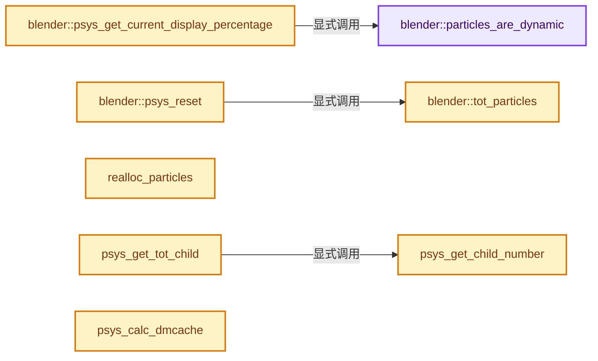

# 实现依赖专题：source/blender/blenkernel/intern/particle_system.cc

[实现依赖导航](../../README.md) · [符号索引](../../../00-课程指南/02-源码与提交索引/符号依赖与实现索引.md)

本专题从正文实际调用进入，集中保存共享实现。函数有稳定锚点，可从调用处直接跳到对应完整函数；递归与互相调用通过回链组织。

## 本文件的实现关系




## 完整成员与函数实现

<a id="f-28997d71607e577d"></a>

### `blender::particles_are_dynamic`

实现位置：[source/blender/blenkernel/intern/particle_system.cc](../../../../../../../source/blender/blenkernel/intern/particle_system.cc) · L82—L93。

接口参数：

- `ParticleSystem *psys`

**教学注释版**

<!-- annotated:a814247503b36f -->

```cpp
static int particles_are_dynamic(ParticleSystem *psys)
{
  if (psys->pointcache->flag & PTCACHE_BAKED) {
    return 0;
  }

  if (psys->part->type == PART_HAIR) {
    return psys->flag & PSYS_HAIR_DYNAMICS;
  }

  return ELEM(psys->part->phystype, PART_PHYS_NEWTON, PART_PHYS_BOIDS, PART_PHYS_FLUID);
}
```

<details>
<summary>核对原始源码：source/blender/blenkernel/intern/particle_system.cc · L82—L93</summary>

<!-- original:a814247503b36f:source/blender/blenkernel/intern/particle_system.cc:82:93 -->

```cpp
static int particles_are_dynamic(ParticleSystem *psys)
{
  if (psys->pointcache->flag & PTCACHE_BAKED) {
    return 0;
  }

  if (psys->part->type == PART_HAIR) {
    return psys->flag & PSYS_HAIR_DYNAMICS;
  }

  return ELEM(psys->part->phystype, PART_PHYS_NEWTON, PART_PHYS_BOIDS, PART_PHYS_FLUID);
}
```

</details>

**结果出口**

- `return 0;`
- `return psys->flag & PSYS_HAIR_DYNAMICS;`
- `return ELEM(psys->part->phystype, PART_PHYS_NEWTON, PART_PHYS_BOIDS, PART_PHYS_FLUID);`

**继续追踪实现**

- `ELEM` → [ELEM · L88](../../07-Intern运行时与平台/ghost/intern/GHOST_utildefines.hh.md#m-d28724a15928)；[ELEM · L135](../../01-BLI基础库/BLI_utildefines.hh.md#m-d6572de7cae0)。宏定义由构建条件选择。

<a id="f-18dbffc920a32312"></a>

### `blender::psys_get_current_display_percentage`

实现位置：[source/blender/blenkernel/intern/particle_system.cc](../../../../../../../source/blender/blenkernel/intern/particle_system.cc) · L95—L108。

接口参数：

- `ParticleSystem *psys`
- `const bool use_render_params`

**教学注释版**

<!-- annotated:6ccc69b4b90a5e -->

```cpp
float psys_get_current_display_percentage(ParticleSystem *psys, const bool use_render_params)
{
  ParticleSettings *part = psys->part;

  if ((use_render_params &&
       !particles_are_dynamic(psys)) ||           /* non-dynamic particles can be rendered fully */
      (part->child_percent && part->childtype) || /* display percentage applies to children */
      (psys->pointcache->flag & PTCACHE_BAKING))  /* baking is always done with full amount */
  {
    return 1.0f;
  }

  return psys->part->disp / 100.0f;
}
```

<details>
<summary>核对原始源码：source/blender/blenkernel/intern/particle_system.cc · L95—L108</summary>

<!-- original:6ccc69b4b90a5e:source/blender/blenkernel/intern/particle_system.cc:95:108 -->

```cpp
float psys_get_current_display_percentage(ParticleSystem *psys, const bool use_render_params)
{
  ParticleSettings *part = psys->part;

  if ((use_render_params &&
       !particles_are_dynamic(psys)) ||           /* non-dynamic particles can be rendered fully */
      (part->child_percent && part->childtype) || /* display percentage applies to children */
      (psys->pointcache->flag & PTCACHE_BAKING))  /* baking is always done with full amount */
  {
    return 1.0f;
  }

  return psys->part->disp / 100.0f;
}
```

</details>

**结果出口**

- `return 1.0f;`
- `return psys->part->disp / 100.0f;`

**继续追踪实现**

- `particles_are_dynamic` → [blender::particles_are_dynamic · L82](particle_system.cc.md#f-28997d71607e577d)。

<a id="f-39a82bec4b6fc774"></a>

### `blender::tot_particles`

实现位置：[source/blender/blenkernel/intern/particle_system.cc](../../../../../../../source/blender/blenkernel/intern/particle_system.cc) · L110—L120。

接口参数：

- `ParticleSystem *psys`
- `PTCacheID *pid`

**教学注释版**

<!-- annotated:04a726b6842317 -->

```cpp
static int tot_particles(ParticleSystem *psys, PTCacheID *pid)
{
  if (pid && psys->pointcache->flag & PTCACHE_EXTERNAL) {
    return pid->cache->totpoint;
  }
  if (psys->part->distr == PART_DISTR_GRID && psys->part->from != PART_FROM_VERT) {
    return psys->part->grid_res * psys->part->grid_res * psys->part->grid_res - psys->totunexist;
  }

  return psys->part->totpart - psys->totunexist;
}
```

<details>
<summary>核对原始源码：source/blender/blenkernel/intern/particle_system.cc · L110—L120</summary>

<!-- original:04a726b6842317:source/blender/blenkernel/intern/particle_system.cc:110:120 -->

```cpp
static int tot_particles(ParticleSystem *psys, PTCacheID *pid)
{
  if (pid && psys->pointcache->flag & PTCACHE_EXTERNAL) {
    return pid->cache->totpoint;
  }
  if (psys->part->distr == PART_DISTR_GRID && psys->part->from != PART_FROM_VERT) {
    return psys->part->grid_res * psys->part->grid_res * psys->part->grid_res - psys->totunexist;
  }

  return psys->part->totpart - psys->totunexist;
}
```

</details>

**结果出口**

- `return pid->cache->totpoint;`
- `return psys->part->grid_res * psys->part->grid_res * psys->part->grid_res - psys->totunexist;`
- `return psys->part->totpart - psys->totunexist;`

**继续追踪实现**

本实现没有需要继续展开的显式调用；检查返回表达式、对象转换和调用者前置条件。

<a id="f-956121a53821c3c7"></a>

### `blender::psys_reset`

实现位置：[source/blender/blenkernel/intern/particle_system.cc](../../../../../../../source/blender/blenkernel/intern/particle_system.cc) · L122—L150。

接口参数：

- `ParticleSystem *psys`
- `int mode`

**教学注释版**

<!-- annotated:8d4bc3574ac6e3 -->

```cpp
void psys_reset(ParticleSystem *psys, int mode)
{
  PARTICLE_P;

  if (ELEM(mode, PSYS_RESET_ALL, PSYS_RESET_DEPSGRAPH)) {
    if (mode == PSYS_RESET_ALL || !(psys->flag & PSYS_EDITED)) {
      /* don't free if not absolutely necessary */
      if (psys->totpart != tot_particles(psys, nullptr)) {
        psys_free_particles(psys);
        psys->totpart = 0;
      }

      psys->totkeyed = 0;
      psys->flag &= ~(PSYS_HAIR_DONE | PSYS_KEYED);

      if (psys->edit && psys->free_edit) {
        psys->free_edit(psys->edit);
        psys->edit = nullptr;
        psys->free_edit = nullptr;
      }
    }
  }
  else if (mode == PSYS_RESET_CACHE_MISS) {
    /* set all particles to be skipped */
    LOOP_PARTICLES
    {
      pa->flag |= PARS_NO_DISP;
    }
  }
```

<details>
<summary>核对原始源码：source/blender/blenkernel/intern/particle_system.cc · L122—L150</summary>

<!-- original:8d4bc3574ac6e3:source/blender/blenkernel/intern/particle_system.cc:122:150 -->

```cpp
void psys_reset(ParticleSystem *psys, int mode)
{
  PARTICLE_P;

  if (ELEM(mode, PSYS_RESET_ALL, PSYS_RESET_DEPSGRAPH)) {
    if (mode == PSYS_RESET_ALL || !(psys->flag & PSYS_EDITED)) {
      /* don't free if not absolutely necessary */
      if (psys->totpart != tot_particles(psys, nullptr)) {
        psys_free_particles(psys);
        psys->totpart = 0;
      }

      psys->totkeyed = 0;
      psys->flag &= ~(PSYS_HAIR_DONE | PSYS_KEYED);

      if (psys->edit && psys->free_edit) {
        psys->free_edit(psys->edit);
        psys->edit = nullptr;
        psys->free_edit = nullptr;
      }
    }
  }
  else if (mode == PSYS_RESET_CACHE_MISS) {
    /* set all particles to be skipped */
    LOOP_PARTICLES
    {
      pa->flag |= PARS_NO_DISP;
    }
  }
```

</details>

**沿实际写入检查状态**

- `psys->totpart = 0;`
- `psys->totkeyed = 0;`
- `psys->flag &= ~(PSYS_HAIR_DONE | PSYS_KEYED);`
- `psys->edit = nullptr;`
- `psys->free_edit = nullptr;`
- `pa->flag |= PARS_NO_DISP;`

**继续追踪实现**

- `ELEM` → [ELEM · L88](../../07-Intern运行时与平台/ghost/intern/GHOST_utildefines.hh.md#m-d28724a15928)；[ELEM · L135](../../01-BLI基础库/BLI_utildefines.hh.md#m-d6572de7cae0)。宏定义由构建条件选择。
- `tot_particles` → [blender::tot_particles · L110](particle_system.cc.md#f-39a82bec4b6fc774)。
- `psys_free_particles` → [psys_free_particles · L930](particle.cc.md#f-3e3a1bd8e92e303b)。
- `psys->free_edit` → [调用协议](../../../00-课程指南/01-路线与规范/模板宏与动态分派协议.md)：由接收对象具体类型或运行时策略提供实现。调用位置L138。

<a id="f-bfbc67c3446483dc"></a>

### `realloc_particles`

实现位置：[source/blender/blenkernel/intern/particle_system.cc](../../../../../../../source/blender/blenkernel/intern/particle_system.cc) · L178—L271。

接口参数：

- `ParticleSimulationData *sim`
- `int new_totpart`

**教学注释版**

<!-- annotated:53178e74ad8fa1 -->

```cpp
static void realloc_particles(ParticleSimulationData *sim, int new_totpart)
{
  ParticleSystem *psys = sim->psys;
  ParticleSettings *part = psys->part;
  ParticleData *newpars = nullptr;
  BoidParticle *newboids = nullptr;
  PARTICLE_P;
  int totpart, totsaved = 0;

  if (new_totpart < 0) {
    if ((part->distr == PART_DISTR_GRID) && (part->from != PART_FROM_VERT)) {
      totpart = part->grid_res;
      totpart *= totpart * totpart;
    }
    else {
      totpart = part->totpart;
    }
  }
  else {
    totpart = new_totpart;
  }

  if (totpart != psys->totpart) {
    if (psys->edit && psys->free_edit) {
      psys->free_edit(psys->edit);
      psys->edit = nullptr;
      psys->free_edit = nullptr;
    }

    if (totpart) {
      newpars = MEM_new_array<ParticleData>(totpart, "particles");
      if (newpars == nullptr) {
        return;
      }

      if (psys->part->phystype == PART_PHYS_BOIDS) {
        newboids = MEM_new_array<BoidParticle>(totpart, "boid particles");

        if (newboids == nullptr) {
          /* allocation error! */
          if (newpars) {
            MEM_delete(newpars);
          }
          return;
        }
      }
    }

    if (psys->particles) {
      // [讲解] std::min：按比较关系选取较小值；截断范围时还需先满足非负和可表示范围，min本身不会证明边界安全。
      totsaved = std::min(psys->totpart, totpart);
      /* Save old pars. */
      if (totsaved) {
        // [讲解] memcpy：复制字节，源与目标不应重叠。类型生命周期、对齐和可复制表示须由调用者证明，不是任意对象的复制构造。
        memcpy(newpars, psys->particles, totsaved * sizeof(ParticleData));

        if (psys->particles->boid) {
          memcpy(newboids, psys->particles->boid, totsaved * sizeof(BoidParticle));
        }
      }

      if (psys->particles->keys) {
        MEM_delete(psys->particles->keys);
      }

      if (psys->particles->boid) {
        MEM_delete(psys->particles->boid);
      }

      for (p = 0, pa = newpars; p < totsaved; p++, pa++) {
        if (pa->keys) {
          pa->keys = nullptr;
          pa->totkey = 0;
        }
      }

      for (p = totsaved, pa = psys->particles + totsaved; p < psys->totpart; p++, pa++) {
        if (pa->hair) {
          MEM_delete(pa->hair);
        }
      }

      MEM_delete(psys->particles);
      psys_free_pdd(psys);
    }

    psys->particles = newpars;
    psys->totpart = totpart;

    if (newboids) {
      LOOP_PARTICLES
      {
        pa->boid = newboids++;
      }
    }
  }
```

<details>
<summary>核对原始源码：source/blender/blenkernel/intern/particle_system.cc · L178—L271</summary>

<!-- original:53178e74ad8fa1:source/blender/blenkernel/intern/particle_system.cc:178:271 -->

```cpp
static void realloc_particles(ParticleSimulationData *sim, int new_totpart)
{
  ParticleSystem *psys = sim->psys;
  ParticleSettings *part = psys->part;
  ParticleData *newpars = nullptr;
  BoidParticle *newboids = nullptr;
  PARTICLE_P;
  int totpart, totsaved = 0;

  if (new_totpart < 0) {
    if ((part->distr == PART_DISTR_GRID) && (part->from != PART_FROM_VERT)) {
      totpart = part->grid_res;
      totpart *= totpart * totpart;
    }
    else {
      totpart = part->totpart;
    }
  }
  else {
    totpart = new_totpart;
  }

  if (totpart != psys->totpart) {
    if (psys->edit && psys->free_edit) {
      psys->free_edit(psys->edit);
      psys->edit = nullptr;
      psys->free_edit = nullptr;
    }

    if (totpart) {
      newpars = MEM_new_array<ParticleData>(totpart, "particles");
      if (newpars == nullptr) {
        return;
      }

      if (psys->part->phystype == PART_PHYS_BOIDS) {
        newboids = MEM_new_array<BoidParticle>(totpart, "boid particles");

        if (newboids == nullptr) {
          /* allocation error! */
          if (newpars) {
            MEM_delete(newpars);
          }
          return;
        }
      }
    }

    if (psys->particles) {
      totsaved = std::min(psys->totpart, totpart);
      /* Save old pars. */
      if (totsaved) {
        memcpy(newpars, psys->particles, totsaved * sizeof(ParticleData));

        if (psys->particles->boid) {
          memcpy(newboids, psys->particles->boid, totsaved * sizeof(BoidParticle));
        }
      }

      if (psys->particles->keys) {
        MEM_delete(psys->particles->keys);
      }

      if (psys->particles->boid) {
        MEM_delete(psys->particles->boid);
      }

      for (p = 0, pa = newpars; p < totsaved; p++, pa++) {
        if (pa->keys) {
          pa->keys = nullptr;
          pa->totkey = 0;
        }
      }

      for (p = totsaved, pa = psys->particles + totsaved; p < psys->totpart; p++, pa++) {
        if (pa->hair) {
          MEM_delete(pa->hair);
        }
      }

      MEM_delete(psys->particles);
      psys_free_pdd(psys);
    }

    psys->particles = newpars;
    psys->totpart = totpart;

    if (newboids) {
      LOOP_PARTICLES
      {
        pa->boid = newboids++;
      }
    }
  }
```

</details>

**沿实际写入检查状态**

- `totpart = part->grid_res;`
- `totpart *= totpart * totpart;`
- `totpart = part->totpart;`
- `totpart = new_totpart;`
- `psys->edit = nullptr;`
- `psys->free_edit = nullptr;`
- `newpars = MEM_new_array<ParticleData>(totpart, "particles");`
- `newboids = MEM_new_array<BoidParticle>(totpart, "boid particles");`
- `totsaved = std::min(psys->totpart, totpart);`
- `pa->keys = nullptr;`
- `pa->totkey = 0;`
- `psys->particles = newpars;`
- `psys->totpart = totpart;`
- `pa->boid = newboids++;`

**继续追踪实现**

- `psys->free_edit` → [调用协议](../../../00-课程指南/01-路线与规范/模板宏与动态分派协议.md)：由接收对象具体类型或运行时策略提供实现。调用位置L202。
- `MEM_new_array<ParticleData>` → [MEM_new_array · L372](../../07-Intern运行时与平台/guardedalloc/MEM_guardedalloc.h.md#f-56b8fe3d391af460)。
- `MEM_new_array<BoidParticle>` → [MEM_new_array · L372](../../07-Intern运行时与平台/guardedalloc/MEM_guardedalloc.h.md#f-56b8fe3d391af460)。
- `MEM_delete` → [MEM_delete · L400](../../07-Intern运行时与平台/guardedalloc/MEM_guardedalloc.h.md#f-9049ffdd1682887c)。
- `std::min` → [外部契约](https://eel.is/c++draft/alg.min.max)：按比较关系选取较小值；截断范围时还需先满足非负和可表示范围，min本身不会证明边界安全。
- `memcpy` → [外部契约](https://eel.is/c++draft/cstring.syn)：复制字节，源与目标不应重叠。类型生命周期、对齐和可复制表示须由调用者证明，不是任意对象的复制构造。
- `psys_free_pdd` → [psys_free_pdd · L960](particle.cc.md#f-61a7250c950df4c1)。

<a id="f-6197cf8773e5588d"></a>

### `psys_get_child_number`

实现位置：[source/blender/blenkernel/intern/particle_system.cc](../../../../../../../source/blender/blenkernel/intern/particle_system.cc) · L280—L296。

接口参数：

- `Scene *scene`
- `ParticleSystem *psys`
- `const bool use_render_params`

**教学注释版**

<!-- annotated:f348203b1365ea -->

```cpp
int psys_get_child_number(Scene *scene, ParticleSystem *psys, const bool use_render_params)
{
  int child_num;

  if (!psys->part->childtype) {
    return 0;
  }

  if (use_render_params) {
    child_num = psys->part->child_render_percent;
  }
  else {
    child_num = psys->part->child_percent;
  }

  return get_render_child_particle_number(&scene->r, child_num, use_render_params);
}
```

<details>
<summary>核对原始源码：source/blender/blenkernel/intern/particle_system.cc · L280—L296</summary>

<!-- original:f348203b1365ea:source/blender/blenkernel/intern/particle_system.cc:280:296 -->

```cpp
int psys_get_child_number(Scene *scene, ParticleSystem *psys, const bool use_render_params)
{
  int child_num;

  if (!psys->part->childtype) {
    return 0;
  }

  if (use_render_params) {
    child_num = psys->part->child_render_percent;
  }
  else {
    child_num = psys->part->child_percent;
  }

  return get_render_child_particle_number(&scene->r, child_num, use_render_params);
}
```

</details>

**沿实际写入检查状态**

- `child_num = psys->part->child_render_percent;`
- `child_num = psys->part->child_percent;`

**结果出口**

- `return 0;`
- `return get_render_child_particle_number(&scene->r, child_num, use_render_params);`

**继续追踪实现**

- `get_render_child_particle_number` → [blender::get_render_child_particle_number · L3029](scene.cc.md#f-e4525570beff733b)。

<a id="f-97a501e056453b9e"></a>

### `psys_get_tot_child`

实现位置：[source/blender/blenkernel/intern/particle_system.cc](../../../../../../../source/blender/blenkernel/intern/particle_system.cc) · L298—L301。

接口参数：

- `Scene *scene`
- `ParticleSystem *psys`
- `const bool use_render_params`

**教学注释版**

<!-- annotated:4f7a2e0f0ab52d -->

```cpp
int psys_get_tot_child(Scene *scene, ParticleSystem *psys, const bool use_render_params)
{
  return psys->totpart * psys_get_child_number(scene, psys, use_render_params);
}
```

<details>
<summary>核对原始源码：source/blender/blenkernel/intern/particle_system.cc · L298—L301</summary>

<!-- original:4f7a2e0f0ab52d:source/blender/blenkernel/intern/particle_system.cc:298:301 -->

```cpp
int psys_get_tot_child(Scene *scene, ParticleSystem *psys, const bool use_render_params)
{
  return psys->totpart * psys_get_child_number(scene, psys, use_render_params);
}
```

</details>

**结果出口**

- `return psys->totpart * psys_get_child_number(scene, psys, use_render_params);`

**继续追踪实现**

- `psys_get_child_number` → [psys_get_child_number · L280](particle_system.cc.md#f-6197cf8773e5588d)。

<a id="f-c5d7777292f5b1c4"></a>

### `psys_calc_dmcache`

实现位置：[source/blender/blenkernel/intern/particle_system.cc](../../../../../../../source/blender/blenkernel/intern/particle_system.cc) · L309—L425。

接口参数：

- `Object *ob`
- `Mesh *mesh_final`
- `Mesh *mesh_original`
- `ParticleSystem *psys`

**教学注释版**

<!-- annotated:50004d3ba66531 -->

```cpp
void psys_calc_dmcache(Object *ob, Mesh *mesh_final, Mesh *mesh_original, ParticleSystem *psys)
{
  /* use for building derived mesh mapping info:
   *
   * node: the allocated links - total derived mesh element count
   * nodearray: the array of nodes aligned with the base mesh's elements, so
   *            each original elements can reference its derived elements
   */
  Mesh *mesh = id_cast<Mesh *>(ob->data);
  bool use_modifier_stack = psys->part->use_modifier_stack;
  PARTICLE_P;

  /* CACHE LOCATIONS */
  if (!mesh_final->runtime->deformed_only) {
    /* Will use later to speed up subsurf/evaluated mesh. */
    LinkNode *node, *nodedmelem, **nodearray;
    int totdmelem, totelem, i;
    const int *origindex;
    const int *origindex_poly = nullptr;
    if (psys->part->from == PART_FROM_VERT) {
      totdmelem = mesh_final->verts_num;

      if (use_modifier_stack) {
        totelem = totdmelem;
        origindex = nullptr;
      }
      else {
        totelem = mesh->verts_num;
        origindex = static_cast<const int *>(
            CustomData_get_layer(&mesh_final->vert_data, CD_ORIGINDEX));
      }
    }
    else { /* FROM_FACE/FROM_VOLUME */
      totdmelem = mesh_final->totface_legacy;

      if (use_modifier_stack) {
        totelem = totdmelem;
        origindex = nullptr;
        origindex_poly = nullptr;
      }
      else {
        totelem = mesh_original->totface_legacy;
        origindex = static_cast<const int *>(
            CustomData_get_layer(&mesh_final->fdata_legacy, CD_ORIGINDEX));

        /* for face lookups we need the poly origindex too */
        origindex_poly = static_cast<const int *>(
            CustomData_get_layer(&mesh_final->face_data, CD_ORIGINDEX));
        if (origindex_poly == nullptr) {
          origindex = nullptr;
        }
      }
    }

    nodedmelem = MEM_new_array_zeroed<LinkNode>(totdmelem, "psys node elems");
    nodearray = MEM_new_array_zeroed<LinkNode *>(totelem, "psys node array");

    for (i = 0, node = nodedmelem; i < totdmelem; i++, node++) {
      int origindex_final;
      node->link = POINTER_FROM_INT(i);

      /* may be vertex or face origindex */
      if (use_modifier_stack) {
        origindex_final = i;
      }
      else {
        origindex_final = origindex ? origindex[i] : ORIGINDEX_NONE;

        /* if we have a poly source, do an index lookup */
        if (origindex_poly && origindex_final != ORIGINDEX_NONE) {
          origindex_final = origindex_poly[origindex_final];
        }
      }

      if (origindex_final != ORIGINDEX_NONE && origindex_final < totelem) {
        if (nodearray[origindex_final]) {
          /* prepend */
          node->next = nodearray[origindex_final];
          nodearray[origindex_final] = node;
        }
        else {
          nodearray[origindex_final] = node;
        }
      }
    }

    /* cache the verts/faces! */
    LOOP_PARTICLES
    {
      if (pa->num < 0) {
        pa->num_dmcache = DMCACHE_NOTFOUND;
        continue;
      }

      if (use_modifier_stack) {
        if (pa->num < totelem) {
          pa->num_dmcache = DMCACHE_ISCHILD;
        }
        else {
          pa->num_dmcache = DMCACHE_NOTFOUND;
        }
      }
      else {
        if (psys->part->from == PART_FROM_VERT) {
          if (pa->num < totelem && nodearray[pa->num]) {
            pa->num_dmcache = POINTER_AS_INT(nodearray[pa->num]->link);
          }
          else {
            pa->num_dmcache = DMCACHE_NOTFOUND;
          }
        }
        else { /* FROM_FACE/FROM_VOLUME */
          pa->num_dmcache = psys_particle_dm_face_lookup(
              mesh_final, mesh_original, pa->num, pa->fuv, nodearray);
        }
      }
    }
```

<details>
<summary>核对原始源码：source/blender/blenkernel/intern/particle_system.cc · L309—L425</summary>

<!-- original:50004d3ba66531:source/blender/blenkernel/intern/particle_system.cc:309:425 -->

```cpp
void psys_calc_dmcache(Object *ob, Mesh *mesh_final, Mesh *mesh_original, ParticleSystem *psys)
{
  /* use for building derived mesh mapping info:
   *
   * node: the allocated links - total derived mesh element count
   * nodearray: the array of nodes aligned with the base mesh's elements, so
   *            each original elements can reference its derived elements
   */
  Mesh *mesh = id_cast<Mesh *>(ob->data);
  bool use_modifier_stack = psys->part->use_modifier_stack;
  PARTICLE_P;

  /* CACHE LOCATIONS */
  if (!mesh_final->runtime->deformed_only) {
    /* Will use later to speed up subsurf/evaluated mesh. */
    LinkNode *node, *nodedmelem, **nodearray;
    int totdmelem, totelem, i;
    const int *origindex;
    const int *origindex_poly = nullptr;
    if (psys->part->from == PART_FROM_VERT) {
      totdmelem = mesh_final->verts_num;

      if (use_modifier_stack) {
        totelem = totdmelem;
        origindex = nullptr;
      }
      else {
        totelem = mesh->verts_num;
        origindex = static_cast<const int *>(
            CustomData_get_layer(&mesh_final->vert_data, CD_ORIGINDEX));
      }
    }
    else { /* FROM_FACE/FROM_VOLUME */
      totdmelem = mesh_final->totface_legacy;

      if (use_modifier_stack) {
        totelem = totdmelem;
        origindex = nullptr;
        origindex_poly = nullptr;
      }
      else {
        totelem = mesh_original->totface_legacy;
        origindex = static_cast<const int *>(
            CustomData_get_layer(&mesh_final->fdata_legacy, CD_ORIGINDEX));

        /* for face lookups we need the poly origindex too */
        origindex_poly = static_cast<const int *>(
            CustomData_get_layer(&mesh_final->face_data, CD_ORIGINDEX));
        if (origindex_poly == nullptr) {
          origindex = nullptr;
        }
      }
    }

    nodedmelem = MEM_new_array_zeroed<LinkNode>(totdmelem, "psys node elems");
    nodearray = MEM_new_array_zeroed<LinkNode *>(totelem, "psys node array");

    for (i = 0, node = nodedmelem; i < totdmelem; i++, node++) {
      int origindex_final;
      node->link = POINTER_FROM_INT(i);

      /* may be vertex or face origindex */
      if (use_modifier_stack) {
        origindex_final = i;
      }
      else {
        origindex_final = origindex ? origindex[i] : ORIGINDEX_NONE;

        /* if we have a poly source, do an index lookup */
        if (origindex_poly && origindex_final != ORIGINDEX_NONE) {
          origindex_final = origindex_poly[origindex_final];
        }
      }

      if (origindex_final != ORIGINDEX_NONE && origindex_final < totelem) {
        if (nodearray[origindex_final]) {
          /* prepend */
          node->next = nodearray[origindex_final];
          nodearray[origindex_final] = node;
        }
        else {
          nodearray[origindex_final] = node;
        }
      }
    }

    /* cache the verts/faces! */
    LOOP_PARTICLES
    {
      if (pa->num < 0) {
        pa->num_dmcache = DMCACHE_NOTFOUND;
        continue;
      }

      if (use_modifier_stack) {
        if (pa->num < totelem) {
          pa->num_dmcache = DMCACHE_ISCHILD;
        }
        else {
          pa->num_dmcache = DMCACHE_NOTFOUND;
        }
      }
      else {
        if (psys->part->from == PART_FROM_VERT) {
          if (pa->num < totelem && nodearray[pa->num]) {
            pa->num_dmcache = POINTER_AS_INT(nodearray[pa->num]->link);
          }
          else {
            pa->num_dmcache = DMCACHE_NOTFOUND;
          }
        }
        else { /* FROM_FACE/FROM_VOLUME */
          pa->num_dmcache = psys_particle_dm_face_lookup(
              mesh_final, mesh_original, pa->num, pa->fuv, nodearray);
        }
      }
    }
```

</details>

**沿实际写入检查状态**

- `totdmelem = mesh_final->verts_num;`
- `totelem = totdmelem;`
- `origindex = nullptr;`
- `totelem = mesh->verts_num;`
- `origindex = static_cast<const int *>(`
- `totdmelem = mesh_final->totface_legacy;`
- `origindex_poly = nullptr;`
- `totelem = mesh_original->totface_legacy;`
- `origindex_poly = static_cast<const int *>(`
- `nodedmelem = MEM_new_array_zeroed<LinkNode>(totdmelem, "psys node elems");`
- `nodearray = MEM_new_array_zeroed<LinkNode *>(totelem, "psys node array");`
- `node->link = POINTER_FROM_INT(i);`
- `origindex_final = i;`
- `origindex_final = origindex ? origindex[i] : ORIGINDEX_NONE;`
- `origindex_final = origindex_poly[origindex_final];`
- `node->next = nodearray[origindex_final];`
- `nodearray[origindex_final] = node;`
- `pa->num_dmcache = DMCACHE_NOTFOUND;`
- `pa->num_dmcache = DMCACHE_ISCHILD;`
- `pa->num_dmcache = POINTER_AS_INT(nodearray[pa->num]->link);`
- `pa->num_dmcache = psys_particle_dm_face_lookup(`

**继续追踪实现**

- `id_cast<Mesh *>` → [blender::id_cast · L1417](../../08-其他Blender模块/makesdna/DNA_ID.h.md#f-6c8ac6412850ac5a)。
- `CustomData_get_layer` → [blender::CustomData_get_layer · L3308](customdata.cc.md#f-add1273f3ef3e57b)。
- `MEM_new_array_zeroed<LinkNode>` → [MEM_new_array_zeroed · L566](../../07-Intern运行时与平台/guardedalloc/MEM_guardedalloc.h.md#f-3a0cf63fb5216500)；[MEM_new_array_zeroed · L119](../../07-Intern运行时与平台/guardedalloc/intern/mallocn.cc.md#f-6825557da566fdbe)。同名重载需按实参类型选择。
- `MEM_new_array_zeroed<LinkNode *>` → [MEM_new_array_zeroed · L566](../../07-Intern运行时与平台/guardedalloc/MEM_guardedalloc.h.md#f-3a0cf63fb5216500)；[MEM_new_array_zeroed · L119](../../07-Intern运行时与平台/guardedalloc/intern/mallocn.cc.md#f-6825557da566fdbe)。同名重载需按实参类型选择。
- `POINTER_FROM_INT` → [POINTER_FROM_INT · L321](../../01-BLI基础库/BLI_utildefines.hh.md#m-17841357bb5a)。宏定义由构建条件选择。
- `if` → [if · L262](../../01-BLI基础库/tests/BLI_path_utils_test.cc.md#m-e5db1d122630)。宏定义由构建条件选择。
- `POINTER_AS_INT` → [POINTER_AS_INT · L322](../../01-BLI基础库/BLI_utildefines.hh.md#m-5c041fdc2f74)。宏定义由构建条件选择。
- `psys_particle_dm_face_lookup` → [psys_particle_dm_face_lookup · L1836](particle.cc.md#f-7c214c492739c12e)。

<a id="f-57f0a0e50d7df192"></a>

### `psys_thread_context_init`

实现位置：[source/blender/blenkernel/intern/particle_system.cc](../../../../../../../source/blender/blenkernel/intern/particle_system.cc) · L442—L448。

接口参数：

- `ParticleThreadContext *ctx`
- `ParticleSimulationData *sim`

**教学注释版**

<!-- annotated:1d368945a3af24 -->

```cpp
void psys_thread_context_init(ParticleThreadContext *ctx, ParticleSimulationData *sim)
{
  // [讲解] memset：填充字节，不调用T构造函数，也不保证任意类型的全零表示是合法或期望值。
  memset(ctx, 0, sizeof(ParticleThreadContext));
  ctx->sim = *sim;
  ctx->mesh = ctx->sim.psmd->mesh_final;
  ctx->ma = BKE_object_material_get(sim->ob, sim->psys->part->omat);
}
```

<details>
<summary>核对原始源码：source/blender/blenkernel/intern/particle_system.cc · L442—L448</summary>

<!-- original:1d368945a3af24:source/blender/blenkernel/intern/particle_system.cc:442:448 -->

```cpp
void psys_thread_context_init(ParticleThreadContext *ctx, ParticleSimulationData *sim)
{
  memset(ctx, 0, sizeof(ParticleThreadContext));
  ctx->sim = *sim;
  ctx->mesh = ctx->sim.psmd->mesh_final;
  ctx->ma = BKE_object_material_get(sim->ob, sim->psys->part->omat);
}
```

</details>

**沿实际写入检查状态**

- `ctx->sim = *sim;`
- `ctx->mesh = ctx->sim.psmd->mesh_final;`
- `ctx->ma = BKE_object_material_get(sim->ob, sim->psys->part->omat);`

**继续追踪实现**

- `memset` → [外部契约](https://eel.is/c++draft/cstring.syn)：填充字节，不调用T构造函数，也不保证任意类型的全零表示是合法或期望值。
- `BKE_object_material_get` → [blender::BKE_object_material_get · L759](material.cc.md#f-9e9ad276ccef84b3)。

<a id="f-40d90a2807eb481e"></a>

### `psys_tasks_create`

实现位置：[source/blender/blenkernel/intern/particle_system.cc](../../../../../../../source/blender/blenkernel/intern/particle_system.cc) · L450—L472。

接口参数：

- `ParticleThreadContext *ctx`
- `int startpart`
- `int endpart`

**教学注释版**

<!-- annotated:9e9e1fec1197f8 -->

```cpp
Vector<ParticleTask> psys_tasks_create(ParticleThreadContext *ctx, int startpart, int endpart)
{
  int numtasks = min_ii(BLI_system_thread_count() * 4, endpart - startpart);
  int particles_per_task = numtasks > 0 ? (endpart - startpart) / numtasks : 0;
  int remainder = numtasks > 0 ? (endpart - startpart) - particles_per_task * numtasks : 0;

  Vector<ParticleTask> tasks(numtasks);

  int p = startpart;
  for (int i = 0; i < numtasks; i++) {
    tasks[i].ctx = ctx;
    tasks[i].begin = p;
    p = p + particles_per_task + (i < remainder ? 1 : 0);
    tasks[i].end = p;
  }

  /* Verify that all particles are accounted for. */
  if (numtasks > 0) {
    BLI_assert(tasks[numtasks - 1].end == endpart);
  }

  return tasks;
}
```

<details>
<summary>核对原始源码：source/blender/blenkernel/intern/particle_system.cc · L450—L472</summary>

<!-- original:9e9e1fec1197f8:source/blender/blenkernel/intern/particle_system.cc:450:472 -->

```cpp
Vector<ParticleTask> psys_tasks_create(ParticleThreadContext *ctx, int startpart, int endpart)
{
  int numtasks = min_ii(BLI_system_thread_count() * 4, endpart - startpart);
  int particles_per_task = numtasks > 0 ? (endpart - startpart) / numtasks : 0;
  int remainder = numtasks > 0 ? (endpart - startpart) - particles_per_task * numtasks : 0;

  Vector<ParticleTask> tasks(numtasks);

  int p = startpart;
  for (int i = 0; i < numtasks; i++) {
    tasks[i].ctx = ctx;
    tasks[i].begin = p;
    p = p + particles_per_task + (i < remainder ? 1 : 0);
    tasks[i].end = p;
  }

  /* Verify that all particles are accounted for. */
  if (numtasks > 0) {
    BLI_assert(tasks[numtasks - 1].end == endpart);
  }

  return tasks;
}
```

</details>

**沿实际写入检查状态**

- `tasks[i].ctx = ctx;`
- `tasks[i].begin = p;`
- `p = p + particles_per_task + (i < remainder ? 1 : 0);`
- `tasks[i].end = p;`

**结果出口**

- `return tasks;`

**继续追踪实现**

- `min_ii` → [blender::min_ii · L364](../../01-BLI基础库/intern/math_base_inline.cc.md#f-30336db35b2810b8)。
- `BLI_system_thread_count` → [BLI_system_thread_count · L258](../../01-BLI基础库/intern/threads.cc.md#f-12aff71a24fecec4)。
- `BLI_assert` → [BLI_assert · L48](../../01-BLI基础库/BLI_assert.hh.md#m-57a88495704d)；[BLI_assert · L63](../../01-BLI基础库/BLI_assert.hh.md#m-d07050020cb5)。宏定义由构建条件选择。

<a id="f-4db1f3a663e72e4c"></a>

### `psys_tasks_free`

实现位置：[source/blender/blenkernel/intern/particle_system.cc](../../../../../../../source/blender/blenkernel/intern/particle_system.cc) · L474—L487。

接口参数：

- `Vector<ParticleTask> &tasks`

**教学注释版**

<!-- annotated:ef879c0d439aaa -->

```cpp
void psys_tasks_free(Vector<ParticleTask> &tasks)
{
  /* threads */
  for (ParticleTask &task : tasks) {
    if (task.rng) {
      BLI_rng_free(task.rng);
    }
    if (task.rng_path) {
      BLI_rng_free(task.rng_path);
    }
  }

  // [讲解] tasks.clear：销毁所有有效元素，把size变为0，但保留原分配或内嵌容量。
  tasks.clear();
}
```

<details>
<summary>核对原始源码：source/blender/blenkernel/intern/particle_system.cc · L474—L487</summary>

<!-- original:ef879c0d439aaa:source/blender/blenkernel/intern/particle_system.cc:474:487 -->

```cpp
void psys_tasks_free(Vector<ParticleTask> &tasks)
{
  /* threads */
  for (ParticleTask &task : tasks) {
    if (task.rng) {
      BLI_rng_free(task.rng);
    }
    if (task.rng_path) {
      BLI_rng_free(task.rng_path);
    }
  }

  tasks.clear();
}
```

</details>

**继续追踪实现**

- `BLI_rng_free` → [RNG::BLI_rng_free · L55](../../01-BLI基础库/intern/rand.cc.md#f-366aa1dd842611e9)。
- `tasks.clear` → [blender::Vector::clear · L468](../../../01-基础容器与现代CPP/10-Vector扩容与增长.md#f-d051bebff5275a43)。

<a id="f-b32fc5fabed7cf2b"></a>

### `psys_thread_context_free`

实现位置：[source/blender/blenkernel/intern/particle_system.cc](../../../../../../../source/blender/blenkernel/intern/particle_system.cc) · L489—L544。

接口参数：

- `ParticleThreadContext *ctx`

**教学注释版**

<!-- annotated:0bb0cacf0ef8c7 -->

```cpp
void psys_thread_context_free(ParticleThreadContext *ctx)
{
  /* path caching */
  if (ctx->vg_length) {
    MEM_delete(ctx->vg_length);
  }
  if (ctx->vg_clump) {
    MEM_delete(ctx->vg_clump);
  }
  if (ctx->vg_kink) {
    MEM_delete(ctx->vg_kink);
  }
  if (ctx->vg_rough1) {
    MEM_delete(ctx->vg_rough1);
  }
  if (ctx->vg_rough2) {
    MEM_delete(ctx->vg_rough2);
  }
  if (ctx->vg_roughe) {
    MEM_delete(ctx->vg_roughe);
  }
  if (ctx->vg_twist) {
    MEM_delete(ctx->vg_twist);
  }

  psys_sim_data_free(&ctx->sim);

  /* distribution */
  if (ctx->jit) {
    MEM_delete(ctx->jit);
  }
  if (ctx->jitoff) {
    MEM_delete(ctx->jitoff);
  }
  if (ctx->weight) {
    MEM_delete(ctx->weight);
  }
  if (ctx->index) {
    MEM_delete(ctx->index);
  }
  if (ctx->seams) {
    MEM_delete(ctx->seams);
  }
  // if (ctx->vertpart) MEM_delete(ctx->vertpart);
  kdtree_free<float3>(ctx->tree);

  if (ctx->clumpcurve != nullptr) {
    BKE_curvemapping_free(ctx->clumpcurve);
  }
  if (ctx->roughcurve != nullptr) {
    BKE_curvemapping_free(ctx->roughcurve);
  }
  if (ctx->twistcurve != nullptr) {
    BKE_curvemapping_free(ctx->twistcurve);
  }
}
```

<details>
<summary>核对原始源码：source/blender/blenkernel/intern/particle_system.cc · L489—L544</summary>

<!-- original:0bb0cacf0ef8c7:source/blender/blenkernel/intern/particle_system.cc:489:544 -->

```cpp
void psys_thread_context_free(ParticleThreadContext *ctx)
{
  /* path caching */
  if (ctx->vg_length) {
    MEM_delete(ctx->vg_length);
  }
  if (ctx->vg_clump) {
    MEM_delete(ctx->vg_clump);
  }
  if (ctx->vg_kink) {
    MEM_delete(ctx->vg_kink);
  }
  if (ctx->vg_rough1) {
    MEM_delete(ctx->vg_rough1);
  }
  if (ctx->vg_rough2) {
    MEM_delete(ctx->vg_rough2);
  }
  if (ctx->vg_roughe) {
    MEM_delete(ctx->vg_roughe);
  }
  if (ctx->vg_twist) {
    MEM_delete(ctx->vg_twist);
  }

  psys_sim_data_free(&ctx->sim);

  /* distribution */
  if (ctx->jit) {
    MEM_delete(ctx->jit);
  }
  if (ctx->jitoff) {
    MEM_delete(ctx->jitoff);
  }
  if (ctx->weight) {
    MEM_delete(ctx->weight);
  }
  if (ctx->index) {
    MEM_delete(ctx->index);
  }
  if (ctx->seams) {
    MEM_delete(ctx->seams);
  }
  // if (ctx->vertpart) MEM_delete(ctx->vertpart);
  kdtree_free<float3>(ctx->tree);

  if (ctx->clumpcurve != nullptr) {
    BKE_curvemapping_free(ctx->clumpcurve);
  }
  if (ctx->roughcurve != nullptr) {
    BKE_curvemapping_free(ctx->roughcurve);
  }
  if (ctx->twistcurve != nullptr) {
    BKE_curvemapping_free(ctx->twistcurve);
  }
}
```

</details>

**继续追踪实现**

- `MEM_delete` → [MEM_delete · L400](../../07-Intern运行时与平台/guardedalloc/MEM_guardedalloc.h.md#f-9049ffdd1682887c)。
- `psys_sim_data_free` → [psys_sim_data_free · L629](particle.cc.md#f-6580337f40740928)。
- `kdtree_free<float3>` → [blender::kdtree_free · L84](../../01-BLI基础库/BLI_kdtree.hh.md#f-29e79484de22f4be)。
- `BKE_curvemapping_free` → [blender::BKE_curvemapping_free · L135](colortools.cc.md#f-8bede43499273823)。

<a id="f-9b01166d892799a3"></a>

### `init_particle_texture`

实现位置：[source/blender/blenkernel/intern/particle_system.cc](../../../../../../../source/blender/blenkernel/intern/particle_system.cc) · L546—L570。

接口参数：

- `ParticleSimulationData *sim`
- `ParticleData *pa`
- `int p`

**教学注释版**

<!-- annotated:dd6835fa29df8a -->

```cpp
static void init_particle_texture(ParticleSimulationData *sim, ParticleData *pa, int p)
{
  ParticleSystem *psys = sim->psys;
  ParticleSettings *part = psys->part;
  ParticleTexture ptex;

  psys_get_texture(sim, pa, &ptex, PAMAP_INIT, 0.0f);

  switch (part->type) {
    case PART_EMITTER:
      if (ptex.exist < psys_frand(psys, p + 125)) {
        pa->flag |= PARS_UNEXIST;
      }
      pa->time = part->sta + (part->end - part->sta) * ptex.time;
      break;
    case PART_HAIR:
      if (ptex.exist < psys_frand(psys, p + 125)) {
        pa->flag |= PARS_UNEXIST;
      }
      pa->time = 0.0f;
      break;
    default:
      break;
  }
}
```

<details>
<summary>核对原始源码：source/blender/blenkernel/intern/particle_system.cc · L546—L570</summary>

<!-- original:dd6835fa29df8a:source/blender/blenkernel/intern/particle_system.cc:546:570 -->

```cpp
static void init_particle_texture(ParticleSimulationData *sim, ParticleData *pa, int p)
{
  ParticleSystem *psys = sim->psys;
  ParticleSettings *part = psys->part;
  ParticleTexture ptex;

  psys_get_texture(sim, pa, &ptex, PAMAP_INIT, 0.0f);

  switch (part->type) {
    case PART_EMITTER:
      if (ptex.exist < psys_frand(psys, p + 125)) {
        pa->flag |= PARS_UNEXIST;
      }
      pa->time = part->sta + (part->end - part->sta) * ptex.time;
      break;
    case PART_HAIR:
      if (ptex.exist < psys_frand(psys, p + 125)) {
        pa->flag |= PARS_UNEXIST;
      }
      pa->time = 0.0f;
      break;
    default:
      break;
  }
}
```

</details>

**沿实际写入检查状态**

- `pa->flag |= PARS_UNEXIST;`
- `pa->time = part->sta + (part->end - part->sta) * ptex.time;`
- `pa->time = 0.0f;`

**继续追踪实现**

- `psys_get_texture` → [psys_get_texture · L4347](particle.cc.md#f-2c6d6422f0fe2b9e)。
- `psys_frand` → [blender::psys_frand · L256](../BKE_particle.h.md#f-0374069a50cd2f66)。

<a id="f-0e5ef02453be9940"></a>

### `init_particle`

实现位置：[source/blender/blenkernel/intern/particle_system.cc](../../../../../../../source/blender/blenkernel/intern/particle_system.cc) · L572—L584。

接口参数：

- `ParticleSimulationData *sim`
- `ParticleData *pa`

**教学注释版**

<!-- annotated:56586320bbc617 -->

```cpp
void init_particle(ParticleSimulationData *sim, ParticleData *pa)
{
  ParticleSettings *part = sim->psys->part;
  float birth_time = float(pa - sim->psys->particles) / float(sim->psys->totpart);

  pa->flag &= ~PARS_UNEXIST;
  pa->time = part->sta + (part->end - part->sta) * birth_time;

  pa->hair_index = 0;
  /* We can't reset to -1 anymore since we've figured out correct index in #distribute_particles
   * usage other than straight after distribute has to handle this index by itself - jahka. */
  // pa->num_dmcache = DMCACHE_NOTFOUND; /* assume we don't have a derived mesh face */
}
```

<details>
<summary>核对原始源码：source/blender/blenkernel/intern/particle_system.cc · L572—L584</summary>

<!-- original:56586320bbc617:source/blender/blenkernel/intern/particle_system.cc:572:584 -->

```cpp
void init_particle(ParticleSimulationData *sim, ParticleData *pa)
{
  ParticleSettings *part = sim->psys->part;
  float birth_time = float(pa - sim->psys->particles) / float(sim->psys->totpart);

  pa->flag &= ~PARS_UNEXIST;
  pa->time = part->sta + (part->end - part->sta) * birth_time;

  pa->hair_index = 0;
  /* We can't reset to -1 anymore since we've figured out correct index in #distribute_particles
   * usage other than straight after distribute has to handle this index by itself - jahka. */
  // pa->num_dmcache = DMCACHE_NOTFOUND; /* assume we don't have a derived mesh face */
}
```

</details>

**沿实际写入检查状态**

- `pa->flag &= ~PARS_UNEXIST;`
- `pa->time = part->sta + (part->end - part->sta) * birth_time;`
- `pa->hair_index = 0;`

**继续追踪实现**

本实现没有需要继续展开的显式调用；检查返回表达式、对象转换和调用者前置条件。

<a id="f-e4d218f8e90de72a"></a>

### `initialize_all_particles`

实现位置：[source/blender/blenkernel/intern/particle_system.cc](../../../../../../../source/blender/blenkernel/intern/particle_system.cc) · L586—L609。

接口参数：

- `ParticleSimulationData *sim`

**教学注释版**

<!-- annotated:08c6a0463d9231 -->

```cpp
static void initialize_all_particles(ParticleSimulationData *sim)
{
  ParticleSystem *psys = sim->psys;
  ParticleSettings *part = psys->part;
  /* Grid distribution-sets UNEXIST flag, need to take care of
   * it here because later this flag is being reset.
   *
   * We can't do it for any distribution, because it'll then
   * conflict with texture influence, which does not free
   * unexisting particles and only sets flag.
   *
   * It's not so bad, because only grid distribution sets
   * UNEXIST flag.
   */
  const bool emit_from_volume_grid = (part->distr == PART_DISTR_GRID) &&
                                     !ELEM(part->from, PART_FROM_VERT, PART_FROM_CHILD);
  PARTICLE_P;
  LOOP_PARTICLES
  {
    if (!(emit_from_volume_grid && (pa->flag & PARS_UNEXIST) != 0)) {
      init_particle(sim, pa);
    }
  }
}
```

<details>
<summary>核对原始源码：source/blender/blenkernel/intern/particle_system.cc · L586—L609</summary>

<!-- original:08c6a0463d9231:source/blender/blenkernel/intern/particle_system.cc:586:609 -->

```cpp
static void initialize_all_particles(ParticleSimulationData *sim)
{
  ParticleSystem *psys = sim->psys;
  ParticleSettings *part = psys->part;
  /* Grid distribution-sets UNEXIST flag, need to take care of
   * it here because later this flag is being reset.
   *
   * We can't do it for any distribution, because it'll then
   * conflict with texture influence, which does not free
   * unexisting particles and only sets flag.
   *
   * It's not so bad, because only grid distribution sets
   * UNEXIST flag.
   */
  const bool emit_from_volume_grid = (part->distr == PART_DISTR_GRID) &&
                                     !ELEM(part->from, PART_FROM_VERT, PART_FROM_CHILD);
  PARTICLE_P;
  LOOP_PARTICLES
  {
    if (!(emit_from_volume_grid && (pa->flag & PARS_UNEXIST) != 0)) {
      init_particle(sim, pa);
    }
  }
}
```

</details>

**继续追踪实现**

- `ELEM` → [ELEM · L88](../../07-Intern运行时与平台/ghost/intern/GHOST_utildefines.hh.md#m-d28724a15928)；[ELEM · L135](../../01-BLI基础库/BLI_utildefines.hh.md#m-d6572de7cae0)。宏定义由构建条件选择。
- `if` → [if · L262](../../01-BLI基础库/tests/BLI_path_utils_test.cc.md#m-e5db1d122630)。宏定义由构建条件选择。
- `init_particle` → [init_particle · L572](particle_system.cc.md#f-0e5ef02453be9940)。

<a id="f-d1986f523557bc9a"></a>

### `free_unexisting_particles`

实现位置：[source/blender/blenkernel/intern/particle_system.cc](../../../../../../../source/blender/blenkernel/intern/particle_system.cc) · L611—L664。

接口参数：

- `ParticleSimulationData *sim`

**教学注释版**

<!-- annotated:54f600efec6508 -->

```cpp
static void free_unexisting_particles(ParticleSimulationData *sim)
{
  ParticleSystem *psys = sim->psys;
  PARTICLE_P;

  psys->totunexist = 0;

  LOOP_PARTICLES
  {
    if (pa->flag & PARS_UNEXIST) {
      psys->totunexist++;
    }
  }

  if (psys->totpart && psys->totunexist == psys->totpart) {
    if (psys->particles->boid) {
      MEM_delete(psys->particles->boid);
    }

    MEM_delete(psys->particles);
    psys->particles = nullptr;
    psys->totpart = psys->totunexist = 0;
  }

  if (psys->totunexist) {
    int newtotpart = psys->totpart - psys->totunexist;
    ParticleData *npa, *newpars;

    npa = newpars = MEM_new_array<ParticleData>(newtotpart, "particles");

    for (p = 0, pa = psys->particles; p < newtotpart; p++, pa++, npa++) {
      while (pa->flag & PARS_UNEXIST) {
        pa++;
      }

      // [讲解] memcpy：复制字节，源与目标不应重叠。类型生命周期、对齐和可复制表示须由调用者证明，不是任意对象的复制构造。
      memcpy(npa, pa, sizeof(ParticleData));
    }

    if (psys->particles->boid) {
      MEM_delete(psys->particles->boid);
    }
    MEM_delete(psys->particles);
    psys->particles = newpars;
    psys->totpart -= psys->totunexist;

    if (psys->particles->boid) {
      BoidParticle *newboids = MEM_new_array<BoidParticle>(psys->totpart, "boid particles");

      LOOP_PARTICLES
      {
        pa->boid = newboids++;
      }
    }
  }
```

<details>
<summary>核对原始源码：source/blender/blenkernel/intern/particle_system.cc · L611—L664</summary>

<!-- original:54f600efec6508:source/blender/blenkernel/intern/particle_system.cc:611:664 -->

```cpp
static void free_unexisting_particles(ParticleSimulationData *sim)
{
  ParticleSystem *psys = sim->psys;
  PARTICLE_P;

  psys->totunexist = 0;

  LOOP_PARTICLES
  {
    if (pa->flag & PARS_UNEXIST) {
      psys->totunexist++;
    }
  }

  if (psys->totpart && psys->totunexist == psys->totpart) {
    if (psys->particles->boid) {
      MEM_delete(psys->particles->boid);
    }

    MEM_delete(psys->particles);
    psys->particles = nullptr;
    psys->totpart = psys->totunexist = 0;
  }

  if (psys->totunexist) {
    int newtotpart = psys->totpart - psys->totunexist;
    ParticleData *npa, *newpars;

    npa = newpars = MEM_new_array<ParticleData>(newtotpart, "particles");

    for (p = 0, pa = psys->particles; p < newtotpart; p++, pa++, npa++) {
      while (pa->flag & PARS_UNEXIST) {
        pa++;
      }

      memcpy(npa, pa, sizeof(ParticleData));
    }

    if (psys->particles->boid) {
      MEM_delete(psys->particles->boid);
    }
    MEM_delete(psys->particles);
    psys->particles = newpars;
    psys->totpart -= psys->totunexist;

    if (psys->particles->boid) {
      BoidParticle *newboids = MEM_new_array<BoidParticle>(psys->totpart, "boid particles");

      LOOP_PARTICLES
      {
        pa->boid = newboids++;
      }
    }
  }
```

</details>

**沿实际写入检查状态**

- `psys->totunexist = 0;`
- `psys->particles = nullptr;`
- `psys->totpart = psys->totunexist = 0;`
- `npa = newpars = MEM_new_array<ParticleData>(newtotpart, "particles");`
- `psys->particles = newpars;`
- `psys->totpart -= psys->totunexist;`
- `pa->boid = newboids++;`

**继续追踪实现**

- `if` → [if · L262](../../01-BLI基础库/tests/BLI_path_utils_test.cc.md#m-e5db1d122630)。宏定义由构建条件选择。
- `MEM_delete` → [MEM_delete · L400](../../07-Intern运行时与平台/guardedalloc/MEM_guardedalloc.h.md#f-9049ffdd1682887c)。
- `MEM_new_array<ParticleData>` → [MEM_new_array · L372](../../07-Intern运行时与平台/guardedalloc/MEM_guardedalloc.h.md#f-56b8fe3d391af460)。
- `memcpy` → [外部契约](https://eel.is/c++draft/cstring.syn)：复制字节，源与目标不应重叠。类型生命周期、对齐和可复制表示须由调用者证明，不是任意对象的复制构造。
- `MEM_new_array<BoidParticle>` → [MEM_new_array · L372](../../07-Intern运行时与平台/guardedalloc/MEM_guardedalloc.h.md#f-56b8fe3d391af460)。

<a id="f-d0c0754b358faf4e"></a>

### `get_angular_velocity_vector`

实现位置：[source/blender/blenkernel/intern/particle_system.cc](../../../../../../../source/blender/blenkernel/intern/particle_system.cc) · L667—L701。

接口参数：

- `short avemode`
- `ParticleKey *state`
- `float vec[3]`

**教学注释版**

<!-- annotated:c5dc00e325d872 -->

```cpp
static void get_angular_velocity_vector(short avemode, ParticleKey *state, float vec[3])
{
  switch (avemode) {
    case PART_AVE_VELOCITY:
      copy_v3_v3(vec, state->vel);
      break;
    case PART_AVE_HORIZONTAL: {
      float zvec[3];
      zvec[0] = zvec[1] = 0;
      zvec[2] = 1.0f;
      cross_v3_v3v3(vec, state->vel, zvec);
      break;
    }
    case PART_AVE_VERTICAL: {
      float zvec[3], temp[3];
      zvec[0] = zvec[1] = 0;
      zvec[2] = 1.0f;
      cross_v3_v3v3(temp, state->vel, zvec);
      cross_v3_v3v3(vec, temp, state->vel);
      break;
    }
    case PART_AVE_GLOBAL_X:
      vec[0] = 1.0f;
      vec[1] = vec[2] = 0;
      break;
    case PART_AVE_GLOBAL_Y:
      vec[1] = 1.0f;
      vec[0] = vec[2] = 0;
      break;
    case PART_AVE_GLOBAL_Z:
      vec[2] = 1.0f;
      vec[0] = vec[1] = 0;
      break;
  }
}
```

<details>
<summary>核对原始源码：source/blender/blenkernel/intern/particle_system.cc · L667—L701</summary>

<!-- original:c5dc00e325d872:source/blender/blenkernel/intern/particle_system.cc:667:701 -->

```cpp
static void get_angular_velocity_vector(short avemode, ParticleKey *state, float vec[3])
{
  switch (avemode) {
    case PART_AVE_VELOCITY:
      copy_v3_v3(vec, state->vel);
      break;
    case PART_AVE_HORIZONTAL: {
      float zvec[3];
      zvec[0] = zvec[1] = 0;
      zvec[2] = 1.0f;
      cross_v3_v3v3(vec, state->vel, zvec);
      break;
    }
    case PART_AVE_VERTICAL: {
      float zvec[3], temp[3];
      zvec[0] = zvec[1] = 0;
      zvec[2] = 1.0f;
      cross_v3_v3v3(temp, state->vel, zvec);
      cross_v3_v3v3(vec, temp, state->vel);
      break;
    }
    case PART_AVE_GLOBAL_X:
      vec[0] = 1.0f;
      vec[1] = vec[2] = 0;
      break;
    case PART_AVE_GLOBAL_Y:
      vec[1] = 1.0f;
      vec[0] = vec[2] = 0;
      break;
    case PART_AVE_GLOBAL_Z:
      vec[2] = 1.0f;
      vec[0] = vec[1] = 0;
      break;
  }
}
```

</details>

**沿实际写入检查状态**

- `zvec[0] = zvec[1] = 0;`
- `zvec[2] = 1.0f;`
- `vec[0] = 1.0f;`
- `vec[1] = vec[2] = 0;`
- `vec[1] = 1.0f;`
- `vec[0] = vec[2] = 0;`
- `vec[2] = 1.0f;`
- `vec[0] = vec[1] = 0;`

**继续追踪实现**

- `copy_v3_v3` → [copy_v3_v3 · L828](../../07-Intern运行时与平台/cycles/util/math_float3.h.md#f-5c67e0fefe437332)。
- `cross_v3_v3v3` → [blender::cross_v3_v3v3 · L690](../../01-BLI基础库/intern/math_vector_inline.cc.md#f-ac8d04405fb5dad4)。

<a id="f-2d648b45ce8a343b"></a>

### `psys_get_birth_coords`

实现位置：[source/blender/blenkernel/intern/particle_system.cc](../../../../../../../source/blender/blenkernel/intern/particle_system.cc) · L703—L1040。

接口参数：

- `ParticleSimulationData *sim`
- `ParticleData *pa`
- `ParticleKey *state`
- `float dtime`
- `float cfra`

**教学注释版**

<!-- annotated:e3f0e7cfe7ad15 -->

```cpp
void psys_get_birth_coords(
    ParticleSimulationData *sim, ParticleData *pa, ParticleKey *state, float dtime, float cfra)
{
  Object *ob = sim->ob;
  ParticleSystem *psys = sim->psys;
  ParticleSettings *part = psys->part;
  ParticleTexture ptex;
  float fac, phasefac, nor[3] = {0, 0, 0}, loc[3], vel[3] = {0.0, 0.0, 0.0}, rot[4], q2[4];
  float r_vel[3], r_ave[3], r_rot[4], vec[3], p_vel[3] = {0.0, 0.0, 0.0};
  float x_vec[3] = {1.0, 0.0, 0.0}, utan[3] = {0.0, 1.0, 0.0}, vtan[3] = {0.0, 0.0, 1.0},
        rot_vec[3] = {0.0, 0.0, 0.0};
  float q_phase[4];

  const bool use_boids = ((part->phystype == PART_PHYS_BOIDS) && (pa->boid != nullptr));
  const bool use_tangents = ((use_boids == false) &&
                             ((part->tanfac != 0.0f) || (part->rotmode == PART_ROT_NOR_TAN)));

  int p = pa - psys->particles;

  /* get birth location from object       */
  if (use_tangents) {
    psys_particle_on_emitter(sim->psmd,
                             part->from,
                             pa->num,
                             pa->num_dmcache,
                             pa->fuv,
                             pa->foffset,
                             loc,
                             nor,
                             utan,
                             vtan,
                             nullptr);
  }
  else {
    psys_particle_on_emitter(sim->psmd,
                             part->from,
                             pa->num,
                             pa->num_dmcache,
                             pa->fuv,
                             pa->foffset,
                             loc,
                             nor,
                             nullptr,
                             nullptr,
                             nullptr);
  }

  /* get possible textural influence */
  psys_get_texture(sim, pa, &ptex, PAMAP_IVEL, cfra);

  /* particles live in global space so    */
  /* let's convert:                       */
  /* -location                            */
  mul_m4_v3(ob->object_to_world().ptr(), loc);

  /* -normal                              */
  mul_mat3_m4_v3(ob->object_to_world().ptr(), nor);
  normalize_v3(nor);

  /* -tangent                             */
  if (use_tangents) {
#if 0
    float phase = vg_rot ?
                      2.0f *
                          (psys_particle_value_from_verts(sim->psmd->dm, part->from, pa, vg_rot) -
                           0.5f) :
                      0.0f;
#else
    float phase = 0.0f;
#endif
    mul_v3_fl(vtan, -cosf(float(M_PI) * (part->tanphase + phase)));
    fac = -sinf(float(M_PI) * (part->tanphase + phase));
    madd_v3_v3fl(vtan, utan, fac);

    mul_mat3_m4_v3(ob->object_to_world().ptr(), vtan);

    copy_v3_v3(utan, nor);
    mul_v3_fl(utan, dot_v3v3(vtan, nor));
    sub_v3_v3(vtan, utan);

    normalize_v3(vtan);
  }

  /* -velocity (boids need this even if there's no random velocity) */
  if (part->randfac != 0.0f || (part->phystype == PART_PHYS_BOIDS && pa->boid)) {
    r_vel[0] = 2.0f * (psys_frand(psys, p + 10) - 0.5f);
    r_vel[1] = 2.0f * (psys_frand(psys, p + 11) - 0.5f);
    r_vel[2] = 2.0f * (psys_frand(psys, p + 12) - 0.5f);

    mul_mat3_m4_v3(ob->object_to_world().ptr(), r_vel);
    normalize_v3(r_vel);
  }

  /* -angular velocity                    */
  if (part->avemode == PART_AVE_RAND) {
    r_ave[0] = 2.0f * (psys_frand(psys, p + 13) - 0.5f);
    r_ave[1] = 2.0f * (psys_frand(psys, p + 14) - 0.5f);
    r_ave[2] = 2.0f * (psys_frand(psys, p + 15) - 0.5f);

    mul_mat3_m4_v3(ob->object_to_world().ptr(), r_ave);
    normalize_v3(r_ave);
  }

  /* -rotation                            */
  if (part->randrotfac != 0.0f) {
    r_rot[0] = 2.0f * (psys_frand(psys, p + 16) - 0.5f);
    r_rot[1] = 2.0f * (psys_frand(psys, p + 17) - 0.5f);
    r_rot[2] = 2.0f * (psys_frand(psys, p + 18) - 0.5f);
    r_rot[3] = 2.0f * (psys_frand(psys, p + 19) - 0.5f);
    normalize_qt(r_rot);

    mat4_to_quat(rot, ob->object_to_world().ptr());
    mul_qt_qtqt(r_rot, r_rot, rot);
  }

  if (use_boids) {
    float dvec[3], q[4], mat[3][3];

    copy_v3_v3(state->co, loc);

    /* boids don't get any initial velocity. */
    zero_v3(state->vel);

    /* boids store direction in ave */
    if (fabsf(nor[2]) == 1.0f) {
      sub_v3_v3v3(state->ave, loc, ob->object_to_world().location());
      normalize_v3(state->ave);
    }
    else {
      copy_v3_v3(state->ave, nor);
    }

    /* calculate rotation matrix */
    project_v3_v3v3(dvec, r_vel, state->ave);
    sub_v3_v3v3(mat[0], state->ave, dvec);
    normalize_v3(mat[0]);
    negate_v3_v3(mat[2], r_vel);
    normalize_v3(mat[2]);
    cross_v3_v3v3(mat[1], mat[2], mat[0]);

    /* apply rotation */
    mat3_to_quat_legacy(q, mat);
    copy_qt_qt(state->rot, q);
  }
  else {
    /* conversion done so now we apply new: */
    /* -velocity from:                      */

    /*      *reactions                      */
    if (dtime > 0.0f) {
      sub_v3_v3v3(vel, pa->state.vel, pa->prev_state.vel);
    }

    /*      *emitter velocity               */
    if (dtime != 0.0f && part->obfac != 0.0f) {
      sub_v3_v3v3(vel, loc, state->co);
      mul_v3_fl(vel, part->obfac / dtime);
    }

    /*      *emitter normal                 */
    if (part->normfac != 0.0f) {
      madd_v3_v3fl(vel, nor, part->normfac);
    }

    /*      *emitter tangent                */
    if (sim->psmd && part->tanfac != 0.0f) {
      madd_v3_v3fl(vel, vtan, part->tanfac);
    }

    /*      *emitter object orientation     */
    if (part->ob_vel[0] != 0.0f) {
      normalize_v3_v3(vec, ob->object_to_world().ptr()[0]);
      madd_v3_v3fl(vel, vec, part->ob_vel[0]);
    }
    if (part->ob_vel[1] != 0.0f) {
      normalize_v3_v3(vec, ob->object_to_world().ptr()[1]);
      madd_v3_v3fl(vel, vec, part->ob_vel[1]);
    }
    if (part->ob_vel[2] != 0.0f) {
      normalize_v3_v3(vec, ob->object_to_world().ptr()[2]);
      madd_v3_v3fl(vel, vec, part->ob_vel[2]);
    }

    /*      *texture                        */
    /* TODO */

    /*      *random                         */
    if (part->randfac != 0.0f) {
      madd_v3_v3fl(vel, r_vel, part->randfac);
    }

    /*      *particle                       */
    if (part->partfac != 0.0f) {
      madd_v3_v3fl(vel, p_vel, part->partfac);
    }

    mul_v3_v3fl(state->vel, vel, ptex.ivel);

    /* -location from emitter               */
    copy_v3_v3(state->co, loc);

    /* -rotation                            */
    unit_qt(state->rot);

    if (part->rotmode) {
      bool use_global_space;

      /* create vector into which rotation is aligned */
      switch (part->rotmode) {
        case PART_ROT_NOR:
        case PART_ROT_NOR_TAN:
          copy_v3_v3(rot_vec, nor);
          use_global_space = false;
          break;
        case PART_ROT_VEL:
          copy_v3_v3(rot_vec, vel);
          use_global_space = true;
          break;
        case PART_ROT_GLOB_X:
        case PART_ROT_GLOB_Y:
        case PART_ROT_GLOB_Z:
          rot_vec[part->rotmode - PART_ROT_GLOB_X] = 1.0f;
          use_global_space = true;
          break;
        case PART_ROT_OB_X:
        case PART_ROT_OB_Y:
        case PART_ROT_OB_Z:
          copy_v3_v3(rot_vec, ob->object_to_world().ptr()[part->rotmode - PART_ROT_OB_X]);
          use_global_space = false;
          break;
        default:
          use_global_space = true;
          break;
      }

      /* create rotation quat */

      if (use_global_space) {
        negate_v3(rot_vec);
        vec_to_quat(q2, rot_vec, OB_POSX, OB_POSZ);

        /* randomize rotation quat */
        if (part->randrotfac != 0.0f) {
          interp_qt_qtqt(rot, q2, r_rot, part->randrotfac);
        }
        else {
          copy_qt_qt(rot, q2);
        }
      }
      else {
        /* calculate rotation in local-space */
        float q_obmat[4];
        float q_imat[4];

        mat4_to_quat(q_obmat, ob->object_to_world().ptr());
        invert_qt_qt_normalized(q_imat, q_obmat);

        if (part->rotmode != PART_ROT_NOR_TAN) {
          float rot_vec_local[3];

          /* rot_vec */
          negate_v3(rot_vec);
          copy_v3_v3(rot_vec_local, rot_vec);
          mul_qt_v3(q_imat, rot_vec_local);
          normalize_v3(rot_vec_local);

          vec_to_quat(q2, rot_vec_local, OB_POSX, OB_POSZ);
        }
        else {
          /* (part->rotmode == PART_ROT_NOR_TAN) */
          float tmat[3][3];

          /* NOTE: utan_local is not taken from 'utan', we calculate from rot_vec/vtan. */
          /* NOTE(@ideasman42): it looks like rotation phase may be applied twice
           * (once with vtan, again below) however this isn't the case. */
          float *rot_vec_local = tmat[0];
          float *vtan_local = tmat[1];
          float *utan_local = tmat[2];

          /* use tangents */
          BLI_assert(use_tangents == true);

          /* rot_vec */
          copy_v3_v3(rot_vec_local, rot_vec);
          mul_qt_v3(q_imat, rot_vec_local);

          /* vtan_local */
          copy_v3_v3(vtan_local, vtan); /* flips, can't use */
          mul_qt_v3(q_imat, vtan_local);

          /* ensure orthogonal matrix (rot_vec aligned) */
          cross_v3_v3v3(utan_local, vtan_local, rot_vec_local);
          cross_v3_v3v3(vtan_local, utan_local, rot_vec_local);

          /* NOTE: no need to normalize. */
          mat3_to_quat(q2, tmat);
        }

        /* randomize rotation quat */
        if (part->randrotfac != 0.0f) {
          mul_qt_qtqt(r_rot, r_rot, q_imat);
          interp_qt_qtqt(rot, q2, r_rot, part->randrotfac);
        }
        else {
          copy_qt_qt(rot, q2);
        }

        mul_qt_qtqt(rot, q_obmat, rot);
      }

      /* rotation phase */
      phasefac = part->phasefac;
      if (part->randphasefac != 0.0f) {
        phasefac += part->randphasefac * psys_frand(psys, p + 20);
      }
      axis_angle_to_quat(q_phase, x_vec, phasefac * float(M_PI));

      /* combine base rotation & phase */
      mul_qt_qtqt(state->rot, rot, q_phase);
    }

    /* -angular velocity                    */

    zero_v3(state->ave);

    if (part->avemode) {
      if (part->avemode == PART_AVE_RAND) {
        copy_v3_v3(state->ave, r_ave);
      }
      else {
        get_angular_velocity_vector(part->avemode, state, state->ave);
      }

      normalize_v3(state->ave);
      mul_v3_fl(state->ave, part->avefac);
    }
  }
}
```

<details>
<summary>核对原始源码：source/blender/blenkernel/intern/particle_system.cc · L703—L1040</summary>

<!-- original:e3f0e7cfe7ad15:source/blender/blenkernel/intern/particle_system.cc:703:1040 -->

```cpp
void psys_get_birth_coords(
    ParticleSimulationData *sim, ParticleData *pa, ParticleKey *state, float dtime, float cfra)
{
  Object *ob = sim->ob;
  ParticleSystem *psys = sim->psys;
  ParticleSettings *part = psys->part;
  ParticleTexture ptex;
  float fac, phasefac, nor[3] = {0, 0, 0}, loc[3], vel[3] = {0.0, 0.0, 0.0}, rot[4], q2[4];
  float r_vel[3], r_ave[3], r_rot[4], vec[3], p_vel[3] = {0.0, 0.0, 0.0};
  float x_vec[3] = {1.0, 0.0, 0.0}, utan[3] = {0.0, 1.0, 0.0}, vtan[3] = {0.0, 0.0, 1.0},
        rot_vec[3] = {0.0, 0.0, 0.0};
  float q_phase[4];

  const bool use_boids = ((part->phystype == PART_PHYS_BOIDS) && (pa->boid != nullptr));
  const bool use_tangents = ((use_boids == false) &&
                             ((part->tanfac != 0.0f) || (part->rotmode == PART_ROT_NOR_TAN)));

  int p = pa - psys->particles;

  /* get birth location from object       */
  if (use_tangents) {
    psys_particle_on_emitter(sim->psmd,
                             part->from,
                             pa->num,
                             pa->num_dmcache,
                             pa->fuv,
                             pa->foffset,
                             loc,
                             nor,
                             utan,
                             vtan,
                             nullptr);
  }
  else {
    psys_particle_on_emitter(sim->psmd,
                             part->from,
                             pa->num,
                             pa->num_dmcache,
                             pa->fuv,
                             pa->foffset,
                             loc,
                             nor,
                             nullptr,
                             nullptr,
                             nullptr);
  }

  /* get possible textural influence */
  psys_get_texture(sim, pa, &ptex, PAMAP_IVEL, cfra);

  /* particles live in global space so    */
  /* let's convert:                       */
  /* -location                            */
  mul_m4_v3(ob->object_to_world().ptr(), loc);

  /* -normal                              */
  mul_mat3_m4_v3(ob->object_to_world().ptr(), nor);
  normalize_v3(nor);

  /* -tangent                             */
  if (use_tangents) {
#if 0
    float phase = vg_rot ?
                      2.0f *
                          (psys_particle_value_from_verts(sim->psmd->dm, part->from, pa, vg_rot) -
                           0.5f) :
                      0.0f;
#else
    float phase = 0.0f;
#endif
    mul_v3_fl(vtan, -cosf(float(M_PI) * (part->tanphase + phase)));
    fac = -sinf(float(M_PI) * (part->tanphase + phase));
    madd_v3_v3fl(vtan, utan, fac);

    mul_mat3_m4_v3(ob->object_to_world().ptr(), vtan);

    copy_v3_v3(utan, nor);
    mul_v3_fl(utan, dot_v3v3(vtan, nor));
    sub_v3_v3(vtan, utan);

    normalize_v3(vtan);
  }

  /* -velocity (boids need this even if there's no random velocity) */
  if (part->randfac != 0.0f || (part->phystype == PART_PHYS_BOIDS && pa->boid)) {
    r_vel[0] = 2.0f * (psys_frand(psys, p + 10) - 0.5f);
    r_vel[1] = 2.0f * (psys_frand(psys, p + 11) - 0.5f);
    r_vel[2] = 2.0f * (psys_frand(psys, p + 12) - 0.5f);

    mul_mat3_m4_v3(ob->object_to_world().ptr(), r_vel);
    normalize_v3(r_vel);
  }

  /* -angular velocity                    */
  if (part->avemode == PART_AVE_RAND) {
    r_ave[0] = 2.0f * (psys_frand(psys, p + 13) - 0.5f);
    r_ave[1] = 2.0f * (psys_frand(psys, p + 14) - 0.5f);
    r_ave[2] = 2.0f * (psys_frand(psys, p + 15) - 0.5f);

    mul_mat3_m4_v3(ob->object_to_world().ptr(), r_ave);
    normalize_v3(r_ave);
  }

  /* -rotation                            */
  if (part->randrotfac != 0.0f) {
    r_rot[0] = 2.0f * (psys_frand(psys, p + 16) - 0.5f);
    r_rot[1] = 2.0f * (psys_frand(psys, p + 17) - 0.5f);
    r_rot[2] = 2.0f * (psys_frand(psys, p + 18) - 0.5f);
    r_rot[3] = 2.0f * (psys_frand(psys, p + 19) - 0.5f);
    normalize_qt(r_rot);

    mat4_to_quat(rot, ob->object_to_world().ptr());
    mul_qt_qtqt(r_rot, r_rot, rot);
  }

  if (use_boids) {
    float dvec[3], q[4], mat[3][3];

    copy_v3_v3(state->co, loc);

    /* boids don't get any initial velocity. */
    zero_v3(state->vel);

    /* boids store direction in ave */
    if (fabsf(nor[2]) == 1.0f) {
      sub_v3_v3v3(state->ave, loc, ob->object_to_world().location());
      normalize_v3(state->ave);
    }
    else {
      copy_v3_v3(state->ave, nor);
    }

    /* calculate rotation matrix */
    project_v3_v3v3(dvec, r_vel, state->ave);
    sub_v3_v3v3(mat[0], state->ave, dvec);
    normalize_v3(mat[0]);
    negate_v3_v3(mat[2], r_vel);
    normalize_v3(mat[2]);
    cross_v3_v3v3(mat[1], mat[2], mat[0]);

    /* apply rotation */
    mat3_to_quat_legacy(q, mat);
    copy_qt_qt(state->rot, q);
  }
  else {
    /* conversion done so now we apply new: */
    /* -velocity from:                      */

    /*      *reactions                      */
    if (dtime > 0.0f) {
      sub_v3_v3v3(vel, pa->state.vel, pa->prev_state.vel);
    }

    /*      *emitter velocity               */
    if (dtime != 0.0f && part->obfac != 0.0f) {
      sub_v3_v3v3(vel, loc, state->co);
      mul_v3_fl(vel, part->obfac / dtime);
    }

    /*      *emitter normal                 */
    if (part->normfac != 0.0f) {
      madd_v3_v3fl(vel, nor, part->normfac);
    }

    /*      *emitter tangent                */
    if (sim->psmd && part->tanfac != 0.0f) {
      madd_v3_v3fl(vel, vtan, part->tanfac);
    }

    /*      *emitter object orientation     */
    if (part->ob_vel[0] != 0.0f) {
      normalize_v3_v3(vec, ob->object_to_world().ptr()[0]);
      madd_v3_v3fl(vel, vec, part->ob_vel[0]);
    }
    if (part->ob_vel[1] != 0.0f) {
      normalize_v3_v3(vec, ob->object_to_world().ptr()[1]);
      madd_v3_v3fl(vel, vec, part->ob_vel[1]);
    }
    if (part->ob_vel[2] != 0.0f) {
      normalize_v3_v3(vec, ob->object_to_world().ptr()[2]);
      madd_v3_v3fl(vel, vec, part->ob_vel[2]);
    }

    /*      *texture                        */
    /* TODO */

    /*      *random                         */
    if (part->randfac != 0.0f) {
      madd_v3_v3fl(vel, r_vel, part->randfac);
    }

    /*      *particle                       */
    if (part->partfac != 0.0f) {
      madd_v3_v3fl(vel, p_vel, part->partfac);
    }

    mul_v3_v3fl(state->vel, vel, ptex.ivel);

    /* -location from emitter               */
    copy_v3_v3(state->co, loc);

    /* -rotation                            */
    unit_qt(state->rot);

    if (part->rotmode) {
      bool use_global_space;

      /* create vector into which rotation is aligned */
      switch (part->rotmode) {
        case PART_ROT_NOR:
        case PART_ROT_NOR_TAN:
          copy_v3_v3(rot_vec, nor);
          use_global_space = false;
          break;
        case PART_ROT_VEL:
          copy_v3_v3(rot_vec, vel);
          use_global_space = true;
          break;
        case PART_ROT_GLOB_X:
        case PART_ROT_GLOB_Y:
        case PART_ROT_GLOB_Z:
          rot_vec[part->rotmode - PART_ROT_GLOB_X] = 1.0f;
          use_global_space = true;
          break;
        case PART_ROT_OB_X:
        case PART_ROT_OB_Y:
        case PART_ROT_OB_Z:
          copy_v3_v3(rot_vec, ob->object_to_world().ptr()[part->rotmode - PART_ROT_OB_X]);
          use_global_space = false;
          break;
        default:
          use_global_space = true;
          break;
      }

      /* create rotation quat */

      if (use_global_space) {
        negate_v3(rot_vec);
        vec_to_quat(q2, rot_vec, OB_POSX, OB_POSZ);

        /* randomize rotation quat */
        if (part->randrotfac != 0.0f) {
          interp_qt_qtqt(rot, q2, r_rot, part->randrotfac);
        }
        else {
          copy_qt_qt(rot, q2);
        }
      }
      else {
        /* calculate rotation in local-space */
        float q_obmat[4];
        float q_imat[4];

        mat4_to_quat(q_obmat, ob->object_to_world().ptr());
        invert_qt_qt_normalized(q_imat, q_obmat);

        if (part->rotmode != PART_ROT_NOR_TAN) {
          float rot_vec_local[3];

          /* rot_vec */
          negate_v3(rot_vec);
          copy_v3_v3(rot_vec_local, rot_vec);
          mul_qt_v3(q_imat, rot_vec_local);
          normalize_v3(rot_vec_local);

          vec_to_quat(q2, rot_vec_local, OB_POSX, OB_POSZ);
        }
        else {
          /* (part->rotmode == PART_ROT_NOR_TAN) */
          float tmat[3][3];

          /* NOTE: utan_local is not taken from 'utan', we calculate from rot_vec/vtan. */
          /* NOTE(@ideasman42): it looks like rotation phase may be applied twice
           * (once with vtan, again below) however this isn't the case. */
          float *rot_vec_local = tmat[0];
          float *vtan_local = tmat[1];
          float *utan_local = tmat[2];

          /* use tangents */
          BLI_assert(use_tangents == true);

          /* rot_vec */
          copy_v3_v3(rot_vec_local, rot_vec);
          mul_qt_v3(q_imat, rot_vec_local);

          /* vtan_local */
          copy_v3_v3(vtan_local, vtan); /* flips, can't use */
          mul_qt_v3(q_imat, vtan_local);

          /* ensure orthogonal matrix (rot_vec aligned) */
          cross_v3_v3v3(utan_local, vtan_local, rot_vec_local);
          cross_v3_v3v3(vtan_local, utan_local, rot_vec_local);

          /* NOTE: no need to normalize. */
          mat3_to_quat(q2, tmat);
        }

        /* randomize rotation quat */
        if (part->randrotfac != 0.0f) {
          mul_qt_qtqt(r_rot, r_rot, q_imat);
          interp_qt_qtqt(rot, q2, r_rot, part->randrotfac);
        }
        else {
          copy_qt_qt(rot, q2);
        }

        mul_qt_qtqt(rot, q_obmat, rot);
      }

      /* rotation phase */
      phasefac = part->phasefac;
      if (part->randphasefac != 0.0f) {
        phasefac += part->randphasefac * psys_frand(psys, p + 20);
      }
      axis_angle_to_quat(q_phase, x_vec, phasefac * float(M_PI));

      /* combine base rotation & phase */
      mul_qt_qtqt(state->rot, rot, q_phase);
    }

    /* -angular velocity                    */

    zero_v3(state->ave);

    if (part->avemode) {
      if (part->avemode == PART_AVE_RAND) {
        copy_v3_v3(state->ave, r_ave);
      }
      else {
        get_angular_velocity_vector(part->avemode, state, state->ave);
      }

      normalize_v3(state->ave);
      mul_v3_fl(state->ave, part->avefac);
    }
  }
}
```

</details>

**沿实际写入检查状态**

- `rot_vec[3] = {0.0, 0.0, 0.0};`
- `fac = -sinf(float(M_PI) * (part->tanphase + phase));`
- `r_vel[0] = 2.0f * (psys_frand(psys, p + 10) - 0.5f);`
- `r_vel[1] = 2.0f * (psys_frand(psys, p + 11) - 0.5f);`
- `r_vel[2] = 2.0f * (psys_frand(psys, p + 12) - 0.5f);`
- `r_ave[0] = 2.0f * (psys_frand(psys, p + 13) - 0.5f);`
- `r_ave[1] = 2.0f * (psys_frand(psys, p + 14) - 0.5f);`
- `r_ave[2] = 2.0f * (psys_frand(psys, p + 15) - 0.5f);`
- `r_rot[0] = 2.0f * (psys_frand(psys, p + 16) - 0.5f);`
- `r_rot[1] = 2.0f * (psys_frand(psys, p + 17) - 0.5f);`
- `r_rot[2] = 2.0f * (psys_frand(psys, p + 18) - 0.5f);`
- `r_rot[3] = 2.0f * (psys_frand(psys, p + 19) - 0.5f);`
- `use_global_space = false;`
- `use_global_space = true;`
- `phasefac = part->phasefac;`
- `phasefac += part->randphasefac * psys_frand(psys, p + 20);`

**继续追踪实现**

- `psys_particle_on_emitter` → [psys_particle_on_emitter · L2252](particle.cc.md#f-8f457781875a8df6)。
- `psys_get_texture` → [psys_get_texture · L4347](particle.cc.md#f-2c6d6422f0fe2b9e)。
- `mul_m4_v3` → [blender::mul_m4_v3 · L677](../../01-BLI基础库/intern/math_matrix_c.cc.md#f-14a8c267710d47a3)。
- `ob->object_to_world().ptr` → [调用协议](../../../00-课程指南/01-路线与规范/模板宏与动态分派协议.md)：接收对象类型依赖auto、返回值或模板实例；不按同名猜测目标。调用位置L756。
- `ob->object_to_world` → [blender::Object::object_to_world · L5761](object.cc.md#f-12fc20026327d50c)。
- `mul_mat3_m4_v3` → [blender::mul_mat3_m4_v3 · L738](../../01-BLI基础库/intern/math_matrix_c.cc.md#f-85a92f87ede557ca)。
- `normalize_v3` → [blender::normalize_v3 · L933](../../01-BLI基础库/intern/math_vector_inline.cc.md#f-5f3257e657ef732c)。
- `psys_particle_value_from_verts` → [psys_particle_value_from_verts · L2143](particle.cc.md#f-a62c861ecbcf292c)。
- `mul_v3_fl` → [blender::mul_v3_fl · L414](../../01-BLI基础库/intern/math_vector_inline.cc.md#f-00165156a06d1224)。
- `cosf` → [cosf · L20](../../07-Intern运行时与平台/cycles/kernel/svm/radial_tiling_shared.h.md#m-cee9ebf67d86)；[cosf · L42](../../07-Intern运行时与平台/cycles/kernel/svm/radial_tiling_shared.h.md#m-346533627567)；[cosf · L73](../../07-Intern运行时与平台/cycles/kernel/svm/radial_tiling_shared.h.md#m-e01b94a43b72)；[cosf · L24](../../01-BLI基础库/intern/radial_tiling_shared.hh.md#m-c317cb08dec6)；[cosf · L46](../../01-BLI基础库/intern/radial_tiling_shared.hh.md#m-93325b515297)；[cosf · L77](../../01-BLI基础库/intern/radial_tiling_shared.hh.md#m-d3058af0b490)；[cosf · L20](../../07-Intern运行时与平台/cycles/kernel/osl/shaders/node_radial_tiling_shared.h.md#m-4c6aea22a560)；[cosf · L42](../../07-Intern运行时与平台/cycles/kernel/osl/shaders/node_radial_tiling_shared.h.md#m-1fd6a5414477)；[cosf · L73](../../07-Intern运行时与平台/cycles/kernel/osl/shaders/node_radial_tiling_shared.h.md#m-de2402f85270)；[cosf · L186](../../07-Intern运行时与平台/cycles/kernel/device/oneapi/compat.h.md#m-7fdbd99009e0)；[cosf · L288](../../07-Intern运行时与平台/cycles/kernel/device/metal/compat.h.md#m-68fe984e8b68)；[cosf · L93](../../07-Intern运行时与平台/cycles/kernel/device/hip/compat.h.md#m-21bb557a23f1)；[cosf · L91](../../07-Intern运行时与平台/cycles/kernel/device/cuda/compat.h.md#m-7721be419a49)；[cosf · L43](../../08-其他Blender模块/gpu/GPU_shader_shared_utils.hh.md#m-25d02fd11b3b)；[cosf · L64](../../08-其他Blender模块/gpu/GPU_shader_shared_utils.hh.md#m-698fc51ccda3)。宏定义由构建条件选择。
- `sinf` → [sinf · L27](../../07-Intern运行时与平台/cycles/kernel/svm/radial_tiling_shared.h.md#m-40547e913688)；[sinf · L49](../../07-Intern运行时与平台/cycles/kernel/svm/radial_tiling_shared.h.md#m-8908e5f49833)；[sinf · L80](../../07-Intern运行时与平台/cycles/kernel/svm/radial_tiling_shared.h.md#m-71130f6adcc4)；[sinf · L31](../../01-BLI基础库/intern/radial_tiling_shared.hh.md#m-a51a6c88deca)；[sinf · L53](../../01-BLI基础库/intern/radial_tiling_shared.hh.md#m-9a4db95358ff)；[sinf · L84](../../01-BLI基础库/intern/radial_tiling_shared.hh.md#m-d26cdafe5b93)；[sinf · L27](../../07-Intern运行时与平台/cycles/kernel/osl/shaders/node_radial_tiling_shared.h.md#m-9f80b4d363af)；[sinf · L49](../../07-Intern运行时与平台/cycles/kernel/osl/shaders/node_radial_tiling_shared.h.md#m-f52c29b37ed1)；[sinf · L80](../../07-Intern运行时与平台/cycles/kernel/osl/shaders/node_radial_tiling_shared.h.md#m-7f1f234ef9ec)；[sinf · L187](../../07-Intern运行时与平台/cycles/kernel/device/oneapi/compat.h.md#m-aab07e522dda)；[sinf · L287](../../07-Intern运行时与平台/cycles/kernel/device/metal/compat.h.md#m-7009b99c07ca)；[sinf · L94](../../07-Intern运行时与平台/cycles/kernel/device/hip/compat.h.md#m-4a1f5d760325)；[sinf · L92](../../07-Intern运行时与平台/cycles/kernel/device/cuda/compat.h.md#m-e63872738f13)；[sinf · L44](../../08-其他Blender模块/gpu/GPU_shader_shared_utils.hh.md#m-a916f31e38c4)；[sinf · L65](../../08-其他Blender模块/gpu/GPU_shader_shared_utils.hh.md#m-268edbf6d41e)。宏定义由构建条件选择。
- `madd_v3_v3fl` → [blender::madd_v3_v3fl · L501](../../01-BLI基础库/intern/math_vector_inline.cc.md#f-4f81667c5d595c80)。
- `copy_v3_v3` → [copy_v3_v3 · L828](../../07-Intern运行时与平台/cycles/util/math_float3.h.md#f-5c67e0fefe437332)。
- `dot_v3v3` → [blender::dot_v3v3 · L646](../../01-BLI基础库/intern/math_vector_inline.cc.md#f-c88befa67d07591a)。
- `sub_v3_v3` → [blender::sub_v3_v3 · L353](../../01-BLI基础库/intern/math_vector_inline.cc.md#f-da39d7342c417f4b)。
- `psys_frand` → [blender::psys_frand · L256](../BKE_particle.h.md#f-0374069a50cd2f66)。
- `normalize_qt` → [blender::normalize_qt · L472](../../01-BLI基础库/intern/math_rotation_c.cc.md#f-375ad5b9de98fb74)。
- `mat4_to_quat` → [blender::mat4_to_quat · L417](../../01-BLI基础库/intern/math_rotation_c.cc.md#f-99ff19524e58cf1b)。
- `mul_qt_qtqt` → [blender::mul_qt_qtqt · L64](../../01-BLI基础库/intern/math_rotation_c.cc.md#f-a42c1e370be54b71)。
- `zero_v3` → [blender::zero_v3 · L26](../../01-BLI基础库/intern/math_vector_inline.cc.md#f-13235b08fdecb098)。
- `fabsf` → [fabsf · L21](../../07-Intern运行时与平台/cycles/kernel/svm/radial_tiling_shared.h.md#m-02cc4c69cfb3)；[fabsf · L43](../../07-Intern运行时与平台/cycles/kernel/svm/radial_tiling_shared.h.md#m-04effe61803b)；[fabsf · L74](../../07-Intern运行时与平台/cycles/kernel/svm/radial_tiling_shared.h.md#m-927dd4eba7dc)；[fabsf · L25](../../01-BLI基础库/intern/radial_tiling_shared.hh.md#m-8348d6b3d08f)；[fabsf · L47](../../01-BLI基础库/intern/radial_tiling_shared.hh.md#m-13b7e0b6d84f)；[fabsf · L78](../../01-BLI基础库/intern/radial_tiling_shared.hh.md#m-326c83464a0d)；[fabsf · L21](../../07-Intern运行时与平台/cycles/kernel/osl/shaders/node_radial_tiling_shared.h.md#m-7c3ee12fc119)；[fabsf · L43](../../07-Intern运行时与平台/cycles/kernel/osl/shaders/node_radial_tiling_shared.h.md#m-9112db0e2dd1)；[fabsf · L74](../../07-Intern运行时与平台/cycles/kernel/osl/shaders/node_radial_tiling_shared.h.md#m-ee4e61908a6f)；[fabsf · L167](../../07-Intern运行时与平台/cycles/kernel/device/oneapi/compat.h.md#m-b039ee6c1601)；[fabsf · L265](../../07-Intern运行时与平台/cycles/kernel/device/metal/compat.h.md#m-6b21869e9f3f)。宏定义由构建条件选择。
- `sub_v3_v3v3` → [blender::sub_v3_v3v3 · L360](../../01-BLI基础库/intern/math_vector_inline.cc.md#f-23781c252db8b30c)。
- `ob->object_to_world().location` → [调用协议](../../../00-课程指南/01-路线与规范/模板宏与动态分派协议.md)：接收对象类型依赖auto、返回值或模板实例；不按同名猜测目标。调用位置L828。
- `project_v3_v3v3` → [blender::project_v3_v3v3 · L495](../../01-BLI基础库/intern/math_vector.cc.md#f-650605f97ccd5047)。
- `negate_v3_v3` → [blender::negate_v3_v3 · L578](../../01-BLI基础库/intern/math_vector_inline.cc.md#f-b680e10c32373391)。
- `cross_v3_v3v3` → [blender::cross_v3_v3v3 · L690](../../01-BLI基础库/intern/math_vector_inline.cc.md#f-ac8d04405fb5dad4)。
- `mat3_to_quat_legacy` → [blender::mat3_to_quat_legacy · L425](../../01-BLI基础库/intern/math_rotation_c.cc.md#f-57e8a82f14c7d0ab)。
- `copy_qt_qt` → [blender::copy_qt_qt · L51](../../01-BLI基础库/intern/math_rotation_c.cc.md#f-503531a8e10b755b)。
- `normalize_v3_v3` → [blender::normalize_v3_v3 · L895](../../01-BLI基础库/intern/math_vector_inline.cc.md#f-ebb89b456f034ce2)。
- `mul_v3_v3fl` → [blender::mul_v3_v3fl · L428](../../01-BLI基础库/intern/math_vector_inline.cc.md#f-c3cb822497b967a8)。
- `unit_qt` → [blender::unit_qt · L45](../../01-BLI基础库/intern/math_rotation_c.cc.md#f-6323eadd66d3989a)。
- `negate_v3` → [blender::negate_v3 · L571](../../01-BLI基础库/intern/math_vector_inline.cc.md#f-10baf09f690bcba8)。
- `vec_to_quat` → [blender::vec_to_quat · L722](../../01-BLI基础库/intern/math_rotation_c.cc.md#f-69dcc29d8103988c)。
- `interp_qt_qtqt` → [blender::interp_qt_qtqt · L900](../../01-BLI基础库/intern/math_rotation_c.cc.md#f-f74c2afc010cc3f9)。
- `invert_qt_qt_normalized` → [blender::invert_qt_qt_normalized · L139](../../01-BLI基础库/intern/math_rotation_c.cc.md#f-5d0341030dea1234)。
- `mul_qt_v3` → [blender::mul_qt_v3 · L77](../../01-BLI基础库/intern/math_rotation_c.cc.md#f-de1eaa8cb3a56e7b)。
- `BLI_assert` → [BLI_assert · L48](../../01-BLI基础库/BLI_assert.hh.md#m-57a88495704d)；[BLI_assert · L63](../../01-BLI基础库/BLI_assert.hh.md#m-d07050020cb5)。宏定义由构建条件选择。
- `mat3_to_quat` → [blender::mat3_to_quat · L403](../../01-BLI基础库/intern/math_rotation_c.cc.md#f-2ec601d2a48b83c5)。
- `axis_angle_to_quat` → [blender::axis_angle_to_quat · L1075](../../01-BLI基础库/intern/math_rotation_c.cc.md#f-c1fc0c33fafbf227)。
- `get_angular_velocity_vector` → [get_angular_velocity_vector · L667](particle_system.cc.md#f-d0c0754b358faf4e)。

<a id="f-8af73412cbd6421d"></a>

### `evaluate_emitter_anim`

实现位置：[source/blender/blenkernel/intern/particle_system.cc](../../../../../../../source/blender/blenkernel/intern/particle_system.cc) · L1043—L1050。

接口参数：

- `Depsgraph *depsgraph`
- `Scene *scene`
- `Object *ob`
- `float cfra`

**教学注释版**

<!-- annotated:8a2745e190c9ca -->

```cpp
static void evaluate_emitter_anim(Depsgraph *depsgraph, Scene *scene, Object *ob, float cfra)
{
  if (ob->parent) {
    evaluate_emitter_anim(depsgraph, scene, ob->parent, cfra);
  }

  BKE_object_where_is_calc_time(depsgraph, scene, ob, cfra);
}
```

<details>
<summary>核对原始源码：source/blender/blenkernel/intern/particle_system.cc · L1043—L1050</summary>

<!-- original:8a2745e190c9ca:source/blender/blenkernel/intern/particle_system.cc:1043:1050 -->

```cpp
static void evaluate_emitter_anim(Depsgraph *depsgraph, Scene *scene, Object *ob, float cfra)
{
  if (ob->parent) {
    evaluate_emitter_anim(depsgraph, scene, ob->parent, cfra);
  }

  BKE_object_where_is_calc_time(depsgraph, scene, ob, cfra);
}
```

</details>

**继续追踪实现**

- `evaluate_emitter_anim` → [evaluate_emitter_anim · L1043](particle_system.cc.md#f-8af73412cbd6421d)。
- `BKE_object_where_is_calc_time` → [blender::BKE_object_where_is_calc_time · L3549](object.cc.md#f-e01a8c3ba2c3aa16)。

<a id="f-b6e88e5a6b3c72ad"></a>

### `reset_particle`

实现位置：[source/blender/blenkernel/intern/particle_system.cc](../../../../../../../source/blender/blenkernel/intern/particle_system.cc) · L1052—L1134。

接口参数：

- `ParticleSimulationData *sim`
- `ParticleData *pa`
- `float dtime`
- `float cfra`

**教学注释版**

<!-- annotated:bdb6da2a79de9a -->

```cpp
void reset_particle(ParticleSimulationData *sim, ParticleData *pa, float dtime, float cfra)
{
  ParticleSystem *psys = sim->psys;
  ParticleSettings *part;
  ParticleTexture ptex;
  int p = pa - psys->particles;
  part = psys->part;

  /* get precise emitter matrix if particle is born */
  if (part->type != PART_HAIR && dtime > 0.0f && pa->time < cfra && pa->time >= sim->psys->cfra) {
    evaluate_emitter_anim(sim->depsgraph, sim->scene, sim->ob, pa->time);

    psys->flag |= PSYS_OB_ANIM_RESTORE;
  }

  psys_get_birth_coords(sim, pa, &pa->state, dtime, cfra);

  /* Initialize particle settings which depends on texture.
   *
   * We could only do it now because we'll need to know coordinate
   * before sampling the texture.
   */
  init_particle_texture(sim, pa, p);

  if (part->phystype == PART_PHYS_BOIDS && pa->boid) {
    BoidParticle *bpa = pa->boid;

    /* and gravity in r_ve */
    bpa->gravity[0] = bpa->gravity[1] = 0.0f;
    bpa->gravity[2] = -1.0f;
    if ((sim->scene->physics_settings.flag & PHYS_GLOBAL_GRAVITY) &&
        (sim->scene->physics_settings.gravity[2] != 0.0f))
    {
      bpa->gravity[2] = sim->scene->physics_settings.gravity[2];
    }

    bpa->data.health = part->boids->health;
    bpa->data.mode = eBoidMode_InAir;
    bpa->data.state_id = (part->boids->states.first())->id;
    bpa->data.acc[0] = bpa->data.acc[1] = bpa->data.acc[2] = 0.0f;
  }

  if (part->type == PART_HAIR) {
    pa->lifetime = 100.0f;
  }
  else {
    /* initialize the lifetime, in case the texture coordinates
     * are from Particles/Strands, which would cause undefined values
     */
    pa->lifetime = part->lifetime * (1.0f - part->randlife * psys_frand(psys, p + 21));
    pa->dietime = pa->time + pa->lifetime;

    /* get possible textural influence */
    psys_get_texture(sim, pa, &ptex, PAMAP_LIFE, cfra);

    pa->lifetime = part->lifetime * ptex.life;

    if (part->randlife != 0.0f) {
      pa->lifetime *= 1.0f - part->randlife * psys_frand(psys, p + 21);
    }
  }

  pa->dietime = pa->time + pa->lifetime;

  if ((sim->psys->pointcache) && (sim->psys->pointcache->flag & PTCACHE_BAKED) &&
      (sim->psys->pointcache->mem_cache.first()))
  {
    float dietime = psys_get_dietime_from_cache(sim->psys->pointcache, p);
    // [讲解] std::min：按比较关系选取较小值；截断范围时还需先满足非负和可表示范围，min本身不会证明边界安全。
    pa->dietime = std::min(pa->dietime, dietime);
  }

  if (pa->time > cfra) {
    pa->alive = PARS_UNBORN;
  }
  else if (pa->dietime <= cfra) {
    pa->alive = PARS_DEAD;
  }
  else {
    pa->alive = PARS_ALIVE;
  }

  pa->state.time = cfra;
}
```

<details>
<summary>核对原始源码：source/blender/blenkernel/intern/particle_system.cc · L1052—L1134</summary>

<!-- original:bdb6da2a79de9a:source/blender/blenkernel/intern/particle_system.cc:1052:1134 -->

```cpp
void reset_particle(ParticleSimulationData *sim, ParticleData *pa, float dtime, float cfra)
{
  ParticleSystem *psys = sim->psys;
  ParticleSettings *part;
  ParticleTexture ptex;
  int p = pa - psys->particles;
  part = psys->part;

  /* get precise emitter matrix if particle is born */
  if (part->type != PART_HAIR && dtime > 0.0f && pa->time < cfra && pa->time >= sim->psys->cfra) {
    evaluate_emitter_anim(sim->depsgraph, sim->scene, sim->ob, pa->time);

    psys->flag |= PSYS_OB_ANIM_RESTORE;
  }

  psys_get_birth_coords(sim, pa, &pa->state, dtime, cfra);

  /* Initialize particle settings which depends on texture.
   *
   * We could only do it now because we'll need to know coordinate
   * before sampling the texture.
   */
  init_particle_texture(sim, pa, p);

  if (part->phystype == PART_PHYS_BOIDS && pa->boid) {
    BoidParticle *bpa = pa->boid;

    /* and gravity in r_ve */
    bpa->gravity[0] = bpa->gravity[1] = 0.0f;
    bpa->gravity[2] = -1.0f;
    if ((sim->scene->physics_settings.flag & PHYS_GLOBAL_GRAVITY) &&
        (sim->scene->physics_settings.gravity[2] != 0.0f))
    {
      bpa->gravity[2] = sim->scene->physics_settings.gravity[2];
    }

    bpa->data.health = part->boids->health;
    bpa->data.mode = eBoidMode_InAir;
    bpa->data.state_id = (part->boids->states.first())->id;
    bpa->data.acc[0] = bpa->data.acc[1] = bpa->data.acc[2] = 0.0f;
  }

  if (part->type == PART_HAIR) {
    pa->lifetime = 100.0f;
  }
  else {
    /* initialize the lifetime, in case the texture coordinates
     * are from Particles/Strands, which would cause undefined values
     */
    pa->lifetime = part->lifetime * (1.0f - part->randlife * psys_frand(psys, p + 21));
    pa->dietime = pa->time + pa->lifetime;

    /* get possible textural influence */
    psys_get_texture(sim, pa, &ptex, PAMAP_LIFE, cfra);

    pa->lifetime = part->lifetime * ptex.life;

    if (part->randlife != 0.0f) {
      pa->lifetime *= 1.0f - part->randlife * psys_frand(psys, p + 21);
    }
  }

  pa->dietime = pa->time + pa->lifetime;

  if ((sim->psys->pointcache) && (sim->psys->pointcache->flag & PTCACHE_BAKED) &&
      (sim->psys->pointcache->mem_cache.first()))
  {
    float dietime = psys_get_dietime_from_cache(sim->psys->pointcache, p);
    pa->dietime = std::min(pa->dietime, dietime);
  }

  if (pa->time > cfra) {
    pa->alive = PARS_UNBORN;
  }
  else if (pa->dietime <= cfra) {
    pa->alive = PARS_DEAD;
  }
  else {
    pa->alive = PARS_ALIVE;
  }

  pa->state.time = cfra;
}
```

</details>

**沿实际写入检查状态**

- `part = psys->part;`
- `psys->flag |= PSYS_OB_ANIM_RESTORE;`
- `bpa->gravity[0] = bpa->gravity[1] = 0.0f;`
- `bpa->gravity[2] = -1.0f;`
- `bpa->gravity[2] = sim->scene->physics_settings.gravity[2];`
- `bpa->data.health = part->boids->health;`
- `bpa->data.mode = eBoidMode_InAir;`
- `bpa->data.state_id = (part->boids->states.first())->id;`
- `bpa->data.acc[0] = bpa->data.acc[1] = bpa->data.acc[2] = 0.0f;`
- `pa->lifetime = 100.0f;`
- `pa->lifetime = part->lifetime * (1.0f - part->randlife * psys_frand(psys, p + 21));`
- `pa->dietime = pa->time + pa->lifetime;`
- `pa->lifetime = part->lifetime * ptex.life;`
- `pa->lifetime *= 1.0f - part->randlife * psys_frand(psys, p + 21);`
- `pa->dietime = std::min(pa->dietime, dietime);`
- `pa->alive = PARS_UNBORN;`
- `pa->alive = PARS_DEAD;`
- `pa->alive = PARS_ALIVE;`
- `pa->state.time = cfra;`

**继续追踪实现**

- `evaluate_emitter_anim` → [evaluate_emitter_anim · L1043](particle_system.cc.md#f-8af73412cbd6421d)。
- `psys_get_birth_coords` → [psys_get_birth_coords · L703](particle_system.cc.md#f-2d648b45ce8a343b)。
- `init_particle_texture` → [init_particle_texture · L546](particle_system.cc.md#f-9b01166d892799a3)。
- `part->boids->states.first` → [调用协议](../../../00-课程指南/01-路线与规范/模板宏与动态分派协议.md)：接收对象类型依赖auto、返回值或模板实例；不按同名猜测目标。调用位置L1090。
- `psys_frand` → [blender::psys_frand · L256](../BKE_particle.h.md#f-0374069a50cd2f66)。
- `psys_get_texture` → [psys_get_texture · L4347](particle.cc.md#f-2c6d6422f0fe2b9e)。
- `sim->psys->pointcache->mem_cache.first` → [调用协议](../../../00-课程指南/01-路线与规范/模板宏与动态分派协议.md)：接收对象类型依赖auto、返回值或模板实例；不按同名猜测目标。调用位置L1117。
- `psys_get_dietime_from_cache` → [psys_get_dietime_from_cache · L1274](particle.cc.md#f-01649b4a1f881b78)。
- `std::min` → [外部契约](https://eel.is/c++draft/alg.min.max)：按比较关系选取较小值；截断范围时还需先满足非负和可表示范围，min本身不会证明边界安全。

<a id="f-c7d70693a8931028"></a>

### `reset_all_particles`

实现位置：[source/blender/blenkernel/intern/particle_system.cc](../../../../../../../source/blender/blenkernel/intern/particle_system.cc) · L1135—L1143。

接口参数：

- `ParticleSimulationData *sim`
- `float dtime`
- `float cfra`
- `int from`

**教学注释版**

<!-- annotated:5688b53c2fd890 -->

```cpp
static void reset_all_particles(ParticleSimulationData *sim, float dtime, float cfra, int from)
{
  ParticleData *pa;
  int p, totpart = sim->psys->totpart;

  for (p = from, pa = sim->psys->particles + from; p < totpart; p++, pa++) {
    reset_particle(sim, pa, dtime, cfra);
  }
}
```

<details>
<summary>核对原始源码：source/blender/blenkernel/intern/particle_system.cc · L1135—L1143</summary>

<!-- original:5688b53c2fd890:source/blender/blenkernel/intern/particle_system.cc:1135:1143 -->

```cpp
static void reset_all_particles(ParticleSimulationData *sim, float dtime, float cfra, int from)
{
  ParticleData *pa;
  int p, totpart = sim->psys->totpart;

  for (p = from, pa = sim->psys->particles + from; p < totpart; p++, pa++) {
    reset_particle(sim, pa, dtime, cfra);
  }
}
```

</details>

**继续追踪实现**

- `reset_particle` → [reset_particle · L1052](particle_system.cc.md#f-b6e88e5a6b3c72ad)。

<a id="f-80e20ae693da48bc"></a>

### `psys_get_target_system`

实现位置：[source/blender/blenkernel/intern/particle_system.cc](../../../../../../../source/blender/blenkernel/intern/particle_system.cc) · L1151—L1170。

接口参数：

- `Object *ob`
- `ParticleTarget *pt`

**教学注释版**

<!-- annotated:65eb48e12918f5 -->

```cpp
ParticleSystem *psys_get_target_system(Object *ob, ParticleTarget *pt)
{
  ParticleSystem *psys = nullptr;

  if (ELEM(pt->ob, nullptr, ob)) {
    psys = static_cast<ParticleSystem *>(BLI_findlink(&ob->particlesystem, pt->psys - 1));
  }
  else {
    psys = static_cast<ParticleSystem *>(BLI_findlink(&pt->ob->particlesystem, pt->psys - 1));
  }

  if (psys) {
    pt->flag |= PTARGET_VALID;
  }
  else {
    pt->flag &= ~PTARGET_VALID;
  }

  return psys;
}
```

<details>
<summary>核对原始源码：source/blender/blenkernel/intern/particle_system.cc · L1151—L1170</summary>

<!-- original:65eb48e12918f5:source/blender/blenkernel/intern/particle_system.cc:1151:1170 -->

```cpp
ParticleSystem *psys_get_target_system(Object *ob, ParticleTarget *pt)
{
  ParticleSystem *psys = nullptr;

  if (ELEM(pt->ob, nullptr, ob)) {
    psys = static_cast<ParticleSystem *>(BLI_findlink(&ob->particlesystem, pt->psys - 1));
  }
  else {
    psys = static_cast<ParticleSystem *>(BLI_findlink(&pt->ob->particlesystem, pt->psys - 1));
  }

  if (psys) {
    pt->flag |= PTARGET_VALID;
  }
  else {
    pt->flag &= ~PTARGET_VALID;
  }

  return psys;
}
```

</details>

**沿实际写入检查状态**

- `psys = static_cast<ParticleSystem *>(BLI_findlink(&ob->particlesystem, pt->psys - 1));`
- `psys = static_cast<ParticleSystem *>(BLI_findlink(&pt->ob->particlesystem, pt->psys - 1));`
- `pt->flag |= PTARGET_VALID;`
- `pt->flag &= ~PTARGET_VALID;`

**结果出口**

- `return psys;`

**继续追踪实现**

- `ELEM` → [ELEM · L88](../../07-Intern运行时与平台/ghost/intern/GHOST_utildefines.hh.md#m-d28724a15928)；[ELEM · L135](../../01-BLI基础库/BLI_utildefines.hh.md#m-d6572de7cae0)。宏定义由构建条件选择。
- `BLI_findlink` → [blender::BLI_findlink · L541](../../01-BLI基础库/intern/listbase.cc.md#f-6d3fd65974b4e808)。

<a id="f-5122b55ccbbb5a57"></a>

### `psys_count_keyed_targets`

实现位置：[source/blender/blenkernel/intern/particle_system.cc](../../../../../../../source/blender/blenkernel/intern/particle_system.cc) · L1178—L1200。

接口参数：

- `ParticleSimulationData *sim`

**教学注释版**

<!-- annotated:b474871fd81388 -->

```cpp
void psys_count_keyed_targets(ParticleSimulationData *sim)
{
  ParticleSystem *psys = sim->psys, *kpsys;
  ParticleTarget *pt = psys->targets.first();
  int keys_valid = 1;
  psys->totkeyed = 0;

  for (; pt; pt = pt->next) {
    kpsys = psys_get_target_system(sim->ob, pt);

    if (kpsys && kpsys->totpart) {
      psys->totkeyed += keys_valid;
      if (psys->flag & PSYS_KEYED_TIMING && pt->duration != 0.0f) {
        psys->totkeyed += 1;
      }
    }
    else {
      keys_valid = 0;
    }
  }

  psys->totkeyed *= psys->flag & PSYS_KEYED_TIMING ? 1 : psys->part->keyed_loops;
}
```

<details>
<summary>核对原始源码：source/blender/blenkernel/intern/particle_system.cc · L1178—L1200</summary>

<!-- original:b474871fd81388:source/blender/blenkernel/intern/particle_system.cc:1178:1200 -->

```cpp
void psys_count_keyed_targets(ParticleSimulationData *sim)
{
  ParticleSystem *psys = sim->psys, *kpsys;
  ParticleTarget *pt = psys->targets.first();
  int keys_valid = 1;
  psys->totkeyed = 0;

  for (; pt; pt = pt->next) {
    kpsys = psys_get_target_system(sim->ob, pt);

    if (kpsys && kpsys->totpart) {
      psys->totkeyed += keys_valid;
      if (psys->flag & PSYS_KEYED_TIMING && pt->duration != 0.0f) {
        psys->totkeyed += 1;
      }
    }
    else {
      keys_valid = 0;
    }
  }

  psys->totkeyed *= psys->flag & PSYS_KEYED_TIMING ? 1 : psys->part->keyed_loops;
}
```

</details>

**沿实际写入检查状态**

- `psys->totkeyed = 0;`
- `kpsys = psys_get_target_system(sim->ob, pt);`
- `psys->totkeyed += keys_valid;`
- `psys->totkeyed += 1;`
- `keys_valid = 0;`
- `psys->totkeyed *= psys->flag & PSYS_KEYED_TIMING ? 1 : psys->part->keyed_loops;`

**继续追踪实现**

- `psys->targets.first` → [调用协议](../../../00-课程指南/01-路线与规范/模板宏与动态分派协议.md)：接收对象类型依赖auto、返回值或模板实例；不按同名猜测目标。调用位置L1181。
- `psys_get_target_system` → [psys_get_target_system · L1151](particle_system.cc.md#f-80e20ae693da48bc)。

<a id="f-f49cc0ba06d39f16"></a>

### `set_keyed_keys`

实现位置：[source/blender/blenkernel/intern/particle_system.cc](../../../../../../../source/blender/blenkernel/intern/particle_system.cc) · L1202—L1233。

接口参数：

- `ParticleSimulationData *sim`

**教学注释版**

<!-- annotated:3cbbeba32d5295 -->

```cpp
static void set_keyed_keys(ParticleSimulationData *sim)
{
  ParticleSystem *psys = sim->psys;
  ParticleSimulationData ksim = {nullptr};
  ParticleTarget *pt;
  PARTICLE_P;
  ParticleKey *key;
  int totpart = psys->totpart, k, totkeys = psys->totkeyed;
  eParticleSystem_Flag keyed_flag = eParticleSystem_Flag{};

  ksim.depsgraph = sim->depsgraph;
  ksim.scene = sim->scene;

  /* no proper targets so let's clear and bail out */
  if (psys->totkeyed == 0) {
    free_keyed_keys(psys);
    psys->flag &= ~PSYS_KEYED;
    return;
  }

  if (totpart && psys->particles->totkey != totkeys) {
    free_keyed_keys(psys);

    key = MEM_new_array_zeroed<ParticleKey>(size_t(totpart) * size_t(totkeys), "Keyed keys");

    LOOP_PARTICLES
    {
      pa->keys = key;
      pa->totkey = totkeys;
      key += totkeys;
    }
  }
```

<details>
<summary>核对原始源码：source/blender/blenkernel/intern/particle_system.cc · L1202—L1233</summary>

<!-- original:3cbbeba32d5295:source/blender/blenkernel/intern/particle_system.cc:1202:1233 -->

```cpp
static void set_keyed_keys(ParticleSimulationData *sim)
{
  ParticleSystem *psys = sim->psys;
  ParticleSimulationData ksim = {nullptr};
  ParticleTarget *pt;
  PARTICLE_P;
  ParticleKey *key;
  int totpart = psys->totpart, k, totkeys = psys->totkeyed;
  eParticleSystem_Flag keyed_flag = eParticleSystem_Flag{};

  ksim.depsgraph = sim->depsgraph;
  ksim.scene = sim->scene;

  /* no proper targets so let's clear and bail out */
  if (psys->totkeyed == 0) {
    free_keyed_keys(psys);
    psys->flag &= ~PSYS_KEYED;
    return;
  }

  if (totpart && psys->particles->totkey != totkeys) {
    free_keyed_keys(psys);

    key = MEM_new_array_zeroed<ParticleKey>(size_t(totpart) * size_t(totkeys), "Keyed keys");

    LOOP_PARTICLES
    {
      pa->keys = key;
      pa->totkey = totkeys;
      key += totkeys;
    }
  }
```

</details>

**沿实际写入检查状态**

- `ksim.depsgraph = sim->depsgraph;`
- `ksim.scene = sim->scene;`
- `psys->flag &= ~PSYS_KEYED;`
- `key = MEM_new_array_zeroed<ParticleKey>(size_t(totpart) * size_t(totkeys), "Keyed keys");`
- `pa->keys = key;`
- `pa->totkey = totkeys;`
- `key += totkeys;`

**继续追踪实现**

- `free_keyed_keys` → [free_keyed_keys · L879](particle.cc.md#f-8d44bab4c528b89f)。
- `MEM_new_array_zeroed<ParticleKey>` → [MEM_new_array_zeroed · L566](../../07-Intern运行时与平台/guardedalloc/MEM_guardedalloc.h.md#f-3a0cf63fb5216500)；[MEM_new_array_zeroed · L119](../../07-Intern运行时与平台/guardedalloc/intern/mallocn.cc.md#f-6825557da566fdbe)。同名重载需按实参类型选择。

<a id="f-c1d26c45360fd795"></a>

### `psys_clear_temp_pointcache`

实现位置：[source/blender/blenkernel/intern/particle_system.cc](../../../../../../../source/blender/blenkernel/intern/particle_system.cc) · L1298—L1303。

接口参数：

- `ParticleSystem *psys`

**教学注释版**

<!-- annotated:ad77cbc6a42d02 -->

```cpp
static void psys_clear_temp_pointcache(ParticleSystem *psys)
{
  if (psys->pointcache->flag & PTCACHE_DISK_CACHE) {
    BKE_ptcache_free_mem(&psys->pointcache->mem_cache);
  }
}
```

<details>
<summary>核对原始源码：source/blender/blenkernel/intern/particle_system.cc · L1298—L1303</summary>

<!-- original:ad77cbc6a42d02:source/blender/blenkernel/intern/particle_system.cc:1298:1303 -->

```cpp
static void psys_clear_temp_pointcache(ParticleSystem *psys)
{
  if (psys->pointcache->flag & PTCACHE_DISK_CACHE) {
    BKE_ptcache_free_mem(&psys->pointcache->mem_cache);
  }
}
```

</details>

**继续追踪实现**

- `BKE_ptcache_free_mem` → [blender::BKE_ptcache_free_mem · L2961](pointcache.cc.md#f-bd1dc600233dad7a)。

<a id="f-c47589b7f9857dd9"></a>

### `psys_get_pointcache_start_end`

实现位置：[source/blender/blenkernel/intern/particle_system.cc](../../../../../../../source/blender/blenkernel/intern/particle_system.cc) · L1304—L1310。

接口参数：

- `Scene *scene`
- `ParticleSystem *psys`
- `int *sfra`
- `int *efra`

**教学注释版**

<!-- annotated:581233f2e556dc -->

```cpp
void psys_get_pointcache_start_end(Scene *scene, ParticleSystem *psys, int *sfra, int *efra)
{
  ParticleSettings *part = psys->part;

  *sfra = max_ii(1, int(part->sta));
  *efra = min_ii(int(part->end + part->lifetime + 1.0f), max_ii(scene->r.pefra, scene->r.efra));
}
```

<details>
<summary>核对原始源码：source/blender/blenkernel/intern/particle_system.cc · L1304—L1310</summary>

<!-- original:581233f2e556dc:source/blender/blenkernel/intern/particle_system.cc:1304:1310 -->

```cpp
void psys_get_pointcache_start_end(Scene *scene, ParticleSystem *psys, int *sfra, int *efra)
{
  ParticleSettings *part = psys->part;

  *sfra = max_ii(1, int(part->sta));
  *efra = min_ii(int(part->end + part->lifetime + 1.0f), max_ii(scene->r.pefra, scene->r.efra));
}
```

</details>

**继续追踪实现**

- `max_ii` → [blender::max_ii · L368](../../01-BLI基础库/intern/math_base_inline.cc.md#f-c45aa7b373adb94c)。
- `min_ii` → [blender::min_ii · L364](../../01-BLI基础库/intern/math_base_inline.cc.md#f-30336db35b2810b8)。

<a id="f-d995cc110084b1f2"></a>

### `psys_update_particle_tree`

实现位置：[source/blender/blenkernel/intern/particle_system.cc](../../../../../../../source/blender/blenkernel/intern/particle_system.cc) · L1368—L1395。

接口参数：

- `ParticleSystem *psys`
- `float cfra`

**教学注释版**

<!-- annotated:f224f0d22ceae2 -->

```cpp
void psys_update_particle_tree(ParticleSystem *psys, float cfra)
{
  if (psys) {
    PARTICLE_P;

    if (!psys->tree || psys->tree_frame != cfra) {
      int totpart = 0;
      LOOP_SHOWN_PARTICLES
      {
        if (pa->alive == PARS_ALIVE) {
          totpart++;
        }
      }

      kdtree_free<float3>(psys->tree);
      psys->tree = kdtree_new<float3>(totpart);

      LOOP_SHOWN_PARTICLES
      {
        if (pa->alive == PARS_ALIVE) {
          const float *co = (pa->state.time == cfra) ? pa->prev_state.co : pa->state.co;
          kdtree_insert<float3>(psys->tree, p, co);
        }
      }
      kdtree_balance<float3>(psys->tree);

      psys->tree_frame = cfra;
    }
```

<details>
<summary>核对原始源码：source/blender/blenkernel/intern/particle_system.cc · L1368—L1395</summary>

<!-- original:f224f0d22ceae2:source/blender/blenkernel/intern/particle_system.cc:1368:1395 -->

```cpp
void psys_update_particle_tree(ParticleSystem *psys, float cfra)
{
  if (psys) {
    PARTICLE_P;

    if (!psys->tree || psys->tree_frame != cfra) {
      int totpart = 0;
      LOOP_SHOWN_PARTICLES
      {
        if (pa->alive == PARS_ALIVE) {
          totpart++;
        }
      }

      kdtree_free<float3>(psys->tree);
      psys->tree = kdtree_new<float3>(totpart);

      LOOP_SHOWN_PARTICLES
      {
        if (pa->alive == PARS_ALIVE) {
          const float *co = (pa->state.time == cfra) ? pa->prev_state.co : pa->state.co;
          kdtree_insert<float3>(psys->tree, p, co);
        }
      }
      kdtree_balance<float3>(psys->tree);

      psys->tree_frame = cfra;
    }
```

</details>

**沿实际写入检查状态**

- `psys->tree = kdtree_new<float3>(totpart);`
- `psys->tree_frame = cfra;`

**继续追踪实现**

- `if` → [if · L262](../../01-BLI基础库/tests/BLI_path_utils_test.cc.md#m-e5db1d122630)。宏定义由构建条件选择。
- `kdtree_free<float3>` → [blender::kdtree_free · L84](../../01-BLI基础库/BLI_kdtree.hh.md#f-29e79484de22f4be)。
- `kdtree_new<float3>` → [blender::kdtree_new · L65](../../01-BLI基础库/BLI_kdtree.hh.md#f-46a3316dfd09a49e)。
- `kdtree_insert<float3>` → [blender::kdtree_insert · L95](../../01-BLI基础库/BLI_kdtree.hh.md#f-ed9cb6449add9ae9)。
- `kdtree_balance<float3>` → [调用协议](../../../00-课程指南/01-路线与规范/模板宏与动态分派协议.md)：函数指针、局部可调用对象或未展开的宏；必须结合调用者环境。调用位置L1392。

<a id="f-3720cc48fb08b160"></a>

### `psys_update_path_cache`

实现位置：[source/blender/blenkernel/intern/particle_system.cc](../../../../../../../source/blender/blenkernel/intern/particle_system.cc) · L3189—L3280。

接口参数：

- `ParticleSimulationData *sim`
- `float cfra`
- `const bool use_render_params`

**教学注释版**

<!-- annotated:f3296d4ebf3ba8 -->

```cpp
static void psys_update_path_cache(ParticleSimulationData *sim,
                                   float cfra,
                                   const bool use_render_params)
{
  ParticleSystem *psys = sim->psys;
  ParticleSettings *part = psys->part;
  ParticleEditSettings *pset = &sim->scene->toolsettings->particle;
  int distr = 0, alloc = 0, skip = 0;

  if ((psys->part->childtype &&
       psys->totchild != psys_get_tot_child(sim->scene, psys, use_render_params)) ||
      psys->recalc & ID_RECALC_PSYS_RESET)
  {
    alloc = 1;
  }

  if (alloc || psys->recalc & ID_RECALC_PSYS_CHILD ||
      (psys->vgroup[PSYS_VG_DENSITY] && (sim->ob && sim->ob->mode & OB_MODE_WEIGHT_PAINT)))
  {
    distr = 1;
  }

  if (distr) {
    if (alloc) {
      realloc_particles(sim, sim->psys->totpart);
    }

    if (psys_get_tot_child(sim->scene, psys, use_render_params)) {
      /* don't generate children while computing the hair keys */
      if (!(psys->part->type == PART_HAIR) || (psys->flag & PSYS_HAIR_DONE)) {
        distribute_particles(sim, PART_FROM_CHILD);

        if (part->childtype == PART_CHILD_FACES && part->parents != 0.0f) {
          psys_find_parents(sim, use_render_params);
        }
      }
    }
    else {
      psys_free_children(psys);
    }
  }

  if ((part->type == PART_HAIR || psys->flag & PSYS_KEYED ||
       psys->pointcache->flag & PTCACHE_BAKED) == 0)
  {
    skip = 1; /* only hair, keyed and baked stuff can have paths */
  }
  else if (part->ren_as != PART_DRAW_PATH &&
           !(part->type == PART_HAIR && ELEM(part->ren_as, PART_DRAW_OB, PART_DRAW_GR)))
  {
    skip = 1; /* particle visualization must be set as path */
  }
  else if (DEG_get_mode(sim->depsgraph) != DAG_EVAL_RENDER) {
    if (part->draw_as != PART_DRAW_REND) {
      skip = 1; /* draw visualization */
    }
    else if (psys->pointcache->flag & PTCACHE_BAKING) {
      skip = 1; /* no need to cache paths while baking dynamics */
    }
    else if (psys_in_edit_mode(sim->depsgraph, psys)) {
      if ((pset->flag & PE_DRAW_PART) == 0) {
        skip = 1;
      }
      else if (part->childtype == 0 &&
               (psys->flag & PSYS_HAIR_DYNAMICS && psys->pointcache->flag & PTCACHE_BAKED) == 0)
      {
        skip = 1; /* in edit mode paths are needed for child particles and dynamic hair */
      }
    }
  }

  if (!skip) {
    psys_cache_paths(sim, cfra, use_render_params);

    /* for render, child particle paths are computed on the fly */
    if (part->childtype) {
      if (!psys->totchild) {
        skip = 1;
      }
      else if (psys->part->type == PART_HAIR && (psys->flag & PSYS_HAIR_DONE) == 0) {
        skip = 1;
      }

      if (!skip) {
        psys_cache_child_paths(sim, cfra, false, use_render_params);
      }
    }
  }
  else if (psys->pathcache) {
    psys_free_path_cache(psys, nullptr);
  }
}
```

<details>
<summary>核对原始源码：source/blender/blenkernel/intern/particle_system.cc · L3189—L3280</summary>

<!-- original:f3296d4ebf3ba8:source/blender/blenkernel/intern/particle_system.cc:3189:3280 -->

```cpp
static void psys_update_path_cache(ParticleSimulationData *sim,
                                   float cfra,
                                   const bool use_render_params)
{
  ParticleSystem *psys = sim->psys;
  ParticleSettings *part = psys->part;
  ParticleEditSettings *pset = &sim->scene->toolsettings->particle;
  int distr = 0, alloc = 0, skip = 0;

  if ((psys->part->childtype &&
       psys->totchild != psys_get_tot_child(sim->scene, psys, use_render_params)) ||
      psys->recalc & ID_RECALC_PSYS_RESET)
  {
    alloc = 1;
  }

  if (alloc || psys->recalc & ID_RECALC_PSYS_CHILD ||
      (psys->vgroup[PSYS_VG_DENSITY] && (sim->ob && sim->ob->mode & OB_MODE_WEIGHT_PAINT)))
  {
    distr = 1;
  }

  if (distr) {
    if (alloc) {
      realloc_particles(sim, sim->psys->totpart);
    }

    if (psys_get_tot_child(sim->scene, psys, use_render_params)) {
      /* don't generate children while computing the hair keys */
      if (!(psys->part->type == PART_HAIR) || (psys->flag & PSYS_HAIR_DONE)) {
        distribute_particles(sim, PART_FROM_CHILD);

        if (part->childtype == PART_CHILD_FACES && part->parents != 0.0f) {
          psys_find_parents(sim, use_render_params);
        }
      }
    }
    else {
      psys_free_children(psys);
    }
  }

  if ((part->type == PART_HAIR || psys->flag & PSYS_KEYED ||
       psys->pointcache->flag & PTCACHE_BAKED) == 0)
  {
    skip = 1; /* only hair, keyed and baked stuff can have paths */
  }
  else if (part->ren_as != PART_DRAW_PATH &&
           !(part->type == PART_HAIR && ELEM(part->ren_as, PART_DRAW_OB, PART_DRAW_GR)))
  {
    skip = 1; /* particle visualization must be set as path */
  }
  else if (DEG_get_mode(sim->depsgraph) != DAG_EVAL_RENDER) {
    if (part->draw_as != PART_DRAW_REND) {
      skip = 1; /* draw visualization */
    }
    else if (psys->pointcache->flag & PTCACHE_BAKING) {
      skip = 1; /* no need to cache paths while baking dynamics */
    }
    else if (psys_in_edit_mode(sim->depsgraph, psys)) {
      if ((pset->flag & PE_DRAW_PART) == 0) {
        skip = 1;
      }
      else if (part->childtype == 0 &&
               (psys->flag & PSYS_HAIR_DYNAMICS && psys->pointcache->flag & PTCACHE_BAKED) == 0)
      {
        skip = 1; /* in edit mode paths are needed for child particles and dynamic hair */
      }
    }
  }

  if (!skip) {
    psys_cache_paths(sim, cfra, use_render_params);

    /* for render, child particle paths are computed on the fly */
    if (part->childtype) {
      if (!psys->totchild) {
        skip = 1;
      }
      else if (psys->part->type == PART_HAIR && (psys->flag & PSYS_HAIR_DONE) == 0) {
        skip = 1;
      }

      if (!skip) {
        psys_cache_child_paths(sim, cfra, false, use_render_params);
      }
    }
  }
  else if (psys->pathcache) {
    psys_free_path_cache(psys, nullptr);
  }
}
```

</details>

**沿实际写入检查状态**

- `alloc = 1;`
- `distr = 1;`
- `skip = 1; /* only hair, keyed and baked stuff can have paths */`
- `skip = 1; /* particle visualization must be set as path */`
- `skip = 1; /* draw visualization */`
- `skip = 1; /* no need to cache paths while baking dynamics */`
- `skip = 1;`
- `skip = 1; /* in edit mode paths are needed for child particles and dynamic hair */`

**继续追踪实现**

- `psys_get_tot_child` → [psys_get_tot_child · L298](particle_system.cc.md#f-97a501e056453b9e)。
- `realloc_particles` → [realloc_particles · L178](particle_system.cc.md#f-bfbc67c3446483dc)。
- `distribute_particles` → [distribute_particles · L1389](particle_distribute.cc.md#f-87828881119c7c84)。
- `psys_find_parents` → [psys_find_parents · L2614](particle.cc.md#f-96e5b4e77af69863)。
- `psys_free_children` → [psys_free_children · L920](particle.cc.md#f-3eb06bdd69e3f363)。
- `ELEM` → [ELEM · L88](../../07-Intern运行时与平台/ghost/intern/GHOST_utildefines.hh.md#m-d28724a15928)；[ELEM · L135](../../01-BLI基础库/BLI_utildefines.hh.md#m-d6572de7cae0)。宏定义由构建条件选择。
- `DEG_get_mode` → [blender::DEG_get_mode · L99](../../06-Depsgraph依赖图/intern/depsgraph_query.cc.md#f-fa117f51322cd95c)。
- `psys_in_edit_mode` → [psys_in_edit_mode · L688](particle.cc.md#f-12f91aada00d3acc)。
- `psys_cache_paths` → [psys_cache_paths · L3258](particle.cc.md#f-80c8639393db3110)。
- `psys_cache_child_paths` → [psys_cache_child_paths · L3159](particle.cc.md#f-92f9f8c34a34c3ec)。
- `psys_free_path_cache` → [psys_free_path_cache · L905](particle.cc.md#f-e6459bda678abcc9)。

<a id="f-b766073ba37cf1ee"></a>

### `hair_step`

实现位置：[source/blender/blenkernel/intern/particle_system.cc](../../../../../../../source/blender/blenkernel/intern/particle_system.cc) · L3532—L3552。

接口参数：

- `ParticleSimulationData *sim`
- `float cfra`
- `const bool use_render_params`

**教学注释版**

<!-- annotated:da9dd5ce6a874a -->

```cpp
static void hair_step(ParticleSimulationData *sim, float cfra, const bool use_render_params)
{
  ParticleSystem *psys = sim->psys;
  ParticleSettings *part = psys->part;
  PARTICLE_P;
  float disp = psys_get_current_display_percentage(psys, use_render_params);

  LOOP_PARTICLES
  {
    pa->size = part->size;
    if (part->randsize > 0.0f) {
      pa->size *= 1.0f - part->randsize * psys_frand(psys, p + 1);
    }

    if (psys_frand(psys, p) > disp) {
      pa->flag |= PARS_NO_DISP;
    }
    else {
      pa->flag &= ~PARS_NO_DISP;
    }
  }
```

<details>
<summary>核对原始源码：source/blender/blenkernel/intern/particle_system.cc · L3532—L3552</summary>

<!-- original:da9dd5ce6a874a:source/blender/blenkernel/intern/particle_system.cc:3532:3552 -->

```cpp
static void hair_step(ParticleSimulationData *sim, float cfra, const bool use_render_params)
{
  ParticleSystem *psys = sim->psys;
  ParticleSettings *part = psys->part;
  PARTICLE_P;
  float disp = psys_get_current_display_percentage(psys, use_render_params);

  LOOP_PARTICLES
  {
    pa->size = part->size;
    if (part->randsize > 0.0f) {
      pa->size *= 1.0f - part->randsize * psys_frand(psys, p + 1);
    }

    if (psys_frand(psys, p) > disp) {
      pa->flag |= PARS_NO_DISP;
    }
    else {
      pa->flag &= ~PARS_NO_DISP;
    }
  }
```

</details>

**沿实际写入检查状态**

- `pa->size = part->size;`
- `pa->size *= 1.0f - part->randsize * psys_frand(psys, p + 1);`
- `pa->flag |= PARS_NO_DISP;`
- `pa->flag &= ~PARS_NO_DISP;`

**继续追踪实现**

- `psys_get_current_display_percentage` → [blender::psys_get_current_display_percentage · L95](particle_system.cc.md#f-18dbffc920a32312)。
- `psys_frand` → [blender::psys_frand · L256](../BKE_particle.h.md#f-0374069a50cd2f66)。

<a id="f-78c34ada812f3987"></a>

### `save_hair`

实现位置：[source/blender/blenkernel/intern/particle_system.cc](../../../../../../../source/blender/blenkernel/intern/particle_system.cc) · L3575—L3622。

接口参数：

- `ParticleSimulationData *sim`
- `float`

**教学注释版**

<!-- annotated:17b94f7d63763a -->

```cpp
static void save_hair(ParticleSimulationData *sim, float /*cfra*/)
{
  Object *ob = sim->ob;
  ParticleSystem *psys = sim->psys;
  HairKey *key, *root;
  PARTICLE_P;

  invert_m4_m4(ob->runtime->world_to_object.ptr(), ob->object_to_world().ptr());

  if (psys->totpart == 0) {
    return;
  }

  psys_sim_data_init(sim);

  /* save new keys for elements if needed */
  LOOP_PARTICLES
  {
    /* first time alloc */
    if (pa->totkey == 0 || pa->hair == nullptr) {
      pa->hair = MEM_new_array_zeroed<HairKey>(size_t(psys->part->hair_step) + 1, "HairKeys");
      pa->totkey = 0;
    }

    key = root = pa->hair;
    key += pa->totkey;

    /* convert from global to geometry space */
    copy_v3_v3(key->co, pa->state.co);
    mul_m4_v3(ob->world_to_object().ptr(), key->co);

    if (pa->totkey) {
      sub_v3_v3(key->co, root->co);
      psys_vec_rot_to_face(sim->psmd->mesh_final, pa, key->co);
    }

    key->time = pa->state.time;

    key->weight = 1.0f - key->time / 100.0f;

    pa->totkey++;

    /* Root is always in the origin of hair space
     * so we set it to be so after the last key is saved. */
    if (pa->totkey == psys->part->hair_step + 1) {
      zero_v3(root->co);
    }
  }
```

<details>
<summary>核对原始源码：source/blender/blenkernel/intern/particle_system.cc · L3575—L3622</summary>

<!-- original:17b94f7d63763a:source/blender/blenkernel/intern/particle_system.cc:3575:3622 -->

```cpp
static void save_hair(ParticleSimulationData *sim, float /*cfra*/)
{
  Object *ob = sim->ob;
  ParticleSystem *psys = sim->psys;
  HairKey *key, *root;
  PARTICLE_P;

  invert_m4_m4(ob->runtime->world_to_object.ptr(), ob->object_to_world().ptr());

  if (psys->totpart == 0) {
    return;
  }

  psys_sim_data_init(sim);

  /* save new keys for elements if needed */
  LOOP_PARTICLES
  {
    /* first time alloc */
    if (pa->totkey == 0 || pa->hair == nullptr) {
      pa->hair = MEM_new_array_zeroed<HairKey>(size_t(psys->part->hair_step) + 1, "HairKeys");
      pa->totkey = 0;
    }

    key = root = pa->hair;
    key += pa->totkey;

    /* convert from global to geometry space */
    copy_v3_v3(key->co, pa->state.co);
    mul_m4_v3(ob->world_to_object().ptr(), key->co);

    if (pa->totkey) {
      sub_v3_v3(key->co, root->co);
      psys_vec_rot_to_face(sim->psmd->mesh_final, pa, key->co);
    }

    key->time = pa->state.time;

    key->weight = 1.0f - key->time / 100.0f;

    pa->totkey++;

    /* Root is always in the origin of hair space
     * so we set it to be so after the last key is saved. */
    if (pa->totkey == psys->part->hair_step + 1) {
      zero_v3(root->co);
    }
  }
```

</details>

**沿实际写入检查状态**

- `pa->hair = MEM_new_array_zeroed<HairKey>(size_t(psys->part->hair_step) + 1, "HairKeys");`
- `pa->totkey = 0;`
- `key = root = pa->hair;`
- `key += pa->totkey;`
- `key->time = pa->state.time;`
- `key->weight = 1.0f - key->time / 100.0f;`

**继续追踪实现**

- `invert_m4_m4` → [blender::invert_m4_m4 · L1150](../../01-BLI基础库/intern/math_matrix_c.cc.md#f-c75789f10cdd5b92)。
- `ob->runtime->world_to_object.ptr` → [调用协议](../../../00-课程指南/01-路线与规范/模板宏与动态分派协议.md)：接收对象类型依赖auto、返回值或模板实例；不按同名猜测目标。调用位置L3582。
- `ob->object_to_world().ptr` → [调用协议](../../../00-课程指南/01-路线与规范/模板宏与动态分派协议.md)：接收对象类型依赖auto、返回值或模板实例；不按同名猜测目标。调用位置L3582。
- `ob->object_to_world` → [blender::Object::object_to_world · L5761](object.cc.md#f-12fc20026327d50c)。
- `psys_sim_data_init` → [psys_sim_data_init · L588](particle.cc.md#f-872abe6c35893054)。
- `if` → [if · L262](../../01-BLI基础库/tests/BLI_path_utils_test.cc.md#m-e5db1d122630)。宏定义由构建条件选择。
- `MEM_new_array_zeroed<HairKey>` → [MEM_new_array_zeroed · L566](../../07-Intern运行时与平台/guardedalloc/MEM_guardedalloc.h.md#f-3a0cf63fb5216500)；[MEM_new_array_zeroed · L119](../../07-Intern运行时与平台/guardedalloc/intern/mallocn.cc.md#f-6825557da566fdbe)。同名重载需按实参类型选择。
- `copy_v3_v3` → [copy_v3_v3 · L828](../../07-Intern运行时与平台/cycles/util/math_float3.h.md#f-5c67e0fefe437332)。
- `mul_m4_v3` → [blender::mul_m4_v3 · L677](../../01-BLI基础库/intern/math_matrix_c.cc.md#f-14a8c267710d47a3)。
- `ob->world_to_object().ptr` → [调用协议](../../../00-课程指南/01-路线与规范/模板宏与动态分派协议.md)：接收对象类型依赖auto、返回值或模板实例；不按同名猜测目标。调用位置L3604。
- `ob->world_to_object` → [blender::Object::world_to_object · L5766](object.cc.md#f-dd4d8d55d6195233)。
- `sub_v3_v3` → [blender::sub_v3_v3 · L353](../../01-BLI基础库/intern/math_vector_inline.cc.md#f-da39d7342c417f4b)。
- `psys_vec_rot_to_face` → [psys_vec_rot_to_face · L3902](particle.cc.md#f-283fe1f517adf702)。
- `zero_v3` → [blender::zero_v3 · L26](../../01-BLI基础库/intern/math_vector_inline.cc.md#f-13235b08fdecb098)。

<a id="f-a5aef523dc092e00"></a>

### `get_base_time_step`

实现位置：[source/blender/blenkernel/intern/particle_system.cc](../../../../../../../source/blender/blenkernel/intern/particle_system.cc) · L3656—L3659。

接口参数：

- `ParticleSettings *part`

**教学注释版**

<!-- annotated:ca3661fcfc5ff4 -->

```cpp
static float get_base_time_step(ParticleSettings *part)
{
  return 1.0f / float(part->subframes + 1);
}
```

<details>
<summary>核对原始源码：source/blender/blenkernel/intern/particle_system.cc · L3656—L3659</summary>

<!-- original:ca3661fcfc5ff4:source/blender/blenkernel/intern/particle_system.cc:3656:3659 -->

```cpp
static float get_base_time_step(ParticleSettings *part)
{
  return 1.0f / float(part->subframes + 1);
}
```

</details>

**结果出口**

- `return 1.0f / float(part->subframes + 1);`

**继续追踪实现**

本实现没有需要继续展开的显式调用；检查返回表达式、对象转换和调用者前置条件。

<a id="f-fefd59cbc44cb7b7"></a>

### `update_timestep`

实现位置：[source/blender/blenkernel/intern/particle_system.cc](../../../../../../../source/blender/blenkernel/intern/particle_system.cc) · L3661—L3687。

接口参数：

- `ParticleSystem *psys`
- `ParticleSimulationData *sim`

**教学注释版**

<!-- annotated:a4c59d56b18a74 -->

```cpp
static void update_timestep(ParticleSystem *psys, ParticleSimulationData *sim)
{
  float dt_target;
  if (sim->courant_num == 0.0f) {
    dt_target = 1.0f;
  }
  else {
    dt_target = psys->dt_frac * (psys->part->courant_target / sim->courant_num);
  }

  /* Make sure the time step is reasonable. For some reason, the CLAMP macro
   * doesn't work here. The time step becomes too large. - z0r */
  if (dt_target < MIN_TIMESTEP) {
    dt_target = MIN_TIMESTEP;
  }
  else if (dt_target > get_base_time_step(psys->part)) {
    dt_target = get_base_time_step(psys->part);
  }

  /* Decrease time step instantly, but increase slowly. */
  if (dt_target > psys->dt_frac) {
    psys->dt_frac = interpf(dt_target, psys->dt_frac, TIMESTEP_EXPANSION_FACTOR);
  }
  else {
    psys->dt_frac = dt_target;
  }
}
```

<details>
<summary>核对原始源码：source/blender/blenkernel/intern/particle_system.cc · L3661—L3687</summary>

<!-- original:a4c59d56b18a74:source/blender/blenkernel/intern/particle_system.cc:3661:3687 -->

```cpp
static void update_timestep(ParticleSystem *psys, ParticleSimulationData *sim)
{
  float dt_target;
  if (sim->courant_num == 0.0f) {
    dt_target = 1.0f;
  }
  else {
    dt_target = psys->dt_frac * (psys->part->courant_target / sim->courant_num);
  }

  /* Make sure the time step is reasonable. For some reason, the CLAMP macro
   * doesn't work here. The time step becomes too large. - z0r */
  if (dt_target < MIN_TIMESTEP) {
    dt_target = MIN_TIMESTEP;
  }
  else if (dt_target > get_base_time_step(psys->part)) {
    dt_target = get_base_time_step(psys->part);
  }

  /* Decrease time step instantly, but increase slowly. */
  if (dt_target > psys->dt_frac) {
    psys->dt_frac = interpf(dt_target, psys->dt_frac, TIMESTEP_EXPANSION_FACTOR);
  }
  else {
    psys->dt_frac = dt_target;
  }
}
```

</details>

**沿实际写入检查状态**

- `dt_target = 1.0f;`
- `dt_target = psys->dt_frac * (psys->part->courant_target / sim->courant_num);`
- `dt_target = MIN_TIMESTEP;`
- `dt_target = get_base_time_step(psys->part);`
- `psys->dt_frac = interpf(dt_target, psys->dt_frac, TIMESTEP_EXPANSION_FACTOR);`
- `psys->dt_frac = dt_target;`

**继续追踪实现**

- `get_base_time_step` → [get_base_time_step · L3656](particle_system.cc.md#f-a5aef523dc092e00)。
- `interpf` → [blender::interpf · L78](../../01-BLI基础库/intern/math_base_inline.cc.md#f-b3f626d354a18194)。

<a id="f-a8329916febb7eb9"></a>

### `sync_timestep`

实现位置：[source/blender/blenkernel/intern/particle_system.cc](../../../../../../../source/blender/blenkernel/intern/particle_system.cc) · L3689—L3700。

接口参数：

- `ParticleSystem *psys`
- `float t_frac`

**教学注释版**

<!-- annotated:d7de2c435e319b -->

```cpp
static float sync_timestep(ParticleSystem *psys, float t_frac)
{
  /* Sync with frame end if it's close. */
  if (t_frac == 1.0f) {
    return psys->dt_frac;
  }
  if (t_frac + (psys->dt_frac * TIMESTEP_EXPANSION_TOLERANCE) >= 1.0f) {
    return 1.0f - t_frac;
  }

  return psys->dt_frac;
}
```

<details>
<summary>核对原始源码：source/blender/blenkernel/intern/particle_system.cc · L3689—L3700</summary>

<!-- original:d7de2c435e319b:source/blender/blenkernel/intern/particle_system.cc:3689:3700 -->

```cpp
static float sync_timestep(ParticleSystem *psys, float t_frac)
{
  /* Sync with frame end if it's close. */
  if (t_frac == 1.0f) {
    return psys->dt_frac;
  }
  if (t_frac + (psys->dt_frac * TIMESTEP_EXPANSION_TOLERANCE) >= 1.0f) {
    return 1.0f - t_frac;
  }

  return psys->dt_frac;
}
```

</details>

**结果出口**

- `return psys->dt_frac;`
- `return 1.0f - t_frac;`

**继续追踪实现**

本实现没有需要继续展开的显式调用；检查返回表达式、对象转换和调用者前置条件。

<a id="f-90333e35f795c117"></a>

### `dynamics_step`

实现位置：[source/blender/blenkernel/intern/particle_system.cc](../../../../../../../source/blender/blenkernel/intern/particle_system.cc) · L3826—L3856。

接口参数：

- `ParticleSimulationData *sim`
- `float cfra`

**教学注释版**

<!-- annotated:ecb0111bb51aeb -->

```cpp
static void dynamics_step(ParticleSimulationData *sim, float cfra)
{
  ParticleSystem *psys = sim->psys;
  ParticleSettings *part = psys->part;
  BoidBrainData bbd;
  ParticleTexture ptex;
  PARTICLE_P;
  float timestep;
  /* frame & time changes */
  float dfra, dtime;
  float birthtime, dietime;

  /* where have we gone in time since last time */
  dfra = cfra - psys->cfra;

  timestep = psys_get_timestep(sim);
  dtime = dfra * timestep;

  if (dfra < 0.0f) {
    LOOP_EXISTING_PARTICLES
    {
      psys_get_texture(sim, pa, &ptex, PAMAP_SIZE, cfra);
      pa->size = part->size * ptex.size;
      if (part->randsize > 0.0f) {
        pa->size *= 1.0f - part->randsize * psys_frand(psys, p + 1);
      }

      reset_particle(sim, pa, dtime, cfra);
    }
    return;
  }
```

<details>
<summary>核对原始源码：source/blender/blenkernel/intern/particle_system.cc · L3826—L3856</summary>

<!-- original:ecb0111bb51aeb:source/blender/blenkernel/intern/particle_system.cc:3826:3856 -->

```cpp
static void dynamics_step(ParticleSimulationData *sim, float cfra)
{
  ParticleSystem *psys = sim->psys;
  ParticleSettings *part = psys->part;
  BoidBrainData bbd;
  ParticleTexture ptex;
  PARTICLE_P;
  float timestep;
  /* frame & time changes */
  float dfra, dtime;
  float birthtime, dietime;

  /* where have we gone in time since last time */
  dfra = cfra - psys->cfra;

  timestep = psys_get_timestep(sim);
  dtime = dfra * timestep;

  if (dfra < 0.0f) {
    LOOP_EXISTING_PARTICLES
    {
      psys_get_texture(sim, pa, &ptex, PAMAP_SIZE, cfra);
      pa->size = part->size * ptex.size;
      if (part->randsize > 0.0f) {
        pa->size *= 1.0f - part->randsize * psys_frand(psys, p + 1);
      }

      reset_particle(sim, pa, dtime, cfra);
    }
    return;
  }
```

</details>

**沿实际写入检查状态**

- `dfra = cfra - psys->cfra;`
- `timestep = psys_get_timestep(sim);`
- `dtime = dfra * timestep;`
- `pa->size = part->size * ptex.size;`
- `pa->size *= 1.0f - part->randsize * psys_frand(psys, p + 1);`

**继续追踪实现**

- `psys_get_timestep` → [psys_get_timestep · L4485](particle.cc.md#f-da326b8185e150b0)。
- `psys_get_texture` → [psys_get_texture · L4347](particle.cc.md#f-2c6d6422f0fe2b9e)。
- `psys_frand` → [blender::psys_frand · L256](../BKE_particle.h.md#f-0374069a50cd2f66)。
- `reset_particle` → [reset_particle · L1052](particle_system.cc.md#f-b6e88e5a6b3c72ad)。

<a id="f-4732481fe6b654ca"></a>

### `emit_particles`

实现位置：[source/blender/blenkernel/intern/particle_system.cc](../../../../../../../source/blender/blenkernel/intern/particle_system.cc) · L4468—L4479。

接口参数：

- `ParticleSimulationData *sim`
- `PTCacheID *pid`
- `float`

**教学注释版**

<!-- annotated:6219202f164cf1 -->

```cpp
static int emit_particles(ParticleSimulationData *sim, PTCacheID *pid, float /*cfra*/)
{
  ParticleSystem *psys = sim->psys;
  int oldtotpart = psys->totpart;
  int totpart = tot_particles(psys, pid);

  if (totpart != oldtotpart) {
    realloc_particles(sim, totpart);
  }

  return totpart - oldtotpart;
}
```

<details>
<summary>核对原始源码：source/blender/blenkernel/intern/particle_system.cc · L4468—L4479</summary>

<!-- original:6219202f164cf1:source/blender/blenkernel/intern/particle_system.cc:4468:4479 -->

```cpp
static int emit_particles(ParticleSimulationData *sim, PTCacheID *pid, float /*cfra*/)
{
  ParticleSystem *psys = sim->psys;
  int oldtotpart = psys->totpart;
  int totpart = tot_particles(psys, pid);

  if (totpart != oldtotpart) {
    realloc_particles(sim, totpart);
  }

  return totpart - oldtotpart;
}
```

</details>

**结果出口**

- `return totpart - oldtotpart;`

**继续追踪实现**

- `tot_particles` → [blender::tot_particles · L110](particle_system.cc.md#f-39a82bec4b6fc774)。
- `realloc_particles` → [realloc_particles · L178](particle_system.cc.md#f-bfbc67c3446483dc)。

<a id="f-a2bb8ee4e34804c7"></a>

### `system_step`

实现位置：[source/blender/blenkernel/intern/particle_system.cc](../../../../../../../source/blender/blenkernel/intern/particle_system.cc) · L4491—L4646。

接口参数：

- `ParticleSimulationData *sim`
- `float cfra`
- `const bool use_render_params`

**教学注释版**

<!-- annotated:bce2204571d93f -->

```cpp
static void system_step(ParticleSimulationData *sim, float cfra, const bool use_render_params)
{
  ParticleSystem *psys = sim->psys;
  ParticleSettings *part = psys->part;
  PointCache *cache = psys->pointcache;
  PTCacheID ptcacheid, *pid = nullptr;
  PARTICLE_P;
  float disp, cache_cfra = cfra; /* , *vg_vel= 0, *vg_tan= 0, *vg_rot= 0, *vg_size= 0; */
  int startframe = 0, endframe = 100, oldtotpart = 0;

  /* cache shouldn't be used for hair or "continue physics" */
  if (part->type != PART_HAIR) {
    psys_clear_temp_pointcache(psys);

    /* set suitable cache range automatically */
    if ((cache->flag & (PTCACHE_BAKING | PTCACHE_BAKED)) == 0) {
      psys_get_pointcache_start_end(sim->scene, psys, &cache->startframe, &cache->endframe);
    }

    pid = &ptcacheid;
    BKE_ptcache_id_from_particles(pid, sim->ob, psys);

    BKE_ptcache_id_time(pid, sim->scene, 0.0f, &startframe, &endframe, nullptr);

    /* clear everything on start frame, or when psys needs full reset! */
    if ((cfra == startframe) || (psys->recalc & ID_RECALC_PSYS_RESET)) {
      BKE_ptcache_id_reset(sim->scene, pid, PTCACHE_RESET_OUTDATED);
      BKE_ptcache_validate(cache, startframe);
      cache->flag &= ~PTCACHE_REDO_NEEDED;
    }

    CLAMP(cache_cfra, startframe, endframe);
  }

  /* 1. emit particles and redo particles if needed */
  oldtotpart = psys->totpart;
  if (emit_particles(sim, pid, cfra) || psys->recalc & ID_RECALC_PSYS_RESET) {
    distribute_particles(sim, part->from);
    initialize_all_particles(sim);
    /* reset only just created particles (on startframe all particles are recreated) */
    reset_all_particles(sim, 0.0, cfra, oldtotpart);
    free_unexisting_particles(sim);

    MEM_SAFE_DELETE(psys->fluid_springs);

    psys->tot_fluidsprings = psys->alloc_fluidsprings = 0;

    /* flag for possible explode modifiers after this system */
    sim->psmd->flag |= eParticleSystemFlag_Pars;

    BKE_ptcache_id_clear(pid, PTCACHE_CLEAR_AFTER, cfra);
  }

  /* 2. try to read from the cache */
  if (pid) {
    int cache_result = BKE_ptcache_read(pid, cache_cfra, true);

    if (ELEM(cache_result, PTCACHE_READ_EXACT, PTCACHE_READ_INTERPOLATED)) {
      cached_step(sim, cfra, use_render_params);
      update_children(sim, use_render_params);
      psys_update_path_cache(sim, cfra, use_render_params);

      BKE_ptcache_validate(cache, int(cache_cfra));

      if (cache_result == PTCACHE_READ_INTERPOLATED && cache->flag & PTCACHE_REDO_NEEDED) {
        BKE_ptcache_write(pid, int(cache_cfra));
      }

      return;
    }
    /* Cache is supposed to be baked, but no data was found so bail out */
    if (cache->flag & PTCACHE_BAKED) {
      psys_reset(psys, PSYS_RESET_CACHE_MISS);
      return;
    }
    if (cache_result == PTCACHE_READ_OLD) {
      psys->cfra = float(cache->simframe);
      cached_step(sim, psys->cfra, use_render_params);
    }

    /* if on second frame, write cache for first frame */
    if (psys->cfra == startframe && (cache->flag & PTCACHE_OUTDATED || cache->last_exact == 0)) {
      BKE_ptcache_write(pid, startframe);
    }
  }
  else {
    BKE_ptcache_invalidate(cache);
  }

  /* 3. do dynamics */
  /* set particles to be not calculated TODO: can't work with pointcache */
  disp = psys_get_current_display_percentage(psys, use_render_params);

  LOOP_PARTICLES
  {
    if (psys_frand(psys, p) > disp) {
      pa->flag |= PARS_NO_DISP;
    }
    else {
      pa->flag &= ~PARS_NO_DISP;
    }
  }

  if (psys->totpart) {
    int dframe, totframesback = 0;
    float t_frac, dt_frac;

    /* handle negative frame start at the first frame by doing
     * all the steps before the first frame */
    if (int(cfra) == startframe && part->sta < startframe) {
      totframesback = startframe - int(part->sta);
    }

    if (!(part->time_flag & PART_TIME_AUTOSF)) {
      /* Constant time step */
      psys->dt_frac = get_base_time_step(part);
    }
    else if (int(cfra) == startframe) {
      /* Variable time step; initialize to sub-frames. */
      psys->dt_frac = get_base_time_step(part);
    }
    else if (psys->dt_frac < MIN_TIMESTEP) {
      /* Variable time step; subsequent frames */
      psys->dt_frac = MIN_TIMESTEP;
    }

    for (dframe = -totframesback; dframe <= 0; dframe++) {
      /* Simulate each sub-frame. */
      dt_frac = psys->dt_frac;
      for (t_frac = dt_frac; t_frac <= 1.0f; t_frac += dt_frac) {
        sim->courant_num = 0.0f;
        dynamics_step(sim, cfra + dframe + t_frac - 1.0f);
        psys->cfra = cfra + dframe + t_frac - 1.0f;

        if (part->time_flag & PART_TIME_AUTOSF) {
          update_timestep(psys, sim);
        }
        /* Even without AUTOSF dt_frac may not add up to 1.0 due to float precision. */
        dt_frac = sync_timestep(psys, t_frac);
      }
    }
  }

  /* 4. only write cache starting from second frame */
  if (pid) {
    BKE_ptcache_validate(cache, int(cache_cfra));
    if (int(cache_cfra) != startframe) {
      BKE_ptcache_write(pid, int(cache_cfra));
    }
  }

  update_children(sim, use_render_params);

  /* cleanup */
  psys_sim_data_free(sim);
}
```

<details>
<summary>核对原始源码：source/blender/blenkernel/intern/particle_system.cc · L4491—L4646</summary>

<!-- original:bce2204571d93f:source/blender/blenkernel/intern/particle_system.cc:4491:4646 -->

```cpp
static void system_step(ParticleSimulationData *sim, float cfra, const bool use_render_params)
{
  ParticleSystem *psys = sim->psys;
  ParticleSettings *part = psys->part;
  PointCache *cache = psys->pointcache;
  PTCacheID ptcacheid, *pid = nullptr;
  PARTICLE_P;
  float disp, cache_cfra = cfra; /* , *vg_vel= 0, *vg_tan= 0, *vg_rot= 0, *vg_size= 0; */
  int startframe = 0, endframe = 100, oldtotpart = 0;

  /* cache shouldn't be used for hair or "continue physics" */
  if (part->type != PART_HAIR) {
    psys_clear_temp_pointcache(psys);

    /* set suitable cache range automatically */
    if ((cache->flag & (PTCACHE_BAKING | PTCACHE_BAKED)) == 0) {
      psys_get_pointcache_start_end(sim->scene, psys, &cache->startframe, &cache->endframe);
    }

    pid = &ptcacheid;
    BKE_ptcache_id_from_particles(pid, sim->ob, psys);

    BKE_ptcache_id_time(pid, sim->scene, 0.0f, &startframe, &endframe, nullptr);

    /* clear everything on start frame, or when psys needs full reset! */
    if ((cfra == startframe) || (psys->recalc & ID_RECALC_PSYS_RESET)) {
      BKE_ptcache_id_reset(sim->scene, pid, PTCACHE_RESET_OUTDATED);
      BKE_ptcache_validate(cache, startframe);
      cache->flag &= ~PTCACHE_REDO_NEEDED;
    }

    CLAMP(cache_cfra, startframe, endframe);
  }

  /* 1. emit particles and redo particles if needed */
  oldtotpart = psys->totpart;
  if (emit_particles(sim, pid, cfra) || psys->recalc & ID_RECALC_PSYS_RESET) {
    distribute_particles(sim, part->from);
    initialize_all_particles(sim);
    /* reset only just created particles (on startframe all particles are recreated) */
    reset_all_particles(sim, 0.0, cfra, oldtotpart);
    free_unexisting_particles(sim);

    MEM_SAFE_DELETE(psys->fluid_springs);

    psys->tot_fluidsprings = psys->alloc_fluidsprings = 0;

    /* flag for possible explode modifiers after this system */
    sim->psmd->flag |= eParticleSystemFlag_Pars;

    BKE_ptcache_id_clear(pid, PTCACHE_CLEAR_AFTER, cfra);
  }

  /* 2. try to read from the cache */
  if (pid) {
    int cache_result = BKE_ptcache_read(pid, cache_cfra, true);

    if (ELEM(cache_result, PTCACHE_READ_EXACT, PTCACHE_READ_INTERPOLATED)) {
      cached_step(sim, cfra, use_render_params);
      update_children(sim, use_render_params);
      psys_update_path_cache(sim, cfra, use_render_params);

      BKE_ptcache_validate(cache, int(cache_cfra));

      if (cache_result == PTCACHE_READ_INTERPOLATED && cache->flag & PTCACHE_REDO_NEEDED) {
        BKE_ptcache_write(pid, int(cache_cfra));
      }

      return;
    }
    /* Cache is supposed to be baked, but no data was found so bail out */
    if (cache->flag & PTCACHE_BAKED) {
      psys_reset(psys, PSYS_RESET_CACHE_MISS);
      return;
    }
    if (cache_result == PTCACHE_READ_OLD) {
      psys->cfra = float(cache->simframe);
      cached_step(sim, psys->cfra, use_render_params);
    }

    /* if on second frame, write cache for first frame */
    if (psys->cfra == startframe && (cache->flag & PTCACHE_OUTDATED || cache->last_exact == 0)) {
      BKE_ptcache_write(pid, startframe);
    }
  }
  else {
    BKE_ptcache_invalidate(cache);
  }

  /* 3. do dynamics */
  /* set particles to be not calculated TODO: can't work with pointcache */
  disp = psys_get_current_display_percentage(psys, use_render_params);

  LOOP_PARTICLES
  {
    if (psys_frand(psys, p) > disp) {
      pa->flag |= PARS_NO_DISP;
    }
    else {
      pa->flag &= ~PARS_NO_DISP;
    }
  }

  if (psys->totpart) {
    int dframe, totframesback = 0;
    float t_frac, dt_frac;

    /* handle negative frame start at the first frame by doing
     * all the steps before the first frame */
    if (int(cfra) == startframe && part->sta < startframe) {
      totframesback = startframe - int(part->sta);
    }

    if (!(part->time_flag & PART_TIME_AUTOSF)) {
      /* Constant time step */
      psys->dt_frac = get_base_time_step(part);
    }
    else if (int(cfra) == startframe) {
      /* Variable time step; initialize to sub-frames. */
      psys->dt_frac = get_base_time_step(part);
    }
    else if (psys->dt_frac < MIN_TIMESTEP) {
      /* Variable time step; subsequent frames */
      psys->dt_frac = MIN_TIMESTEP;
    }

    for (dframe = -totframesback; dframe <= 0; dframe++) {
      /* Simulate each sub-frame. */
      dt_frac = psys->dt_frac;
      for (t_frac = dt_frac; t_frac <= 1.0f; t_frac += dt_frac) {
        sim->courant_num = 0.0f;
        dynamics_step(sim, cfra + dframe + t_frac - 1.0f);
        psys->cfra = cfra + dframe + t_frac - 1.0f;

        if (part->time_flag & PART_TIME_AUTOSF) {
          update_timestep(psys, sim);
        }
        /* Even without AUTOSF dt_frac may not add up to 1.0 due to float precision. */
        dt_frac = sync_timestep(psys, t_frac);
      }
    }
  }

  /* 4. only write cache starting from second frame */
  if (pid) {
    BKE_ptcache_validate(cache, int(cache_cfra));
    if (int(cache_cfra) != startframe) {
      BKE_ptcache_write(pid, int(cache_cfra));
    }
  }

  update_children(sim, use_render_params);

  /* cleanup */
  psys_sim_data_free(sim);
}
```

</details>

**沿实际写入检查状态**

- `pid = &ptcacheid;`
- `cache->flag &= ~PTCACHE_REDO_NEEDED;`
- `oldtotpart = psys->totpart;`
- `psys->tot_fluidsprings = psys->alloc_fluidsprings = 0;`
- `sim->psmd->flag |= eParticleSystemFlag_Pars;`
- `psys->cfra = float(cache->simframe);`
- `disp = psys_get_current_display_percentage(psys, use_render_params);`
- `pa->flag |= PARS_NO_DISP;`
- `pa->flag &= ~PARS_NO_DISP;`
- `totframesback = startframe - int(part->sta);`
- `psys->dt_frac = get_base_time_step(part);`
- `psys->dt_frac = MIN_TIMESTEP;`
- `dt_frac = psys->dt_frac;`
- `sim->courant_num = 0.0f;`
- `psys->cfra = cfra + dframe + t_frac - 1.0f;`
- `dt_frac = sync_timestep(psys, t_frac);`

**继续追踪实现**

- `psys_clear_temp_pointcache` → [psys_clear_temp_pointcache · L1298](particle_system.cc.md#f-c1d26c45360fd795)。
- `psys_get_pointcache_start_end` → [psys_get_pointcache_start_end · L1304](particle_system.cc.md#f-c47589b7f9857dd9)。
- `BKE_ptcache_id_from_particles` → [blender::BKE_ptcache_id_from_particles · L906](pointcache.cc.md#f-ab51e6f519c110c8)。
- `BKE_ptcache_id_time` → [blender::BKE_ptcache_id_time · L2705](pointcache.cc.md#f-e331db2530c7f490)。
- `BKE_ptcache_id_reset` → [blender::BKE_ptcache_id_reset · L2802](pointcache.cc.md#f-4d5cd8885ad535e3)。
- `BKE_ptcache_validate` → [blender::BKE_ptcache_validate · L3722](pointcache.cc.md#f-f906f26c794a2885)。
- `CLAMP` → [CLAMP · L200](../../01-BLI基础库/BLI_utildefines.hh.md#m-69703e497120)。宏定义由构建条件选择。
- `emit_particles` → [emit_particles · L4468](particle_system.cc.md#f-4732481fe6b654ca)。
- `distribute_particles` → [distribute_particles · L1389](particle_distribute.cc.md#f-87828881119c7c84)。
- `initialize_all_particles` → [initialize_all_particles · L586](particle_system.cc.md#f-e4d218f8e90de72a)。
- `reset_all_particles` → [reset_all_particles · L1135](particle_system.cc.md#f-c7d70693a8931028)。
- `free_unexisting_particles` → [free_unexisting_particles · L611](particle_system.cc.md#f-d1986f523557bc9a)。
- `MEM_SAFE_DELETE` → [MEM_SAFE_DELETE · L436](../../07-Intern运行时与平台/guardedalloc/MEM_guardedalloc.h.md#m-eadb3bc5b902)。宏定义由构建条件选择。
- `BKE_ptcache_id_clear` → [blender::BKE_ptcache_id_clear · L2522](pointcache.cc.md#f-9ab4db9050e5e4ca)。
- `BKE_ptcache_read` → [blender::BKE_ptcache_read · L2210](pointcache.cc.md#f-aed4ca8933fce7ea)。
- `ELEM` → [ELEM · L88](../../07-Intern运行时与平台/ghost/intern/GHOST_utildefines.hh.md#m-d28724a15928)；[ELEM · L135](../../01-BLI基础库/BLI_utildefines.hh.md#m-d6572de7cae0)。宏定义由构建条件选择。
- `cached_step` → [调用协议](../../../00-课程指南/01-路线与规范/模板宏与动态分派协议.md)：函数指针、局部可调用对象或未展开的宏；必须结合调用者环境。调用位置L4549。
- `update_children` → [调用协议](../../../00-课程指南/01-路线与规范/模板宏与动态分派协议.md)：函数指针、局部可调用对象或未展开的宏；必须结合调用者环境。调用位置L4550。
- `psys_update_path_cache` → [psys_update_path_cache · L3189](particle_system.cc.md#f-3720cc48fb08b160)。
- `BKE_ptcache_write` → [blender::BKE_ptcache_write · L2470](pointcache.cc.md#f-93dac1fa06b96892)。
- `psys_reset` → [blender::psys_reset · L122](particle_system.cc.md#f-956121a53821c3c7)。
- `BKE_ptcache_invalidate` → [blender::BKE_ptcache_invalidate · L3729](pointcache.cc.md#f-7b5878cf2f669a8d)。
- `psys_get_current_display_percentage` → [blender::psys_get_current_display_percentage · L95](particle_system.cc.md#f-18dbffc920a32312)。
- `if` → [if · L262](../../01-BLI基础库/tests/BLI_path_utils_test.cc.md#m-e5db1d122630)。宏定义由构建条件选择。
- `psys_frand` → [blender::psys_frand · L256](../BKE_particle.h.md#f-0374069a50cd2f66)。
- `get_base_time_step` → [get_base_time_step · L3656](particle_system.cc.md#f-a5aef523dc092e00)。
- `dynamics_step` → [dynamics_step · L3826](particle_system.cc.md#f-90333e35f795c117)。
- `update_timestep` → [update_timestep · L3661](particle_system.cc.md#f-fefd59cbc44cb7b7)。
- `sync_timestep` → [sync_timestep · L3689](particle_system.cc.md#f-a8329916febb7eb9)。
- `psys_sim_data_free` → [psys_sim_data_free · L629](particle.cc.md#f-6580337f40740928)。

<a id="f-57a090220feab828"></a>

### `psys_check_boid_data`

实现位置：[source/blender/blenkernel/intern/particle_system.cc](../../../../../../../source/blender/blenkernel/intern/particle_system.cc) · L4686—L4706。

接口参数：

- `ParticleSystem *psys`

**教学注释版**

<!-- annotated:4348b07d3bffb3 -->

```cpp
void psys_check_boid_data(ParticleSystem *psys)
{
  BoidParticle *bpa;
  PARTICLE_P;

  pa = psys->particles;

  if (!pa) {
    return;
  }

  if (psys->part && psys->part->phystype == PART_PHYS_BOIDS) {
    if (!pa->boid) {
      bpa = MEM_new_array<BoidParticle>(psys->totpart, "Boid Data");

      LOOP_PARTICLES
      {
        pa->boid = bpa++;
      }
    }
  }
```

<details>
<summary>核对原始源码：source/blender/blenkernel/intern/particle_system.cc · L4686—L4706</summary>

<!-- original:4348b07d3bffb3:source/blender/blenkernel/intern/particle_system.cc:4686:4706 -->

```cpp
void psys_check_boid_data(ParticleSystem *psys)
{
  BoidParticle *bpa;
  PARTICLE_P;

  pa = psys->particles;

  if (!pa) {
    return;
  }

  if (psys->part && psys->part->phystype == PART_PHYS_BOIDS) {
    if (!pa->boid) {
      bpa = MEM_new_array<BoidParticle>(psys->totpart, "Boid Data");

      LOOP_PARTICLES
      {
        pa->boid = bpa++;
      }
    }
  }
```

</details>

**沿实际写入检查状态**

- `pa = psys->particles;`
- `bpa = MEM_new_array<BoidParticle>(psys->totpart, "Boid Data");`
- `pa->boid = bpa++;`

**继续追踪实现**

- `MEM_new_array<BoidParticle>` → [MEM_new_array · L372](../../07-Intern运行时与平台/guardedalloc/MEM_guardedalloc.h.md#f-56b8fe3d391af460)。

<a id="f-5c58b3bdeadd1593"></a>

### `psys_prepare_physics`

实现位置：[source/blender/blenkernel/intern/particle_system.cc](../../../../../../../source/blender/blenkernel/intern/particle_system.cc) · L4735—L4758。

接口参数：

- `ParticleSimulationData *sim`

**教学注释版**

<!-- annotated:ad8e87a4b1da6b -->

```cpp
static void psys_prepare_physics(ParticleSimulationData *sim)
{
  ParticleSettings *part = sim->psys->part;

  if (ELEM(part->phystype, PART_PHYS_NO, PART_PHYS_KEYED)) {
    PTCacheID pid;
    BKE_ptcache_id_from_particles(&pid, sim->ob, sim->psys);
    BKE_ptcache_id_clear(&pid, PTCACHE_CLEAR_ALL, 0);
  }
  else {
    free_keyed_keys(sim->psys);
    sim->psys->flag &= ~PSYS_KEYED;
  }

  /* RNA Update must ensure this is true. */
  if (part->phystype == PART_PHYS_BOIDS) {
    BLI_assert(part->boids != nullptr);
  }
  else if (part->phystype == PART_PHYS_FLUID) {
    BLI_assert(part->fluid != nullptr);
  }

  psys_check_boid_data(sim->psys);
}
```

<details>
<summary>核对原始源码：source/blender/blenkernel/intern/particle_system.cc · L4735—L4758</summary>

<!-- original:ad8e87a4b1da6b:source/blender/blenkernel/intern/particle_system.cc:4735:4758 -->

```cpp
static void psys_prepare_physics(ParticleSimulationData *sim)
{
  ParticleSettings *part = sim->psys->part;

  if (ELEM(part->phystype, PART_PHYS_NO, PART_PHYS_KEYED)) {
    PTCacheID pid;
    BKE_ptcache_id_from_particles(&pid, sim->ob, sim->psys);
    BKE_ptcache_id_clear(&pid, PTCACHE_CLEAR_ALL, 0);
  }
  else {
    free_keyed_keys(sim->psys);
    sim->psys->flag &= ~PSYS_KEYED;
  }

  /* RNA Update must ensure this is true. */
  if (part->phystype == PART_PHYS_BOIDS) {
    BLI_assert(part->boids != nullptr);
  }
  else if (part->phystype == PART_PHYS_FLUID) {
    BLI_assert(part->fluid != nullptr);
  }

  psys_check_boid_data(sim->psys);
}
```

</details>

**沿实际写入检查状态**

- `sim->psys->flag &= ~PSYS_KEYED;`

**继续追踪实现**

- `ELEM` → [ELEM · L88](../../07-Intern运行时与平台/ghost/intern/GHOST_utildefines.hh.md#m-d28724a15928)；[ELEM · L135](../../01-BLI基础库/BLI_utildefines.hh.md#m-d6572de7cae0)。宏定义由构建条件选择。
- `BKE_ptcache_id_from_particles` → [blender::BKE_ptcache_id_from_particles · L906](pointcache.cc.md#f-ab51e6f519c110c8)。
- `BKE_ptcache_id_clear` → [blender::BKE_ptcache_id_clear · L2522](pointcache.cc.md#f-9ab4db9050e5e4ca)。
- `free_keyed_keys` → [free_keyed_keys · L879](particle.cc.md#f-8d44bab4c528b89f)。
- `BLI_assert` → [BLI_assert · L48](../../01-BLI基础库/BLI_assert.hh.md#m-57a88495704d)；[BLI_assert · L63](../../01-BLI基础库/BLI_assert.hh.md#m-d07050020cb5)。宏定义由构建条件选择。
- `psys_check_boid_data` → [psys_check_boid_data · L4686](particle_system.cc.md#f-57a090220feab828)。

<a id="f-6f68758bf2865182"></a>

### `hair_needs_recalc`

实现位置：[source/blender/blenkernel/intern/particle_system.cc](../../../../../../../source/blender/blenkernel/intern/particle_system.cc) · L4759—L4769。

接口参数：

- `ParticleSystem *psys`

**教学注释版**

<!-- annotated:d8d751411f11c5 -->

```cpp
static int hair_needs_recalc(ParticleSystem *psys)
{
  if (!(psys->flag & PSYS_EDITED) && (!psys->edit || !psys->edit->edited) &&
      ((psys->flag & PSYS_HAIR_DONE) == 0 || psys->recalc & ID_RECALC_PSYS_RESET ||
       (psys->part->flag & PART_HAIR_REGROW && !psys->edit)))
  {
    return 1;
  }

  return 0;
}
```

<details>
<summary>核对原始源码：source/blender/blenkernel/intern/particle_system.cc · L4759—L4769</summary>

<!-- original:d8d751411f11c5:source/blender/blenkernel/intern/particle_system.cc:4759:4769 -->

```cpp
static int hair_needs_recalc(ParticleSystem *psys)
{
  if (!(psys->flag & PSYS_EDITED) && (!psys->edit || !psys->edit->edited) &&
      ((psys->flag & PSYS_HAIR_DONE) == 0 || psys->recalc & ID_RECALC_PSYS_RESET ||
       (psys->part->flag & PART_HAIR_REGROW && !psys->edit)))
  {
    return 1;
  }

  return 0;
}
```

</details>

**结果出口**

- `return 1;`
- `return 0;`

**继续追踪实现**

本实现没有需要继续展开的显式调用；检查返回表达式、对象转换和调用者前置条件。

<a id="f-9b1474ddc0da130a"></a>

### `particle_settings_localize`

实现位置：[source/blender/blenkernel/intern/particle_system.cc](../../../../../../../source/blender/blenkernel/intern/particle_system.cc) · L4771—L4776。

接口参数：

- `ParticleSettings *particle_settings`

**教学注释版**

<!-- annotated:d116b583f18423 -->

```cpp
static ParticleSettings *particle_settings_localize(ParticleSettings *particle_settings)
{
  ParticleSettings *particle_settings_local = id_cast<ParticleSettings *>(
      BKE_id_copy_ex(nullptr, (&particle_settings->id), nullptr, LIB_ID_COPY_LOCALIZE));
  return particle_settings_local;
}
```

<details>
<summary>核对原始源码：source/blender/blenkernel/intern/particle_system.cc · L4771—L4776</summary>

<!-- original:d116b583f18423:source/blender/blenkernel/intern/particle_system.cc:4771:4776 -->

```cpp
static ParticleSettings *particle_settings_localize(ParticleSettings *particle_settings)
{
  ParticleSettings *particle_settings_local = id_cast<ParticleSettings *>(
      BKE_id_copy_ex(nullptr, (&particle_settings->id), nullptr, LIB_ID_COPY_LOCALIZE));
  return particle_settings_local;
}
```

</details>

**结果出口**

- `return particle_settings_local;`

**继续追踪实现**

- `id_cast<ParticleSettings *>` → [blender::id_cast · L1417](../../08-其他Blender模块/makesdna/DNA_ID.h.md#f-6c8ac6412850ac5a)。
- `BKE_id_copy_ex` → [blender::BKE_id_copy_ex · L851](lib_id.cc.md#f-24272170c95f49fb)。

<a id="f-8ac5f4acb2bddf90"></a>

### `particle_settings_free_local`

实现位置：[source/blender/blenkernel/intern/particle_system.cc](../../../../../../../source/blender/blenkernel/intern/particle_system.cc) · L4778—L4784。

接口参数：

- `ParticleSettings *particle_settings`

**教学注释版**

<!-- annotated:0a6d63509033b4 -->

```cpp
static void particle_settings_free_local(ParticleSettings *particle_settings)
{
  BKE_libblock_free_datablock(&particle_settings->id, 0);
  BKE_libblock_free_data(&particle_settings->id, false);
  BLI_assert(!particle_settings->id.py_instance); /* Or call #BKE_libblock_free_data_py. */
  MEM_delete(particle_settings);
}
```

<details>
<summary>核对原始源码：source/blender/blenkernel/intern/particle_system.cc · L4778—L4784</summary>

<!-- original:0a6d63509033b4:source/blender/blenkernel/intern/particle_system.cc:4778:4784 -->

```cpp
static void particle_settings_free_local(ParticleSettings *particle_settings)
{
  BKE_libblock_free_datablock(&particle_settings->id, 0);
  BKE_libblock_free_data(&particle_settings->id, false);
  BLI_assert(!particle_settings->id.py_instance); /* Or call #BKE_libblock_free_data_py. */
  MEM_delete(particle_settings);
}
```

</details>

**继续追踪实现**

- `BKE_libblock_free_datablock` → [blender::BKE_libblock_free_datablock · L80](lib_id_delete.cc.md#f-841dff48dde58c7f)。
- `BKE_libblock_free_data` → [blender::BKE_libblock_free_data · L51](lib_id_delete.cc.md#f-46dd6f10f77b69a6)。
- `BLI_assert` → [BLI_assert · L48](../../01-BLI基础库/BLI_assert.hh.md#m-57a88495704d)；[BLI_assert · L63](../../01-BLI基础库/BLI_assert.hh.md#m-d07050020cb5)。宏定义由构建条件选择。
- `MEM_delete` → [MEM_delete · L400](../../07-Intern运行时与平台/guardedalloc/MEM_guardedalloc.h.md#f-9049ffdd1682887c)。

<a id="f-618ea9ee01667b2d"></a>

### `particle_system_update`

实现位置：[source/blender/blenkernel/intern/particle_system.cc](../../../../../../../source/blender/blenkernel/intern/particle_system.cc) · L4786—L4968。

接口参数：

- `Depsgraph *depsgraph`
- `Scene *scene`
- `Object *ob`
- `ParticleSystem *psys`
- `const bool use_render_params`

**教学注释版**

<!-- annotated:5636f21e272c24 -->

```cpp
void particle_system_update(Depsgraph *depsgraph,
                            Scene *scene,
                            Object *ob,
                            ParticleSystem *psys,
                            const bool use_render_params)
{
  ParticleSimulationData sim = {nullptr};
  ParticleSettings *part = psys->part;
  ParticleSystem *psys_orig = psys_orig_get(psys);
  float cfra;
  ParticleSystemModifierData *psmd = psys_get_modifier(ob, psys);

  /* Draw data is outdated after ANY change. */
  if (psys->pdd) {
    psys->pdd->flag &= ~PARTICLE_DRAW_DATA_UPDATED;
  }

  if (!psys_check_enabled(ob, psys, use_render_params)) {
    return;
  }

  cfra = DEG_get_ctime(depsgraph);

  sim.depsgraph = depsgraph;
  sim.scene = scene;
  sim.ob = ob;
  sim.psys = psys;
  sim.psmd = psmd;

  /* system was already updated from modifier stack */
  if (sim.psmd->flag & eParticleSystemFlag_psys_updated) {
    sim.psmd->flag &= ~eParticleSystemFlag_psys_updated;
    /* make sure it really was updated to cfra */
    if (psys->cfra == cfra) {
      return;
    }
  }

  if (!sim.psmd->mesh_final) {
    return;
  }

  if (part->from != PART_FROM_VERT) {
    BKE_mesh_tessface_ensure(sim.psmd->mesh_final);
  }

  /* to verify if we need to restore object afterwards */
  psys->flag &= ~PSYS_OB_ANIM_RESTORE;

  if (psys->recalc & ID_RECALC_PSYS_RESET) {
    psys->totunexist = 0;
  }

  /* setup necessary physics type dependent additional data if it doesn't yet exist */
  psys_prepare_physics(&sim);

  if (part->type == PART_HAIR) {
    /* nothing to do so bail out early */
    if (psys->totpart == 0 && part->totpart == 0) {
      psys_free_path_cache(psys, nullptr);
      free_hair(ob, psys, 0);
      psys->flag |= PSYS_HAIR_DONE;
    }
    /* (re-)create hair */
    else if (hair_needs_recalc(psys)) {
      float hcfra = 0.0f;
      int i, recalc = psys->recalc;

      free_hair(ob, psys, 0);

      if (psys_orig->edit && psys_orig->free_edit) {
        psys_orig->free_edit(psys_orig->edit);
        psys_orig->edit = nullptr;
        psys_orig->free_edit = nullptr;
      }

      /* first step is negative so particles get killed and reset */
      psys->cfra = 1.0f;

      ParticleSettings *part_local = part;
      if ((part->flag & PART_HAIR_REGROW) == 0) {
        part_local = particle_settings_localize(part);
        psys->part = part_local;
      }

      for (i = 0; i <= part->hair_step; i++) {
        hcfra = 100.0f * float(i) / float(psys->part->hair_step);
        if ((part->flag & PART_HAIR_REGROW) == 0) {
          const AnimationEvalContext anim_eval_context = BKE_animsys_eval_context_construct(
              depsgraph, hcfra);
          BKE_animsys_evaluate_animdata(
              &part_local->id, part_local->adt, &anim_eval_context, ADT_RECALC_ANIM, false);
        }
        system_step(&sim, hcfra, use_render_params);
        psys->cfra = hcfra;
        psys->recalc = 0;
        save_hair(&sim, hcfra);
      }

      if (part_local != part) {
        particle_settings_free_local(part_local);
        psys->part = part;
      }

      psys->flag |= PSYS_HAIR_DONE;
      psys->recalc = recalc;
    }
    else if (psys->flag & PSYS_EDITED) {
      psys->flag |= PSYS_HAIR_DONE;
    }

    if (psys->flag & PSYS_HAIR_DONE) {
      hair_step(&sim, cfra, use_render_params);
    }
  }
  else if (particles_has_flip(part->type) || particles_has_spray(part->type) ||
           particles_has_bubble(part->type) || particles_has_foam(part->type) ||
           particles_has_tracer(part->type))
  {
    particles_fluid_step(&sim, int(cfra), use_render_params);
  }
  else {
    switch (part->phystype) {
      case PART_PHYS_NO:
      case PART_PHYS_KEYED: {
        PARTICLE_P;
        float disp = psys_get_current_display_percentage(psys, use_render_params);
        bool free_unexisting = false;

        /* Particles without dynamics haven't been reset yet because they don't use pointcache */
        if (psys->recalc & ID_RECALC_PSYS_RESET) {
          psys_reset(psys, PSYS_RESET_ALL);
        }

        if (emit_particles(&sim, nullptr, cfra) || (psys->recalc & ID_RECALC_PSYS_RESET)) {
          free_keyed_keys(psys);
          distribute_particles(&sim, part->from);
          initialize_all_particles(&sim);
          free_unexisting = true;

          /* flag for possible explode modifiers after this system */
          sim.psmd->flag |= eParticleSystemFlag_Pars;
        }

        ParticleTexture ptex;

        LOOP_EXISTING_PARTICLES
        {
          psys_get_texture(&sim, pa, &ptex, PAMAP_SIZE, cfra);
          pa->size = part->size * ptex.size;
          if (part->randsize > 0.0f) {
            pa->size *= 1.0f - part->randsize * psys_frand(psys, p + 1);
          }

          reset_particle(&sim, pa, 0.0, cfra);

          if (psys_frand(psys, p) > disp) {
            pa->flag |= PARS_NO_DISP;
          }
          else {
            pa->flag &= ~PARS_NO_DISP;
          }
        }

        /* free unexisting after resetting particles */
        if (free_unexisting) {
          free_unexisting_particles(&sim);
        }

        if (part->phystype == PART_PHYS_KEYED) {
          psys_count_keyed_targets(&sim);
          set_keyed_keys(&sim);
          psys_update_path_cache(&sim, int(cfra), use_render_params);
        }
        break;
      }
      default: {
        /* the main dynamic particle system step */
        system_step(&sim, cfra, use_render_params);
        break;
      }
    }
  }
```

<details>
<summary>核对原始源码：source/blender/blenkernel/intern/particle_system.cc · L4786—L4968</summary>

<!-- original:5636f21e272c24:source/blender/blenkernel/intern/particle_system.cc:4786:4968 -->

```cpp
void particle_system_update(Depsgraph *depsgraph,
                            Scene *scene,
                            Object *ob,
                            ParticleSystem *psys,
                            const bool use_render_params)
{
  ParticleSimulationData sim = {nullptr};
  ParticleSettings *part = psys->part;
  ParticleSystem *psys_orig = psys_orig_get(psys);
  float cfra;
  ParticleSystemModifierData *psmd = psys_get_modifier(ob, psys);

  /* Draw data is outdated after ANY change. */
  if (psys->pdd) {
    psys->pdd->flag &= ~PARTICLE_DRAW_DATA_UPDATED;
  }

  if (!psys_check_enabled(ob, psys, use_render_params)) {
    return;
  }

  cfra = DEG_get_ctime(depsgraph);

  sim.depsgraph = depsgraph;
  sim.scene = scene;
  sim.ob = ob;
  sim.psys = psys;
  sim.psmd = psmd;

  /* system was already updated from modifier stack */
  if (sim.psmd->flag & eParticleSystemFlag_psys_updated) {
    sim.psmd->flag &= ~eParticleSystemFlag_psys_updated;
    /* make sure it really was updated to cfra */
    if (psys->cfra == cfra) {
      return;
    }
  }

  if (!sim.psmd->mesh_final) {
    return;
  }

  if (part->from != PART_FROM_VERT) {
    BKE_mesh_tessface_ensure(sim.psmd->mesh_final);
  }

  /* to verify if we need to restore object afterwards */
  psys->flag &= ~PSYS_OB_ANIM_RESTORE;

  if (psys->recalc & ID_RECALC_PSYS_RESET) {
    psys->totunexist = 0;
  }

  /* setup necessary physics type dependent additional data if it doesn't yet exist */
  psys_prepare_physics(&sim);

  if (part->type == PART_HAIR) {
    /* nothing to do so bail out early */
    if (psys->totpart == 0 && part->totpart == 0) {
      psys_free_path_cache(psys, nullptr);
      free_hair(ob, psys, 0);
      psys->flag |= PSYS_HAIR_DONE;
    }
    /* (re-)create hair */
    else if (hair_needs_recalc(psys)) {
      float hcfra = 0.0f;
      int i, recalc = psys->recalc;

      free_hair(ob, psys, 0);

      if (psys_orig->edit && psys_orig->free_edit) {
        psys_orig->free_edit(psys_orig->edit);
        psys_orig->edit = nullptr;
        psys_orig->free_edit = nullptr;
      }

      /* first step is negative so particles get killed and reset */
      psys->cfra = 1.0f;

      ParticleSettings *part_local = part;
      if ((part->flag & PART_HAIR_REGROW) == 0) {
        part_local = particle_settings_localize(part);
        psys->part = part_local;
      }

      for (i = 0; i <= part->hair_step; i++) {
        hcfra = 100.0f * float(i) / float(psys->part->hair_step);
        if ((part->flag & PART_HAIR_REGROW) == 0) {
          const AnimationEvalContext anim_eval_context = BKE_animsys_eval_context_construct(
              depsgraph, hcfra);
          BKE_animsys_evaluate_animdata(
              &part_local->id, part_local->adt, &anim_eval_context, ADT_RECALC_ANIM, false);
        }
        system_step(&sim, hcfra, use_render_params);
        psys->cfra = hcfra;
        psys->recalc = 0;
        save_hair(&sim, hcfra);
      }

      if (part_local != part) {
        particle_settings_free_local(part_local);
        psys->part = part;
      }

      psys->flag |= PSYS_HAIR_DONE;
      psys->recalc = recalc;
    }
    else if (psys->flag & PSYS_EDITED) {
      psys->flag |= PSYS_HAIR_DONE;
    }

    if (psys->flag & PSYS_HAIR_DONE) {
      hair_step(&sim, cfra, use_render_params);
    }
  }
  else if (particles_has_flip(part->type) || particles_has_spray(part->type) ||
           particles_has_bubble(part->type) || particles_has_foam(part->type) ||
           particles_has_tracer(part->type))
  {
    particles_fluid_step(&sim, int(cfra), use_render_params);
  }
  else {
    switch (part->phystype) {
      case PART_PHYS_NO:
      case PART_PHYS_KEYED: {
        PARTICLE_P;
        float disp = psys_get_current_display_percentage(psys, use_render_params);
        bool free_unexisting = false;

        /* Particles without dynamics haven't been reset yet because they don't use pointcache */
        if (psys->recalc & ID_RECALC_PSYS_RESET) {
          psys_reset(psys, PSYS_RESET_ALL);
        }

        if (emit_particles(&sim, nullptr, cfra) || (psys->recalc & ID_RECALC_PSYS_RESET)) {
          free_keyed_keys(psys);
          distribute_particles(&sim, part->from);
          initialize_all_particles(&sim);
          free_unexisting = true;

          /* flag for possible explode modifiers after this system */
          sim.psmd->flag |= eParticleSystemFlag_Pars;
        }

        ParticleTexture ptex;

        LOOP_EXISTING_PARTICLES
        {
          psys_get_texture(&sim, pa, &ptex, PAMAP_SIZE, cfra);
          pa->size = part->size * ptex.size;
          if (part->randsize > 0.0f) {
            pa->size *= 1.0f - part->randsize * psys_frand(psys, p + 1);
          }

          reset_particle(&sim, pa, 0.0, cfra);

          if (psys_frand(psys, p) > disp) {
            pa->flag |= PARS_NO_DISP;
          }
          else {
            pa->flag &= ~PARS_NO_DISP;
          }
        }

        /* free unexisting after resetting particles */
        if (free_unexisting) {
          free_unexisting_particles(&sim);
        }

        if (part->phystype == PART_PHYS_KEYED) {
          psys_count_keyed_targets(&sim);
          set_keyed_keys(&sim);
          psys_update_path_cache(&sim, int(cfra), use_render_params);
        }
        break;
      }
      default: {
        /* the main dynamic particle system step */
        system_step(&sim, cfra, use_render_params);
        break;
      }
    }
  }
```

</details>

**沿实际写入检查状态**

- `psys->pdd->flag &= ~PARTICLE_DRAW_DATA_UPDATED;`
- `cfra = DEG_get_ctime(depsgraph);`
- `sim.depsgraph = depsgraph;`
- `sim.scene = scene;`
- `sim.ob = ob;`
- `sim.psys = psys;`
- `sim.psmd = psmd;`
- `sim.psmd->flag &= ~eParticleSystemFlag_psys_updated;`
- `psys->flag &= ~PSYS_OB_ANIM_RESTORE;`
- `psys->totunexist = 0;`
- `psys->flag |= PSYS_HAIR_DONE;`
- `psys_orig->edit = nullptr;`
- `psys_orig->free_edit = nullptr;`
- `psys->cfra = 1.0f;`
- `part_local = particle_settings_localize(part);`
- `psys->part = part_local;`
- `hcfra = 100.0f * float(i) / float(psys->part->hair_step);`
- `psys->cfra = hcfra;`
- `psys->recalc = 0;`
- `psys->part = part;`
- `psys->recalc = recalc;`
- `free_unexisting = true;`
- `sim.psmd->flag |= eParticleSystemFlag_Pars;`
- `pa->size = part->size * ptex.size;`
- `pa->size *= 1.0f - part->randsize * psys_frand(psys, p + 1);`
- `pa->flag |= PARS_NO_DISP;`
- `pa->flag &= ~PARS_NO_DISP;`

**继续追踪实现**

- `psys_orig_get` → [psys_orig_get · L656](particle.cc.md#f-f8f1f3b8cec95981)。
- `psys_get_modifier` → [psys_get_modifier · L2157](particle.cc.md#f-5e2a73eb0484900c)。
- `psys_check_enabled` → [psys_check_enabled · L706](particle.cc.md#f-ecccf7e9e00a9741)。
- `DEG_get_ctime` → [blender::DEG_get_ctime · L105](../../06-Depsgraph依赖图/intern/depsgraph_query.cc.md#f-156dee0918a22f2f)。
- `BKE_mesh_tessface_ensure` → [BKE_mesh_tessface_ensure · L1246](mesh_legacy_convert.cc.md#f-75cbf0000e6885fb)。
- `psys_prepare_physics` → [psys_prepare_physics · L4735](particle_system.cc.md#f-5c58b3bdeadd1593)。
- `psys_free_path_cache` → [psys_free_path_cache · L905](particle.cc.md#f-e6459bda678abcc9)。
- `free_hair` → [free_hair · L844](particle.cc.md#f-54d6d67b32c31ca0)。
- `hair_needs_recalc` → [hair_needs_recalc · L4759](particle_system.cc.md#f-6f68758bf2865182)。
- `psys_orig->free_edit` → [调用协议](../../../00-课程指南/01-路线与规范/模板宏与动态分派协议.md)：由接收对象具体类型或运行时策略提供实现。调用位置L4857。
- `particle_settings_localize` → [particle_settings_localize · L4771](particle_system.cc.md#f-9b1474ddc0da130a)。
- `BKE_animsys_eval_context_construct` → [blender::BKE_animsys_eval_context_construct · L602](anim_sys.cc.md#f-af44793c19c0ddcc)。
- `BKE_animsys_evaluate_animdata` → [blender::BKE_animsys_evaluate_animdata · L3716](anim_sys.cc.md#f-9c68bd2f293cc66b)。
- `system_step` → [system_step · L4491](particle_system.cc.md#f-a2bb8ee4e34804c7)。
- `save_hair` → [save_hair · L3575](particle_system.cc.md#f-78c34ada812f3987)。
- `particle_settings_free_local` → [particle_settings_free_local · L4778](particle_system.cc.md#f-8ac5f4acb2bddf90)。
- `hair_step` → [hair_step · L3532](particle_system.cc.md#f-b766073ba37cf1ee)。
- `particles_has_flip` → [调用协议](../../../00-课程指南/01-路线与规范/模板宏与动态分派协议.md)：函数指针、局部可调用对象或未展开的宏；必须结合调用者环境。调用位置L4901。
- `particles_has_spray` → [调用协议](../../../00-课程指南/01-路线与规范/模板宏与动态分派协议.md)：函数指针、局部可调用对象或未展开的宏；必须结合调用者环境。调用位置L4901。
- `particles_has_bubble` → [调用协议](../../../00-课程指南/01-路线与规范/模板宏与动态分派协议.md)：函数指针、局部可调用对象或未展开的宏；必须结合调用者环境。调用位置L4902。
- `particles_has_foam` → [调用协议](../../../00-课程指南/01-路线与规范/模板宏与动态分派协议.md)：函数指针、局部可调用对象或未展开的宏；必须结合调用者环境。调用位置L4902。
- `particles_has_tracer` → [调用协议](../../../00-课程指南/01-路线与规范/模板宏与动态分派协议.md)：函数指针、局部可调用对象或未展开的宏；必须结合调用者环境。调用位置L4903。
- `particles_fluid_step` → [调用协议](../../../00-课程指南/01-路线与规范/模板宏与动态分派协议.md)：函数指针、局部可调用对象或未展开的宏；必须结合调用者环境。调用位置L4905。
- `psys_get_current_display_percentage` → [blender::psys_get_current_display_percentage · L95](particle_system.cc.md#f-18dbffc920a32312)。
- `psys_reset` → [blender::psys_reset · L122](particle_system.cc.md#f-956121a53821c3c7)。
- `emit_particles` → [emit_particles · L4468](particle_system.cc.md#f-4732481fe6b654ca)。
- `free_keyed_keys` → [free_keyed_keys · L879](particle.cc.md#f-8d44bab4c528b89f)。
- `distribute_particles` → [distribute_particles · L1389](particle_distribute.cc.md#f-87828881119c7c84)。
- `initialize_all_particles` → [initialize_all_particles · L586](particle_system.cc.md#f-e4d218f8e90de72a)。
- `psys_get_texture` → [psys_get_texture · L4347](particle.cc.md#f-2c6d6422f0fe2b9e)。
- `psys_frand` → [blender::psys_frand · L256](../BKE_particle.h.md#f-0374069a50cd2f66)。
- `reset_particle` → [reset_particle · L1052](particle_system.cc.md#f-b6e88e5a6b3c72ad)。
- `free_unexisting_particles` → [free_unexisting_particles · L611](particle_system.cc.md#f-d1986f523557bc9a)。
- `psys_count_keyed_targets` → [psys_count_keyed_targets · L1178](particle_system.cc.md#f-5122b55ccbbb5a57)。
- `set_keyed_keys` → [set_keyed_keys · L1202](particle_system.cc.md#f-f49cc0ba06d39f16)。
- `psys_update_path_cache` → [psys_update_path_cache · L3189](particle_system.cc.md#f-3720cc48fb08b160)。

<a id="f-824571296cf625c5"></a>

### `BKE_particle_settings_eval_reset`

实现位置：[source/blender/blenkernel/intern/particle_system.cc](../../../../../../../source/blender/blenkernel/intern/particle_system.cc) · L5086—L5090。

接口参数：

- `Depsgraph *depsgraph`
- `ParticleSettings *particle_settings`

**教学注释版**

<!-- annotated:39ffc66dae72d4 -->

```cpp
void BKE_particle_settings_eval_reset(Depsgraph *depsgraph, ParticleSettings *particle_settings)
{
  DEG_debug_print_eval(depsgraph, __func__, particle_settings->id.name, particle_settings);
  particle_settings->id.recalc |= ID_RECALC_PSYS_RESET;
}
```

<details>
<summary>核对原始源码：source/blender/blenkernel/intern/particle_system.cc · L5086—L5090</summary>

<!-- original:39ffc66dae72d4:source/blender/blenkernel/intern/particle_system.cc:5086:5090 -->

```cpp
void BKE_particle_settings_eval_reset(Depsgraph *depsgraph, ParticleSettings *particle_settings)
{
  DEG_debug_print_eval(depsgraph, __func__, particle_settings->id.name, particle_settings);
  particle_settings->id.recalc |= ID_RECALC_PSYS_RESET;
}
```

</details>

**沿实际写入检查状态**

- `particle_settings->id.recalc |= ID_RECALC_PSYS_RESET;`

**继续追踪实现**

- `DEG_debug_print_eval` → [blender::DEG_debug_print_eval · L240](../../06-Depsgraph依赖图/intern/depsgraph_debug.cc.md#f-f2c4ea506dd14a2f)。

<a id="f-6847645830982424"></a>

### `BKE_particle_system_eval_init`

实现位置：[source/blender/blenkernel/intern/particle_system.cc](../../../../../../../source/blender/blenkernel/intern/particle_system.cc) · L5092—L5098。

接口参数：

- `Depsgraph *depsgraph`
- `Object *object`

**教学注释版**

<!-- annotated:77a0c4004fd000 -->

```cpp
void BKE_particle_system_eval_init(Depsgraph *depsgraph, Object *object)
{
  DEG_debug_print_eval(depsgraph, __func__, object->id.name, object);
  for (ParticleSystem *psys = object->particlesystem.first(); psys != nullptr; psys = psys->next) {
    psys->recalc |= (psys->part->id.recalc & ID_RECALC_PSYS_ALL);
  }
}
```

<details>
<summary>核对原始源码：source/blender/blenkernel/intern/particle_system.cc · L5092—L5098</summary>

<!-- original:77a0c4004fd000:source/blender/blenkernel/intern/particle_system.cc:5092:5098 -->

```cpp
void BKE_particle_system_eval_init(Depsgraph *depsgraph, Object *object)
{
  DEG_debug_print_eval(depsgraph, __func__, object->id.name, object);
  for (ParticleSystem *psys = object->particlesystem.first(); psys != nullptr; psys = psys->next) {
    psys->recalc |= (psys->part->id.recalc & ID_RECALC_PSYS_ALL);
  }
}
```

</details>

**沿实际写入检查状态**

- `psys->recalc |= (psys->part->id.recalc & ID_RECALC_PSYS_ALL);`

**继续追踪实现**

- `DEG_debug_print_eval` → [blender::DEG_debug_print_eval · L240](../../06-Depsgraph依赖图/intern/depsgraph_debug.cc.md#f-f2c4ea506dd14a2f)。
- `object->particlesystem.first` → [调用协议](../../../00-课程指南/01-路线与规范/模板宏与动态分派协议.md)：接收对象类型依赖auto、返回值或模板实例；不按同名猜测目标。调用位置L5095。
