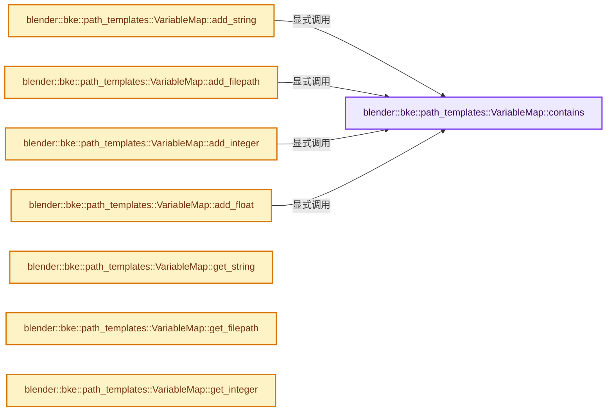

# 实现依赖专题：source/blender/blenkernel/intern/path_templates.cc

[实现依赖导航](../../README.md) · [符号索引](../../../00-课程指南/02-源码与提交索引/符号依赖与实现索引.md)

本专题从正文实际调用进入，集中保存共享实现。函数有稳定锚点，可从调用处直接跳到对应完整函数；递归与互相调用通过回链组织。

## 本文件的实现关系




## 相关类型布局与成员入口

<a id="t-6c16bd9637da"></a>

### `blender::TokenType`

原始声明：[source/blender/blenkernel/intern/path_templates.cc](../../../../../../../source/blender/blenkernel/intern/path_templates.cc) · L427—L442。

以下保留类的数据声明与编译条件，成员函数实现通过后面的精确链接阅读。

<!-- annotated:31b41134a16953 -->

```cpp
enum class TokenType {
  /* Either "{variable_name}" or "{variable_name:format_spec}". */
  VARIABLE_EXPRESSION,

  /* "{{", which is an escaped "{". */
  LEFT_CURLY_BRACE,

  /* "}}", which is an escaped "}". */
  RIGHT_CURLY_BRACE,

  /* Encountered a syntax error while trying to parse a variable expression. */
  VARIABLE_SYNTAX_ERROR,

  /* Encountered an unescaped curly brace in an invalid position. */
  UNESCAPED_CURLY_BRACE_ERROR,
};
```

<details>
<summary>核对原始源码：source/blender/blenkernel/intern/path_templates.cc · L427—L442</summary>

<!-- original:31b41134a16953:source/blender/blenkernel/intern/path_templates.cc:427:442 -->

```cpp
enum class TokenType {
  /* Either "{variable_name}" or "{variable_name:format_spec}". */
  VARIABLE_EXPRESSION,

  /* "{{", which is an escaped "{". */
  LEFT_CURLY_BRACE,

  /* "}}", which is an escaped "}". */
  RIGHT_CURLY_BRACE,

  /* Encountered a syntax error while trying to parse a variable expression. */
  VARIABLE_SYNTAX_ERROR,

  /* Encountered an unescaped curly brace in an invalid position. */
  UNESCAPED_CURLY_BRACE_ERROR,
};
```

</details>


<a id="t-d63008e5c7da"></a>

### `blender::Token`

原始声明：[source/blender/blenkernel/intern/path_templates.cc](../../../../../../../source/blender/blenkernel/intern/path_templates.cc) · L447—L465。

成员布局：

- `TokenType type`
- `IndexRange byte_range`
- `StringRef variable_name`
- `FormatSpecifier format`

以下保留类的数据声明与编译条件，成员函数实现通过后面的精确链接阅读。

<!-- annotated:0f5e9cfdd2e47b -->

```cpp
struct Token {
  TokenType type = TokenType::VARIABLE_EXPRESSION;

  /* Byte index range (exclusive on the right) of the token or syntax error in
   * the path string. */
  IndexRange byte_range;

  /* Reference to the variable name as written in the template string. Note
   * that this points into the template string, and does not own the value.
   *
   * Only relevant when `type == VARIABLE_EXPRESSION`. */
  StringRef variable_name;

  /* Indicates how the variable's value should be formatted into a string. This
   * is derived from the format specification (e.g. the "###" in "{blah:###}").
   *
   * Only relevant when `type == VARIABLE_EXPRESSION`. */
  FormatSpecifier format;
};
```

<details>
<summary>核对原始源码：source/blender/blenkernel/intern/path_templates.cc · L447—L465</summary>

<!-- original:0f5e9cfdd2e47b:source/blender/blenkernel/intern/path_templates.cc:447:465 -->

```cpp
struct Token {
  TokenType type = TokenType::VARIABLE_EXPRESSION;

  /* Byte index range (exclusive on the right) of the token or syntax error in
   * the path string. */
  IndexRange byte_range;

  /* Reference to the variable name as written in the template string. Note
   * that this points into the template string, and does not own the value.
   *
   * Only relevant when `type == VARIABLE_EXPRESSION`. */
  StringRef variable_name;

  /* Indicates how the variable's value should be formatted into a string. This
   * is derived from the format specification (e.g. the "###" in "{blah:###}").
   *
   * Only relevant when `type == VARIABLE_EXPRESSION`. */
  FormatSpecifier format;
};
```

</details>


## 完整成员与函数实现

<a id="f-eafc100bfb634c00"></a>

### `blender::bke::path_templates::VariableMap::contains`

实现位置：[source/blender/blenkernel/intern/path_templates.cc](../../../../../../../source/blender/blenkernel/intern/path_templates.cc) · L35—L50。

接口参数：

- `StringRef name`

**教学注释版**

<!-- annotated:42fc1f05e787c1 -->

```cpp
bool VariableMap::contains(StringRef name) const
{
  if (this->strings_.contains(name)) {
    return true;
  }
  if (this->filepaths_.contains(name)) {
    return true;
  }
  if (this->integers_.contains(name)) {
    return true;
  }
  if (this->floats_.contains(name)) {
    return true;
  }
  return false;
}
```

<details>
<summary>核对原始源码：source/blender/blenkernel/intern/path_templates.cc · L35—L50</summary>

<!-- original:42fc1f05e787c1:source/blender/blenkernel/intern/path_templates.cc:35:50 -->

```cpp
bool VariableMap::contains(StringRef name) const
{
  if (this->strings_.contains(name)) {
    return true;
  }
  if (this->filepaths_.contains(name)) {
    return true;
  }
  if (this->integers_.contains(name)) {
    return true;
  }
  if (this->floats_.contains(name)) {
    return true;
  }
  return false;
}
```

</details>

**结果出口**

- `return true;`
- `return false;`

**继续追踪实现**

- `this->strings_.contains` → [调用协议](../../../00-课程指南/01-路线与规范/模板宏与动态分派协议.md)：接收对象类型依赖auto、返回值或模板实例；不按同名猜测目标。调用位置L37。
- `this->filepaths_.contains` → [调用协议](../../../00-课程指南/01-路线与规范/模板宏与动态分派协议.md)：接收对象类型依赖auto、返回值或模板实例；不按同名猜测目标。调用位置L40。
- `this->integers_.contains` → [调用协议](../../../00-课程指南/01-路线与规范/模板宏与动态分派协议.md)：接收对象类型依赖auto、返回值或模板实例；不按同名猜测目标。调用位置L43。
- `this->floats_.contains` → [调用协议](../../../00-课程指南/01-路线与规范/模板宏与动态分派协议.md)：接收对象类型依赖auto、返回值或模板实例；不按同名猜测目标。调用位置L46。

<a id="f-a34527bba86ec1bd"></a>

### `blender::bke::path_templates::VariableMap::add_string`

实现位置：[source/blender/blenkernel/intern/path_templates.cc](../../../../../../../source/blender/blenkernel/intern/path_templates.cc) · L69—L76。

接口参数：

- `StringRef name`
- `StringRef value`

**教学注释版**

<!-- annotated:99f6a61ba79375 -->

```cpp
bool VariableMap::add_string(StringRef name, StringRef value)
{
  if (this->contains(name)) {
    return false;
  }
  this->strings_.add_new(name, value);
  return true;
}
```

<details>
<summary>核对原始源码：source/blender/blenkernel/intern/path_templates.cc · L69—L76</summary>

<!-- original:99f6a61ba79375:source/blender/blenkernel/intern/path_templates.cc:69:76 -->

```cpp
bool VariableMap::add_string(StringRef name, StringRef value)
{
  if (this->contains(name)) {
    return false;
  }
  this->strings_.add_new(name, value);
  return true;
}
```

</details>

**结果出口**

- `return false;`
- `return true;`

**继续追踪实现**

- `this->contains` → [blender::bke::path_templates::VariableMap::contains · L35](path_templates.cc.md#f-eafc100bfb634c00)。
- `this->strings_.add_new` → [调用协议](../../../00-课程指南/01-路线与规范/模板宏与动态分派协议.md)：接收对象类型依赖auto、返回值或模板实例；不按同名猜测目标。调用位置L74。

<a id="f-6645ffbd3f6d3f37"></a>

### `blender::bke::path_templates::VariableMap::add_filepath`

实现位置：[source/blender/blenkernel/intern/path_templates.cc](../../../../../../../source/blender/blenkernel/intern/path_templates.cc) · L78—L85。

接口参数：

- `StringRef name`
- `StringRef value`

**教学注释版**

<!-- annotated:ebce091eff733e -->

```cpp
bool VariableMap::add_filepath(StringRef name, StringRef value)
{
  if (this->contains(name)) {
    return false;
  }
  this->filepaths_.add_new(name, value);
  return true;
}
```

<details>
<summary>核对原始源码：source/blender/blenkernel/intern/path_templates.cc · L78—L85</summary>

<!-- original:ebce091eff733e:source/blender/blenkernel/intern/path_templates.cc:78:85 -->

```cpp
bool VariableMap::add_filepath(StringRef name, StringRef value)
{
  if (this->contains(name)) {
    return false;
  }
  this->filepaths_.add_new(name, value);
  return true;
}
```

</details>

**结果出口**

- `return false;`
- `return true;`

**继续追踪实现**

- `this->contains` → [blender::bke::path_templates::VariableMap::contains · L35](path_templates.cc.md#f-eafc100bfb634c00)。
- `this->filepaths_.add_new` → [调用协议](../../../00-课程指南/01-路线与规范/模板宏与动态分派协议.md)：接收对象类型依赖auto、返回值或模板实例；不按同名猜测目标。调用位置L83。

<a id="f-6eab9d13c78fc3f8"></a>

### `blender::bke::path_templates::VariableMap::add_integer`

实现位置：[source/blender/blenkernel/intern/path_templates.cc](../../../../../../../source/blender/blenkernel/intern/path_templates.cc) · L87—L94。

接口参数：

- `StringRef name`
- `const int64_t value`

**教学注释版**

<!-- annotated:34f95962943d98 -->

```cpp
bool VariableMap::add_integer(StringRef name, const int64_t value)
{
  if (this->contains(name)) {
    return false;
  }
  this->integers_.add_new(name, value);
  return true;
}
```

<details>
<summary>核对原始源码：source/blender/blenkernel/intern/path_templates.cc · L87—L94</summary>

<!-- original:34f95962943d98:source/blender/blenkernel/intern/path_templates.cc:87:94 -->

```cpp
bool VariableMap::add_integer(StringRef name, const int64_t value)
{
  if (this->contains(name)) {
    return false;
  }
  this->integers_.add_new(name, value);
  return true;
}
```

</details>

**结果出口**

- `return false;`
- `return true;`

**继续追踪实现**

- `this->contains` → [blender::bke::path_templates::VariableMap::contains · L35](path_templates.cc.md#f-eafc100bfb634c00)。
- `this->integers_.add_new` → [调用协议](../../../00-课程指南/01-路线与规范/模板宏与动态分派协议.md)：接收对象类型依赖auto、返回值或模板实例；不按同名猜测目标。调用位置L92。

<a id="f-b25da5ac308e9940"></a>

### `blender::bke::path_templates::VariableMap::add_float`

实现位置：[source/blender/blenkernel/intern/path_templates.cc](../../../../../../../source/blender/blenkernel/intern/path_templates.cc) · L96—L103。

接口参数：

- `StringRef name`
- `const double value`

**教学注释版**

<!-- annotated:c560c14a14940e -->

```cpp
bool VariableMap::add_float(StringRef name, const double value)
{
  if (this->contains(name)) {
    return false;
  }
  this->floats_.add_new(name, value);
  return true;
}
```

<details>
<summary>核对原始源码：source/blender/blenkernel/intern/path_templates.cc · L96—L103</summary>

<!-- original:c560c14a14940e:source/blender/blenkernel/intern/path_templates.cc:96:103 -->

```cpp
bool VariableMap::add_float(StringRef name, const double value)
{
  if (this->contains(name)) {
    return false;
  }
  this->floats_.add_new(name, value);
  return true;
}
```

</details>

**结果出口**

- `return false;`
- `return true;`

**继续追踪实现**

- `this->contains` → [blender::bke::path_templates::VariableMap::contains · L35](path_templates.cc.md#f-eafc100bfb634c00)。
- `this->floats_.add_new` → [调用协议](../../../00-课程指南/01-路线与规范/模板宏与动态分派协议.md)：接收对象类型依赖auto、返回值或模板实例；不按同名猜测目标。调用位置L101。

<a id="f-d1cac57122447672"></a>

### `blender::bke::path_templates::VariableMap::get_string`

实现位置：[source/blender/blenkernel/intern/path_templates.cc](../../../../../../../source/blender/blenkernel/intern/path_templates.cc) · L105—L112。

接口参数：

- `StringRef name`

**教学注释版**

<!-- annotated:e5e202a8fbcac2 -->

```cpp
std::optional<StringRefNull> VariableMap::get_string(StringRef name) const
{
  const std::string *value = this->strings_.lookup_ptr(name);
  if (value == nullptr) {
    return std::nullopt;
  }
  return StringRefNull(*value);
}
```

<details>
<summary>核对原始源码：source/blender/blenkernel/intern/path_templates.cc · L105—L112</summary>

<!-- original:e5e202a8fbcac2:source/blender/blenkernel/intern/path_templates.cc:105:112 -->

```cpp
std::optional<StringRefNull> VariableMap::get_string(StringRef name) const
{
  const std::string *value = this->strings_.lookup_ptr(name);
  if (value == nullptr) {
    return std::nullopt;
  }
  return StringRefNull(*value);
}
```

</details>

**结果出口**

- `return std::nullopt;`
- `return StringRefNull(*value);`

**继续追踪实现**

- `this->strings_.lookup_ptr` → [调用协议](../../../00-课程指南/01-路线与规范/模板宏与动态分派协议.md)：接收对象类型依赖auto、返回值或模板实例；不按同名猜测目标。调用位置L107。
- `StringRefNull` → [blender::StringRefNull::StringRefNull · L149](../../../01-基础容器与现代CPP/15-StringRef字符串视图.md#f-ebc6ee5f8fc16390)；[blender::StringRefNull::StringRefNull · L496](../../../01-基础容器与现代CPP/15-StringRef字符串视图.md#f-936c98fc0d9ae39e)；[blender::StringRefNull::StringRefNull · L502](../../../01-基础容器与现代CPP/15-StringRef字符串视图.md#f-cf03ac0c28007ee0)；[blender::StringRefNull::StringRefNull · L512](../../../01-基础容器与现代CPP/15-StringRef字符串视图.md#f-8a14273318bc57e1)；[blender::StringRefNull::StringRefNull · L523](../../../01-基础容器与现代CPP/15-StringRef字符串视图.md#f-e1cc63a4ff92775b)。同名重载需按实参类型选择。

<a id="f-463a7e58b6b00dbe"></a>

### `blender::bke::path_templates::VariableMap::get_filepath`

实现位置：[source/blender/blenkernel/intern/path_templates.cc](../../../../../../../source/blender/blenkernel/intern/path_templates.cc) · L114—L121。

接口参数：

- `StringRef name`

**教学注释版**

<!-- annotated:5f742228cc02de -->

```cpp
std::optional<StringRefNull> VariableMap::get_filepath(StringRef name) const
{
  const std::string *value = this->filepaths_.lookup_ptr(name);
  if (value == nullptr) {
    return std::nullopt;
  }
  return StringRefNull(*value);
}
```

<details>
<summary>核对原始源码：source/blender/blenkernel/intern/path_templates.cc · L114—L121</summary>

<!-- original:5f742228cc02de:source/blender/blenkernel/intern/path_templates.cc:114:121 -->

```cpp
std::optional<StringRefNull> VariableMap::get_filepath(StringRef name) const
{
  const std::string *value = this->filepaths_.lookup_ptr(name);
  if (value == nullptr) {
    return std::nullopt;
  }
  return StringRefNull(*value);
}
```

</details>

**结果出口**

- `return std::nullopt;`
- `return StringRefNull(*value);`

**继续追踪实现**

- `this->filepaths_.lookup_ptr` → [调用协议](../../../00-课程指南/01-路线与规范/模板宏与动态分派协议.md)：接收对象类型依赖auto、返回值或模板实例；不按同名猜测目标。调用位置L116。
- `StringRefNull` → [blender::StringRefNull::StringRefNull · L149](../../../01-基础容器与现代CPP/15-StringRef字符串视图.md#f-ebc6ee5f8fc16390)；[blender::StringRefNull::StringRefNull · L496](../../../01-基础容器与现代CPP/15-StringRef字符串视图.md#f-936c98fc0d9ae39e)；[blender::StringRefNull::StringRefNull · L502](../../../01-基础容器与现代CPP/15-StringRef字符串视图.md#f-cf03ac0c28007ee0)；[blender::StringRefNull::StringRefNull · L512](../../../01-基础容器与现代CPP/15-StringRef字符串视图.md#f-8a14273318bc57e1)；[blender::StringRefNull::StringRefNull · L523](../../../01-基础容器与现代CPP/15-StringRef字符串视图.md#f-e1cc63a4ff92775b)。同名重载需按实参类型选择。

<a id="f-2c03adcb5e8cddfd"></a>

### `blender::bke::path_templates::VariableMap::get_integer`

实现位置：[source/blender/blenkernel/intern/path_templates.cc](../../../../../../../source/blender/blenkernel/intern/path_templates.cc) · L123—L130。

接口参数：

- `StringRef name`

**教学注释版**

<!-- annotated:5376c7104e6d44 -->

```cpp
std::optional<int64_t> VariableMap::get_integer(StringRef name) const
{
  const int64_t *value = this->integers_.lookup_ptr(name);
  if (value == nullptr) {
    return std::nullopt;
  }
  return *value;
}
```

<details>
<summary>核对原始源码：source/blender/blenkernel/intern/path_templates.cc · L123—L130</summary>

<!-- original:5376c7104e6d44:source/blender/blenkernel/intern/path_templates.cc:123:130 -->

```cpp
std::optional<int64_t> VariableMap::get_integer(StringRef name) const
{
  const int64_t *value = this->integers_.lookup_ptr(name);
  if (value == nullptr) {
    return std::nullopt;
  }
  return *value;
}
```

</details>

**结果出口**

- `return std::nullopt;`
- `return *value;`

**继续追踪实现**

- `this->integers_.lookup_ptr` → [调用协议](../../../00-课程指南/01-路线与规范/模板宏与动态分派协议.md)：接收对象类型依赖auto、返回值或模板实例；不按同名猜测目标。调用位置L125。

<a id="f-82274b77167b842d"></a>

### `blender::bke::path_templates::VariableMap::get_float`

实现位置：[source/blender/blenkernel/intern/path_templates.cc](../../../../../../../source/blender/blenkernel/intern/path_templates.cc) · L132—L139。

接口参数：

- `StringRef name`

**教学注释版**

<!-- annotated:bb87805af9b7a5 -->

```cpp
std::optional<double> VariableMap::get_float(StringRef name) const
{
  const double *value = this->floats_.lookup_ptr(name);
  if (value == nullptr) {
    return std::nullopt;
  }
  return *value;
}
```

<details>
<summary>核对原始源码：source/blender/blenkernel/intern/path_templates.cc · L132—L139</summary>

<!-- original:bb87805af9b7a5:source/blender/blenkernel/intern/path_templates.cc:132:139 -->

```cpp
std::optional<double> VariableMap::get_float(StringRef name) const
{
  const double *value = this->floats_.lookup_ptr(name);
  if (value == nullptr) {
    return std::nullopt;
  }
  return *value;
}
```

</details>

**结果出口**

- `return std::nullopt;`
- `return *value;`

**继续追踪实现**

- `this->floats_.lookup_ptr` → [调用协议](../../../00-课程指南/01-路线与规范/模板宏与动态分派协议.md)：接收对象类型依赖auto、返回值或模板实例；不按同名猜测目标。调用位置L134。

<a id="f-70831724108be28a"></a>

### `blender::bke::path_templates::VariableMap::add_filename_only`

实现位置：[source/blender/blenkernel/intern/path_templates.cc](../../../../../../../source/blender/blenkernel/intern/path_templates.cc) · L141—L158。

接口参数：

- `StringRef var_name`
- `StringRefNull full_path`
- `StringRef fallback`

**教学注释版**

<!-- annotated:cc2e811acd66ae -->

```cpp
bool VariableMap::add_filename_only(StringRef var_name,
                                    StringRefNull full_path,
                                    StringRef fallback)
{
  const char *file_name = BLI_path_basename(full_path.c_str());
  const char *file_name_end = BLI_path_extension_or_end(file_name);

  if (file_name[0] == '\0') {
    /* If there is no file name, default to the fallback. */
    return this->add_filepath(var_name, fallback);
  }
  if (file_name_end == file_name) {
    /* When the filename has no extension, but starts with a period. */
    return this->add_filepath(var_name, StringRef(file_name));
  }
  /* Normal case. */
  return this->add_filepath(var_name, StringRef(file_name, file_name_end));
}
```

<details>
<summary>核对原始源码：source/blender/blenkernel/intern/path_templates.cc · L141—L158</summary>

<!-- original:cc2e811acd66ae:source/blender/blenkernel/intern/path_templates.cc:141:158 -->

```cpp
bool VariableMap::add_filename_only(StringRef var_name,
                                    StringRefNull full_path,
                                    StringRef fallback)
{
  const char *file_name = BLI_path_basename(full_path.c_str());
  const char *file_name_end = BLI_path_extension_or_end(file_name);

  if (file_name[0] == '\0') {
    /* If there is no file name, default to the fallback. */
    return this->add_filepath(var_name, fallback);
  }
  if (file_name_end == file_name) {
    /* When the filename has no extension, but starts with a period. */
    return this->add_filepath(var_name, StringRef(file_name));
  }
  /* Normal case. */
  return this->add_filepath(var_name, StringRef(file_name, file_name_end));
}
```

</details>

**结果出口**

- `return this->add_filepath(var_name, fallback);`
- `return this->add_filepath(var_name, StringRef(file_name));`
- `return this->add_filepath(var_name, StringRef(file_name, file_name_end));`

**继续追踪实现**

- `BLI_path_basename` → [BLI_path_basename · L1847](../../01-BLI基础库/intern/path_utils.cc.md#f-1b9bc48bebf9dfcd)。
- `full_path.c_str` → [blender::StringRefNull::c_str · L544](../../../01-基础容器与现代CPP/15-StringRef字符串视图.md#f-4a8bbfe1e6d00757)。
- `BLI_path_extension_or_end` → [BLI_path_extension_or_end · L1681](../../01-BLI基础库/intern/path_utils.cc.md#f-c766884945075983)。
- `this->add_filepath` → [blender::bke::path_templates::VariableMap::add_filepath · L78](path_templates.cc.md#f-6645ffbd3f6d3f37)。
- `StringRef` → [blender::StringRef::StringRef · L555](../../../01-基础容器与现代CPP/15-StringRef字符串视图.md#f-f6aca324a36faa7e)；[blender::StringRef::StringRef · L560](../../../01-基础容器与现代CPP/15-StringRef字符串视图.md#f-ab9714781ca51bac)；[blender::StringRef::StringRef · L565](../../../01-基础容器与现代CPP/15-StringRef字符串视图.md#f-95f0b483bbdd7739)；[blender::StringRef::StringRef · L570](../../../01-基础容器与现代CPP/15-StringRef字符串视图.md#f-808d05699cb33334)；[blender::StringRef::StringRef · L631](../../../01-基础容器与现代CPP/15-StringRef字符串视图.md#f-37788e5f3fa3b736)；[blender::StringRef::StringRef · L641](../../../01-基础容器与现代CPP/15-StringRef字符串视图.md#f-11abd0510fb6b926)；[blender::StringRef::StringRef · L646](../../../01-基础容器与现代CPP/15-StringRef字符串视图.md#f-8437dbd8a582eefd)；[blender::StringRef::StringRef · L651](../../../01-基础容器与现代CPP/15-StringRef字符串视图.md#f-70bcb338de0db978)。同名重载需按实参类型选择。

<a id="f-531fcb44aef10496"></a>

### `blender::bke::path_templates::VariableMap::add_path_up_to_file`

实现位置：[source/blender/blenkernel/intern/path_templates.cc](../../../../../../../source/blender/blenkernel/intern/path_templates.cc) · L160—L185。

接口参数：

- `StringRef var_name`
- `StringRefNull full_path`
- `StringRef fallback`

**教学注释版**

<!-- annotated:7cfe8d5454e9d6 -->

```cpp
bool VariableMap::add_path_up_to_file(StringRef var_name,
                                      StringRefNull full_path,
                                      StringRef fallback)
{
  /* Empty path. */
  if (full_path.is_empty()) {
    return this->add_filepath(var_name, fallback);
  }

  /* No filename at the end. */
  if (BLI_path_basename(full_path.c_str()) == full_path.end()) {
    return this->add_filepath(var_name, full_path);
  }

  Vector<char> dir_path(full_path.size() + 1);
  // [讲解] dir_path.data：提供当前存储或有效范围的地址。
  full_path.copy_unsafe(dir_path.data());

  const bool success = BLI_path_parent_dir(dir_path.data());

  if (!success || dir_path[0] == '\0') {
    /* If no path before the filename, default to the fallback. */
    return this->add_filepath(var_name, fallback);
  }

  return this->add_filepath(var_name, dir_path.data());
}
```

<details>
<summary>核对原始源码：source/blender/blenkernel/intern/path_templates.cc · L160—L185</summary>

<!-- original:7cfe8d5454e9d6:source/blender/blenkernel/intern/path_templates.cc:160:185 -->

```cpp
bool VariableMap::add_path_up_to_file(StringRef var_name,
                                      StringRefNull full_path,
                                      StringRef fallback)
{
  /* Empty path. */
  if (full_path.is_empty()) {
    return this->add_filepath(var_name, fallback);
  }

  /* No filename at the end. */
  if (BLI_path_basename(full_path.c_str()) == full_path.end()) {
    return this->add_filepath(var_name, full_path);
  }

  Vector<char> dir_path(full_path.size() + 1);
  full_path.copy_unsafe(dir_path.data());

  const bool success = BLI_path_parent_dir(dir_path.data());

  if (!success || dir_path[0] == '\0') {
    /* If no path before the filename, default to the fallback. */
    return this->add_filepath(var_name, fallback);
  }

  return this->add_filepath(var_name, dir_path.data());
}
```

</details>

**结果出口**

- `return this->add_filepath(var_name, fallback);`
- `return this->add_filepath(var_name, full_path);`
- `return this->add_filepath(var_name, dir_path.data());`

**继续追踪实现**

- `full_path.is_empty` → [调用协议](../../../00-课程指南/01-路线与规范/模板宏与动态分派协议.md)：由接收对象具体类型或运行时策略提供实现。调用位置L165。
- `this->add_filepath` → [blender::bke::path_templates::VariableMap::add_filepath · L78](path_templates.cc.md#f-6645ffbd3f6d3f37)。
- `BLI_path_basename` → [BLI_path_basename · L1847](../../01-BLI基础库/intern/path_utils.cc.md#f-1b9bc48bebf9dfcd)。
- `full_path.c_str` → [blender::StringRefNull::c_str · L544](../../../01-基础容器与现代CPP/15-StringRef字符串视图.md#f-4a8bbfe1e6d00757)。
- `full_path.end` → [调用协议](../../../00-课程指南/01-路线与规范/模板宏与动态分派协议.md)：由接收对象具体类型或运行时策略提供实现。调用位置L170。
- `full_path.size` → [调用协议](../../../00-课程指南/01-路线与规范/模板宏与动态分派协议.md)：由接收对象具体类型或运行时策略提供实现。调用位置L174。
- `full_path.copy_unsafe` → [blender::StringRefBase::copy_unsafe · L248](../../../01-基础容器与现代CPP/15-StringRef字符串视图.md#f-0616684a44814e0a)。
- `dir_path.data` → [blender::Vector::data · L954](../../../01-基础容器与现代CPP/12-Vector异常安全与边界.md#f-6e441591404715bc)；[blender::Vector::data · L962](../../../01-基础容器与现代CPP/12-Vector异常安全与边界.md#f-4bc78d4954c1021a)。同名重载需按实参类型选择。
- `BLI_path_parent_dir` → [BLI_path_parent_dir · L903](../../01-BLI基础库/intern/path_utils.cc.md#f-111df144f335a226)。

<a id="f-7566e4a90928e8a4"></a>

### `blender::BKE_build_template_variables_for_prop`

实现位置：[source/blender/blenkernel/intern/path_templates.cc](../../../../../../../source/blender/blenkernel/intern/path_templates.cc) · L196—L291。

接口参数：

- `const bContext *C`
- `PointerRNA *ptr`
- `PropertyRNA *prop`

**教学注释版**

<!-- annotated:51c0ed113bf8eb -->

```cpp
std::optional<VariableMap> BKE_build_template_variables_for_prop(const bContext *C,
                                                                 PointerRNA *ptr,
                                                                 PropertyRNA *prop)
{
  /*
   * This function should be maintained such that it always produces variables
   * consistent with the variables produced elsewhere in the code base for the
   * same property. For example, render paths are processed in the rendering
   * code and the variables for that purpose are built there; this function
   * should produce variables consistent with that for the same render path
   * properties here.
   *
   * This function is organized into two sections: a `switch` giving each
   * purpose its "general" and "purpose-specific" variables, and one for
   * "type-specific" variables. (See the top-level documentation in
   * BKE_path_templates.hh for details on what that means).
   *
   * To add support for additional variables here:
   *
   * - For "general" variables, simply add them to
   *   #BKE_add_template_variables_general(). Nothing else special needs to be
   *   done.
   * - For "purpose-specific" variables, add them to the appropriate
   *   purpose-specific function (e.g.
   *   #BKE_add_template_variables_for_render_path()). If no function exists
   *   for your purpose yet, add a new enum item to #PropertyPathTemplateType
   *   and a corresponding new function, add your variable to the new function,
   *   and then call it from the `switch` on #RNA_property_path_template_type()
   *   below.
   * - For "type-specific" variables, add them to the appropriate type-specific
   *   function (e.g. #BKE_add_template_variables_for_node()). If no function
   *   exists for that type yet, create a new function for it, add the variable
   *   there, and then call it from the bottom section of this function, with an
   *   appropriate guard on the struct type.
   */

  /* No property passed, or it doesn't support path templates. */
  if (ptr == nullptr || prop == nullptr ||
      (RNA_property_flag(prop) & PROP_PATH_SUPPORTS_TEMPLATES) == 0)
  {
    return std::nullopt;
  }

  VariableMap variables;
  const Main *bmain = CTX_data_main(C);

  /* General and purpose-specific variables. */
  switch (RNA_property_path_template_type(prop)) {
    case PROP_VARIABLES_NONE: {
      BKE_blender_project_read_callback(bmain, [&](const bke::BlenderProject *project) {
        BKE_add_template_variables_general(variables, ptr->owner_id, project);
      });
      break;
    }

    /* Scene render output path, the compositor's File Output node's paths, etc. */
    case PROP_VARIABLES_RENDER_OUTPUT: {
      BKE_blender_project_read_callback(bmain, [&](const bke::BlenderProject *project) {
        BKE_add_template_variables_general(variables, ptr->owner_id, project);
      });

      const Scene *scene;
      if (GS(ptr->owner_id->name) == ID_SCE) {
        scene = reinterpret_cast<const Scene *>(ptr->owner_id);
      }
      else {
        scene = CTX_data_scene(C);
      }

      BKE_add_template_variables_for_render_path(variables, *scene);
      break;
    }

    /* Project settings. */
    case PROP_VARIABLES_PROJECT: {
      BKE_blender_project_read_callback(bmain, [&](const bke::BlenderProject *project) {
        if (project) {
          BKE_add_template_variables_for_project(variables, *project);
        }
      });
      break;
    }
  }

  /* Type-specific variables. */

  /* Nodes. */
  if (std::optional<AncestorPointerRNA> node_rna_ptr = RNA_struct_search_closest_ancestor_by_type(
          ptr, RNA_Node))
  {
    const bNode *bnode = reinterpret_cast<const bNode *>(node_rna_ptr->data);
    BKE_add_template_variables_for_node(variables, *bnode);
  }

  return variables;
}
```

<details>
<summary>核对原始源码：source/blender/blenkernel/intern/path_templates.cc · L196—L291</summary>

<!-- original:51c0ed113bf8eb:source/blender/blenkernel/intern/path_templates.cc:196:291 -->

```cpp
std::optional<VariableMap> BKE_build_template_variables_for_prop(const bContext *C,
                                                                 PointerRNA *ptr,
                                                                 PropertyRNA *prop)
{
  /*
   * This function should be maintained such that it always produces variables
   * consistent with the variables produced elsewhere in the code base for the
   * same property. For example, render paths are processed in the rendering
   * code and the variables for that purpose are built there; this function
   * should produce variables consistent with that for the same render path
   * properties here.
   *
   * This function is organized into two sections: a `switch` giving each
   * purpose its "general" and "purpose-specific" variables, and one for
   * "type-specific" variables. (See the top-level documentation in
   * BKE_path_templates.hh for details on what that means).
   *
   * To add support for additional variables here:
   *
   * - For "general" variables, simply add them to
   *   #BKE_add_template_variables_general(). Nothing else special needs to be
   *   done.
   * - For "purpose-specific" variables, add them to the appropriate
   *   purpose-specific function (e.g.
   *   #BKE_add_template_variables_for_render_path()). If no function exists
   *   for your purpose yet, add a new enum item to #PropertyPathTemplateType
   *   and a corresponding new function, add your variable to the new function,
   *   and then call it from the `switch` on #RNA_property_path_template_type()
   *   below.
   * - For "type-specific" variables, add them to the appropriate type-specific
   *   function (e.g. #BKE_add_template_variables_for_node()). If no function
   *   exists for that type yet, create a new function for it, add the variable
   *   there, and then call it from the bottom section of this function, with an
   *   appropriate guard on the struct type.
   */

  /* No property passed, or it doesn't support path templates. */
  if (ptr == nullptr || prop == nullptr ||
      (RNA_property_flag(prop) & PROP_PATH_SUPPORTS_TEMPLATES) == 0)
  {
    return std::nullopt;
  }

  VariableMap variables;
  const Main *bmain = CTX_data_main(C);

  /* General and purpose-specific variables. */
  switch (RNA_property_path_template_type(prop)) {
    case PROP_VARIABLES_NONE: {
      BKE_blender_project_read_callback(bmain, [&](const bke::BlenderProject *project) {
        BKE_add_template_variables_general(variables, ptr->owner_id, project);
      });
      break;
    }

    /* Scene render output path, the compositor's File Output node's paths, etc. */
    case PROP_VARIABLES_RENDER_OUTPUT: {
      BKE_blender_project_read_callback(bmain, [&](const bke::BlenderProject *project) {
        BKE_add_template_variables_general(variables, ptr->owner_id, project);
      });

      const Scene *scene;
      if (GS(ptr->owner_id->name) == ID_SCE) {
        scene = reinterpret_cast<const Scene *>(ptr->owner_id);
      }
      else {
        scene = CTX_data_scene(C);
      }

      BKE_add_template_variables_for_render_path(variables, *scene);
      break;
    }

    /* Project settings. */
    case PROP_VARIABLES_PROJECT: {
      BKE_blender_project_read_callback(bmain, [&](const bke::BlenderProject *project) {
        if (project) {
          BKE_add_template_variables_for_project(variables, *project);
        }
      });
      break;
    }
  }

  /* Type-specific variables. */

  /* Nodes. */
  if (std::optional<AncestorPointerRNA> node_rna_ptr = RNA_struct_search_closest_ancestor_by_type(
          ptr, RNA_Node))
  {
    const bNode *bnode = reinterpret_cast<const bNode *>(node_rna_ptr->data);
    BKE_add_template_variables_for_node(variables, *bnode);
  }

  return variables;
}
```

</details>

**沿实际写入检查状态**

- `scene = reinterpret_cast<const Scene *>(ptr->owner_id);`
- `scene = CTX_data_scene(C);`

**结果出口**

- `return std::nullopt;`
- `return variables;`

**继续追踪实现**

- `RNA_property_flag` → [blender::RNA_property_flag · L1342](../../08-其他Blender模块/makesrna/intern/rna_access.cc.md#f-c36ad8058f3a533e)。
- `CTX_data_main` → [blender::CTX_data_main · L1313](context.cc.md#f-6d4ba24a62a80b94)。
- `RNA_property_path_template_type` → [blender::RNA_property_path_template_type · L1352](../../08-其他Blender模块/makesrna/intern/rna_access.cc.md#f-0d5e1119f9f01668)。
- `BKE_blender_project_read_callback` → [blender::BKE_blender_project_read_callback · L337](../BKE_blender_project.hh.md#f-f3ce9b3af0b90ded)。
- `BKE_add_template_variables_general` → [blender::BKE_add_template_variables_general · L323](path_templates.cc.md#f-f4e98befdafedf29)。
- `GS` → [blender::GS · L410](../../08-其他Blender模块/makesdna/DNA_ID.h.md#f-c3ff509f79f21b05)。
- `CTX_data_scene` → [blender::CTX_data_scene · L1329](context.cc.md#f-6a2fb518a7aa2eee)。
- `BKE_add_template_variables_for_render_path` → [blender::BKE_add_template_variables_for_render_path · L358](path_templates.cc.md#f-9aed718e1c5185be)。
- `BKE_add_template_variables_for_project` → [blender::BKE_add_template_variables_for_project · L293](path_templates.cc.md#f-2d681316355c25e2)。
- `RNA_struct_search_closest_ancestor_by_type` → [blender::RNA_struct_search_closest_ancestor_by_type · L1028](../../08-其他Blender模块/makesrna/intern/rna_access.cc.md#f-5e12095813527a94)。
- `BKE_add_template_variables_for_node` → [blender::BKE_add_template_variables_for_node · L386](path_templates.cc.md#f-8040f3d64ffe4dde)。

<a id="f-2d681316355c25e2"></a>

### `blender::BKE_add_template_variables_for_project`

实现位置：[source/blender/blenkernel/intern/path_templates.cc](../../../../../../../source/blender/blenkernel/intern/path_templates.cc) · L293—L321。

接口参数：

- `VariableMap &variables`
- `const bke::BlenderProject &project`

**教学注释版**

<!-- annotated:6aa29eb7f39c85 -->

```cpp
void BKE_add_template_variables_for_project(VariableMap &variables,
                                            const bke::BlenderProject &project)
{
  variables.add_string("project_name", project.get_name());

  variables.add_filepath("project_root", project.get_root_path());

  for (const std::unique_ptr<bke::ProjectVariable> &var : project.variables) {
    switch (var->type_get()) {
      case bke::ProjectVariableType::STRING: {
        if (var->string_subtype_get() == bke::ProjectVariableStringSubtype::FILEPATH) {
          variables.add_filepath(var->name_get(), var->value_string_get());
        }
        else {
          variables.add_string(var->name_get(), var->value_string_get());
        }
        break;
      }

      case bke::ProjectVariableType::INT:
        variables.add_integer(var->name_get(), var->value_int_get());
        break;

      case bke::ProjectVariableType::FLOAT:
        variables.add_float(var->name_get(), var->value_float_get());
        break;
    }
  }
}
```

<details>
<summary>核对原始源码：source/blender/blenkernel/intern/path_templates.cc · L293—L321</summary>

<!-- original:6aa29eb7f39c85:source/blender/blenkernel/intern/path_templates.cc:293:321 -->

```cpp
void BKE_add_template_variables_for_project(VariableMap &variables,
                                            const bke::BlenderProject &project)
{
  variables.add_string("project_name", project.get_name());

  variables.add_filepath("project_root", project.get_root_path());

  for (const std::unique_ptr<bke::ProjectVariable> &var : project.variables) {
    switch (var->type_get()) {
      case bke::ProjectVariableType::STRING: {
        if (var->string_subtype_get() == bke::ProjectVariableStringSubtype::FILEPATH) {
          variables.add_filepath(var->name_get(), var->value_string_get());
        }
        else {
          variables.add_string(var->name_get(), var->value_string_get());
        }
        break;
      }

      case bke::ProjectVariableType::INT:
        variables.add_integer(var->name_get(), var->value_int_get());
        break;

      case bke::ProjectVariableType::FLOAT:
        variables.add_float(var->name_get(), var->value_float_get());
        break;
    }
  }
}
```

</details>

**继续追踪实现**

- `variables.add_string` → [blender::bke::path_templates::VariableMap::add_string · L69](path_templates.cc.md#f-a34527bba86ec1bd)。
- `project.get_name` → [blender::bke::BlenderProject::get_name · L221](blender_project.cc.md#f-bd4599b340d15751)。
- `variables.add_filepath` → [blender::bke::path_templates::VariableMap::add_filepath · L78](path_templates.cc.md#f-6645ffbd3f6d3f37)。
- `project.get_root_path` → [blender::bke::BlenderProject::get_root_path · L226](blender_project.cc.md#f-1dbabb7417a309ae)。
- `var->type_get` → [调用协议](../../../00-课程指南/01-路线与规范/模板宏与动态分派协议.md)：接收对象类型依赖auto、返回值或模板实例；不按同名猜测目标。调用位置L301。
- `var->string_subtype_get` → [调用协议](../../../00-课程指南/01-路线与规范/模板宏与动态分派协议.md)：接收对象类型依赖auto、返回值或模板实例；不按同名猜测目标。调用位置L303。
- `var->name_get` → [调用协议](../../../00-课程指南/01-路线与规范/模板宏与动态分派协议.md)：接收对象类型依赖auto、返回值或模板实例；不按同名猜测目标。调用位置L304。
- `var->value_string_get` → [调用协议](../../../00-课程指南/01-路线与规范/模板宏与动态分派协议.md)：接收对象类型依赖auto、返回值或模板实例；不按同名猜测目标。调用位置L304。
- `variables.add_integer` → [blender::bke::path_templates::VariableMap::add_integer · L87](path_templates.cc.md#f-6eab9d13c78fc3f8)。
- `var->value_int_get` → [调用协议](../../../00-课程指南/01-路线与规范/模板宏与动态分派协议.md)：接收对象类型依赖auto、返回值或模板实例；不按同名猜测目标。调用位置L313。
- `variables.add_float` → [blender::bke::path_templates::VariableMap::add_float · L96](path_templates.cc.md#f-b25da5ac308e9940)。
- `var->value_float_get` → [调用协议](../../../00-课程指南/01-路线与规范/模板宏与动态分派协议.md)：接收对象类型依赖auto、返回值或模板实例；不按同名猜测目标。调用位置L317。

<a id="f-f4e98befdafedf29"></a>

### `blender::BKE_add_template_variables_general`

实现位置：[source/blender/blenkernel/intern/path_templates.cc](../../../../../../../source/blender/blenkernel/intern/path_templates.cc) · L323—L356。

接口参数：

- `bke::path_templates::VariableMap &variables`
- `const ID *path_owner_id`
- `const bke::BlenderProject *project`

**教学注释版**

<!-- annotated:a45842f70633f8 -->

```cpp
void BKE_add_template_variables_general(bke::path_templates::VariableMap &variables,
                                        const ID *path_owner_id,
                                        const bke::BlenderProject *project)
{
  /* Project variables. */
  if (project) {
    BKE_add_template_variables_for_project(variables, *project);
  }

  /* Global blend filepath (a.k.a. path to the blend file that's currently
   * open). */
  {
    const char *g_blend_file_path = BKE_main_blendfile_path_from_global();

    variables.add_filename_only("blend_name", g_blend_file_path, StringRef(DATA_("Unsaved")));

    /* Note: fallback to `./` for unsaved files, which if used at the start of a
     * path is equivalent to the current working directory. This is consistent
     * with how `//` works. */
    variables.add_path_up_to_file("blend_dir", g_blend_file_path, StringRef("./"));
  }

  /* Library blend filepath (a.k.a. path to the blend file that actually owns the ID). */
  if (path_owner_id) {
    const char *lib_blend_file_path = ID_BLEND_PATH_FROM_GLOBAL(path_owner_id);
    variables.add_filename_only(
        "blend_name_lib", lib_blend_file_path, StringRef(DATA_("Unsaved")));

    /* Note: fallback to `./` for unsaved files, which if used at the start of a
     * path is equivalent to the current working directory. This is consistent
     * with how `//` works. */
    variables.add_path_up_to_file("blend_dir_lib", lib_blend_file_path, StringRef("./"));
  }
}
```

<details>
<summary>核对原始源码：source/blender/blenkernel/intern/path_templates.cc · L323—L356</summary>

<!-- original:a45842f70633f8:source/blender/blenkernel/intern/path_templates.cc:323:356 -->

```cpp
void BKE_add_template_variables_general(bke::path_templates::VariableMap &variables,
                                        const ID *path_owner_id,
                                        const bke::BlenderProject *project)
{
  /* Project variables. */
  if (project) {
    BKE_add_template_variables_for_project(variables, *project);
  }

  /* Global blend filepath (a.k.a. path to the blend file that's currently
   * open). */
  {
    const char *g_blend_file_path = BKE_main_blendfile_path_from_global();

    variables.add_filename_only("blend_name", g_blend_file_path, StringRef(DATA_("Unsaved")));

    /* Note: fallback to `./` for unsaved files, which if used at the start of a
     * path is equivalent to the current working directory. This is consistent
     * with how `//` works. */
    variables.add_path_up_to_file("blend_dir", g_blend_file_path, StringRef("./"));
  }

  /* Library blend filepath (a.k.a. path to the blend file that actually owns the ID). */
  if (path_owner_id) {
    const char *lib_blend_file_path = ID_BLEND_PATH_FROM_GLOBAL(path_owner_id);
    variables.add_filename_only(
        "blend_name_lib", lib_blend_file_path, StringRef(DATA_("Unsaved")));

    /* Note: fallback to `./` for unsaved files, which if used at the start of a
     * path is equivalent to the current working directory. This is consistent
     * with how `//` works. */
    variables.add_path_up_to_file("blend_dir_lib", lib_blend_file_path, StringRef("./"));
  }
}
```

</details>

**继续追踪实现**

- `BKE_add_template_variables_for_project` → [blender::BKE_add_template_variables_for_project · L293](path_templates.cc.md#f-2d681316355c25e2)。
- `BKE_main_blendfile_path_from_global` → [blender::BKE_main_blendfile_path_from_global · L1063](main.cc.md#f-06a1cf589f8e04a9)。
- `variables.add_filename_only` → [blender::bke::path_templates::VariableMap::add_filename_only · L141](path_templates.cc.md#f-70831724108be28a)。
- `StringRef` → [blender::StringRef::StringRef · L555](../../../01-基础容器与现代CPP/15-StringRef字符串视图.md#f-f6aca324a36faa7e)；[blender::StringRef::StringRef · L560](../../../01-基础容器与现代CPP/15-StringRef字符串视图.md#f-ab9714781ca51bac)；[blender::StringRef::StringRef · L565](../../../01-基础容器与现代CPP/15-StringRef字符串视图.md#f-95f0b483bbdd7739)；[blender::StringRef::StringRef · L570](../../../01-基础容器与现代CPP/15-StringRef字符串视图.md#f-808d05699cb33334)；[blender::StringRef::StringRef · L631](../../../01-基础容器与现代CPP/15-StringRef字符串视图.md#f-37788e5f3fa3b736)；[blender::StringRef::StringRef · L641](../../../01-基础容器与现代CPP/15-StringRef字符串视图.md#f-11abd0510fb6b926)；[blender::StringRef::StringRef · L646](../../../01-基础容器与现代CPP/15-StringRef字符串视图.md#f-8437dbd8a582eefd)；[blender::StringRef::StringRef · L651](../../../01-基础容器与现代CPP/15-StringRef字符串视图.md#f-70bcb338de0db978)。同名重载需按实参类型选择。
- `DATA_` → [DATA_ · L52](../../08-其他Blender模块/blentranslation/BLT_translation.hh.md#m-178736083f83)。宏定义由构建条件选择。
- `variables.add_path_up_to_file` → [blender::bke::path_templates::VariableMap::add_path_up_to_file · L160](path_templates.cc.md#f-531fcb44aef10496)。
- `ID_BLEND_PATH_FROM_GLOBAL` → [ID_BLEND_PATH_FROM_GLOBAL · L691](../../08-其他Blender模块/makesdna/DNA_ID.h.md#m-2b76f08bf41b)。宏定义由构建条件选择。

<a id="f-9aed718e1c5185be"></a>

### `blender::BKE_add_template_variables_for_render_path`

实现位置：[source/blender/blenkernel/intern/path_templates.cc](../../../../../../../source/blender/blenkernel/intern/path_templates.cc) · L358—L384。

接口参数：

- `VariableMap &variables`
- `const Scene &scene`

**教学注释版**

<!-- annotated:54aab5052af5d6 -->

```cpp
void BKE_add_template_variables_for_render_path(VariableMap &variables, const Scene &scene)
{
  /* Resolution variables. */
  int res_x, res_y;
  BKE_render_resolution(&scene.r, false, &res_x, &res_y);
  variables.add_integer("resolution_x", res_x);
  variables.add_integer("resolution_y", res_y);

  /* FPS variable.
   *
   * FPS eval code copied from #BKE_cachefile_filepath_get().
   *
   * TODO: should probably use one function for this everywhere to ensure that
   * fps is computed consistently, but at the time of writing no such function
   * seems to exist. Every place in the code base just has its own bespoke
   * code, using different precision, etc. */
  const double fps = double(scene.r.frs_sec) / double(scene.r.frs_sec_base);
  variables.add_float("fps", fps);

  /* Scene name variable. */
  variables.add_string("scene_name", scene.id.name + 2);

  /* Camera name variable. */
  if (scene.camera) {
    variables.add_string("camera_name", scene.camera->id.name + 2);
  }
}
```

<details>
<summary>核对原始源码：source/blender/blenkernel/intern/path_templates.cc · L358—L384</summary>

<!-- original:54aab5052af5d6:source/blender/blenkernel/intern/path_templates.cc:358:384 -->

```cpp
void BKE_add_template_variables_for_render_path(VariableMap &variables, const Scene &scene)
{
  /* Resolution variables. */
  int res_x, res_y;
  BKE_render_resolution(&scene.r, false, &res_x, &res_y);
  variables.add_integer("resolution_x", res_x);
  variables.add_integer("resolution_y", res_y);

  /* FPS variable.
   *
   * FPS eval code copied from #BKE_cachefile_filepath_get().
   *
   * TODO: should probably use one function for this everywhere to ensure that
   * fps is computed consistently, but at the time of writing no such function
   * seems to exist. Every place in the code base just has its own bespoke
   * code, using different precision, etc. */
  const double fps = double(scene.r.frs_sec) / double(scene.r.frs_sec_base);
  variables.add_float("fps", fps);

  /* Scene name variable. */
  variables.add_string("scene_name", scene.id.name + 2);

  /* Camera name variable. */
  if (scene.camera) {
    variables.add_string("camera_name", scene.camera->id.name + 2);
  }
}
```

</details>

**继续追踪实现**

- `BKE_render_resolution` → [blender::BKE_render_resolution · L3178](scene.cc.md#f-ecc3710832a4e09f)。
- `variables.add_integer` → [blender::bke::path_templates::VariableMap::add_integer · L87](path_templates.cc.md#f-6eab9d13c78fc3f8)。
- `variables.add_float` → [blender::bke::path_templates::VariableMap::add_float · L96](path_templates.cc.md#f-b25da5ac308e9940)。
- `variables.add_string` → [blender::bke::path_templates::VariableMap::add_string · L69](path_templates.cc.md#f-a34527bba86ec1bd)。

<a id="f-8040f3d64ffe4dde"></a>

### `blender::BKE_add_template_variables_for_node`

实现位置：[source/blender/blenkernel/intern/path_templates.cc](../../../../../../../source/blender/blenkernel/intern/path_templates.cc) · L386—L390。

接口参数：

- `bke::path_templates::VariableMap &variables`
- `const bNode &owning_node`

**教学注释版**

<!-- annotated:5c64a936ef1c26 -->

```cpp
void BKE_add_template_variables_for_node(bke::path_templates::VariableMap &variables,
                                         const bNode &owning_node)
{
  variables.add_string("node_name", owning_node.name);
}
```

<details>
<summary>核对原始源码：source/blender/blenkernel/intern/path_templates.cc · L386—L390</summary>

<!-- original:5c64a936ef1c26:source/blender/blenkernel/intern/path_templates.cc:386:390 -->

```cpp
void BKE_add_template_variables_for_node(bke::path_templates::VariableMap &variables,
                                         const bNode &owning_node)
{
  variables.add_string("node_name", owning_node.name);
}
```

</details>

**继续追踪实现**

- `variables.add_string` → [blender::bke::path_templates::VariableMap::add_string · L69](path_templates.cc.md#f-a34527bba86ec1bd)。

<a id="f-906fd1fc4d49b4e3"></a>

### `blender::format_int_to_string`

实现位置：[source/blender/blenkernel/intern/path_templates.cc](../../../../../../../source/blender/blenkernel/intern/path_templates.cc) · L477—L551。

接口参数：

- `const FormatSpecifier &format`
- `const int64_t integer_value`
- `char r_output_string[FORMAT_BUFFER_SIZE]`

**教学注释版**

<!-- annotated:ec4c3368f37fdb -->

```cpp
static int format_int_to_string(const FormatSpecifier &format,
                                const int64_t integer_value,
                                char r_output_string[FORMAT_BUFFER_SIZE])
{
  BLI_assert(format.type != FormatSpecifierType::SYNTAX_ERROR);

  r_output_string[0] = '\0';
  int output_length = 0;

  switch (format.type) {
    case FormatSpecifierType::NONE: {
      output_length =
          fmt::format_to_n(r_output_string, FORMAT_BUFFER_SIZE - 1, "{}", integer_value).size;
      r_output_string[output_length] = '\0';
      break;
    }

    case FormatSpecifierType::INTEGER: {
      BLI_assert(format.integer_digit_count.has_value());
      BLI_assert(*format.integer_digit_count > 0);
      output_length = fmt::format_to_n(r_output_string,
                                       FORMAT_BUFFER_SIZE - 1,
                                       "{:0{}}",
                                       integer_value,
                                       *format.integer_digit_count)
                          .size;
      r_output_string[output_length] = '\0';
      break;
    }

    case FormatSpecifierType::FLOAT: {
      /* Formatting an integer as a float: we do *not* defer to the float
       * formatter for this because we could lose precision with very large
       * numbers. Instead we simply print the integer, and then append ".000..."
       * to it. */
      BLI_assert(format.fractional_digit_count.has_value());
      BLI_assert(*format.fractional_digit_count > 0);

      if (format.integer_digit_count.has_value()) {
        BLI_assert(*format.integer_digit_count > 0);
        output_length = fmt::format_to_n(r_output_string,
                                         FORMAT_BUFFER_SIZE - 1,
                                         "{:0{}}",
                                         integer_value,
                                         *format.integer_digit_count)
                            .size;
      }
      else {
        output_length =
            fmt::format_to_n(r_output_string, FORMAT_BUFFER_SIZE - 1, "{}", integer_value).size;
      }

      r_output_string[output_length] = '.';
      output_length++;

      for (int i = 0; i < *format.fractional_digit_count && i < (FORMAT_BUFFER_SIZE - 1); i++) {
        r_output_string[output_length] = '0';
        output_length++;
      }

      r_output_string[output_length] = '\0';

      break;
    }

    case FormatSpecifierType::SYNTAX_ERROR: {
      BLI_assert_msg(
          false,
          "Format specifiers with invalid syntax should have been rejected before getting here.");
      break;
    }
  }

  return output_length;
}
```

<details>
<summary>核对原始源码：source/blender/blenkernel/intern/path_templates.cc · L477—L551</summary>

<!-- original:ec4c3368f37fdb:source/blender/blenkernel/intern/path_templates.cc:477:551 -->

```cpp
static int format_int_to_string(const FormatSpecifier &format,
                                const int64_t integer_value,
                                char r_output_string[FORMAT_BUFFER_SIZE])
{
  BLI_assert(format.type != FormatSpecifierType::SYNTAX_ERROR);

  r_output_string[0] = '\0';
  int output_length = 0;

  switch (format.type) {
    case FormatSpecifierType::NONE: {
      output_length =
          fmt::format_to_n(r_output_string, FORMAT_BUFFER_SIZE - 1, "{}", integer_value).size;
      r_output_string[output_length] = '\0';
      break;
    }

    case FormatSpecifierType::INTEGER: {
      BLI_assert(format.integer_digit_count.has_value());
      BLI_assert(*format.integer_digit_count > 0);
      output_length = fmt::format_to_n(r_output_string,
                                       FORMAT_BUFFER_SIZE - 1,
                                       "{:0{}}",
                                       integer_value,
                                       *format.integer_digit_count)
                          .size;
      r_output_string[output_length] = '\0';
      break;
    }

    case FormatSpecifierType::FLOAT: {
      /* Formatting an integer as a float: we do *not* defer to the float
       * formatter for this because we could lose precision with very large
       * numbers. Instead we simply print the integer, and then append ".000..."
       * to it. */
      BLI_assert(format.fractional_digit_count.has_value());
      BLI_assert(*format.fractional_digit_count > 0);

      if (format.integer_digit_count.has_value()) {
        BLI_assert(*format.integer_digit_count > 0);
        output_length = fmt::format_to_n(r_output_string,
                                         FORMAT_BUFFER_SIZE - 1,
                                         "{:0{}}",
                                         integer_value,
                                         *format.integer_digit_count)
                            .size;
      }
      else {
        output_length =
            fmt::format_to_n(r_output_string, FORMAT_BUFFER_SIZE - 1, "{}", integer_value).size;
      }

      r_output_string[output_length] = '.';
      output_length++;

      for (int i = 0; i < *format.fractional_digit_count && i < (FORMAT_BUFFER_SIZE - 1); i++) {
        r_output_string[output_length] = '0';
        output_length++;
      }

      r_output_string[output_length] = '\0';

      break;
    }

    case FormatSpecifierType::SYNTAX_ERROR: {
      BLI_assert_msg(
          false,
          "Format specifiers with invalid syntax should have been rejected before getting here.");
      break;
    }
  }

  return output_length;
}
```

</details>

**沿实际写入检查状态**

- `r_output_string[0] = '\0';`
- `output_length =`
- `r_output_string[output_length] = '\0';`
- `output_length = fmt::format_to_n(r_output_string,`
- `r_output_string[output_length] = '.';`
- `r_output_string[output_length] = '0';`

**结果出口**

- `return output_length;`

**继续追踪实现**

- `BLI_assert` → [BLI_assert · L48](../../01-BLI基础库/BLI_assert.hh.md#m-57a88495704d)；[BLI_assert · L63](../../01-BLI基础库/BLI_assert.hh.md#m-d07050020cb5)。宏定义由构建条件选择。
- `fmt::format_to_n` → [外部契约](https://fmt.dev/latest/api/)：按fmt接口的格式字符串与参数类型契约使用，格式化不改变被格式化对象的拥有关系。
- `format.integer_digit_count.has_value` → [调用协议](../../../00-课程指南/01-路线与规范/模板宏与动态分派协议.md)：接收对象类型依赖auto、返回值或模板实例；不按同名猜测目标。调用位置L495。
- `format.fractional_digit_count.has_value` → [调用协议](../../../00-课程指南/01-路线与规范/模板宏与动态分派协议.md)：接收对象类型依赖auto、返回值或模板实例；不按同名猜测目标。调用位置L512。
- `BLI_assert_msg` → [BLI_assert_msg · L55](../../01-BLI基础库/BLI_assert.hh.md#m-695eed20dceb)；[BLI_assert_msg · L64](../../01-BLI基础库/BLI_assert.hh.md#m-7de5563de4db)。宏定义由构建条件选择。

<a id="f-2a045c30e8c0a8d6"></a>

### `blender::format_float_to_string`

实现位置：[source/blender/blenkernel/intern/path_templates.cc](../../../../../../../source/blender/blenkernel/intern/path_templates.cc) · L561—L636。

接口参数：

- `const FormatSpecifier &format`
- `const double float_value`
- `char r_output_string[FORMAT_BUFFER_SIZE]`

**教学注释版**

<!-- annotated:2ba5909c6163ab -->

```cpp
static int format_float_to_string(const FormatSpecifier &format,
                                  const double float_value,
                                  char r_output_string[FORMAT_BUFFER_SIZE])
{
  BLI_assert(format.type != FormatSpecifierType::SYNTAX_ERROR);

  r_output_string[0] = '\0';
  int output_length = 0;

  switch (format.type) {
    case FormatSpecifierType::NONE: {
      /* When no format specification is given, we attempt to replicate Python's
       * behavior in the same situation. The only major thing we can't replicate
       * via `libfmt` is that in Python whole numbers are printed with a trailing
       * ".0". So we handle that bit manually. */
      output_length =
          fmt::format_to_n(r_output_string, FORMAT_BUFFER_SIZE - 1, "{}", float_value).size;
      r_output_string[output_length] = '\0';

      /* If the string consists only of digits and a possible negative sign, then
       * we append a ".0" to match Python. */
      if (StringRef(r_output_string).find_first_not_of("-0123456789") == std::string::npos) {
        r_output_string[output_length] = '.';
        r_output_string[output_length + 1] = '0';
        r_output_string[output_length + 2] = '\0';
        output_length += 2;
      }
      break;
    }

    case FormatSpecifierType::INTEGER: {
      /* Defer to the integer formatter with a rounded value. */
      return format_int_to_string(format, std::round(float_value), r_output_string);
    }

    case FormatSpecifierType::FLOAT: {
      BLI_assert(format.fractional_digit_count.has_value());
      BLI_assert(*format.fractional_digit_count > 0);

      if (format.integer_digit_count.has_value()) {
        /* Both integer and fractional component lengths are specified. */
        BLI_assert(*format.integer_digit_count > 0);
        output_length = fmt::format_to_n(r_output_string,
                                         FORMAT_BUFFER_SIZE - 1,
                                         "{:0{}.{}f}",
                                         float_value,
                                         *format.integer_digit_count +
                                             *format.fractional_digit_count + 1,
                                         *format.fractional_digit_count)
                            .size;
        r_output_string[output_length] = '\0';
      }
      else {
        /* Only fractional component length is specified. */
        output_length = fmt::format_to_n(r_output_string,
                                         FORMAT_BUFFER_SIZE - 1,
                                         "{:.{}f}",
                                         float_value,
                                         *format.fractional_digit_count)
                            .size;
        r_output_string[output_length] = '\0';
      }

      break;
    }

    case FormatSpecifierType::SYNTAX_ERROR: {
      BLI_assert_msg(
          false,
          "Format specifiers with invalid syntax should have been rejected before getting here.");
      break;
    }
  }

  return output_length;
}
```

<details>
<summary>核对原始源码：source/blender/blenkernel/intern/path_templates.cc · L561—L636</summary>

<!-- original:2ba5909c6163ab:source/blender/blenkernel/intern/path_templates.cc:561:636 -->

```cpp
static int format_float_to_string(const FormatSpecifier &format,
                                  const double float_value,
                                  char r_output_string[FORMAT_BUFFER_SIZE])
{
  BLI_assert(format.type != FormatSpecifierType::SYNTAX_ERROR);

  r_output_string[0] = '\0';
  int output_length = 0;

  switch (format.type) {
    case FormatSpecifierType::NONE: {
      /* When no format specification is given, we attempt to replicate Python's
       * behavior in the same situation. The only major thing we can't replicate
       * via `libfmt` is that in Python whole numbers are printed with a trailing
       * ".0". So we handle that bit manually. */
      output_length =
          fmt::format_to_n(r_output_string, FORMAT_BUFFER_SIZE - 1, "{}", float_value).size;
      r_output_string[output_length] = '\0';

      /* If the string consists only of digits and a possible negative sign, then
       * we append a ".0" to match Python. */
      if (StringRef(r_output_string).find_first_not_of("-0123456789") == std::string::npos) {
        r_output_string[output_length] = '.';
        r_output_string[output_length + 1] = '0';
        r_output_string[output_length + 2] = '\0';
        output_length += 2;
      }
      break;
    }

    case FormatSpecifierType::INTEGER: {
      /* Defer to the integer formatter with a rounded value. */
      return format_int_to_string(format, std::round(float_value), r_output_string);
    }

    case FormatSpecifierType::FLOAT: {
      BLI_assert(format.fractional_digit_count.has_value());
      BLI_assert(*format.fractional_digit_count > 0);

      if (format.integer_digit_count.has_value()) {
        /* Both integer and fractional component lengths are specified. */
        BLI_assert(*format.integer_digit_count > 0);
        output_length = fmt::format_to_n(r_output_string,
                                         FORMAT_BUFFER_SIZE - 1,
                                         "{:0{}.{}f}",
                                         float_value,
                                         *format.integer_digit_count +
                                             *format.fractional_digit_count + 1,
                                         *format.fractional_digit_count)
                            .size;
        r_output_string[output_length] = '\0';
      }
      else {
        /* Only fractional component length is specified. */
        output_length = fmt::format_to_n(r_output_string,
                                         FORMAT_BUFFER_SIZE - 1,
                                         "{:.{}f}",
                                         float_value,
                                         *format.fractional_digit_count)
                            .size;
        r_output_string[output_length] = '\0';
      }

      break;
    }

    case FormatSpecifierType::SYNTAX_ERROR: {
      BLI_assert_msg(
          false,
          "Format specifiers with invalid syntax should have been rejected before getting here.");
      break;
    }
  }

  return output_length;
}
```

</details>

**沿实际写入检查状态**

- `r_output_string[0] = '\0';`
- `output_length =`
- `r_output_string[output_length] = '\0';`
- `r_output_string[output_length] = '.';`
- `output_length += 2;`
- `output_length = fmt::format_to_n(r_output_string,`

**结果出口**

- `return format_int_to_string(format, std::round(float_value), r_output_string);`
- `return output_length;`

**继续追踪实现**

- `BLI_assert` → [BLI_assert · L48](../../01-BLI基础库/BLI_assert.hh.md#m-57a88495704d)；[BLI_assert · L63](../../01-BLI基础库/BLI_assert.hh.md#m-d07050020cb5)。宏定义由构建条件选择。
- `fmt::format_to_n` → [外部契约](https://fmt.dev/latest/api/)：按fmt接口的格式字符串与参数类型契约使用，格式化不改变被格式化对象的拥有关系。
- `StringRef(r_output_string).find_first_not_of` → [调用协议](../../../00-课程指南/01-路线与规范/模板宏与动态分派协议.md)：接收对象类型依赖auto、返回值或模板实例；不按同名猜测目标。调用位置L582。
- `StringRef` → [blender::StringRef::StringRef · L555](../../../01-基础容器与现代CPP/15-StringRef字符串视图.md#f-f6aca324a36faa7e)；[blender::StringRef::StringRef · L560](../../../01-基础容器与现代CPP/15-StringRef字符串视图.md#f-ab9714781ca51bac)；[blender::StringRef::StringRef · L565](../../../01-基础容器与现代CPP/15-StringRef字符串视图.md#f-95f0b483bbdd7739)；[blender::StringRef::StringRef · L570](../../../01-基础容器与现代CPP/15-StringRef字符串视图.md#f-808d05699cb33334)；[blender::StringRef::StringRef · L631](../../../01-基础容器与现代CPP/15-StringRef字符串视图.md#f-37788e5f3fa3b736)；[blender::StringRef::StringRef · L641](../../../01-基础容器与现代CPP/15-StringRef字符串视图.md#f-11abd0510fb6b926)；[blender::StringRef::StringRef · L646](../../../01-基础容器与现代CPP/15-StringRef字符串视图.md#f-8437dbd8a582eefd)；[blender::StringRef::StringRef · L651](../../../01-基础容器与现代CPP/15-StringRef字符串视图.md#f-70bcb338de0db978)。同名重载需按实参类型选择。
- `format_int_to_string` → [blender::format_int_to_string · L477](path_templates.cc.md#f-906fd1fc4d49b4e3)。
- `std::round` → [外部契约](https://eel.is/c++draft/)：这个边界按实际表达式及所属类型核对参数、返回值、寿命与失败行为。这里提供接口入口，不声称已解释该第三方版本的内部实现。
- `format.fractional_digit_count.has_value` → [调用协议](../../../00-课程指南/01-路线与规范/模板宏与动态分派协议.md)：接收对象类型依赖auto、返回值或模板实例；不按同名猜测目标。调用位置L597。
- `format.integer_digit_count.has_value` → [调用协议](../../../00-课程指南/01-路线与规范/模板宏与动态分派协议.md)：接收对象类型依赖auto、返回值或模板实例；不按同名猜测目标。调用位置L600。
- `BLI_assert_msg` → [BLI_assert_msg · L55](../../01-BLI基础库/BLI_assert.hh.md#m-695eed20dceb)；[BLI_assert_msg · L64](../../01-BLI基础库/BLI_assert.hh.md#m-7de5563de4db)。宏定义由构建条件选择。

<a id="f-38144ae0b03c3577"></a>

### `blender::parse_format_specifier`

实现位置：[source/blender/blenkernel/intern/path_templates.cc](../../../../../../../source/blender/blenkernel/intern/path_templates.cc) · L645—L691。

接口参数：

- `StringRef format_specifier`

**教学注释版**

<!-- annotated:b1550db84ff5c6 -->

```cpp
static FormatSpecifier parse_format_specifier(StringRef format_specifier)
{
  FormatSpecifier format = {};

  /* A ":" was used, but no format specifier was given, which is invalid. */
  if (format_specifier.is_empty()) {
    format.type = FormatSpecifierType::SYNTAX_ERROR;
    return format;
  }

  /* If it's all digit specifiers, then format as an integer. */
  if (format_specifier.find_first_not_of("#") == std::string::npos) {
    format.integer_digit_count = format_specifier.size();

    format.type = FormatSpecifierType::INTEGER;
    return format;
  }

  /* If it's digit specifiers and a dot, format as a float. */
  const int64_t dot_index = format_specifier.find_first_of('.');
  const int64_t dot_index_last = format_specifier.find_last_of('.');
  const bool found_dot = dot_index != std::string::npos;
  const bool only_one_dot = dot_index == dot_index_last;
  if (format_specifier.find_first_not_of(".#") == std::string::npos && found_dot && only_one_dot) {
    StringRef left = format_specifier.substr(0, dot_index);
    StringRef right = format_specifier.substr(dot_index + 1);

    /* We currently require that the fractional digits are specified, so bail if
     * they aren't. */
    if (right.is_empty()) {
      format.type = FormatSpecifierType::SYNTAX_ERROR;
      return format;
    }

    if (!left.is_empty()) {
      format.integer_digit_count = left.size();
    }

    format.fractional_digit_count = right.size();

    format.type = FormatSpecifierType::FLOAT;
    return format;
  }

  format.type = FormatSpecifierType::SYNTAX_ERROR;
  return format;
}
```

<details>
<summary>核对原始源码：source/blender/blenkernel/intern/path_templates.cc · L645—L691</summary>

<!-- original:b1550db84ff5c6:source/blender/blenkernel/intern/path_templates.cc:645:691 -->

```cpp
static FormatSpecifier parse_format_specifier(StringRef format_specifier)
{
  FormatSpecifier format = {};

  /* A ":" was used, but no format specifier was given, which is invalid. */
  if (format_specifier.is_empty()) {
    format.type = FormatSpecifierType::SYNTAX_ERROR;
    return format;
  }

  /* If it's all digit specifiers, then format as an integer. */
  if (format_specifier.find_first_not_of("#") == std::string::npos) {
    format.integer_digit_count = format_specifier.size();

    format.type = FormatSpecifierType::INTEGER;
    return format;
  }

  /* If it's digit specifiers and a dot, format as a float. */
  const int64_t dot_index = format_specifier.find_first_of('.');
  const int64_t dot_index_last = format_specifier.find_last_of('.');
  const bool found_dot = dot_index != std::string::npos;
  const bool only_one_dot = dot_index == dot_index_last;
  if (format_specifier.find_first_not_of(".#") == std::string::npos && found_dot && only_one_dot) {
    StringRef left = format_specifier.substr(0, dot_index);
    StringRef right = format_specifier.substr(dot_index + 1);

    /* We currently require that the fractional digits are specified, so bail if
     * they aren't. */
    if (right.is_empty()) {
      format.type = FormatSpecifierType::SYNTAX_ERROR;
      return format;
    }

    if (!left.is_empty()) {
      format.integer_digit_count = left.size();
    }

    format.fractional_digit_count = right.size();

    format.type = FormatSpecifierType::FLOAT;
    return format;
  }

  format.type = FormatSpecifierType::SYNTAX_ERROR;
  return format;
}
```

</details>

**沿实际写入检查状态**

- `format.type = FormatSpecifierType::SYNTAX_ERROR;`
- `format.integer_digit_count = format_specifier.size();`
- `format.type = FormatSpecifierType::INTEGER;`
- `format.integer_digit_count = left.size();`
- `format.fractional_digit_count = right.size();`
- `format.type = FormatSpecifierType::FLOAT;`

**结果出口**

- `return format;`

**继续追踪实现**

- `format_specifier.is_empty` → [blender::Bounds<T>::is_empty · L533](../../../12-空间数据结构与几何算法/07-Bounds与BVH对比.md#f-55ac376b3d0a0944)；[blender::GVArrayCommon::is_empty · L767](../../../04-虚拟数组与索引选择/05-GVArray运行时类型.md#f-c1da602ffc5555f9)；[blender::StringRefBase::is_empty · L201](../../../01-基础容器与现代CPP/15-StringRef字符串视图.md#f-9f6c3d2da1cb1796)；[blender::KDTreeNew<T>::is_empty · L498](../../../12-空间数据结构与几何算法/05-K近邻与范围查询.md#f-67f0ff91cf00b00b)。同名重载需按实参类型选择。
- `format_specifier.find_first_not_of` → [blender::StringRefBase::find_first_not_of · L387](../../../01-基础容器与现代CPP/15-StringRef字符串视图.md#f-66eefb2c95171a7c)；[blender::StringRefBase::find_first_not_of · L393](../../../01-基础容器与现代CPP/15-StringRef字符串视图.md#f-ba321a173dea47b3)。同名重载需按实参类型选择。
- `format_specifier.size` → [blender::MainAllIDsIterator::size · L1291](main.cc.md#f-520d1311c646452f)。
- `format_specifier.find_first_of` → [blender::StringRefBase::find_first_of · L363](../../../01-基础容器与现代CPP/15-StringRef字符串视图.md#f-1f3c5f639269f8da)；[blender::StringRefBase::find_first_of · L369](../../../01-基础容器与现代CPP/15-StringRef字符串视图.md#f-d68ec25e99992ba5)。同名重载需按实参类型选择。
- `format_specifier.find_last_of` → [blender::StringRefBase::find_last_of · L375](../../../01-基础容器与现代CPP/15-StringRef字符串视图.md#f-772956008fcef072)；[blender::StringRefBase::find_last_of · L381](../../../01-基础容器与现代CPP/15-StringRef字符串视图.md#f-8a2955b5a2a9177f)。同名重载需按实参类型选择。
- `format_specifier.substr` → [blender::StringRefBase::substr · L303](../../../01-基础容器与现代CPP/15-StringRef字符串视图.md#f-cc876508a516d26d)。
- `right.is_empty` → [blender::Bounds<T>::is_empty · L533](../../../12-空间数据结构与几何算法/07-Bounds与BVH对比.md#f-55ac376b3d0a0944)；[blender::GVArrayCommon::is_empty · L767](../../../04-虚拟数组与索引选择/05-GVArray运行时类型.md#f-c1da602ffc5555f9)；[blender::StringRefBase::is_empty · L201](../../../01-基础容器与现代CPP/15-StringRef字符串视图.md#f-9f6c3d2da1cb1796)；[blender::KDTreeNew<T>::is_empty · L498](../../../12-空间数据结构与几何算法/05-K近邻与范围查询.md#f-67f0ff91cf00b00b)。同名重载需按实参类型选择。
- `left.is_empty` → [blender::Bounds<T>::is_empty · L533](../../../12-空间数据结构与几何算法/07-Bounds与BVH对比.md#f-55ac376b3d0a0944)；[blender::GVArrayCommon::is_empty · L767](../../../04-虚拟数组与索引选择/05-GVArray运行时类型.md#f-c1da602ffc5555f9)；[blender::StringRefBase::is_empty · L201](../../../01-基础容器与现代CPP/15-StringRef字符串视图.md#f-9f6c3d2da1cb1796)；[blender::KDTreeNew<T>::is_empty · L498](../../../12-空间数据结构与几何算法/05-K近邻与范围查询.md#f-67f0ff91cf00b00b)。同名重载需按实参类型选择。
- `left.size` → [blender::MainAllIDsIterator::size · L1291](main.cc.md#f-520d1311c646452f)。
- `right.size` → [blender::MainAllIDsIterator::size · L1291](main.cc.md#f-520d1311c646452f)。

<a id="f-50d77d7346a014fd"></a>

### `blender::next_token`

实现位置：[source/blender/blenkernel/intern/path_templates.cc](../../../../../../../source/blender/blenkernel/intern/path_templates.cc) · L703—L813。

接口参数：

- `StringRef path`
- `const int from_char`

**教学注释版**

<!-- annotated:06be4095a1cd13 -->

```cpp
static std::optional<Token> next_token(StringRef path, const int from_char)
{
  Token token;

  /* We use the magic number -1 here to indicate that a component hasn't been
   * found yet. When a component is found, the respective token here is set
   * to the byte offset it was found at. */
  int start = -1;                  /* "{" */
  int format_specifier_split = -1; /* ":" */
  int end = -1;                    /* "}" */

  for (int byte_index = from_char; byte_index < path.size(); byte_index++) {
    /* Check for escaped "{". */
    if (start == -1 && (byte_index + 1) < path.size() && path[byte_index] == '{' &&
        path[byte_index + 1] == '{')
    {
      Token token;
      token.type = TokenType::LEFT_CURLY_BRACE;
      token.byte_range = IndexRange::from_begin_end(byte_index, byte_index + 2);
      return token;
    }

    /* Check for escaped "}".
     *
     * Note that we only do this check when not already inside a variable
     * expression, since it could be a valid closing "}" followed by additional
     * escaped closing braces. */
    if (start == -1 && (byte_index + 1) < path.size() && path[byte_index] == '}' &&
        path[byte_index + 1] == '}')
    {
      token.type = TokenType::RIGHT_CURLY_BRACE;
      token.byte_range = IndexRange::from_begin_end(byte_index, byte_index + 2);
      return token;
    }

    /* Check for unescaped "}", which outside of a variable expression is
     * illegal. */
    if (start == -1 && path[byte_index] == '}') {
      token.type = TokenType::UNESCAPED_CURLY_BRACE_ERROR;
      token.byte_range = IndexRange::from_begin_end(byte_index, byte_index + 1);
      return token;
    }

    /* Check if we've found a starting "{". */
    if (path[byte_index] == '{') {
      if (start != -1) {
        /* Already inside a variable expression. */
        token.type = TokenType::VARIABLE_SYNTAX_ERROR;
        token.byte_range = IndexRange::from_begin_end(start, byte_index);
        return token;
      }
      start = byte_index;
      format_specifier_split = -1;
      continue;
    }

    /* If we haven't found a start, we shouldn't try to parse the other bits
     * yet. */
    if (start == -1) {
      continue;
    }

    /* Check if we've found a format splitter. */
    if (path[byte_index] == ':') {
      if (format_specifier_split == -1) {
        /* Only set if it's the first ":" we've encountered in the variable
         * expression. Subsequent ones will be handled in the format specifier
         * parsing. */
        format_specifier_split = byte_index;
      }
      continue;
    }

    /* Check if we've found the closing "}". */
    if (path[byte_index] == '}') {
      end = byte_index + 1; /* Exclusive end. */
      break;
    }
  }

  /* No variable expression found. */
  if (start == -1) {
    return std::nullopt;
  }

  /* Unclosed variable expression. Syntax error. */
  if (end == -1) {
    token.type = TokenType::VARIABLE_SYNTAX_ERROR;
    token.byte_range = IndexRange::from_begin_end(start, path.size());
    return token;
  }

  /* Parse the variable expression we found. */
  token.byte_range = IndexRange::from_begin_end(start, end);
  if (format_specifier_split == -1) {
    /* No format specifier. */
    token.variable_name = path.substr(start + 1, (end - 1) - (start + 1));
  }
  else {
    /* Found format specifier. */
    token.variable_name = path.substr(start + 1, format_specifier_split - (start + 1));
    token.format = parse_format_specifier(
        path.substr(format_specifier_split + 1, (end - 1) - (format_specifier_split + 1)));
    if (token.format.type == FormatSpecifierType::SYNTAX_ERROR) {
      token.type = TokenType::VARIABLE_SYNTAX_ERROR;
      return token;
    }
  }

  return token;
}
```

<details>
<summary>核对原始源码：source/blender/blenkernel/intern/path_templates.cc · L703—L813</summary>

<!-- original:06be4095a1cd13:source/blender/blenkernel/intern/path_templates.cc:703:813 -->

```cpp
static std::optional<Token> next_token(StringRef path, const int from_char)
{
  Token token;

  /* We use the magic number -1 here to indicate that a component hasn't been
   * found yet. When a component is found, the respective token here is set
   * to the byte offset it was found at. */
  int start = -1;                  /* "{" */
  int format_specifier_split = -1; /* ":" */
  int end = -1;                    /* "}" */

  for (int byte_index = from_char; byte_index < path.size(); byte_index++) {
    /* Check for escaped "{". */
    if (start == -1 && (byte_index + 1) < path.size() && path[byte_index] == '{' &&
        path[byte_index + 1] == '{')
    {
      Token token;
      token.type = TokenType::LEFT_CURLY_BRACE;
      token.byte_range = IndexRange::from_begin_end(byte_index, byte_index + 2);
      return token;
    }

    /* Check for escaped "}".
     *
     * Note that we only do this check when not already inside a variable
     * expression, since it could be a valid closing "}" followed by additional
     * escaped closing braces. */
    if (start == -1 && (byte_index + 1) < path.size() && path[byte_index] == '}' &&
        path[byte_index + 1] == '}')
    {
      token.type = TokenType::RIGHT_CURLY_BRACE;
      token.byte_range = IndexRange::from_begin_end(byte_index, byte_index + 2);
      return token;
    }

    /* Check for unescaped "}", which outside of a variable expression is
     * illegal. */
    if (start == -1 && path[byte_index] == '}') {
      token.type = TokenType::UNESCAPED_CURLY_BRACE_ERROR;
      token.byte_range = IndexRange::from_begin_end(byte_index, byte_index + 1);
      return token;
    }

    /* Check if we've found a starting "{". */
    if (path[byte_index] == '{') {
      if (start != -1) {
        /* Already inside a variable expression. */
        token.type = TokenType::VARIABLE_SYNTAX_ERROR;
        token.byte_range = IndexRange::from_begin_end(start, byte_index);
        return token;
      }
      start = byte_index;
      format_specifier_split = -1;
      continue;
    }

    /* If we haven't found a start, we shouldn't try to parse the other bits
     * yet. */
    if (start == -1) {
      continue;
    }

    /* Check if we've found a format splitter. */
    if (path[byte_index] == ':') {
      if (format_specifier_split == -1) {
        /* Only set if it's the first ":" we've encountered in the variable
         * expression. Subsequent ones will be handled in the format specifier
         * parsing. */
        format_specifier_split = byte_index;
      }
      continue;
    }

    /* Check if we've found the closing "}". */
    if (path[byte_index] == '}') {
      end = byte_index + 1; /* Exclusive end. */
      break;
    }
  }

  /* No variable expression found. */
  if (start == -1) {
    return std::nullopt;
  }

  /* Unclosed variable expression. Syntax error. */
  if (end == -1) {
    token.type = TokenType::VARIABLE_SYNTAX_ERROR;
    token.byte_range = IndexRange::from_begin_end(start, path.size());
    return token;
  }

  /* Parse the variable expression we found. */
  token.byte_range = IndexRange::from_begin_end(start, end);
  if (format_specifier_split == -1) {
    /* No format specifier. */
    token.variable_name = path.substr(start + 1, (end - 1) - (start + 1));
  }
  else {
    /* Found format specifier. */
    token.variable_name = path.substr(start + 1, format_specifier_split - (start + 1));
    token.format = parse_format_specifier(
        path.substr(format_specifier_split + 1, (end - 1) - (format_specifier_split + 1)));
    if (token.format.type == FormatSpecifierType::SYNTAX_ERROR) {
      token.type = TokenType::VARIABLE_SYNTAX_ERROR;
      return token;
    }
  }

  return token;
}
```

</details>

**沿实际写入检查状态**

- `token.type = TokenType::LEFT_CURLY_BRACE;`
- `token.byte_range = IndexRange::from_begin_end(byte_index, byte_index + 2);`
- `token.type = TokenType::RIGHT_CURLY_BRACE;`
- `token.type = TokenType::UNESCAPED_CURLY_BRACE_ERROR;`
- `token.byte_range = IndexRange::from_begin_end(byte_index, byte_index + 1);`
- `token.type = TokenType::VARIABLE_SYNTAX_ERROR;`
- `token.byte_range = IndexRange::from_begin_end(start, byte_index);`
- `start = byte_index;`
- `format_specifier_split = -1;`
- `format_specifier_split = byte_index;`
- `end = byte_index + 1; /* Exclusive end. */`
- `token.byte_range = IndexRange::from_begin_end(start, path.size());`
- `token.byte_range = IndexRange::from_begin_end(start, end);`
- `token.variable_name = path.substr(start + 1, (end - 1) - (start + 1));`
- `token.variable_name = path.substr(start + 1, format_specifier_split - (start + 1));`
- `token.format = parse_format_specifier(`

**结果出口**

- `return token;`
- `return std::nullopt;`

**继续追踪实现**

- `path.size` → [blender::MainAllIDsIterator::size · L1291](main.cc.md#f-520d1311c646452f)。
- `IndexRange::from_begin_end` → [blender::IndexRange::from_begin_end · L78](../../../01-基础容器与现代CPP/04-IndexRange连续整数区间.md#f-a523839fb9650253)。
- `path.substr` → [blender::StringRefBase::substr · L303](../../../01-基础容器与现代CPP/15-StringRef字符串视图.md#f-cc876508a516d26d)。
- `parse_format_specifier` → [blender::parse_format_specifier · L645](path_templates.cc.md#f-38144ae0b03c3577)。

<a id="f-9cdd126decfe0ef0"></a>

### `blender::parse_template`

实现位置：[source/blender/blenkernel/intern/path_templates.cc](../../../../../../../source/blender/blenkernel/intern/path_templates.cc) · L849—L865。

接口参数：

- `StringRef path`

**教学注释版**

<!-- annotated:da4aa5a18ad566 -->

```cpp
static Vector<Token> parse_template(StringRef path)
{
  Vector<Token> tokens;

  for (int bytes_read = 0; bytes_read < path.size();) {
    const std::optional<Token> token = next_token(path, bytes_read);

    if (!token.has_value()) {
      break;
    }

    bytes_read = token->byte_range.one_after_last();
    // [讲解] tokens.append：在尾部建立新元素，必要时先扩大存储。
    tokens.append(*token);
  }

  return tokens;
}
```

<details>
<summary>核对原始源码：source/blender/blenkernel/intern/path_templates.cc · L849—L865</summary>

<!-- original:da4aa5a18ad566:source/blender/blenkernel/intern/path_templates.cc:849:865 -->

```cpp
static Vector<Token> parse_template(StringRef path)
{
  Vector<Token> tokens;

  for (int bytes_read = 0; bytes_read < path.size();) {
    const std::optional<Token> token = next_token(path, bytes_read);

    if (!token.has_value()) {
      break;
    }

    bytes_read = token->byte_range.one_after_last();
    tokens.append(*token);
  }

  return tokens;
}
```

</details>

**沿实际写入检查状态**

- `bytes_read = token->byte_range.one_after_last();`

**结果出口**

- `return tokens;`

**继续追踪实现**

- `path.size` → [blender::MainAllIDsIterator::size · L1291](main.cc.md#f-520d1311c646452f)。
- `next_token` → [blender::next_token · L703](path_templates.cc.md#f-50d77d7346a014fd)。
- `token.has_value` → [外部契约](https://eel.is/c++draft/)：这个边界按实际表达式及所属类型核对参数、返回值、寿命与失败行为。这里提供接口入口，不声称已解释该第三方版本的内部实现。
- `token->byte_range.one_after_last` → [调用协议](../../../00-课程指南/01-路线与规范/模板宏与动态分派协议.md)：接收对象类型依赖auto、返回值或模板实例；不按同名猜测目标。调用位置L860。
- `tokens.append` → [blender::Vector::append · L498](../../../01-基础容器与现代CPP/11-Vector插入删除与重排.md#f-5bde268a69e443ec)；[blender::Vector::append · L502](../../../01-基础容器与现代CPP/11-Vector插入删除与重排.md#f-591e0b15e6308532)。同名重载需按实参类型选择。

<a id="f-0b2fbe55ae41c50b"></a>

### `blender::token_to_syntax_error`

实现位置：[source/blender/blenkernel/intern/path_templates.cc](../../../../../../../source/blender/blenkernel/intern/path_templates.cc) · L869—L892。

接口参数：

- `const Token &token`

**教学注释版**

<!-- annotated:09bdc97d1fd36c -->

```cpp
static std::optional<Error> token_to_syntax_error(const Token &token)
{
  switch (token.type) {
    case TokenType::VARIABLE_SYNTAX_ERROR: {
      if (token.format.type == FormatSpecifierType::SYNTAX_ERROR) {
        return {{ErrorType::FORMAT_SPECIFIER, token.byte_range}};
      }
      return {{ErrorType::VARIABLE_SYNTAX, token.byte_range}};
    }

    case TokenType::UNESCAPED_CURLY_BRACE_ERROR: {
      return {{ErrorType::UNESCAPED_CURLY_BRACE, token.byte_range}};
    }

    /* Non-errors. */
    case TokenType::VARIABLE_EXPRESSION:
    case TokenType::LEFT_CURLY_BRACE:
    case TokenType::RIGHT_CURLY_BRACE:
      return std::nullopt;
  }

  BLI_assert_msg(false, "Unhandled token type.");
  return std::nullopt;
}
```

<details>
<summary>核对原始源码：source/blender/blenkernel/intern/path_templates.cc · L869—L892</summary>

<!-- original:09bdc97d1fd36c:source/blender/blenkernel/intern/path_templates.cc:869:892 -->

```cpp
static std::optional<Error> token_to_syntax_error(const Token &token)
{
  switch (token.type) {
    case TokenType::VARIABLE_SYNTAX_ERROR: {
      if (token.format.type == FormatSpecifierType::SYNTAX_ERROR) {
        return {{ErrorType::FORMAT_SPECIFIER, token.byte_range}};
      }
      return {{ErrorType::VARIABLE_SYNTAX, token.byte_range}};
    }

    case TokenType::UNESCAPED_CURLY_BRACE_ERROR: {
      return {{ErrorType::UNESCAPED_CURLY_BRACE, token.byte_range}};
    }

    /* Non-errors. */
    case TokenType::VARIABLE_EXPRESSION:
    case TokenType::LEFT_CURLY_BRACE:
    case TokenType::RIGHT_CURLY_BRACE:
      return std::nullopt;
  }

  BLI_assert_msg(false, "Unhandled token type.");
  return std::nullopt;
}
```

</details>

**结果出口**

- `return {{ErrorType::FORMAT_SPECIFIER, token.byte_range}};`
- `return {{ErrorType::VARIABLE_SYNTAX, token.byte_range}};`
- `return {{ErrorType::UNESCAPED_CURLY_BRACE, token.byte_range}};`
- `return std::nullopt;`

**继续追踪实现**

- `BLI_assert_msg` → [BLI_assert_msg · L55](../../01-BLI基础库/BLI_assert.hh.md#m-695eed20dceb)；[BLI_assert_msg · L64](../../01-BLI基础库/BLI_assert.hh.md#m-7de5563de4db)。宏定义由构建条件选择。

<a id="f-f3ca8394ded0846a"></a>

### `blender::BKE_path_contains_template_syntax`

实现位置：[source/blender/blenkernel/intern/path_templates.cc](../../../../../../../source/blender/blenkernel/intern/path_templates.cc) · L894—L897。

接口参数：

- `StringRef path`

**教学注释版**

<!-- annotated:3cdba6f0f7bd46 -->

```cpp
bool BKE_path_contains_template_syntax(StringRef path)
{
  return path.find_first_of("{}") != std::string_view::npos;
}
```

<details>
<summary>核对原始源码：source/blender/blenkernel/intern/path_templates.cc · L894—L897</summary>

<!-- original:3cdba6f0f7bd46:source/blender/blenkernel/intern/path_templates.cc:894:897 -->

```cpp
bool BKE_path_contains_template_syntax(StringRef path)
{
  return path.find_first_of("{}") != std::string_view::npos;
}
```

</details>

**结果出口**

- `return path.find_first_of("{}") != std::string_view::npos;`

**继续追踪实现**

- `path.find_first_of` → [blender::StringRefBase::find_first_of · L363](../../../01-基础容器与现代CPP/15-StringRef字符串视图.md#f-1f3c5f639269f8da)；[blender::StringRefBase::find_first_of · L369](../../../01-基础容器与现代CPP/15-StringRef字符串视图.md#f-d68ec25e99992ba5)。同名重载需按实参类型选择。

<a id="f-190ba0f276b81478"></a>

### `blender::eval_template`

实现位置：[source/blender/blenkernel/intern/path_templates.cc](../../../../../../../source/blender/blenkernel/intern/path_templates.cc) · L930—L1047。

接口参数：

- `std::string *r_out_path`
- `StringRef in_path`
- `const VariableMap &template_variables`

**教学注释版**

<!-- annotated:69edd28a9eb97b -->

```cpp
static Vector<Error> eval_template(std::string *r_out_path,
                                   StringRef in_path,
                                   const VariableMap &template_variables)
{
  if (r_out_path) {
    /* Just in case. */
    r_out_path->clear();
  }

  const Vector<Token> tokens = parse_template(in_path);

  if (tokens.is_empty()) {
    /* No tokens found, so the output is the same as the input. */
    if (r_out_path) {
      r_out_path->append(in_path);
    }
    return {};
  }

  /* Accumulates errors as we process the tokens. */
  Vector<Error> errors;

  /* Byte index of our position in the input path, to track where we are while
   * copying things over. */
  int in_head = 0;

  for (const Token &token : tokens) {
    /* Syntax errors. */
    if (std::optional<Error> error = token_to_syntax_error(token)) {
      // [讲解] errors.append：在尾部建立新元素，必要时先扩大存储。
      errors.append(*error);
      continue;
    }

    char replacement_string[FORMAT_BUFFER_SIZE];

    switch (token.type) {
      /* Syntax errors should have been handled above. */
      case TokenType::VARIABLE_SYNTAX_ERROR:
      case TokenType::UNESCAPED_CURLY_BRACE_ERROR: {
        BLI_assert_msg(false, "Unhandled syntax error.");
        continue;
      }

      /* Curly brace escapes. */
      case TokenType::LEFT_CURLY_BRACE: {
        ARRAY_SET_ITEMS(replacement_string, '{', '\0');
        break;
      }
      case TokenType::RIGHT_CURLY_BRACE: {
        ARRAY_SET_ITEMS(replacement_string, '}', '\0');
        break;
      }

      /* Expand variable expression into the variable's value. */
      case TokenType::VARIABLE_EXPRESSION: {
        if (std::optional<StringRefNull> string_value = template_variables.get_string(
                token.variable_name))
        {
          if (token.format.type != FormatSpecifierType::NONE) {
            /* String variables don't take format specifiers: error. */
            errors.append({ErrorType::FORMAT_SPECIFIER, token.byte_range});
            continue;
          }
          STRNCPY(replacement_string, string_value->c_str());
          BLI_path_make_safe_filename(replacement_string);
          break;
        }

        if (std::optional<StringRefNull> path_value = template_variables.get_filepath(
                token.variable_name))
        {
          if (token.format.type != FormatSpecifierType::NONE) {
            /* Path variables don't take format specifiers: error. */
            errors.append({ErrorType::FORMAT_SPECIFIER, token.byte_range});
            continue;
          }
          STRNCPY(replacement_string, path_value->c_str());
          break;
        }

        if (std::optional<int64_t> integer_value = template_variables.get_integer(
                token.variable_name))
        {
          /* Integer variable found. */
          format_int_to_string(token.format, *integer_value, replacement_string);
          break;
        }

        if (std::optional<double> float_value = template_variables.get_float(token.variable_name))
        {
          /* Float variable found. */
          format_float_to_string(token.format, *float_value, replacement_string);
          break;
        }

        /* No matching variable found: error. */
        errors.append({ErrorType::UNKNOWN_VARIABLE, token.byte_range});
        continue;
      }
    }

    if (r_out_path) {
      /* Copy over any non-token text that precedes the token. */
      r_out_path->append(in_path.substr(in_head, token.byte_range.start() - in_head));

      /* Copy over the token replacement text. */
      r_out_path->append(StringRef(replacement_string));
    }
    in_head = token.byte_range.one_after_last();
  }

  /* Copy any remaining non-token text after the last token. */
  if (r_out_path) {
    r_out_path->append(in_path.substr(in_head));
  }

  return errors;
}
```

<details>
<summary>核对原始源码：source/blender/blenkernel/intern/path_templates.cc · L930—L1047</summary>

<!-- original:69edd28a9eb97b:source/blender/blenkernel/intern/path_templates.cc:930:1047 -->

```cpp
static Vector<Error> eval_template(std::string *r_out_path,
                                   StringRef in_path,
                                   const VariableMap &template_variables)
{
  if (r_out_path) {
    /* Just in case. */
    r_out_path->clear();
  }

  const Vector<Token> tokens = parse_template(in_path);

  if (tokens.is_empty()) {
    /* No tokens found, so the output is the same as the input. */
    if (r_out_path) {
      r_out_path->append(in_path);
    }
    return {};
  }

  /* Accumulates errors as we process the tokens. */
  Vector<Error> errors;

  /* Byte index of our position in the input path, to track where we are while
   * copying things over. */
  int in_head = 0;

  for (const Token &token : tokens) {
    /* Syntax errors. */
    if (std::optional<Error> error = token_to_syntax_error(token)) {
      errors.append(*error);
      continue;
    }

    char replacement_string[FORMAT_BUFFER_SIZE];

    switch (token.type) {
      /* Syntax errors should have been handled above. */
      case TokenType::VARIABLE_SYNTAX_ERROR:
      case TokenType::UNESCAPED_CURLY_BRACE_ERROR: {
        BLI_assert_msg(false, "Unhandled syntax error.");
        continue;
      }

      /* Curly brace escapes. */
      case TokenType::LEFT_CURLY_BRACE: {
        ARRAY_SET_ITEMS(replacement_string, '{', '\0');
        break;
      }
      case TokenType::RIGHT_CURLY_BRACE: {
        ARRAY_SET_ITEMS(replacement_string, '}', '\0');
        break;
      }

      /* Expand variable expression into the variable's value. */
      case TokenType::VARIABLE_EXPRESSION: {
        if (std::optional<StringRefNull> string_value = template_variables.get_string(
                token.variable_name))
        {
          if (token.format.type != FormatSpecifierType::NONE) {
            /* String variables don't take format specifiers: error. */
            errors.append({ErrorType::FORMAT_SPECIFIER, token.byte_range});
            continue;
          }
          STRNCPY(replacement_string, string_value->c_str());
          BLI_path_make_safe_filename(replacement_string);
          break;
        }

        if (std::optional<StringRefNull> path_value = template_variables.get_filepath(
                token.variable_name))
        {
          if (token.format.type != FormatSpecifierType::NONE) {
            /* Path variables don't take format specifiers: error. */
            errors.append({ErrorType::FORMAT_SPECIFIER, token.byte_range});
            continue;
          }
          STRNCPY(replacement_string, path_value->c_str());
          break;
        }

        if (std::optional<int64_t> integer_value = template_variables.get_integer(
                token.variable_name))
        {
          /* Integer variable found. */
          format_int_to_string(token.format, *integer_value, replacement_string);
          break;
        }

        if (std::optional<double> float_value = template_variables.get_float(token.variable_name))
        {
          /* Float variable found. */
          format_float_to_string(token.format, *float_value, replacement_string);
          break;
        }

        /* No matching variable found: error. */
        errors.append({ErrorType::UNKNOWN_VARIABLE, token.byte_range});
        continue;
      }
    }

    if (r_out_path) {
      /* Copy over any non-token text that precedes the token. */
      r_out_path->append(in_path.substr(in_head, token.byte_range.start() - in_head));

      /* Copy over the token replacement text. */
      r_out_path->append(StringRef(replacement_string));
    }
    in_head = token.byte_range.one_after_last();
  }

  /* Copy any remaining non-token text after the last token. */
  if (r_out_path) {
    r_out_path->append(in_path.substr(in_head));
  }

  return errors;
}
```

</details>

**沿实际写入检查状态**

- `in_head = token.byte_range.one_after_last();`

**结果出口**

- `return {};`
- `return errors;`

**继续追踪实现**

- `r_out_path->clear` → [外部契约](https://eel.is/c++draft/)：这个边界按实际表达式及所属类型核对参数、返回值、寿命与失败行为。这里提供接口入口，不声称已解释该第三方版本的内部实现。
- `parse_template` → [blender::parse_template · L849](path_templates.cc.md#f-9cdd126decfe0ef0)。
- `tokens.is_empty` → [blender::Vector::is_empty · L792](../../../01-基础容器与现代CPP/11-Vector插入删除与重排.md#f-937bbd9cb80bdcc8)。
- `r_out_path->append` → [外部契约](https://eel.is/c++draft/)：这个边界按实际表达式及所属类型核对参数、返回值、寿命与失败行为。这里提供接口入口，不声称已解释该第三方版本的内部实现。
- `token_to_syntax_error` → [blender::token_to_syntax_error · L869](path_templates.cc.md#f-0b2fbe55ae41c50b)。
- `errors.append` → [blender::Vector::append · L498](../../../01-基础容器与现代CPP/11-Vector插入删除与重排.md#f-5bde268a69e443ec)；[blender::Vector::append · L502](../../../01-基础容器与现代CPP/11-Vector插入删除与重排.md#f-591e0b15e6308532)。同名重载需按实参类型选择。
- `BLI_assert_msg` → [BLI_assert_msg · L55](../../01-BLI基础库/BLI_assert.hh.md#m-695eed20dceb)；[BLI_assert_msg · L64](../../01-BLI基础库/BLI_assert.hh.md#m-7de5563de4db)。宏定义由构建条件选择。
- `ARRAY_SET_ITEMS` → [ARRAY_SET_ITEMS · L304](../../01-BLI基础库/BLI_utildefines.hh.md#m-80336b50a95e)。宏定义由构建条件选择。
- `template_variables.get_string` → [blender::bke::path_templates::VariableMap::get_string · L105](path_templates.cc.md#f-d1cac57122447672)。
- `STRNCPY` → [blender::STRNCPY · L690](../../01-BLI基础库/BLI_string.hh.md#f-6b2d861724026be6)。
- `string_value->c_str` → [外部契约](https://eel.is/c++draft/)：这个边界按实际表达式及所属类型核对参数、返回值、寿命与失败行为。这里提供接口入口，不声称已解释该第三方版本的内部实现。
- `BLI_path_make_safe_filename` → [BLI_path_make_safe_filename · L497](../../01-BLI基础库/intern/path_utils.cc.md#f-5b8de3cd8cdd3b82)。
- `template_variables.get_filepath` → [blender::bke::path_templates::VariableMap::get_filepath · L114](path_templates.cc.md#f-463a7e58b6b00dbe)。
- `path_value->c_str` → [外部契约](https://eel.is/c++draft/)：这个边界按实际表达式及所属类型核对参数、返回值、寿命与失败行为。这里提供接口入口，不声称已解释该第三方版本的内部实现。
- `template_variables.get_integer` → [blender::bke::path_templates::VariableMap::get_integer · L123](path_templates.cc.md#f-2c03adcb5e8cddfd)。
- `format_int_to_string` → [blender::format_int_to_string · L477](path_templates.cc.md#f-906fd1fc4d49b4e3)。
- `template_variables.get_float` → [blender::bke::path_templates::VariableMap::get_float · L132](path_templates.cc.md#f-82274b77167b842d)。
- `format_float_to_string` → [blender::format_float_to_string · L561](path_templates.cc.md#f-2a045c30e8c0a8d6)。
- `in_path.substr` → [blender::StringRefBase::substr · L303](../../../01-基础容器与现代CPP/15-StringRef字符串视图.md#f-cc876508a516d26d)。
- `token.byte_range.start` → [调用协议](../../../00-课程指南/01-路线与规范/模板宏与动态分派协议.md)：接收对象类型依赖auto、返回值或模板实例；不按同名猜测目标。调用位置L1033。
- `StringRef` → [blender::StringRef::StringRef · L555](../../../01-基础容器与现代CPP/15-StringRef字符串视图.md#f-f6aca324a36faa7e)；[blender::StringRef::StringRef · L560](../../../01-基础容器与现代CPP/15-StringRef字符串视图.md#f-ab9714781ca51bac)；[blender::StringRef::StringRef · L565](../../../01-基础容器与现代CPP/15-StringRef字符串视图.md#f-95f0b483bbdd7739)；[blender::StringRef::StringRef · L570](../../../01-基础容器与现代CPP/15-StringRef字符串视图.md#f-808d05699cb33334)；[blender::StringRef::StringRef · L631](../../../01-基础容器与现代CPP/15-StringRef字符串视图.md#f-37788e5f3fa3b736)；[blender::StringRef::StringRef · L641](../../../01-基础容器与现代CPP/15-StringRef字符串视图.md#f-11abd0510fb6b926)；[blender::StringRef::StringRef · L646](../../../01-基础容器与现代CPP/15-StringRef字符串视图.md#f-8437dbd8a582eefd)；[blender::StringRef::StringRef · L651](../../../01-基础容器与现代CPP/15-StringRef字符串视图.md#f-70bcb338de0db978)。同名重载需按实参类型选择。
- `token.byte_range.one_after_last` → [调用协议](../../../00-课程指南/01-路线与规范/模板宏与动态分派协议.md)：接收对象类型依赖auto、返回值或模板实例；不按同名猜测目标。调用位置L1038。

<a id="f-7340ca7dcea04d61"></a>

### `blender::BKE_path_validate_template`

实现位置：[source/blender/blenkernel/intern/path_templates.cc](../../../../../../../source/blender/blenkernel/intern/path_templates.cc) · L1049—L1053。

接口参数：

- `StringRef path`
- `const bke::path_templates::VariableMap &template_variables`

**教学注释版**

<!-- annotated:2cd6b15b898c1e -->

```cpp
Vector<Error> BKE_path_validate_template(
    StringRef path, const bke::path_templates::VariableMap &template_variables)
{
  return eval_template(nullptr, path, template_variables);
}
```

<details>
<summary>核对原始源码：source/blender/blenkernel/intern/path_templates.cc · L1049—L1053</summary>

<!-- original:2cd6b15b898c1e:source/blender/blenkernel/intern/path_templates.cc:1049:1053 -->

```cpp
Vector<Error> BKE_path_validate_template(
    StringRef path, const bke::path_templates::VariableMap &template_variables)
{
  return eval_template(nullptr, path, template_variables);
}
```

</details>

**结果出口**

- `return eval_template(nullptr, path, template_variables);`

**继续追踪实现**

- `eval_template` → [blender::eval_template · L930](path_templates.cc.md#f-190ba0f276b81478)。

<a id="f-4fce298769f4ae68"></a>

### `blender::BKE_path_apply_template`

实现位置：[source/blender/blenkernel/intern/path_templates.cc](../../../../../../../source/blender/blenkernel/intern/path_templates.cc) · L1055—L1069。

接口参数：

- `char *path`
- `int path_maxncpy`
- `const VariableMap &template_variables`

**教学注释版**

<!-- annotated:1fbedef67fae5c -->

```cpp
Vector<Error> BKE_path_apply_template(char *path,
                                      int path_maxncpy,
                                      const VariableMap &template_variables)
{
  BLI_assert(path != nullptr);

  std::string evaluated_path;
  const Vector<Error> errors = eval_template(&evaluated_path, path, template_variables);

  if (errors.is_empty()) {
    /* No errors, so copy the modified path back to the original. */
    BLI_strncpy(path, evaluated_path.c_str(), path_maxncpy);
  }
  return errors;
}
```

<details>
<summary>核对原始源码：source/blender/blenkernel/intern/path_templates.cc · L1055—L1069</summary>

<!-- original:1fbedef67fae5c:source/blender/blenkernel/intern/path_templates.cc:1055:1069 -->

```cpp
Vector<Error> BKE_path_apply_template(char *path,
                                      int path_maxncpy,
                                      const VariableMap &template_variables)
{
  BLI_assert(path != nullptr);

  std::string evaluated_path;
  const Vector<Error> errors = eval_template(&evaluated_path, path, template_variables);

  if (errors.is_empty()) {
    /* No errors, so copy the modified path back to the original. */
    BLI_strncpy(path, evaluated_path.c_str(), path_maxncpy);
  }
  return errors;
}
```

</details>

**结果出口**

- `return errors;`

**继续追踪实现**

- `BLI_assert` → [BLI_assert · L48](../../01-BLI基础库/BLI_assert.hh.md#m-57a88495704d)；[BLI_assert · L63](../../01-BLI基础库/BLI_assert.hh.md#m-d07050020cb5)。宏定义由构建条件选择。
- `eval_template` → [blender::eval_template · L930](path_templates.cc.md#f-190ba0f276b81478)。
- `errors.is_empty` → [blender::Vector::is_empty · L792](../../../01-基础容器与现代CPP/11-Vector插入删除与重排.md#f-937bbd9cb80bdcc8)。
- `BLI_strncpy` → [blender::BLI_strncpy · L70](../../01-BLI基础库/intern/string.cc.md#f-6324147b0d116da1)。
- `evaluated_path.c_str` → [外部契约](https://eel.is/c++draft/)：这个边界按实际表达式及所属类型核对参数、返回值、寿命与失败行为。这里提供接口入口，不声称已解释该第三方版本的内部实现。
