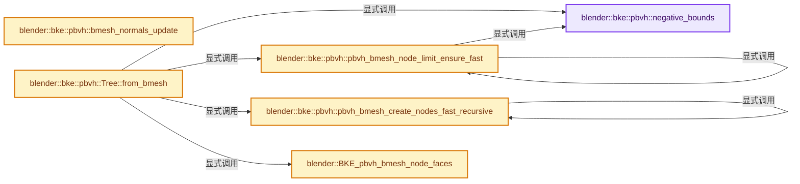
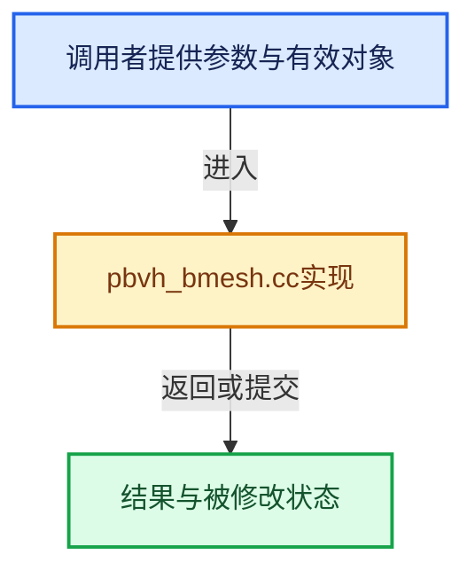

# 实现依赖专题：source/blender/blenkernel/intern/pbvh_bmesh.cc

[实现依赖导航](../../README.md) · [符号索引](../../../00-课程指南/02-源码与提交索引/符号依赖与实现索引.md)

本专题从正文实际调用进入，集中保存共享实现。函数有稳定锚点，可从调用处直接跳到对应完整函数；递归与互相调用通过回链组织。

## 本文件的实现关系






## 完整成员与函数实现

<a id="f-221382a3ad3846c0"></a>

### `blender::bke::pbvh::negative_bounds`

实现位置：[source/blender/blenkernel/intern/pbvh_bmesh.cc](../../../../../../../source/blender/blenkernel/intern/pbvh_bmesh.cc) · L96—L99。

**教学注释版**

<!-- annotated:907db7f2b3372f -->

```cpp
static Bounds<float3> negative_bounds()
{
  // [讲解] std::numeric_limits<float>::max：按比较关系选取较大值。本讲解中的增长公式同时满足最低请求和几何增长；若保存返回引用，还需注意实参寿命。
  return {float3(std::numeric_limits<float>::max()), float3(std::numeric_limits<float>::lowest())};
}
```

<details>
<summary>核对原始源码：source/blender/blenkernel/intern/pbvh_bmesh.cc · L96—L99</summary>

<!-- original:907db7f2b3372f:source/blender/blenkernel/intern/pbvh_bmesh.cc:96:99 -->

```cpp
static Bounds<float3> negative_bounds()
{
  return {float3(std::numeric_limits<float>::max()), float3(std::numeric_limits<float>::lowest())};
}
```

</details>

**结果出口**

- `return {float3(std::numeric_limits<float>::max()), float3(std::numeric_limits<float>::lowest())};`

**继续追踪实现**

- `float3` → [float3 · L641](../../08-其他Blender模块/compositor/algorithms/intern/smaa.cc.md#m-0ea8254cfdb4)。宏定义由构建条件选择。
- `std::numeric_limits<float>::max` → [外部契约](https://eel.is/c++draft/alg.min.max)：按比较关系选取较大值。本讲解中的增长公式同时满足最低请求和几何增长；若保存返回引用，还需注意实参寿命。
- `std::numeric_limits<float>::lowest` → [外部契约](https://eel.is/c++draft/)：这个边界按实际表达式及所属类型核对参数、返回值、寿命与失败行为。这里提供接口入口，不声称已解释该第三方版本的内部实现。

<a id="f-502b35dc5a8da919"></a>

### `blender::bke::pbvh::bmesh_normals_update`

实现位置：[source/blender/blenkernel/intern/pbvh_bmesh.cc](../../../../../../../source/blender/blenkernel/intern/pbvh_bmesh.cc) · L1902—L1917。

接口参数：

- `Tree &pbvh`
- `const IndexMask &nodes_to_update`

**教学注释版**

<!-- annotated:c8581dcf525131 -->

```cpp
void bmesh_normals_update(Tree &pbvh, const IndexMask &nodes_to_update)
{
  const MutableSpan<BMeshNode> nodes = pbvh.nodes<BMeshNode>();
  nodes_to_update.foreach_index([&](const int i) {
    BMeshNode &node = nodes[i];
    for (BMFace *face : node.bm_faces_) {
      BM_face_normal_update(face);
    }
    for (BMVert *vert : node.bm_unique_verts_) {
      BM_vert_normal_update(vert);
    }
    for (BMVert *vert : node.bm_other_verts_) {
      BM_vert_normal_update(vert);
    }
  });
}
```

<details>
<summary>核对原始源码：source/blender/blenkernel/intern/pbvh_bmesh.cc · L1902—L1917</summary>

<!-- original:c8581dcf525131:source/blender/blenkernel/intern/pbvh_bmesh.cc:1902:1917 -->

```cpp
void bmesh_normals_update(Tree &pbvh, const IndexMask &nodes_to_update)
{
  const MutableSpan<BMeshNode> nodes = pbvh.nodes<BMeshNode>();
  nodes_to_update.foreach_index([&](const int i) {
    BMeshNode &node = nodes[i];
    for (BMFace *face : node.bm_faces_) {
      BM_face_normal_update(face);
    }
    for (BMVert *vert : node.bm_unique_verts_) {
      BM_vert_normal_update(vert);
    }
    for (BMVert *vert : node.bm_other_verts_) {
      BM_vert_normal_update(vert);
    }
  });
}
```

</details>

**继续追踪实现**

- `pbvh.nodes<BMeshNode>` → [blender::bke::pbvh::Tree::nodes · L584](pbvh.cc.md#f-663f289ebea16e59)；[blender::bke::pbvh::Tree::nodes · L588](pbvh.cc.md#f-50703e7cf53b4d1c)；[blender::bke::pbvh::Tree::nodes · L592](pbvh.cc.md#f-d9221c845e25f9af)；[blender::bke::pbvh::Tree::nodes · L596](pbvh.cc.md#f-ec75be38023af56b)；[blender::bke::pbvh::Tree::nodes · L600](pbvh.cc.md#f-77d63d7d2fc007e2)；[blender::bke::pbvh::Tree::nodes · L604](pbvh.cc.md#f-fcfca3ad8c2580dc)。同名重载需按实参类型选择。
- `nodes_to_update.foreach_index` → [blender::index_mask::IndexMask::foreach_index · L855](../../../04-虚拟数组与索引选择/09-分段存储与遍历.md#f-cd6cd317e2e2812c)。
- `BM_face_normal_update` → [blender::BM_face_normal_update · L851](../../08-其他Blender模块/bmesh/intern/bmesh_polygon.cc.md#f-d8c9aad00022af01)。
- `BM_vert_normal_update` → [blender::BM_vert_normal_update · L820](../../08-其他Blender模块/bmesh/intern/bmesh_polygon.cc.md#f-0b7995e57c57863c)。

<a id="f-2372bdf7fece7bca"></a>

### `blender::bke::pbvh::pbvh_bmesh_node_limit_ensure_fast`

实现位置：[source/blender/blenkernel/intern/pbvh_bmesh.cc](../../../../../../../source/blender/blenkernel/intern/pbvh_bmesh.cc) · L1931—L2034。

接口参数：

- `const MutableSpan<BMFace *> nodeinfo`
- `const Span<Bounds<float3>> face_bounds`
- `FastNodeBuildInfo *node`
- `MemArena *arena`

**教学注释版**

<!-- annotated:78e7de36a828a9 -->

```cpp
static void pbvh_bmesh_node_limit_ensure_fast(const MutableSpan<BMFace *> nodeinfo,
                                              const Span<Bounds<float3>> face_bounds,
                                              FastNodeBuildInfo *node,
                                              MemArena *arena)
{
  if (node->totface <= leaf_limit) {
    return;
  }

  /* Calculate bounding box around primitive centroids. */
  Bounds<float3> cb = negative_bounds();
  for (int i = 0; i < node->totface; i++) {
    const BMFace *f = nodeinfo[i + node->start];
    const int face_index = BM_elem_index_get(f);
    const float3 center = math::midpoint(face_bounds[face_index].min, face_bounds[face_index].max);
    math::min_max(center, cb.min, cb.max);
  }

  /* Find widest axis and its midpoint. */
  const int axis = math::dominant_axis(cb.max - cb.min);
  const float mid = math::midpoint(cb.max[axis], cb.min[axis]);

  int num_child1 = 0;
  int num_child2 = 0;

  /* Split vertices along the middle line. */
  const int end = node->start + node->totface;
  for (int i = node->start; i < end - num_child2; i++) {
    const BMFace *f = nodeinfo[i];
    const int face_i = BM_elem_index_get(f);

    if (math::midpoint(face_bounds[face_i].min[axis], face_bounds[face_i].max[axis]) > mid) {
      int i_iter = end - num_child2 - 1;
      int candidate = -1;
      /* Found a face that should be part of another node, look for a face to substitute with. */

      for (; i_iter > i; i_iter--) {
        const BMFace *f_iter = nodeinfo[i_iter];
        const int face_iter_i = BM_elem_index_get(f_iter);
        if (math::midpoint(face_bounds[face_iter_i].min[axis],
                           face_bounds[face_iter_i].max[axis]) <= mid)
        {
          candidate = i_iter;
          break;
        }

        num_child2++;
      }

      if (candidate != -1) {
        BMFace *tmp = nodeinfo[i];
        nodeinfo[i] = nodeinfo[candidate];
        nodeinfo[candidate] = tmp;
        /* Increase both counts. */
        num_child1++;
        num_child2++;
      }
      else {
        /* Not finding candidate means second half of array part is full of
         * second node parts, just increase the number of child nodes for it. */
        num_child2++;
      }
    }
    else {
      num_child1++;
    }
  }

  /* Ensure at least one child in each node. */
  if (num_child2 == 0) {
    num_child2++;
    num_child1--;
  }
  else if (num_child1 == 0) {
    num_child1++;
    num_child2--;
  }

  /* At this point, faces should have been split along the array range sequentially,
   * each sequential part belonging to one node only. */
  BLI_assert((num_child1 + num_child2) == node->totface);

  /* Initialize the children. */
  FastNodeBuildInfo *child1 = static_cast<FastNodeBuildInfo *>(
      BLI_memarena_alloc(arena, sizeof(FastNodeBuildInfo)));
  FastNodeBuildInfo *child2 = static_cast<FastNodeBuildInfo *>(
      BLI_memarena_alloc(arena, sizeof(FastNodeBuildInfo)));

  node->child1 = child1;
  node->child2 = child2;

  child1->totface = num_child1;
  child1->start = node->start;
  child1->child1 = nullptr;
  child1->child2 = nullptr;

  child2->totface = num_child2;
  child2->start = node->start + num_child1;
  child2->child1 = nullptr;
  child2->child2 = nullptr;

  pbvh_bmesh_node_limit_ensure_fast(nodeinfo, face_bounds, child1, arena);
  pbvh_bmesh_node_limit_ensure_fast(nodeinfo, face_bounds, child2, arena);
}
```

<details>
<summary>核对原始源码：source/blender/blenkernel/intern/pbvh_bmesh.cc · L1931—L2034</summary>

<!-- original:78e7de36a828a9:source/blender/blenkernel/intern/pbvh_bmesh.cc:1931:2034 -->

```cpp
static void pbvh_bmesh_node_limit_ensure_fast(const MutableSpan<BMFace *> nodeinfo,
                                              const Span<Bounds<float3>> face_bounds,
                                              FastNodeBuildInfo *node,
                                              MemArena *arena)
{
  if (node->totface <= leaf_limit) {
    return;
  }

  /* Calculate bounding box around primitive centroids. */
  Bounds<float3> cb = negative_bounds();
  for (int i = 0; i < node->totface; i++) {
    const BMFace *f = nodeinfo[i + node->start];
    const int face_index = BM_elem_index_get(f);
    const float3 center = math::midpoint(face_bounds[face_index].min, face_bounds[face_index].max);
    math::min_max(center, cb.min, cb.max);
  }

  /* Find widest axis and its midpoint. */
  const int axis = math::dominant_axis(cb.max - cb.min);
  const float mid = math::midpoint(cb.max[axis], cb.min[axis]);

  int num_child1 = 0;
  int num_child2 = 0;

  /* Split vertices along the middle line. */
  const int end = node->start + node->totface;
  for (int i = node->start; i < end - num_child2; i++) {
    const BMFace *f = nodeinfo[i];
    const int face_i = BM_elem_index_get(f);

    if (math::midpoint(face_bounds[face_i].min[axis], face_bounds[face_i].max[axis]) > mid) {
      int i_iter = end - num_child2 - 1;
      int candidate = -1;
      /* Found a face that should be part of another node, look for a face to substitute with. */

      for (; i_iter > i; i_iter--) {
        const BMFace *f_iter = nodeinfo[i_iter];
        const int face_iter_i = BM_elem_index_get(f_iter);
        if (math::midpoint(face_bounds[face_iter_i].min[axis],
                           face_bounds[face_iter_i].max[axis]) <= mid)
        {
          candidate = i_iter;
          break;
        }

        num_child2++;
      }

      if (candidate != -1) {
        BMFace *tmp = nodeinfo[i];
        nodeinfo[i] = nodeinfo[candidate];
        nodeinfo[candidate] = tmp;
        /* Increase both counts. */
        num_child1++;
        num_child2++;
      }
      else {
        /* Not finding candidate means second half of array part is full of
         * second node parts, just increase the number of child nodes for it. */
        num_child2++;
      }
    }
    else {
      num_child1++;
    }
  }

  /* Ensure at least one child in each node. */
  if (num_child2 == 0) {
    num_child2++;
    num_child1--;
  }
  else if (num_child1 == 0) {
    num_child1++;
    num_child2--;
  }

  /* At this point, faces should have been split along the array range sequentially,
   * each sequential part belonging to one node only. */
  BLI_assert((num_child1 + num_child2) == node->totface);

  /* Initialize the children. */
  FastNodeBuildInfo *child1 = static_cast<FastNodeBuildInfo *>(
      BLI_memarena_alloc(arena, sizeof(FastNodeBuildInfo)));
  FastNodeBuildInfo *child2 = static_cast<FastNodeBuildInfo *>(
      BLI_memarena_alloc(arena, sizeof(FastNodeBuildInfo)));

  node->child1 = child1;
  node->child2 = child2;

  child1->totface = num_child1;
  child1->start = node->start;
  child1->child1 = nullptr;
  child1->child2 = nullptr;

  child2->totface = num_child2;
  child2->start = node->start + num_child1;
  child2->child1 = nullptr;
  child2->child2 = nullptr;

  pbvh_bmesh_node_limit_ensure_fast(nodeinfo, face_bounds, child1, arena);
  pbvh_bmesh_node_limit_ensure_fast(nodeinfo, face_bounds, child2, arena);
}
```

</details>

**沿实际写入检查状态**

- `candidate = i_iter;`
- `nodeinfo[i] = nodeinfo[candidate];`
- `nodeinfo[candidate] = tmp;`
- `node->child1 = child1;`
- `node->child2 = child2;`
- `child1->totface = num_child1;`
- `child1->start = node->start;`
- `child1->child1 = nullptr;`
- `child1->child2 = nullptr;`
- `child2->totface = num_child2;`
- `child2->start = node->start + num_child1;`
- `child2->child1 = nullptr;`
- `child2->child2 = nullptr;`

**继续追踪实现**

- `negative_bounds` → [blender::bke::pbvh::negative_bounds · L96](pbvh_bmesh.cc.md#f-221382a3ad3846c0)。
- `BM_elem_index_get` → [BM_elem_index_get · L120](../../08-其他Blender模块/bmesh/intern/bmesh_inline.hh.md#m-201981cdc62d)。宏定义由构建条件选择。
- `math::midpoint` → [blender::math::midpoint · L647](../../01-BLI基础库/BLI_math_vector.hh.md#f-383eeed0051cc8bd)；[blender::math::midpoint · L288](../../01-BLI基础库/BLI_math_base.hh.md#f-1a01baa0be6c0b84)。同名重载需按实参类型选择。
- `math::min_max` → [blender::math::min_max · L331](../../01-BLI基础库/BLI_math_vector.hh.md#f-d0ca25e982d9489c)；[blender::math::min_max · L99](../../01-BLI基础库/BLI_math_base.hh.md#f-d076aca4030981e7)。同名重载需按实参类型选择。
- `math::dominant_axis` → [blender::math::dominant_axis · L668](../../01-BLI基础库/BLI_math_vector.hh.md#f-29bbd91a3e22182f)。
- `BLI_assert` → [BLI_assert · L48](../../01-BLI基础库/BLI_assert.hh.md#m-57a88495704d)；[BLI_assert · L63](../../01-BLI基础库/BLI_assert.hh.md#m-d07050020cb5)。宏定义由构建条件选择。
- `BLI_memarena_alloc` → [blender::BLI_memarena_alloc · L125](../../01-BLI基础库/intern/BLI_memarena.cc.md#f-ae79828c3629e134)；[blender::BLI_memarena_alloc · L43](../../01-BLI基础库/BLI_memarena.hh.md#f-3c7ccf0d8384021b)。同名重载需按实参类型选择。
- `pbvh_bmesh_node_limit_ensure_fast` → [blender::bke::pbvh::pbvh_bmesh_node_limit_ensure_fast · L1931](pbvh_bmesh.cc.md#f-2372bdf7fece7bca)。

<a id="f-5780603ba713cba0"></a>

### `blender::bke::pbvh::pbvh_bmesh_create_nodes_fast_recursive`

实现位置：[source/blender/blenkernel/intern/pbvh_bmesh.cc](../../../../../../../source/blender/blenkernel/intern/pbvh_bmesh.cc) · L2036—L2104。

接口参数：

- `Vector<BMeshNode> &nodes`
- `const int cd_vert_node_offset`
- `const int cd_face_node_offset`
- `const Span<BMFace *> nodeinfo`
- `const Span<Bounds<float3>> face_bounds`
- `const FastNodeBuildInfo *node`
- `const int node_index`
- `const int parent_index`

**教学注释版**

<!-- annotated:1da7f26873f3bd -->

```cpp
static void pbvh_bmesh_create_nodes_fast_recursive(Vector<BMeshNode> &nodes,
                                                   const int cd_vert_node_offset,
                                                   const int cd_face_node_offset,
                                                   const Span<BMFace *> nodeinfo,
                                                   const Span<Bounds<float3>> face_bounds,
                                                   const FastNodeBuildInfo *node,
                                                   const int node_index,
                                                   const int parent_index)
{
  BLI_assert(parent_index >= -1);
  nodes[node_index].parent_ = parent_index;

  /* Two cases, node does not have children or does have children. */
  if (node->child1) {
    // [讲解] nodes.size：用end_减begin_得到活元素数量。
    int children_offset_ = nodes.size();

    nodes[node_index].children_offset_ = children_offset_;
    // [讲解] nodes.resize：把有效元素数调整为new_size。增长路径构造新元素，缩小路径销毁尾部对象，最后才提交新的end_。
    nodes.resize(nodes.size() + 2);
    pbvh_bmesh_create_nodes_fast_recursive(nodes,
                                           cd_vert_node_offset,
                                           cd_face_node_offset,
                                           nodeinfo,
                                           face_bounds,
                                           node->child1,
                                           children_offset_,
                                           node_index);
    pbvh_bmesh_create_nodes_fast_recursive(nodes,
                                           cd_vert_node_offset,
                                           cd_face_node_offset,
                                           nodeinfo,
                                           face_bounds,
                                           node->child2,
                                           children_offset_ + 1,
                                           node_index);
  }
  else {
    /* Node does not have children so it's a leaf node, populate with faces and tag accordingly
     * this is an expensive part but it's not so easily thread-able due to vertex node indices. */

    nodes[node_index].flag_ |= Node::Leaf;
    nodes[node_index].bm_faces_.reserve(node->totface);

    const int end = node->start + node->totface;

    for (int i = node->start; i < end; i++) {
      BMFace *f = nodeinfo[i];

      /* Update ownership of faces. */
      nodes[node_index].bm_faces_.add_new(f);
      BM_ELEM_CD_SET_INT(f, cd_face_node_offset, node_index);

      /* Update vertices. */
      const BMLoop *l_first = BM_FACE_FIRST_LOOP(f);
      const BMLoop *l_iter = l_first;
      do {
        BMVert *v = l_iter->v;
        if (!nodes[node_index].bm_unique_verts_.contains(v)) {
          if (BM_ELEM_CD_GET_INT(v, cd_vert_node_offset) != dyntopo_node_none) {
            nodes[node_index].bm_other_verts_.add(v);
          }
          else {
            nodes[node_index].bm_unique_verts_.add(v);
            BM_ELEM_CD_SET_INT(v, cd_vert_node_offset, node_index);
          }
        }
      } while ((l_iter = l_iter->next) != l_first);
    }
  }
}
```

<details>
<summary>核对原始源码：source/blender/blenkernel/intern/pbvh_bmesh.cc · L2036—L2104</summary>

<!-- original:1da7f26873f3bd:source/blender/blenkernel/intern/pbvh_bmesh.cc:2036:2104 -->

```cpp
static void pbvh_bmesh_create_nodes_fast_recursive(Vector<BMeshNode> &nodes,
                                                   const int cd_vert_node_offset,
                                                   const int cd_face_node_offset,
                                                   const Span<BMFace *> nodeinfo,
                                                   const Span<Bounds<float3>> face_bounds,
                                                   const FastNodeBuildInfo *node,
                                                   const int node_index,
                                                   const int parent_index)
{
  BLI_assert(parent_index >= -1);
  nodes[node_index].parent_ = parent_index;

  /* Two cases, node does not have children or does have children. */
  if (node->child1) {
    int children_offset_ = nodes.size();

    nodes[node_index].children_offset_ = children_offset_;
    nodes.resize(nodes.size() + 2);
    pbvh_bmesh_create_nodes_fast_recursive(nodes,
                                           cd_vert_node_offset,
                                           cd_face_node_offset,
                                           nodeinfo,
                                           face_bounds,
                                           node->child1,
                                           children_offset_,
                                           node_index);
    pbvh_bmesh_create_nodes_fast_recursive(nodes,
                                           cd_vert_node_offset,
                                           cd_face_node_offset,
                                           nodeinfo,
                                           face_bounds,
                                           node->child2,
                                           children_offset_ + 1,
                                           node_index);
  }
  else {
    /* Node does not have children so it's a leaf node, populate with faces and tag accordingly
     * this is an expensive part but it's not so easily thread-able due to vertex node indices. */

    nodes[node_index].flag_ |= Node::Leaf;
    nodes[node_index].bm_faces_.reserve(node->totface);

    const int end = node->start + node->totface;

    for (int i = node->start; i < end; i++) {
      BMFace *f = nodeinfo[i];

      /* Update ownership of faces. */
      nodes[node_index].bm_faces_.add_new(f);
      BM_ELEM_CD_SET_INT(f, cd_face_node_offset, node_index);

      /* Update vertices. */
      const BMLoop *l_first = BM_FACE_FIRST_LOOP(f);
      const BMLoop *l_iter = l_first;
      do {
        BMVert *v = l_iter->v;
        if (!nodes[node_index].bm_unique_verts_.contains(v)) {
          if (BM_ELEM_CD_GET_INT(v, cd_vert_node_offset) != dyntopo_node_none) {
            nodes[node_index].bm_other_verts_.add(v);
          }
          else {
            nodes[node_index].bm_unique_verts_.add(v);
            BM_ELEM_CD_SET_INT(v, cd_vert_node_offset, node_index);
          }
        }
      } while ((l_iter = l_iter->next) != l_first);
    }
  }
}
```

</details>

**沿实际写入检查状态**

- `nodes[node_index].parent_ = parent_index;`
- `nodes[node_index].children_offset_ = children_offset_;`
- `nodes[node_index].flag_ |= Node::Leaf;`

**继续追踪实现**

- `BLI_assert` → [BLI_assert · L48](../../01-BLI基础库/BLI_assert.hh.md#m-57a88495704d)；[BLI_assert · L63](../../01-BLI基础库/BLI_assert.hh.md#m-d07050020cb5)。宏定义由构建条件选择。
- `nodes.size` → [blender::Vector::size · L780](../../../01-基础容器与现代CPP/11-Vector插入删除与重排.md#f-714773731767349c)。
- `nodes.resize` → [blender::Vector::resize · L418](../../../01-基础容器与现代CPP/10-Vector扩容与增长.md#f-059312cabb8abe3a)；[blender::Vector::resize · L439](../../../01-基础容器与现代CPP/10-Vector扩容与增长.md#f-ab8f94924ebe2d12)。同名重载需按实参类型选择。
- `pbvh_bmesh_create_nodes_fast_recursive` → [blender::bke::pbvh::pbvh_bmesh_create_nodes_fast_recursive · L2036](pbvh_bmesh.cc.md#f-5780603ba713cba0)。
- `nodes[node_index].bm_faces_.reserve` → [调用协议](../../../00-课程指南/01-路线与规范/模板宏与动态分派协议.md)：接收对象类型依赖auto、返回值或模板实例；不按同名猜测目标。调用位置L2076。
- `nodes[node_index].bm_faces_.add_new` → [调用协议](../../../00-课程指南/01-路线与规范/模板宏与动态分派协议.md)：接收对象类型依赖auto、返回值或模板实例；不按同名猜测目标。调用位置L2084。
- `BM_ELEM_CD_SET_INT` → [BM_ELEM_CD_SET_INT · L574](../../08-其他Blender模块/bmesh/bmesh_class.hh.md#m-c0f0ab052376)。宏定义由构建条件选择。
- `BM_FACE_FIRST_LOOP` → [BM_FACE_FIRST_LOOP · L697](../../08-其他Blender模块/bmesh/bmesh_class.hh.md#m-c7e10ffb38e6)；[BM_FACE_FIRST_LOOP · L699](../../08-其他Blender模块/bmesh/bmesh_class.hh.md#m-76a054cc4770)。宏定义由构建条件选择。
- `nodes[node_index].bm_unique_verts_.contains` → [调用协议](../../../00-课程指南/01-路线与规范/模板宏与动态分派协议.md)：接收对象类型依赖auto、返回值或模板实例；不按同名猜测目标。调用位置L2092。
- `BM_ELEM_CD_GET_INT` → [BM_ELEM_CD_GET_INT · L582](../../08-其他Blender模块/bmesh/bmesh_class.hh.md#m-d722975f4396)。宏定义由构建条件选择。
- `nodes[node_index].bm_other_verts_.add` → [调用协议](../../../00-课程指南/01-路线与规范/模板宏与动态分派协议.md)：接收对象类型依赖auto、返回值或模板实例；不按同名猜测目标。调用位置L2094。
- `nodes[node_index].bm_unique_verts_.add` → [调用协议](../../../00-课程指南/01-路线与规范/模板宏与动态分派协议.md)：接收对象类型依赖auto、返回值或模板实例；不按同名猜测目标。调用位置L2097。

<a id="f-1c9649e2b4cf9b8c"></a>

### `blender::bke::pbvh::Tree::from_bmesh`

实现位置：[source/blender/blenkernel/intern/pbvh_bmesh.cc](../../../../../../../source/blender/blenkernel/intern/pbvh_bmesh.cc) · L2108—L2188。

接口参数：

- `BMesh &bm`

**教学注释版**

<!-- annotated:f67c978326174c -->

```cpp
Tree Tree::from_bmesh(BMesh &bm)
{
  PRF_scope(ProfileCategory::Core);
  Tree pbvh(Type::BMesh);
  if (bm.totface == 0) {
    return pbvh;
  }

  const int cd_vert_node_offset = CustomData_get_offset_named(
      &bm.vdata, CD_PROP_INT32, ".sculpt_dyntopo_node_id_vertex");
  const int cd_face_node_offset = CustomData_get_offset_named(
      &bm.pdata, CD_PROP_INT32, ".sculpt_dyntopo_node_id_face");

  /* bounding box array of all faces, no need to recalculate every time. */
  Array<Bounds<float3>> face_bounds(bm.totface);
  Array<BMFace *> nodeinfo(bm.totface);
  MemArena *arena = BLI_memarena_new(BLI_MEMARENA_STD_BUFSIZE, "fast Tree node storage");

  BMIter iter;
  BMFace *f;
  int i;
  BM_ITER_MESH_INDEX (f, &iter, &bm, BM_FACES_OF_MESH, i) {
    face_bounds[i] = negative_bounds();

    const BMLoop *l_first = BM_FACE_FIRST_LOOP(f);
    const BMLoop *l_iter = l_first;
    do {
      math::min_max(float3(l_iter->v->co), face_bounds[i].min, face_bounds[i].max);
    } while ((l_iter = l_iter->next) != l_first);

    /* so we can do direct lookups on 'face_bounds' */
    BM_elem_index_set(f, i); /* set_dirty! */
    nodeinfo[i] = f;
    BM_ELEM_CD_SET_INT(f, cd_face_node_offset, dyntopo_node_none);
  }
  /* Likely this is already dirty. */
  bm.elem_index_dirty |= BM_FACE;

  BMVert *v;
  BM_ITER_MESH (v, &iter, &bm, BM_VERTS_OF_MESH) {
    BM_ELEM_CD_SET_INT(v, cd_vert_node_offset, dyntopo_node_none);
  }

  /* Set up root node. */
  FastNodeBuildInfo rootnode = {0};
  rootnode.totface = bm.totface;

  /* Start recursion, assign faces to nodes accordingly. */
  pbvh_bmesh_node_limit_ensure_fast(nodeinfo, face_bounds, &rootnode, arena);

  /* We now have all faces assigned to a node,
   * next we need to assign those to the gsets of the nodes. */

  /* Start with all faces in the root node. */
  /* Take root node and visit and populate children recursively. */
  Vector<BMeshNode> &nodes = std::get<Vector<BMeshNode>>(pbvh.nodes_);
  // [讲解] nodes.resize：把有效元素数调整为new_size。增长路径构造新元素，缩小路径销毁尾部对象，最后才提交新的end_。
  nodes.resize(1);
  pbvh_bmesh_create_nodes_fast_recursive(
      nodes, cd_vert_node_offset, cd_face_node_offset, nodeinfo, face_bounds, &rootnode, 0, -1);

  pbvh.tag_positions_changed(nodes.index_range());
  pbvh.update_bounds_bmesh(bm);
  store_bounds_orig(pbvh);

  threading::parallel_for(nodes.index_range(), 8, [&](const IndexRange range) {
    for (const int i : range) {
      const Set<BMFace *, 0> &faces = BKE_pbvh_bmesh_node_faces(&nodes[i]);
      if (std::all_of(faces.begin(),
                      faces.end(),
                      [&](const BMFace *face) { return BM_elem_flag_test(face, BM_ELEM_HIDDEN); }))
      {
        nodes[i].flag_ |= Node::FullyHidden;
      }
    }
  });

  update_mask_bmesh(bm, nodes.index_range(), pbvh);

  BLI_memarena_free(arena);
  return pbvh;
}
```

<details>
<summary>核对原始源码：source/blender/blenkernel/intern/pbvh_bmesh.cc · L2108—L2188</summary>

<!-- original:f67c978326174c:source/blender/blenkernel/intern/pbvh_bmesh.cc:2108:2188 -->

```cpp
Tree Tree::from_bmesh(BMesh &bm)
{
  PRF_scope(ProfileCategory::Core);
  Tree pbvh(Type::BMesh);
  if (bm.totface == 0) {
    return pbvh;
  }

  const int cd_vert_node_offset = CustomData_get_offset_named(
      &bm.vdata, CD_PROP_INT32, ".sculpt_dyntopo_node_id_vertex");
  const int cd_face_node_offset = CustomData_get_offset_named(
      &bm.pdata, CD_PROP_INT32, ".sculpt_dyntopo_node_id_face");

  /* bounding box array of all faces, no need to recalculate every time. */
  Array<Bounds<float3>> face_bounds(bm.totface);
  Array<BMFace *> nodeinfo(bm.totface);
  MemArena *arena = BLI_memarena_new(BLI_MEMARENA_STD_BUFSIZE, "fast Tree node storage");

  BMIter iter;
  BMFace *f;
  int i;
  BM_ITER_MESH_INDEX (f, &iter, &bm, BM_FACES_OF_MESH, i) {
    face_bounds[i] = negative_bounds();

    const BMLoop *l_first = BM_FACE_FIRST_LOOP(f);
    const BMLoop *l_iter = l_first;
    do {
      math::min_max(float3(l_iter->v->co), face_bounds[i].min, face_bounds[i].max);
    } while ((l_iter = l_iter->next) != l_first);

    /* so we can do direct lookups on 'face_bounds' */
    BM_elem_index_set(f, i); /* set_dirty! */
    nodeinfo[i] = f;
    BM_ELEM_CD_SET_INT(f, cd_face_node_offset, dyntopo_node_none);
  }
  /* Likely this is already dirty. */
  bm.elem_index_dirty |= BM_FACE;

  BMVert *v;
  BM_ITER_MESH (v, &iter, &bm, BM_VERTS_OF_MESH) {
    BM_ELEM_CD_SET_INT(v, cd_vert_node_offset, dyntopo_node_none);
  }

  /* Set up root node. */
  FastNodeBuildInfo rootnode = {0};
  rootnode.totface = bm.totface;

  /* Start recursion, assign faces to nodes accordingly. */
  pbvh_bmesh_node_limit_ensure_fast(nodeinfo, face_bounds, &rootnode, arena);

  /* We now have all faces assigned to a node,
   * next we need to assign those to the gsets of the nodes. */

  /* Start with all faces in the root node. */
  /* Take root node and visit and populate children recursively. */
  Vector<BMeshNode> &nodes = std::get<Vector<BMeshNode>>(pbvh.nodes_);
  nodes.resize(1);
  pbvh_bmesh_create_nodes_fast_recursive(
      nodes, cd_vert_node_offset, cd_face_node_offset, nodeinfo, face_bounds, &rootnode, 0, -1);

  pbvh.tag_positions_changed(nodes.index_range());
  pbvh.update_bounds_bmesh(bm);
  store_bounds_orig(pbvh);

  threading::parallel_for(nodes.index_range(), 8, [&](const IndexRange range) {
    for (const int i : range) {
      const Set<BMFace *, 0> &faces = BKE_pbvh_bmesh_node_faces(&nodes[i]);
      if (std::all_of(faces.begin(),
                      faces.end(),
                      [&](const BMFace *face) { return BM_elem_flag_test(face, BM_ELEM_HIDDEN); }))
      {
        nodes[i].flag_ |= Node::FullyHidden;
      }
    }
  });

  update_mask_bmesh(bm, nodes.index_range(), pbvh);

  BLI_memarena_free(arena);
  return pbvh;
}
```

</details>

**沿实际写入检查状态**

- `face_bounds[i] = negative_bounds();`
- `nodeinfo[i] = f;`
- `bm.elem_index_dirty |= BM_FACE;`
- `rootnode.totface = bm.totface;`
- `nodes[i].flag_ |= Node::FullyHidden;`

**结果出口**

- `return pbvh;`

**继续追踪实现**

- `PRF_scope` → [PRF_scope · L51](../../07-Intern运行时与平台/profile/PRF_profile.hh.md#m-9f5e4ea0487b)；[PRF_scope · L90](../../07-Intern运行时与平台/profile/PRF_profile.hh.md#m-8fc74ae4419e)。宏定义由构建条件选择。
- `CustomData_get_offset_named` → [blender::CustomData_get_offset_named · L3398](customdata.cc.md#f-fe199f3da62e9c30)。
- `BLI_memarena_new` → [blender::BLI_memarena_new · L73](../../01-BLI基础库/intern/BLI_memarena.cc.md#f-590ef4f6ab548c98)。
- `BM_ITER_MESH_INDEX` → [BM_ITER_MESH_INDEX · L76](../../08-其他Blender模块/bmesh/intern/bmesh_iterators.hh.md#m-6a0cac4538f9)。宏定义由构建条件选择。
- `negative_bounds` → [blender::bke::pbvh::negative_bounds · L96](pbvh_bmesh.cc.md#f-221382a3ad3846c0)。
- `BM_FACE_FIRST_LOOP` → [BM_FACE_FIRST_LOOP · L697](../../08-其他Blender模块/bmesh/bmesh_class.hh.md#m-c7e10ffb38e6)；[BM_FACE_FIRST_LOOP · L699](../../08-其他Blender模块/bmesh/bmesh_class.hh.md#m-76a054cc4770)。宏定义由构建条件选择。
- `math::min_max` → [blender::math::min_max · L331](../../01-BLI基础库/BLI_math_vector.hh.md#f-d0ca25e982d9489c)；[blender::math::min_max · L99](../../01-BLI基础库/BLI_math_base.hh.md#f-d076aca4030981e7)。同名重载需按实参类型选择。
- `float3` → [float3 · L641](../../08-其他Blender模块/compositor/algorithms/intern/smaa.cc.md#m-0ea8254cfdb4)。宏定义由构建条件选择。
- `BM_elem_index_set` → [BM_elem_index_set · L121](../../08-其他Blender模块/bmesh/intern/bmesh_inline.hh.md#m-7bd559c53007)。宏定义由构建条件选择。
- `BM_ELEM_CD_SET_INT` → [BM_ELEM_CD_SET_INT · L574](../../08-其他Blender模块/bmesh/bmesh_class.hh.md#m-c0f0ab052376)。宏定义由构建条件选择。
- `BM_ITER_MESH` → [BM_ITER_MESH · L72](../../08-其他Blender模块/bmesh/intern/bmesh_iterators.hh.md#m-cfc837c73218)。宏定义由构建条件选择。
- `pbvh_bmesh_node_limit_ensure_fast` → [blender::bke::pbvh::pbvh_bmesh_node_limit_ensure_fast · L1931](pbvh_bmesh.cc.md#f-2372bdf7fece7bca)。
- `std::get<Vector<BMeshNode>>` → [外部契约](https://eel.is/c++draft/)：这个边界按实际表达式及所属类型核对参数、返回值、寿命与失败行为。这里提供接口入口，不声称已解释该第三方版本的内部实现。
- `nodes.resize` → [blender::Vector::resize · L418](../../../01-基础容器与现代CPP/10-Vector扩容与增长.md#f-059312cabb8abe3a)；[blender::Vector::resize · L439](../../../01-基础容器与现代CPP/10-Vector扩容与增长.md#f-ab8f94924ebe2d12)。同名重载需按实参类型选择。
- `pbvh_bmesh_create_nodes_fast_recursive` → [blender::bke::pbvh::pbvh_bmesh_create_nodes_fast_recursive · L2036](pbvh_bmesh.cc.md#f-5780603ba713cba0)。
- `pbvh.tag_positions_changed` → [blender::bke::pbvh::Tree::tag_positions_changed · L614](pbvh.cc.md#f-89cd60ad894dff8b)。
- `nodes.index_range` → [blender::Vector::index_range · L1026](../../../01-基础容器与现代CPP/12-Vector异常安全与边界.md#f-ac29cf36ef185ab9)。
- `pbvh.update_bounds_bmesh` → [blender::bke::pbvh::Tree::update_bounds_bmesh · L1296](pbvh.cc.md#f-a28b375cd3b337ad)。
- `store_bounds_orig` → [blender::bke::pbvh::store_bounds_orig · L1332](pbvh.cc.md#f-1d202e4278216242)。
- `threading::parallel_for` → [blender::threading::parallel_for · L68](../../../11-Depsgraph与并行任务系统/07-任务池与TBB接入.md#f-838294754c24426c)。
- `BKE_pbvh_bmesh_node_faces` → [blender::BKE_pbvh_bmesh_node_faces · L2409](pbvh_bmesh.cc.md#f-03b95a39adb88de0)。
- `std::all_of` → [外部契约](https://eel.is/c++draft/)：这个边界按实际表达式及所属类型核对参数、返回值、寿命与失败行为。这里提供接口入口，不声称已解释该第三方版本的内部实现。
- `faces.begin` → [blender::Set::begin · L499](../../../02-哈希表与关联数据结构/08-Set与集合语义.md#f-2885cc115ca7486f)。
- `faces.end` → [blender::Set::end · L509](../../../02-哈希表与关联数据结构/08-Set与集合语义.md#f-553fc42e3d469eaa)。
- `BM_elem_flag_test` → [BM_elem_flag_test · L21](../../08-其他Blender模块/bmesh/intern/bmesh_inline.hh.md#m-2431d1179b41)。宏定义由构建条件选择。
- `update_mask_bmesh` → [blender::bke::pbvh::update_mask_bmesh · L1421](pbvh.cc.md#f-c718aff093f818f3)。
- `BLI_memarena_free` → [blender::BLI_memarena_free · L103](../../01-BLI基础库/intern/BLI_memarena.cc.md#f-a655794ad41d1bdf)。

<a id="f-03b95a39adb88de0"></a>

### `blender::BKE_pbvh_bmesh_node_faces`

实现位置：[source/blender/blenkernel/intern/pbvh_bmesh.cc](../../../../../../../source/blender/blenkernel/intern/pbvh_bmesh.cc) · L2409—L2412。

接口参数：

- `bke::pbvh::BMeshNode *node`

**教学注释版**

<!-- annotated:a7ad210e0c6d01 -->

```cpp
const Set<BMFace *, 0> &BKE_pbvh_bmesh_node_faces(bke::pbvh::BMeshNode *node)
{
  return node->bm_faces_;
}
```

<details>
<summary>核对原始源码：source/blender/blenkernel/intern/pbvh_bmesh.cc · L2409—L2412</summary>

<!-- original:a7ad210e0c6d01:source/blender/blenkernel/intern/pbvh_bmesh.cc:2409:2412 -->

```cpp
const Set<BMFace *, 0> &BKE_pbvh_bmesh_node_faces(bke::pbvh::BMeshNode *node)
{
  return node->bm_faces_;
}
```

</details>

**结果出口**

- `return node->bm_faces_;`

**继续追踪实现**

本实现没有需要继续展开的显式调用；检查返回表达式、对象转换和调用者前置条件。
