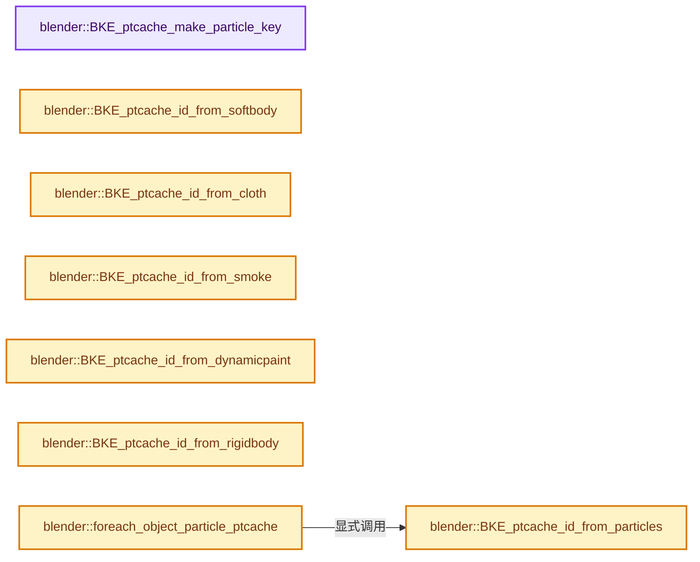
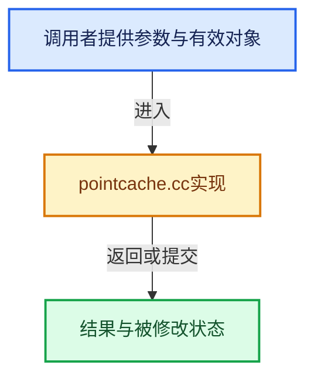

# 实现依赖专题：source/blender/blenkernel/intern/pointcache.cc

[实现依赖导航](../../README.md) · [符号索引](../../../00-课程指南/02-源码与提交索引/符号依赖与实现索引.md)

本专题从正文实际调用进入，集中保存共享实现。函数有稳定锚点，可从调用处直接跳到对应完整函数；递归与互相调用通过回链组织。

## 本文件的实现关系






<a id="m-54a88127920b"></a>

## 宏 `PTCACHE_DATA_TO`

<!-- annotated:b07a966a46c21f -->

```cpp
#define PTCACHE_DATA_TO(data, type, index, to) \
  if (data[type]) { \
    memcpy(to, \
           (char *)(data)[type] + ((index) ? (index) * ptcache_data_size[type] : 0), \
           ptcache_data_size[type]); \
  } \
  (void)0

```

<details>
<summary>核对原始源码：source/blender/blenkernel/intern/pointcache.cc · L90—L97</summary>

<!-- original:b07a966a46c21f:source/blender/blenkernel/intern/pointcache.cc:90:97 -->

```cpp
#define PTCACHE_DATA_TO(data, type, index, to) \
  if (data[type]) { \
    memcpy(to, \
           (char *)(data)[type] + ((index) ? (index) * ptcache_data_size[type] : 0), \
           ptcache_data_size[type]); \
  } \
  (void)0

```

</details>

宏在预处理阶段展开，参数替换、重复求值和条件编译应直接从该定义检查。与普通函数不同，宏不会自动提供参数类型检查；构建配置选择哪个定义需结合外围条件。

## 完整成员与函数实现

<a id="f-bbf294c8cf9cf71b"></a>

### `blender::BKE_ptcache_make_particle_key`

实现位置：[source/blender/blenkernel/intern/pointcache.cc](../../../../../../../source/blender/blenkernel/intern/pointcache.cc) · L258—L273。

接口参数：

- `ParticleKey *key`
- `int index`
- `void **data`
- `float time`

**教学注释版**

<!-- annotated:631c4960f07d69 -->

```cpp
void BKE_ptcache_make_particle_key(ParticleKey *key, int index, void **data, float time)
{
  PTCACHE_DATA_TO(data, BPHYS_DATA_LOCATION, index, key->co);
  PTCACHE_DATA_TO(data, BPHYS_DATA_VELOCITY, index, key->vel);

  /* no rotation info, so make something nice up */
  if (data[BPHYS_DATA_ROTATION] == nullptr) {
    vec_to_quat(key->rot, key->vel, OB_NEGX, OB_POSZ);
  }
  else {
    PTCACHE_DATA_TO(data, BPHYS_DATA_ROTATION, index, key->rot);
  }

  PTCACHE_DATA_TO(data, BPHYS_DATA_AVELOCITY, index, key->ave);
  key->time = time;
}
```

<details>
<summary>核对原始源码：source/blender/blenkernel/intern/pointcache.cc · L258—L273</summary>

<!-- original:631c4960f07d69:source/blender/blenkernel/intern/pointcache.cc:258:273 -->

```cpp
void BKE_ptcache_make_particle_key(ParticleKey *key, int index, void **data, float time)
{
  PTCACHE_DATA_TO(data, BPHYS_DATA_LOCATION, index, key->co);
  PTCACHE_DATA_TO(data, BPHYS_DATA_VELOCITY, index, key->vel);

  /* no rotation info, so make something nice up */
  if (data[BPHYS_DATA_ROTATION] == nullptr) {
    vec_to_quat(key->rot, key->vel, OB_NEGX, OB_POSZ);
  }
  else {
    PTCACHE_DATA_TO(data, BPHYS_DATA_ROTATION, index, key->rot);
  }

  PTCACHE_DATA_TO(data, BPHYS_DATA_AVELOCITY, index, key->ave);
  key->time = time;
}
```

</details>

**沿实际写入检查状态**

- `key->time = time;`

**继续追踪实现**

- `PTCACHE_DATA_TO` → [PTCACHE_DATA_TO · L90](pointcache.cc.md#m-54a88127920b)。宏定义由构建条件选择。
- `vec_to_quat` → [blender::vec_to_quat · L722](../../01-BLI基础库/intern/math_rotation_c.cc.md#f-69dcc29d8103988c)。

<a id="f-cc2eb844c3b15557"></a>

### `blender::BKE_ptcache_id_from_softbody`

实现位置：[source/blender/blenkernel/intern/pointcache.cc](../../../../../../../source/blender/blenkernel/intern/pointcache.cc) · L870—L905。

接口参数：

- `PTCacheID *pid`
- `Object *ob`
- `SoftBody *sb`

**教学注释版**

<!-- annotated:a75f76a767d037 -->

```cpp
void BKE_ptcache_id_from_softbody(PTCacheID *pid, Object *ob, SoftBody *sb)
{
  // [讲解] memset：填充字节，不调用T构造函数，也不保证任意类型的全零表示是合法或期望值。
  memset(pid, 0, sizeof(PTCacheID));

  pid->owner_id = &ob->id;
  pid->calldata = sb;
  pid->type = PTCACHE_TYPE_SOFTBODY;
  pid->cache = sb->shared->pointcache;
  pid->cache_ptr = &sb->shared->pointcache;
  pid->ptcaches = &sb->shared->ptcaches;
  pid->totpoint = pid->totwrite = ptcache_softbody_totpoint;
  pid->error = ptcache_softbody_error;

  pid->write_point = ptcache_softbody_write;
  pid->read_point = ptcache_softbody_read;
  pid->interpolate_point = ptcache_softbody_interpolate;

  pid->write_stream = nullptr;
  pid->read_stream = nullptr;

  pid->write_extra_data = nullptr;
  pid->read_extra_data = nullptr;
  pid->interpolate_extra_data = nullptr;

  pid->write_header = ptcache_basic_header_write;
  pid->read_header = ptcache_basic_header_read;

  pid->data_types = (1 << BPHYS_DATA_LOCATION) | (1 << BPHYS_DATA_VELOCITY);
  pid->info_types = 0;

  pid->stack_index = pid->cache->index;

  pid->default_step = 1;
  pid->max_step = 20;
  pid->file_type = PTCACHE_FILE_PTCACHE;
}
```

<details>
<summary>核对原始源码：source/blender/blenkernel/intern/pointcache.cc · L870—L905</summary>

<!-- original:a75f76a767d037:source/blender/blenkernel/intern/pointcache.cc:870:905 -->

```cpp
void BKE_ptcache_id_from_softbody(PTCacheID *pid, Object *ob, SoftBody *sb)
{
  memset(pid, 0, sizeof(PTCacheID));

  pid->owner_id = &ob->id;
  pid->calldata = sb;
  pid->type = PTCACHE_TYPE_SOFTBODY;
  pid->cache = sb->shared->pointcache;
  pid->cache_ptr = &sb->shared->pointcache;
  pid->ptcaches = &sb->shared->ptcaches;
  pid->totpoint = pid->totwrite = ptcache_softbody_totpoint;
  pid->error = ptcache_softbody_error;

  pid->write_point = ptcache_softbody_write;
  pid->read_point = ptcache_softbody_read;
  pid->interpolate_point = ptcache_softbody_interpolate;

  pid->write_stream = nullptr;
  pid->read_stream = nullptr;

  pid->write_extra_data = nullptr;
  pid->read_extra_data = nullptr;
  pid->interpolate_extra_data = nullptr;

  pid->write_header = ptcache_basic_header_write;
  pid->read_header = ptcache_basic_header_read;

  pid->data_types = (1 << BPHYS_DATA_LOCATION) | (1 << BPHYS_DATA_VELOCITY);
  pid->info_types = 0;

  pid->stack_index = pid->cache->index;

  pid->default_step = 1;
  pid->max_step = 20;
  pid->file_type = PTCACHE_FILE_PTCACHE;
}
```

</details>

**沿实际写入检查状态**

- `pid->owner_id = &ob->id;`
- `pid->calldata = sb;`
- `pid->type = PTCACHE_TYPE_SOFTBODY;`
- `pid->cache = sb->shared->pointcache;`
- `pid->cache_ptr = &sb->shared->pointcache;`
- `pid->ptcaches = &sb->shared->ptcaches;`
- `pid->totpoint = pid->totwrite = ptcache_softbody_totpoint;`
- `pid->error = ptcache_softbody_error;`
- `pid->write_point = ptcache_softbody_write;`
- `pid->read_point = ptcache_softbody_read;`
- `pid->interpolate_point = ptcache_softbody_interpolate;`
- `pid->write_stream = nullptr;`
- `pid->read_stream = nullptr;`
- `pid->write_extra_data = nullptr;`
- `pid->read_extra_data = nullptr;`
- `pid->interpolate_extra_data = nullptr;`
- `pid->write_header = ptcache_basic_header_write;`
- `pid->read_header = ptcache_basic_header_read;`
- `pid->data_types = (1 << BPHYS_DATA_LOCATION) | (1 << BPHYS_DATA_VELOCITY);`
- `pid->info_types = 0;`
- `pid->stack_index = pid->cache->index;`
- `pid->default_step = 1;`
- `pid->max_step = 20;`
- `pid->file_type = PTCACHE_FILE_PTCACHE;`

**继续追踪实现**

- `memset` → [外部契约](https://eel.is/c++draft/cstring.syn)：填充字节，不调用T构造函数，也不保证任意类型的全零表示是合法或期望值。

<a id="f-ab51e6f519c110c8"></a>

### `blender::BKE_ptcache_id_from_particles`

实现位置：[source/blender/blenkernel/intern/pointcache.cc](../../../../../../../source/blender/blenkernel/intern/pointcache.cc) · L906—L969。

接口参数：

- `PTCacheID *pid`
- `Object *ob`
- `ParticleSystem *psys`

**教学注释版**

<!-- annotated:7f4a1e1bb1acbd -->

```cpp
void BKE_ptcache_id_from_particles(PTCacheID *pid, Object *ob, ParticleSystem *psys)
{
  // [讲解] memset：填充字节，不调用T构造函数，也不保证任意类型的全零表示是合法或期望值。
  memset(pid, 0, sizeof(PTCacheID));

  pid->owner_id = &ob->id;
  pid->calldata = psys;
  pid->type = PTCACHE_TYPE_PARTICLES;
  pid->stack_index = psys->pointcache->index;
  pid->cache = psys->pointcache;
  pid->cache_ptr = &psys->pointcache;
  pid->ptcaches = &psys->ptcaches;

  if (psys->part->type != PART_HAIR) {
    pid->flag |= PTCACHE_VEL_PER_SEC;
  }

  pid->totpoint = ptcache_particle_totpoint;
  pid->totwrite = ptcache_particle_totwrite;
  pid->error = ptcache_particle_error;

  pid->write_point = ptcache_particle_write;
  pid->read_point = ptcache_particle_read;
  pid->interpolate_point = ptcache_particle_interpolate;

  pid->write_stream = nullptr;
  pid->read_stream = nullptr;

  pid->write_extra_data = nullptr;
  pid->read_extra_data = nullptr;
  pid->interpolate_extra_data = nullptr;

  pid->write_header = ptcache_basic_header_write;
  pid->read_header = ptcache_basic_header_read;

  pid->data_types = (1 << BPHYS_DATA_LOCATION) | (1 << BPHYS_DATA_VELOCITY) |
                    (1 << BPHYS_DATA_INDEX);

  if (psys->part->phystype == PART_PHYS_BOIDS) {
    pid->data_types |= (1 << BPHYS_DATA_AVELOCITY) | (1 << BPHYS_DATA_ROTATION) |
                       (1 << BPHYS_DATA_BOIDS);
  }
  else if (psys->part->phystype == PART_PHYS_FLUID && psys->part->fluid &&
           psys->part->fluid->flag & SPH_VISCOELASTIC_SPRINGS)
  {
    pid->write_extra_data = ptcache_particle_extra_write;
    pid->read_extra_data = ptcache_particle_extra_read;
  }

  if (psys->part->flag & PART_ROTATIONS) {
    pid->data_types |= (1 << BPHYS_DATA_ROTATION);

    if (psys->part->rotmode != PART_ROT_VEL || psys->part->avemode == PART_AVE_RAND ||
        psys->part->avefac != 0.0f)
    {
      pid->data_types |= (1 << BPHYS_DATA_AVELOCITY);
    }
  }

  pid->info_types = (1 << BPHYS_DATA_TIMES);

  pid->default_step = 1;
  pid->max_step = 20;
  pid->file_type = PTCACHE_FILE_PTCACHE;
}
```

<details>
<summary>核对原始源码：source/blender/blenkernel/intern/pointcache.cc · L906—L969</summary>

<!-- original:7f4a1e1bb1acbd:source/blender/blenkernel/intern/pointcache.cc:906:969 -->

```cpp
void BKE_ptcache_id_from_particles(PTCacheID *pid, Object *ob, ParticleSystem *psys)
{
  memset(pid, 0, sizeof(PTCacheID));

  pid->owner_id = &ob->id;
  pid->calldata = psys;
  pid->type = PTCACHE_TYPE_PARTICLES;
  pid->stack_index = psys->pointcache->index;
  pid->cache = psys->pointcache;
  pid->cache_ptr = &psys->pointcache;
  pid->ptcaches = &psys->ptcaches;

  if (psys->part->type != PART_HAIR) {
    pid->flag |= PTCACHE_VEL_PER_SEC;
  }

  pid->totpoint = ptcache_particle_totpoint;
  pid->totwrite = ptcache_particle_totwrite;
  pid->error = ptcache_particle_error;

  pid->write_point = ptcache_particle_write;
  pid->read_point = ptcache_particle_read;
  pid->interpolate_point = ptcache_particle_interpolate;

  pid->write_stream = nullptr;
  pid->read_stream = nullptr;

  pid->write_extra_data = nullptr;
  pid->read_extra_data = nullptr;
  pid->interpolate_extra_data = nullptr;

  pid->write_header = ptcache_basic_header_write;
  pid->read_header = ptcache_basic_header_read;

  pid->data_types = (1 << BPHYS_DATA_LOCATION) | (1 << BPHYS_DATA_VELOCITY) |
                    (1 << BPHYS_DATA_INDEX);

  if (psys->part->phystype == PART_PHYS_BOIDS) {
    pid->data_types |= (1 << BPHYS_DATA_AVELOCITY) | (1 << BPHYS_DATA_ROTATION) |
                       (1 << BPHYS_DATA_BOIDS);
  }
  else if (psys->part->phystype == PART_PHYS_FLUID && psys->part->fluid &&
           psys->part->fluid->flag & SPH_VISCOELASTIC_SPRINGS)
  {
    pid->write_extra_data = ptcache_particle_extra_write;
    pid->read_extra_data = ptcache_particle_extra_read;
  }

  if (psys->part->flag & PART_ROTATIONS) {
    pid->data_types |= (1 << BPHYS_DATA_ROTATION);

    if (psys->part->rotmode != PART_ROT_VEL || psys->part->avemode == PART_AVE_RAND ||
        psys->part->avefac != 0.0f)
    {
      pid->data_types |= (1 << BPHYS_DATA_AVELOCITY);
    }
  }

  pid->info_types = (1 << BPHYS_DATA_TIMES);

  pid->default_step = 1;
  pid->max_step = 20;
  pid->file_type = PTCACHE_FILE_PTCACHE;
}
```

</details>

**沿实际写入检查状态**

- `pid->owner_id = &ob->id;`
- `pid->calldata = psys;`
- `pid->type = PTCACHE_TYPE_PARTICLES;`
- `pid->stack_index = psys->pointcache->index;`
- `pid->cache = psys->pointcache;`
- `pid->cache_ptr = &psys->pointcache;`
- `pid->ptcaches = &psys->ptcaches;`
- `pid->flag |= PTCACHE_VEL_PER_SEC;`
- `pid->totpoint = ptcache_particle_totpoint;`
- `pid->totwrite = ptcache_particle_totwrite;`
- `pid->error = ptcache_particle_error;`
- `pid->write_point = ptcache_particle_write;`
- `pid->read_point = ptcache_particle_read;`
- `pid->interpolate_point = ptcache_particle_interpolate;`
- `pid->write_stream = nullptr;`
- `pid->read_stream = nullptr;`
- `pid->write_extra_data = nullptr;`
- `pid->read_extra_data = nullptr;`
- `pid->interpolate_extra_data = nullptr;`
- `pid->write_header = ptcache_basic_header_write;`
- `pid->read_header = ptcache_basic_header_read;`
- `pid->data_types = (1 << BPHYS_DATA_LOCATION) | (1 << BPHYS_DATA_VELOCITY) |`
- `pid->data_types |= (1 << BPHYS_DATA_AVELOCITY) | (1 << BPHYS_DATA_ROTATION) |`
- `pid->write_extra_data = ptcache_particle_extra_write;`
- `pid->read_extra_data = ptcache_particle_extra_read;`
- `pid->data_types |= (1 << BPHYS_DATA_ROTATION);`
- `pid->data_types |= (1 << BPHYS_DATA_AVELOCITY);`
- `pid->info_types = (1 << BPHYS_DATA_TIMES);`
- `pid->default_step = 1;`
- `pid->max_step = 20;`
- `pid->file_type = PTCACHE_FILE_PTCACHE;`

**继续追踪实现**

- `memset` → [外部契约](https://eel.is/c++draft/cstring.syn)：填充字节，不调用T构造函数，也不保证任意类型的全零表示是合法或期望值。

<a id="f-6c8ae24c1e0e4971"></a>

### `blender::BKE_ptcache_id_from_cloth`

实现位置：[source/blender/blenkernel/intern/pointcache.cc](../../../../../../../source/blender/blenkernel/intern/pointcache.cc) · L970—L1005。

接口参数：

- `PTCacheID *pid`
- `Object *ob`
- `ClothModifierData *clmd`

**教学注释版**

<!-- annotated:1d65e6f45149c8 -->

```cpp
void BKE_ptcache_id_from_cloth(PTCacheID *pid, Object *ob, ClothModifierData *clmd)
{
  // [讲解] memset：填充字节，不调用T构造函数，也不保证任意类型的全零表示是合法或期望值。
  memset(pid, 0, sizeof(PTCacheID));

  pid->owner_id = &ob->id;
  pid->calldata = clmd;
  pid->type = PTCACHE_TYPE_CLOTH;
  pid->stack_index = clmd->point_cache->index;
  pid->cache = clmd->point_cache;
  pid->cache_ptr = &clmd->point_cache;
  pid->ptcaches = &clmd->ptcaches;
  pid->totpoint = pid->totwrite = ptcache_cloth_totpoint;
  pid->error = ptcache_cloth_error;

  pid->write_point = ptcache_cloth_write;
  pid->read_point = ptcache_cloth_read;
  pid->interpolate_point = ptcache_cloth_interpolate;

  pid->write_stream = nullptr;
  pid->read_stream = nullptr;

  pid->write_extra_data = ptcache_cloth_extra_write;
  pid->read_extra_data = ptcache_cloth_extra_read;
  pid->interpolate_extra_data = nullptr;

  pid->write_header = ptcache_basic_header_write;
  pid->read_header = ptcache_basic_header_read;

  pid->data_types = (1 << BPHYS_DATA_LOCATION) | (1 << BPHYS_DATA_VELOCITY) |
                    (1 << BPHYS_DATA_XCONST);
  pid->info_types = 0;

  pid->default_step = 1;
  pid->max_step = 1;
  pid->file_type = PTCACHE_FILE_PTCACHE;
}
```

<details>
<summary>核对原始源码：source/blender/blenkernel/intern/pointcache.cc · L970—L1005</summary>

<!-- original:1d65e6f45149c8:source/blender/blenkernel/intern/pointcache.cc:970:1005 -->

```cpp
void BKE_ptcache_id_from_cloth(PTCacheID *pid, Object *ob, ClothModifierData *clmd)
{
  memset(pid, 0, sizeof(PTCacheID));

  pid->owner_id = &ob->id;
  pid->calldata = clmd;
  pid->type = PTCACHE_TYPE_CLOTH;
  pid->stack_index = clmd->point_cache->index;
  pid->cache = clmd->point_cache;
  pid->cache_ptr = &clmd->point_cache;
  pid->ptcaches = &clmd->ptcaches;
  pid->totpoint = pid->totwrite = ptcache_cloth_totpoint;
  pid->error = ptcache_cloth_error;

  pid->write_point = ptcache_cloth_write;
  pid->read_point = ptcache_cloth_read;
  pid->interpolate_point = ptcache_cloth_interpolate;

  pid->write_stream = nullptr;
  pid->read_stream = nullptr;

  pid->write_extra_data = ptcache_cloth_extra_write;
  pid->read_extra_data = ptcache_cloth_extra_read;
  pid->interpolate_extra_data = nullptr;

  pid->write_header = ptcache_basic_header_write;
  pid->read_header = ptcache_basic_header_read;

  pid->data_types = (1 << BPHYS_DATA_LOCATION) | (1 << BPHYS_DATA_VELOCITY) |
                    (1 << BPHYS_DATA_XCONST);
  pid->info_types = 0;

  pid->default_step = 1;
  pid->max_step = 1;
  pid->file_type = PTCACHE_FILE_PTCACHE;
}
```

</details>

**沿实际写入检查状态**

- `pid->owner_id = &ob->id;`
- `pid->calldata = clmd;`
- `pid->type = PTCACHE_TYPE_CLOTH;`
- `pid->stack_index = clmd->point_cache->index;`
- `pid->cache = clmd->point_cache;`
- `pid->cache_ptr = &clmd->point_cache;`
- `pid->ptcaches = &clmd->ptcaches;`
- `pid->totpoint = pid->totwrite = ptcache_cloth_totpoint;`
- `pid->error = ptcache_cloth_error;`
- `pid->write_point = ptcache_cloth_write;`
- `pid->read_point = ptcache_cloth_read;`
- `pid->interpolate_point = ptcache_cloth_interpolate;`
- `pid->write_stream = nullptr;`
- `pid->read_stream = nullptr;`
- `pid->write_extra_data = ptcache_cloth_extra_write;`
- `pid->read_extra_data = ptcache_cloth_extra_read;`
- `pid->interpolate_extra_data = nullptr;`
- `pid->write_header = ptcache_basic_header_write;`
- `pid->read_header = ptcache_basic_header_read;`
- `pid->data_types = (1 << BPHYS_DATA_LOCATION) | (1 << BPHYS_DATA_VELOCITY) |`
- `pid->info_types = 0;`
- `pid->default_step = 1;`
- `pid->max_step = 1;`
- `pid->file_type = PTCACHE_FILE_PTCACHE;`

**继续追踪实现**

- `memset` → [外部契约](https://eel.is/c++draft/cstring.syn)：填充字节，不调用T构造函数，也不保证任意类型的全零表示是合法或期望值。

<a id="f-39aa48e17fe0a594"></a>

### `blender::BKE_ptcache_id_from_smoke`

实现位置：[source/blender/blenkernel/intern/pointcache.cc](../../../../../../../source/blender/blenkernel/intern/pointcache.cc) · L1007—L1022。

接口参数：

- `PTCacheID *pid`
- `Object *ob`
- `FluidModifierData *fmd`

**教学注释版**

<!-- annotated:3d7d6597feb012 -->

```cpp
void BKE_ptcache_id_from_smoke(PTCacheID *pid, Object *ob, FluidModifierData *fmd)
{
  FluidDomainSettings *fds = fmd->domain;

  // [讲解] memset：填充字节，不调用T构造函数，也不保证任意类型的全零表示是合法或期望值。
  memset(pid, 0, sizeof(PTCacheID));

  pid->owner_id = &ob->id;
  pid->calldata = fmd;

  pid->type = PTCACHE_TYPE_SMOKE_DOMAIN;
  pid->stack_index = fds->point_cache[0]->index;

  pid->cache = fds->point_cache[0];
  pid->cache_ptr = &(fds->point_cache[0]);
  pid->ptcaches = &(fds->ptcaches[0]);
}
```

<details>
<summary>核对原始源码：source/blender/blenkernel/intern/pointcache.cc · L1007—L1022</summary>

<!-- original:3d7d6597feb012:source/blender/blenkernel/intern/pointcache.cc:1007:1022 -->

```cpp
void BKE_ptcache_id_from_smoke(PTCacheID *pid, Object *ob, FluidModifierData *fmd)
{
  FluidDomainSettings *fds = fmd->domain;

  memset(pid, 0, sizeof(PTCacheID));

  pid->owner_id = &ob->id;
  pid->calldata = fmd;

  pid->type = PTCACHE_TYPE_SMOKE_DOMAIN;
  pid->stack_index = fds->point_cache[0]->index;

  pid->cache = fds->point_cache[0];
  pid->cache_ptr = &(fds->point_cache[0]);
  pid->ptcaches = &(fds->ptcaches[0]);
}
```

</details>

**沿实际写入检查状态**

- `pid->owner_id = &ob->id;`
- `pid->calldata = fmd;`
- `pid->type = PTCACHE_TYPE_SMOKE_DOMAIN;`
- `pid->stack_index = fds->point_cache[0]->index;`
- `pid->cache = fds->point_cache[0];`
- `pid->cache_ptr = &(fds->point_cache[0]);`
- `pid->ptcaches = &(fds->ptcaches[0]);`

**继续追踪实现**

- `memset` → [外部契约](https://eel.is/c++draft/cstring.syn)：填充字节，不调用T构造函数，也不保证任意类型的全零表示是合法或期望值。

<a id="f-86fd083e575083e9"></a>

### `blender::BKE_ptcache_id_from_dynamicpaint`

实现位置：[source/blender/blenkernel/intern/pointcache.cc](../../../../../../../source/blender/blenkernel/intern/pointcache.cc) · L1024—L1060。

接口参数：

- `PTCacheID *pid`
- `Object *ob`
- `DynamicPaintSurface *surface`

**教学注释版**

<!-- annotated:f565de010856ce -->

```cpp
void BKE_ptcache_id_from_dynamicpaint(PTCacheID *pid, Object *ob, DynamicPaintSurface *surface)
{

  // [讲解] memset：填充字节，不调用T构造函数，也不保证任意类型的全零表示是合法或期望值。
  memset(pid, 0, sizeof(PTCacheID));

  pid->owner_id = &ob->id;
  pid->calldata = surface;
  pid->type = PTCACHE_TYPE_DYNAMICPAINT;
  pid->cache = surface->pointcache;
  pid->cache_ptr = &surface->pointcache;
  pid->ptcaches = &surface->ptcaches;
  pid->totpoint = pid->totwrite = ptcache_dynamicpaint_totpoint;
  pid->error = ptcache_dynamicpaint_error;

  pid->write_point = nullptr;
  pid->read_point = nullptr;
  pid->interpolate_point = nullptr;

  pid->write_stream = ptcache_dynamicpaint_write;
  pid->read_stream = ptcache_dynamicpaint_read;

  pid->write_extra_data = nullptr;
  pid->read_extra_data = nullptr;
  pid->interpolate_extra_data = nullptr;

  pid->write_header = ptcache_basic_header_write;
  pid->read_header = ptcache_basic_header_read;

  pid->data_types = BPHYS_DATA_DYNAMICPAINT;
  pid->info_types = 0;

  pid->stack_index = pid->cache->index;

  pid->default_step = 1;
  pid->max_step = 1;
  pid->file_type = PTCACHE_FILE_PTCACHE;
}
```

<details>
<summary>核对原始源码：source/blender/blenkernel/intern/pointcache.cc · L1024—L1060</summary>

<!-- original:f565de010856ce:source/blender/blenkernel/intern/pointcache.cc:1024:1060 -->

```cpp
void BKE_ptcache_id_from_dynamicpaint(PTCacheID *pid, Object *ob, DynamicPaintSurface *surface)
{

  memset(pid, 0, sizeof(PTCacheID));

  pid->owner_id = &ob->id;
  pid->calldata = surface;
  pid->type = PTCACHE_TYPE_DYNAMICPAINT;
  pid->cache = surface->pointcache;
  pid->cache_ptr = &surface->pointcache;
  pid->ptcaches = &surface->ptcaches;
  pid->totpoint = pid->totwrite = ptcache_dynamicpaint_totpoint;
  pid->error = ptcache_dynamicpaint_error;

  pid->write_point = nullptr;
  pid->read_point = nullptr;
  pid->interpolate_point = nullptr;

  pid->write_stream = ptcache_dynamicpaint_write;
  pid->read_stream = ptcache_dynamicpaint_read;

  pid->write_extra_data = nullptr;
  pid->read_extra_data = nullptr;
  pid->interpolate_extra_data = nullptr;

  pid->write_header = ptcache_basic_header_write;
  pid->read_header = ptcache_basic_header_read;

  pid->data_types = BPHYS_DATA_DYNAMICPAINT;
  pid->info_types = 0;

  pid->stack_index = pid->cache->index;

  pid->default_step = 1;
  pid->max_step = 1;
  pid->file_type = PTCACHE_FILE_PTCACHE;
}
```

</details>

**沿实际写入检查状态**

- `pid->owner_id = &ob->id;`
- `pid->calldata = surface;`
- `pid->type = PTCACHE_TYPE_DYNAMICPAINT;`
- `pid->cache = surface->pointcache;`
- `pid->cache_ptr = &surface->pointcache;`
- `pid->ptcaches = &surface->ptcaches;`
- `pid->totpoint = pid->totwrite = ptcache_dynamicpaint_totpoint;`
- `pid->error = ptcache_dynamicpaint_error;`
- `pid->write_point = nullptr;`
- `pid->read_point = nullptr;`
- `pid->interpolate_point = nullptr;`
- `pid->write_stream = ptcache_dynamicpaint_write;`
- `pid->read_stream = ptcache_dynamicpaint_read;`
- `pid->write_extra_data = nullptr;`
- `pid->read_extra_data = nullptr;`
- `pid->interpolate_extra_data = nullptr;`
- `pid->write_header = ptcache_basic_header_write;`
- `pid->read_header = ptcache_basic_header_read;`
- `pid->data_types = BPHYS_DATA_DYNAMICPAINT;`
- `pid->info_types = 0;`
- `pid->stack_index = pid->cache->index;`
- `pid->default_step = 1;`
- `pid->max_step = 1;`
- `pid->file_type = PTCACHE_FILE_PTCACHE;`

**继续追踪实现**

- `memset` → [外部契约](https://eel.is/c++draft/cstring.syn)：填充字节，不调用T构造函数，也不保证任意类型的全零表示是合法或期望值。

<a id="f-1526c9c71bfa7156"></a>

### `blender::BKE_ptcache_id_from_rigidbody`

实现位置：[source/blender/blenkernel/intern/pointcache.cc](../../../../../../../source/blender/blenkernel/intern/pointcache.cc) · L1062—L1098。

接口参数：

- `PTCacheID *pid`
- `Object *ob`
- `RigidBodyWorld *rbw`

**教学注释版**

<!-- annotated:e0c6a358232a49 -->

```cpp
void BKE_ptcache_id_from_rigidbody(PTCacheID *pid, Object *ob, RigidBodyWorld *rbw)
{

  // [讲解] memset：填充字节，不调用T构造函数，也不保证任意类型的全零表示是合法或期望值。
  memset(pid, 0, sizeof(PTCacheID));

  pid->owner_id = ob != nullptr ? &ob->id : nullptr;
  pid->calldata = rbw;
  pid->type = PTCACHE_TYPE_RIGIDBODY;
  pid->cache = rbw->shared->pointcache;
  pid->cache_ptr = &rbw->shared->pointcache;
  pid->ptcaches = &rbw->shared->ptcaches;
  pid->totpoint = pid->totwrite = ptcache_rigidbody_totpoint;
  pid->error = ptcache_rigidbody_error;

  pid->write_point = ptcache_rigidbody_write;
  pid->read_point = ptcache_rigidbody_read;
  pid->interpolate_point = ptcache_rigidbody_interpolate;

  pid->write_stream = nullptr;
  pid->read_stream = nullptr;

  pid->write_extra_data = nullptr;
  pid->read_extra_data = nullptr;
  pid->interpolate_extra_data = nullptr;

  pid->write_header = ptcache_basic_header_write;
  pid->read_header = ptcache_basic_header_read;

  pid->data_types = (1 << BPHYS_DATA_LOCATION) | (1 << BPHYS_DATA_ROTATION);
  pid->info_types = 0;

  pid->stack_index = pid->cache->index;

  pid->default_step = 1;
  pid->max_step = 1;
  pid->file_type = PTCACHE_FILE_PTCACHE;
}
```

<details>
<summary>核对原始源码：source/blender/blenkernel/intern/pointcache.cc · L1062—L1098</summary>

<!-- original:e0c6a358232a49:source/blender/blenkernel/intern/pointcache.cc:1062:1098 -->

```cpp
void BKE_ptcache_id_from_rigidbody(PTCacheID *pid, Object *ob, RigidBodyWorld *rbw)
{

  memset(pid, 0, sizeof(PTCacheID));

  pid->owner_id = ob != nullptr ? &ob->id : nullptr;
  pid->calldata = rbw;
  pid->type = PTCACHE_TYPE_RIGIDBODY;
  pid->cache = rbw->shared->pointcache;
  pid->cache_ptr = &rbw->shared->pointcache;
  pid->ptcaches = &rbw->shared->ptcaches;
  pid->totpoint = pid->totwrite = ptcache_rigidbody_totpoint;
  pid->error = ptcache_rigidbody_error;

  pid->write_point = ptcache_rigidbody_write;
  pid->read_point = ptcache_rigidbody_read;
  pid->interpolate_point = ptcache_rigidbody_interpolate;

  pid->write_stream = nullptr;
  pid->read_stream = nullptr;

  pid->write_extra_data = nullptr;
  pid->read_extra_data = nullptr;
  pid->interpolate_extra_data = nullptr;

  pid->write_header = ptcache_basic_header_write;
  pid->read_header = ptcache_basic_header_read;

  pid->data_types = (1 << BPHYS_DATA_LOCATION) | (1 << BPHYS_DATA_ROTATION);
  pid->info_types = 0;

  pid->stack_index = pid->cache->index;

  pid->default_step = 1;
  pid->max_step = 1;
  pid->file_type = PTCACHE_FILE_PTCACHE;
}
```

</details>

**沿实际写入检查状态**

- `pid->owner_id = ob != nullptr ? &ob->id : nullptr;`
- `pid->calldata = rbw;`
- `pid->type = PTCACHE_TYPE_RIGIDBODY;`
- `pid->cache = rbw->shared->pointcache;`
- `pid->cache_ptr = &rbw->shared->pointcache;`
- `pid->ptcaches = &rbw->shared->ptcaches;`
- `pid->totpoint = pid->totwrite = ptcache_rigidbody_totpoint;`
- `pid->error = ptcache_rigidbody_error;`
- `pid->write_point = ptcache_rigidbody_write;`
- `pid->read_point = ptcache_rigidbody_read;`
- `pid->interpolate_point = ptcache_rigidbody_interpolate;`
- `pid->write_stream = nullptr;`
- `pid->read_stream = nullptr;`
- `pid->write_extra_data = nullptr;`
- `pid->read_extra_data = nullptr;`
- `pid->interpolate_extra_data = nullptr;`
- `pid->write_header = ptcache_basic_header_write;`
- `pid->read_header = ptcache_basic_header_read;`
- `pid->data_types = (1 << BPHYS_DATA_LOCATION) | (1 << BPHYS_DATA_ROTATION);`
- `pid->info_types = 0;`
- `pid->stack_index = pid->cache->index;`
- `pid->default_step = 1;`
- `pid->max_step = 1;`
- `pid->file_type = PTCACHE_FILE_PTCACHE;`

**继续追踪实现**

- `memset` → [外部契约](https://eel.is/c++draft/cstring.syn)：填充字节，不调用T构造函数，也不保证任意类型的全零表示是合法或期望值。

<a id="f-709327510aa35534"></a>

### `blender::foreach_object_particle_ptcache`

实现位置：[source/blender/blenkernel/intern/pointcache.cc](../../../../../../../source/blender/blenkernel/intern/pointcache.cc) · L1130—L1157。

接口参数：

- `Object *object`
- `PointCacheIdFn callback`

**教学注释版**

<!-- annotated:aa6ae659e41930 -->

```cpp
static bool foreach_object_particle_ptcache(Object *object, PointCacheIdFn callback)
{
  PTCacheID pid;
  for (ParticleSystem *psys = object->particlesystem.first(); psys != nullptr; psys = psys->next) {
    if (psys->part == nullptr) {
      continue;
    }
    /* Check to make sure point cache is actually used by the particles. */
    if (ELEM(psys->part->phystype, PART_PHYS_NO, PART_PHYS_KEYED)) {
      continue;
    }
/* Hair needs to be included in id-list for cache edit mode to work. */
#if 0
    if ((psys->part->type == PART_HAIR) && (psys->flag & PSYS_HAIR_DYNAMICS) == 0) {
      continue;
    }
#endif
    if (psys->part->type == PART_FLUID) {
      continue;
    }
    BKE_ptcache_id_from_particles(&pid, object, psys);
    /* TODO figure out the particle modifier for this system and put it here. */
    if (!callback(pid, nullptr)) {
      return false;
    }
  }
  return true;
}
```

<details>
<summary>核对原始源码：source/blender/blenkernel/intern/pointcache.cc · L1130—L1157</summary>

<!-- original:aa6ae659e41930:source/blender/blenkernel/intern/pointcache.cc:1130:1157 -->

```cpp
static bool foreach_object_particle_ptcache(Object *object, PointCacheIdFn callback)
{
  PTCacheID pid;
  for (ParticleSystem *psys = object->particlesystem.first(); psys != nullptr; psys = psys->next) {
    if (psys->part == nullptr) {
      continue;
    }
    /* Check to make sure point cache is actually used by the particles. */
    if (ELEM(psys->part->phystype, PART_PHYS_NO, PART_PHYS_KEYED)) {
      continue;
    }
/* Hair needs to be included in id-list for cache edit mode to work. */
#if 0
    if ((psys->part->type == PART_HAIR) && (psys->flag & PSYS_HAIR_DYNAMICS) == 0) {
      continue;
    }
#endif
    if (psys->part->type == PART_FLUID) {
      continue;
    }
    BKE_ptcache_id_from_particles(&pid, object, psys);
    /* TODO figure out the particle modifier for this system and put it here. */
    if (!callback(pid, nullptr)) {
      return false;
    }
  }
  return true;
}
```

</details>

**结果出口**

- `return false;`
- `return true;`

**继续追踪实现**

- `object->particlesystem.first` → [调用协议](../../../00-课程指南/01-路线与规范/模板宏与动态分派协议.md)：接收对象类型依赖auto、返回值或模板实例；不按同名猜测目标。调用位置L1133。
- `ELEM` → [ELEM · L88](../../07-Intern运行时与平台/ghost/intern/GHOST_utildefines.hh.md#m-d28724a15928)；[ELEM · L135](../../01-BLI基础库/BLI_utildefines.hh.md#m-d6572de7cae0)。宏定义由构建条件选择。
- `BKE_ptcache_id_from_particles` → [blender::BKE_ptcache_id_from_particles · L906](pointcache.cc.md#f-ab51e6f519c110c8)。
- `callback` → [调用协议](../../../00-课程指南/01-路线与规范/模板宏与动态分派协议.md)：局部可调用对象，须结合其初始化与捕获环境。调用位置L1152。

<a id="f-e55f1f86a41c46fb"></a>

### `blender::foreach_object_modifier_ptcache`

实现位置：[source/blender/blenkernel/intern/pointcache.cc](../../../../../../../source/blender/blenkernel/intern/pointcache.cc) · L1159—L1192。

接口参数：

- `Object *object`
- `PointCacheIdFn callback`

**教学注释版**

<!-- annotated:e9ef02dc44494d -->

```cpp
static bool foreach_object_modifier_ptcache(Object *object, PointCacheIdFn callback)
{
  PTCacheID pid;
  for (ModifierData *md = object->modifiers.first(); md != nullptr; md = md->next) {
    if (md->type == eModifierType_Cloth) {
      BKE_ptcache_id_from_cloth(&pid, object, reinterpret_cast<ClothModifierData *>(md));
      if (!callback(pid, md)) {
        return false;
      }
    }
    else if (md->type == eModifierType_Fluid) {
      FluidModifierData *fmd = reinterpret_cast<FluidModifierData *>(md);
      if (fmd->type & MOD_FLUID_TYPE_DOMAIN) {
        BKE_ptcache_id_from_smoke(&pid, object, reinterpret_cast<FluidModifierData *>(md));
        if (!callback(pid, md)) {
          return false;
        }
      }
    }
    else if (md->type == eModifierType_DynamicPaint) {
      DynamicPaintModifierData *pmd = reinterpret_cast<DynamicPaintModifierData *>(md);
      if (pmd->canvas) {
        DynamicPaintSurface *surface = pmd->canvas->surfaces.first();
        for (; surface; surface = surface->next) {
          BKE_ptcache_id_from_dynamicpaint(&pid, object, surface);
          if (!callback(pid, md)) {
            return false;
          }
        }
      }
    }
  }
  return true;
}
```

<details>
<summary>核对原始源码：source/blender/blenkernel/intern/pointcache.cc · L1159—L1192</summary>

<!-- original:e9ef02dc44494d:source/blender/blenkernel/intern/pointcache.cc:1159:1192 -->

```cpp
static bool foreach_object_modifier_ptcache(Object *object, PointCacheIdFn callback)
{
  PTCacheID pid;
  for (ModifierData *md = object->modifiers.first(); md != nullptr; md = md->next) {
    if (md->type == eModifierType_Cloth) {
      BKE_ptcache_id_from_cloth(&pid, object, reinterpret_cast<ClothModifierData *>(md));
      if (!callback(pid, md)) {
        return false;
      }
    }
    else if (md->type == eModifierType_Fluid) {
      FluidModifierData *fmd = reinterpret_cast<FluidModifierData *>(md);
      if (fmd->type & MOD_FLUID_TYPE_DOMAIN) {
        BKE_ptcache_id_from_smoke(&pid, object, reinterpret_cast<FluidModifierData *>(md));
        if (!callback(pid, md)) {
          return false;
        }
      }
    }
    else if (md->type == eModifierType_DynamicPaint) {
      DynamicPaintModifierData *pmd = reinterpret_cast<DynamicPaintModifierData *>(md);
      if (pmd->canvas) {
        DynamicPaintSurface *surface = pmd->canvas->surfaces.first();
        for (; surface; surface = surface->next) {
          BKE_ptcache_id_from_dynamicpaint(&pid, object, surface);
          if (!callback(pid, md)) {
            return false;
          }
        }
      }
    }
  }
  return true;
}
```

</details>

**结果出口**

- `return false;`
- `return true;`

**继续追踪实现**

- `object->modifiers.first` → [调用协议](../../../00-课程指南/01-路线与规范/模板宏与动态分派协议.md)：接收对象类型依赖auto、返回值或模板实例；不按同名猜测目标。调用位置L1162。
- `BKE_ptcache_id_from_cloth` → [blender::BKE_ptcache_id_from_cloth · L970](pointcache.cc.md#f-6c8ae24c1e0e4971)。
- `callback` → [调用协议](../../../00-课程指南/01-路线与规范/模板宏与动态分派协议.md)：局部可调用对象，须结合其初始化与捕获环境。调用位置L1165。
- `BKE_ptcache_id_from_smoke` → [blender::BKE_ptcache_id_from_smoke · L1007](pointcache.cc.md#f-39aa48e17fe0a594)。
- `pmd->canvas->surfaces.first` → [调用协议](../../../00-课程指南/01-路线与规范/模板宏与动态分派协议.md)：接收对象类型依赖auto、返回值或模板实例；不按同名猜测目标。调用位置L1181。
- `BKE_ptcache_id_from_dynamicpaint` → [blender::BKE_ptcache_id_from_dynamicpaint · L1024](pointcache.cc.md#f-86fd083e575083e9)。

<a id="f-22ee6e777561c864"></a>

### `blender::foreach_object_ptcache`

实现位置：[source/blender/blenkernel/intern/pointcache.cc](../../../../../../../source/blender/blenkernel/intern/pointcache.cc) · L1195—L1242。

接口参数：

- `Scene *scene`
- `Object *object`
- `int duplis`
- `PointCacheIdFn callback`

**教学注释版**

<!-- annotated:47f033d0434421 -->

```cpp
static bool foreach_object_ptcache(Scene *scene,
                                   Object *object,
                                   int duplis,
                                   PointCacheIdFn callback)
{
  PTCacheID pid;

  if (object != nullptr) {
    /* Soft body. */
    if (object->soft != nullptr) {
      BKE_ptcache_id_from_softbody(&pid, object, object->soft);
      if (!callback(pid, nullptr)) {
        return false;
      }
    }
    /* Particle systems. */
    if (!foreach_object_particle_ptcache(object, callback)) {
      return false;
    }
    /* Modifiers. */
    if (!foreach_object_modifier_ptcache(object, callback)) {
      return false;
    }
    /* Consider all object in dupli-groups to be part of the same object,
     * for baking with linking dupli-groups. Once we have better overrides
     * this can be revisited so users select the local objects directly. */
    if (scene != nullptr && (duplis-- > 0) && (object->instance_collection != nullptr)) {
      FOREACH_COLLECTION_OBJECT_RECURSIVE_BEGIN (object->instance_collection, current_object) {
        if (current_object == object) {
          continue;
        }
        foreach_object_ptcache(scene, current_object, duplis, callback);
      }
      FOREACH_COLLECTION_OBJECT_RECURSIVE_END;
    }
  }

  /* Rigid body. */
  if (scene != nullptr && (object == nullptr || object->rigidbody_object != nullptr) &&
      scene->rigidbody_world != nullptr)
  {
    BKE_ptcache_id_from_rigidbody(&pid, object, scene->rigidbody_world);
    if (!callback(pid, nullptr)) {
      return false;
    }
  }
  return true;
}
```

<details>
<summary>核对原始源码：source/blender/blenkernel/intern/pointcache.cc · L1195—L1242</summary>

<!-- original:47f033d0434421:source/blender/blenkernel/intern/pointcache.cc:1195:1242 -->

```cpp
static bool foreach_object_ptcache(Scene *scene,
                                   Object *object,
                                   int duplis,
                                   PointCacheIdFn callback)
{
  PTCacheID pid;

  if (object != nullptr) {
    /* Soft body. */
    if (object->soft != nullptr) {
      BKE_ptcache_id_from_softbody(&pid, object, object->soft);
      if (!callback(pid, nullptr)) {
        return false;
      }
    }
    /* Particle systems. */
    if (!foreach_object_particle_ptcache(object, callback)) {
      return false;
    }
    /* Modifiers. */
    if (!foreach_object_modifier_ptcache(object, callback)) {
      return false;
    }
    /* Consider all object in dupli-groups to be part of the same object,
     * for baking with linking dupli-groups. Once we have better overrides
     * this can be revisited so users select the local objects directly. */
    if (scene != nullptr && (duplis-- > 0) && (object->instance_collection != nullptr)) {
      FOREACH_COLLECTION_OBJECT_RECURSIVE_BEGIN (object->instance_collection, current_object) {
        if (current_object == object) {
          continue;
        }
        foreach_object_ptcache(scene, current_object, duplis, callback);
      }
      FOREACH_COLLECTION_OBJECT_RECURSIVE_END;
    }
  }

  /* Rigid body. */
  if (scene != nullptr && (object == nullptr || object->rigidbody_object != nullptr) &&
      scene->rigidbody_world != nullptr)
  {
    BKE_ptcache_id_from_rigidbody(&pid, object, scene->rigidbody_world);
    if (!callback(pid, nullptr)) {
      return false;
    }
  }
  return true;
}
```

</details>

**结果出口**

- `return false;`
- `return true;`

**继续追踪实现**

- `BKE_ptcache_id_from_softbody` → [blender::BKE_ptcache_id_from_softbody · L870](pointcache.cc.md#f-cc2eb844c3b15557)。
- `callback` → [调用协议](../../../00-课程指南/01-路线与规范/模板宏与动态分派协议.md)：局部可调用对象，须结合其初始化与捕获环境。调用位置L1206。
- `foreach_object_particle_ptcache` → [blender::foreach_object_particle_ptcache · L1130](pointcache.cc.md#f-709327510aa35534)。
- `foreach_object_modifier_ptcache` → [blender::foreach_object_modifier_ptcache · L1159](pointcache.cc.md#f-e55f1f86a41c46fb)。
- `FOREACH_COLLECTION_OBJECT_RECURSIVE_BEGIN` → [FOREACH_COLLECTION_OBJECT_RECURSIVE_BEGIN · L485](../BKE_collection.hh.md#m-056dd72ee5fb)。宏定义由构建条件选择。
- `foreach_object_ptcache` → [blender::foreach_object_ptcache · L1195](pointcache.cc.md#f-22ee6e777561c864)。
- `BKE_ptcache_id_from_rigidbody` → [blender::BKE_ptcache_id_from_rigidbody · L1062](pointcache.cc.md#f-1526c9c71bfa7156)。

<a id="f-21449d6667ebe269"></a>

### `blender::BKE_ptcache_ids_from_object`

实现位置：[source/blender/blenkernel/intern/pointcache.cc](../../../../../../../source/blender/blenkernel/intern/pointcache.cc) · L1244—L1253。

接口参数：

- `ListBaseT<PTCacheID> *lb`
- `Object *ob`
- `Scene *scene`
- `int duplis`

**教学注释版**

<!-- annotated:08c3cd4bb7621a -->

```cpp
void BKE_ptcache_ids_from_object(ListBaseT<PTCacheID> *lb, Object *ob, Scene *scene, int duplis)
{
  lb->first_ = lb->last_ = nullptr;
  foreach_object_ptcache(scene, ob, duplis, [&](PTCacheID &pid, ModifierData * /*md*/) -> bool {
    PTCacheID *own_pid = MEM_new_uninitialized<PTCacheID>("PTCacheID");
    *own_pid = pid;
    BLI_addtail(lb, own_pid);
    return true;
  });
}
```

<details>
<summary>核对原始源码：source/blender/blenkernel/intern/pointcache.cc · L1244—L1253</summary>

<!-- original:08c3cd4bb7621a:source/blender/blenkernel/intern/pointcache.cc:1244:1253 -->

```cpp
void BKE_ptcache_ids_from_object(ListBaseT<PTCacheID> *lb, Object *ob, Scene *scene, int duplis)
{
  lb->first_ = lb->last_ = nullptr;
  foreach_object_ptcache(scene, ob, duplis, [&](PTCacheID &pid, ModifierData * /*md*/) -> bool {
    PTCacheID *own_pid = MEM_new_uninitialized<PTCacheID>("PTCacheID");
    *own_pid = pid;
    BLI_addtail(lb, own_pid);
    return true;
  });
}
```

</details>

**沿实际写入检查状态**

- `lb->first_ = lb->last_ = nullptr;`

**结果出口**

- `return true;`

**继续追踪实现**

- `foreach_object_ptcache` → [blender::foreach_object_ptcache · L1195](pointcache.cc.md#f-22ee6e777561c864)。
- `MEM_new_uninitialized<PTCacheID>` → [MEM_new_uninitialized · L590](../../07-Intern运行时与平台/guardedalloc/MEM_guardedalloc.h.md#f-c773b2e5b8fe70e4)；[MEM_new_uninitialized · L124](../../07-Intern运行时与平台/guardedalloc/intern/mallocn.cc.md#f-28a7e00a1e67f699)。同名重载需按实参类型选择。
- `BLI_addtail` → [blender::BLI_addtail · L118](../../01-BLI基础库/intern/listbase.cc.md#f-4fb027713fa3115b)。

<a id="f-c671f9ebbadeaaa4"></a>

### `blender::BKE_ptcache_foreach_object_cache`

实现位置：[source/blender/blenkernel/intern/pointcache.cc](../../../../../../../source/blender/blenkernel/intern/pointcache.cc) · L1255—L1258。

接口参数：

- `Object &ob`
- `Scene &scene`
- `bool duplis`
- `PointCacheIdFn fn`

**教学注释版**

<!-- annotated:9f2d7bd8b40afc -->

```cpp
void BKE_ptcache_foreach_object_cache(Object &ob, Scene &scene, bool duplis, PointCacheIdFn fn)
{
  foreach_object_ptcache(&scene, &ob, duplis, fn);
}
```

<details>
<summary>核对原始源码：source/blender/blenkernel/intern/pointcache.cc · L1255—L1258</summary>

<!-- original:9f2d7bd8b40afc:source/blender/blenkernel/intern/pointcache.cc:1255:1258 -->

```cpp
void BKE_ptcache_foreach_object_cache(Object &ob, Scene &scene, bool duplis, PointCacheIdFn fn)
{
  foreach_object_ptcache(&scene, &ob, duplis, fn);
}
```

</details>

**继续追踪实现**

- `foreach_object_ptcache` → [blender::foreach_object_ptcache · L1195](pointcache.cc.md#f-22ee6e777561c864)。

<a id="f-a3f9a9df2d9c316c"></a>

### `blender::BKE_ptcache_object_has`

实现位置：[source/blender/blenkernel/intern/pointcache.cc](../../../../../../../source/blender/blenkernel/intern/pointcache.cc) · L1260—L1268。

接口参数：

- `Scene *scene`
- `Object *ob`
- `int duplis`

**教学注释版**

<!-- annotated:52e4e90636a0b0 -->

```cpp
bool BKE_ptcache_object_has(Scene *scene, Object *ob, int duplis)
{
  bool has_point_cache = false;
  foreach_object_ptcache(scene, ob, duplis, [&](PTCacheID & /*pid*/, ModifierData * /*md*/) {
    has_point_cache = true;
    return false;
  });
  return has_point_cache;
}
```

<details>
<summary>核对原始源码：source/blender/blenkernel/intern/pointcache.cc · L1260—L1268</summary>

<!-- original:52e4e90636a0b0:source/blender/blenkernel/intern/pointcache.cc:1260:1268 -->

```cpp
bool BKE_ptcache_object_has(Scene *scene, Object *ob, int duplis)
{
  bool has_point_cache = false;
  foreach_object_ptcache(scene, ob, duplis, [&](PTCacheID & /*pid*/, ModifierData * /*md*/) {
    has_point_cache = true;
    return false;
  });
  return has_point_cache;
}
```

</details>

**沿实际写入检查状态**

- `has_point_cache = true;`

**结果出口**

- `return false;`
- `return has_point_cache;`

**继续追踪实现**

- `foreach_object_ptcache` → [blender::foreach_object_ptcache · L1195](pointcache.cc.md#f-22ee6e777561c864)。

<a id="f-ea3ed35fdee83111"></a>

### `blender::ptcache_file_extension`

实现位置：[source/blender/blenkernel/intern/pointcache.cc](../../../../../../../source/blender/blenkernel/intern/pointcache.cc) · L1272—L1279。

接口参数：

- `const PTCacheID *pid`

**教学注释版**

<!-- annotated:5b8bf2bf28adbf -->

```cpp
static const char *ptcache_file_extension(const PTCacheID *pid)
{
  switch (pid->file_type) {
    default:
    case PTCACHE_FILE_PTCACHE:
      return PTCACHE_EXT;
  }
}
```

<details>
<summary>核对原始源码：source/blender/blenkernel/intern/pointcache.cc · L1272—L1279</summary>

<!-- original:5b8bf2bf28adbf:source/blender/blenkernel/intern/pointcache.cc:1272:1279 -->

```cpp
static const char *ptcache_file_extension(const PTCacheID *pid)
{
  switch (pid->file_type) {
    default:
    case PTCACHE_FILE_PTCACHE:
      return PTCACHE_EXT;
  }
}
```

</details>

**结果出口**

- `return PTCACHE_EXT;`

**继续追踪实现**

本实现没有需要继续展开的显式调用；检查返回表达式、对象转换和调用者前置条件。

<a id="f-821826e5e59a46cb"></a>

### `blender::ptcache_frame_from_filename`

实现位置：[source/blender/blenkernel/intern/pointcache.cc](../../../../../../../source/blender/blenkernel/intern/pointcache.cc) · L1284—L1300。

接口参数：

- `const char *filename`
- `const char *ext`

**教学注释版**

<!-- annotated:d10719d211e0cf -->

```cpp
static int ptcache_frame_from_filename(const char *filename, const char *ext)
{
  const int frame_len = 6;
  const int ext_len = frame_len + strlen(ext);
  const int len = strlen(filename);

  /* could crash if trying to copy a string out of this range */
  if (len > ext_len) {
    /* Using frame_len here gives compile error (VLA). */
    char num[/*frame_len*/ 6 + 1];
    STRNCPY(num, filename + len - ext_len);

    return atoi(num);
  }

  return -1;
}
```

<details>
<summary>核对原始源码：source/blender/blenkernel/intern/pointcache.cc · L1284—L1300</summary>

<!-- original:d10719d211e0cf:source/blender/blenkernel/intern/pointcache.cc:1284:1300 -->

```cpp
static int ptcache_frame_from_filename(const char *filename, const char *ext)
{
  const int frame_len = 6;
  const int ext_len = frame_len + strlen(ext);
  const int len = strlen(filename);

  /* could crash if trying to copy a string out of this range */
  if (len > ext_len) {
    /* Using frame_len here gives compile error (VLA). */
    char num[/*frame_len*/ 6 + 1];
    STRNCPY(num, filename + len - ext_len);

    return atoi(num);
  }

  return -1;
}
```

</details>

**结果出口**

- `return atoi(num);`
- `return -1;`

**继续追踪实现**

- `strlen` → [外部契约](https://eel.is/c++draft/)：这个边界按实际表达式及所属类型核对参数、返回值、寿命与失败行为。这里提供接口入口，不声称已解释该第三方版本的内部实现。
- `STRNCPY` → [blender::STRNCPY · L690](../../01-BLI基础库/BLI_string.hh.md#f-6b2d861724026be6)。
- `atoi` → [调用协议](../../../00-课程指南/01-路线与规范/模板宏与动态分派协议.md)：函数指针、局部可调用对象或未展开的宏；必须结合调用者环境。调用位置L1296。

<a id="f-2f5ef97d8f54a1cd"></a>

### `blender::BKE_ptcache_path`

实现位置：[source/blender/blenkernel/intern/pointcache.cc](../../../../../../../source/blender/blenkernel/intern/pointcache.cc) · L1311—L1347。

接口参数：

- `PTCacheID *pid`
- `char dirname[MAX_PTCACHE_PATH]`

**教学注释版**

<!-- annotated:a5aaed7866cbe4 -->

```cpp
int BKE_ptcache_path(PTCacheID *pid, char dirname[MAX_PTCACHE_PATH])
{
  const char *blendfile_path = BKE_main_blendfile_path_from_global();
  Library *lib = (pid->owner_id) ? pid->owner_id->lib : nullptr;
  const char *blendfile_path_lib = (lib && (pid->cache->flag & PTCACHE_IGNORE_LIBPATH) == 0) ?
                                       lib->runtime->filepath_abs :
                                       blendfile_path;

  if (pid->cache->flag & PTCACHE_EXTERNAL) {
    BLI_strncpy(dirname, pid->cache->path, MAX_PTCACHE_PATH);

    if (BLI_path_is_rel(dirname)) {
      BLI_path_abs(dirname, blendfile_path_lib);
    }

    return BLI_path_slash_ensure(dirname, MAX_PTCACHE_PATH); /* new strlen() */
  }
  if ((blendfile_path[0] != '\0') || lib) {
    char file[MAX_PTCACHE_PATH]; /* we don't want the dir, only the file */

    BLI_path_split_file_part(blendfile_path_lib, file, sizeof(file));
    /* Remove the `.blend` extension. */
    BLI_path_extension_strip(file);

    /* Add blend file name to pointcache dir. */
    BLI_snprintf(dirname, MAX_PTCACHE_PATH, "//" PTCACHE_PATH "%s", file);

    BLI_path_abs(dirname, blendfile_path_lib);
    return BLI_path_slash_ensure(dirname, MAX_PTCACHE_PATH); /* new strlen() */
  }

  /* use the temp path. this is weak but better than not using point cache at all */
  /* temporary directory is assumed to exist and ALWAYS has a trailing slash */
  BLI_snprintf(dirname, MAX_PTCACHE_PATH, "%s" PTCACHE_PATH, BKE_tempdir_session());

  return BLI_path_slash_ensure(dirname, MAX_PTCACHE_PATH); /* new strlen() */
}
```

<details>
<summary>核对原始源码：source/blender/blenkernel/intern/pointcache.cc · L1311—L1347</summary>

<!-- original:a5aaed7866cbe4:source/blender/blenkernel/intern/pointcache.cc:1311:1347 -->

```cpp
int BKE_ptcache_path(PTCacheID *pid, char dirname[MAX_PTCACHE_PATH])
{
  const char *blendfile_path = BKE_main_blendfile_path_from_global();
  Library *lib = (pid->owner_id) ? pid->owner_id->lib : nullptr;
  const char *blendfile_path_lib = (lib && (pid->cache->flag & PTCACHE_IGNORE_LIBPATH) == 0) ?
                                       lib->runtime->filepath_abs :
                                       blendfile_path;

  if (pid->cache->flag & PTCACHE_EXTERNAL) {
    BLI_strncpy(dirname, pid->cache->path, MAX_PTCACHE_PATH);

    if (BLI_path_is_rel(dirname)) {
      BLI_path_abs(dirname, blendfile_path_lib);
    }

    return BLI_path_slash_ensure(dirname, MAX_PTCACHE_PATH); /* new strlen() */
  }
  if ((blendfile_path[0] != '\0') || lib) {
    char file[MAX_PTCACHE_PATH]; /* we don't want the dir, only the file */

    BLI_path_split_file_part(blendfile_path_lib, file, sizeof(file));
    /* Remove the `.blend` extension. */
    BLI_path_extension_strip(file);

    /* Add blend file name to pointcache dir. */
    BLI_snprintf(dirname, MAX_PTCACHE_PATH, "//" PTCACHE_PATH "%s", file);

    BLI_path_abs(dirname, blendfile_path_lib);
    return BLI_path_slash_ensure(dirname, MAX_PTCACHE_PATH); /* new strlen() */
  }

  /* use the temp path. this is weak but better than not using point cache at all */
  /* temporary directory is assumed to exist and ALWAYS has a trailing slash */
  BLI_snprintf(dirname, MAX_PTCACHE_PATH, "%s" PTCACHE_PATH, BKE_tempdir_session());

  return BLI_path_slash_ensure(dirname, MAX_PTCACHE_PATH); /* new strlen() */
}
```

</details>

**结果出口**

- `return BLI_path_slash_ensure(dirname, MAX_PTCACHE_PATH); /* new strlen() */`

**继续追踪实现**

- `BKE_main_blendfile_path_from_global` → [blender::BKE_main_blendfile_path_from_global · L1063](main.cc.md#f-06a1cf589f8e04a9)。
- `BLI_strncpy` → [blender::BLI_strncpy · L70](../../01-BLI基础库/intern/string.cc.md#f-6324147b0d116da1)。
- `BLI_path_is_rel` → [BLI_path_is_rel · L536](../../01-BLI基础库/intern/path_utils.cc.md#f-d938443d331ba72c)。
- `BLI_path_abs` → [BLI_path_abs · L1164](../../01-BLI基础库/intern/path_utils.cc.md#f-002380948c1caeb6)。
- `BLI_path_slash_ensure` → [BLI_path_slash_ensure · L2021](../../01-BLI基础库/intern/path_utils.cc.md#f-5a6c9abc494fe6dd)。
- `BLI_path_split_file_part` → [BLI_path_split_file_part · L1674](../../01-BLI基础库/intern/path_utils.cc.md#f-fac783d5356a4c48)。
- `BLI_path_extension_strip` → [BLI_path_extension_strip · L1586](../../01-BLI基础库/intern/path_utils.cc.md#f-7e87c1aef957112e)。
- `BLI_snprintf` → [blender::BLI_snprintf · L201](../../01-BLI基础库/intern/string.cc.md#f-c4de2f0e81459332)。
- `BKE_tempdir_session` → [BKE_tempdir_session · L1283](appdir.cc.md#f-0d5ef7d3f0038dc1)。

<a id="f-b657b00c33069272"></a>

### `blender::ptcache_filepath_ext_append`

实现位置：[source/blender/blenkernel/intern/pointcache.cc](../../../../../../../source/blender/blenkernel/intern/pointcache.cc) · L1349—L1400。

接口参数：

- `PTCacheID *pid`
- `char filepath[MAX_PTCACHE_FILE]`
- `const size_t filepath_len`
- `const bool use_frame_number`
- `const int cfra`

**教学注释版**

<!-- annotated:77a02807c22dfd -->

```cpp
static size_t ptcache_filepath_ext_append(PTCacheID *pid,
                                          char filepath[MAX_PTCACHE_FILE],
                                          const size_t filepath_len,
                                          const bool use_frame_number,
                                          const int cfra)
{
  size_t len = filepath_len;
  char *filename_ext;
  filename_ext = filepath + filepath_len;
  *filename_ext = '\0';

  /* PointCaches are inserted in object's list on demand, we need a valid index now. */
  if (pid->cache->index < 0) {
    BLI_assert(GS(pid->owner_id->name) == ID_OB);
    pid->cache->index = pid->stack_index = BKE_object_insert_ptcache(
        id_cast<Object *>(pid->owner_id));
  }

  const char *ext = ptcache_file_extension(pid);
  if (use_frame_number) {
    if (pid->cache->flag & PTCACHE_EXTERNAL) {
      if (pid->cache->index >= 0) {
        len += BLI_snprintf_rlen(
            filename_ext, MAX_PTCACHE_FILE - len, "_%06d_%02u%s", cfra, pid->stack_index, ext);
      }
      else {
        len += BLI_snprintf_rlen(filename_ext, MAX_PTCACHE_FILE - len, "_%06d%s", cfra, ext);
      }
    }
    else {
      len += BLI_snprintf_rlen(
          filename_ext, MAX_PTCACHE_FILE - len, "_%06d_%02u%s", cfra, pid->stack_index, ext);
    }
  }
  else {
    if (pid->cache->flag & PTCACHE_EXTERNAL) {
      if (pid->cache->index >= 0) {
        len += BLI_snprintf_rlen(
            filename_ext, MAX_PTCACHE_FILE - len, "_%02u%s", pid->stack_index, ext);
      }
      else {
        len += BLI_strncpy_rlen(filename_ext, ext, MAX_PTCACHE_FILE - len);
      }
    }
    else {
      len += BLI_snprintf_rlen(
          filename_ext, MAX_PTCACHE_FILE - len, "_%02u%s", pid->stack_index, ext);
    }
  }

  return len;
}
```

<details>
<summary>核对原始源码：source/blender/blenkernel/intern/pointcache.cc · L1349—L1400</summary>

<!-- original:77a02807c22dfd:source/blender/blenkernel/intern/pointcache.cc:1349:1400 -->

```cpp
static size_t ptcache_filepath_ext_append(PTCacheID *pid,
                                          char filepath[MAX_PTCACHE_FILE],
                                          const size_t filepath_len,
                                          const bool use_frame_number,
                                          const int cfra)
{
  size_t len = filepath_len;
  char *filename_ext;
  filename_ext = filepath + filepath_len;
  *filename_ext = '\0';

  /* PointCaches are inserted in object's list on demand, we need a valid index now. */
  if (pid->cache->index < 0) {
    BLI_assert(GS(pid->owner_id->name) == ID_OB);
    pid->cache->index = pid->stack_index = BKE_object_insert_ptcache(
        id_cast<Object *>(pid->owner_id));
  }

  const char *ext = ptcache_file_extension(pid);
  if (use_frame_number) {
    if (pid->cache->flag & PTCACHE_EXTERNAL) {
      if (pid->cache->index >= 0) {
        len += BLI_snprintf_rlen(
            filename_ext, MAX_PTCACHE_FILE - len, "_%06d_%02u%s", cfra, pid->stack_index, ext);
      }
      else {
        len += BLI_snprintf_rlen(filename_ext, MAX_PTCACHE_FILE - len, "_%06d%s", cfra, ext);
      }
    }
    else {
      len += BLI_snprintf_rlen(
          filename_ext, MAX_PTCACHE_FILE - len, "_%06d_%02u%s", cfra, pid->stack_index, ext);
    }
  }
  else {
    if (pid->cache->flag & PTCACHE_EXTERNAL) {
      if (pid->cache->index >= 0) {
        len += BLI_snprintf_rlen(
            filename_ext, MAX_PTCACHE_FILE - len, "_%02u%s", pid->stack_index, ext);
      }
      else {
        len += BLI_strncpy_rlen(filename_ext, ext, MAX_PTCACHE_FILE - len);
      }
    }
    else {
      len += BLI_snprintf_rlen(
          filename_ext, MAX_PTCACHE_FILE - len, "_%02u%s", pid->stack_index, ext);
    }
  }

  return len;
}
```

</details>

**沿实际写入检查状态**

- `filename_ext = filepath + filepath_len;`
- `pid->cache->index = pid->stack_index = BKE_object_insert_ptcache(`
- `len += BLI_snprintf_rlen(`
- `len += BLI_snprintf_rlen(filename_ext, MAX_PTCACHE_FILE - len, "_%06d%s", cfra, ext);`
- `len += BLI_strncpy_rlen(filename_ext, ext, MAX_PTCACHE_FILE - len);`

**结果出口**

- `return len;`

**继续追踪实现**

- `BLI_assert` → [BLI_assert · L48](../../01-BLI基础库/BLI_assert.hh.md#m-57a88495704d)；[BLI_assert · L63](../../01-BLI基础库/BLI_assert.hh.md#m-d07050020cb5)。宏定义由构建条件选择。
- `GS` → [blender::GS · L410](../../08-其他Blender模块/makesdna/DNA_ID.h.md#f-c3ff509f79f21b05)。
- `BKE_object_insert_ptcache` → [blender::BKE_object_insert_ptcache · L4592](object.cc.md#f-8ccd8b3b975afb47)。
- `id_cast<Object *>` → [blender::id_cast · L1417](../../08-其他Blender模块/makesdna/DNA_ID.h.md#f-6c8ac6412850ac5a)。
- `ptcache_file_extension` → [blender::ptcache_file_extension · L1272](pointcache.cc.md#f-ea3ed35fdee83111)。
- `BLI_snprintf_rlen` → [blender::BLI_snprintf_rlen · L213](../../01-BLI基础库/intern/string.cc.md#f-935c2eb6daad7a3a)。
- `BLI_strncpy_rlen` → [blender::BLI_strncpy_rlen · L121](../../01-BLI基础库/intern/string.cc.md#f-41d02d7e241b0968)。

<a id="f-2055e9b4e7ce72dd"></a>

### `blender::ptcache_filepath`

实现位置：[source/blender/blenkernel/intern/pointcache.cc](../../../../../../../source/blender/blenkernel/intern/pointcache.cc) · L1402—L1448。

接口参数：

- `PTCacheID *pid`
- `char filepath[MAX_PTCACHE_FILE]`
- `int cfra`
- `const bool do_path`
- `const bool do_ext`

**教学注释版**

<!-- annotated:533437485281b0 -->

```cpp
static int ptcache_filepath(PTCacheID *pid,
                            char filepath[MAX_PTCACHE_FILE],
                            int cfra,
                            const bool do_path,
                            const bool do_ext)
{
  int len = 0;
  const char *idname;
  char *newname;
  filepath[0] = '\0';
  newname = filepath;

  if ((pid->cache->flag & PTCACHE_EXTERNAL) == 0) {
    const char *blendfile_path = BKE_main_blendfile_path_from_global();
    if (blendfile_path[0] == '\0') {
      return 0; /* save blend file before using disk pointcache */
    }
  }

  /* start with temp dir */
  if (do_path) {
    len = BKE_ptcache_path(pid, filepath);
    newname += len;
  }
  if (pid->cache->name[0] == '\0' && (pid->cache->flag & PTCACHE_EXTERNAL) == 0) {
    idname = (pid->owner_id->name + 2);
    /* convert chars to hex so they are always a valid filename */
    while ('\0' != *idname) {
      /* Always 2 unless there isn't enough room in the string. */
      const int temp = BLI_snprintf_rlen(newname, MAX_PTCACHE_FILE - len, "%02X", uint(*idname++));
      newname += temp;
      len += temp;
    }
  }
  else {
    int temp = BLI_strncpy_rlen(newname, pid->cache->name, MAX_PTCACHE_FILE - len);
    newname += temp;
    len += temp;
  }
  UNUSED_VARS(newname);

  if (do_ext) {
    len += ptcache_filepath_ext_append(pid, filepath, size_t(len), true, cfra);
  }

  return len; /* make sure the above string is always 16 chars */
}
```

<details>
<summary>核对原始源码：source/blender/blenkernel/intern/pointcache.cc · L1402—L1448</summary>

<!-- original:533437485281b0:source/blender/blenkernel/intern/pointcache.cc:1402:1448 -->

```cpp
static int ptcache_filepath(PTCacheID *pid,
                            char filepath[MAX_PTCACHE_FILE],
                            int cfra,
                            const bool do_path,
                            const bool do_ext)
{
  int len = 0;
  const char *idname;
  char *newname;
  filepath[0] = '\0';
  newname = filepath;

  if ((pid->cache->flag & PTCACHE_EXTERNAL) == 0) {
    const char *blendfile_path = BKE_main_blendfile_path_from_global();
    if (blendfile_path[0] == '\0') {
      return 0; /* save blend file before using disk pointcache */
    }
  }

  /* start with temp dir */
  if (do_path) {
    len = BKE_ptcache_path(pid, filepath);
    newname += len;
  }
  if (pid->cache->name[0] == '\0' && (pid->cache->flag & PTCACHE_EXTERNAL) == 0) {
    idname = (pid->owner_id->name + 2);
    /* convert chars to hex so they are always a valid filename */
    while ('\0' != *idname) {
      /* Always 2 unless there isn't enough room in the string. */
      const int temp = BLI_snprintf_rlen(newname, MAX_PTCACHE_FILE - len, "%02X", uint(*idname++));
      newname += temp;
      len += temp;
    }
  }
  else {
    int temp = BLI_strncpy_rlen(newname, pid->cache->name, MAX_PTCACHE_FILE - len);
    newname += temp;
    len += temp;
  }
  UNUSED_VARS(newname);

  if (do_ext) {
    len += ptcache_filepath_ext_append(pid, filepath, size_t(len), true, cfra);
  }

  return len; /* make sure the above string is always 16 chars */
}
```

</details>

**沿实际写入检查状态**

- `filepath[0] = '\0';`
- `newname = filepath;`
- `len = BKE_ptcache_path(pid, filepath);`
- `newname += len;`
- `idname = (pid->owner_id->name + 2);`
- `newname += temp;`
- `len += temp;`
- `len += ptcache_filepath_ext_append(pid, filepath, size_t(len), true, cfra);`

**结果出口**

- `return 0; /* save blend file before using disk pointcache */`
- `return len; /* make sure the above string is always 16 chars */`

**继续追踪实现**

- `BKE_main_blendfile_path_from_global` → [blender::BKE_main_blendfile_path_from_global · L1063](main.cc.md#f-06a1cf589f8e04a9)。
- `BKE_ptcache_path` → [blender::BKE_ptcache_path · L1311](pointcache.cc.md#f-2f5ef97d8f54a1cd)。
- `BLI_snprintf_rlen` → [blender::BLI_snprintf_rlen · L213](../../01-BLI基础库/intern/string.cc.md#f-935c2eb6daad7a3a)。
- `BLI_strncpy_rlen` → [blender::BLI_strncpy_rlen · L121](../../01-BLI基础库/intern/string.cc.md#f-41d02d7e241b0968)。
- `UNUSED_VARS` → [UNUSED_VARS · L522](../../01-BLI基础库/BLI_utildefines.hh.md#m-013582537634)；[UNUSED_VARS · L41](../../08-其他Blender模块/gpu/GPU_shader_shared_utils.hh.md#m-05d9d7a33da0)；[UNUSED_VARS · L62](../../08-其他Blender模块/gpu/GPU_shader_shared_utils.hh.md#m-e12c683a4aca)。宏定义由构建条件选择。
- `ptcache_filepath_ext_append` → [blender::ptcache_filepath_ext_append · L1349](pointcache.cc.md#f-b657b00c33069272)。

<a id="f-cef77d9c4811ac5f"></a>

### `blender::ptcache_file_open`

实现位置：[source/blender/blenkernel/intern/pointcache.cc](../../../../../../../source/blender/blenkernel/intern/pointcache.cc) · L1453—L1496。

接口参数：

- `PTCacheID *pid`
- `int mode`
- `int cfra`

**教学注释版**

<!-- annotated:631d120be51611 -->

```cpp
static PTCacheFile *ptcache_file_open(PTCacheID *pid, int mode, int cfra)
{
  PTCacheFile *pf;
  FILE *fp = nullptr;
  char filepath[MAX_PTCACHE_FILE];

#ifndef DURIAN_POINTCACHE_LIB_OK
  /* don't allow writing for linked objects */
  if (pid->owner_id->lib && mode == PTCACHE_FILE_WRITE) {
    return nullptr;
  }
#endif
  if ((pid->cache->flag & PTCACHE_EXTERNAL) == 0) {
    const char *blendfile_path = BKE_main_blendfile_path_from_global();
    if (blendfile_path[0] == '\0') {
      return nullptr; /* save blend file before using disk pointcache */
    }
  }

  ptcache_filepath(pid, filepath, cfra, true, true);

  if (mode == PTCACHE_FILE_READ) {
    fp = BLI_fopen(filepath, "rb");
  }
  else if (mode == PTCACHE_FILE_WRITE) {
    BLI_file_ensure_parent_dir_exists(filepath);
    fp = BLI_fopen(filepath, "wb");
  }
  else if (mode == PTCACHE_FILE_UPDATE) {
    BLI_file_ensure_parent_dir_exists(filepath);
    fp = BLI_fopen(filepath, "rb+");
  }

  if (!fp) {
    return nullptr;
  }

  pf = MEM_new<PTCacheFile>("PTCacheFile");
  pf->fp = fp;
  pf->old_format = 0;
  pf->frame = cfra;

  return pf;
}
```

<details>
<summary>核对原始源码：source/blender/blenkernel/intern/pointcache.cc · L1453—L1496</summary>

<!-- original:631d120be51611:source/blender/blenkernel/intern/pointcache.cc:1453:1496 -->

```cpp
static PTCacheFile *ptcache_file_open(PTCacheID *pid, int mode, int cfra)
{
  PTCacheFile *pf;
  FILE *fp = nullptr;
  char filepath[MAX_PTCACHE_FILE];

#ifndef DURIAN_POINTCACHE_LIB_OK
  /* don't allow writing for linked objects */
  if (pid->owner_id->lib && mode == PTCACHE_FILE_WRITE) {
    return nullptr;
  }
#endif
  if ((pid->cache->flag & PTCACHE_EXTERNAL) == 0) {
    const char *blendfile_path = BKE_main_blendfile_path_from_global();
    if (blendfile_path[0] == '\0') {
      return nullptr; /* save blend file before using disk pointcache */
    }
  }

  ptcache_filepath(pid, filepath, cfra, true, true);

  if (mode == PTCACHE_FILE_READ) {
    fp = BLI_fopen(filepath, "rb");
  }
  else if (mode == PTCACHE_FILE_WRITE) {
    BLI_file_ensure_parent_dir_exists(filepath);
    fp = BLI_fopen(filepath, "wb");
  }
  else if (mode == PTCACHE_FILE_UPDATE) {
    BLI_file_ensure_parent_dir_exists(filepath);
    fp = BLI_fopen(filepath, "rb+");
  }

  if (!fp) {
    return nullptr;
  }

  pf = MEM_new<PTCacheFile>("PTCacheFile");
  pf->fp = fp;
  pf->old_format = 0;
  pf->frame = cfra;

  return pf;
}
```

</details>

**沿实际写入检查状态**

- `fp = BLI_fopen(filepath, "rb");`
- `fp = BLI_fopen(filepath, "wb");`
- `fp = BLI_fopen(filepath, "rb+");`
- `pf = MEM_new<PTCacheFile>("PTCacheFile");`
- `pf->fp = fp;`
- `pf->old_format = 0;`
- `pf->frame = cfra;`

**结果出口**

- `return nullptr;`
- `return nullptr; /* save blend file before using disk pointcache */`
- `return pf;`

**继续追踪实现**

- `BKE_main_blendfile_path_from_global` → [blender::BKE_main_blendfile_path_from_global · L1063](main.cc.md#f-06a1cf589f8e04a9)。
- `ptcache_filepath` → [blender::ptcache_filepath · L1402](pointcache.cc.md#f-2055e9b4e7ce72dd)。
- `BLI_fopen` → [blender::BLI_fopen · L558](../../01-BLI基础库/intern/fileops_c.cc.md#f-c6d3cebeeea3cab3)；[blender::BLI_fopen · L1185](../../01-BLI基础库/intern/fileops_c.cc.md#f-d834ce38c568c49a)。同名重载需按实参类型选择。
- `BLI_file_ensure_parent_dir_exists` → [blender::BLI_file_ensure_parent_dir_exists · L454](../../01-BLI基础库/intern/fileops_c.cc.md#f-4a52b353b2b7ba32)。
- `MEM_new<PTCacheFile>` → [MEM_new · L351](../../07-Intern运行时与平台/guardedalloc/MEM_guardedalloc.h.md#f-115f9b6784f89912)。

<a id="f-fa6b6b32efff0b32"></a>

### `blender::ptcache_file_close`

实现位置：[source/blender/blenkernel/intern/pointcache.cc](../../../../../../../source/blender/blenkernel/intern/pointcache.cc) · L1497—L1503。

接口参数：

- `PTCacheFile *pf`

**教学注释版**

<!-- annotated:b891f3eadecb6c -->

```cpp
static void ptcache_file_close(PTCacheFile *pf)
{
  if (pf) {
    fclose(pf->fp);
    MEM_delete(pf);
  }
}
```

<details>
<summary>核对原始源码：source/blender/blenkernel/intern/pointcache.cc · L1497—L1503</summary>

<!-- original:b891f3eadecb6c:source/blender/blenkernel/intern/pointcache.cc:1497:1503 -->

```cpp
static void ptcache_file_close(PTCacheFile *pf)
{
  if (pf) {
    fclose(pf->fp);
    MEM_delete(pf);
  }
}
```

</details>

**继续追踪实现**

- `fclose` → [调用协议](../../../00-课程指南/01-路线与规范/模板宏与动态分派协议.md)：函数指针、局部可调用对象或未展开的宏；必须结合调用者环境。调用位置L1500。
- `MEM_delete` → [MEM_delete · L400](../../07-Intern运行时与平台/guardedalloc/MEM_guardedalloc.h.md#f-9049ffdd1682887c)。

<a id="f-d5f0f5bbef305a05"></a>

### `blender::ptcache_file_compressed_read`

实现位置：[source/blender/blenkernel/intern/pointcache.cc](../../../../../../../source/blender/blenkernel/intern/pointcache.cc) · L1505—L1558。

接口参数：

- `PTCacheFile *pf`
- `uchar *result`
- `uint items_num`
- `uint item_size`

**教学注释版**

<!-- annotated:3e0e6d307a85f6 -->

```cpp
static int ptcache_file_compressed_read(PTCacheFile *pf,
                                        uchar *result,
                                        uint items_num,
                                        uint item_size)
{
  int r = 0;
  size_t in_len;

  uchar compressed_val = 0;
  ptcache_file_read(pf, &compressed_val, 1, sizeof(uchar));
  const PointCacheCompression compressed = PointCacheCompression(compressed_val);
  if (compressed != PTCACHE_COMPRESS_NO) {
    uint size;
    ptcache_file_read(pf, &size, 1, sizeof(uint));
    in_len = size_t(size);
    if (in_len == 0) {
      /* do nothing */
    }
    else {
      uchar *in = MEM_new_array_zeroed<uchar>(in_len, "pointcache_compressed_buffer");
      ptcache_file_read(pf, in, in_len, sizeof(uchar));

      uchar *decomp_result = result;
      if (compressed == PTCACHE_COMPRESS_ZSTD_FILTERED) {
        decomp_result = MEM_new_array_uninitialized<uchar>(items_num * item_size,
                                                           "pointcache_unfilter_buffer");
      }
      if (ELEM(compressed,
               PTCACHE_COMPRESS_ZSTD_FILTERED,
               PTCACHE_COMPRESS_ZSTD_FAST_DEPRECATED,
               PTCACHE_COMPRESS_ZSTD_SLOW_DEPRECATED))
      {
        const size_t err = ZSTD_decompress(decomp_result, items_num * item_size, in, in_len);
        r = ZSTD_isError(err);
      }
      else {
        /* We are trying to read an unsupported compression format. */
        r = 1;
      }
      MEM_delete(in);

      /* Un-filter the decompressed data, if needed. */
      if (compressed == PTCACHE_COMPRESS_ZSTD_FILTERED) {
        unfilter_transpose_delta(decomp_result, result, items_num, item_size);
        MEM_delete(decomp_result);
      }
    }
  }
  else {
    ptcache_file_read(pf, result, items_num * item_size, sizeof(uchar));
  }

  return r;
}
```

<details>
<summary>核对原始源码：source/blender/blenkernel/intern/pointcache.cc · L1505—L1558</summary>

<!-- original:3e0e6d307a85f6:source/blender/blenkernel/intern/pointcache.cc:1505:1558 -->

```cpp
static int ptcache_file_compressed_read(PTCacheFile *pf,
                                        uchar *result,
                                        uint items_num,
                                        uint item_size)
{
  int r = 0;
  size_t in_len;

  uchar compressed_val = 0;
  ptcache_file_read(pf, &compressed_val, 1, sizeof(uchar));
  const PointCacheCompression compressed = PointCacheCompression(compressed_val);
  if (compressed != PTCACHE_COMPRESS_NO) {
    uint size;
    ptcache_file_read(pf, &size, 1, sizeof(uint));
    in_len = size_t(size);
    if (in_len == 0) {
      /* do nothing */
    }
    else {
      uchar *in = MEM_new_array_zeroed<uchar>(in_len, "pointcache_compressed_buffer");
      ptcache_file_read(pf, in, in_len, sizeof(uchar));

      uchar *decomp_result = result;
      if (compressed == PTCACHE_COMPRESS_ZSTD_FILTERED) {
        decomp_result = MEM_new_array_uninitialized<uchar>(items_num * item_size,
                                                           "pointcache_unfilter_buffer");
      }
      if (ELEM(compressed,
               PTCACHE_COMPRESS_ZSTD_FILTERED,
               PTCACHE_COMPRESS_ZSTD_FAST_DEPRECATED,
               PTCACHE_COMPRESS_ZSTD_SLOW_DEPRECATED))
      {
        const size_t err = ZSTD_decompress(decomp_result, items_num * item_size, in, in_len);
        r = ZSTD_isError(err);
      }
      else {
        /* We are trying to read an unsupported compression format. */
        r = 1;
      }
      MEM_delete(in);

      /* Un-filter the decompressed data, if needed. */
      if (compressed == PTCACHE_COMPRESS_ZSTD_FILTERED) {
        unfilter_transpose_delta(decomp_result, result, items_num, item_size);
        MEM_delete(decomp_result);
      }
    }
  }
  else {
    ptcache_file_read(pf, result, items_num * item_size, sizeof(uchar));
  }

  return r;
}
```

</details>

**沿实际写入检查状态**

- `in_len = size_t(size);`
- `decomp_result = MEM_new_array_uninitialized<uchar>(items_num * item_size,`
- `r = ZSTD_isError(err);`
- `r = 1;`

**结果出口**

- `return r;`

**继续追踪实现**

- `ptcache_file_read` → [blender::ptcache_file_read · L1589](pointcache.cc.md#f-e89d6cc689b8524f)。
- `PointCacheCompression` → [blender::PointCacheCompression](../../08-其他Blender模块/makesdna/DNA_pointcache_types.h.md#t-788b6c7e5aa2)。
- `MEM_new_array_zeroed<uchar>` → [MEM_new_array_zeroed · L566](../../07-Intern运行时与平台/guardedalloc/MEM_guardedalloc.h.md#f-3a0cf63fb5216500)；[MEM_new_array_zeroed · L119](../../07-Intern运行时与平台/guardedalloc/intern/mallocn.cc.md#f-6825557da566fdbe)。同名重载需按实参类型选择。
- `MEM_new_array_uninitialized<uchar>` → [MEM_new_array_uninitialized · L608](../../07-Intern运行时与平台/guardedalloc/MEM_guardedalloc.h.md#f-b7103eae8eb57b05)；[MEM_new_array_uninitialized · L129](../../07-Intern运行时与平台/guardedalloc/intern/mallocn.cc.md#f-bf6ef4ddcfb6e5df)。同名重载需按实参类型选择。
- `ELEM` → [ELEM · L88](../../07-Intern运行时与平台/ghost/intern/GHOST_utildefines.hh.md#m-d28724a15928)；[ELEM · L135](../../01-BLI基础库/BLI_utildefines.hh.md#m-d6572de7cae0)。宏定义由构建条件选择。
- `ZSTD_decompress` → [调用协议](../../../00-课程指南/01-路线与规范/模板宏与动态分派协议.md)：函数指针、局部可调用对象或未展开的宏；必须结合调用者环境。调用位置L1537。
- `ZSTD_isError` → [调用协议](../../../00-课程指南/01-路线与规范/模板宏与动态分派协议.md)：函数指针、局部可调用对象或未展开的宏；必须结合调用者环境。调用位置L1538。
- `MEM_delete` → [MEM_delete · L400](../../07-Intern运行时与平台/guardedalloc/MEM_guardedalloc.h.md#f-9049ffdd1682887c)。
- `unfilter_transpose_delta` → [blender::unfilter_transpose_delta · L29](../../01-BLI基础库/intern/compression.cc.md#f-5f97f6e8b8225d7f)。

<a id="f-d664331fd6eb4536"></a>

### `blender::ptcache_file_compressed_write`

实现位置：[source/blender/blenkernel/intern/pointcache.cc](../../../../../../../source/blender/blenkernel/intern/pointcache.cc) · L1560—L1587。

接口参数：

- `PTCacheFile *pf`
- `const void *data`
- `uint items_num`
- `uint item_size`

**教学注释版**

<!-- annotated:1bd2c46eea3174 -->

```cpp
static void ptcache_file_compressed_write(PTCacheFile *pf,
                                          const void *data,
                                          uint items_num,
                                          uint item_size)
{
  /* Allocate space for compressed data. */
  const PointCacheCompression compression = PTCACHE_COMPRESS_ZSTD_FILTERED;
  const uint data_size = items_num * item_size;
  size_t out_len = ZSTD_compressBound(data_size);
  Array<uchar> out(out_len);

  /* Filter the data: transpose by bytes; delta-encode. */
  Array<uchar> filtered(data_size);
  filter_transpose_delta(
      // [讲解] filtered.data：提供数组的借用访问入口。
      static_cast<const uint8_t *>(data), filtered.data(), items_num, item_size);

  /* Do compression: always zstd level 3. */
  const int zstd_level = 3;
  size_t res = ZSTD_compress(out.data(), out_len, filtered.data(), data_size, zstd_level);
  out_len = res;

  /* Write to file. */
  const uchar compression_val = compression;
  ptcache_file_write(pf, &compression_val, 1, sizeof(uchar));
  uint size = out_len;
  ptcache_file_write(pf, &size, 1, sizeof(uint));
  ptcache_file_write(pf, out.data(), out_len, sizeof(uchar));
}
```

<details>
<summary>核对原始源码：source/blender/blenkernel/intern/pointcache.cc · L1560—L1587</summary>

<!-- original:1bd2c46eea3174:source/blender/blenkernel/intern/pointcache.cc:1560:1587 -->

```cpp
static void ptcache_file_compressed_write(PTCacheFile *pf,
                                          const void *data,
                                          uint items_num,
                                          uint item_size)
{
  /* Allocate space for compressed data. */
  const PointCacheCompression compression = PTCACHE_COMPRESS_ZSTD_FILTERED;
  const uint data_size = items_num * item_size;
  size_t out_len = ZSTD_compressBound(data_size);
  Array<uchar> out(out_len);

  /* Filter the data: transpose by bytes; delta-encode. */
  Array<uchar> filtered(data_size);
  filter_transpose_delta(
      static_cast<const uint8_t *>(data), filtered.data(), items_num, item_size);

  /* Do compression: always zstd level 3. */
  const int zstd_level = 3;
  size_t res = ZSTD_compress(out.data(), out_len, filtered.data(), data_size, zstd_level);
  out_len = res;

  /* Write to file. */
  const uchar compression_val = compression;
  ptcache_file_write(pf, &compression_val, 1, sizeof(uchar));
  uint size = out_len;
  ptcache_file_write(pf, &size, 1, sizeof(uint));
  ptcache_file_write(pf, out.data(), out_len, sizeof(uchar));
}
```

</details>

**沿实际写入检查状态**

- `out_len = res;`

**继续追踪实现**

- `ZSTD_compressBound` → [调用协议](../../../00-课程指南/01-路线与规范/模板宏与动态分派协议.md)：函数指针、局部可调用对象或未展开的宏；必须结合调用者环境。调用位置L1568。
- `filter_transpose_delta` → [blender::filter_transpose_delta · L13](../../01-BLI基础库/intern/compression.cc.md#f-1aa8b2cbc2a46f40)。
- `filtered.data` → [blender::Array::data · L323](../../../01-基础容器与现代CPP/08-Array复制移动与销毁.md#f-95648c799002f4ba)；[blender::Array::data · L327](../../../01-基础容器与现代CPP/08-Array复制移动与销毁.md#f-50c18301f8c40f9e)。同名重载需按实参类型选择。
- `ZSTD_compress` → [调用协议](../../../00-课程指南/01-路线与规范/模板宏与动态分派协议.md)：函数指针、局部可调用对象或未展开的宏；必须结合调用者环境。调用位置L1578。
- `out.data` → [blender::Array::data · L323](../../../01-基础容器与现代CPP/08-Array复制移动与销毁.md#f-95648c799002f4ba)；[blender::Array::data · L327](../../../01-基础容器与现代CPP/08-Array复制移动与销毁.md#f-50c18301f8c40f9e)。同名重载需按实参类型选择。
- `ptcache_file_write` → [blender::ptcache_file_write · L1593](pointcache.cc.md#f-a0f3db5941a266ba)。

<a id="f-e89d6cc689b8524f"></a>

### `blender::ptcache_file_read`

实现位置：[source/blender/blenkernel/intern/pointcache.cc](../../../../../../../source/blender/blenkernel/intern/pointcache.cc) · L1589—L1592。

接口参数：

- `PTCacheFile *pf`
- `void *f`
- `uint items_num`
- `uint item_size`

**教学注释版**

<!-- annotated:814cb75225e7f6 -->

```cpp
static bool ptcache_file_read(PTCacheFile *pf, void *f, uint items_num, uint item_size)
{
  return (fread(f, item_size, items_num, pf->fp) == items_num);
}
```

<details>
<summary>核对原始源码：source/blender/blenkernel/intern/pointcache.cc · L1589—L1592</summary>

<!-- original:814cb75225e7f6:source/blender/blenkernel/intern/pointcache.cc:1589:1592 -->

```cpp
static bool ptcache_file_read(PTCacheFile *pf, void *f, uint items_num, uint item_size)
{
  return (fread(f, item_size, items_num, pf->fp) == items_num);
}
```

</details>

**结果出口**

- `return (fread(f, item_size, items_num, pf->fp) == items_num);`

**继续追踪实现**

- `fread` → [调用协议](../../../00-课程指南/01-路线与规范/模板宏与动态分派协议.md)：函数指针、局部可调用对象或未展开的宏；必须结合调用者环境。调用位置L1591。

<a id="f-a0f3db5941a266ba"></a>

### `blender::ptcache_file_write`

实现位置：[source/blender/blenkernel/intern/pointcache.cc](../../../../../../../source/blender/blenkernel/intern/pointcache.cc) · L1593—L1596。

接口参数：

- `PTCacheFile *pf`
- `const void *data`
- `uint items_num`
- `uint item_size`

**教学注释版**

<!-- annotated:35f3b18349f9ce -->

```cpp
static int ptcache_file_write(PTCacheFile *pf, const void *data, uint items_num, uint item_size)
{
  return (fwrite(data, item_size, items_num, pf->fp) == items_num);
}
```

<details>
<summary>核对原始源码：source/blender/blenkernel/intern/pointcache.cc · L1593—L1596</summary>

<!-- original:35f3b18349f9ce:source/blender/blenkernel/intern/pointcache.cc:1593:1596 -->

```cpp
static int ptcache_file_write(PTCacheFile *pf, const void *data, uint items_num, uint item_size)
{
  return (fwrite(data, item_size, items_num, pf->fp) == items_num);
}
```

</details>

**结果出口**

- `return (fwrite(data, item_size, items_num, pf->fp) == items_num);`

**继续追踪实现**

- `fwrite` → [调用协议](../../../00-课程指南/01-路线与规范/模板宏与动态分派协议.md)：函数指针、局部可调用对象或未展开的宏；必须结合调用者环境。调用位置L1595。

<a id="f-4b97327c660e38e7"></a>

### `blender::ptcache_file_data_read`

实现位置：[source/blender/blenkernel/intern/pointcache.cc](../../../../../../../source/blender/blenkernel/intern/pointcache.cc) · L1597—L1609。

接口参数：

- `PTCacheFile *pf`

**教学注释版**

<!-- annotated:2b97df0f4357a6 -->

```cpp
static bool ptcache_file_data_read(PTCacheFile *pf)
{
  int i;

  for (i = 0; i < BPHYS_TOT_DATA; i++) {
    if ((pf->data_types & (1 << i)) && !ptcache_file_read(pf, pf->cur[i], 1, ptcache_data_size[i]))
    {
      return false;
    }
  }

  return true;
}
```

<details>
<summary>核对原始源码：source/blender/blenkernel/intern/pointcache.cc · L1597—L1609</summary>

<!-- original:2b97df0f4357a6:source/blender/blenkernel/intern/pointcache.cc:1597:1609 -->

```cpp
static bool ptcache_file_data_read(PTCacheFile *pf)
{
  int i;

  for (i = 0; i < BPHYS_TOT_DATA; i++) {
    if ((pf->data_types & (1 << i)) && !ptcache_file_read(pf, pf->cur[i], 1, ptcache_data_size[i]))
    {
      return false;
    }
  }

  return true;
}
```

</details>

**结果出口**

- `return false;`
- `return true;`

**继续追踪实现**

- `ptcache_file_read` → [blender::ptcache_file_read · L1589](pointcache.cc.md#f-e89d6cc689b8524f)。

<a id="f-3036ab24ecc58ecc"></a>

### `blender::ptcache_file_header_begin_read`

实现位置：[source/blender/blenkernel/intern/pointcache.cc](../../../../../../../source/blender/blenkernel/intern/pointcache.cc) · L1610—L1639。

接口参数：

- `PTCacheFile *pf`

**教学注释版**

<!-- annotated:7ccc56e9b7dd21 -->

```cpp
static int ptcache_file_header_begin_read(PTCacheFile *pf)
{
  uint typeflag = 0;
  int error = 0;
  char bphysics[8];

  pf->data_types = 0;

  if (fread(bphysics, sizeof(char), 8, pf->fp) != 8) {
    error = 1;
  }

  if (!error && !STREQLEN(bphysics, "BPHYSICS", 8)) {
    error = 1;
  }

  if (!error && !fread(&typeflag, sizeof(uint), 1, pf->fp)) {
    error = 1;
  }

  pf->type = (typeflag & PTCACHE_TYPEFLAG_TYPEMASK);
  pf->flag = (typeflag & PTCACHE_TYPEFLAG_FLAGMASK);

  /* if there was an error set file as it was */
  if (error) {
    BLI_fseek(pf->fp, 0, SEEK_SET);
  }

  return !error;
}
```

<details>
<summary>核对原始源码：source/blender/blenkernel/intern/pointcache.cc · L1610—L1639</summary>

<!-- original:7ccc56e9b7dd21:source/blender/blenkernel/intern/pointcache.cc:1610:1639 -->

```cpp
static int ptcache_file_header_begin_read(PTCacheFile *pf)
{
  uint typeflag = 0;
  int error = 0;
  char bphysics[8];

  pf->data_types = 0;

  if (fread(bphysics, sizeof(char), 8, pf->fp) != 8) {
    error = 1;
  }

  if (!error && !STREQLEN(bphysics, "BPHYSICS", 8)) {
    error = 1;
  }

  if (!error && !fread(&typeflag, sizeof(uint), 1, pf->fp)) {
    error = 1;
  }

  pf->type = (typeflag & PTCACHE_TYPEFLAG_TYPEMASK);
  pf->flag = (typeflag & PTCACHE_TYPEFLAG_FLAGMASK);

  /* if there was an error set file as it was */
  if (error) {
    BLI_fseek(pf->fp, 0, SEEK_SET);
  }

  return !error;
}
```

</details>

**沿实际写入检查状态**

- `pf->data_types = 0;`
- `error = 1;`
- `pf->type = (typeflag & PTCACHE_TYPEFLAG_TYPEMASK);`
- `pf->flag = (typeflag & PTCACHE_TYPEFLAG_FLAGMASK);`

**结果出口**

- `return !error;`

**继续追踪实现**

- `fread` → [调用协议](../../../00-课程指南/01-路线与规范/模板宏与动态分派协议.md)：函数指针、局部可调用对象或未展开的宏；必须结合调用者环境。调用位置L1618。
- `STREQLEN` → [STREQLEN · L114](../../07-Intern运行时与平台/ghost/intern/GHOST_utildefines.hh.md#m-4c9fb75cc1d1)；[STREQLEN · L453](../../01-BLI基础库/BLI_utildefines.hh.md#m-c74c1422ab62)；[STREQLEN · L56](../../07-Intern运行时与平台/clog/clog.cc.md#m-c4a18b1393b9)。宏定义由构建条件选择。
- `BLI_fseek` → [blender::BLI_fseek · L201](../../01-BLI基础库/intern/storage.cc.md#f-66c5f3581da90506)。

<a id="f-f3d3c7ba972abce8"></a>

### `blender::ptcache_file_header_begin_write`

实现位置：[source/blender/blenkernel/intern/pointcache.cc](../../../../../../../source/blender/blenkernel/intern/pointcache.cc) · L1640—L1654。

接口参数：

- `PTCacheFile *pf`

**教学注释版**

<!-- annotated:1bfd202f154f1d -->

```cpp
static int ptcache_file_header_begin_write(PTCacheFile *pf)
{
  const char *bphysics = "BPHYSICS";
  uint typeflag = pf->type + pf->flag;

  if (fwrite(bphysics, sizeof(char), 8, pf->fp) != 8) {
    return 0;
  }

  if (!fwrite(&typeflag, sizeof(uint), 1, pf->fp)) {
    return 0;
  }

  return 1;
}
```

<details>
<summary>核对原始源码：source/blender/blenkernel/intern/pointcache.cc · L1640—L1654</summary>

<!-- original:1bfd202f154f1d:source/blender/blenkernel/intern/pointcache.cc:1640:1654 -->

```cpp
static int ptcache_file_header_begin_write(PTCacheFile *pf)
{
  const char *bphysics = "BPHYSICS";
  uint typeflag = pf->type + pf->flag;

  if (fwrite(bphysics, sizeof(char), 8, pf->fp) != 8) {
    return 0;
  }

  if (!fwrite(&typeflag, sizeof(uint), 1, pf->fp)) {
    return 0;
  }

  return 1;
}
```

</details>

**结果出口**

- `return 0;`
- `return 1;`

**继续追踪实现**

- `fwrite` → [调用协议](../../../00-课程指南/01-路线与规范/模板宏与动态分派协议.md)：函数指针、局部可调用对象或未展开的宏；必须结合调用者环境。调用位置L1645。

<a id="f-c00ebdb959774e82"></a>

### `blender::ptcache_file_pointers_init`

实现位置：[source/blender/blenkernel/intern/pointcache.cc](../../../../../../../source/blender/blenkernel/intern/pointcache.cc) · L1663—L1679。

接口参数：

- `PTCacheFile *pf`

**教学注释版**

<!-- annotated:45077d5aaffb6f -->

```cpp
static void ptcache_file_pointers_init(PTCacheFile *pf)
{
  int data_types = pf->data_types;

  pf->cur[BPHYS_DATA_INDEX] = (data_types & (1 << BPHYS_DATA_INDEX)) ? &pf->data.index : nullptr;
  pf->cur[BPHYS_DATA_LOCATION] = (data_types & (1 << BPHYS_DATA_LOCATION)) ? &pf->data.loc :
                                                                             nullptr;
  pf->cur[BPHYS_DATA_VELOCITY] = (data_types & (1 << BPHYS_DATA_VELOCITY)) ? &pf->data.vel :
                                                                             nullptr;
  pf->cur[BPHYS_DATA_ROTATION] = (data_types & (1 << BPHYS_DATA_ROTATION)) ? &pf->data.rot :
                                                                             nullptr;
  pf->cur[BPHYS_DATA_AVELOCITY] = (data_types & (1 << BPHYS_DATA_AVELOCITY)) ? &pf->data.ave :
                                                                               nullptr;
  pf->cur[BPHYS_DATA_SIZE] = (data_types & (1 << BPHYS_DATA_SIZE)) ? &pf->data.size : nullptr;
  pf->cur[BPHYS_DATA_TIMES] = (data_types & (1 << BPHYS_DATA_TIMES)) ? &pf->data.times : nullptr;
  pf->cur[BPHYS_DATA_BOIDS] = (data_types & (1 << BPHYS_DATA_BOIDS)) ? &pf->data.boids : nullptr;
}
```

<details>
<summary>核对原始源码：source/blender/blenkernel/intern/pointcache.cc · L1663—L1679</summary>

<!-- original:45077d5aaffb6f:source/blender/blenkernel/intern/pointcache.cc:1663:1679 -->

```cpp
static void ptcache_file_pointers_init(PTCacheFile *pf)
{
  int data_types = pf->data_types;

  pf->cur[BPHYS_DATA_INDEX] = (data_types & (1 << BPHYS_DATA_INDEX)) ? &pf->data.index : nullptr;
  pf->cur[BPHYS_DATA_LOCATION] = (data_types & (1 << BPHYS_DATA_LOCATION)) ? &pf->data.loc :
                                                                             nullptr;
  pf->cur[BPHYS_DATA_VELOCITY] = (data_types & (1 << BPHYS_DATA_VELOCITY)) ? &pf->data.vel :
                                                                             nullptr;
  pf->cur[BPHYS_DATA_ROTATION] = (data_types & (1 << BPHYS_DATA_ROTATION)) ? &pf->data.rot :
                                                                             nullptr;
  pf->cur[BPHYS_DATA_AVELOCITY] = (data_types & (1 << BPHYS_DATA_AVELOCITY)) ? &pf->data.ave :
                                                                               nullptr;
  pf->cur[BPHYS_DATA_SIZE] = (data_types & (1 << BPHYS_DATA_SIZE)) ? &pf->data.size : nullptr;
  pf->cur[BPHYS_DATA_TIMES] = (data_types & (1 << BPHYS_DATA_TIMES)) ? &pf->data.times : nullptr;
  pf->cur[BPHYS_DATA_BOIDS] = (data_types & (1 << BPHYS_DATA_BOIDS)) ? &pf->data.boids : nullptr;
}
```

</details>

**沿实际写入检查状态**

- `pf->cur[BPHYS_DATA_INDEX] = (data_types & (1 << BPHYS_DATA_INDEX)) ? &pf->data.index : nullptr;`
- `pf->cur[BPHYS_DATA_LOCATION] = (data_types & (1 << BPHYS_DATA_LOCATION)) ? &pf->data.loc :`
- `pf->cur[BPHYS_DATA_VELOCITY] = (data_types & (1 << BPHYS_DATA_VELOCITY)) ? &pf->data.vel :`
- `pf->cur[BPHYS_DATA_ROTATION] = (data_types & (1 << BPHYS_DATA_ROTATION)) ? &pf->data.rot :`
- `pf->cur[BPHYS_DATA_AVELOCITY] = (data_types & (1 << BPHYS_DATA_AVELOCITY)) ? &pf->data.ave :`
- `pf->cur[BPHYS_DATA_SIZE] = (data_types & (1 << BPHYS_DATA_SIZE)) ? &pf->data.size : nullptr;`
- `pf->cur[BPHYS_DATA_TIMES] = (data_types & (1 << BPHYS_DATA_TIMES)) ? &pf->data.times : nullptr;`
- `pf->cur[BPHYS_DATA_BOIDS] = (data_types & (1 << BPHYS_DATA_BOIDS)) ? &pf->data.boids : nullptr;`

**继续追踪实现**

本实现没有需要继续展开的显式调用；检查返回表达式、对象转换和调用者前置条件。

<a id="f-d0cdb41d2d9094b3"></a>

### `blender::BKE_ptcache_mem_index_find`

实现位置：[source/blender/blenkernel/intern/pointcache.cc](../../../../../../../source/blender/blenkernel/intern/pointcache.cc) · L1681—L1714。

接口参数：

- `PTCacheMem *pm`
- `uint index`

**教学注释版**

<!-- annotated:c04a02c9247eb9 -->

```cpp
int BKE_ptcache_mem_index_find(PTCacheMem *pm, uint index)
{
  if (pm->totpoint > 0 && pm->data[BPHYS_DATA_INDEX]) {
    uint *data = static_cast<uint *>(pm->data[BPHYS_DATA_INDEX]);
    uint mid, low = 0, high = pm->totpoint - 1;

    if (index < *data || index > *(data + high)) {
      return -1;
    }

    /* check simple case for continuous indexes first */
    if (index - *data < high && data[index - *data] == index) {
      return index - *data;
    }

    while (low <= high) {
      mid = (low + high) / 2;

      if (data[mid] > index) {
        high = mid - 1;
      }
      else if (data[mid] < index) {
        low = mid + 1;
      }
      else {
        return mid;
      }
    }

    return -1;
  }

  return (index < pm->totpoint ? index : -1);
}
```

<details>
<summary>核对原始源码：source/blender/blenkernel/intern/pointcache.cc · L1681—L1714</summary>

<!-- original:c04a02c9247eb9:source/blender/blenkernel/intern/pointcache.cc:1681:1714 -->

```cpp
int BKE_ptcache_mem_index_find(PTCacheMem *pm, uint index)
{
  if (pm->totpoint > 0 && pm->data[BPHYS_DATA_INDEX]) {
    uint *data = static_cast<uint *>(pm->data[BPHYS_DATA_INDEX]);
    uint mid, low = 0, high = pm->totpoint - 1;

    if (index < *data || index > *(data + high)) {
      return -1;
    }

    /* check simple case for continuous indexes first */
    if (index - *data < high && data[index - *data] == index) {
      return index - *data;
    }

    while (low <= high) {
      mid = (low + high) / 2;

      if (data[mid] > index) {
        high = mid - 1;
      }
      else if (data[mid] < index) {
        low = mid + 1;
      }
      else {
        return mid;
      }
    }

    return -1;
  }

  return (index < pm->totpoint ? index : -1);
}
```

</details>

**沿实际写入检查状态**

- `mid = (low + high) / 2;`
- `high = mid - 1;`
- `low = mid + 1;`

**结果出口**

- `return -1;`
- `return index - *data;`
- `return mid;`
- `return (index < pm->totpoint ? index : -1);`

**继续追踪实现**

本实现没有需要继续展开的显式调用；检查返回表达式、对象转换和调用者前置条件。

<a id="f-fa42849cb7865e78"></a>

### `blender::BKE_ptcache_mem_pointers_init`

实现位置：[source/blender/blenkernel/intern/pointcache.cc](../../../../../../../source/blender/blenkernel/intern/pointcache.cc) · L1716—L1724。

接口参数：

- `PTCacheMem *pm`
- `void *cur[BPHYS_TOT_DATA]`

**教学注释版**

<!-- annotated:a4171b1923635a -->

```cpp
void BKE_ptcache_mem_pointers_init(PTCacheMem *pm, void *cur[BPHYS_TOT_DATA])
{
  int data_types = pm->data_types;
  int i;

  for (i = 0; i < BPHYS_TOT_DATA; i++) {
    cur[i] = ((data_types & (1 << i)) ? pm->data[i] : nullptr);
  }
}
```

<details>
<summary>核对原始源码：source/blender/blenkernel/intern/pointcache.cc · L1716—L1724</summary>

<!-- original:a4171b1923635a:source/blender/blenkernel/intern/pointcache.cc:1716:1724 -->

```cpp
void BKE_ptcache_mem_pointers_init(PTCacheMem *pm, void *cur[BPHYS_TOT_DATA])
{
  int data_types = pm->data_types;
  int i;

  for (i = 0; i < BPHYS_TOT_DATA; i++) {
    cur[i] = ((data_types & (1 << i)) ? pm->data[i] : nullptr);
  }
}
```

</details>

**沿实际写入检查状态**

- `cur[i] = ((data_types & (1 << i)) ? pm->data[i] : nullptr);`

**继续追踪实现**

本实现没有需要继续展开的显式调用；检查返回表达式、对象转换和调用者前置条件。

<a id="f-04767c8bed5cf97f"></a>

### `blender::BKE_ptcache_mem_pointers_incr`

实现位置：[source/blender/blenkernel/intern/pointcache.cc](../../../../../../../source/blender/blenkernel/intern/pointcache.cc) · L1726—L1735。

接口参数：

- `void *cur[BPHYS_TOT_DATA]`

**教学注释版**

<!-- annotated:dccf6b00198dee -->

```cpp
void BKE_ptcache_mem_pointers_incr(void *cur[BPHYS_TOT_DATA])
{
  int i;

  for (i = 0; i < BPHYS_TOT_DATA; i++) {
    if (cur[i]) {
      cur[i] = static_cast<char *>(cur[i]) + ptcache_data_size[i];
    }
  }
}
```

<details>
<summary>核对原始源码：source/blender/blenkernel/intern/pointcache.cc · L1726—L1735</summary>

<!-- original:dccf6b00198dee:source/blender/blenkernel/intern/pointcache.cc:1726:1735 -->

```cpp
void BKE_ptcache_mem_pointers_incr(void *cur[BPHYS_TOT_DATA])
{
  int i;

  for (i = 0; i < BPHYS_TOT_DATA; i++) {
    if (cur[i]) {
      cur[i] = static_cast<char *>(cur[i]) + ptcache_data_size[i];
    }
  }
}
```

</details>

**沿实际写入检查状态**

- `cur[i] = static_cast<char *>(cur[i]) + ptcache_data_size[i];`

**继续追踪实现**

本实现没有需要继续展开的显式调用；检查返回表达式、对象转换和调用者前置条件。

<a id="f-39741e47fac9427c"></a>

### `blender::BKE_ptcache_mem_pointers_seek`

实现位置：[source/blender/blenkernel/intern/pointcache.cc](../../../../../../../source/blender/blenkernel/intern/pointcache.cc) · L1736—L1755。

接口参数：

- `int point_index`
- `PTCacheMem *pm`
- `void *cur[BPHYS_TOT_DATA]`

**教学注释版**

<!-- annotated:7955636a47607c -->

```cpp
int BKE_ptcache_mem_pointers_seek(int point_index, PTCacheMem *pm, void *cur[BPHYS_TOT_DATA])
{
  int data_types = pm->data_types;
  int i, index = BKE_ptcache_mem_index_find(pm, point_index);

  if (index < 0) {
    /* Can't give proper location without reallocation, so don't give any location.
     * Some points will be cached improperly, but this only happens with simulation
     * steps bigger than cache->step, so the cache has to be recalculated anyway at some point. */
    return 0;
  }

  for (i = 0; i < BPHYS_TOT_DATA; i++) {
    cur[i] = (data_types & (1 << i)) ?
                 static_cast<char *>(pm->data[i]) + index * ptcache_data_size[i] :
                 nullptr;
  }

  return 1;
}
```

<details>
<summary>核对原始源码：source/blender/blenkernel/intern/pointcache.cc · L1736—L1755</summary>

<!-- original:7955636a47607c:source/blender/blenkernel/intern/pointcache.cc:1736:1755 -->

```cpp
int BKE_ptcache_mem_pointers_seek(int point_index, PTCacheMem *pm, void *cur[BPHYS_TOT_DATA])
{
  int data_types = pm->data_types;
  int i, index = BKE_ptcache_mem_index_find(pm, point_index);

  if (index < 0) {
    /* Can't give proper location without reallocation, so don't give any location.
     * Some points will be cached improperly, but this only happens with simulation
     * steps bigger than cache->step, so the cache has to be recalculated anyway at some point. */
    return 0;
  }

  for (i = 0; i < BPHYS_TOT_DATA; i++) {
    cur[i] = (data_types & (1 << i)) ?
                 static_cast<char *>(pm->data[i]) + index * ptcache_data_size[i] :
                 nullptr;
  }

  return 1;
}
```

</details>

**沿实际写入检查状态**

- `cur[i] = (data_types & (1 << i)) ?`

**结果出口**

- `return 0;`
- `return 1;`

**继续追踪实现**

- `BKE_ptcache_mem_index_find` → [blender::BKE_ptcache_mem_index_find · L1681](pointcache.cc.md#f-d0cdb41d2d9094b3)。

<a id="f-b88185d931787264"></a>

### `blender::ptcache_data_alloc`

实现位置：[source/blender/blenkernel/intern/pointcache.cc](../../../../../../../source/blender/blenkernel/intern/pointcache.cc) · L1756—L1767。

接口参数：

- `PTCacheMem *pm`

**教学注释版**

<!-- annotated:25f029981f272d -->

```cpp
static void ptcache_data_alloc(PTCacheMem *pm)
{
  int data_types = pm->data_types;
  int totpoint = pm->totpoint;
  int i;

  for (i = 0; i < BPHYS_TOT_DATA; i++) {
    if (data_types & (1 << i)) {
      pm->data[i] = MEM_new_zeroed(totpoint * ptcache_data_size[i], "PTCache Data");
    }
  }
}
```

<details>
<summary>核对原始源码：source/blender/blenkernel/intern/pointcache.cc · L1756—L1767</summary>

<!-- original:25f029981f272d:source/blender/blenkernel/intern/pointcache.cc:1756:1767 -->

```cpp
static void ptcache_data_alloc(PTCacheMem *pm)
{
  int data_types = pm->data_types;
  int totpoint = pm->totpoint;
  int i;

  for (i = 0; i < BPHYS_TOT_DATA; i++) {
    if (data_types & (1 << i)) {
      pm->data[i] = MEM_new_zeroed(totpoint * ptcache_data_size[i], "PTCache Data");
    }
  }
}
```

</details>

**沿实际写入检查状态**

- `pm->data[i] = MEM_new_zeroed(totpoint * ptcache_data_size[i], "PTCache Data");`

**继续追踪实现**

- `MEM_new_zeroed` → [MEM_new_zeroed · L550](../../07-Intern运行时与平台/guardedalloc/MEM_guardedalloc.h.md#f-eeb1e2a7f57dd231)；[MEM_new_zeroed · L114](../../07-Intern运行时与平台/guardedalloc/intern/mallocn.cc.md#f-e04cf01c64c8b180)。同名重载需按实参类型选择。

<a id="f-6f1d6e73e8076196"></a>

### `blender::ptcache_data_free`

实现位置：[source/blender/blenkernel/intern/pointcache.cc](../../../../../../../source/blender/blenkernel/intern/pointcache.cc) · L1768—L1778。

接口参数：

- `PTCacheMem *pm`

**教学注释版**

<!-- annotated:c2ebcb6b88a76f -->

```cpp
static void ptcache_data_free(PTCacheMem *pm)
{
  void **data = pm->data;
  int i;

  for (i = 0; i < BPHYS_TOT_DATA; i++) {
    if (data[i]) {
      // [讲解] MEM_delete_void：以原始存储释放约定调用当前后端。
      MEM_delete_void(data[i]);
    }
  }
}
```

<details>
<summary>核对原始源码：source/blender/blenkernel/intern/pointcache.cc · L1768—L1778</summary>

<!-- original:c2ebcb6b88a76f:source/blender/blenkernel/intern/pointcache.cc:1768:1778 -->

```cpp
static void ptcache_data_free(PTCacheMem *pm)
{
  void **data = pm->data;
  int i;

  for (i = 0; i < BPHYS_TOT_DATA; i++) {
    if (data[i]) {
      MEM_delete_void(data[i]);
    }
  }
}
```

</details>

**继续追踪实现**

- `MEM_delete_void` → [MEM_delete_void · L647](../../07-Intern运行时与平台/guardedalloc/MEM_guardedalloc.h.md#f-642896c7c62ff8b9)；[MEM_delete_void · L109](../../07-Intern运行时与平台/guardedalloc/intern/mallocn.cc.md#f-9a07b26421f2bee6)。同名重载需按实参类型选择。

<a id="f-85ffc9a0fc86fae3"></a>

### `blender::ptcache_data_copy`

实现位置：[source/blender/blenkernel/intern/pointcache.cc](../../../../../../../source/blender/blenkernel/intern/pointcache.cc) · L1779—L1789。

接口参数：

- `void *from[]`
- `void *to[]`

**教学注释版**

<!-- annotated:2f509058db7371 -->

```cpp
static void ptcache_data_copy(void *from[], void *to[])
{
  int i;
  for (i = 0; i < BPHYS_TOT_DATA; i++) {
    /* NOTE: Durian file `03.4b_comp` crashes if `to[i]` is not tested
     * its null, not sure if this should be fixed elsewhere but for now its needed. */
    if (from[i] && to[i]) {
      // [讲解] memcpy：复制字节，源与目标不应重叠。类型生命周期、对齐和可复制表示须由调用者证明，不是任意对象的复制构造。
      memcpy(to[i], from[i], ptcache_data_size[i]);
    }
  }
}
```

<details>
<summary>核对原始源码：source/blender/blenkernel/intern/pointcache.cc · L1779—L1789</summary>

<!-- original:2f509058db7371:source/blender/blenkernel/intern/pointcache.cc:1779:1789 -->

```cpp
static void ptcache_data_copy(void *from[], void *to[])
{
  int i;
  for (i = 0; i < BPHYS_TOT_DATA; i++) {
    /* NOTE: Durian file `03.4b_comp` crashes if `to[i]` is not tested
     * its null, not sure if this should be fixed elsewhere but for now its needed. */
    if (from[i] && to[i]) {
      memcpy(to[i], from[i], ptcache_data_size[i]);
    }
  }
}
```

</details>

**继续追踪实现**

- `memcpy` → [外部契约](https://eel.is/c++draft/cstring.syn)：复制字节，源与目标不应重叠。类型生命周期、对齐和可复制表示须由调用者证明，不是任意对象的复制构造。

<a id="f-a8591e5afeb83817"></a>

### `blender::ptcache_extra_free`

实现位置：[source/blender/blenkernel/intern/pointcache.cc](../../../../../../../source/blender/blenkernel/intern/pointcache.cc) · L1791—L1804。

接口参数：

- `PTCacheMem *pm`

**教学注释版**

<!-- annotated:00072e1ab1099b -->

```cpp
static void ptcache_extra_free(PTCacheMem *pm)
{
  PTCacheExtra *extra = pm->extradata.first();

  if (extra) {
    for (; extra; extra = extra->next) {
      if (extra->data) {
        // [讲解] MEM_delete_void：以原始存储释放约定调用当前后端。
        MEM_delete_void(extra->data);
      }
    }

    pm->extradata.free_no_destruct();
  }
}
```

<details>
<summary>核对原始源码：source/blender/blenkernel/intern/pointcache.cc · L1791—L1804</summary>

<!-- original:00072e1ab1099b:source/blender/blenkernel/intern/pointcache.cc:1791:1804 -->

```cpp
static void ptcache_extra_free(PTCacheMem *pm)
{
  PTCacheExtra *extra = pm->extradata.first();

  if (extra) {
    for (; extra; extra = extra->next) {
      if (extra->data) {
        MEM_delete_void(extra->data);
      }
    }

    pm->extradata.free_no_destruct();
  }
}
```

</details>

**继续追踪实现**

- `pm->extradata.first` → [调用协议](../../../00-课程指南/01-路线与规范/模板宏与动态分派协议.md)：接收对象类型依赖auto、返回值或模板实例；不按同名猜测目标。调用位置L1793。
- `MEM_delete_void` → [MEM_delete_void · L647](../../07-Intern运行时与平台/guardedalloc/MEM_guardedalloc.h.md#f-642896c7c62ff8b9)；[MEM_delete_void · L109](../../07-Intern运行时与平台/guardedalloc/intern/mallocn.cc.md#f-9a07b26421f2bee6)。同名重载需按实参类型选择。
- `pm->extradata.free_no_destruct` → [调用协议](../../../00-课程指南/01-路线与规范/模板宏与动态分派协议.md)：接收对象类型依赖auto、返回值或模板实例；不按同名猜测目标。调用位置L1802。

<a id="f-0113262e525e8c4b"></a>

### `blender::ptcache_mem_clear`

实现位置：[source/blender/blenkernel/intern/pointcache.cc](../../../../../../../source/blender/blenkernel/intern/pointcache.cc) · L1806—L1810。

接口参数：

- `PTCacheMem *pm`

**教学注释版**

<!-- annotated:338e34d9c28ccd -->

```cpp
static void ptcache_mem_clear(PTCacheMem *pm)
{
  ptcache_data_free(pm);
  ptcache_extra_free(pm);
}
```

<details>
<summary>核对原始源码：source/blender/blenkernel/intern/pointcache.cc · L1806—L1810</summary>

<!-- original:338e34d9c28ccd:source/blender/blenkernel/intern/pointcache.cc:1806:1810 -->

```cpp
static void ptcache_mem_clear(PTCacheMem *pm)
{
  ptcache_data_free(pm);
  ptcache_extra_free(pm);
}
```

</details>

**继续追踪实现**

- `ptcache_data_free` → [blender::ptcache_data_free · L1768](pointcache.cc.md#f-6f1d6e73e8076196)。
- `ptcache_extra_free` → [blender::ptcache_extra_free · L1791](pointcache.cc.md#f-a8591e5afeb83817)。

<a id="f-92f638f0f4c3aceb"></a>

### `blender::ptcache_find_frames_around`

实现位置：[source/blender/blenkernel/intern/pointcache.cc](../../../../../../../source/blender/blenkernel/intern/pointcache.cc) · L1827—L1883。

接口参数：

- `PTCacheID *pid`
- `uint frame`
- `int *r_fra1`
- `int *r_fra2`

**教学注释版**

<!-- annotated:d0600f72c3275d -->

```cpp
static void ptcache_find_frames_around(PTCacheID *pid, uint frame, int *r_fra1, int *r_fra2)
{
  if (pid->cache->flag & PTCACHE_DISK_CACHE) {
    int cfra1 = frame, cfra2 = frame + 1;

    while (cfra1 >= pid->cache->startframe && !BKE_ptcache_id_exist(pid, cfra1)) {
      cfra1--;
    }

    if (cfra1 < pid->cache->startframe) {
      cfra1 = 0;
    }

    while (cfra2 <= pid->cache->endframe && !BKE_ptcache_id_exist(pid, cfra2)) {
      cfra2++;
    }

    if (cfra2 > pid->cache->endframe) {
      cfra2 = 0;
    }

    if (cfra1 && !cfra2) {
      *r_fra1 = 0;
      *r_fra2 = cfra1;
    }
    else {
      *r_fra1 = cfra1;
      *r_fra2 = cfra2;
    }
  }
  else if (pid->cache->mem_cache.first()) {
    PTCacheMem *pm = pid->cache->mem_cache.first();
    PTCacheMem *pm2 = pid->cache->mem_cache.last();

    while (pm->next && pm->next->frame <= frame) {
      pm = pm->next;
    }

    if (pm2->frame < frame) {
      pm2 = nullptr;
    }
    else {
      while (pm2->prev && pm2->prev->frame > frame) {
        pm2 = pm2->prev;
      }
    }

    if (!pm2) {
      *r_fra1 = 0;
      *r_fra2 = pm->frame;
    }
    else {
      *r_fra1 = pm->frame;
      *r_fra2 = pm2->frame;
    }
  }
}
```

<details>
<summary>核对原始源码：source/blender/blenkernel/intern/pointcache.cc · L1827—L1883</summary>

<!-- original:d0600f72c3275d:source/blender/blenkernel/intern/pointcache.cc:1827:1883 -->

```cpp
static void ptcache_find_frames_around(PTCacheID *pid, uint frame, int *r_fra1, int *r_fra2)
{
  if (pid->cache->flag & PTCACHE_DISK_CACHE) {
    int cfra1 = frame, cfra2 = frame + 1;

    while (cfra1 >= pid->cache->startframe && !BKE_ptcache_id_exist(pid, cfra1)) {
      cfra1--;
    }

    if (cfra1 < pid->cache->startframe) {
      cfra1 = 0;
    }

    while (cfra2 <= pid->cache->endframe && !BKE_ptcache_id_exist(pid, cfra2)) {
      cfra2++;
    }

    if (cfra2 > pid->cache->endframe) {
      cfra2 = 0;
    }

    if (cfra1 && !cfra2) {
      *r_fra1 = 0;
      *r_fra2 = cfra1;
    }
    else {
      *r_fra1 = cfra1;
      *r_fra2 = cfra2;
    }
  }
  else if (pid->cache->mem_cache.first()) {
    PTCacheMem *pm = pid->cache->mem_cache.first();
    PTCacheMem *pm2 = pid->cache->mem_cache.last();

    while (pm->next && pm->next->frame <= frame) {
      pm = pm->next;
    }

    if (pm2->frame < frame) {
      pm2 = nullptr;
    }
    else {
      while (pm2->prev && pm2->prev->frame > frame) {
        pm2 = pm2->prev;
      }
    }

    if (!pm2) {
      *r_fra1 = 0;
      *r_fra2 = pm->frame;
    }
    else {
      *r_fra1 = pm->frame;
      *r_fra2 = pm2->frame;
    }
  }
}
```

</details>

**沿实际写入检查状态**

- `cfra1 = 0;`
- `cfra2 = 0;`
- `pm = pm->next;`
- `pm2 = nullptr;`
- `pm2 = pm2->prev;`

**继续追踪实现**

- `BKE_ptcache_id_exist` → [blender::BKE_ptcache_id_exist · L2674](pointcache.cc.md#f-645802b4b90b08a3)。
- `pid->cache->mem_cache.first` → [调用协议](../../../00-课程指南/01-路线与规范/模板宏与动态分派协议.md)：接收对象类型依赖auto、返回值或模板实例；不按同名猜测目标。调用位置L1857。
- `pid->cache->mem_cache.last` → [调用协议](../../../00-课程指南/01-路线与规范/模板宏与动态分派协议.md)：接收对象类型依赖auto、返回值或模板实例；不按同名猜测目标。调用位置L1859。

<a id="f-c19eb349013ee688"></a>

### `blender::ptcache_disk_frame_to_mem`

实现位置：[source/blender/blenkernel/intern/pointcache.cc](../../../../../../../source/blender/blenkernel/intern/pointcache.cc) · L1885—L1981。

接口参数：

- `PTCacheID *pid`
- `int cfra`

**教学注释版**

<!-- annotated:86c7d1732f5f7c -->

```cpp
static PTCacheMem *ptcache_disk_frame_to_mem(PTCacheID *pid, int cfra)
{
  PTCacheFile *pf = ptcache_file_open(pid, PTCACHE_FILE_READ, cfra);
  PTCacheMem *pm = nullptr;
  uint i, error = 0;

  if (pf == nullptr) {
    return nullptr;
  }

  if (!ptcache_file_header_begin_read(pf)) {
    error = 1;
  }

  if (!error && (pf->type != pid->type || !pid->read_header(pf))) {
    error = 1;
  }

  if (!error) {
    pm = MEM_new<PTCacheMem>("Pointcache mem");

    pm->totpoint = pf->totpoint;
    pm->data_types = pf->data_types;
    pm->frame = pf->frame;

    ptcache_data_alloc(pm);

    if (pf->flag & PTCACHE_TYPEFLAG_COMPRESS) {
      for (i = 0; !error && i < BPHYS_TOT_DATA; i++) {
        if (pf->data_types & (1 << i)) {
          error = ptcache_file_compressed_read(
              pf, static_cast<uchar *>(pm->data[i]), pm->totpoint, ptcache_data_size[i]);
        }
      }
    }
    else {
      void *cur[BPHYS_TOT_DATA];
      BKE_ptcache_mem_pointers_init(pm, cur);
      ptcache_file_pointers_init(pf);

      for (i = 0; i < pm->totpoint; i++) {
        if (!ptcache_file_data_read(pf)) {
          error = 1;
          break;
        }
        ptcache_data_copy(pf->cur, cur);
        BKE_ptcache_mem_pointers_incr(cur);
      }
    }
  }

  if (!error && pf->flag & PTCACHE_TYPEFLAG_EXTRADATA) {
    uint extratype = 0;

    while (!error && ptcache_file_read(pf, &extratype, 1, sizeof(uint))) {
      if (!ELEM(extratype, BPHYS_EXTRA_FLUID_SPRINGS, BPHYS_EXTRA_CLOTH_ACCELERATION)) {
        error = 1;
        break;
      }

      PTCacheExtra *extra = MEM_new<PTCacheExtra>("Pointcache extradata");

      extra->type = ePointCache_ExtraDataType(extratype);

      ptcache_file_read(pf, &extra->totdata, 1, sizeof(uint));

      extra->data = MEM_new_zeroed(extra->totdata * ptcache_extra_datasize[extra->type],
                                   "Pointcache extradata->data");

      if (pf->flag & PTCACHE_TYPEFLAG_COMPRESS) {
        error = ptcache_file_compressed_read(pf,
                                             static_cast<uchar *>(extra->data),
                                             extra->totdata,
                                             ptcache_extra_datasize[extra->type]);
      }
      else {
        ptcache_file_read(pf, extra->data, extra->totdata, ptcache_extra_datasize[extra->type]);
      }

      BLI_addtail(&pm->extradata, extra);
    }
  }

  if (error && pm) {
    ptcache_mem_clear(pm);
    MEM_delete(pm);
    pm = nullptr;
  }

  ptcache_file_close(pf);

  if (error && G.debug & G_DEBUG) {
    printf("Error reading from disk cache\n");
  }

  return pm;
}
```

<details>
<summary>核对原始源码：source/blender/blenkernel/intern/pointcache.cc · L1885—L1981</summary>

<!-- original:86c7d1732f5f7c:source/blender/blenkernel/intern/pointcache.cc:1885:1981 -->

```cpp
static PTCacheMem *ptcache_disk_frame_to_mem(PTCacheID *pid, int cfra)
{
  PTCacheFile *pf = ptcache_file_open(pid, PTCACHE_FILE_READ, cfra);
  PTCacheMem *pm = nullptr;
  uint i, error = 0;

  if (pf == nullptr) {
    return nullptr;
  }

  if (!ptcache_file_header_begin_read(pf)) {
    error = 1;
  }

  if (!error && (pf->type != pid->type || !pid->read_header(pf))) {
    error = 1;
  }

  if (!error) {
    pm = MEM_new<PTCacheMem>("Pointcache mem");

    pm->totpoint = pf->totpoint;
    pm->data_types = pf->data_types;
    pm->frame = pf->frame;

    ptcache_data_alloc(pm);

    if (pf->flag & PTCACHE_TYPEFLAG_COMPRESS) {
      for (i = 0; !error && i < BPHYS_TOT_DATA; i++) {
        if (pf->data_types & (1 << i)) {
          error = ptcache_file_compressed_read(
              pf, static_cast<uchar *>(pm->data[i]), pm->totpoint, ptcache_data_size[i]);
        }
      }
    }
    else {
      void *cur[BPHYS_TOT_DATA];
      BKE_ptcache_mem_pointers_init(pm, cur);
      ptcache_file_pointers_init(pf);

      for (i = 0; i < pm->totpoint; i++) {
        if (!ptcache_file_data_read(pf)) {
          error = 1;
          break;
        }
        ptcache_data_copy(pf->cur, cur);
        BKE_ptcache_mem_pointers_incr(cur);
      }
    }
  }

  if (!error && pf->flag & PTCACHE_TYPEFLAG_EXTRADATA) {
    uint extratype = 0;

    while (!error && ptcache_file_read(pf, &extratype, 1, sizeof(uint))) {
      if (!ELEM(extratype, BPHYS_EXTRA_FLUID_SPRINGS, BPHYS_EXTRA_CLOTH_ACCELERATION)) {
        error = 1;
        break;
      }

      PTCacheExtra *extra = MEM_new<PTCacheExtra>("Pointcache extradata");

      extra->type = ePointCache_ExtraDataType(extratype);

      ptcache_file_read(pf, &extra->totdata, 1, sizeof(uint));

      extra->data = MEM_new_zeroed(extra->totdata * ptcache_extra_datasize[extra->type],
                                   "Pointcache extradata->data");

      if (pf->flag & PTCACHE_TYPEFLAG_COMPRESS) {
        error = ptcache_file_compressed_read(pf,
                                             static_cast<uchar *>(extra->data),
                                             extra->totdata,
                                             ptcache_extra_datasize[extra->type]);
      }
      else {
        ptcache_file_read(pf, extra->data, extra->totdata, ptcache_extra_datasize[extra->type]);
      }

      BLI_addtail(&pm->extradata, extra);
    }
  }

  if (error && pm) {
    ptcache_mem_clear(pm);
    MEM_delete(pm);
    pm = nullptr;
  }

  ptcache_file_close(pf);

  if (error && G.debug & G_DEBUG) {
    printf("Error reading from disk cache\n");
  }

  return pm;
}
```

</details>

**沿实际写入检查状态**

- `error = 1;`
- `pm = MEM_new<PTCacheMem>("Pointcache mem");`
- `pm->totpoint = pf->totpoint;`
- `pm->data_types = pf->data_types;`
- `pm->frame = pf->frame;`
- `error = ptcache_file_compressed_read(`
- `extra->type = ePointCache_ExtraDataType(extratype);`
- `extra->data = MEM_new_zeroed(extra->totdata * ptcache_extra_datasize[extra->type],`
- `error = ptcache_file_compressed_read(pf,`
- `pm = nullptr;`

**结果出口**

- `return nullptr;`
- `return pm;`

**继续追踪实现**

- `ptcache_file_open` → [blender::ptcache_file_open · L1453](pointcache.cc.md#f-cef77d9c4811ac5f)。
- `ptcache_file_header_begin_read` → [blender::ptcache_file_header_begin_read · L1610](pointcache.cc.md#f-3036ab24ecc58ecc)。
- `pid->read_header` → [调用协议](../../../00-课程指南/01-路线与规范/模板宏与动态分派协议.md)：由接收对象具体类型或运行时策略提供实现。调用位置L1899。
- `MEM_new<PTCacheMem>` → [MEM_new · L351](../../07-Intern运行时与平台/guardedalloc/MEM_guardedalloc.h.md#f-115f9b6784f89912)。
- `ptcache_data_alloc` → [blender::ptcache_data_alloc · L1756](pointcache.cc.md#f-b88185d931787264)。
- `ptcache_file_compressed_read` → [blender::ptcache_file_compressed_read · L1505](pointcache.cc.md#f-d5f0f5bbef305a05)。
- `BKE_ptcache_mem_pointers_init` → [blender::BKE_ptcache_mem_pointers_init · L1716](pointcache.cc.md#f-fa42849cb7865e78)。
- `ptcache_file_pointers_init` → [blender::ptcache_file_pointers_init · L1663](pointcache.cc.md#f-c00ebdb959774e82)。
- `ptcache_file_data_read` → [blender::ptcache_file_data_read · L1597](pointcache.cc.md#f-4b97327c660e38e7)。
- `ptcache_data_copy` → [blender::ptcache_data_copy · L1779](pointcache.cc.md#f-85ffc9a0fc86fae3)。
- `BKE_ptcache_mem_pointers_incr` → [blender::BKE_ptcache_mem_pointers_incr · L1726](pointcache.cc.md#f-04767c8bed5cf97f)。
- `ptcache_file_read` → [blender::ptcache_file_read · L1589](pointcache.cc.md#f-e89d6cc689b8524f)。
- `ELEM` → [ELEM · L88](../../07-Intern运行时与平台/ghost/intern/GHOST_utildefines.hh.md#m-d28724a15928)；[ELEM · L135](../../01-BLI基础库/BLI_utildefines.hh.md#m-d6572de7cae0)。宏定义由构建条件选择。
- `MEM_new<PTCacheExtra>` → [MEM_new · L351](../../07-Intern运行时与平台/guardedalloc/MEM_guardedalloc.h.md#f-115f9b6784f89912)。
- `ePointCache_ExtraDataType` → [blender::ePointCache_ExtraDataType](../../08-其他Blender模块/makesdna/DNA_pointcache_types.h.md#t-5bf459ec93d0)。
- `MEM_new_zeroed` → [MEM_new_zeroed · L550](../../07-Intern运行时与平台/guardedalloc/MEM_guardedalloc.h.md#f-eeb1e2a7f57dd231)；[MEM_new_zeroed · L114](../../07-Intern运行时与平台/guardedalloc/intern/mallocn.cc.md#f-e04cf01c64c8b180)。同名重载需按实参类型选择。
- `BLI_addtail` → [blender::BLI_addtail · L118](../../01-BLI基础库/intern/listbase.cc.md#f-4fb027713fa3115b)。
- `ptcache_mem_clear` → [blender::ptcache_mem_clear · L1806](pointcache.cc.md#f-0113262e525e8c4b)。
- `MEM_delete` → [MEM_delete · L400](../../07-Intern运行时与平台/guardedalloc/MEM_guardedalloc.h.md#f-9049ffdd1682887c)。
- `ptcache_file_close` → [blender::ptcache_file_close · L1497](pointcache.cc.md#f-fa6b6b32efff0b32)。
- `printf` → [外部契约](https://eel.is/c++draft/)：这个边界按实际表达式及所属类型核对参数、返回值、寿命与失败行为。这里提供接口入口，不声称已解释该第三方版本的内部实现。

<a id="f-f5054bd76a0e289f"></a>

### `blender::ptcache_mem_frame_to_disk`

实现位置：[source/blender/blenkernel/intern/pointcache.cc](../../../../../../../source/blender/blenkernel/intern/pointcache.cc) · L1982—L2045。

接口参数：

- `PTCacheID *pid`
- `PTCacheMem *pm`

**教学注释版**

<!-- annotated:adb388d0d6417b -->

```cpp
static int ptcache_mem_frame_to_disk(PTCacheID *pid, PTCacheMem *pm)
{
  PTCacheFile *pf = nullptr;
  uint i, error = 0;

  BKE_ptcache_id_clear(pid, PTCACHE_CLEAR_FRAME, pm->frame);

  pf = ptcache_file_open(pid, PTCACHE_FILE_WRITE, pm->frame);

  if (pf == nullptr) {
    if (G.debug & G_DEBUG) {
      printf("Error opening disk cache file for writing\n");
    }
    return 0;
  }

  pf->data_types = pm->data_types;
  pf->totpoint = pm->totpoint;
  pf->type = pid->type;
  pf->flag = 0;

  if (pm->extradata.first()) {
    pf->flag |= PTCACHE_TYPEFLAG_EXTRADATA;
  }

  pf->flag |= PTCACHE_TYPEFLAG_COMPRESS;

  if (!ptcache_file_header_begin_write(pf) || !pid->write_header(pf)) {
    error = 1;
  }

  if (!error) {
    for (i = 0; i < BPHYS_TOT_DATA; i++) {
      if (pm->data[i]) {
        ptcache_file_compressed_write(pf, pm->data[i], pm->totpoint, ptcache_data_size[i]);
      }
    }
  }

  if (!error && pm->extradata.first()) {
    PTCacheExtra *extra = pm->extradata.first();

    for (; extra; extra = extra->next) {
      if (extra->data == nullptr || extra->totdata == 0) {
        continue;
      }

      const uint extratype = uint(extra->type);
      ptcache_file_write(pf, &extratype, 1, sizeof(uint));
      ptcache_file_write(pf, &extra->totdata, 1, sizeof(uint));

      ptcache_file_compressed_write(
          pf, extra->data, extra->totdata, ptcache_extra_datasize[extra->type]);
    }
  }

  ptcache_file_close(pf);

  if (error && G.debug & G_DEBUG) {
    printf("Error writing to disk cache\n");
  }

  return error == 0;
}
```

<details>
<summary>核对原始源码：source/blender/blenkernel/intern/pointcache.cc · L1982—L2045</summary>

<!-- original:adb388d0d6417b:source/blender/blenkernel/intern/pointcache.cc:1982:2045 -->

```cpp
static int ptcache_mem_frame_to_disk(PTCacheID *pid, PTCacheMem *pm)
{
  PTCacheFile *pf = nullptr;
  uint i, error = 0;

  BKE_ptcache_id_clear(pid, PTCACHE_CLEAR_FRAME, pm->frame);

  pf = ptcache_file_open(pid, PTCACHE_FILE_WRITE, pm->frame);

  if (pf == nullptr) {
    if (G.debug & G_DEBUG) {
      printf("Error opening disk cache file for writing\n");
    }
    return 0;
  }

  pf->data_types = pm->data_types;
  pf->totpoint = pm->totpoint;
  pf->type = pid->type;
  pf->flag = 0;

  if (pm->extradata.first()) {
    pf->flag |= PTCACHE_TYPEFLAG_EXTRADATA;
  }

  pf->flag |= PTCACHE_TYPEFLAG_COMPRESS;

  if (!ptcache_file_header_begin_write(pf) || !pid->write_header(pf)) {
    error = 1;
  }

  if (!error) {
    for (i = 0; i < BPHYS_TOT_DATA; i++) {
      if (pm->data[i]) {
        ptcache_file_compressed_write(pf, pm->data[i], pm->totpoint, ptcache_data_size[i]);
      }
    }
  }

  if (!error && pm->extradata.first()) {
    PTCacheExtra *extra = pm->extradata.first();

    for (; extra; extra = extra->next) {
      if (extra->data == nullptr || extra->totdata == 0) {
        continue;
      }

      const uint extratype = uint(extra->type);
      ptcache_file_write(pf, &extratype, 1, sizeof(uint));
      ptcache_file_write(pf, &extra->totdata, 1, sizeof(uint));

      ptcache_file_compressed_write(
          pf, extra->data, extra->totdata, ptcache_extra_datasize[extra->type]);
    }
  }

  ptcache_file_close(pf);

  if (error && G.debug & G_DEBUG) {
    printf("Error writing to disk cache\n");
  }

  return error == 0;
}
```

</details>

**沿实际写入检查状态**

- `pf = ptcache_file_open(pid, PTCACHE_FILE_WRITE, pm->frame);`
- `pf->data_types = pm->data_types;`
- `pf->totpoint = pm->totpoint;`
- `pf->type = pid->type;`
- `pf->flag = 0;`
- `pf->flag |= PTCACHE_TYPEFLAG_EXTRADATA;`
- `pf->flag |= PTCACHE_TYPEFLAG_COMPRESS;`
- `error = 1;`

**结果出口**

- `return 0;`
- `return error == 0;`

**继续追踪实现**

- `BKE_ptcache_id_clear` → [blender::BKE_ptcache_id_clear · L2522](pointcache.cc.md#f-9ab4db9050e5e4ca)。
- `ptcache_file_open` → [blender::ptcache_file_open · L1453](pointcache.cc.md#f-cef77d9c4811ac5f)。
- `printf` → [外部契约](https://eel.is/c++draft/)：这个边界按实际表达式及所属类型核对参数、返回值、寿命与失败行为。这里提供接口入口，不声称已解释该第三方版本的内部实现。
- `pm->extradata.first` → [调用协议](../../../00-课程指南/01-路线与规范/模板宏与动态分派协议.md)：接收对象类型依赖auto、返回值或模板实例；不按同名猜测目标。调用位置L2003。
- `ptcache_file_header_begin_write` → [blender::ptcache_file_header_begin_write · L1640](pointcache.cc.md#f-f3d3c7ba972abce8)。
- `pid->write_header` → [调用协议](../../../00-课程指南/01-路线与规范/模板宏与动态分派协议.md)：由接收对象具体类型或运行时策略提供实现。调用位置L2009。
- `ptcache_file_compressed_write` → [blender::ptcache_file_compressed_write · L1560](pointcache.cc.md#f-d664331fd6eb4536)。
- `ptcache_file_write` → [blender::ptcache_file_write · L1593](pointcache.cc.md#f-a0f3db5941a266ba)。
- `ptcache_file_close` → [blender::ptcache_file_close · L1497](pointcache.cc.md#f-fa6b6b32efff0b32)。

<a id="f-87974c7a544c949c"></a>

### `blender::ptcache_read_stream`

实现位置：[source/blender/blenkernel/intern/pointcache.cc](../../../../../../../source/blender/blenkernel/intern/pointcache.cc) · L2047—L2093。

接口参数：

- `PTCacheID *pid`
- `int cfra`

**教学注释版**

<!-- annotated:abb2b23573be01 -->

```cpp
static int ptcache_read_stream(PTCacheID *pid, int cfra)
{
  PTCacheFile *pf = ptcache_file_open(pid, PTCACHE_FILE_READ, cfra);
  int error = 0;

  if (pid->read_stream == nullptr) {
    return 0;
  }

  if (pf == nullptr) {
    if (G.debug & G_DEBUG) {
      printf("Error opening disk cache file for reading\n");
    }
    return 0;
  }

  if (!ptcache_file_header_begin_read(pf)) {
    pid->error(pid->owner_id, pid->calldata, "Failed to read point cache file");
    error = 1;
  }
  else if (pf->type != pid->type) {
    pid->error(pid->owner_id, pid->calldata, "Point cache file has wrong type");
    error = 1;
  }
  else if (!pid->read_header(pf)) {
    pid->error(pid->owner_id, pid->calldata, "Failed to read point cache file header");
    error = 1;
  }
  else if (pf->totpoint != pid->totpoint(pid->calldata, cfra)) {
    pid->error(pid->owner_id, pid->calldata, "Number of points in cache does not match mesh");
    error = 1;
  }

  if (!error) {
    ptcache_file_pointers_init(pf);

    /* We have stream reading here. */
    if (!pid->read_stream(pf, pid->calldata)) {
      pid->error(pid->owner_id, pid->calldata, "Failed to read point cache file data");
      error = 1;
    }
  }

  ptcache_file_close(pf);

  return error == 0;
}
```

<details>
<summary>核对原始源码：source/blender/blenkernel/intern/pointcache.cc · L2047—L2093</summary>

<!-- original:abb2b23573be01:source/blender/blenkernel/intern/pointcache.cc:2047:2093 -->

```cpp
static int ptcache_read_stream(PTCacheID *pid, int cfra)
{
  PTCacheFile *pf = ptcache_file_open(pid, PTCACHE_FILE_READ, cfra);
  int error = 0;

  if (pid->read_stream == nullptr) {
    return 0;
  }

  if (pf == nullptr) {
    if (G.debug & G_DEBUG) {
      printf("Error opening disk cache file for reading\n");
    }
    return 0;
  }

  if (!ptcache_file_header_begin_read(pf)) {
    pid->error(pid->owner_id, pid->calldata, "Failed to read point cache file");
    error = 1;
  }
  else if (pf->type != pid->type) {
    pid->error(pid->owner_id, pid->calldata, "Point cache file has wrong type");
    error = 1;
  }
  else if (!pid->read_header(pf)) {
    pid->error(pid->owner_id, pid->calldata, "Failed to read point cache file header");
    error = 1;
  }
  else if (pf->totpoint != pid->totpoint(pid->calldata, cfra)) {
    pid->error(pid->owner_id, pid->calldata, "Number of points in cache does not match mesh");
    error = 1;
  }

  if (!error) {
    ptcache_file_pointers_init(pf);

    /* We have stream reading here. */
    if (!pid->read_stream(pf, pid->calldata)) {
      pid->error(pid->owner_id, pid->calldata, "Failed to read point cache file data");
      error = 1;
    }
  }

  ptcache_file_close(pf);

  return error == 0;
}
```

</details>

**沿实际写入检查状态**

- `error = 1;`

**结果出口**

- `return 0;`
- `return error == 0;`

**继续追踪实现**

- `ptcache_file_open` → [blender::ptcache_file_open · L1453](pointcache.cc.md#f-cef77d9c4811ac5f)。
- `printf` → [外部契约](https://eel.is/c++draft/)：这个边界按实际表达式及所属类型核对参数、返回值、寿命与失败行为。这里提供接口入口，不声称已解释该第三方版本的内部实现。
- `ptcache_file_header_begin_read` → [blender::ptcache_file_header_begin_read · L1610](pointcache.cc.md#f-3036ab24ecc58ecc)。
- `pid->error` → [blender::error · L49](../../08-其他Blender模块/editors/armature/meshlaplacian.cc.md#f-c548acb77ab50203)。
- `pid->read_header` → [调用协议](../../../00-课程指南/01-路线与规范/模板宏与动态分派协议.md)：由接收对象具体类型或运行时策略提供实现。调用位置L2071。
- `pid->totpoint` → [调用协议](../../../00-课程指南/01-路线与规范/模板宏与动态分派协议.md)：由接收对象具体类型或运行时策略提供实现。调用位置L2075。
- `ptcache_file_pointers_init` → [blender::ptcache_file_pointers_init · L1663](pointcache.cc.md#f-c00ebdb959774e82)。
- `pid->read_stream` → [调用协议](../../../00-课程指南/01-路线与规范/模板宏与动态分派协议.md)：由接收对象具体类型或运行时策略提供实现。调用位置L2084。
- `ptcache_file_close` → [blender::ptcache_file_close · L1497](pointcache.cc.md#f-fa6b6b32efff0b32)。

<a id="f-9f483a6c8a11525a"></a>

### `blender::ptcache_read`

实现位置：[source/blender/blenkernel/intern/pointcache.cc](../../../../../../../source/blender/blenkernel/intern/pointcache.cc) · L2095—L2151。

接口参数：

- `PTCacheID *pid`
- `int cfra`

**教学注释版**

<!-- annotated:a0e2192c9c8f61 -->

```cpp
static int ptcache_read(PTCacheID *pid, int cfra)
{
  PTCacheMem *pm = nullptr;
  int i;
  int *index = &i;

  /* get a memory cache to read from */
  if (pid->cache->flag & PTCACHE_DISK_CACHE) {
    pm = ptcache_disk_frame_to_mem(pid, cfra);
  }
  else {
    pm = pid->cache->mem_cache.first();

    while (pm && pm->frame != cfra) {
      pm = pm->next;
    }
  }

  /* read the cache */
  if (pm) {
    int totpoint = pm->totpoint;

    if ((pid->data_types & (1 << BPHYS_DATA_INDEX)) == 0) {
      int pid_totpoint = pid->totpoint(pid->calldata, cfra);

      if (totpoint != pid_totpoint) {
        pid->error(pid->owner_id, pid->calldata, "Number of points in cache does not match mesh");
        // [讲解] std::min：按比较关系选取较小值；截断范围时还需先满足非负和可表示范围，min本身不会证明边界安全。
        totpoint = std::min(totpoint, pid_totpoint);
      }
    }

    void *cur[BPHYS_TOT_DATA];
    BKE_ptcache_mem_pointers_init(pm, cur);

    for (i = 0; i < totpoint; i++) {
      if (pm->data_types & (1 << BPHYS_DATA_INDEX)) {
        index = static_cast<int *>(cur[BPHYS_DATA_INDEX]);
      }

      pid->read_point(*index, pid->calldata, cur, float(pm->frame), nullptr);

      BKE_ptcache_mem_pointers_incr(cur);
    }

    if (pid->read_extra_data && pm->extradata.first()) {
      pid->read_extra_data(pid->calldata, pm, float(pm->frame));
    }

    /* clean up temporary memory cache */
    if (pid->cache->flag & PTCACHE_DISK_CACHE) {
      ptcache_mem_clear(pm);
      MEM_delete(pm);
    }
  }

  return 1;
}
```

<details>
<summary>核对原始源码：source/blender/blenkernel/intern/pointcache.cc · L2095—L2151</summary>

<!-- original:a0e2192c9c8f61:source/blender/blenkernel/intern/pointcache.cc:2095:2151 -->

```cpp
static int ptcache_read(PTCacheID *pid, int cfra)
{
  PTCacheMem *pm = nullptr;
  int i;
  int *index = &i;

  /* get a memory cache to read from */
  if (pid->cache->flag & PTCACHE_DISK_CACHE) {
    pm = ptcache_disk_frame_to_mem(pid, cfra);
  }
  else {
    pm = pid->cache->mem_cache.first();

    while (pm && pm->frame != cfra) {
      pm = pm->next;
    }
  }

  /* read the cache */
  if (pm) {
    int totpoint = pm->totpoint;

    if ((pid->data_types & (1 << BPHYS_DATA_INDEX)) == 0) {
      int pid_totpoint = pid->totpoint(pid->calldata, cfra);

      if (totpoint != pid_totpoint) {
        pid->error(pid->owner_id, pid->calldata, "Number of points in cache does not match mesh");
        totpoint = std::min(totpoint, pid_totpoint);
      }
    }

    void *cur[BPHYS_TOT_DATA];
    BKE_ptcache_mem_pointers_init(pm, cur);

    for (i = 0; i < totpoint; i++) {
      if (pm->data_types & (1 << BPHYS_DATA_INDEX)) {
        index = static_cast<int *>(cur[BPHYS_DATA_INDEX]);
      }

      pid->read_point(*index, pid->calldata, cur, float(pm->frame), nullptr);

      BKE_ptcache_mem_pointers_incr(cur);
    }

    if (pid->read_extra_data && pm->extradata.first()) {
      pid->read_extra_data(pid->calldata, pm, float(pm->frame));
    }

    /* clean up temporary memory cache */
    if (pid->cache->flag & PTCACHE_DISK_CACHE) {
      ptcache_mem_clear(pm);
      MEM_delete(pm);
    }
  }

  return 1;
}
```

</details>

**沿实际写入检查状态**

- `pm = ptcache_disk_frame_to_mem(pid, cfra);`
- `pm = pid->cache->mem_cache.first();`
- `pm = pm->next;`
- `totpoint = std::min(totpoint, pid_totpoint);`
- `index = static_cast<int *>(cur[BPHYS_DATA_INDEX]);`

**结果出口**

- `return 1;`

**继续追踪实现**

- `ptcache_disk_frame_to_mem` → [blender::ptcache_disk_frame_to_mem · L1885](pointcache.cc.md#f-c19eb349013ee688)。
- `pid->cache->mem_cache.first` → [调用协议](../../../00-课程指南/01-路线与规范/模板宏与动态分派协议.md)：接收对象类型依赖auto、返回值或模板实例；不按同名猜测目标。调用位置L2106。
- `pid->totpoint` → [调用协议](../../../00-课程指南/01-路线与规范/模板宏与动态分派协议.md)：由接收对象具体类型或运行时策略提供实现。调用位置L2118。
- `pid->error` → [blender::error · L49](../../08-其他Blender模块/editors/armature/meshlaplacian.cc.md#f-c548acb77ab50203)。
- `std::min` → [外部契约](https://eel.is/c++draft/alg.min.max)：按比较关系选取较小值；截断范围时还需先满足非负和可表示范围，min本身不会证明边界安全。
- `BKE_ptcache_mem_pointers_init` → [blender::BKE_ptcache_mem_pointers_init · L1716](pointcache.cc.md#f-fa42849cb7865e78)。
- `pid->read_point` → [调用协议](../../../00-课程指南/01-路线与规范/模板宏与动态分派协议.md)：由接收对象具体类型或运行时策略提供实现。调用位置L2134。
- `BKE_ptcache_mem_pointers_incr` → [blender::BKE_ptcache_mem_pointers_incr · L1726](pointcache.cc.md#f-04767c8bed5cf97f)。
- `pm->extradata.first` → [调用协议](../../../00-课程指南/01-路线与规范/模板宏与动态分派协议.md)：接收对象类型依赖auto、返回值或模板实例；不按同名猜测目标。调用位置L2139。
- `pid->read_extra_data` → [调用协议](../../../00-课程指南/01-路线与规范/模板宏与动态分派协议.md)：由接收对象具体类型或运行时策略提供实现。调用位置L2140。
- `ptcache_mem_clear` → [blender::ptcache_mem_clear · L1806](pointcache.cc.md#f-0113262e525e8c4b)。
- `MEM_delete` → [MEM_delete · L400](../../07-Intern运行时与平台/guardedalloc/MEM_guardedalloc.h.md#f-9049ffdd1682887c)。

<a id="f-0f21f910a5f0a9e6"></a>

### `blender::ptcache_interpolate`

实现位置：[source/blender/blenkernel/intern/pointcache.cc](../../../../../../../source/blender/blenkernel/intern/pointcache.cc) · L2152—L2208。

接口参数：

- `PTCacheID *pid`
- `float cfra`
- `int cfra1`
- `int cfra2`

**教学注释版**

<!-- annotated:38db1f74b21d38 -->

```cpp
static int ptcache_interpolate(PTCacheID *pid, float cfra, int cfra1, int cfra2)
{
  PTCacheMem *pm = nullptr;
  int i;
  int *index = &i;

  /* get a memory cache to read from */
  if (pid->cache->flag & PTCACHE_DISK_CACHE) {
    pm = ptcache_disk_frame_to_mem(pid, cfra2);
  }
  else {
    pm = pid->cache->mem_cache.first();

    while (pm && pm->frame != cfra2) {
      pm = pm->next;
    }
  }

  /* read the cache */
  if (pm) {
    int totpoint = pm->totpoint;

    if ((pid->data_types & (1 << BPHYS_DATA_INDEX)) == 0) {
      int pid_totpoint = pid->totpoint(pid->calldata, int(cfra));

      if (totpoint != pid_totpoint) {
        pid->error(pid->owner_id, pid->calldata, "Number of points in cache does not match mesh");
        // [讲解] std::min：按比较关系选取较小值；截断范围时还需先满足非负和可表示范围，min本身不会证明边界安全。
        totpoint = std::min(totpoint, pid_totpoint);
      }
    }

    void *cur[BPHYS_TOT_DATA];
    BKE_ptcache_mem_pointers_init(pm, cur);

    for (i = 0; i < totpoint; i++) {
      if (pm->data_types & (1 << BPHYS_DATA_INDEX)) {
        index = static_cast<int *>(cur[BPHYS_DATA_INDEX]);
      }

      pid->interpolate_point(
          *index, pid->calldata, cur, cfra, float(cfra1), float(cfra2), nullptr);
      BKE_ptcache_mem_pointers_incr(cur);
    }

    if (pid->interpolate_extra_data && pm->extradata.first()) {
      pid->interpolate_extra_data(pid->calldata, pm, cfra, float(cfra1), float(cfra2));
    }

    /* clean up temporary memory cache */
    if (pid->cache->flag & PTCACHE_DISK_CACHE) {
      ptcache_mem_clear(pm);
      MEM_delete(pm);
    }
  }

  return 1;
}
```

<details>
<summary>核对原始源码：source/blender/blenkernel/intern/pointcache.cc · L2152—L2208</summary>

<!-- original:38db1f74b21d38:source/blender/blenkernel/intern/pointcache.cc:2152:2208 -->

```cpp
static int ptcache_interpolate(PTCacheID *pid, float cfra, int cfra1, int cfra2)
{
  PTCacheMem *pm = nullptr;
  int i;
  int *index = &i;

  /* get a memory cache to read from */
  if (pid->cache->flag & PTCACHE_DISK_CACHE) {
    pm = ptcache_disk_frame_to_mem(pid, cfra2);
  }
  else {
    pm = pid->cache->mem_cache.first();

    while (pm && pm->frame != cfra2) {
      pm = pm->next;
    }
  }

  /* read the cache */
  if (pm) {
    int totpoint = pm->totpoint;

    if ((pid->data_types & (1 << BPHYS_DATA_INDEX)) == 0) {
      int pid_totpoint = pid->totpoint(pid->calldata, int(cfra));

      if (totpoint != pid_totpoint) {
        pid->error(pid->owner_id, pid->calldata, "Number of points in cache does not match mesh");
        totpoint = std::min(totpoint, pid_totpoint);
      }
    }

    void *cur[BPHYS_TOT_DATA];
    BKE_ptcache_mem_pointers_init(pm, cur);

    for (i = 0; i < totpoint; i++) {
      if (pm->data_types & (1 << BPHYS_DATA_INDEX)) {
        index = static_cast<int *>(cur[BPHYS_DATA_INDEX]);
      }

      pid->interpolate_point(
          *index, pid->calldata, cur, cfra, float(cfra1), float(cfra2), nullptr);
      BKE_ptcache_mem_pointers_incr(cur);
    }

    if (pid->interpolate_extra_data && pm->extradata.first()) {
      pid->interpolate_extra_data(pid->calldata, pm, cfra, float(cfra1), float(cfra2));
    }

    /* clean up temporary memory cache */
    if (pid->cache->flag & PTCACHE_DISK_CACHE) {
      ptcache_mem_clear(pm);
      MEM_delete(pm);
    }
  }

  return 1;
}
```

</details>

**沿实际写入检查状态**

- `pm = ptcache_disk_frame_to_mem(pid, cfra2);`
- `pm = pid->cache->mem_cache.first();`
- `pm = pm->next;`
- `totpoint = std::min(totpoint, pid_totpoint);`
- `index = static_cast<int *>(cur[BPHYS_DATA_INDEX]);`

**结果出口**

- `return 1;`

**继续追踪实现**

- `ptcache_disk_frame_to_mem` → [blender::ptcache_disk_frame_to_mem · L1885](pointcache.cc.md#f-c19eb349013ee688)。
- `pid->cache->mem_cache.first` → [调用协议](../../../00-课程指南/01-路线与规范/模板宏与动态分派协议.md)：接收对象类型依赖auto、返回值或模板实例；不按同名猜测目标。调用位置L2163。
- `pid->totpoint` → [调用协议](../../../00-课程指南/01-路线与规范/模板宏与动态分派协议.md)：由接收对象具体类型或运行时策略提供实现。调用位置L2175。
- `pid->error` → [blender::error · L49](../../08-其他Blender模块/editors/armature/meshlaplacian.cc.md#f-c548acb77ab50203)。
- `std::min` → [外部契约](https://eel.is/c++draft/alg.min.max)：按比较关系选取较小值；截断范围时还需先满足非负和可表示范围，min本身不会证明边界安全。
- `BKE_ptcache_mem_pointers_init` → [blender::BKE_ptcache_mem_pointers_init · L1716](pointcache.cc.md#f-fa42849cb7865e78)。
- `pid->interpolate_point` → [调用协议](../../../00-课程指南/01-路线与规范/模板宏与动态分派协议.md)：由接收对象具体类型或运行时策略提供实现。调用位置L2191。
- `BKE_ptcache_mem_pointers_incr` → [blender::BKE_ptcache_mem_pointers_incr · L1726](pointcache.cc.md#f-04767c8bed5cf97f)。
- `pm->extradata.first` → [调用协议](../../../00-课程指南/01-路线与规范/模板宏与动态分派协议.md)：接收对象类型依赖auto、返回值或模板实例；不按同名猜测目标。调用位置L2196。
- `pid->interpolate_extra_data` → [调用协议](../../../00-课程指南/01-路线与规范/模板宏与动态分派协议.md)：由接收对象具体类型或运行时策略提供实现。调用位置L2197。
- `ptcache_mem_clear` → [blender::ptcache_mem_clear · L1806](pointcache.cc.md#f-0113262e525e8c4b)。
- `MEM_delete` → [MEM_delete · L400](../../07-Intern运行时与平台/guardedalloc/MEM_guardedalloc.h.md#f-9049ffdd1682887c)。

<a id="f-aed4ca8933fce7ea"></a>

### `blender::BKE_ptcache_read`

实现位置：[source/blender/blenkernel/intern/pointcache.cc](../../../../../../../source/blender/blenkernel/intern/pointcache.cc) · L2210—L2304。

接口参数：

- `PTCacheID *pid`
- `float cfra`
- `bool no_extrapolate_old`

**教学注释版**

<!-- annotated:4183e83a101843 -->

```cpp
int BKE_ptcache_read(PTCacheID *pid, float cfra, bool no_extrapolate_old)
{
  int cfrai = int(floor(cfra)), cfra1 = 0, cfra2 = 0;
  int ret = 0;

  /* nothing to read to */
  if (pid->totpoint(pid->calldata, cfrai) == 0) {
    return 0;
  }

  if (pid->cache->flag & PTCACHE_READ_INFO) {
    pid->cache->flag &= ~PTCACHE_READ_INFO;
    ptcache_read(pid, 0);
  }

  /* first check if we have the actual frame cached */
  if (cfra == float(cfrai) && BKE_ptcache_id_exist(pid, cfrai)) {
    cfra1 = cfrai;
  }

  /* no exact cache frame found so try to find cached frames around cfra */
  if (cfra1 == 0) {
    ptcache_find_frames_around(pid, cfrai, &cfra1, &cfra2);
  }

  if (cfra1 == 0 && cfra2 == 0) {
    return 0;
  }

  /* don't read old cache if already simulated past cached frame */
  if (no_extrapolate_old) {
    if (cfra1 == 0 && cfra2 && cfra2 <= pid->cache->simframe) {
      return 0;
    }
    if (cfra1 && cfra1 == cfra2) {
      return 0;
    }
  }
  else {
    /* avoid calling interpolate between the same frame values */
    if (cfra1 && cfra1 == cfra2) {
      cfra1 = 0;
    }
  }

  if (cfra1) {
    if (pid->read_stream) {
      if (!ptcache_read_stream(pid, cfra1)) {
        return 0;
      }
    }
    else if (pid->read_point) {
      ptcache_read(pid, cfra1);
    }
  }

  if (cfra2) {
    if (pid->read_stream) {
      if (!ptcache_read_stream(pid, cfra2)) {
        return 0;
      }
    }
    else if (pid->read_point) {
      if (cfra1 && cfra2 && pid->interpolate_point) {
        ptcache_interpolate(pid, cfra, cfra1, cfra2);
      }
      else {
        ptcache_read(pid, cfra2);
      }
    }
  }

  if (cfra1) {
    ret = (cfra2 ? PTCACHE_READ_INTERPOLATED : PTCACHE_READ_EXACT);
  }
  else if (cfra2) {
    ret = PTCACHE_READ_OLD;
    pid->cache->simframe = cfra2;
  }

  cfrai = int(cfra);
  /* clear invalid cache frames so that better stuff can be simulated */
  if (pid->cache->flag & PTCACHE_OUTDATED) {
    BKE_ptcache_id_clear(pid, PTCACHE_CLEAR_AFTER, cfrai);
  }
  else if (pid->cache->flag & PTCACHE_FRAMES_SKIPPED) {
    if (cfra <= pid->cache->last_exact) {
      pid->cache->flag &= ~PTCACHE_FRAMES_SKIPPED;
    }

    // [讲解] std::max：按比较关系选取较大值。本讲解中的增长公式同时满足最低请求和几何增长；若保存返回引用，还需注意实参寿命。
    BKE_ptcache_id_clear(pid, PTCACHE_CLEAR_AFTER, std::max(cfrai, pid->cache->last_exact));
  }

  return ret;
}
```

<details>
<summary>核对原始源码：source/blender/blenkernel/intern/pointcache.cc · L2210—L2304</summary>

<!-- original:4183e83a101843:source/blender/blenkernel/intern/pointcache.cc:2210:2304 -->

```cpp
int BKE_ptcache_read(PTCacheID *pid, float cfra, bool no_extrapolate_old)
{
  int cfrai = int(floor(cfra)), cfra1 = 0, cfra2 = 0;
  int ret = 0;

  /* nothing to read to */
  if (pid->totpoint(pid->calldata, cfrai) == 0) {
    return 0;
  }

  if (pid->cache->flag & PTCACHE_READ_INFO) {
    pid->cache->flag &= ~PTCACHE_READ_INFO;
    ptcache_read(pid, 0);
  }

  /* first check if we have the actual frame cached */
  if (cfra == float(cfrai) && BKE_ptcache_id_exist(pid, cfrai)) {
    cfra1 = cfrai;
  }

  /* no exact cache frame found so try to find cached frames around cfra */
  if (cfra1 == 0) {
    ptcache_find_frames_around(pid, cfrai, &cfra1, &cfra2);
  }

  if (cfra1 == 0 && cfra2 == 0) {
    return 0;
  }

  /* don't read old cache if already simulated past cached frame */
  if (no_extrapolate_old) {
    if (cfra1 == 0 && cfra2 && cfra2 <= pid->cache->simframe) {
      return 0;
    }
    if (cfra1 && cfra1 == cfra2) {
      return 0;
    }
  }
  else {
    /* avoid calling interpolate between the same frame values */
    if (cfra1 && cfra1 == cfra2) {
      cfra1 = 0;
    }
  }

  if (cfra1) {
    if (pid->read_stream) {
      if (!ptcache_read_stream(pid, cfra1)) {
        return 0;
      }
    }
    else if (pid->read_point) {
      ptcache_read(pid, cfra1);
    }
  }

  if (cfra2) {
    if (pid->read_stream) {
      if (!ptcache_read_stream(pid, cfra2)) {
        return 0;
      }
    }
    else if (pid->read_point) {
      if (cfra1 && cfra2 && pid->interpolate_point) {
        ptcache_interpolate(pid, cfra, cfra1, cfra2);
      }
      else {
        ptcache_read(pid, cfra2);
      }
    }
  }

  if (cfra1) {
    ret = (cfra2 ? PTCACHE_READ_INTERPOLATED : PTCACHE_READ_EXACT);
  }
  else if (cfra2) {
    ret = PTCACHE_READ_OLD;
    pid->cache->simframe = cfra2;
  }

  cfrai = int(cfra);
  /* clear invalid cache frames so that better stuff can be simulated */
  if (pid->cache->flag & PTCACHE_OUTDATED) {
    BKE_ptcache_id_clear(pid, PTCACHE_CLEAR_AFTER, cfrai);
  }
  else if (pid->cache->flag & PTCACHE_FRAMES_SKIPPED) {
    if (cfra <= pid->cache->last_exact) {
      pid->cache->flag &= ~PTCACHE_FRAMES_SKIPPED;
    }

    BKE_ptcache_id_clear(pid, PTCACHE_CLEAR_AFTER, std::max(cfrai, pid->cache->last_exact));
  }

  return ret;
}
```

</details>

**沿实际写入检查状态**

- `pid->cache->flag &= ~PTCACHE_READ_INFO;`
- `cfra1 = cfrai;`
- `cfra1 = 0;`
- `ret = (cfra2 ? PTCACHE_READ_INTERPOLATED : PTCACHE_READ_EXACT);`
- `ret = PTCACHE_READ_OLD;`
- `pid->cache->simframe = cfra2;`
- `cfrai = int(cfra);`
- `pid->cache->flag &= ~PTCACHE_FRAMES_SKIPPED;`

**结果出口**

- `return 0;`
- `return ret;`

**继续追踪实现**

- `floor` → [外部契约](https://eel.is/c++draft/)：这个边界按实际表达式及所属类型核对参数、返回值、寿命与失败行为。这里提供接口入口，不声称已解释该第三方版本的内部实现。
- `pid->totpoint` → [调用协议](../../../00-课程指南/01-路线与规范/模板宏与动态分派协议.md)：由接收对象具体类型或运行时策略提供实现。调用位置L2216。
- `ptcache_read` → [blender::ptcache_read · L2095](pointcache.cc.md#f-9f483a6c8a11525a)。
- `BKE_ptcache_id_exist` → [blender::BKE_ptcache_id_exist · L2674](pointcache.cc.md#f-645802b4b90b08a3)。
- `ptcache_find_frames_around` → [blender::ptcache_find_frames_around · L1827](pointcache.cc.md#f-92f638f0f4c3aceb)。
- `ptcache_read_stream` → [blender::ptcache_read_stream · L2047](pointcache.cc.md#f-87974c7a544c949c)。
- `ptcache_interpolate` → [blender::ptcache_interpolate · L2152](pointcache.cc.md#f-0f21f910a5f0a9e6)。
- `BKE_ptcache_id_clear` → [blender::BKE_ptcache_id_clear · L2522](pointcache.cc.md#f-9ab4db9050e5e4ca)。
- `std::max` → [外部契约](https://eel.is/c++draft/alg.min.max)：按比较关系选取较大值。本讲解中的增长公式同时满足最低请求和几何增长；若保存返回引用，还需注意实参寿命。

<a id="f-0a524d3bcee55d69"></a>

### `blender::ptcache_write_stream`

实现位置：[source/blender/blenkernel/intern/pointcache.cc](../../../../../../../source/blender/blenkernel/intern/pointcache.cc) · L2305—L2341。

接口参数：

- `PTCacheID *pid`
- `int cfra`
- `int totpoint`

**教学注释版**

<!-- annotated:e26ffc8b9b5334 -->

```cpp
static int ptcache_write_stream(PTCacheID *pid, int cfra, int totpoint)
{
  PTCacheFile *pf = nullptr;
  int error = 0;

  BKE_ptcache_id_clear(pid, PTCACHE_CLEAR_FRAME, cfra);

  pf = ptcache_file_open(pid, PTCACHE_FILE_WRITE, cfra);

  if (pf == nullptr) {
    if (G.debug & G_DEBUG) {
      printf("Error opening disk cache file for writing\n");
    }
    return 0;
  }

  pf->data_types = pid->data_types;
  pf->totpoint = totpoint;
  pf->type = pid->type;
  pf->flag = 0;

  if (!error && (!ptcache_file_header_begin_write(pf) || !pid->write_header(pf))) {
    error = 1;
  }

  if (!error && pid->write_stream) {
    pid->write_stream(pf, pid->calldata);
  }

  ptcache_file_close(pf);

  if (error && G.debug & G_DEBUG) {
    printf("Error writing to disk cache\n");
  }

  return error == 0;
}
```

<details>
<summary>核对原始源码：source/blender/blenkernel/intern/pointcache.cc · L2305—L2341</summary>

<!-- original:e26ffc8b9b5334:source/blender/blenkernel/intern/pointcache.cc:2305:2341 -->

```cpp
static int ptcache_write_stream(PTCacheID *pid, int cfra, int totpoint)
{
  PTCacheFile *pf = nullptr;
  int error = 0;

  BKE_ptcache_id_clear(pid, PTCACHE_CLEAR_FRAME, cfra);

  pf = ptcache_file_open(pid, PTCACHE_FILE_WRITE, cfra);

  if (pf == nullptr) {
    if (G.debug & G_DEBUG) {
      printf("Error opening disk cache file for writing\n");
    }
    return 0;
  }

  pf->data_types = pid->data_types;
  pf->totpoint = totpoint;
  pf->type = pid->type;
  pf->flag = 0;

  if (!error && (!ptcache_file_header_begin_write(pf) || !pid->write_header(pf))) {
    error = 1;
  }

  if (!error && pid->write_stream) {
    pid->write_stream(pf, pid->calldata);
  }

  ptcache_file_close(pf);

  if (error && G.debug & G_DEBUG) {
    printf("Error writing to disk cache\n");
  }

  return error == 0;
}
```

</details>

**沿实际写入检查状态**

- `pf = ptcache_file_open(pid, PTCACHE_FILE_WRITE, cfra);`
- `pf->data_types = pid->data_types;`
- `pf->totpoint = totpoint;`
- `pf->type = pid->type;`
- `pf->flag = 0;`
- `error = 1;`

**结果出口**

- `return 0;`
- `return error == 0;`

**继续追踪实现**

- `BKE_ptcache_id_clear` → [blender::BKE_ptcache_id_clear · L2522](pointcache.cc.md#f-9ab4db9050e5e4ca)。
- `ptcache_file_open` → [blender::ptcache_file_open · L1453](pointcache.cc.md#f-cef77d9c4811ac5f)。
- `printf` → [外部契约](https://eel.is/c++draft/)：这个边界按实际表达式及所属类型核对参数、返回值、寿命与失败行为。这里提供接口入口，不声称已解释该第三方版本的内部实现。
- `ptcache_file_header_begin_write` → [blender::ptcache_file_header_begin_write · L1640](pointcache.cc.md#f-f3d3c7ba972abce8)。
- `pid->write_header` → [调用协议](../../../00-课程指南/01-路线与规范/模板宏与动态分派协议.md)：由接收对象具体类型或运行时策略提供实现。调用位置L2326。
- `pid->write_stream` → [调用协议](../../../00-课程指南/01-路线与规范/模板宏与动态分派协议.md)：由接收对象具体类型或运行时策略提供实现。调用位置L2331。
- `ptcache_file_close` → [blender::ptcache_file_close · L1497](pointcache.cc.md#f-fa6b6b32efff0b32)。

<a id="f-d657e69d8297b14a"></a>

### `blender::ptcache_write`

实现位置：[source/blender/blenkernel/intern/pointcache.cc](../../../../../../../source/blender/blenkernel/intern/pointcache.cc) · L2343—L2415。

接口参数：

- `PTCacheID *pid`
- `int cfra`
- `int overwrite`

**教学注释版**

<!-- annotated:56dda2b6c78c6f -->

```cpp
static int ptcache_write(PTCacheID *pid, int cfra, int overwrite)
{
  PointCache *cache = pid->cache;
  PTCacheMem *pm = nullptr, *pm2 = nullptr;
  int totpoint = pid->totpoint(pid->calldata, cfra);
  int i, error = 0;

  pm = MEM_new<PTCacheMem>("Pointcache mem");

  pm->totpoint = pid->totwrite(pid->calldata, cfra);
  pm->data_types = cfra ? pid->data_types : pid->info_types;

  ptcache_data_alloc(pm);
  void *cur[BPHYS_TOT_DATA];
  BKE_ptcache_mem_pointers_init(pm, cur);

  if (overwrite) {
    if (cache->flag & PTCACHE_DISK_CACHE) {
      int fra = cfra - 1;

      while (fra >= cache->startframe && !BKE_ptcache_id_exist(pid, fra)) {
        fra--;
      }

      pm2 = ptcache_disk_frame_to_mem(pid, fra);
    }
    else {
      pm2 = cache->mem_cache.last();
    }
  }

  if (pid->write_point) {
    for (i = 0; i < totpoint; i++) {
      int write = pid->write_point(i, pid->calldata, cur, cfra);
      if (write) {
        BKE_ptcache_mem_pointers_incr(cur);

        void *cur2[BPHYS_TOT_DATA];
        /* newly born particles have to be copied to previous cached frame */
        if (overwrite && write == 2 && pm2 && BKE_ptcache_mem_pointers_seek(i, pm2, cur2)) {
          pid->write_point(i, pid->calldata, cur2, cfra);
        }
      }
    }
  }

  if (pid->write_extra_data) {
    pid->write_extra_data(pid->calldata, pm, cfra);
  }

  pm->frame = cfra;

  if (cache->flag & PTCACHE_DISK_CACHE) {
    error += !ptcache_mem_frame_to_disk(pid, pm);

    // if (pm) /* pm is always set */
    {
      ptcache_mem_clear(pm);
      MEM_delete(pm);
    }

    if (pm2) {
      error += !ptcache_mem_frame_to_disk(pid, pm2);
      ptcache_mem_clear(pm2);
      MEM_delete(pm2);
    }
  }
  else {
    BLI_addtail(&cache->mem_cache, pm);
  }

  return error;
}
```

<details>
<summary>核对原始源码：source/blender/blenkernel/intern/pointcache.cc · L2343—L2415</summary>

<!-- original:56dda2b6c78c6f:source/blender/blenkernel/intern/pointcache.cc:2343:2415 -->

```cpp
static int ptcache_write(PTCacheID *pid, int cfra, int overwrite)
{
  PointCache *cache = pid->cache;
  PTCacheMem *pm = nullptr, *pm2 = nullptr;
  int totpoint = pid->totpoint(pid->calldata, cfra);
  int i, error = 0;

  pm = MEM_new<PTCacheMem>("Pointcache mem");

  pm->totpoint = pid->totwrite(pid->calldata, cfra);
  pm->data_types = cfra ? pid->data_types : pid->info_types;

  ptcache_data_alloc(pm);
  void *cur[BPHYS_TOT_DATA];
  BKE_ptcache_mem_pointers_init(pm, cur);

  if (overwrite) {
    if (cache->flag & PTCACHE_DISK_CACHE) {
      int fra = cfra - 1;

      while (fra >= cache->startframe && !BKE_ptcache_id_exist(pid, fra)) {
        fra--;
      }

      pm2 = ptcache_disk_frame_to_mem(pid, fra);
    }
    else {
      pm2 = cache->mem_cache.last();
    }
  }

  if (pid->write_point) {
    for (i = 0; i < totpoint; i++) {
      int write = pid->write_point(i, pid->calldata, cur, cfra);
      if (write) {
        BKE_ptcache_mem_pointers_incr(cur);

        void *cur2[BPHYS_TOT_DATA];
        /* newly born particles have to be copied to previous cached frame */
        if (overwrite && write == 2 && pm2 && BKE_ptcache_mem_pointers_seek(i, pm2, cur2)) {
          pid->write_point(i, pid->calldata, cur2, cfra);
        }
      }
    }
  }

  if (pid->write_extra_data) {
    pid->write_extra_data(pid->calldata, pm, cfra);
  }

  pm->frame = cfra;

  if (cache->flag & PTCACHE_DISK_CACHE) {
    error += !ptcache_mem_frame_to_disk(pid, pm);

    // if (pm) /* pm is always set */
    {
      ptcache_mem_clear(pm);
      MEM_delete(pm);
    }

    if (pm2) {
      error += !ptcache_mem_frame_to_disk(pid, pm2);
      ptcache_mem_clear(pm2);
      MEM_delete(pm2);
    }
  }
  else {
    BLI_addtail(&cache->mem_cache, pm);
  }

  return error;
}
```

</details>

**沿实际写入检查状态**

- `pm = MEM_new<PTCacheMem>("Pointcache mem");`
- `pm->totpoint = pid->totwrite(pid->calldata, cfra);`
- `pm->data_types = cfra ? pid->data_types : pid->info_types;`
- `pm2 = ptcache_disk_frame_to_mem(pid, fra);`
- `pm2 = cache->mem_cache.last();`
- `pm->frame = cfra;`
- `error += !ptcache_mem_frame_to_disk(pid, pm);`
- `error += !ptcache_mem_frame_to_disk(pid, pm2);`

**结果出口**

- `return error;`

**继续追踪实现**

- `pid->totpoint` → [调用协议](../../../00-课程指南/01-路线与规范/模板宏与动态分派协议.md)：由接收对象具体类型或运行时策略提供实现。调用位置L2347。
- `MEM_new<PTCacheMem>` → [MEM_new · L351](../../07-Intern运行时与平台/guardedalloc/MEM_guardedalloc.h.md#f-115f9b6784f89912)。
- `pid->totwrite` → [调用协议](../../../00-课程指南/01-路线与规范/模板宏与动态分派协议.md)：由接收对象具体类型或运行时策略提供实现。调用位置L2352。
- `ptcache_data_alloc` → [blender::ptcache_data_alloc · L1756](pointcache.cc.md#f-b88185d931787264)。
- `BKE_ptcache_mem_pointers_init` → [blender::BKE_ptcache_mem_pointers_init · L1716](pointcache.cc.md#f-fa42849cb7865e78)。
- `BKE_ptcache_id_exist` → [blender::BKE_ptcache_id_exist · L2674](pointcache.cc.md#f-645802b4b90b08a3)。
- `ptcache_disk_frame_to_mem` → [blender::ptcache_disk_frame_to_mem · L1885](pointcache.cc.md#f-c19eb349013ee688)。
- `cache->mem_cache.last` → [调用协议](../../../00-课程指南/01-路线与规范/模板宏与动态分派协议.md)：接收对象类型依赖auto、返回值或模板实例；不按同名猜测目标。调用位置L2370。
- `pid->write_point` → [调用协议](../../../00-课程指南/01-路线与规范/模板宏与动态分派协议.md)：由接收对象具体类型或运行时策略提供实现。调用位置L2376。
- `BKE_ptcache_mem_pointers_incr` → [blender::BKE_ptcache_mem_pointers_incr · L1726](pointcache.cc.md#f-04767c8bed5cf97f)。
- `BKE_ptcache_mem_pointers_seek` → [blender::BKE_ptcache_mem_pointers_seek · L1736](pointcache.cc.md#f-39741e47fac9427c)。
- `pid->write_extra_data` → [调用协议](../../../00-课程指南/01-路线与规范/模板宏与动态分派协议.md)：由接收对象具体类型或运行时策略提供实现。调用位置L2390。
- `ptcache_mem_frame_to_disk` → [blender::ptcache_mem_frame_to_disk · L1982](pointcache.cc.md#f-f5054bd76a0e289f)。
- `ptcache_mem_clear` → [blender::ptcache_mem_clear · L1806](pointcache.cc.md#f-0113262e525e8c4b)。
- `MEM_delete` → [MEM_delete · L400](../../07-Intern运行时与平台/guardedalloc/MEM_guardedalloc.h.md#f-9049ffdd1682887c)。
- `BLI_addtail` → [blender::BLI_addtail · L118](../../01-BLI基础库/intern/listbase.cc.md#f-4fb027713fa3115b)。

<a id="f-1786ecda4b36d8fa"></a>

### `blender::ptcache_write_needed`

实现位置：[source/blender/blenkernel/intern/pointcache.cc](../../../../../../../source/blender/blenkernel/intern/pointcache.cc) · L2416—L2469。

接口参数：

- `PTCacheID *pid`
- `int cfra`
- `int *overwrite`

**教学注释版**

<!-- annotated:b6914a44676f36 -->

```cpp
static int ptcache_write_needed(PTCacheID *pid, int cfra, int *overwrite)
{
  PointCache *cache = pid->cache;
  int ofra = 0, efra = cache->endframe;

  /* always start from scratch on the first frame */
  if (cfra && cfra == cache->startframe) {
    BKE_ptcache_id_clear(pid, PTCACHE_CLEAR_ALL, cfra);
    cache->flag &= ~PTCACHE_REDO_NEEDED;
    return 1;
  }

  if (pid->cache->flag & PTCACHE_DISK_CACHE) {
    if (cfra == 0 && cache->startframe > 0) {
      return 1;
    }

    /* find last cached frame */
    while (efra > cache->startframe && !BKE_ptcache_id_exist(pid, efra)) {
      efra--;
    }

    /* find second last cached frame */
    ofra = efra - 1;
    while (ofra > cache->startframe && !BKE_ptcache_id_exist(pid, ofra)) {
      ofra--;
    }
  }
  else {
    PTCacheMem *pm = cache->mem_cache.last();
    /* don't write info file in memory */
    if (cfra == 0) {
      return 0;
    }

    if (pm == nullptr) {
      return 1;
    }

    efra = pm->frame;
    ofra = (pm->prev ? pm->prev->frame : efra - cache->step);
  }

  if (efra >= cache->startframe && cfra > efra) {
    if (ofra >= cache->startframe && efra - ofra < cache->step) {
      /* overwrite previous frame */
      BKE_ptcache_id_clear(pid, PTCACHE_CLEAR_FRAME, efra);
      *overwrite = 1;
    }
    return 1;
  }

  return 0;
}
```

<details>
<summary>核对原始源码：source/blender/blenkernel/intern/pointcache.cc · L2416—L2469</summary>

<!-- original:b6914a44676f36:source/blender/blenkernel/intern/pointcache.cc:2416:2469 -->

```cpp
static int ptcache_write_needed(PTCacheID *pid, int cfra, int *overwrite)
{
  PointCache *cache = pid->cache;
  int ofra = 0, efra = cache->endframe;

  /* always start from scratch on the first frame */
  if (cfra && cfra == cache->startframe) {
    BKE_ptcache_id_clear(pid, PTCACHE_CLEAR_ALL, cfra);
    cache->flag &= ~PTCACHE_REDO_NEEDED;
    return 1;
  }

  if (pid->cache->flag & PTCACHE_DISK_CACHE) {
    if (cfra == 0 && cache->startframe > 0) {
      return 1;
    }

    /* find last cached frame */
    while (efra > cache->startframe && !BKE_ptcache_id_exist(pid, efra)) {
      efra--;
    }

    /* find second last cached frame */
    ofra = efra - 1;
    while (ofra > cache->startframe && !BKE_ptcache_id_exist(pid, ofra)) {
      ofra--;
    }
  }
  else {
    PTCacheMem *pm = cache->mem_cache.last();
    /* don't write info file in memory */
    if (cfra == 0) {
      return 0;
    }

    if (pm == nullptr) {
      return 1;
    }

    efra = pm->frame;
    ofra = (pm->prev ? pm->prev->frame : efra - cache->step);
  }

  if (efra >= cache->startframe && cfra > efra) {
    if (ofra >= cache->startframe && efra - ofra < cache->step) {
      /* overwrite previous frame */
      BKE_ptcache_id_clear(pid, PTCACHE_CLEAR_FRAME, efra);
      *overwrite = 1;
    }
    return 1;
  }

  return 0;
}
```

</details>

**沿实际写入检查状态**

- `cache->flag &= ~PTCACHE_REDO_NEEDED;`
- `ofra = efra - 1;`
- `efra = pm->frame;`
- `ofra = (pm->prev ? pm->prev->frame : efra - cache->step);`

**结果出口**

- `return 1;`
- `return 0;`

**继续追踪实现**

- `BKE_ptcache_id_clear` → [blender::BKE_ptcache_id_clear · L2522](pointcache.cc.md#f-9ab4db9050e5e4ca)。
- `BKE_ptcache_id_exist` → [blender::BKE_ptcache_id_exist · L2674](pointcache.cc.md#f-645802b4b90b08a3)。
- `cache->mem_cache.last` → [调用协议](../../../00-课程指南/01-路线与规范/模板宏与动态分派协议.md)：接收对象类型依赖auto、返回值或模板实例；不按同名猜测目标。调用位置L2445。

<a id="f-93dac1fa06b96892"></a>

### `blender::BKE_ptcache_write`

实现位置：[source/blender/blenkernel/intern/pointcache.cc](../../../../../../../source/blender/blenkernel/intern/pointcache.cc) · L2470—L2515。

接口参数：

- `PTCacheID *pid`
- `uint cfra`

**教学注释版**

<!-- annotated:969ccb9595bcb3 -->

```cpp
int BKE_ptcache_write(PTCacheID *pid, uint cfra)
{
  PointCache *cache = pid->cache;
  if (!pid->totpoint) {
    /* This happens when `pid->type == PTCACHE_TYPE_SMOKE_DOMAIN`. The fluid system does not
     * actually use the pointcache anymore for caching. */
    return 0;
  }

  int totpoint = pid->totpoint(pid->calldata, cfra);
  int overwrite = 0, error = 0;

  if (totpoint == 0 || (cfra ? pid->data_types == 0 : pid->info_types == 0)) {
    return 0;
  }

  if (ptcache_write_needed(pid, cfra, &overwrite) == 0) {
    return 0;
  }

  if (pid->write_stream) {
    ptcache_write_stream(pid, cfra, totpoint);
  }
  else if (pid->write_point) {
    error += ptcache_write(pid, cfra, overwrite);
  }

  /* Mark frames skipped if more than 1 frame forwards since last non-skipped frame. */
  if (cfra - cache->last_exact == 1 || cfra == cache->startframe) {
    cache->last_exact = cfra;
    cache->flag &= ~PTCACHE_FRAMES_SKIPPED;
  }
  /* Don't mark skipped when writing info file (frame 0) */
  else if (cfra) {
    cache->flag |= PTCACHE_FRAMES_SKIPPED;
  }

  /* Update timeline cache display */
  if (cfra && cache->cached_frames) {
    cache->cached_frames[cfra - cache->startframe] = 1;
  }

  cache->flag |= PTCACHE_FLAG_INFO_DIRTY;

  return !error;
}
```

<details>
<summary>核对原始源码：source/blender/blenkernel/intern/pointcache.cc · L2470—L2515</summary>

<!-- original:969ccb9595bcb3:source/blender/blenkernel/intern/pointcache.cc:2470:2515 -->

```cpp
int BKE_ptcache_write(PTCacheID *pid, uint cfra)
{
  PointCache *cache = pid->cache;
  if (!pid->totpoint) {
    /* This happens when `pid->type == PTCACHE_TYPE_SMOKE_DOMAIN`. The fluid system does not
     * actually use the pointcache anymore for caching. */
    return 0;
  }

  int totpoint = pid->totpoint(pid->calldata, cfra);
  int overwrite = 0, error = 0;

  if (totpoint == 0 || (cfra ? pid->data_types == 0 : pid->info_types == 0)) {
    return 0;
  }

  if (ptcache_write_needed(pid, cfra, &overwrite) == 0) {
    return 0;
  }

  if (pid->write_stream) {
    ptcache_write_stream(pid, cfra, totpoint);
  }
  else if (pid->write_point) {
    error += ptcache_write(pid, cfra, overwrite);
  }

  /* Mark frames skipped if more than 1 frame forwards since last non-skipped frame. */
  if (cfra - cache->last_exact == 1 || cfra == cache->startframe) {
    cache->last_exact = cfra;
    cache->flag &= ~PTCACHE_FRAMES_SKIPPED;
  }
  /* Don't mark skipped when writing info file (frame 0) */
  else if (cfra) {
    cache->flag |= PTCACHE_FRAMES_SKIPPED;
  }

  /* Update timeline cache display */
  if (cfra && cache->cached_frames) {
    cache->cached_frames[cfra - cache->startframe] = 1;
  }

  cache->flag |= PTCACHE_FLAG_INFO_DIRTY;

  return !error;
}
```

</details>

**沿实际写入检查状态**

- `error += ptcache_write(pid, cfra, overwrite);`
- `cache->last_exact = cfra;`
- `cache->flag &= ~PTCACHE_FRAMES_SKIPPED;`
- `cache->flag |= PTCACHE_FRAMES_SKIPPED;`
- `cache->flag |= PTCACHE_FLAG_INFO_DIRTY;`

**结果出口**

- `return 0;`
- `return !error;`

**继续追踪实现**

- `pid->totpoint` → [调用协议](../../../00-课程指南/01-路线与规范/模板宏与动态分派协议.md)：由接收对象具体类型或运行时策略提供实现。调用位置L2479。
- `ptcache_write_needed` → [blender::ptcache_write_needed · L2416](pointcache.cc.md#f-1786ecda4b36d8fa)。
- `ptcache_write_stream` → [blender::ptcache_write_stream · L2305](pointcache.cc.md#f-0a524d3bcee55d69)。
- `ptcache_write` → [blender::ptcache_write · L2343](pointcache.cc.md#f-d657e69d8297b14a)。

<a id="f-9ab4db9050e5e4ca"></a>

### `blender::BKE_ptcache_id_clear`

实现位置：[source/blender/blenkernel/intern/pointcache.cc](../../../../../../../source/blender/blenkernel/intern/pointcache.cc) · L2522—L2672。

接口参数：

- `PTCacheID *pid`
- `int mode`
- `uint cfra`

**教学注释版**

<!-- annotated:f0849694a07082 -->

```cpp
void BKE_ptcache_id_clear(PTCacheID *pid, int mode, uint cfra)
{
  uint len; /* store the length of the string */
  uint sta, end;

  /* mode is same as fopen's modes */
  DIR *dir;
  dirent *de;
  char path[MAX_PTCACHE_PATH];
  char filepath[MAX_PTCACHE_FILE];
  char path_full[MAX_PTCACHE_FILE];
  char ext[MAX_PTCACHE_FILE];

  if (!pid || !pid->cache || pid->cache->flag & PTCACHE_BAKED) {
    return;
  }

  if (pid->cache->flag & PTCACHE_IGNORE_CLEAR) {
    return;
  }

  sta = pid->cache->startframe;
  end = pid->cache->endframe;

#ifndef DURIAN_POINTCACHE_LIB_OK
  /* don't allow clearing for linked objects */
  if (pid->owner_id->lib) {
    return;
  }
#endif

  /* Clear all files in the temp dir with the prefix of the ID and the `.bphys` suffix. */
  switch (mode) {
    case PTCACHE_CLEAR_ALL:
    case PTCACHE_CLEAR_BEFORE:
    case PTCACHE_CLEAR_AFTER:
      if (pid->cache->flag & PTCACHE_DISK_CACHE) {
        BKE_ptcache_path(pid, path);

        dir = opendir(path);
        if (dir == nullptr) {
          return;
        }

        len = ptcache_filepath(pid, filepath, cfra, false, false); /* no path */
        /* append underscore terminator to ensure we don't match similar names
         * from objects whose names start with the same prefix
         */
        if (len < sizeof(filepath) - 2) {
          BLI_strncpy(filepath + len, "_", sizeof(filepath) - 2 - len);
          len += 1;
        }

        ptcache_filepath_ext_append(pid, ext, 0, false, 0);

        while ((de = readdir(dir)) != nullptr) {
          if (strstr(de->d_name, ext)) {               /* Do we have the right extension? */
            if (STREQLEN(filepath, de->d_name, len)) { /* Do we have the right prefix. */
              if (mode == PTCACHE_CLEAR_ALL) {
                // [讲解] std::min：按比较关系选取较小值；截断范围时还需先满足非负和可表示范围，min本身不会证明边界安全。
                pid->cache->last_exact = std::min(pid->cache->startframe, 0);
                BLI_path_join(path_full, sizeof(path_full), path, de->d_name);
                BLI_delete(path_full, false, false);
              }
              else {
                /* read the number of the file */
                const int frame = ptcache_frame_from_filename(de->d_name, ext);

                if (frame != -1) {
                  if ((mode == PTCACHE_CLEAR_BEFORE && frame < cfra) ||
                      (mode == PTCACHE_CLEAR_AFTER && frame > cfra))
                  {
                    BLI_path_join(path_full, sizeof(path_full), path, de->d_name);
                    BLI_delete(path_full, false, false);
                    if (pid->cache->cached_frames && frame >= sta && frame <= end) {
                      pid->cache->cached_frames[frame - sta] = 0;
                    }
                  }
                }
              }
            }
          }
        }
        closedir(dir);

        if (mode == PTCACHE_CLEAR_ALL && pid->cache->cached_frames) {
          // [讲解] memset：填充字节，不调用T构造函数，也不保证任意类型的全零表示是合法或期望值。
          memset(pid->cache->cached_frames, 0, pid->cache->cached_frames_len);
        }
      }
      else {
        PTCacheMem *pm = pid->cache->mem_cache.first();
        PTCacheMem *link = nullptr;

        if (mode == PTCACHE_CLEAR_ALL) {
          /* We want startframe if the cache starts before zero. */
          pid->cache->last_exact = std::min(pid->cache->startframe, 0);
          for (; pm; pm = pm->next) {
            ptcache_mem_clear(pm);
          }
          pid->cache->mem_cache.free_no_destruct();

          if (pid->cache->cached_frames) {
            memset(pid->cache->cached_frames, 0, pid->cache->cached_frames_len);
          }
        }
        else {
          while (pm) {
            if ((mode == PTCACHE_CLEAR_BEFORE && pm->frame < cfra) ||
                (mode == PTCACHE_CLEAR_AFTER && pm->frame > cfra))
            {
              link = pm;
              if (pid->cache->cached_frames && pm->frame >= sta && pm->frame <= end) {
                pid->cache->cached_frames[pm->frame - sta] = 0;
              }
              ptcache_mem_clear(pm);
              pm = pm->next;
              BLI_freelinkN(&pid->cache->mem_cache, link);
            }
            else {
              pm = pm->next;
            }
          }
        }
      }
      break;

    case PTCACHE_CLEAR_FRAME:
      if (pid->cache->flag & PTCACHE_DISK_CACHE) {
        if (BKE_ptcache_id_exist(pid, cfra)) {
          ptcache_filepath(pid, filepath, cfra, true, true); /* no path */
          BLI_delete(filepath, false, false);
        }
      }
      else {
        PTCacheMem *pm = pid->cache->mem_cache.first();

        for (; pm; pm = pm->next) {
          if (pm->frame == cfra) {
            ptcache_mem_clear(pm);
            BLI_freelinkN(&pid->cache->mem_cache, pm);
            break;
          }
        }
      }
      if (pid->cache->cached_frames && cfra >= sta && cfra <= end) {
        pid->cache->cached_frames[cfra - sta] = 0;
      }
      break;
  }

  pid->cache->flag |= PTCACHE_FLAG_INFO_DIRTY;
}
```

<details>
<summary>核对原始源码：source/blender/blenkernel/intern/pointcache.cc · L2522—L2672</summary>

<!-- original:f0849694a07082:source/blender/blenkernel/intern/pointcache.cc:2522:2672 -->

```cpp
void BKE_ptcache_id_clear(PTCacheID *pid, int mode, uint cfra)
{
  uint len; /* store the length of the string */
  uint sta, end;

  /* mode is same as fopen's modes */
  DIR *dir;
  dirent *de;
  char path[MAX_PTCACHE_PATH];
  char filepath[MAX_PTCACHE_FILE];
  char path_full[MAX_PTCACHE_FILE];
  char ext[MAX_PTCACHE_FILE];

  if (!pid || !pid->cache || pid->cache->flag & PTCACHE_BAKED) {
    return;
  }

  if (pid->cache->flag & PTCACHE_IGNORE_CLEAR) {
    return;
  }

  sta = pid->cache->startframe;
  end = pid->cache->endframe;

#ifndef DURIAN_POINTCACHE_LIB_OK
  /* don't allow clearing for linked objects */
  if (pid->owner_id->lib) {
    return;
  }
#endif

  /* Clear all files in the temp dir with the prefix of the ID and the `.bphys` suffix. */
  switch (mode) {
    case PTCACHE_CLEAR_ALL:
    case PTCACHE_CLEAR_BEFORE:
    case PTCACHE_CLEAR_AFTER:
      if (pid->cache->flag & PTCACHE_DISK_CACHE) {
        BKE_ptcache_path(pid, path);

        dir = opendir(path);
        if (dir == nullptr) {
          return;
        }

        len = ptcache_filepath(pid, filepath, cfra, false, false); /* no path */
        /* append underscore terminator to ensure we don't match similar names
         * from objects whose names start with the same prefix
         */
        if (len < sizeof(filepath) - 2) {
          BLI_strncpy(filepath + len, "_", sizeof(filepath) - 2 - len);
          len += 1;
        }

        ptcache_filepath_ext_append(pid, ext, 0, false, 0);

        while ((de = readdir(dir)) != nullptr) {
          if (strstr(de->d_name, ext)) {               /* Do we have the right extension? */
            if (STREQLEN(filepath, de->d_name, len)) { /* Do we have the right prefix. */
              if (mode == PTCACHE_CLEAR_ALL) {
                pid->cache->last_exact = std::min(pid->cache->startframe, 0);
                BLI_path_join(path_full, sizeof(path_full), path, de->d_name);
                BLI_delete(path_full, false, false);
              }
              else {
                /* read the number of the file */
                const int frame = ptcache_frame_from_filename(de->d_name, ext);

                if (frame != -1) {
                  if ((mode == PTCACHE_CLEAR_BEFORE && frame < cfra) ||
                      (mode == PTCACHE_CLEAR_AFTER && frame > cfra))
                  {
                    BLI_path_join(path_full, sizeof(path_full), path, de->d_name);
                    BLI_delete(path_full, false, false);
                    if (pid->cache->cached_frames && frame >= sta && frame <= end) {
                      pid->cache->cached_frames[frame - sta] = 0;
                    }
                  }
                }
              }
            }
          }
        }
        closedir(dir);

        if (mode == PTCACHE_CLEAR_ALL && pid->cache->cached_frames) {
          memset(pid->cache->cached_frames, 0, pid->cache->cached_frames_len);
        }
      }
      else {
        PTCacheMem *pm = pid->cache->mem_cache.first();
        PTCacheMem *link = nullptr;

        if (mode == PTCACHE_CLEAR_ALL) {
          /* We want startframe if the cache starts before zero. */
          pid->cache->last_exact = std::min(pid->cache->startframe, 0);
          for (; pm; pm = pm->next) {
            ptcache_mem_clear(pm);
          }
          pid->cache->mem_cache.free_no_destruct();

          if (pid->cache->cached_frames) {
            memset(pid->cache->cached_frames, 0, pid->cache->cached_frames_len);
          }
        }
        else {
          while (pm) {
            if ((mode == PTCACHE_CLEAR_BEFORE && pm->frame < cfra) ||
                (mode == PTCACHE_CLEAR_AFTER && pm->frame > cfra))
            {
              link = pm;
              if (pid->cache->cached_frames && pm->frame >= sta && pm->frame <= end) {
                pid->cache->cached_frames[pm->frame - sta] = 0;
              }
              ptcache_mem_clear(pm);
              pm = pm->next;
              BLI_freelinkN(&pid->cache->mem_cache, link);
            }
            else {
              pm = pm->next;
            }
          }
        }
      }
      break;

    case PTCACHE_CLEAR_FRAME:
      if (pid->cache->flag & PTCACHE_DISK_CACHE) {
        if (BKE_ptcache_id_exist(pid, cfra)) {
          ptcache_filepath(pid, filepath, cfra, true, true); /* no path */
          BLI_delete(filepath, false, false);
        }
      }
      else {
        PTCacheMem *pm = pid->cache->mem_cache.first();

        for (; pm; pm = pm->next) {
          if (pm->frame == cfra) {
            ptcache_mem_clear(pm);
            BLI_freelinkN(&pid->cache->mem_cache, pm);
            break;
          }
        }
      }
      if (pid->cache->cached_frames && cfra >= sta && cfra <= end) {
        pid->cache->cached_frames[cfra - sta] = 0;
      }
      break;
  }

  pid->cache->flag |= PTCACHE_FLAG_INFO_DIRTY;
}
```

</details>

**沿实际写入检查状态**

- `sta = pid->cache->startframe;`
- `end = pid->cache->endframe;`
- `dir = opendir(path);`
- `len = ptcache_filepath(pid, filepath, cfra, false, false); /* no path */`
- `len += 1;`
- `pid->cache->last_exact = std::min(pid->cache->startframe, 0);`
- `link = pm;`
- `pm = pm->next;`
- `pid->cache->flag |= PTCACHE_FLAG_INFO_DIRTY;`

**继续追踪实现**

- `BKE_ptcache_path` → [blender::BKE_ptcache_path · L1311](pointcache.cc.md#f-2f5ef97d8f54a1cd)。
- `opendir` → [opendir · L52](../../01-BLI基础库/intern/winstuff_dir.cc.md#f-8eddd2c8401dbec3)。
- `ptcache_filepath` → [blender::ptcache_filepath · L1402](pointcache.cc.md#f-2055e9b4e7ce72dd)。
- `BLI_strncpy` → [blender::BLI_strncpy · L70](../../01-BLI基础库/intern/string.cc.md#f-6324147b0d116da1)。
- `ptcache_filepath_ext_append` → [blender::ptcache_filepath_ext_append · L1349](pointcache.cc.md#f-b657b00c33069272)。
- `readdir` → [readdir · L100](../../01-BLI基础库/intern/winstuff_dir.cc.md#f-f0893c7b3bd7aa91)。
- `strstr` → [调用协议](../../../00-课程指南/01-路线与规范/模板宏与动态分派协议.md)：函数指针、局部可调用对象或未展开的宏；必须结合调用者环境。调用位置L2578。
- `STREQLEN` → [STREQLEN · L114](../../07-Intern运行时与平台/ghost/intern/GHOST_utildefines.hh.md#m-4c9fb75cc1d1)；[STREQLEN · L453](../../01-BLI基础库/BLI_utildefines.hh.md#m-c74c1422ab62)；[STREQLEN · L56](../../07-Intern运行时与平台/clog/clog.cc.md#m-c4a18b1393b9)。宏定义由构建条件选择。
- `std::min` → [外部契约](https://eel.is/c++draft/alg.min.max)：按比较关系选取较小值；截断范围时还需先满足非负和可表示范围，min本身不会证明边界安全。
- `BLI_path_join` → [BLI_path_join · L386](../../01-BLI基础库/BLI_path_utils.hh.md#m-f3b1183fb80c)。宏定义由构建条件选择。
- `BLI_delete` → [blender::BLI_delete · L755](../../01-BLI基础库/intern/fileops_c.cc.md#f-52bb2cf47a5d315b)；[blender::BLI_delete · L1213](../../01-BLI基础库/intern/fileops_c.cc.md#f-53fbcac7274c6ffe)。同名重载需按实参类型选择。
- `ptcache_frame_from_filename` → [blender::ptcache_frame_from_filename · L1284](pointcache.cc.md#f-821826e5e59a46cb)。
- `closedir` → [closedir · L129](../../01-BLI基础库/intern/winstuff_dir.cc.md#f-79e13f88b984b0fb)。
- `memset` → [外部契约](https://eel.is/c++draft/cstring.syn)：填充字节，不调用T构造函数，也不保证任意类型的全零表示是合法或期望值。
- `pid->cache->mem_cache.first` → [调用协议](../../../00-课程指南/01-路线与规范/模板宏与动态分派协议.md)：接收对象类型依赖auto、返回值或模板实例；不按同名猜测目标。调用位置L2611。
- `ptcache_mem_clear` → [blender::ptcache_mem_clear · L1806](pointcache.cc.md#f-0113262e525e8c4b)。
- `pid->cache->mem_cache.free_no_destruct` → [调用协议](../../../00-课程指南/01-路线与规范/模板宏与动态分派协议.md)：接收对象类型依赖auto、返回值或模板实例；不按同名猜测目标。调用位置L2620。
- `BLI_freelinkN` → [blender::BLI_freelinkN · L277](../../01-BLI基础库/intern/listbase.cc.md#f-c7719591852af7da)。
- `BKE_ptcache_id_exist` → [blender::BKE_ptcache_id_exist · L2674](pointcache.cc.md#f-645802b4b90b08a3)。

<a id="f-645802b4b90b08a3"></a>

### `blender::BKE_ptcache_id_exist`

实现位置：[source/blender/blenkernel/intern/pointcache.cc](../../../../../../../source/blender/blenkernel/intern/pointcache.cc) · L2674—L2704。

接口参数：

- `PTCacheID *pid`
- `int cfra`

**教学注释版**

<!-- annotated:0006bf4f457a8b -->

```cpp
bool BKE_ptcache_id_exist(PTCacheID *pid, int cfra)
{
  if (!pid->cache) {
    return false;
  }

  if (cfra < pid->cache->startframe || cfra > pid->cache->endframe) {
    return false;
  }

  if (pid->cache->cached_frames && pid->cache->cached_frames[cfra - pid->cache->startframe] == 0) {
    return false;
  }

  if (pid->cache->flag & PTCACHE_DISK_CACHE) {
    char filepath[MAX_PTCACHE_FILE];

    ptcache_filepath(pid, filepath, cfra, true, true);

    return BLI_exists(filepath);
  }

  PTCacheMem *pm = pid->cache->mem_cache.first();

  for (; pm; pm = pm->next) {
    if (pm->frame == cfra) {
      return true;
    }
  }
  return false;
}
```

<details>
<summary>核对原始源码：source/blender/blenkernel/intern/pointcache.cc · L2674—L2704</summary>

<!-- original:0006bf4f457a8b:source/blender/blenkernel/intern/pointcache.cc:2674:2704 -->

```cpp
bool BKE_ptcache_id_exist(PTCacheID *pid, int cfra)
{
  if (!pid->cache) {
    return false;
  }

  if (cfra < pid->cache->startframe || cfra > pid->cache->endframe) {
    return false;
  }

  if (pid->cache->cached_frames && pid->cache->cached_frames[cfra - pid->cache->startframe] == 0) {
    return false;
  }

  if (pid->cache->flag & PTCACHE_DISK_CACHE) {
    char filepath[MAX_PTCACHE_FILE];

    ptcache_filepath(pid, filepath, cfra, true, true);

    return BLI_exists(filepath);
  }

  PTCacheMem *pm = pid->cache->mem_cache.first();

  for (; pm; pm = pm->next) {
    if (pm->frame == cfra) {
      return true;
    }
  }
  return false;
}
```

</details>

**结果出口**

- `return false;`
- `return BLI_exists(filepath);`
- `return true;`

**继续追踪实现**

- `ptcache_filepath` → [blender::ptcache_filepath · L1402](pointcache.cc.md#f-2055e9b4e7ce72dd)。
- `BLI_exists` → [blender::BLI_exists · L404](../../01-BLI基础库/intern/storage.cc.md#f-a84afb14d0277334)。
- `pid->cache->mem_cache.first` → [调用协议](../../../00-课程指南/01-路线与规范/模板宏与动态分派协议.md)：接收对象类型依赖auto、返回值或模板实例；不按同名猜测目标。调用位置L2696。

<a id="f-e331db2530c7f490"></a>

### `blender::BKE_ptcache_id_time`

实现位置：[source/blender/blenkernel/intern/pointcache.cc](../../../../../../../source/blender/blenkernel/intern/pointcache.cc) · L2705—L2801。

接口参数：

- `PTCacheID *pid`
- `Scene *scene`
- `float cfra`
- `int *startframe`
- `int *endframe`
- `float *timescale`

**教学注释版**

<!-- annotated:1cd52d071a787e -->

```cpp
void BKE_ptcache_id_time(
    PTCacheID *pid, Scene *scene, float cfra, int *startframe, int *endframe, float *timescale)
{
  // Object *ob; /* UNUSED */
  PointCache *cache;
  /* float offset; unused for now */
  float time, nexttime;

  /* TODO: this has to be sorted out once bsystem_time gets redone, */
  /*       now caches can handle interpolating etc. too - jahka */

  /* time handling for point cache:
   * - simulation time is scaled by result of bsystem_time
   * - for offsetting time only time offset is taken into account, since
   *   that's always the same and can't be animated. a time-offset which
   *   varies over time is not simple to support.
   * - field and motion blur offsets are currently ignored, proper solution
   *   is probably to interpolate results from two frames for that ..
   */

  cache = pid->cache;

  if (timescale) {
    time = BKE_scene_ctime_get(scene);
    nexttime = BKE_scene_frame_to_ctime(scene, scene->r.cfra + 1);

    // [讲解] std::max：按比较关系选取较大值。本讲解中的增长公式同时满足最低请求和几何增长；若保存返回引用，还需注意实参寿命。
    *timescale = std::max(nexttime - time, 0.0f);
  }

  if (startframe && endframe) {
    *startframe = cache->startframe;
    *endframe = cache->endframe;
  }

  /* verify cached_frames array is up to date */
  if (cache->cached_frames) {
    if (cache->cached_frames_len != (cache->endframe - cache->startframe + 1)) {
      MEM_delete(cache->cached_frames);
      cache->cached_frames = nullptr;
      cache->cached_frames_len = 0;
    }
  }

  if (cache->cached_frames == nullptr && cache->endframe > cache->startframe) {
    uint sta = cache->startframe;
    uint end = cache->endframe;

    cache->cached_frames_len = cache->endframe - cache->startframe + 1;
    cache->cached_frames = MEM_new_array_zeroed<char>(cache->cached_frames_len,
                                                      "cached frames array");

    if (pid->cache->flag & PTCACHE_DISK_CACHE) {
      /* mode is same as fopen's modes */
      DIR *dir;
      dirent *de;
      char path[MAX_PTCACHE_PATH];
      char filepath[MAX_PTCACHE_FILE];
      char ext[MAX_PTCACHE_FILE];
      uint len; /* store the length of the string */

      BKE_ptcache_path(pid, path);

      len = ptcache_filepath(pid, filepath, int(cfra), false, false); /* no path */

      dir = opendir(path);
      if (dir == nullptr) {
        return;
      }

      ptcache_filepath_ext_append(pid, ext, 0, false, 0);

      while ((de = readdir(dir)) != nullptr) {
        if (strstr(de->d_name, ext)) {               /* Do we have the right extension? */
          if (STREQLEN(filepath, de->d_name, len)) { /* Do we have the right prefix. */
            /* read the number of the file */
            const int frame = ptcache_frame_from_filename(de->d_name, ext);

            if ((frame != -1) && (frame >= sta && frame <= end)) {
              cache->cached_frames[frame - sta] = 1;
            }
          }
        }
      }
      closedir(dir);
    }
    else {
      PTCacheMem *pm = pid->cache->mem_cache.first();

      while (pm) {
        if (pm->frame >= sta && pm->frame <= end) {
          cache->cached_frames[pm->frame - sta] = 1;
        }
        pm = pm->next;
      }
    }
  }
}
```

<details>
<summary>核对原始源码：source/blender/blenkernel/intern/pointcache.cc · L2705—L2801</summary>

<!-- original:1cd52d071a787e:source/blender/blenkernel/intern/pointcache.cc:2705:2801 -->

```cpp
void BKE_ptcache_id_time(
    PTCacheID *pid, Scene *scene, float cfra, int *startframe, int *endframe, float *timescale)
{
  // Object *ob; /* UNUSED */
  PointCache *cache;
  /* float offset; unused for now */
  float time, nexttime;

  /* TODO: this has to be sorted out once bsystem_time gets redone, */
  /*       now caches can handle interpolating etc. too - jahka */

  /* time handling for point cache:
   * - simulation time is scaled by result of bsystem_time
   * - for offsetting time only time offset is taken into account, since
   *   that's always the same and can't be animated. a time-offset which
   *   varies over time is not simple to support.
   * - field and motion blur offsets are currently ignored, proper solution
   *   is probably to interpolate results from two frames for that ..
   */

  cache = pid->cache;

  if (timescale) {
    time = BKE_scene_ctime_get(scene);
    nexttime = BKE_scene_frame_to_ctime(scene, scene->r.cfra + 1);

    *timescale = std::max(nexttime - time, 0.0f);
  }

  if (startframe && endframe) {
    *startframe = cache->startframe;
    *endframe = cache->endframe;
  }

  /* verify cached_frames array is up to date */
  if (cache->cached_frames) {
    if (cache->cached_frames_len != (cache->endframe - cache->startframe + 1)) {
      MEM_delete(cache->cached_frames);
      cache->cached_frames = nullptr;
      cache->cached_frames_len = 0;
    }
  }

  if (cache->cached_frames == nullptr && cache->endframe > cache->startframe) {
    uint sta = cache->startframe;
    uint end = cache->endframe;

    cache->cached_frames_len = cache->endframe - cache->startframe + 1;
    cache->cached_frames = MEM_new_array_zeroed<char>(cache->cached_frames_len,
                                                      "cached frames array");

    if (pid->cache->flag & PTCACHE_DISK_CACHE) {
      /* mode is same as fopen's modes */
      DIR *dir;
      dirent *de;
      char path[MAX_PTCACHE_PATH];
      char filepath[MAX_PTCACHE_FILE];
      char ext[MAX_PTCACHE_FILE];
      uint len; /* store the length of the string */

      BKE_ptcache_path(pid, path);

      len = ptcache_filepath(pid, filepath, int(cfra), false, false); /* no path */

      dir = opendir(path);
      if (dir == nullptr) {
        return;
      }

      ptcache_filepath_ext_append(pid, ext, 0, false, 0);

      while ((de = readdir(dir)) != nullptr) {
        if (strstr(de->d_name, ext)) {               /* Do we have the right extension? */
          if (STREQLEN(filepath, de->d_name, len)) { /* Do we have the right prefix. */
            /* read the number of the file */
            const int frame = ptcache_frame_from_filename(de->d_name, ext);

            if ((frame != -1) && (frame >= sta && frame <= end)) {
              cache->cached_frames[frame - sta] = 1;
            }
          }
        }
      }
      closedir(dir);
    }
    else {
      PTCacheMem *pm = pid->cache->mem_cache.first();

      while (pm) {
        if (pm->frame >= sta && pm->frame <= end) {
          cache->cached_frames[pm->frame - sta] = 1;
        }
        pm = pm->next;
      }
    }
  }
}
```

</details>

**沿实际写入检查状态**

- `cache = pid->cache;`
- `time = BKE_scene_ctime_get(scene);`
- `nexttime = BKE_scene_frame_to_ctime(scene, scene->r.cfra + 1);`
- `cache->cached_frames = nullptr;`
- `cache->cached_frames_len = 0;`
- `cache->cached_frames_len = cache->endframe - cache->startframe + 1;`
- `cache->cached_frames = MEM_new_array_zeroed<char>(cache->cached_frames_len,`
- `len = ptcache_filepath(pid, filepath, int(cfra), false, false); /* no path */`
- `dir = opendir(path);`
- `pm = pm->next;`

**继续追踪实现**

- `BKE_scene_ctime_get` → [blender::BKE_scene_ctime_get · L2591](scene.cc.md#f-5e28483f19a62bf5)。
- `BKE_scene_frame_to_ctime` → [blender::BKE_scene_frame_to_ctime · L2596](scene.cc.md#f-53108ac5f75b4753)。
- `std::max` → [外部契约](https://eel.is/c++draft/alg.min.max)：按比较关系选取较大值。本讲解中的增长公式同时满足最低请求和几何增长；若保存返回引用，还需注意实参寿命。
- `MEM_delete` → [MEM_delete · L400](../../07-Intern运行时与平台/guardedalloc/MEM_guardedalloc.h.md#f-9049ffdd1682887c)。
- `MEM_new_array_zeroed<char>` → [MEM_new_array_zeroed · L566](../../07-Intern运行时与平台/guardedalloc/MEM_guardedalloc.h.md#f-3a0cf63fb5216500)；[MEM_new_array_zeroed · L119](../../07-Intern运行时与平台/guardedalloc/intern/mallocn.cc.md#f-6825557da566fdbe)。同名重载需按实参类型选择。
- `BKE_ptcache_path` → [blender::BKE_ptcache_path · L1311](pointcache.cc.md#f-2f5ef97d8f54a1cd)。
- `ptcache_filepath` → [blender::ptcache_filepath · L1402](pointcache.cc.md#f-2055e9b4e7ce72dd)。
- `opendir` → [opendir · L52](../../01-BLI基础库/intern/winstuff_dir.cc.md#f-8eddd2c8401dbec3)。
- `ptcache_filepath_ext_append` → [blender::ptcache_filepath_ext_append · L1349](pointcache.cc.md#f-b657b00c33069272)。
- `readdir` → [readdir · L100](../../01-BLI基础库/intern/winstuff_dir.cc.md#f-f0893c7b3bd7aa91)。
- `strstr` → [调用协议](../../../00-课程指南/01-路线与规范/模板宏与动态分派协议.md)：函数指针、局部可调用对象或未展开的宏；必须结合调用者环境。调用位置L2777。
- `STREQLEN` → [STREQLEN · L114](../../07-Intern运行时与平台/ghost/intern/GHOST_utildefines.hh.md#m-4c9fb75cc1d1)；[STREQLEN · L453](../../01-BLI基础库/BLI_utildefines.hh.md#m-c74c1422ab62)；[STREQLEN · L56](../../07-Intern运行时与平台/clog/clog.cc.md#m-c4a18b1393b9)。宏定义由构建条件选择。
- `ptcache_frame_from_filename` → [blender::ptcache_frame_from_filename · L1284](pointcache.cc.md#f-821826e5e59a46cb)。
- `closedir` → [closedir · L129](../../01-BLI基础库/intern/winstuff_dir.cc.md#f-79e13f88b984b0fb)。
- `pid->cache->mem_cache.first` → [调用协议](../../../00-课程指南/01-路线与规范/模板宏与动态分派协议.md)：接收对象类型依赖auto、返回值或模板实例；不按同名猜测目标。调用位置L2791。

<a id="f-4d5cd8885ad535e3"></a>

### `blender::BKE_ptcache_id_reset`

实现位置：[source/blender/blenkernel/intern/pointcache.cc](../../../../../../../source/blender/blenkernel/intern/pointcache.cc) · L2802—L2861。

接口参数：

- `Scene *scene`
- `PTCacheID *pid`
- `int mode`

**教学注释版**

<!-- annotated:61d870d761d602 -->

```cpp
int BKE_ptcache_id_reset(Scene *scene, PTCacheID *pid, int mode)
{
  PointCache *cache;
  int reset, clear, after;

  if (!pid->cache) {
    return 0;
  }

  cache = pid->cache;
  reset = 0;
  clear = 0;
  after = 0;

  if (mode == PTCACHE_RESET_DEPSGRAPH) {
    if (!(cache->flag & PTCACHE_BAKED)) {

      after = 1;
    }

    cache->flag |= PTCACHE_OUTDATED;
  }
  else if (mode == PTCACHE_RESET_BAKED) {
    cache->flag |= PTCACHE_OUTDATED;
  }
  else if (mode == PTCACHE_RESET_OUTDATED) {
    reset = 1;

    if (cache->flag & PTCACHE_OUTDATED && !(cache->flag & PTCACHE_BAKED)) {
      clear = 1;
      cache->flag &= ~PTCACHE_OUTDATED;
    }
  }

  if (reset) {
    BKE_ptcache_invalidate(cache);
    cache->flag &= ~PTCACHE_REDO_NEEDED;

    if (pid->type == PTCACHE_TYPE_CLOTH) {
      cloth_free_modifier(static_cast<ClothModifierData *>(pid->calldata));
    }
    else if (pid->type == PTCACHE_TYPE_SOFTBODY) {
      sbFreeSimulation(static_cast<SoftBody *>(pid->calldata));
    }
    else if (pid->type == PTCACHE_TYPE_PARTICLES) {
      psys_reset(static_cast<ParticleSystem *>(pid->calldata), PSYS_RESET_DEPSGRAPH);
    }
    else if (pid->type == PTCACHE_TYPE_DYNAMICPAINT) {
      dynamicPaint_clearSurface(scene, static_cast<DynamicPaintSurface *>(pid->calldata));
    }
  }
  if (clear) {
    BKE_ptcache_id_clear(pid, PTCACHE_CLEAR_ALL, 0);
  }
  else if (after) {
    BKE_ptcache_id_clear(pid, PTCACHE_CLEAR_AFTER, scene->r.cfra);
  }

  return (reset || clear || after);
}
```

<details>
<summary>核对原始源码：source/blender/blenkernel/intern/pointcache.cc · L2802—L2861</summary>

<!-- original:61d870d761d602:source/blender/blenkernel/intern/pointcache.cc:2802:2861 -->

```cpp
int BKE_ptcache_id_reset(Scene *scene, PTCacheID *pid, int mode)
{
  PointCache *cache;
  int reset, clear, after;

  if (!pid->cache) {
    return 0;
  }

  cache = pid->cache;
  reset = 0;
  clear = 0;
  after = 0;

  if (mode == PTCACHE_RESET_DEPSGRAPH) {
    if (!(cache->flag & PTCACHE_BAKED)) {

      after = 1;
    }

    cache->flag |= PTCACHE_OUTDATED;
  }
  else if (mode == PTCACHE_RESET_BAKED) {
    cache->flag |= PTCACHE_OUTDATED;
  }
  else if (mode == PTCACHE_RESET_OUTDATED) {
    reset = 1;

    if (cache->flag & PTCACHE_OUTDATED && !(cache->flag & PTCACHE_BAKED)) {
      clear = 1;
      cache->flag &= ~PTCACHE_OUTDATED;
    }
  }

  if (reset) {
    BKE_ptcache_invalidate(cache);
    cache->flag &= ~PTCACHE_REDO_NEEDED;

    if (pid->type == PTCACHE_TYPE_CLOTH) {
      cloth_free_modifier(static_cast<ClothModifierData *>(pid->calldata));
    }
    else if (pid->type == PTCACHE_TYPE_SOFTBODY) {
      sbFreeSimulation(static_cast<SoftBody *>(pid->calldata));
    }
    else if (pid->type == PTCACHE_TYPE_PARTICLES) {
      psys_reset(static_cast<ParticleSystem *>(pid->calldata), PSYS_RESET_DEPSGRAPH);
    }
    else if (pid->type == PTCACHE_TYPE_DYNAMICPAINT) {
      dynamicPaint_clearSurface(scene, static_cast<DynamicPaintSurface *>(pid->calldata));
    }
  }
  if (clear) {
    BKE_ptcache_id_clear(pid, PTCACHE_CLEAR_ALL, 0);
  }
  else if (after) {
    BKE_ptcache_id_clear(pid, PTCACHE_CLEAR_AFTER, scene->r.cfra);
  }

  return (reset || clear || after);
}
```

</details>

**沿实际写入检查状态**

- `cache = pid->cache;`
- `reset = 0;`
- `clear = 0;`
- `after = 0;`
- `after = 1;`
- `cache->flag |= PTCACHE_OUTDATED;`
- `reset = 1;`
- `clear = 1;`
- `cache->flag &= ~PTCACHE_OUTDATED;`
- `cache->flag &= ~PTCACHE_REDO_NEEDED;`

**结果出口**

- `return 0;`
- `return (reset || clear || after);`

**继续追踪实现**

- `BKE_ptcache_invalidate` → [blender::BKE_ptcache_invalidate · L3729](pointcache.cc.md#f-7b5878cf2f669a8d)。
- `cloth_free_modifier` → [blender::cloth_free_modifier · L445](cloth.cc.md#f-c962ffece4b9f1c4)。
- `sbFreeSimulation` → [blender::sbFreeSimulation · L3194](softbody.cc.md#f-ea164044f8ab2140)。
- `psys_reset` → [blender::psys_reset · L122](particle_system.cc.md#f-956121a53821c3c7)。
- `dynamicPaint_clearSurface` → [blender::dynamicPaint_clearSurface · L1734](dynamicpaint.cc.md#f-56d6f97de7abced5)。
- `BKE_ptcache_id_clear` → [blender::BKE_ptcache_id_clear · L2522](pointcache.cc.md#f-9ab4db9050e5e4ca)。

<a id="f-282a6d5f28263278"></a>

### `blender::BKE_ptcache_object_reset`

实现位置：[source/blender/blenkernel/intern/pointcache.cc](../../../../../../../source/blender/blenkernel/intern/pointcache.cc) · L2862—L2942。

接口参数：

- `Scene *scene`
- `Object *ob`
- `int mode`

**教学注释版**

<!-- annotated:5e69e58fbb0ff2 -->

```cpp
int BKE_ptcache_object_reset(Scene *scene, Object *ob, int mode)
{
  PTCacheID pid;
  int reset, skip;

  reset = 0;
  skip = 0;

  if (ob->soft) {
    BKE_ptcache_id_from_softbody(&pid, ob, ob->soft);
    reset |= BKE_ptcache_id_reset(scene, &pid, mode);
  }

  for (ParticleSystem &psys : ob->particlesystem) {
    /* children or just redo can be calculated without resetting anything */
    if (psys.recalc & ID_RECALC_PSYS_REDO || psys.recalc & ID_RECALC_PSYS_CHILD) {
      skip = 1;
      /* Baked cloth hair has to be checked too, because we don't want to reset */
      /* particles or cloth in that case -jahka */
    }
    else if (psys.clmd) {
      BKE_ptcache_id_from_cloth(&pid, ob, psys.clmd);
      if (mode == PSYS_RESET_ALL ||
          !(psys.part->type == PART_HAIR && (pid.cache->flag & PTCACHE_BAKED)))
      {
        reset |= BKE_ptcache_id_reset(scene, &pid, mode);
      }
      else {
        skip = 1;
      }
    }

    if (skip == 0 && psys.part) {
      BKE_ptcache_id_from_particles(&pid, ob, &psys);
      reset |= BKE_ptcache_id_reset(scene, &pid, mode);
    }
  }

  for (ModifierData &md : ob->modifiers) {
    if (md.type == eModifierType_Cloth) {
      BKE_ptcache_id_from_cloth(&pid, ob, reinterpret_cast<ClothModifierData *>(&md));
      reset |= BKE_ptcache_id_reset(scene, &pid, mode);
    }
    if (md.type == eModifierType_DynamicPaint) {
      DynamicPaintModifierData *pmd = reinterpret_cast<DynamicPaintModifierData *>(&md);
      if (pmd->canvas) {
        DynamicPaintSurface *surface = pmd->canvas->surfaces.first();

        for (; surface; surface = surface->next) {
          BKE_ptcache_id_from_dynamicpaint(&pid, ob, surface);
          reset |= BKE_ptcache_id_reset(scene, &pid, mode);
        }
      }
    }
    if (md.type == eModifierType_Fluid) {
      FluidModifierData *fmd = reinterpret_cast<FluidModifierData *>(&md);
      FluidDomainSettings *fds = fmd->domain;
      if ((fmd->type & MOD_FLUID_TYPE_DOMAIN) && fds &&
          fds->cache_type == FLUID_DOMAIN_CACHE_REPLAY)
      {
        BKE_ptcache_id_from_smoke(&pid, ob, fmd);
        reset |= BKE_ptcache_id_reset(scene, &pid, mode);
      }
    }
  }

  if (scene->rigidbody_world && (ob->rigidbody_object || ob->rigidbody_constraint)) {
    if (ob->rigidbody_object) {
      ob->rigidbody_object->flag |= RBO_FLAG_NEEDS_RESHAPE;
    }
    BKE_ptcache_id_from_rigidbody(&pid, ob, scene->rigidbody_world);
    /* only flag as outdated, resetting should happen on start frame */
    pid.cache->flag |= PTCACHE_OUTDATED;
  }

  if (ob->type == OB_ARMATURE) {
    BIK_clear_cache(ob->pose);
  }

  return reset;
}
```

<details>
<summary>核对原始源码：source/blender/blenkernel/intern/pointcache.cc · L2862—L2942</summary>

<!-- original:5e69e58fbb0ff2:source/blender/blenkernel/intern/pointcache.cc:2862:2942 -->

```cpp
int BKE_ptcache_object_reset(Scene *scene, Object *ob, int mode)
{
  PTCacheID pid;
  int reset, skip;

  reset = 0;
  skip = 0;

  if (ob->soft) {
    BKE_ptcache_id_from_softbody(&pid, ob, ob->soft);
    reset |= BKE_ptcache_id_reset(scene, &pid, mode);
  }

  for (ParticleSystem &psys : ob->particlesystem) {
    /* children or just redo can be calculated without resetting anything */
    if (psys.recalc & ID_RECALC_PSYS_REDO || psys.recalc & ID_RECALC_PSYS_CHILD) {
      skip = 1;
      /* Baked cloth hair has to be checked too, because we don't want to reset */
      /* particles or cloth in that case -jahka */
    }
    else if (psys.clmd) {
      BKE_ptcache_id_from_cloth(&pid, ob, psys.clmd);
      if (mode == PSYS_RESET_ALL ||
          !(psys.part->type == PART_HAIR && (pid.cache->flag & PTCACHE_BAKED)))
      {
        reset |= BKE_ptcache_id_reset(scene, &pid, mode);
      }
      else {
        skip = 1;
      }
    }

    if (skip == 0 && psys.part) {
      BKE_ptcache_id_from_particles(&pid, ob, &psys);
      reset |= BKE_ptcache_id_reset(scene, &pid, mode);
    }
  }

  for (ModifierData &md : ob->modifiers) {
    if (md.type == eModifierType_Cloth) {
      BKE_ptcache_id_from_cloth(&pid, ob, reinterpret_cast<ClothModifierData *>(&md));
      reset |= BKE_ptcache_id_reset(scene, &pid, mode);
    }
    if (md.type == eModifierType_DynamicPaint) {
      DynamicPaintModifierData *pmd = reinterpret_cast<DynamicPaintModifierData *>(&md);
      if (pmd->canvas) {
        DynamicPaintSurface *surface = pmd->canvas->surfaces.first();

        for (; surface; surface = surface->next) {
          BKE_ptcache_id_from_dynamicpaint(&pid, ob, surface);
          reset |= BKE_ptcache_id_reset(scene, &pid, mode);
        }
      }
    }
    if (md.type == eModifierType_Fluid) {
      FluidModifierData *fmd = reinterpret_cast<FluidModifierData *>(&md);
      FluidDomainSettings *fds = fmd->domain;
      if ((fmd->type & MOD_FLUID_TYPE_DOMAIN) && fds &&
          fds->cache_type == FLUID_DOMAIN_CACHE_REPLAY)
      {
        BKE_ptcache_id_from_smoke(&pid, ob, fmd);
        reset |= BKE_ptcache_id_reset(scene, &pid, mode);
      }
    }
  }

  if (scene->rigidbody_world && (ob->rigidbody_object || ob->rigidbody_constraint)) {
    if (ob->rigidbody_object) {
      ob->rigidbody_object->flag |= RBO_FLAG_NEEDS_RESHAPE;
    }
    BKE_ptcache_id_from_rigidbody(&pid, ob, scene->rigidbody_world);
    /* only flag as outdated, resetting should happen on start frame */
    pid.cache->flag |= PTCACHE_OUTDATED;
  }

  if (ob->type == OB_ARMATURE) {
    BIK_clear_cache(ob->pose);
  }

  return reset;
}
```

</details>

**沿实际写入检查状态**

- `reset = 0;`
- `skip = 0;`
- `reset |= BKE_ptcache_id_reset(scene, &pid, mode);`
- `skip = 1;`
- `ob->rigidbody_object->flag |= RBO_FLAG_NEEDS_RESHAPE;`
- `pid.cache->flag |= PTCACHE_OUTDATED;`

**结果出口**

- `return reset;`

**继续追踪实现**

- `BKE_ptcache_id_from_softbody` → [blender::BKE_ptcache_id_from_softbody · L870](pointcache.cc.md#f-cc2eb844c3b15557)。
- `BKE_ptcache_id_reset` → [blender::BKE_ptcache_id_reset · L2802](pointcache.cc.md#f-4d5cd8885ad535e3)。
- `BKE_ptcache_id_from_cloth` → [blender::BKE_ptcache_id_from_cloth · L970](pointcache.cc.md#f-6c8ae24c1e0e4971)。
- `BKE_ptcache_id_from_particles` → [blender::BKE_ptcache_id_from_particles · L906](pointcache.cc.md#f-ab51e6f519c110c8)。
- `pmd->canvas->surfaces.first` → [调用协议](../../../00-课程指南/01-路线与规范/模板宏与动态分派协议.md)：接收对象类型依赖auto、返回值或模板实例；不按同名猜测目标。调用位置L2908。
- `BKE_ptcache_id_from_dynamicpaint` → [blender::BKE_ptcache_id_from_dynamicpaint · L1024](pointcache.cc.md#f-86fd083e575083e9)。
- `BKE_ptcache_id_from_smoke` → [blender::BKE_ptcache_id_from_smoke · L1007](pointcache.cc.md#f-39aa48e17fe0a594)。
- `BKE_ptcache_id_from_rigidbody` → [blender::BKE_ptcache_id_from_rigidbody · L1062](pointcache.cc.md#f-1526c9c71bfa7156)。
- `BIK_clear_cache` → [blender::BIK_clear_cache · L105](../../08-其他Blender模块/ikplugin/intern/ikplugin_api.cc.md#f-0709230fbb068d6a)。

<a id="f-38defead0f419693"></a>

### `blender::BKE_ptcache_add`

实现位置：[source/blender/blenkernel/intern/pointcache.cc](../../../../../../../source/blender/blenkernel/intern/pointcache.cc) · L2946—L2959。

接口参数：

- `ListBaseT<PointCache> *ptcaches`

**教学注释版**

<!-- annotated:95a5126d68f79e -->

```cpp
PointCache *BKE_ptcache_add(ListBaseT<PointCache> *ptcaches)
{
  PointCache *cache;

  cache = MEM_new<PointCache>("PointCache");
  cache->startframe = 1;
  cache->endframe = 250;
  cache->step = 1;
  cache->index = -1;

  BLI_addtail(ptcaches, cache);

  return cache;
}
```

<details>
<summary>核对原始源码：source/blender/blenkernel/intern/pointcache.cc · L2946—L2959</summary>

<!-- original:95a5126d68f79e:source/blender/blenkernel/intern/pointcache.cc:2946:2959 -->

```cpp
PointCache *BKE_ptcache_add(ListBaseT<PointCache> *ptcaches)
{
  PointCache *cache;

  cache = MEM_new<PointCache>("PointCache");
  cache->startframe = 1;
  cache->endframe = 250;
  cache->step = 1;
  cache->index = -1;

  BLI_addtail(ptcaches, cache);

  return cache;
}
```

</details>

**沿实际写入检查状态**

- `cache = MEM_new<PointCache>("PointCache");`
- `cache->startframe = 1;`
- `cache->endframe = 250;`
- `cache->step = 1;`
- `cache->index = -1;`

**结果出口**

- `return cache;`

**继续追踪实现**

- `MEM_new<PointCache>` → [MEM_new · L351](../../07-Intern运行时与平台/guardedalloc/MEM_guardedalloc.h.md#f-115f9b6784f89912)。
- `BLI_addtail` → [blender::BLI_addtail · L118](../../01-BLI基础库/intern/listbase.cc.md#f-4fb027713fa3115b)。

<a id="f-bd1dc600233dad7a"></a>

### `blender::BKE_ptcache_free_mem`

实现位置：[source/blender/blenkernel/intern/pointcache.cc](../../../../../../../source/blender/blenkernel/intern/pointcache.cc) · L2961—L2972。

接口参数：

- `ListBaseT<PTCacheMem> *mem_cache`

**教学注释版**

<!-- annotated:8121b5b49219f7 -->

```cpp
void BKE_ptcache_free_mem(ListBaseT<PTCacheMem> *mem_cache)
{
  PTCacheMem *pm = mem_cache->first();

  if (pm) {
    for (; pm; pm = pm->next) {
      ptcache_mem_clear(pm);
    }

    mem_cache->free_no_destruct();
  }
}
```

<details>
<summary>核对原始源码：source/blender/blenkernel/intern/pointcache.cc · L2961—L2972</summary>

<!-- original:8121b5b49219f7:source/blender/blenkernel/intern/pointcache.cc:2961:2972 -->

```cpp
void BKE_ptcache_free_mem(ListBaseT<PTCacheMem> *mem_cache)
{
  PTCacheMem *pm = mem_cache->first();

  if (pm) {
    for (; pm; pm = pm->next) {
      ptcache_mem_clear(pm);
    }

    mem_cache->free_no_destruct();
  }
}
```

</details>

**继续追踪实现**

- `mem_cache->first` → [blender::ListBaseT::first · L102](../../08-其他Blender模块/makesdna/DNA_listBase.h.md#f-3d12ff35da057c9e)；[blender::ListBaseT::first · L106](../../08-其他Blender模块/makesdna/DNA_listBase.h.md#f-0df87c3480e059f9)。同名重载需按实参类型选择。
- `ptcache_mem_clear` → [blender::ptcache_mem_clear · L1806](pointcache.cc.md#f-0113262e525e8c4b)。
- `mem_cache->free_no_destruct` → [blender::ListBaseT::free_no_destruct · L78](../../08-其他Blender模块/makesdna/DNA_listBase.h.md#f-8656670edd0f6b7e)。

<a id="f-f1ff07de66aaabfd"></a>

### `blender::BKE_ptcache_free`

实现位置：[source/blender/blenkernel/intern/pointcache.cc](../../../../../../../source/blender/blenkernel/intern/pointcache.cc) · L2973—L2983。

接口参数：

- `PointCache *cache`

**教学注释版**

<!-- annotated:b4b0f315ae8586 -->

```cpp
void BKE_ptcache_free(PointCache *cache)
{
  BKE_ptcache_free_mem(&cache->mem_cache);
  if (cache->edit && cache->free_edit) {
    cache->free_edit(cache->edit);
  }
  if (cache->cached_frames) {
    MEM_delete(cache->cached_frames);
  }
  MEM_delete(cache);
}
```

<details>
<summary>核对原始源码：source/blender/blenkernel/intern/pointcache.cc · L2973—L2983</summary>

<!-- original:b4b0f315ae8586:source/blender/blenkernel/intern/pointcache.cc:2973:2983 -->

```cpp
void BKE_ptcache_free(PointCache *cache)
{
  BKE_ptcache_free_mem(&cache->mem_cache);
  if (cache->edit && cache->free_edit) {
    cache->free_edit(cache->edit);
  }
  if (cache->cached_frames) {
    MEM_delete(cache->cached_frames);
  }
  MEM_delete(cache);
}
```

</details>

**继续追踪实现**

- `BKE_ptcache_free_mem` → [blender::BKE_ptcache_free_mem · L2961](pointcache.cc.md#f-bd1dc600233dad7a)。
- `cache->free_edit` → [调用协议](../../../00-课程指南/01-路线与规范/模板宏与动态分派协议.md)：由接收对象具体类型或运行时策略提供实现。调用位置L2977。
- `MEM_delete` → [MEM_delete · L400](../../07-Intern运行时与平台/guardedalloc/MEM_guardedalloc.h.md#f-9049ffdd1682887c)。

<a id="f-991629cc4fbaa5d7"></a>

### `blender::BKE_ptcache_free_list`

实现位置：[source/blender/blenkernel/intern/pointcache.cc](../../../../../../../source/blender/blenkernel/intern/pointcache.cc) · L2984—L2989。

接口参数：

- `ListBaseT<PointCache> *ptcaches`

**教学注释版**

<!-- annotated:b933124a04216f -->

```cpp
void BKE_ptcache_free_list(ListBaseT<PointCache> *ptcaches)
{
  while (PointCache *cache = static_cast<PointCache *>(BLI_pophead(ptcaches))) {
    BKE_ptcache_free(cache);
  }
}
```

<details>
<summary>核对原始源码：source/blender/blenkernel/intern/pointcache.cc · L2984—L2989</summary>

<!-- original:b933124a04216f:source/blender/blenkernel/intern/pointcache.cc:2984:2989 -->

```cpp
void BKE_ptcache_free_list(ListBaseT<PointCache> *ptcaches)
{
  while (PointCache *cache = static_cast<PointCache *>(BLI_pophead(ptcaches))) {
    BKE_ptcache_free(cache);
  }
}
```

</details>

**继续追踪实现**

- `BLI_pophead` → [blender::BLI_pophead · L259](../../01-BLI基础库/intern/listbase.cc.md#f-c1491382e532f81c)。
- `BKE_ptcache_free` → [blender::BKE_ptcache_free · L2973](pointcache.cc.md#f-f1ff07de66aaabfd)。

<a id="f-f906f26c794a2885"></a>

### `blender::BKE_ptcache_validate`

实现位置：[source/blender/blenkernel/intern/pointcache.cc](../../../../../../../source/blender/blenkernel/intern/pointcache.cc) · L3722—L3728。

接口参数：

- `PointCache *cache`
- `int framenr`

**教学注释版**

<!-- annotated:83206c215ee096 -->

```cpp
void BKE_ptcache_validate(PointCache *cache, int framenr)
{
  if (cache) {
    cache->flag |= PTCACHE_SIMULATION_VALID;
    cache->simframe = framenr;
  }
}
```

<details>
<summary>核对原始源码：source/blender/blenkernel/intern/pointcache.cc · L3722—L3728</summary>

<!-- original:83206c215ee096:source/blender/blenkernel/intern/pointcache.cc:3722:3728 -->

```cpp
void BKE_ptcache_validate(PointCache *cache, int framenr)
{
  if (cache) {
    cache->flag |= PTCACHE_SIMULATION_VALID;
    cache->simframe = framenr;
  }
}
```

</details>

**沿实际写入检查状态**

- `cache->flag |= PTCACHE_SIMULATION_VALID;`
- `cache->simframe = framenr;`

**继续追踪实现**

本实现没有需要继续展开的显式调用；检查返回表达式、对象转换和调用者前置条件。

<a id="f-7b5878cf2f669a8d"></a>

### `blender::BKE_ptcache_invalidate`

实现位置：[source/blender/blenkernel/intern/pointcache.cc](../../../../../../../source/blender/blenkernel/intern/pointcache.cc) · L3729—L3736。

接口参数：

- `PointCache *cache`

**教学注释版**

<!-- annotated:7ef679f8bde076 -->

```cpp
void BKE_ptcache_invalidate(PointCache *cache)
{
  if (cache) {
    cache->flag &= ~PTCACHE_SIMULATION_VALID;
    cache->simframe = 0;
    // [讲解] std::min：按比较关系选取较小值；截断范围时还需先满足非负和可表示范围，min本身不会证明边界安全。
    cache->last_exact = std::min(cache->startframe, 0);
  }
}
```

<details>
<summary>核对原始源码：source/blender/blenkernel/intern/pointcache.cc · L3729—L3736</summary>

<!-- original:7ef679f8bde076:source/blender/blenkernel/intern/pointcache.cc:3729:3736 -->

```cpp
void BKE_ptcache_invalidate(PointCache *cache)
{
  if (cache) {
    cache->flag &= ~PTCACHE_SIMULATION_VALID;
    cache->simframe = 0;
    cache->last_exact = std::min(cache->startframe, 0);
  }
}
```

</details>

**沿实际写入检查状态**

- `cache->flag &= ~PTCACHE_SIMULATION_VALID;`
- `cache->simframe = 0;`
- `cache->last_exact = std::min(cache->startframe, 0);`

**继续追踪实现**

- `std::min` → [外部契约](https://eel.is/c++draft/alg.min.max)：按比较关系选取较小值；截断范围时还需先满足非负和可表示范围，min本身不会证明边界安全。
