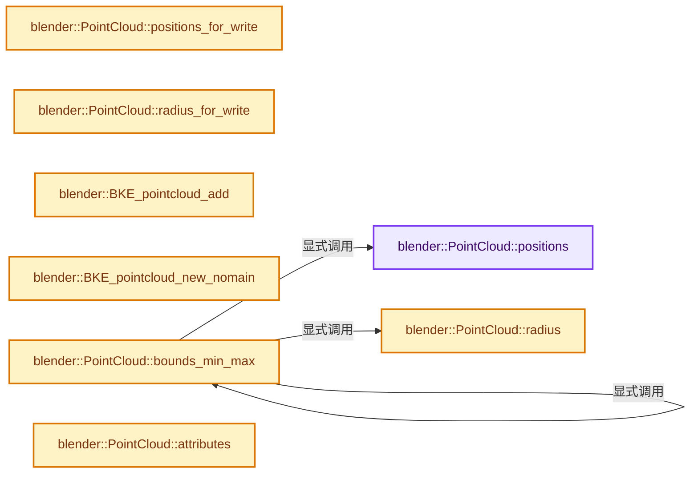
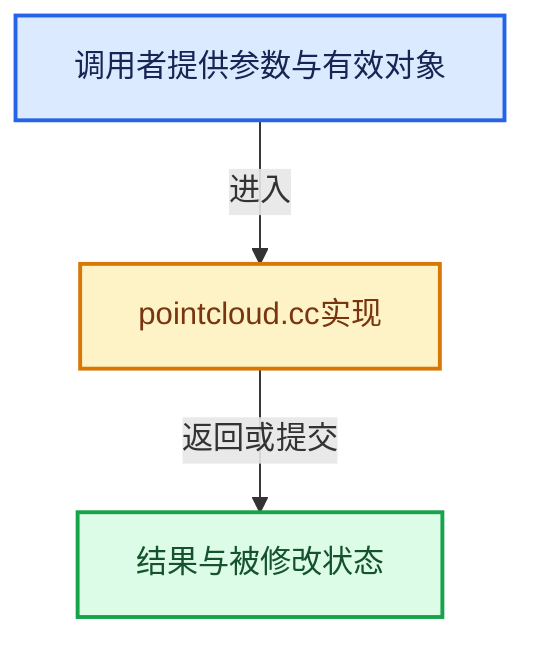

# 实现依赖专题：source/blender/blenkernel/intern/pointcloud.cc

[实现依赖导航](../../README.md) · [符号索引](../../../00-课程指南/02-源码与提交索引/符号依赖与实现索引.md)

本专题从正文实际调用进入，集中保存共享实现。函数有稳定锚点，可从调用处直接跳到对应完整函数；递归与互相调用通过回链组织。

## 本文件的实现关系






## 完整成员与函数实现

<a id="f-f02364be34f558ea"></a>

### `blender::PointCloud::positions`

实现位置：[source/blender/blenkernel/intern/pointcloud.cc](../../../../../../../source/blender/blenkernel/intern/pointcloud.cc) · L198—L203。

**教学注释版**

<!-- annotated:053439b6b12af1 -->

```cpp
Span<float3> PointCloud::positions() const
{
  return bke::get_span_attribute<float3>(
             this->attribute_storage.wrap(), bke::AttrDomain::Point, "position", this->totpoint)
      .value_or(Span<float3>());
}
```

<details>
<summary>核对原始源码：source/blender/blenkernel/intern/pointcloud.cc · L198—L203</summary>

<!-- original:053439b6b12af1:source/blender/blenkernel/intern/pointcloud.cc:198:203 -->

```cpp
Span<float3> PointCloud::positions() const
{
  return bke::get_span_attribute<float3>(
             this->attribute_storage.wrap(), bke::AttrDomain::Point, "position", this->totpoint)
      .value_or(Span<float3>());
}
```

</details>

**结果出口**

- `return bke::get_span_attribute<float3>(`

**继续追踪实现**

- `bke::get_span_attribute<float3>( this->attribute_storage.wrap(), bke::AttrDomain::Point, "position", this->totpoint) .value_or` → [调用协议](../../../00-课程指南/01-路线与规范/模板宏与动态分派协议.md)：接收对象类型依赖auto、返回值或模板实例；不按同名猜测目标。调用位置L200。
- `bke::get_span_attribute<float3>` → [blender::bke::get_span_attribute · L69](attribute_storage_access.hh.md#f-31bf92bc55779d80)；[blender::bke::get_span_attribute · L167](attribute_storage_access.cc.md#f-043f0c9c1fd78c2f)。同名重载需按实参类型选择。
- `this->attribute_storage.wrap` → [调用协议](../../../00-课程指南/01-路线与规范/模板宏与动态分派协议.md)：接收对象类型依赖auto、返回值或模板实例；不按同名猜测目标。调用位置L201。
- `Span<float3>` → [blender::Span · L214](../../../01-基础容器与现代CPP/15-StringRef字符串视图.md#f-eea723436ab634ed)。

<a id="f-638cb4413ae404ef"></a>

### `blender::PointCloud::positions_for_write`

实现位置：[source/blender/blenkernel/intern/pointcloud.cc](../../../../../../../source/blender/blenkernel/intern/pointcloud.cc) · L204—L208。

**教学注释版**

<!-- annotated:53c81f4e633798 -->

```cpp
MutableSpan<float3> PointCloud::positions_for_write()
{
  return bke::get_mutable_attribute<float3>(
      this->attribute_storage.wrap(), bke::AttrDomain::Point, "position", this->totpoint);
}
```

<details>
<summary>核对原始源码：source/blender/blenkernel/intern/pointcloud.cc · L204—L208</summary>

<!-- original:53c81f4e633798:source/blender/blenkernel/intern/pointcloud.cc:204:208 -->

```cpp
MutableSpan<float3> PointCloud::positions_for_write()
{
  return bke::get_mutable_attribute<float3>(
      this->attribute_storage.wrap(), bke::AttrDomain::Point, "position", this->totpoint);
}
```

</details>

**结果出口**

- `return bke::get_mutable_attribute<float3>(`

**继续追踪实现**

- `bke::get_mutable_attribute<float3>` → [blender::bke::get_mutable_attribute · L90](attribute_storage_access.hh.md#f-94948323441578df)；[blender::bke::get_mutable_attribute · L188](attribute_storage_access.cc.md#f-1dc04fa7db8e0dd3)。同名重载需按实参类型选择。
- `this->attribute_storage.wrap` → [调用协议](../../../00-课程指南/01-路线与规范/模板宏与动态分派协议.md)：接收对象类型依赖auto、返回值或模板实例；不按同名猜测目标。调用位置L207。

<a id="f-765043f3c90ffb0b"></a>

### `blender::PointCloud::radius`

实现位置：[source/blender/blenkernel/intern/pointcloud.cc](../../../../../../../source/blender/blenkernel/intern/pointcloud.cc) · L210—L214。

**教学注释版**

<!-- annotated:70ecf72bf80bd1 -->

```cpp
VArray<float> PointCloud::radius() const
{
  return bke::get_varray_attribute<float>(
      this->attribute_storage.wrap(), bke::AttrDomain::Point, "radius", this->totpoint, 0.01f);
}
```

<details>
<summary>核对原始源码：source/blender/blenkernel/intern/pointcloud.cc · L210—L214</summary>

<!-- original:70ecf72bf80bd1:source/blender/blenkernel/intern/pointcloud.cc:210:214 -->

```cpp
VArray<float> PointCloud::radius() const
{
  return bke::get_varray_attribute<float>(
      this->attribute_storage.wrap(), bke::AttrDomain::Point, "radius", this->totpoint, 0.01f);
}
```

</details>

**结果出口**

- `return bke::get_varray_attribute<float>(`

**继续追踪实现**

- `bke::get_varray_attribute<float>` → [blender::bke::get_varray_attribute · L51](attribute_storage_access.hh.md#f-0df9ea62fe11ae5b)；[blender::bke::get_varray_attribute · L131](attribute_storage_access.cc.md#f-f83c3184952b0870)。同名重载需按实参类型选择。
- `this->attribute_storage.wrap` → [调用协议](../../../00-课程指南/01-路线与规范/模板宏与动态分派协议.md)：接收对象类型依赖auto、返回值或模板实例；不按同名猜测目标。调用位置L213。

<a id="f-5a598b96f030a5ab"></a>

### `blender::PointCloud::radius_for_write`

实现位置：[source/blender/blenkernel/intern/pointcloud.cc](../../../../../../../source/blender/blenkernel/intern/pointcloud.cc) · L215—L219。

**教学注释版**

<!-- annotated:a0b7ddbd833c99 -->

```cpp
MutableSpan<float> PointCloud::radius_for_write()
{
  return bke::get_mutable_attribute<float>(
      this->attribute_storage.wrap(), bke::AttrDomain::Point, "radius", this->totpoint, 0.01f);
}
```

<details>
<summary>核对原始源码：source/blender/blenkernel/intern/pointcloud.cc · L215—L219</summary>

<!-- original:a0b7ddbd833c99:source/blender/blenkernel/intern/pointcloud.cc:215:219 -->

```cpp
MutableSpan<float> PointCloud::radius_for_write()
{
  return bke::get_mutable_attribute<float>(
      this->attribute_storage.wrap(), bke::AttrDomain::Point, "radius", this->totpoint, 0.01f);
}
```

</details>

**结果出口**

- `return bke::get_mutable_attribute<float>(`

**继续追踪实现**

- `bke::get_mutable_attribute<float>` → [blender::bke::get_mutable_attribute · L90](attribute_storage_access.hh.md#f-94948323441578df)；[blender::bke::get_mutable_attribute · L188](attribute_storage_access.cc.md#f-1dc04fa7db8e0dd3)。同名重载需按实参类型选择。
- `this->attribute_storage.wrap` → [调用协议](../../../00-课程指南/01-路线与规范/模板宏与动态分派协议.md)：接收对象类型依赖auto、返回值或模板实例；不按同名猜测目标。调用位置L218。

<a id="f-5709cc4ca7632327"></a>

### `blender::BKE_pointcloud_add`

实现位置：[source/blender/blenkernel/intern/pointcloud.cc](../../../../../../../source/blender/blenkernel/intern/pointcloud.cc) · L221—L226。

接口参数：

- `Main *bmain`
- `const char *name`

**教学注释版**

<!-- annotated:d05d0c029ee1f0 -->

```cpp
PointCloud *BKE_pointcloud_add(Main *bmain, const char *name)
{
  PointCloud *pointcloud = BKE_id_new<PointCloud>(bmain, name);

  return pointcloud;
}
```

<details>
<summary>核对原始源码：source/blender/blenkernel/intern/pointcloud.cc · L221—L226</summary>

<!-- original:d05d0c029ee1f0:source/blender/blenkernel/intern/pointcloud.cc:221:226 -->

```cpp
PointCloud *BKE_pointcloud_add(Main *bmain, const char *name)
{
  PointCloud *pointcloud = BKE_id_new<PointCloud>(bmain, name);

  return pointcloud;
}
```

</details>

**结果出口**

- `return pointcloud;`

**继续追踪实现**

- `BKE_id_new<PointCloud>` → [blender::BKE_id_new · L1612](lib_id.cc.md#f-5335c97ce0a8fbc8)。

<a id="f-8ee0d698049c08aa"></a>

### `blender::BKE_pointcloud_new_nomain`

实现位置：[source/blender/blenkernel/intern/pointcloud.cc](../../../../../../../source/blender/blenkernel/intern/pointcloud.cc) · L228—L242。

接口参数：

- `const PointCloudType type`
- `const int totpoint`

**教学注释版**

<!-- annotated:cb0026e738bffb -->

```cpp
PointCloud *BKE_pointcloud_new_nomain(const PointCloudType type, const int totpoint)
{
  PointCloud *pointcloud = static_cast<PointCloud *>(BKE_libblock_alloc(
      nullptr, ID_PT, BKE_idtype_idcode_to_name(ID_PT), LIB_ID_CREATE_LOCALIZE));

  BKE_libblock_init_empty(&pointcloud->id);

  pointcloud->type = type;
  pointcloud->totpoint = totpoint;

  pointcloud->attributes_for_write().add<float3>(
      "position", bke::AttrDomain::Point, bke::AttributeInitConstruct());

  return pointcloud;
}
```

<details>
<summary>核对原始源码：source/blender/blenkernel/intern/pointcloud.cc · L228—L242</summary>

<!-- original:cb0026e738bffb:source/blender/blenkernel/intern/pointcloud.cc:228:242 -->

```cpp
PointCloud *BKE_pointcloud_new_nomain(const PointCloudType type, const int totpoint)
{
  PointCloud *pointcloud = static_cast<PointCloud *>(BKE_libblock_alloc(
      nullptr, ID_PT, BKE_idtype_idcode_to_name(ID_PT), LIB_ID_CREATE_LOCALIZE));

  BKE_libblock_init_empty(&pointcloud->id);

  pointcloud->type = type;
  pointcloud->totpoint = totpoint;

  pointcloud->attributes_for_write().add<float3>(
      "position", bke::AttrDomain::Point, bke::AttributeInitConstruct());

  return pointcloud;
}
```

</details>

**沿实际写入检查状态**

- `pointcloud->type = type;`
- `pointcloud->totpoint = totpoint;`

**结果出口**

- `return pointcloud;`

**继续追踪实现**

- `BKE_libblock_alloc` → [blender::BKE_libblock_alloc · L1545](lib_id.cc.md#f-135c8eaf9ed20667)。
- `BKE_idtype_idcode_to_name` → [blender::BKE_idtype_idcode_to_name · L261](idtype.cc.md#f-282fc9db6d5f0eb2)。
- `BKE_libblock_init_empty` → [blender::BKE_libblock_init_empty · L1550](lib_id.cc.md#f-5036d15511807417)。
- `pointcloud->attributes_for_write().add<float3>` → [调用协议](../../../00-课程指南/01-路线与规范/模板宏与动态分派协议.md)：接收对象类型依赖auto、返回值或模板实例；不按同名猜测目标。调用位置L238。
- `pointcloud->attributes_for_write` → [blender::PointCloud::attributes_for_write · L312](pointcloud.cc.md#f-308c3c12507fb7fb)。
- `bke::AttributeInitConstruct` → [blender::bke::AttributeInitConstruct::AttributeInitConstruct · L90](../../../05-几何存储与拓扑映射/08-AttributeAccessor接口.md#f-864cb8bb6c1e50b4)。

<a id="f-608e12c4a3f505af"></a>

### `blender::PointCloud::bounds_min_max`

实现位置：[source/blender/blenkernel/intern/pointcloud.cc](../../../../../../../source/blender/blenkernel/intern/pointcloud.cc) · L261—L285。

接口参数：

- `const bool use_radius`

**教学注释版**

<!-- annotated:747e39402f07e7 -->

```cpp
std::optional<Bounds<float3>> PointCloud::bounds_min_max(const bool use_radius) const
{
  using namespace blender::bke;
  if (this->totpoint == 0) {
    return std::nullopt;
  }
  if (use_radius) {
    this->runtime->bounds_with_radius_cache.ensure([&](Bounds<float3> &r_bounds) {
      const VArray<float> radius = this->radius();
      if (const std::optional radius_single = radius.get_if_single()) {
        r_bounds = *this->bounds_min_max(false);
        r_bounds.pad(*radius_single);
        return;
      }
      const Span radius_span = radius.get_internal_span();
      r_bounds = *bounds::min_max_with_radii(this->positions(), radius_span);
    });
  }
  else {
    this->runtime->bounds_cache.ensure(
        [&](Bounds<float3> &r_bounds) { r_bounds = *bounds::min_max(this->positions()); });
  }
  return use_radius ? this->runtime->bounds_with_radius_cache.data() :
                      this->runtime->bounds_cache.data();
}
```

<details>
<summary>核对原始源码：source/blender/blenkernel/intern/pointcloud.cc · L261—L285</summary>

<!-- original:747e39402f07e7:source/blender/blenkernel/intern/pointcloud.cc:261:285 -->

```cpp
std::optional<Bounds<float3>> PointCloud::bounds_min_max(const bool use_radius) const
{
  using namespace blender::bke;
  if (this->totpoint == 0) {
    return std::nullopt;
  }
  if (use_radius) {
    this->runtime->bounds_with_radius_cache.ensure([&](Bounds<float3> &r_bounds) {
      const VArray<float> radius = this->radius();
      if (const std::optional radius_single = radius.get_if_single()) {
        r_bounds = *this->bounds_min_max(false);
        r_bounds.pad(*radius_single);
        return;
      }
      const Span radius_span = radius.get_internal_span();
      r_bounds = *bounds::min_max_with_radii(this->positions(), radius_span);
    });
  }
  else {
    this->runtime->bounds_cache.ensure(
        [&](Bounds<float3> &r_bounds) { r_bounds = *bounds::min_max(this->positions()); });
  }
  return use_radius ? this->runtime->bounds_with_radius_cache.data() :
                      this->runtime->bounds_cache.data();
}
```

</details>

**沿实际写入检查状态**

- `r_bounds = *this->bounds_min_max(false);`
- `r_bounds = *bounds::min_max_with_radii(this->positions(), radius_span);`

**结果出口**

- `return std::nullopt;`
- `return use_radius ? this->runtime->bounds_with_radius_cache.data() :`

**继续追踪实现**

- `this->runtime->bounds_with_radius_cache.ensure` → [调用协议](../../../00-课程指南/01-路线与规范/模板宏与动态分派协议.md)：接收对象类型依赖auto、返回值或模板实例；不按同名猜测目标。调用位置L268。
- `this->radius` → [blender::PointCloud::radius · L210](pointcloud.cc.md#f-765043f3c90ffb0b)。
- `radius.get_if_single` → [blender::VArrayCommon::get_if_single · L649](../../../04-虚拟数组与索引选择/03-单值与Span表示.md#f-779c11c4fd8e6ac3)。
- `this->bounds_min_max` → [blender::PointCloud::bounds_min_max · L261](pointcloud.cc.md#f-608e12c4a3f505af)。
- `r_bounds.pad` → [blender::Bounds<T>::pad · L575](../../../12-空间数据结构与几何算法/07-Bounds与BVH对比.md#f-325fbb34200737de)。
- `radius.get_internal_span` → [blender::GVArrayCommon::get_internal_span · L589](../../../04-虚拟数组与索引选择/05-GVArray运行时类型.md#f-4d436117b63aa0fc)；[blender::GVMutableArray::get_internal_span · L703](../../../04-虚拟数组与索引选择/05-GVArray运行时类型.md#f-1f2931ad1abf0605)。同名重载需按实参类型选择。
- `bounds::min_max_with_radii` → [blender::bounds::min_max_with_radii · L188](../../../12-空间数据结构与几何算法/07-Bounds与BVH对比.md#f-7cb47639fafbdef7)。
- `this->positions` → [blender::PointCloud::positions · L198](pointcloud.cc.md#f-f02364be34f558ea)。
- `this->runtime->bounds_cache.ensure` → [调用协议](../../../00-课程指南/01-路线与规范/模板宏与动态分派协议.md)：接收对象类型依赖auto、返回值或模板实例；不按同名猜测目标。调用位置L280。
- `bounds::min_max` → [blender::bounds::min_max · L55](../../../12-空间数据结构与几何算法/07-Bounds与BVH对比.md#f-8ec8264a27aee526)；[blender::bounds::min_max · L142](../../../12-空间数据结构与几何算法/07-Bounds与BVH对比.md#f-54be182a0edebcb6)；[blender::bounds::min_max · L159](../../../12-空间数据结构与几何算法/07-Bounds与BVH对比.md#f-c05654b35c75b0ff)；[blender::bounds::min_max · L212](../../../12-空间数据结构与几何算法/07-Bounds与BVH对比.md#f-6c1add8352426e55)。同名重载需按实参类型选择。
- `this->runtime->bounds_with_radius_cache.data` → [调用协议](../../../00-课程指南/01-路线与规范/模板宏与动态分派协议.md)：接收对象类型依赖auto、返回值或模板实例；不按同名猜测目标。调用位置L283。
- `this->runtime->bounds_cache.data` → [调用协议](../../../00-课程指南/01-路线与规范/模板宏与动态分派协议.md)：接收对象类型依赖auto、返回值或模板实例；不按同名猜测目标。调用位置L284。

<a id="f-bf2e5928a63a6e15"></a>

### `blender::PointCloud::attributes`

实现位置：[source/blender/blenkernel/intern/pointcloud.cc](../../../../../../../source/blender/blenkernel/intern/pointcloud.cc) · L307—L310。

**教学注释版**

<!-- annotated:e7f72c7db6425e -->

```cpp
bke::AttributeAccessor PointCloud::attributes() const
{
  return bke::AttributeAccessor(this, bke::pointcloud_attribute_accessor_functions());
}
```

<details>
<summary>核对原始源码：source/blender/blenkernel/intern/pointcloud.cc · L307—L310</summary>

<!-- original:e7f72c7db6425e:source/blender/blenkernel/intern/pointcloud.cc:307:310 -->

```cpp
bke::AttributeAccessor PointCloud::attributes() const
{
  return bke::AttributeAccessor(this, bke::pointcloud_attribute_accessor_functions());
}
```

</details>

**结果出口**

- `return bke::AttributeAccessor(this, bke::pointcloud_attribute_accessor_functions());`

**继续追踪实现**

- `bke::AttributeAccessor` → [blender::bke::AttributeAccessor::AttributeAccessor · L512](../../../05-几何存储与拓扑映射/08-AttributeAccessor接口.md#f-9d1f53e927223cec)。
- `bke::pointcloud_attribute_accessor_functions` → [blender::bke::pointcloud_attribute_accessor_functions · L223](pointcloud_attributes.cc.md#f-02d141e3f2f6bcd3)。

<a id="f-308c3c12507fb7fb"></a>

### `blender::PointCloud::attributes_for_write`

实现位置：[source/blender/blenkernel/intern/pointcloud.cc](../../../../../../../source/blender/blenkernel/intern/pointcloud.cc) · L312—L315。

**教学注释版**

<!-- annotated:72035213b19ce4 -->

```cpp
bke::MutableAttributeAccessor PointCloud::attributes_for_write()
{
  return bke::MutableAttributeAccessor(this, bke::pointcloud_attribute_accessor_functions());
}
```

<details>
<summary>核对原始源码：source/blender/blenkernel/intern/pointcloud.cc · L312—L315</summary>

<!-- original:72035213b19ce4:source/blender/blenkernel/intern/pointcloud.cc:312:315 -->

```cpp
bke::MutableAttributeAccessor PointCloud::attributes_for_write()
{
  return bke::MutableAttributeAccessor(this, bke::pointcloud_attribute_accessor_functions());
}
```

</details>

**结果出口**

- `return bke::MutableAttributeAccessor(this, bke::pointcloud_attribute_accessor_functions());`

**继续追踪实现**

- `bke::MutableAttributeAccessor` → [blender::bke::MutableAttributeAccessor::MutableAttributeAccessor · L709](../../../05-几何存储与拓扑映射/08-AttributeAccessor接口.md#f-22c329b6ae0e6946)。
- `bke::pointcloud_attribute_accessor_functions` → [blender::bke::pointcloud_attribute_accessor_functions · L223](pointcloud_attributes.cc.md#f-02d141e3f2f6bcd3)。

<a id="f-d3259b0ed225d89c"></a>

### `blender::BKE_pointcloud_attribute_required`

实现位置：[source/blender/blenkernel/intern/pointcloud.cc](../../../../../../../source/blender/blenkernel/intern/pointcloud.cc) · L317—L320。

接口参数：

- `const PointCloud *`
- `const StringRef name`

**教学注释版**

<!-- annotated:5a61c007c65bbf -->

```cpp
bool BKE_pointcloud_attribute_required(const PointCloud * /*pointcloud*/, const StringRef name)
{
  return name == ATTR_POSITION;
}
```

<details>
<summary>核对原始源码：source/blender/blenkernel/intern/pointcloud.cc · L317—L320</summary>

<!-- original:5a61c007c65bbf:source/blender/blenkernel/intern/pointcloud.cc:317:320 -->

```cpp
bool BKE_pointcloud_attribute_required(const PointCloud * /*pointcloud*/, const StringRef name)
{
  return name == ATTR_POSITION;
}
```

</details>

**结果出口**

- `return name == ATTR_POSITION;`

**继续追踪实现**

本实现没有需要继续展开的显式调用；检查返回表达式、对象转换和调用者前置条件。

<a id="f-3fb53ca0ce1b90a5"></a>

### `blender::BKE_pointcloud_copy_for_eval`

实现位置：[source/blender/blenkernel/intern/pointcloud.cc](../../../../../../../source/blender/blenkernel/intern/pointcloud.cc) · L366—L370。

接口参数：

- `const PointCloud *pointcloud_src`

**教学注释版**

<!-- annotated:3137a1399a1840 -->

```cpp
PointCloud *BKE_pointcloud_copy_for_eval(const PointCloud *pointcloud_src)
{
  return reinterpret_cast<PointCloud *>(
      BKE_id_copy_ex(nullptr, &pointcloud_src->id, nullptr, LIB_ID_COPY_LOCALIZE));
}
```

<details>
<summary>核对原始源码：source/blender/blenkernel/intern/pointcloud.cc · L366—L370</summary>

<!-- original:3137a1399a1840:source/blender/blenkernel/intern/pointcloud.cc:366:370 -->

```cpp
PointCloud *BKE_pointcloud_copy_for_eval(const PointCloud *pointcloud_src)
{
  return reinterpret_cast<PointCloud *>(
      BKE_id_copy_ex(nullptr, &pointcloud_src->id, nullptr, LIB_ID_COPY_LOCALIZE));
}
```

</details>

**结果出口**

- `return reinterpret_cast<PointCloud *>(`

**继续追踪实现**

- `BKE_id_copy_ex` → [blender::BKE_id_copy_ex · L851](lib_id.cc.md#f-24272170c95f49fb)。

<a id="f-91ffefbd7ee7bfee"></a>

### `blender::pointcloud_evaluate_modifiers`

实现位置：[source/blender/blenkernel/intern/pointcloud.cc](../../../../../../../source/blender/blenkernel/intern/pointcloud.cc) · L372—L404。

接口参数：

- `Depsgraph *depsgraph`
- `Scene *scene`
- `Object *object`
- `bke::GeometrySet &geometry_set`

**教学注释版**

<!-- annotated:d8e8014b63fb6e -->

```cpp
static void pointcloud_evaluate_modifiers(Depsgraph *depsgraph,
                                          Scene *scene,
                                          Object *object,
                                          bke::GeometrySet &geometry_set)
{
  /* Modifier evaluation modes. */
  const bool use_render = (DEG_get_mode(depsgraph) == DAG_EVAL_RENDER);
  const int required_mode = use_render ? eModifierMode_Render : eModifierMode_Realtime;
  ModifierApplyFlag apply_flag = use_render ? MOD_APPLY_RENDER : MOD_APPLY_USECACHE;
  const ModifierEvalContext mectx = {depsgraph, object, apply_flag};

  BKE_modifiers_clear_errors(object);

  /* Get effective list of modifiers to execute. Some effects like shape keys
   * are added as virtual modifiers before the user created modifiers. */
  VirtualModifierData virtual_modifier_data;
  ModifierData *md = BKE_modifiers_get_virtual_modifierlist(object, &virtual_modifier_data);

  /* Evaluate modifiers. */
  for (; md; md = md->next) {
    const ModifierTypeInfo *mti = BKE_modifier_get_info(md->type);

    if (!BKE_modifier_is_enabled(scene, md, required_mode)) {
      continue;
    }

    bke::ScopedModifierTimer modifier_timer{*md};

    if (mti->modify_geometry_set) {
      mti->modify_geometry_set(md, &mectx, &geometry_set);
    }
  }
}
```

<details>
<summary>核对原始源码：source/blender/blenkernel/intern/pointcloud.cc · L372—L404</summary>

<!-- original:d8e8014b63fb6e:source/blender/blenkernel/intern/pointcloud.cc:372:404 -->

```cpp
static void pointcloud_evaluate_modifiers(Depsgraph *depsgraph,
                                          Scene *scene,
                                          Object *object,
                                          bke::GeometrySet &geometry_set)
{
  /* Modifier evaluation modes. */
  const bool use_render = (DEG_get_mode(depsgraph) == DAG_EVAL_RENDER);
  const int required_mode = use_render ? eModifierMode_Render : eModifierMode_Realtime;
  ModifierApplyFlag apply_flag = use_render ? MOD_APPLY_RENDER : MOD_APPLY_USECACHE;
  const ModifierEvalContext mectx = {depsgraph, object, apply_flag};

  BKE_modifiers_clear_errors(object);

  /* Get effective list of modifiers to execute. Some effects like shape keys
   * are added as virtual modifiers before the user created modifiers. */
  VirtualModifierData virtual_modifier_data;
  ModifierData *md = BKE_modifiers_get_virtual_modifierlist(object, &virtual_modifier_data);

  /* Evaluate modifiers. */
  for (; md; md = md->next) {
    const ModifierTypeInfo *mti = BKE_modifier_get_info(md->type);

    if (!BKE_modifier_is_enabled(scene, md, required_mode)) {
      continue;
    }

    bke::ScopedModifierTimer modifier_timer{*md};

    if (mti->modify_geometry_set) {
      mti->modify_geometry_set(md, &mectx, &geometry_set);
    }
  }
}
```

</details>

**继续追踪实现**

- `DEG_get_mode` → [blender::DEG_get_mode · L99](../../06-Depsgraph依赖图/intern/depsgraph_query.cc.md#f-fa117f51322cd95c)。
- `BKE_modifiers_clear_errors` → [blender::BKE_modifiers_clear_errors · L282](modifier.cc.md#f-aeccb28cb209861b)。
- `BKE_modifiers_get_virtual_modifierlist` → [blender::BKE_modifiers_get_virtual_modifierlist · L620](modifier.cc.md#f-47967058788364c5)。
- `BKE_modifier_get_info` → [blender::BKE_modifier_get_info · L120](modifier.cc.md#f-88218d6d450f0291)。
- `BKE_modifier_is_enabled` → [blender::BKE_modifier_is_enabled · L529](modifier.cc.md#f-1debd86d0fcbcc8e)。
- `mti->modify_geometry_set` → [blender::modify_geometry_set · L243](../../08-其他Blender模块/modifiers/intern/MOD_grease_pencil_noise.cc.md#f-230f261ee5b301b9)；[blender::modify_geometry_set · L218](../../08-其他Blender模块/modifiers/intern/MOD_grease_pencil_multiply.cc.md#f-20b39fa517056ba3)；[blender::modify_geometry_set · L184](../../08-其他Blender模块/modifiers/intern/MOD_grease_pencil_mirror.cc.md#f-3dc669ce25b45890)；[blender::modify_geometry_set · L303](../../08-其他Blender模块/modifiers/intern/MOD_volume_displace.cc.md#f-ebaffe948c472b25)；[blender::modify_geometry_set · L245](../../08-其他Blender模块/modifiers/intern/MOD_grease_pencil_length.cc.md#f-115999e601704e66)；[blender::modify_geometry_set · L127](../../08-其他Blender模块/modifiers/intern/MOD_grease_pencil_lattice.cc.md#f-08d3356602673303)；[blender::modify_geometry_set · L237](../../08-其他Blender模块/modifiers/intern/MOD_grease_pencil_hook.cc.md#f-7d8cba698be3f21f)；[blender::modify_geometry_set · L648](../../08-其他Blender模块/modifiers/intern/MOD_grease_pencil_envelope.cc.md#f-89a88be68c707af7)；[blender::modify_geometry_set · L383](../../08-其他Blender模块/modifiers/intern/MOD_grease_pencil_dash.cc.md#f-77a5c0cf948381ba)；[blender::modify_geometry_set · L186](../../08-其他Blender模块/modifiers/intern/MOD_grease_pencil_color.cc.md#f-b7d9cea51cff81d7)；[blender::modify_geometry_set · L708](../../08-其他Blender模块/modifiers/intern/MOD_grease_pencil_build.cc.md#f-5dd5fbb27a45198a)；[blender::modify_geometry_set · L256](../../08-其他Blender模块/modifiers/intern/MOD_grease_pencil_array.cc.md#f-5bbc1bf941a9346b)；[blender::modify_geometry_set · L228](../../08-其他Blender模块/modifiers/intern/MOD_grease_pencil_armature.cc.md#f-aa0222d18ac7bd5e)；[blender::modify_geometry_set · L1862](../../08-其他Blender模块/modifiers/intern/MOD_nodes.cc.md#f-2a30b7b16d4a8c31)；[blender::modify_geometry_set · L176](../../08-其他Blender模块/modifiers/intern/MOD_mesh_to_volume.cc.md#f-d3eb652ca6ad569c)；[blender::modify_geometry_set · L146](../../08-其他Blender模块/modifiers/intern/MOD_meshsequencecache.cc.md#f-293a594730db07db)；[blender::modify_geometry_set · L873](../../08-其他Blender模块/modifiers/intern/MOD_lineart.cc.md#f-5f731799aa2bb8f9)；[blender::modify_geometry_set · L212](../../08-其他Blender模块/modifiers/intern/MOD_grease_pencil_weight_proximity.cc.md#f-ea5a620d5c23e64e)；[blender::modify_geometry_set · L192](../../08-其他Blender模块/modifiers/intern/MOD_grease_pencil_weight_angle.cc.md#f-782ecf61845b0827)；[blender::modify_geometry_set · L409](../../08-其他Blender模块/modifiers/intern/MOD_grease_pencil_tint.cc.md#f-54a72eb9cf6cff28)；[blender::modify_geometry_set · L480](../../08-其他Blender模块/modifiers/intern/MOD_grease_pencil_time.cc.md#f-9ab3d6f606c2eab8)；[blender::modify_geometry_set · L150](../../08-其他Blender模块/modifiers/intern/MOD_grease_pencil_thickness.cc.md#f-4e7b0f538b12bed5)；[blender::modify_geometry_set · L276](../../08-其他Blender模块/modifiers/intern/MOD_grease_pencil_texture.cc.md#f-1ff4ec887af41ab7)；[blender::modify_geometry_set · L130](../../08-其他Blender模块/modifiers/intern/MOD_grease_pencil_subdiv.cc.md#f-931890f60d4fecdf)；[blender::modify_geometry_set · L202](../../08-其他Blender模块/modifiers/intern/MOD_grease_pencil_smooth.cc.md#f-b3cfc63152b3b8cf)；[blender::modify_geometry_set · L161](../../08-其他Blender模块/modifiers/intern/MOD_grease_pencil_simplify.cc.md#f-43ffd26310c793e0)；[blender::modify_geometry_set · L204](../../08-其他Blender模块/modifiers/intern/MOD_grease_pencil_shrinkwrap.cc.md#f-46686f6c416f5e15)；[blender::modify_geometry_set · L231](../../08-其他Blender模块/modifiers/intern/MOD_grease_pencil_outline.cc.md#f-fa4d9a8d843e52d6)；[blender::modify_geometry_set · L206](../../08-其他Blender模块/modifiers/intern/MOD_grease_pencil_opacity.cc.md#f-e612ca2075a8aa0f)；[blender::modify_geometry_set · L359](../../08-其他Blender模块/modifiers/intern/MOD_grease_pencil_offset.cc.md#f-efbe77084a15801e)。同名重载需按实参类型选择。

<a id="f-aefe2577dd60b6e8"></a>

### `blender::take_pointcloud_ownership_from_geometry_set`

实现位置：[source/blender/blenkernel/intern/pointcloud.cc](../../../../../../../source/blender/blenkernel/intern/pointcloud.cc) · L406—L423。

接口参数：

- `bke::GeometrySet &geometry_set`

**教学注释版**

<!-- annotated:c20465a78a6aa1 -->

```cpp
static PointCloud *take_pointcloud_ownership_from_geometry_set(bke::GeometrySet &geometry_set)
{
  if (!geometry_set.has<bke::PointCloudComponent>()) {
    return nullptr;
  }
  bke::PointCloudComponent &pointcloud_component =
      geometry_set.get_component_for_write<bke::PointCloudComponent>();
  PointCloud *pointcloud = pointcloud_component.release();
  if (pointcloud != nullptr) {
    /* Add back, but as read-only non-owning component. */
    pointcloud_component.replace(pointcloud, bke::GeometryOwnershipType::ReadOnly);
  }
  else {
    /* The component was empty, we can also remove it. */
    geometry_set.remove<bke::PointCloudComponent>();
  }
  return pointcloud;
}
```

<details>
<summary>核对原始源码：source/blender/blenkernel/intern/pointcloud.cc · L406—L423</summary>

<!-- original:c20465a78a6aa1:source/blender/blenkernel/intern/pointcloud.cc:406:423 -->

```cpp
static PointCloud *take_pointcloud_ownership_from_geometry_set(bke::GeometrySet &geometry_set)
{
  if (!geometry_set.has<bke::PointCloudComponent>()) {
    return nullptr;
  }
  bke::PointCloudComponent &pointcloud_component =
      geometry_set.get_component_for_write<bke::PointCloudComponent>();
  PointCloud *pointcloud = pointcloud_component.release();
  if (pointcloud != nullptr) {
    /* Add back, but as read-only non-owning component. */
    pointcloud_component.replace(pointcloud, bke::GeometryOwnershipType::ReadOnly);
  }
  else {
    /* The component was empty, we can also remove it. */
    geometry_set.remove<bke::PointCloudComponent>();
  }
  return pointcloud;
}
```

</details>

**结果出口**

- `return nullptr;`
- `return pointcloud;`

**继续追踪实现**

- `geometry_set.has<bke::PointCloudComponent>` → [blender::bke::GeometrySet::has · L142](../../../06-隐式共享与缓存系统/05-GeometrySet读写与复制.md#f-5777be605a5451b6)。
- `geometry_set.get_component_for_write<bke::PointCloudComponent>` → [blender::bke::GeometrySet::get_component_for_write · L119](../../../06-隐式共享与缓存系统/05-GeometrySet读写与复制.md#f-21eccb196f5b9a78)。
- `pointcloud_component.release` → [blender::bke::PointCloudComponent::release · L69](geometry_component_pointcloud.cc.md#f-716fd49e11f1a04e)。
- `pointcloud_component.replace` → [blender::bke::PointCloudComponent::replace · L61](geometry_component_pointcloud.cc.md#f-3ec2070a3f242dfc)。
- `geometry_set.remove<bke::PointCloudComponent>` → [blender::bke::GeometrySet::remove · L148](../../../06-隐式共享与缓存系统/05-GeometrySet读写与复制.md#f-32c960ae92da98ca)。

<a id="f-1065bf1f49ef43f9"></a>

### `blender::BKE_pointcloud_data_update`

实现位置：[source/blender/blenkernel/intern/pointcloud.cc](../../../../../../../source/blender/blenkernel/intern/pointcloud.cc) · L425—L447。

接口参数：

- `Depsgraph *depsgraph`
- `Scene *scene`
- `Object *object`

**教学注释版**

<!-- annotated:c83f0622543d43 -->

```cpp
void BKE_pointcloud_data_update(Depsgraph *depsgraph, Scene *scene, Object *object)
{
  /* Free any evaluated data and restore original data. */
  BKE_object_free_derived_caches(object);

  /* Evaluate modifiers. */
  PointCloud *pointcloud = id_cast<PointCloud *>(object->data);
  bke::GeometrySet geometry_set = bke::GeometrySet::from_pointcloud(
      pointcloud, bke::GeometryOwnershipType::ReadOnly);
  pointcloud_evaluate_modifiers(depsgraph, scene, object, geometry_set);

  PointCloud *pointcloud_eval = take_pointcloud_ownership_from_geometry_set(geometry_set);

  /* If the geometry set did not contain a point cloud, we still create an empty one. */
  if (pointcloud_eval == nullptr) {
    pointcloud_eval = BKE_pointcloud_new_nomain(pointcloud->type, 0);
  }

  /* Assign evaluated object. */
  const bool eval_is_owned = pointcloud_eval != pointcloud;
  BKE_object_eval_assign_data(object, &pointcloud_eval->id, eval_is_owned);
  // [讲解] std::move：把表达式转换成可供移动重载选择的值类别；不保证真的移动，不结束源对象寿命，对const值可能选择复制。
  object->runtime->geometry_set_eval = new bke::GeometrySet(std::move(geometry_set));
}
```

<details>
<summary>核对原始源码：source/blender/blenkernel/intern/pointcloud.cc · L425—L447</summary>

<!-- original:c83f0622543d43:source/blender/blenkernel/intern/pointcloud.cc:425:447 -->

```cpp
void BKE_pointcloud_data_update(Depsgraph *depsgraph, Scene *scene, Object *object)
{
  /* Free any evaluated data and restore original data. */
  BKE_object_free_derived_caches(object);

  /* Evaluate modifiers. */
  PointCloud *pointcloud = id_cast<PointCloud *>(object->data);
  bke::GeometrySet geometry_set = bke::GeometrySet::from_pointcloud(
      pointcloud, bke::GeometryOwnershipType::ReadOnly);
  pointcloud_evaluate_modifiers(depsgraph, scene, object, geometry_set);

  PointCloud *pointcloud_eval = take_pointcloud_ownership_from_geometry_set(geometry_set);

  /* If the geometry set did not contain a point cloud, we still create an empty one. */
  if (pointcloud_eval == nullptr) {
    pointcloud_eval = BKE_pointcloud_new_nomain(pointcloud->type, 0);
  }

  /* Assign evaluated object. */
  const bool eval_is_owned = pointcloud_eval != pointcloud;
  BKE_object_eval_assign_data(object, &pointcloud_eval->id, eval_is_owned);
  object->runtime->geometry_set_eval = new bke::GeometrySet(std::move(geometry_set));
}
```

</details>

**沿实际写入检查状态**

- `pointcloud_eval = BKE_pointcloud_new_nomain(pointcloud->type, 0);`
- `object->runtime->geometry_set_eval = new bke::GeometrySet(std::move(geometry_set));`

**继续追踪实现**

- `BKE_object_free_derived_caches` → [blender::BKE_object_free_derived_caches · L1810](object.cc.md#f-74071902e41326eb)。
- `id_cast<PointCloud *>` → [blender::id_cast · L1417](../../08-其他Blender模块/makesdna/DNA_ID.h.md#f-6c8ac6412850ac5a)。
- `bke::GeometrySet::from_pointcloud` → [blender::bke::GeometrySet::from_pointcloud · L441](../../../06-隐式共享与缓存系统/05-GeometrySet读写与复制.md#f-2552789cec99aad0)。
- `pointcloud_evaluate_modifiers` → [blender::pointcloud_evaluate_modifiers · L372](pointcloud.cc.md#f-91ffefbd7ee7bfee)。
- `take_pointcloud_ownership_from_geometry_set` → [blender::take_pointcloud_ownership_from_geometry_set · L406](pointcloud.cc.md#f-aefe2577dd60b6e8)。
- `BKE_pointcloud_new_nomain` → [blender::BKE_pointcloud_new_nomain · L228](pointcloud.cc.md#f-8ee0d698049c08aa)。
- `BKE_object_eval_assign_data` → [blender::BKE_object_eval_assign_data · L1786](object.cc.md#f-8f43c337a2db2299)。
- `std::move` → [外部契约](https://eel.is/c++draft/utility.forward)：把表达式转换成可供移动重载选择的值类别；不保证真的移动，不结束源对象寿命，对const值可能选择复制。

<a id="f-2d331a28c458df48"></a>

### `blender::PointCloud::tag_positions_changed`

实现位置：[source/blender/blenkernel/intern/pointcloud.cc](../../../../../../../source/blender/blenkernel/intern/pointcloud.cc) · L449—L454。

**教学注释版**

<!-- annotated:318d8053883b4a -->

```cpp
void PointCloud::tag_positions_changed()
{
  this->runtime->bounds_cache.tag_dirty();
  this->runtime->bounds_with_radius_cache.tag_dirty();
  this->runtime->bvh_cache.tag_dirty();
}
```

<details>
<summary>核对原始源码：source/blender/blenkernel/intern/pointcloud.cc · L449—L454</summary>

<!-- original:318d8053883b4a:source/blender/blenkernel/intern/pointcloud.cc:449:454 -->

```cpp
void PointCloud::tag_positions_changed()
{
  this->runtime->bounds_cache.tag_dirty();
  this->runtime->bounds_with_radius_cache.tag_dirty();
  this->runtime->bvh_cache.tag_dirty();
}
```

</details>

**继续追踪实现**

- `this->runtime->bounds_cache.tag_dirty` → [调用协议](../../../00-课程指南/01-路线与规范/模板宏与动态分派协议.md)：接收对象类型依赖auto、返回值或模板实例；不按同名猜测目标。调用位置L451。
- `this->runtime->bounds_with_radius_cache.tag_dirty` → [调用协议](../../../00-课程指南/01-路线与规范/模板宏与动态分派协议.md)：接收对象类型依赖auto、返回值或模板实例；不按同名猜测目标。调用位置L452。
- `this->runtime->bvh_cache.tag_dirty` → [调用协议](../../../00-课程指南/01-路线与规范/模板宏与动态分派协议.md)：接收对象类型依赖auto、返回值或模板实例；不按同名猜测目标。调用位置L453。

<a id="f-9eb2e762fa3681ad"></a>

### `blender::BKE_pointcloud_batch_cache_dirty_tag`

实现位置：[source/blender/blenkernel/intern/pointcloud.cc](../../../../../../../source/blender/blenkernel/intern/pointcloud.cc) · L468—L476。

接口参数：

- `PointCloud *pointcloud`
- `int mode`

**教学注释版**

<!-- annotated:247ccc3002089a -->

```cpp
void BKE_pointcloud_batch_cache_dirty_tag(PointCloud *pointcloud, int mode)
{
  if (pointcloud->pointcloud_batch_cache) {
    BKE_pointcloud_batch_cache_dirty_tag_cb(pointcloud, mode);
  }
  if (pointcloud->gsplat_batch_cache) {
    BKE_gsplat_batch_cache_dirty_tag_cb(pointcloud, mode);
  }
}
```

<details>
<summary>核对原始源码：source/blender/blenkernel/intern/pointcloud.cc · L468—L476</summary>

<!-- original:247ccc3002089a:source/blender/blenkernel/intern/pointcloud.cc:468:476 -->

```cpp
void BKE_pointcloud_batch_cache_dirty_tag(PointCloud *pointcloud, int mode)
{
  if (pointcloud->pointcloud_batch_cache) {
    BKE_pointcloud_batch_cache_dirty_tag_cb(pointcloud, mode);
  }
  if (pointcloud->gsplat_batch_cache) {
    BKE_gsplat_batch_cache_dirty_tag_cb(pointcloud, mode);
  }
}
```

</details>

**继续追踪实现**

- `BKE_pointcloud_batch_cache_dirty_tag_cb` → [调用协议](../../../00-课程指南/01-路线与规范/模板宏与动态分派协议.md)：函数指针、局部可调用对象或未展开的宏；必须结合调用者环境。调用位置L471。
- `BKE_gsplat_batch_cache_dirty_tag_cb` → [调用协议](../../../00-课程指南/01-路线与规范/模板宏与动态分派协议.md)：函数指针、局部可调用对象或未展开的宏；必须结合调用者环境。调用位置L474。
