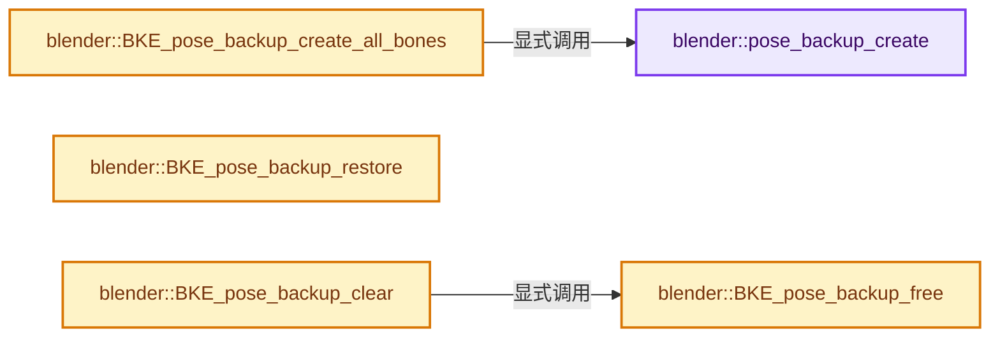
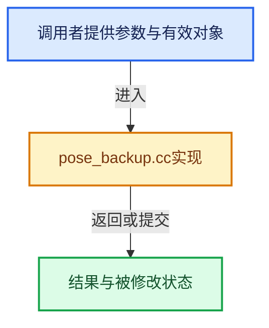

# 实现依赖专题：source/blender/blenkernel/intern/pose_backup.cc

[实现依赖导航](../../README.md) · [符号索引](../../../00-课程指南/02-源码与提交索引/符号依赖与实现索引.md)

本专题从正文实际调用进入，集中保存共享实现。函数有稳定锚点，可从调用处直接跳到对应完整函数；递归与互相调用通过回链组织。

## 本文件的实现关系






## 完整成员与函数实现

<a id="f-8731fe15be4855ed"></a>

### `blender::pose_backup_create`

实现位置：[source/blender/blenkernel/intern/pose_backup.cc](../../../../../../../source/blender/blenkernel/intern/pose_backup.cc) · L59—L102。

接口参数：

- `const Object *ob`
- `bAction *action`
- `const BoneNameSet &selected_bone_names`
- `PoseBackup &pose_backup`

**教学注释版**

<!-- annotated:2a11d0fba77e2d -->

```cpp
static void pose_backup_create(const Object *ob,
                               bAction *action,
                               const BoneNameSet &selected_bone_names,
                               PoseBackup &pose_backup)
{
  BoneNameSet backed_up_bone_names;
  const bool is_bone_selection_relevant = pose_backup.is_bone_selection_relevant;
  /* Make a backup of the given pose channel. */
  auto store_animated_pchans = [&](const FCurve * /*unused*/, const char *bone_name) {
    if (backed_up_bone_names.contains(bone_name)) {
      /* Only backup each bone once. */
      return;
    }

    bPoseChannel *pchan = BKE_pose_channel_find_name(ob->pose, bone_name);
    if (pchan == nullptr) {
      /* FCurve targets non-existent bone. */
      return;
    }

    if (is_bone_selection_relevant && !selected_bone_names.contains(bone_name)) {
      return;
    }

    PoseChannelBackup *chan_bak = MEM_new<PoseChannelBackup>("PoseChannelBackup");
    chan_bak->pchan = pchan;
    chan_bak->olddata = dna::shallow_copy(*chan_bak->pchan);
    chan_bak->owner = ob;

    if (pchan->prop) {
      chan_bak->oldprops = IDP_CopyProperty(pchan->prop);
    }
    if (pchan->system_properties) {
      chan_bak->old_system_properties = IDP_CopyProperty(pchan->system_properties);
    }

    BLI_addtail(&pose_backup.backups, chan_bak);
    backed_up_bone_names.add_new(bone_name);
  };

  animrig::Slot &slot = animrig::get_best_pose_slot_for_id(ob->id, action->wrap());
  /* Call `store_animated_pchans()` for each FCurve that targets a bone. */
  BKE_action_find_fcurves_with_bones(action, slot.handle, store_animated_pchans);
}
```

<details>
<summary>核对原始源码：source/blender/blenkernel/intern/pose_backup.cc · L59—L102</summary>

<!-- original:2a11d0fba77e2d:source/blender/blenkernel/intern/pose_backup.cc:59:102 -->

```cpp
static void pose_backup_create(const Object *ob,
                               bAction *action,
                               const BoneNameSet &selected_bone_names,
                               PoseBackup &pose_backup)
{
  BoneNameSet backed_up_bone_names;
  const bool is_bone_selection_relevant = pose_backup.is_bone_selection_relevant;
  /* Make a backup of the given pose channel. */
  auto store_animated_pchans = [&](const FCurve * /*unused*/, const char *bone_name) {
    if (backed_up_bone_names.contains(bone_name)) {
      /* Only backup each bone once. */
      return;
    }

    bPoseChannel *pchan = BKE_pose_channel_find_name(ob->pose, bone_name);
    if (pchan == nullptr) {
      /* FCurve targets non-existent bone. */
      return;
    }

    if (is_bone_selection_relevant && !selected_bone_names.contains(bone_name)) {
      return;
    }

    PoseChannelBackup *chan_bak = MEM_new<PoseChannelBackup>("PoseChannelBackup");
    chan_bak->pchan = pchan;
    chan_bak->olddata = dna::shallow_copy(*chan_bak->pchan);
    chan_bak->owner = ob;

    if (pchan->prop) {
      chan_bak->oldprops = IDP_CopyProperty(pchan->prop);
    }
    if (pchan->system_properties) {
      chan_bak->old_system_properties = IDP_CopyProperty(pchan->system_properties);
    }

    BLI_addtail(&pose_backup.backups, chan_bak);
    backed_up_bone_names.add_new(bone_name);
  };

  animrig::Slot &slot = animrig::get_best_pose_slot_for_id(ob->id, action->wrap());
  /* Call `store_animated_pchans()` for each FCurve that targets a bone. */
  BKE_action_find_fcurves_with_bones(action, slot.handle, store_animated_pchans);
}
```

</details>

**沿实际写入检查状态**

- `chan_bak->pchan = pchan;`
- `chan_bak->olddata = dna::shallow_copy(*chan_bak->pchan);`
- `chan_bak->owner = ob;`
- `chan_bak->oldprops = IDP_CopyProperty(pchan->prop);`
- `chan_bak->old_system_properties = IDP_CopyProperty(pchan->system_properties);`

**继续追踪实现**

- `backed_up_bone_names.contains` → [blender::bNodeTreeInterfacePanel::contains · L923](node_tree_interface.cc.md#f-ba8671d8881bed94)。
- `BKE_pose_channel_find_name` → [blender::BKE_pose_channel_find_name · L895](action.cc.md#f-5997206551bfc9f9)。
- `selected_bone_names.contains` → [blender::bNodeTreeInterfacePanel::contains · L923](node_tree_interface.cc.md#f-ba8671d8881bed94)。
- `MEM_new<PoseChannelBackup>` → [MEM_new · L351](../../07-Intern运行时与平台/guardedalloc/MEM_guardedalloc.h.md#f-115f9b6784f89912)。
- `dna::shallow_copy` → [blender::dna::shallow_copy · L146](../../08-其他Blender模块/makesdna/DNA_defs.h.md#f-84b6eda95a1c994c)。
- `IDP_CopyProperty` → [blender::IDP_CopyProperty · L986](idprop.cc.md#f-e78bbf56cd2a07bd)。
- `BLI_addtail` → [blender::BLI_addtail · L118](../../01-BLI基础库/intern/listbase.cc.md#f-4fb027713fa3115b)。
- `backed_up_bone_names.add_new` → [调用协议](../../../00-课程指南/01-路线与规范/模板宏与动态分派协议.md)：由接收对象具体类型或运行时策略提供实现。调用位置L96。
- `animrig::get_best_pose_slot_for_id` → [blender::animrig::get_best_pose_slot_for_id · L471](../../08-其他Blender模块/animrig/intern/pose.cc.md#f-30b0f2d18d49d1d9)。
- `action->wrap` → [blender::bAction::wrap · L1929](../../08-其他Blender模块/animrig/ANIM_action.hh.md#f-f049614274fd7a45)；[blender::bAction::wrap · L1933](../../08-其他Blender模块/animrig/ANIM_action.hh.md#f-2d697d1983fd282f)。同名重载需按实参类型选择。
- `BKE_action_find_fcurves_with_bones` → [blender::bke::BKE_action_find_fcurves_with_bones · L21](action_bones.cc.md#f-9745e4376c100546)；[blender::bke::BKE_action_find_fcurves_with_bones · L32](action_bones.cc.md#f-da05aab12ef96e57)。同名重载需按实参类型选择。

<a id="f-791aaa0b478416cc"></a>

### `blender::BKE_pose_backup_create_all_bones`

实现位置：[source/blender/blenkernel/intern/pose_backup.cc](../../../../../../../source/blender/blenkernel/intern/pose_backup.cc) · L129—L138。

接口参数：

- `Span<Object *> objects`
- `const bAction *action`

**教学注释版**

<!-- annotated:f45b23fc751c21 -->

```cpp
PoseBackup *BKE_pose_backup_create_all_bones(Span<Object *> objects, const bAction *action)
{
  PoseBackup *pose_backup = MEM_new_zeroed<PoseBackup>(__func__);
  pose_backup->backups = {nullptr, nullptr};
  pose_backup->is_bone_selection_relevant = false;
  for (Object *ob : objects) {
    pose_backup_create(ob, const_cast<bAction *>(action), BoneNameSet(), *pose_backup);
  }
  return pose_backup;
}
```

<details>
<summary>核对原始源码：source/blender/blenkernel/intern/pose_backup.cc · L129—L138</summary>

<!-- original:f45b23fc751c21:source/blender/blenkernel/intern/pose_backup.cc:129:138 -->

```cpp
PoseBackup *BKE_pose_backup_create_all_bones(Span<Object *> objects, const bAction *action)
{
  PoseBackup *pose_backup = MEM_new_zeroed<PoseBackup>(__func__);
  pose_backup->backups = {nullptr, nullptr};
  pose_backup->is_bone_selection_relevant = false;
  for (Object *ob : objects) {
    pose_backup_create(ob, const_cast<bAction *>(action), BoneNameSet(), *pose_backup);
  }
  return pose_backup;
}
```

</details>

**沿实际写入检查状态**

- `pose_backup->backups = {nullptr, nullptr};`
- `pose_backup->is_bone_selection_relevant = false;`

**结果出口**

- `return pose_backup;`

**继续追踪实现**

- `MEM_new_zeroed<PoseBackup>` → [MEM_new_zeroed · L550](../../07-Intern运行时与平台/guardedalloc/MEM_guardedalloc.h.md#f-eeb1e2a7f57dd231)；[MEM_new_zeroed · L114](../../07-Intern运行时与平台/guardedalloc/intern/mallocn.cc.md#f-e04cf01c64c8b180)。同名重载需按实参类型选择。
- `pose_backup_create` → [blender::pose_backup_create · L59](pose_backup.cc.md#f-8731fe15be4855ed)。
- `BoneNameSet` → [调用协议](../../../00-课程指南/01-路线与规范/模板宏与动态分派协议.md)：函数指针、局部可调用对象或未展开的宏；必须结合调用者环境。调用位置L135。

<a id="f-da353b32769ec4d5"></a>

### `blender::BKE_pose_backup_restore`

实现位置：[source/blender/blenkernel/intern/pose_backup.cc](../../../../../../../source/blender/blenkernel/intern/pose_backup.cc) · L160—L175。

接口参数：

- `const PoseBackup *pbd`

**教学注释版**

<!-- annotated:529581cb0986b8 -->

```cpp
void BKE_pose_backup_restore(const PoseBackup *pbd)
{
  for (PoseChannelBackup &chan_bak : pbd->backups) {
    *chan_bak.pchan = dna::shallow_copy(chan_bak.olddata);

    if (chan_bak.oldprops) {
      IDP_SyncGroupValues(chan_bak.pchan->prop, chan_bak.oldprops);
    }
    if (chan_bak.old_system_properties) {
      IDP_SyncGroupValues(chan_bak.pchan->system_properties, chan_bak.old_system_properties);
    }

    /* TODO: constraints settings aren't restored yet,
     * even though these could change (though not that likely) */
  }
}
```

<details>
<summary>核对原始源码：source/blender/blenkernel/intern/pose_backup.cc · L160—L175</summary>

<!-- original:529581cb0986b8:source/blender/blenkernel/intern/pose_backup.cc:160:175 -->

```cpp
void BKE_pose_backup_restore(const PoseBackup *pbd)
{
  for (PoseChannelBackup &chan_bak : pbd->backups) {
    *chan_bak.pchan = dna::shallow_copy(chan_bak.olddata);

    if (chan_bak.oldprops) {
      IDP_SyncGroupValues(chan_bak.pchan->prop, chan_bak.oldprops);
    }
    if (chan_bak.old_system_properties) {
      IDP_SyncGroupValues(chan_bak.pchan->system_properties, chan_bak.old_system_properties);
    }

    /* TODO: constraints settings aren't restored yet,
     * even though these could change (though not that likely) */
  }
}
```

</details>

**继续追踪实现**

- `dna::shallow_copy` → [blender::dna::shallow_copy · L146](../../08-其他Blender模块/makesdna/DNA_defs.h.md#f-84b6eda95a1c994c)。
- `IDP_SyncGroupValues` → [blender::IDP_SyncGroupValues · L655](idprop.cc.md#f-5c45ca0b96383b65)。

<a id="f-7fca098cda438067"></a>

### `blender::BKE_pose_backup_free`

实现位置：[source/blender/blenkernel/intern/pose_backup.cc](../../../../../../../source/blender/blenkernel/intern/pose_backup.cc) · L177—L193。

接口参数：

- `PoseBackup *pbd`

**教学注释版**

<!-- annotated:49b1834a9208b3 -->

```cpp
void BKE_pose_backup_free(PoseBackup *pbd)
{
  if (!pbd) {
    /* Can happen if initialization was aborted. */
    return;
  }
  for (PoseChannelBackup &chan_bak : pbd->backups.items_mutable()) {
    if (chan_bak.oldprops) {
      IDP_FreeProperty(chan_bak.oldprops);
    }
    if (chan_bak.old_system_properties) {
      IDP_FreeProperty(chan_bak.old_system_properties);
    }
    BLI_freelinkN(&pbd->backups, &chan_bak);
  }
  MEM_delete(pbd);
}
```

<details>
<summary>核对原始源码：source/blender/blenkernel/intern/pose_backup.cc · L177—L193</summary>

<!-- original:49b1834a9208b3:source/blender/blenkernel/intern/pose_backup.cc:177:193 -->

```cpp
void BKE_pose_backup_free(PoseBackup *pbd)
{
  if (!pbd) {
    /* Can happen if initialization was aborted. */
    return;
  }
  for (PoseChannelBackup &chan_bak : pbd->backups.items_mutable()) {
    if (chan_bak.oldprops) {
      IDP_FreeProperty(chan_bak.oldprops);
    }
    if (chan_bak.old_system_properties) {
      IDP_FreeProperty(chan_bak.old_system_properties);
    }
    BLI_freelinkN(&pbd->backups, &chan_bak);
  }
  MEM_delete(pbd);
}
```

</details>

**继续追踪实现**

- `pbd->backups.items_mutable` → [调用协议](../../../00-课程指南/01-路线与规范/模板宏与动态分派协议.md)：接收对象类型依赖auto、返回值或模板实例；不按同名猜测目标。调用位置L183。
- `IDP_FreeProperty` → [blender::IDP_FreeProperty · L1403](idprop.cc.md#f-389134a630df1bed)。
- `BLI_freelinkN` → [blender::BLI_freelinkN · L277](../../01-BLI基础库/intern/listbase.cc.md#f-c7719591852af7da)。
- `MEM_delete` → [MEM_delete · L400](../../07-Intern运行时与平台/guardedalloc/MEM_guardedalloc.h.md#f-9049ffdd1682887c)。

<a id="f-3eefe40d7310ac42"></a>

### `blender::BKE_pose_backup_clear`

实现位置：[source/blender/blenkernel/intern/pose_backup.cc](../../../../../../../source/blender/blenkernel/intern/pose_backup.cc) · L211—L219。

接口参数：

- `Object *ob`

**教学注释版**

<!-- annotated:7534dfe8913df8 -->

```cpp
void BKE_pose_backup_clear(Object *ob)
{
  if (ob->runtime->pose_backup == nullptr) {
    return;
  }

  BKE_pose_backup_free(ob->runtime->pose_backup);
  ob->runtime->pose_backup = nullptr;
}
```

<details>
<summary>核对原始源码：source/blender/blenkernel/intern/pose_backup.cc · L211—L219</summary>

<!-- original:7534dfe8913df8:source/blender/blenkernel/intern/pose_backup.cc:211:219 -->

```cpp
void BKE_pose_backup_clear(Object *ob)
{
  if (ob->runtime->pose_backup == nullptr) {
    return;
  }

  BKE_pose_backup_free(ob->runtime->pose_backup);
  ob->runtime->pose_backup = nullptr;
}
```

</details>

**沿实际写入检查状态**

- `ob->runtime->pose_backup = nullptr;`

**继续追踪实现**

- `BKE_pose_backup_free` → [blender::BKE_pose_backup_free · L177](pose_backup.cc.md#f-7fca098cda438067)。
