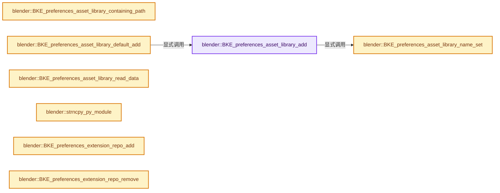
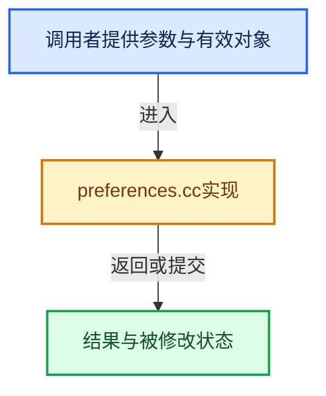

# 实现依赖专题：source/blender/blenkernel/intern/preferences.cc

[实现依赖导航](../../README.md) · [符号索引](../../../00-课程指南/02-源码与提交索引/符号依赖与实现索引.md)

本专题从正文实际调用进入，集中保存共享实现。函数有稳定锚点，可从调用处直接跳到对应完整函数；递归与互相调用通过回链组织。

## 本文件的实现关系






## 完整成员与函数实现

<a id="f-b24664c228acfea7"></a>

### `blender::BKE_preferences_asset_library_add`

实现位置：[source/blender/blenkernel/intern/preferences.cc](../../../../../../../source/blender/blenkernel/intern/preferences.cc) · L70—L89。

接口参数：

- `UserDef *userdef`
- `const char *name`
- `const char *dirpath`

**教学注释版**

<!-- annotated:1a0fa447af7379 -->

```cpp
bUserAssetLibrary *BKE_preferences_asset_library_add(UserDef *userdef,
                                                     const char *name,
                                                     const char *dirpath)
{
  bUserAssetLibrary *library = MEM_new<bUserAssetLibrary>(__func__);

  BLI_addtail(&userdef->asset_libraries, library);
  if (userdef->experimental.no_data_block_packing) {
    library->import_method = ASSET_IMPORT_APPEND_REUSE;
  }
  if (name) {
    BKE_preferences_asset_library_name_set(userdef, library, name);
  }
  if (dirpath) {
    STRNCPY(library->resolved_dirpath, AS_asset_library_resolve_path(dirpath).c_str());
    STRNCPY(library->dirpath, dirpath);
  }

  return library;
}
```

<details>
<summary>核对原始源码：source/blender/blenkernel/intern/preferences.cc · L70—L89</summary>

<!-- original:1a0fa447af7379:source/blender/blenkernel/intern/preferences.cc:70:89 -->

```cpp
bUserAssetLibrary *BKE_preferences_asset_library_add(UserDef *userdef,
                                                     const char *name,
                                                     const char *dirpath)
{
  bUserAssetLibrary *library = MEM_new<bUserAssetLibrary>(__func__);

  BLI_addtail(&userdef->asset_libraries, library);
  if (userdef->experimental.no_data_block_packing) {
    library->import_method = ASSET_IMPORT_APPEND_REUSE;
  }
  if (name) {
    BKE_preferences_asset_library_name_set(userdef, library, name);
  }
  if (dirpath) {
    STRNCPY(library->resolved_dirpath, AS_asset_library_resolve_path(dirpath).c_str());
    STRNCPY(library->dirpath, dirpath);
  }

  return library;
}
```

</details>

**沿实际写入检查状态**

- `library->import_method = ASSET_IMPORT_APPEND_REUSE;`

**结果出口**

- `return library;`

**继续追踪实现**

- `MEM_new<bUserAssetLibrary>` → [MEM_new · L351](../../07-Intern运行时与平台/guardedalloc/MEM_guardedalloc.h.md#f-115f9b6784f89912)。
- `BLI_addtail` → [blender::BLI_addtail · L118](../../01-BLI基础库/intern/listbase.cc.md#f-4fb027713fa3115b)。
- `BKE_preferences_asset_library_name_set` → [blender::BKE_preferences_asset_library_name_set · L109](preferences.cc.md#f-91b54c66995c5d73)。
- `STRNCPY` → [blender::STRNCPY · L690](../../01-BLI基础库/BLI_string.hh.md#f-6b2d861724026be6)。
- `AS_asset_library_resolve_path(dirpath).c_str` → [调用协议](../../../00-课程指南/01-路线与规范/模板宏与动态分派协议.md)：接收对象类型依赖auto、返回值或模板实例；不按同名猜测目标。调用位置L84。
- `AS_asset_library_resolve_path` → [blender::AS_asset_library_resolve_path · L71](../../08-其他Blender模块/asset_system/intern/asset_library.cc.md#f-a580989b9c9aeb2d)。

<a id="f-91b54c66995c5d73"></a>

### `blender::BKE_preferences_asset_library_name_set`

实现位置：[source/blender/blenkernel/intern/preferences.cc](../../../../../../../source/blender/blenkernel/intern/preferences.cc) · L109—L120。

接口参数：

- `UserDef *userdef`
- `bUserAssetLibrary *library`
- `const char *name`

**教学注释版**

<!-- annotated:789e39ff4d1bd4 -->

```cpp
void BKE_preferences_asset_library_name_set(UserDef *userdef,
                                            bUserAssetLibrary *library,
                                            const char *name)
{
  STRNCPY_UTF8(library->name, name);
  BLI_uniquename(&userdef->asset_libraries,
                 library,
                 name,
                 '.',
                 offsetof(bUserAssetLibrary, name),
                 sizeof(library->name));
}
```

<details>
<summary>核对原始源码：source/blender/blenkernel/intern/preferences.cc · L109—L120</summary>

<!-- original:789e39ff4d1bd4:source/blender/blenkernel/intern/preferences.cc:109:120 -->

```cpp
void BKE_preferences_asset_library_name_set(UserDef *userdef,
                                            bUserAssetLibrary *library,
                                            const char *name)
{
  STRNCPY_UTF8(library->name, name);
  BLI_uniquename(&userdef->asset_libraries,
                 library,
                 name,
                 '.',
                 offsetof(bUserAssetLibrary, name),
                 sizeof(library->name));
}
```

</details>

**继续追踪实现**

- `STRNCPY_UTF8` → [STRNCPY_UTF8 · L335](../../01-BLI基础库/BLI_string_utf8.hh.md#m-222967f0ab6a)。宏定义由构建条件选择。
- `BLI_uniquename` → [blender::BLI_uniquename · L491](../../01-BLI基础库/intern/string_utils.cc.md#f-bcf1a000dbfb87d1)。

<a id="f-7e69a2d67c04e98e"></a>

### `blender::BKE_preferences_asset_library_containing_path`

实现位置：[source/blender/blenkernel/intern/preferences.cc](../../../../../../../source/blender/blenkernel/intern/preferences.cc) · L144—L155。

接口参数：

- `const UserDef *userdef`
- `const char *path`

**教学注释版**

<!-- annotated:fc5f889391b685 -->

```cpp
bUserAssetLibrary *BKE_preferences_asset_library_containing_path(const UserDef *userdef,
                                                                 const char *path)
{
  for (bUserAssetLibrary &asset_lib_pref : userdef->asset_libraries) {
    if (asset_lib_pref.resolved_dirpath[0] &&
        BLI_path_contains(asset_lib_pref.resolved_dirpath, path))
    {
      return &asset_lib_pref;
    }
  }
  return nullptr;
}
```

<details>
<summary>核对原始源码：source/blender/blenkernel/intern/preferences.cc · L144—L155</summary>

<!-- original:fc5f889391b685:source/blender/blenkernel/intern/preferences.cc:144:155 -->

```cpp
bUserAssetLibrary *BKE_preferences_asset_library_containing_path(const UserDef *userdef,
                                                                 const char *path)
{
  for (bUserAssetLibrary &asset_lib_pref : userdef->asset_libraries) {
    if (asset_lib_pref.resolved_dirpath[0] &&
        BLI_path_contains(asset_lib_pref.resolved_dirpath, path))
    {
      return &asset_lib_pref;
    }
  }
  return nullptr;
}
```

</details>

**结果出口**

- `return &asset_lib_pref;`
- `return nullptr;`

**继续追踪实现**

- `BLI_path_contains` → [BLI_path_contains · L1931](../../01-BLI基础库/intern/path_utils.cc.md#f-7aee9b5c30526e8c)。

<a id="f-bd925fcb0e2c4c25"></a>

### `blender::BKE_preferences_asset_library_default_add`

实现位置：[source/blender/blenkernel/intern/preferences.cc](../../../../../../../source/blender/blenkernel/intern/preferences.cc) · L215—L231。

接口参数：

- `UserDef *userdef`

**教学注释版**

<!-- annotated:eca0fbba199f81 -->

```cpp
void BKE_preferences_asset_library_default_add(UserDef *userdef)
{
  char documents_path[FILE_MAXDIR];

  /* No home or documents path found, not much we can do. */
  if (!BKE_appdir_folder_documents(documents_path) || !documents_path[0]) {
    return;
  }

  bUserAssetLibrary *library = BKE_preferences_asset_library_add(
      userdef, DATA_(BKE_PREFS_ASSET_LIBRARY_DEFAULT_NAME), nullptr);

  /* Add new "Default" library under '[doc_path]/Blender/Assets'. */
  BLI_path_join(
      library->dirpath, sizeof(library->dirpath), documents_path, N_("Blender"), N_("Assets"));
  STRNCPY(library->resolved_dirpath, AS_asset_library_resolve_path(library->dirpath).c_str());
}
```

<details>
<summary>核对原始源码：source/blender/blenkernel/intern/preferences.cc · L215—L231</summary>

<!-- original:eca0fbba199f81:source/blender/blenkernel/intern/preferences.cc:215:231 -->

```cpp
void BKE_preferences_asset_library_default_add(UserDef *userdef)
{
  char documents_path[FILE_MAXDIR];

  /* No home or documents path found, not much we can do. */
  if (!BKE_appdir_folder_documents(documents_path) || !documents_path[0]) {
    return;
  }

  bUserAssetLibrary *library = BKE_preferences_asset_library_add(
      userdef, DATA_(BKE_PREFS_ASSET_LIBRARY_DEFAULT_NAME), nullptr);

  /* Add new "Default" library under '[doc_path]/Blender/Assets'. */
  BLI_path_join(
      library->dirpath, sizeof(library->dirpath), documents_path, N_("Blender"), N_("Assets"));
  STRNCPY(library->resolved_dirpath, AS_asset_library_resolve_path(library->dirpath).c_str());
}
```

</details>

**继续追踪实现**

- `BKE_appdir_folder_documents` → [blender::BKE_appdir_folder_documents · L174](appdir.cc.md#f-0ff1928608dc7586)。
- `BKE_preferences_asset_library_add` → [blender::BKE_preferences_asset_library_add · L70](preferences.cc.md#f-b24664c228acfea7)。
- `DATA_` → [DATA_ · L52](../../08-其他Blender模块/blentranslation/BLT_translation.hh.md#m-178736083f83)。宏定义由构建条件选择。
- `BLI_path_join` → [BLI_path_join · L386](../../01-BLI基础库/BLI_path_utils.hh.md#m-f3b1183fb80c)。宏定义由构建条件选择。
- `N_` → [N_ · L65](../../08-其他Blender模块/blenloader/intern/versioning_userdef.cc.md#m-7c11c8200907)；[N_ · L44](../../08-其他Blender模块/blentranslation/BLT_translation.hh.md#m-e686781e2b24)。宏定义由构建条件选择。
- `STRNCPY` → [blender::STRNCPY · L690](../../01-BLI基础库/BLI_string.hh.md#f-6b2d861724026be6)。
- `AS_asset_library_resolve_path(library->dirpath).c_str` → [调用协议](../../../00-课程指南/01-路线与规范/模板宏与动态分派协议.md)：接收对象类型依赖auto、返回值或模板实例；不按同名猜测目标。调用位置L230。
- `AS_asset_library_resolve_path` → [blender::AS_asset_library_resolve_path · L71](../../08-其他Blender模块/asset_system/intern/asset_library.cc.md#f-a580989b9c9aeb2d)。

<a id="f-d9116ff5ccf1ab14"></a>

### `blender::BKE_preferences_asset_library_read_data`

实现位置：[source/blender/blenkernel/intern/preferences.cc](../../../../../../../source/blender/blenkernel/intern/preferences.cc) · L233—L243。

接口参数：

- `BlendDataReader *reader`
- `bUserAssetLibrary *library`

**教学注释版**

<!-- annotated:314e152cb1bc9f -->

```cpp
void BKE_preferences_asset_library_read_data(BlendDataReader *reader, bUserAssetLibrary *library)
{
  if (library->auth_token) {
    BLO_read_string(reader, &library->auth_token);
  }
  if (library->invalid_uuid) {
    BLO_read_string(reader, &library->invalid_uuid);
  }
  /* Ensure that the resolved path dir is up to date. */
  STRNCPY(library->resolved_dirpath, AS_asset_library_resolve_path(library->dirpath).c_str());
}
```

<details>
<summary>核对原始源码：source/blender/blenkernel/intern/preferences.cc · L233—L243</summary>

<!-- original:314e152cb1bc9f:source/blender/blenkernel/intern/preferences.cc:233:243 -->

```cpp
void BKE_preferences_asset_library_read_data(BlendDataReader *reader, bUserAssetLibrary *library)
{
  if (library->auth_token) {
    BLO_read_string(reader, &library->auth_token);
  }
  if (library->invalid_uuid) {
    BLO_read_string(reader, &library->invalid_uuid);
  }
  /* Ensure that the resolved path dir is up to date. */
  STRNCPY(library->resolved_dirpath, AS_asset_library_resolve_path(library->dirpath).c_str());
}
```

</details>

**继续追踪实现**

- `BLO_read_string` → [BLO_read_string · L6348](../../08-其他Blender模块/blenloader/intern/readfile.cc.md#f-b9cb42e390941235)；[BLO_read_string · L6370](../../08-其他Blender模块/blenloader/intern/readfile.cc.md#f-1bb75b8661d718d2)；[BLO_read_string · L6375](../../08-其他Blender模块/blenloader/intern/readfile.cc.md#f-5714da923b3ad83d)。同名重载需按实参类型选择。
- `STRNCPY` → [blender::STRNCPY · L690](../../01-BLI基础库/BLI_string.hh.md#f-6b2d861724026be6)。
- `AS_asset_library_resolve_path(library->dirpath).c_str` → [调用协议](../../../00-课程指南/01-路线与规范/模板宏与动态分派协议.md)：接收对象类型依赖auto、返回值或模板实例；不按同名猜测目标。调用位置L242。
- `AS_asset_library_resolve_path` → [blender::AS_asset_library_resolve_path · L71](../../08-其他Blender模块/asset_system/intern/asset_library.cc.md#f-a580989b9c9aeb2d)。

<a id="f-fa4c65f4dbcf2307"></a>

### `blender::strncpy_py_module`

实现位置：[source/blender/blenkernel/intern/preferences.cc](../../../../../../../source/blender/blenkernel/intern/preferences.cc) · L362—L382。

接口参数：

- `char *dst`
- `const char *src`
- `const size_t dst_maxncpy`

**教学注释版**

<!-- annotated:491347ae2b7c6f -->

```cpp
static size_t strncpy_py_module(char *dst, const char *src, const size_t dst_maxncpy)
{
  const size_t dst_len_max = dst_maxncpy - 1;
  dst[0] = '\0';
  size_t i_src = 0, i_dst = 0;
  while (src[i_src] && (i_dst < dst_len_max)) {
    const char c = src[i_src++];
    const bool is_alpha = (c >= 'a' && c <= 'z') || (c >= 'A' && c <= 'Z');
    /* The first character must be `[a-zA-Z]`. */
    if (i_dst == 0 && !is_alpha) {
      continue;
    }
    const bool is_num = (is_alpha == false) && ((c >= '0' && c <= '9') || c == '_');
    if (!(is_alpha || is_num)) {
      continue;
    }
    dst[i_dst++] = c;
  }
  dst[i_dst] = '\0';
  return i_dst;
}
```

<details>
<summary>核对原始源码：source/blender/blenkernel/intern/preferences.cc · L362—L382</summary>

<!-- original:491347ae2b7c6f:source/blender/blenkernel/intern/preferences.cc:362:382 -->

```cpp
static size_t strncpy_py_module(char *dst, const char *src, const size_t dst_maxncpy)
{
  const size_t dst_len_max = dst_maxncpy - 1;
  dst[0] = '\0';
  size_t i_src = 0, i_dst = 0;
  while (src[i_src] && (i_dst < dst_len_max)) {
    const char c = src[i_src++];
    const bool is_alpha = (c >= 'a' && c <= 'z') || (c >= 'A' && c <= 'Z');
    /* The first character must be `[a-zA-Z]`. */
    if (i_dst == 0 && !is_alpha) {
      continue;
    }
    const bool is_num = (is_alpha == false) && ((c >= '0' && c <= '9') || c == '_');
    if (!(is_alpha || is_num)) {
      continue;
    }
    dst[i_dst++] = c;
  }
  dst[i_dst] = '\0';
  return i_dst;
}
```

</details>

**沿实际写入检查状态**

- `dst[0] = '\0';`
- `dst[i_dst] = '\0';`

**结果出口**

- `return i_dst;`

**继续追踪实现**

本实现没有需要继续展开的显式调用；检查返回表达式、对象转换和调用者前置条件。

<a id="f-88d79af622e078a4"></a>

### `blender::BKE_preferences_extension_repo_add`

实现位置：[source/blender/blenkernel/intern/preferences.cc](../../../../../../../source/blender/blenkernel/intern/preferences.cc) · L384—L416。

接口参数：

- `UserDef *userdef`
- `const char *name`
- `const char *module`
- `const char *custom_dirpath`

**教学注释版**

<!-- annotated:ca18f497aa9d1b -->

```cpp
bUserExtensionRepo *BKE_preferences_extension_repo_add(UserDef *userdef,
                                                       const char *name,
                                                       const char *module,
                                                       const char *custom_dirpath)
{
  bUserExtensionRepo *repo = MEM_new<bUserExtensionRepo>(__func__);
  BLI_addtail(&userdef->extension_repos, repo);

  /* Set the unique ID-name. */
  BKE_preferences_extension_repo_name_set(userdef, repo, name);

  /* Set the unique module-name. */
  BKE_preferences_extension_repo_module_set(userdef, repo, module);

  /* Set the directory. */
  STRNCPY(repo->custom_dirpath, custom_dirpath);
  BLI_path_normalize(repo->custom_dirpath);
  BLI_path_slash_rstrip(repo->custom_dirpath);

  /* While not a strict rule, ignored paths that already exist, *
   * pointing to the same path is going to logical problems with package-management. */
  for (const bUserExtensionRepo &repo_iter : userdef->extension_repos) {
    if (repo == &repo_iter) {
      continue;
    }
    if (BLI_path_cmp(repo->custom_dirpath, repo_iter.custom_dirpath) == 0) {
      repo->custom_dirpath[0] = '\0';
      break;
    }
  }

  return repo;
}
```

<details>
<summary>核对原始源码：source/blender/blenkernel/intern/preferences.cc · L384—L416</summary>

<!-- original:ca18f497aa9d1b:source/blender/blenkernel/intern/preferences.cc:384:416 -->

```cpp
bUserExtensionRepo *BKE_preferences_extension_repo_add(UserDef *userdef,
                                                       const char *name,
                                                       const char *module,
                                                       const char *custom_dirpath)
{
  bUserExtensionRepo *repo = MEM_new<bUserExtensionRepo>(__func__);
  BLI_addtail(&userdef->extension_repos, repo);

  /* Set the unique ID-name. */
  BKE_preferences_extension_repo_name_set(userdef, repo, name);

  /* Set the unique module-name. */
  BKE_preferences_extension_repo_module_set(userdef, repo, module);

  /* Set the directory. */
  STRNCPY(repo->custom_dirpath, custom_dirpath);
  BLI_path_normalize(repo->custom_dirpath);
  BLI_path_slash_rstrip(repo->custom_dirpath);

  /* While not a strict rule, ignored paths that already exist, *
   * pointing to the same path is going to logical problems with package-management. */
  for (const bUserExtensionRepo &repo_iter : userdef->extension_repos) {
    if (repo == &repo_iter) {
      continue;
    }
    if (BLI_path_cmp(repo->custom_dirpath, repo_iter.custom_dirpath) == 0) {
      repo->custom_dirpath[0] = '\0';
      break;
    }
  }

  return repo;
}
```

</details>

**沿实际写入检查状态**

- `repo->custom_dirpath[0] = '\0';`

**结果出口**

- `return repo;`

**继续追踪实现**

- `MEM_new<bUserExtensionRepo>` → [MEM_new · L351](../../07-Intern运行时与平台/guardedalloc/MEM_guardedalloc.h.md#f-115f9b6784f89912)。
- `BLI_addtail` → [blender::BLI_addtail · L118](../../01-BLI基础库/intern/listbase.cc.md#f-4fb027713fa3115b)。
- `BKE_preferences_extension_repo_name_set` → [blender::BKE_preferences_extension_repo_name_set · L460](preferences.cc.md#f-50c4f9532aa61bf9)。
- `BKE_preferences_extension_repo_module_set` → [blender::BKE_preferences_extension_repo_module_set · L477](preferences.cc.md#f-ae7a75c9fad40e7f)。
- `STRNCPY` → [blender::STRNCPY · L690](../../01-BLI基础库/BLI_string.hh.md#f-6b2d861724026be6)。
- `BLI_path_normalize` → [BLI_path_normalize · L377](../../01-BLI基础库/intern/path_utils.cc.md#f-f17914e0f9704330)。
- `BLI_path_slash_rstrip` → [BLI_path_slash_rstrip · L2026](../../01-BLI基础库/intern/path_utils.cc.md#f-cbab4911dc2b5503)。
- `BLI_path_cmp` → [BLI_path_cmp · L542](../../01-BLI基础库/BLI_path_utils.hh.md#m-fb8e9adb1664)；[BLI_path_cmp · L545](../../01-BLI基础库/BLI_path_utils.hh.md#m-babc26dbf6dd)。宏定义由构建条件选择。

<a id="f-e8910ab29f55f827"></a>

### `blender::BKE_preferences_extension_repo_remove`

实现位置：[source/blender/blenkernel/intern/preferences.cc](../../../../../../../source/blender/blenkernel/intern/preferences.cc) · L418—L424。

接口参数：

- `UserDef *userdef`
- `bUserExtensionRepo *repo`

**教学注释版**

<!-- annotated:798a5fd2b27a1f -->

```cpp
void BKE_preferences_extension_repo_remove(UserDef *userdef, bUserExtensionRepo *repo)
{
  if (repo->access_token) {
    MEM_delete(repo->access_token);
  }
  BLI_freelinkN(&userdef->extension_repos, repo);
}
```

<details>
<summary>核对原始源码：source/blender/blenkernel/intern/preferences.cc · L418—L424</summary>

<!-- original:798a5fd2b27a1f:source/blender/blenkernel/intern/preferences.cc:418:424 -->

```cpp
void BKE_preferences_extension_repo_remove(UserDef *userdef, bUserExtensionRepo *repo)
{
  if (repo->access_token) {
    MEM_delete(repo->access_token);
  }
  BLI_freelinkN(&userdef->extension_repos, repo);
}
```

</details>

**继续追踪实现**

- `MEM_delete` → [MEM_delete · L400](../../07-Intern运行时与平台/guardedalloc/MEM_guardedalloc.h.md#f-9049ffdd1682887c)。
- `BLI_freelinkN` → [blender::BLI_freelinkN · L277](../../01-BLI基础库/intern/listbase.cc.md#f-c7719591852af7da)。

<a id="f-b03243ecb0bc1609"></a>

### `blender::BKE_preferences_extension_repo_add_default_remote`

实现位置：[source/blender/blenkernel/intern/preferences.cc](../../../../../../../source/blender/blenkernel/intern/preferences.cc) · L426—L436。

接口参数：

- `UserDef *userdef`

**教学注释版**

<!-- annotated:5ec29ac8547731 -->

```cpp
bUserExtensionRepo *BKE_preferences_extension_repo_add_default_remote(UserDef *userdef)
{
  bUserExtensionRepo *repo = BKE_preferences_extension_repo_add(
      userdef, "extensions.blender.org", "blender_org", "");
  /* The trailing slash on this URL is important, without it a redirect is used. */
  STRNCPY(repo->remote_url, "https://extensions.blender.org/api/v1/extensions/");
  /* Disable `blender.org` by default, the initial "Online Preferences" section gives
   * the option to enable this. */
  repo->flag |= USER_EXTENSION_REPO_FLAG_USE_REMOTE_URL | USER_EXTENSION_REPO_FLAG_SYNC_ON_STARTUP;
  return repo;
}
```

<details>
<summary>核对原始源码：source/blender/blenkernel/intern/preferences.cc · L426—L436</summary>

<!-- original:5ec29ac8547731:source/blender/blenkernel/intern/preferences.cc:426:436 -->

```cpp
bUserExtensionRepo *BKE_preferences_extension_repo_add_default_remote(UserDef *userdef)
{
  bUserExtensionRepo *repo = BKE_preferences_extension_repo_add(
      userdef, "extensions.blender.org", "blender_org", "");
  /* The trailing slash on this URL is important, without it a redirect is used. */
  STRNCPY(repo->remote_url, "https://extensions.blender.org/api/v1/extensions/");
  /* Disable `blender.org` by default, the initial "Online Preferences" section gives
   * the option to enable this. */
  repo->flag |= USER_EXTENSION_REPO_FLAG_USE_REMOTE_URL | USER_EXTENSION_REPO_FLAG_SYNC_ON_STARTUP;
  return repo;
}
```

</details>

**沿实际写入检查状态**

- `repo->flag |= USER_EXTENSION_REPO_FLAG_USE_REMOTE_URL | USER_EXTENSION_REPO_FLAG_SYNC_ON_STARTUP;`

**结果出口**

- `return repo;`

**继续追踪实现**

- `BKE_preferences_extension_repo_add` → [blender::BKE_preferences_extension_repo_add · L384](preferences.cc.md#f-88d79af622e078a4)。
- `STRNCPY` → [blender::STRNCPY · L690](../../01-BLI基础库/BLI_string.hh.md#f-6b2d861724026be6)。

<a id="f-8ff4d2e0baaff8f0"></a>

### `blender::BKE_preferences_extension_repo_add_default_user`

实现位置：[source/blender/blenkernel/intern/preferences.cc](../../../../../../../source/blender/blenkernel/intern/preferences.cc) · L438—L443。

接口参数：

- `UserDef *userdef`

**教学注释版**

<!-- annotated:aae070a01916f0 -->

```cpp
bUserExtensionRepo *BKE_preferences_extension_repo_add_default_user(UserDef *userdef)
{
  bUserExtensionRepo *repo = BKE_preferences_extension_repo_add(
      userdef, "User Default", "user_default", "");
  return repo;
}
```

<details>
<summary>核对原始源码：source/blender/blenkernel/intern/preferences.cc · L438—L443</summary>

<!-- original:aae070a01916f0:source/blender/blenkernel/intern/preferences.cc:438:443 -->

```cpp
bUserExtensionRepo *BKE_preferences_extension_repo_add_default_user(UserDef *userdef)
{
  bUserExtensionRepo *repo = BKE_preferences_extension_repo_add(
      userdef, "User Default", "user_default", "");
  return repo;
}
```

</details>

**结果出口**

- `return repo;`

**继续追踪实现**

- `BKE_preferences_extension_repo_add` → [blender::BKE_preferences_extension_repo_add · L384](preferences.cc.md#f-88d79af622e078a4)。

<a id="f-890939e6ed3dcc8e"></a>

### `blender::BKE_preferences_extension_repo_add_default_system`

实现位置：[source/blender/blenkernel/intern/preferences.cc](../../../../../../../source/blender/blenkernel/intern/preferences.cc) · L445—L450。

接口参数：

- `UserDef *userdef`

**教学注释版**

<!-- annotated:acc8c49ddc1d86 -->

```cpp
bUserExtensionRepo *BKE_preferences_extension_repo_add_default_system(UserDef *userdef)
{
  bUserExtensionRepo *repo = BKE_preferences_extension_repo_add(userdef, "System", "system", "");
  repo->source = USER_EXTENSION_REPO_SOURCE_SYSTEM;
  return repo;
}
```

<details>
<summary>核对原始源码：source/blender/blenkernel/intern/preferences.cc · L445—L450</summary>

<!-- original:acc8c49ddc1d86:source/blender/blenkernel/intern/preferences.cc:445:450 -->

```cpp
bUserExtensionRepo *BKE_preferences_extension_repo_add_default_system(UserDef *userdef)
{
  bUserExtensionRepo *repo = BKE_preferences_extension_repo_add(userdef, "System", "system", "");
  repo->source = USER_EXTENSION_REPO_SOURCE_SYSTEM;
  return repo;
}
```

</details>

**沿实际写入检查状态**

- `repo->source = USER_EXTENSION_REPO_SOURCE_SYSTEM;`

**结果出口**

- `return repo;`

**继续追踪实现**

- `BKE_preferences_extension_repo_add` → [blender::BKE_preferences_extension_repo_add · L384](preferences.cc.md#f-88d79af622e078a4)。

<a id="f-50c4f9532aa61bf9"></a>

### `blender::BKE_preferences_extension_repo_name_set`

实现位置：[source/blender/blenkernel/intern/preferences.cc](../../../../../../../source/blender/blenkernel/intern/preferences.cc) · L460—L475。

接口参数：

- `UserDef *userdef`
- `bUserExtensionRepo *repo`
- `const char *name`

**教学注释版**

<!-- annotated:770f47afeff5e1 -->

```cpp
void BKE_preferences_extension_repo_name_set(UserDef *userdef,
                                             bUserExtensionRepo *repo,
                                             const char *name)
{
  if (*name == '\0') {
    name = "User Repository";
  }
  STRNCPY_UTF8(repo->name, name);

  BLI_uniquename(&userdef->extension_repos,
                 repo,
                 name,
                 '.',
                 offsetof(bUserExtensionRepo, name),
                 sizeof(repo->name));
}
```

<details>
<summary>核对原始源码：source/blender/blenkernel/intern/preferences.cc · L460—L475</summary>

<!-- original:770f47afeff5e1:source/blender/blenkernel/intern/preferences.cc:460:475 -->

```cpp
void BKE_preferences_extension_repo_name_set(UserDef *userdef,
                                             bUserExtensionRepo *repo,
                                             const char *name)
{
  if (*name == '\0') {
    name = "User Repository";
  }
  STRNCPY_UTF8(repo->name, name);

  BLI_uniquename(&userdef->extension_repos,
                 repo,
                 name,
                 '.',
                 offsetof(bUserExtensionRepo, name),
                 sizeof(repo->name));
}
```

</details>

**沿实际写入检查状态**

- `name = "User Repository";`

**继续追踪实现**

- `STRNCPY_UTF8` → [STRNCPY_UTF8 · L335](../../01-BLI基础库/BLI_string_utf8.hh.md#m-222967f0ab6a)。宏定义由构建条件选择。
- `BLI_uniquename` → [blender::BLI_uniquename · L491](../../01-BLI基础库/intern/string_utils.cc.md#f-bcf1a000dbfb87d1)。

<a id="f-ae7a75c9fad40e7f"></a>

### `blender::BKE_preferences_extension_repo_module_set`

实现位置：[source/blender/blenkernel/intern/preferences.cc](../../../../../../../source/blender/blenkernel/intern/preferences.cc) · L477—L491。

接口参数：

- `UserDef *userdef`
- `bUserExtensionRepo *repo`
- `const char *module`

**教学注释版**

<!-- annotated:e56b292656918d -->

```cpp
void BKE_preferences_extension_repo_module_set(UserDef *userdef,
                                               bUserExtensionRepo *repo,
                                               const char *module)
{
  if (strncpy_py_module(repo->module, module, sizeof(repo->module)) == 0) {
    STRNCPY(repo->module, "repository");
  }

  BLI_uniquename(&userdef->extension_repos,
                 repo,
                 module,
                 '_',
                 offsetof(bUserExtensionRepo, module),
                 sizeof(repo->module));
}
```

<details>
<summary>核对原始源码：source/blender/blenkernel/intern/preferences.cc · L477—L491</summary>

<!-- original:e56b292656918d:source/blender/blenkernel/intern/preferences.cc:477:491 -->

```cpp
void BKE_preferences_extension_repo_module_set(UserDef *userdef,
                                               bUserExtensionRepo *repo,
                                               const char *module)
{
  if (strncpy_py_module(repo->module, module, sizeof(repo->module)) == 0) {
    STRNCPY(repo->module, "repository");
  }

  BLI_uniquename(&userdef->extension_repos,
                 repo,
                 module,
                 '_',
                 offsetof(bUserExtensionRepo, module),
                 sizeof(repo->module));
}
```

</details>

**继续追踪实现**

- `strncpy_py_module` → [blender::strncpy_py_module · L362](preferences.cc.md#f-fa4c65f4dbcf2307)。
- `STRNCPY` → [blender::STRNCPY · L690](../../01-BLI基础库/BLI_string.hh.md#f-6b2d861724026be6)。
- `BLI_uniquename` → [blender::BLI_uniquename · L491](../../01-BLI基础库/intern/string_utils.cc.md#f-bcf1a000dbfb87d1)。

<a id="f-127cbb56213b20a2"></a>

### `blender::BKE_preferences_extension_repo_read_data`

实现位置：[source/blender/blenkernel/intern/preferences.cc](../../../../../../../source/blender/blenkernel/intern/preferences.cc) · L651—L656。

接口参数：

- `BlendDataReader *reader`
- `bUserExtensionRepo *repo`

**教学注释版**

<!-- annotated:c4fe1f51a7a37d -->

```cpp
void BKE_preferences_extension_repo_read_data(BlendDataReader *reader, bUserExtensionRepo *repo)
{
  if (repo->access_token) {
    BLO_read_string(reader, &repo->access_token);
  }
}
```

<details>
<summary>核对原始源码：source/blender/blenkernel/intern/preferences.cc · L651—L656</summary>

<!-- original:c4fe1f51a7a37d:source/blender/blenkernel/intern/preferences.cc:651:656 -->

```cpp
void BKE_preferences_extension_repo_read_data(BlendDataReader *reader, bUserExtensionRepo *repo)
{
  if (repo->access_token) {
    BLO_read_string(reader, &repo->access_token);
  }
}
```

</details>

**继续追踪实现**

- `BLO_read_string` → [BLO_read_string · L6348](../../08-其他Blender模块/blenloader/intern/readfile.cc.md#f-b9cb42e390941235)；[BLO_read_string · L6370](../../08-其他Blender模块/blenloader/intern/readfile.cc.md#f-1bb75b8661d718d2)；[BLO_read_string · L6375](../../08-其他Blender模块/blenloader/intern/readfile.cc.md#f-5714da923b3ad83d)。同名重载需按实参类型选择。

<a id="f-e9c931d9c43b3680"></a>

### `blender::asset_shelf_settings_new`

实现位置：[source/blender/blenkernel/intern/preferences.cc](../../../../../../../source/blender/blenkernel/intern/preferences.cc) · L763—L771。

接口参数：

- `UserDef *userdef`
- `const char *shelf_idname`

**教学注释版**

<!-- annotated:460edf5a0c091d -->

```cpp
static bUserAssetShelfSettings *asset_shelf_settings_new(UserDef *userdef,
                                                         const char *shelf_idname)
{
  bUserAssetShelfSettings *settings = MEM_new<bUserAssetShelfSettings>(__func__);
  BLI_addtail(&userdef->asset_shelves_settings, settings);
  STRNCPY(settings->shelf_idname, shelf_idname);
  BLI_assert(settings->enabled_catalog_paths.is_empty());
  return settings;
}
```

<details>
<summary>核对原始源码：source/blender/blenkernel/intern/preferences.cc · L763—L771</summary>

<!-- original:460edf5a0c091d:source/blender/blenkernel/intern/preferences.cc:763:771 -->

```cpp
static bUserAssetShelfSettings *asset_shelf_settings_new(UserDef *userdef,
                                                         const char *shelf_idname)
{
  bUserAssetShelfSettings *settings = MEM_new<bUserAssetShelfSettings>(__func__);
  BLI_addtail(&userdef->asset_shelves_settings, settings);
  STRNCPY(settings->shelf_idname, shelf_idname);
  BLI_assert(settings->enabled_catalog_paths.is_empty());
  return settings;
}
```

</details>

**结果出口**

- `return settings;`

**继续追踪实现**

- `MEM_new<bUserAssetShelfSettings>` → [MEM_new · L351](../../07-Intern运行时与平台/guardedalloc/MEM_guardedalloc.h.md#f-115f9b6784f89912)。
- `BLI_addtail` → [blender::BLI_addtail · L118](../../01-BLI基础库/intern/listbase.cc.md#f-4fb027713fa3115b)。
- `STRNCPY` → [blender::STRNCPY · L690](../../01-BLI基础库/BLI_string.hh.md#f-6b2d861724026be6)。
- `BLI_assert` → [BLI_assert · L48](../../01-BLI基础库/BLI_assert.hh.md#m-57a88495704d)；[BLI_assert · L63](../../01-BLI基础库/BLI_assert.hh.md#m-d07050020cb5)。宏定义由构建条件选择。
- `settings->enabled_catalog_paths.is_empty` → [调用协议](../../../00-课程指南/01-路线与规范/模板宏与动态分派协议.md)：接收对象类型依赖auto、返回值或模板实例；不按同名猜测目标。调用位置L769。

<a id="f-437bc739cc7b5aa4"></a>

### `blender::asset_shelf_settings_ensure`

实现位置：[source/blender/blenkernel/intern/preferences.cc](../../../../../../../source/blender/blenkernel/intern/preferences.cc) · L773—L782。

接口参数：

- `UserDef *userdef`
- `const char *shelf_idname`

**教学注释版**

<!-- annotated:a0ee46b7c2a625 -->

```cpp
static bUserAssetShelfSettings *asset_shelf_settings_ensure(UserDef *userdef,
                                                            const char *shelf_idname)
{
  if (bUserAssetShelfSettings *settings = BKE_preferences_asset_shelf_settings_get(userdef,
                                                                                   shelf_idname))
  {
    return settings;
  }
  return asset_shelf_settings_new(userdef, shelf_idname);
}
```

<details>
<summary>核对原始源码：source/blender/blenkernel/intern/preferences.cc · L773—L782</summary>

<!-- original:a0ee46b7c2a625:source/blender/blenkernel/intern/preferences.cc:773:782 -->

```cpp
static bUserAssetShelfSettings *asset_shelf_settings_ensure(UserDef *userdef,
                                                            const char *shelf_idname)
{
  if (bUserAssetShelfSettings *settings = BKE_preferences_asset_shelf_settings_get(userdef,
                                                                                   shelf_idname))
  {
    return settings;
  }
  return asset_shelf_settings_new(userdef, shelf_idname);
}
```

</details>

**结果出口**

- `return settings;`
- `return asset_shelf_settings_new(userdef, shelf_idname);`

**继续追踪实现**

- `BKE_preferences_asset_shelf_settings_get` → [blender::BKE_preferences_asset_shelf_settings_get · L784](preferences.cc.md#f-770c782689d5a6e1)。
- `asset_shelf_settings_new` → [blender::asset_shelf_settings_new · L763](preferences.cc.md#f-e9c931d9c43b3680)。

<a id="f-770c782689d5a6e1"></a>

### `blender::BKE_preferences_asset_shelf_settings_get`

实现位置：[source/blender/blenkernel/intern/preferences.cc](../../../../../../../source/blender/blenkernel/intern/preferences.cc) · L784—L791。

接口参数：

- `const UserDef *userdef`
- `const char *shelf_idname`

**教学注释版**

<!-- annotated:94473e6b6df7b1 -->

```cpp
bUserAssetShelfSettings *BKE_preferences_asset_shelf_settings_get(const UserDef *userdef,
                                                                  const char *shelf_idname)
{
  return static_cast<bUserAssetShelfSettings *>(
      BLI_findstring(&userdef->asset_shelves_settings,
                     shelf_idname,
                     offsetof(bUserAssetShelfSettings, shelf_idname)));
}
```

<details>
<summary>核对原始源码：source/blender/blenkernel/intern/preferences.cc · L784—L791</summary>

<!-- original:94473e6b6df7b1:source/blender/blenkernel/intern/preferences.cc:784:791 -->

```cpp
bUserAssetShelfSettings *BKE_preferences_asset_shelf_settings_get(const UserDef *userdef,
                                                                  const char *shelf_idname)
{
  return static_cast<bUserAssetShelfSettings *>(
      BLI_findstring(&userdef->asset_shelves_settings,
                     shelf_idname,
                     offsetof(bUserAssetShelfSettings, shelf_idname)));
}
```

</details>

**结果出口**

- `return static_cast<bUserAssetShelfSettings *>(`

**继续追踪实现**

- `BLI_findstring` → [blender::BLI_findstring · L615](../../01-BLI基础库/intern/listbase.cc.md#f-d913b13b2651348e)。

<a id="f-25eabb7de83cb84f"></a>

### `blender::BKE_preferences_asset_shelf_settings_is_catalog_path_enabled`

实现位置：[source/blender/blenkernel/intern/preferences.cc](../../../../../../../source/blender/blenkernel/intern/preferences.cc) · L793—L803。

接口参数：

- `const UserDef *userdef`
- `const char *shelf_idname`
- `const char *catalog_path`

**教学注释版**

<!-- annotated:16037b105308c9 -->

```cpp
bool BKE_preferences_asset_shelf_settings_is_catalog_path_enabled(const UserDef *userdef,
                                                                  const char *shelf_idname,
                                                                  const char *catalog_path)
{
  const bUserAssetShelfSettings *settings = BKE_preferences_asset_shelf_settings_get(userdef,
                                                                                     shelf_idname);
  if (!settings) {
    return false;
  }
  return BKE_asset_catalog_path_list_has_path(settings->enabled_catalog_paths, catalog_path);
}
```

<details>
<summary>核对原始源码：source/blender/blenkernel/intern/preferences.cc · L793—L803</summary>

<!-- original:16037b105308c9:source/blender/blenkernel/intern/preferences.cc:793:803 -->

```cpp
bool BKE_preferences_asset_shelf_settings_is_catalog_path_enabled(const UserDef *userdef,
                                                                  const char *shelf_idname,
                                                                  const char *catalog_path)
{
  const bUserAssetShelfSettings *settings = BKE_preferences_asset_shelf_settings_get(userdef,
                                                                                     shelf_idname);
  if (!settings) {
    return false;
  }
  return BKE_asset_catalog_path_list_has_path(settings->enabled_catalog_paths, catalog_path);
}
```

</details>

**结果出口**

- `return false;`
- `return BKE_asset_catalog_path_list_has_path(settings->enabled_catalog_paths, catalog_path);`

**继续追踪实现**

- `BKE_preferences_asset_shelf_settings_get` → [blender::BKE_preferences_asset_shelf_settings_get · L784](preferences.cc.md#f-770c782689d5a6e1)。
- `BKE_asset_catalog_path_list_has_path` → [blender::BKE_asset_catalog_path_list_has_path · L186](asset_weak_reference.cc.md#f-9db508be6eab71e1)。

<a id="f-d3d6688dbaaf6469"></a>

### `blender::BKE_preferences_asset_shelf_settings_ensure_catalog_path_enabled`

实现位置：[source/blender/blenkernel/intern/preferences.cc](../../../../../../../source/blender/blenkernel/intern/preferences.cc) · L805—L818。

接口参数：

- `UserDef *userdef`
- `const char *shelf_idname`
- `const char *catalog_path`

**教学注释版**

<!-- annotated:4b62e1294f9612 -->

```cpp
bool BKE_preferences_asset_shelf_settings_ensure_catalog_path_enabled(UserDef *userdef,
                                                                      const char *shelf_idname,
                                                                      const char *catalog_path)
{
  if (BKE_preferences_asset_shelf_settings_is_catalog_path_enabled(
          userdef, shelf_idname, catalog_path))
  {
    return false;
  }

  bUserAssetShelfSettings *settings = asset_shelf_settings_ensure(userdef, shelf_idname);
  BKE_asset_catalog_path_list_add_path(settings->enabled_catalog_paths, catalog_path);
  return true;
}
```

<details>
<summary>核对原始源码：source/blender/blenkernel/intern/preferences.cc · L805—L818</summary>

<!-- original:4b62e1294f9612:source/blender/blenkernel/intern/preferences.cc:805:818 -->

```cpp
bool BKE_preferences_asset_shelf_settings_ensure_catalog_path_enabled(UserDef *userdef,
                                                                      const char *shelf_idname,
                                                                      const char *catalog_path)
{
  if (BKE_preferences_asset_shelf_settings_is_catalog_path_enabled(
          userdef, shelf_idname, catalog_path))
  {
    return false;
  }

  bUserAssetShelfSettings *settings = asset_shelf_settings_ensure(userdef, shelf_idname);
  BKE_asset_catalog_path_list_add_path(settings->enabled_catalog_paths, catalog_path);
  return true;
}
```

</details>

**结果出口**

- `return false;`
- `return true;`

**继续追踪实现**

- `BKE_preferences_asset_shelf_settings_is_catalog_path_enabled` → [blender::BKE_preferences_asset_shelf_settings_is_catalog_path_enabled · L793](preferences.cc.md#f-25eabb7de83cb84f)。
- `asset_shelf_settings_ensure` → [blender::asset_shelf_settings_ensure · L773](preferences.cc.md#f-437bc739cc7b5aa4)。
- `BKE_asset_catalog_path_list_add_path` → [blender::BKE_asset_catalog_path_list_add_path · L193](asset_weak_reference.cc.md#f-447a2c485db78c77)。

<a id="f-5135a05202413b06"></a>

### `blender::BKE_preferences_asset_shelf_settings_disable_catalog_path`

实现位置：[source/blender/blenkernel/intern/preferences.cc](../../../../../../../source/blender/blenkernel/intern/preferences.cc) · L820—L831。

接口参数：

- `UserDef *userdef`
- `const char *shelf_idname`
- `const char *catalog_path`

**教学注释版**

<!-- annotated:cb72319fd73c35 -->

```cpp
bool BKE_preferences_asset_shelf_settings_disable_catalog_path(UserDef *userdef,
                                                               const char *shelf_idname,
                                                               const char *catalog_path)
{
  bUserAssetShelfSettings *settings = BKE_preferences_asset_shelf_settings_get(userdef,
                                                                               shelf_idname);
  if (!settings) {
    return false;
  }

  return BKE_asset_catalog_path_list_remove_path(settings->enabled_catalog_paths, catalog_path);
}
```

<details>
<summary>核对原始源码：source/blender/blenkernel/intern/preferences.cc · L820—L831</summary>

<!-- original:cb72319fd73c35:source/blender/blenkernel/intern/preferences.cc:820:831 -->

```cpp
bool BKE_preferences_asset_shelf_settings_disable_catalog_path(UserDef *userdef,
                                                               const char *shelf_idname,
                                                               const char *catalog_path)
{
  bUserAssetShelfSettings *settings = BKE_preferences_asset_shelf_settings_get(userdef,
                                                                               shelf_idname);
  if (!settings) {
    return false;
  }

  return BKE_asset_catalog_path_list_remove_path(settings->enabled_catalog_paths, catalog_path);
}
```

</details>

**结果出口**

- `return false;`
- `return BKE_asset_catalog_path_list_remove_path(settings->enabled_catalog_paths, catalog_path);`

**继续追踪实现**

- `BKE_preferences_asset_shelf_settings_get` → [blender::BKE_preferences_asset_shelf_settings_get · L784](preferences.cc.md#f-770c782689d5a6e1)。
- `BKE_asset_catalog_path_list_remove_path` → [blender::BKE_asset_catalog_path_list_remove_path · L201](asset_weak_reference.cc.md#f-3f39c272e3c7d5fb)。
