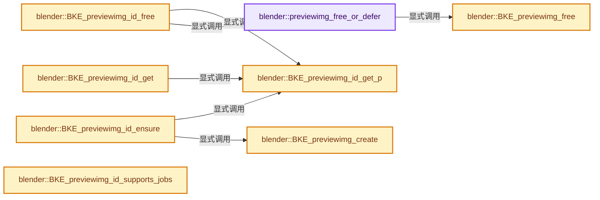

# 实现依赖专题：source/blender/blenkernel/intern/preview_image.cc

[实现依赖导航](../../README.md) · [符号索引](../../../00-课程指南/02-源码与提交索引/符号依赖与实现索引.md)

本专题从正文实际调用进入，集中保存共享实现。函数有稳定锚点，可从调用处直接跳到对应完整函数；递归与互相调用通过回链组织。

## 本文件的实现关系




## 完整成员与函数实现

<a id="f-af7103af89c264b6"></a>

### `blender::previewimg_free_or_defer`

实现位置：[source/blender/blenkernel/intern/preview_image.cc](../../../../../../../source/blender/blenkernel/intern/preview_image.cc) · L85—L118。

接口参数：

- `PreviewImage **prv`

**教学注释版**

<!-- annotated:192c3f605ed2a5 -->

```cpp
static bool previewimg_free_or_defer(PreviewImage **prv)
{
  if (*prv == nullptr) {
    return false;
  }

  BLI_assert(BLI_thread_is_main());

  /* User counting is only done in few cases. If the count is 0, no counting is being used. */
  if ((*prv)->runtime->user_count > 0) {
    (*prv)->runtime->user_count--;
    if ((*prv)->runtime->user_count > 0) {
      /* Don't free yet. */
      return false;
    }
  }

  bool do_delete = true;

  /* If a preview is still being rendered, tag it for deferred deletion in
   * BKE_previewimg_render_end. */
  for (int i = 0; i < NUM_ICON_SIZES; i++) {
    if ((*prv)->runtime->tag[i] & PRV_TAG_DEFERRED_RENDERING) {
      (*prv)->runtime->tag[i] |= PRV_TAG_DEFERRED_DELETE;
      do_delete = false;
    }
  }

  if (do_delete) {
    BKE_previewimg_free(prv);
  }
  *prv = nullptr;
  return true;
}
```

<details>
<summary>核对原始源码：source/blender/blenkernel/intern/preview_image.cc · L85—L118</summary>

<!-- original:192c3f605ed2a5:source/blender/blenkernel/intern/preview_image.cc:85:118 -->

```cpp
static bool previewimg_free_or_defer(PreviewImage **prv)
{
  if (*prv == nullptr) {
    return false;
  }

  BLI_assert(BLI_thread_is_main());

  /* User counting is only done in few cases. If the count is 0, no counting is being used. */
  if ((*prv)->runtime->user_count > 0) {
    (*prv)->runtime->user_count--;
    if ((*prv)->runtime->user_count > 0) {
      /* Don't free yet. */
      return false;
    }
  }

  bool do_delete = true;

  /* If a preview is still being rendered, tag it for deferred deletion in
   * BKE_previewimg_render_end. */
  for (int i = 0; i < NUM_ICON_SIZES; i++) {
    if ((*prv)->runtime->tag[i] & PRV_TAG_DEFERRED_RENDERING) {
      (*prv)->runtime->tag[i] |= PRV_TAG_DEFERRED_DELETE;
      do_delete = false;
    }
  }

  if (do_delete) {
    BKE_previewimg_free(prv);
  }
  *prv = nullptr;
  return true;
}
```

</details>

**沿实际写入检查状态**

- `do_delete = false;`

**结果出口**

- `return false;`
- `return true;`

**继续追踪实现**

- `BLI_assert` → [BLI_assert · L48](../../01-BLI基础库/BLI_assert.hh.md#m-57a88495704d)；[BLI_assert · L63](../../01-BLI基础库/BLI_assert.hh.md#m-d07050020cb5)。宏定义由构建条件选择。
- `BLI_thread_is_main` → [BLI_thread_is_main · L184](../../01-BLI基础库/intern/threads.cc.md#f-da304af4327defdc)。
- `BKE_previewimg_free` → [blender::BKE_previewimg_free · L133](preview_image.cc.md#f-195b2b3fa13fc292)。

<a id="f-0faf5dbae1ab5b62"></a>

### `blender::BKE_previewimg_create`

实现位置：[source/blender/blenkernel/intern/preview_image.cc](../../../../../../../source/blender/blenkernel/intern/preview_image.cc) · L120—L131。

**教学注释版**

<!-- annotated:87f6a8a5dcd380 -->

```cpp
PreviewImage *BKE_previewimg_create()
{
  PreviewImage *prv = MEM_new<PreviewImage>(__func__);

  for (int i = 0; i < NUM_ICON_SIZES; i++) {
    prv->flag[i] |= PRV_CHANGED;
    prv->changed_timestamp[i] = 0;
  }

  prv->runtime = MEM_new<bke::PreviewImageRuntime>(__func__);
  return prv;
}
```

<details>
<summary>核对原始源码：source/blender/blenkernel/intern/preview_image.cc · L120—L131</summary>

<!-- original:87f6a8a5dcd380:source/blender/blenkernel/intern/preview_image.cc:120:131 -->

```cpp
PreviewImage *BKE_previewimg_create()
{
  PreviewImage *prv = MEM_new<PreviewImage>(__func__);

  for (int i = 0; i < NUM_ICON_SIZES; i++) {
    prv->flag[i] |= PRV_CHANGED;
    prv->changed_timestamp[i] = 0;
  }

  prv->runtime = MEM_new<bke::PreviewImageRuntime>(__func__);
  return prv;
}
```

</details>

**沿实际写入检查状态**

- `prv->flag[i] |= PRV_CHANGED;`
- `prv->changed_timestamp[i] = 0;`
- `prv->runtime = MEM_new<bke::PreviewImageRuntime>(__func__);`

**结果出口**

- `return prv;`

**继续追踪实现**

- `MEM_new<PreviewImage>` → [MEM_new · L351](../../07-Intern运行时与平台/guardedalloc/MEM_guardedalloc.h.md#f-115f9b6784f89912)。
- `MEM_new<bke::PreviewImageRuntime>` → [MEM_new · L351](../../07-Intern运行时与平台/guardedalloc/MEM_guardedalloc.h.md#f-115f9b6784f89912)。

<a id="f-195b2b3fa13fc292"></a>

### `blender::BKE_previewimg_free`

实现位置：[source/blender/blenkernel/intern/preview_image.cc](../../../../../../../source/blender/blenkernel/intern/preview_image.cc) · L133—L153。

接口参数：

- `PreviewImage **prv`

**教学注释版**

<!-- annotated:25aeb05b934e4f -->

```cpp
void BKE_previewimg_free(PreviewImage **prv)
{
  if (prv && (*prv)) {
    if ((*prv)->runtime->icon_id) {
      BKE_icon_delete((*prv)->runtime->icon_id);
    }

    for (int i = 0; i < NUM_ICON_SIZES; i++) {
      if ((*prv)->rect[i]) {
        MEM_delete((*prv)->rect[i]);
      }
      if ((*prv)->runtime->gputexture[i]) {
        GPU_texture_free((*prv)->runtime->gputexture[i]);
      }
    }

    MEM_delete((*prv)->runtime);
    MEM_delete(*prv);
    *prv = nullptr;
  }
}
```

<details>
<summary>核对原始源码：source/blender/blenkernel/intern/preview_image.cc · L133—L153</summary>

<!-- original:25aeb05b934e4f:source/blender/blenkernel/intern/preview_image.cc:133:153 -->

```cpp
void BKE_previewimg_free(PreviewImage **prv)
{
  if (prv && (*prv)) {
    if ((*prv)->runtime->icon_id) {
      BKE_icon_delete((*prv)->runtime->icon_id);
    }

    for (int i = 0; i < NUM_ICON_SIZES; i++) {
      if ((*prv)->rect[i]) {
        MEM_delete((*prv)->rect[i]);
      }
      if ((*prv)->runtime->gputexture[i]) {
        GPU_texture_free((*prv)->runtime->gputexture[i]);
      }
    }

    MEM_delete((*prv)->runtime);
    MEM_delete(*prv);
    *prv = nullptr;
  }
}
```

</details>

**继续追踪实现**

- `BKE_icon_delete` → [blender::BKE_icon_delete · L545](icons.cc.md#f-d7e7f833e5762709)。
- `MEM_delete` → [MEM_delete · L400](../../07-Intern运行时与平台/guardedalloc/MEM_guardedalloc.h.md#f-9049ffdd1682887c)。
- `GPU_texture_free` → [blender::GPU_texture_free · L735](../../08-其他Blender模块/gpu/intern/gpu_texture.cc.md#f-3f23c7904f8ea87f)。

<a id="f-e580ec2793e2975e"></a>

### `blender::BKE_previewimg_id_get_p`

实现位置：[source/blender/blenkernel/intern/preview_image.cc](../../../../../../../source/blender/blenkernel/intern/preview_image.cc) · L222—L248。

接口参数：

- `const ID *id`

**教学注释版**

<!-- annotated:9ef0aa1ea567a2 -->

```cpp
PreviewImage **BKE_previewimg_id_get_p(const ID *id)
{
  switch (GS(id->name)) {
#define ID_PRV_CASE(id_code, id_struct) \
  case id_code: { \
    return &((id_struct *)id)->preview; \
  } \
    ((void)0)
    ID_PRV_CASE(ID_OB, Object);
    ID_PRV_CASE(ID_MA, Material);
    ID_PRV_CASE(ID_TE, Tex);
    ID_PRV_CASE(ID_WO, World);
    ID_PRV_CASE(ID_LA, Light);
    ID_PRV_CASE(ID_IM, Image);
    ID_PRV_CASE(ID_BR, Brush);
    ID_PRV_CASE(ID_GR, Collection);
    ID_PRV_CASE(ID_SCE, Scene);
    ID_PRV_CASE(ID_SCR, bScreen);
    ID_PRV_CASE(ID_AC, bAction);
    ID_PRV_CASE(ID_NT, bNodeTree);
#undef ID_PRV_CASE
    default:
      break;
  }

  return nullptr;
}
```

<details>
<summary>核对原始源码：source/blender/blenkernel/intern/preview_image.cc · L222—L248</summary>

<!-- original:9ef0aa1ea567a2:source/blender/blenkernel/intern/preview_image.cc:222:248 -->

```cpp
PreviewImage **BKE_previewimg_id_get_p(const ID *id)
{
  switch (GS(id->name)) {
#define ID_PRV_CASE(id_code, id_struct) \
  case id_code: { \
    return &((id_struct *)id)->preview; \
  } \
    ((void)0)
    ID_PRV_CASE(ID_OB, Object);
    ID_PRV_CASE(ID_MA, Material);
    ID_PRV_CASE(ID_TE, Tex);
    ID_PRV_CASE(ID_WO, World);
    ID_PRV_CASE(ID_LA, Light);
    ID_PRV_CASE(ID_IM, Image);
    ID_PRV_CASE(ID_BR, Brush);
    ID_PRV_CASE(ID_GR, Collection);
    ID_PRV_CASE(ID_SCE, Scene);
    ID_PRV_CASE(ID_SCR, bScreen);
    ID_PRV_CASE(ID_AC, bAction);
    ID_PRV_CASE(ID_NT, bNodeTree);
#undef ID_PRV_CASE
    default:
      break;
  }

  return nullptr;
}
```

</details>

**结果出口**

- `return &((id_struct *)id)->preview; \`
- `return nullptr;`

**继续追踪实现**

- `GS` → [blender::GS · L410](../../08-其他Blender模块/makesdna/DNA_ID.h.md#f-c3ff509f79f21b05)。
- `ID_PRV_CASE` → [调用协议](../../../00-课程指南/01-路线与规范/模板宏与动态分派协议.md)：函数指针、局部可调用对象或未展开的宏；必须结合调用者环境。调用位置L230。

<a id="f-099dfed2f9ba7399"></a>

### `blender::BKE_previewimg_id_get`

实现位置：[source/blender/blenkernel/intern/preview_image.cc](../../../../../../../source/blender/blenkernel/intern/preview_image.cc) · L250—L254。

接口参数：

- `const ID *id`

**教学注释版**

<!-- annotated:fdeab6bee97206 -->

```cpp
PreviewImage *BKE_previewimg_id_get(const ID *id)
{
  PreviewImage **prv_p = BKE_previewimg_id_get_p(id);
  return prv_p ? *prv_p : nullptr;
}
```

<details>
<summary>核对原始源码：source/blender/blenkernel/intern/preview_image.cc · L250—L254</summary>

<!-- original:fdeab6bee97206:source/blender/blenkernel/intern/preview_image.cc:250:254 -->

```cpp
PreviewImage *BKE_previewimg_id_get(const ID *id)
{
  PreviewImage **prv_p = BKE_previewimg_id_get_p(id);
  return prv_p ? *prv_p : nullptr;
}
```

</details>

**结果出口**

- `return prv_p ? *prv_p : nullptr;`

**继续追踪实现**

- `BKE_previewimg_id_get_p` → [blender::BKE_previewimg_id_get_p · L222](preview_image.cc.md#f-e580ec2793e2975e)。

<a id="f-35355dba9d0bc856"></a>

### `blender::BKE_previewimg_id_free`

实现位置：[source/blender/blenkernel/intern/preview_image.cc](../../../../../../../source/blender/blenkernel/intern/preview_image.cc) · L256—L262。

接口参数：

- `ID *id`

**教学注释版**

<!-- annotated:107341ff0103fe -->

```cpp
void BKE_previewimg_id_free(ID *id)
{
  PreviewImage **prv_p = BKE_previewimg_id_get_p(id);
  if (prv_p) {
    previewimg_free_or_defer(prv_p);
  }
}
```

<details>
<summary>核对原始源码：source/blender/blenkernel/intern/preview_image.cc · L256—L262</summary>

<!-- original:107341ff0103fe:source/blender/blenkernel/intern/preview_image.cc:256:262 -->

```cpp
void BKE_previewimg_id_free(ID *id)
{
  PreviewImage **prv_p = BKE_previewimg_id_get_p(id);
  if (prv_p) {
    previewimg_free_or_defer(prv_p);
  }
}
```

</details>

**继续追踪实现**

- `BKE_previewimg_id_get_p` → [blender::BKE_previewimg_id_get_p · L222](preview_image.cc.md#f-e580ec2793e2975e)。
- `previewimg_free_or_defer` → [blender::previewimg_free_or_defer · L85](preview_image.cc.md#f-af7103af89c264b6)。

<a id="f-6af4997fedf2ae02"></a>

### `blender::BKE_previewimg_id_ensure`

实现位置：[source/blender/blenkernel/intern/preview_image.cc](../../../../../../../source/blender/blenkernel/intern/preview_image.cc) · L264—L275。

接口参数：

- `ID *id`

**教学注释版**

<!-- annotated:88437a91e91997 -->

```cpp
PreviewImage *BKE_previewimg_id_ensure(ID *id)
{
  PreviewImage **prv_p = BKE_previewimg_id_get_p(id);
  if (!prv_p) {
    return nullptr;
  }

  if (*prv_p == nullptr) {
    *prv_p = BKE_previewimg_create();
  }
  return *prv_p;
}
```

<details>
<summary>核对原始源码：source/blender/blenkernel/intern/preview_image.cc · L264—L275</summary>

<!-- original:88437a91e91997:source/blender/blenkernel/intern/preview_image.cc:264:275 -->

```cpp
PreviewImage *BKE_previewimg_id_ensure(ID *id)
{
  PreviewImage **prv_p = BKE_previewimg_id_get_p(id);
  if (!prv_p) {
    return nullptr;
  }

  if (*prv_p == nullptr) {
    *prv_p = BKE_previewimg_create();
  }
  return *prv_p;
}
```

</details>

**结果出口**

- `return nullptr;`
- `return *prv_p;`

**继续追踪实现**

- `BKE_previewimg_id_get_p` → [blender::BKE_previewimg_id_get_p · L222](preview_image.cc.md#f-e580ec2793e2975e)。
- `BKE_previewimg_create` → [blender::BKE_previewimg_create · L120](preview_image.cc.md#f-0faf5dbae1ab5b62)。

<a id="f-9c389708dfca3760"></a>

### `blender::BKE_previewimg_id_supports_jobs`

实现位置：[source/blender/blenkernel/intern/preview_image.cc](../../../../../../../source/blender/blenkernel/intern/preview_image.cc) · L296—L299。

接口参数：

- `const ID *id`

**教学注释版**

<!-- annotated:c310a09941f5d2 -->

```cpp
bool BKE_previewimg_id_supports_jobs(const ID *id)
{
  return ELEM(GS(id->name), ID_OB, ID_MA, ID_TE, ID_LA, ID_WO, ID_IM, ID_BR, ID_GR, ID_SCE);
}
```

<details>
<summary>核对原始源码：source/blender/blenkernel/intern/preview_image.cc · L296—L299</summary>

<!-- original:c310a09941f5d2:source/blender/blenkernel/intern/preview_image.cc:296:299 -->

```cpp
bool BKE_previewimg_id_supports_jobs(const ID *id)
{
  return ELEM(GS(id->name), ID_OB, ID_MA, ID_TE, ID_LA, ID_WO, ID_IM, ID_BR, ID_GR, ID_SCE);
}
```

</details>

**结果出口**

- `return ELEM(GS(id->name), ID_OB, ID_MA, ID_TE, ID_LA, ID_WO, ID_IM, ID_BR, ID_GR, ID_SCE);`

**继续追踪实现**

- `ELEM` → [ELEM · L88](../../07-Intern运行时与平台/ghost/intern/GHOST_utildefines.hh.md#m-d28724a15928)；[ELEM · L135](../../01-BLI基础库/BLI_utildefines.hh.md#m-d6572de7cae0)。宏定义由构建条件选择。
- `GS` → [blender::GS · L410](../../08-其他Blender模块/makesdna/DNA_ID.h.md#f-c3ff509f79f21b05)。

<a id="f-4ec3cd2f953e0ff4"></a>

### `blender::BKE_previewimg_is_online`

实现位置：[source/blender/blenkernel/intern/preview_image.cc](../../../../../../../source/blender/blenkernel/intern/preview_image.cc) · L450—L457。

接口参数：

- `const PreviewImage *prv`

**教学注释版**

<!-- annotated:69f7c10e333ae4 -->

```cpp
bool BKE_previewimg_is_online(const PreviewImage *prv)
{
  if (!prv->runtime->deferred_loading_data) {
    return false;
  }

  return prv->runtime->deferred_loading_data->is_online;
}
```

<details>
<summary>核对原始源码：source/blender/blenkernel/intern/preview_image.cc · L450—L457</summary>

<!-- original:69f7c10e333ae4:source/blender/blenkernel/intern/preview_image.cc:450:457 -->

```cpp
bool BKE_previewimg_is_online(const PreviewImage *prv)
{
  if (!prv->runtime->deferred_loading_data) {
    return false;
  }

  return prv->runtime->deferred_loading_data->is_online;
}
```

</details>

**结果出口**

- `return false;`
- `return prv->runtime->deferred_loading_data->is_online;`

**继续追踪实现**

本实现没有需要继续展开的显式调用；检查返回表达式、对象转换和调用者前置条件。

<a id="f-475dd8b1883c5b3d"></a>

### `blender::BKE_previewimg_deferred_filepath_get`

实现位置：[source/blender/blenkernel/intern/preview_image.cc](../../../../../../../source/blender/blenkernel/intern/preview_image.cc) · L459—L466。

接口参数：

- `const PreviewImage *prv`

**教学注释版**

<!-- annotated:8226cbd1cd85a5 -->

```cpp
std::optional<blender::StringRefNull> BKE_previewimg_deferred_filepath_get(const PreviewImage *prv)
{
  if (!prv->runtime->deferred_loading_data) {
    return std::nullopt;
  }

  return prv->runtime->deferred_loading_data->filepath;
}
```

<details>
<summary>核对原始源码：source/blender/blenkernel/intern/preview_image.cc · L459—L466</summary>

<!-- original:8226cbd1cd85a5:source/blender/blenkernel/intern/preview_image.cc:459:466 -->

```cpp
std::optional<blender::StringRefNull> BKE_previewimg_deferred_filepath_get(const PreviewImage *prv)
{
  if (!prv->runtime->deferred_loading_data) {
    return std::nullopt;
  }

  return prv->runtime->deferred_loading_data->filepath;
}
```

</details>

**结果出口**

- `return std::nullopt;`
- `return prv->runtime->deferred_loading_data->filepath;`

**继续追踪实现**

本实现没有需要继续展开的显式调用；检查返回表达式、对象转换和调用者前置条件。

<a id="f-dd0cb611f0d3772b"></a>

### `blender::BKE_previewimg_deferred_thumb_source_get`

实现位置：[source/blender/blenkernel/intern/preview_image.cc](../../../../../../../source/blender/blenkernel/intern/preview_image.cc) · L468—L475。

接口参数：

- `const PreviewImage *prv`

**教学注释版**

<!-- annotated:2fd0bc739cf366 -->

```cpp
std::optional<int> BKE_previewimg_deferred_thumb_source_get(const PreviewImage *prv)
{
  if (!prv->runtime->deferred_loading_data) {
    return std::nullopt;
  }

  return prv->runtime->deferred_loading_data->source;
}
```

<details>
<summary>核对原始源码：source/blender/blenkernel/intern/preview_image.cc · L468—L475</summary>

<!-- original:2fd0bc739cf366:source/blender/blenkernel/intern/preview_image.cc:468:475 -->

```cpp
std::optional<int> BKE_previewimg_deferred_thumb_source_get(const PreviewImage *prv)
{
  if (!prv->runtime->deferred_loading_data) {
    return std::nullopt;
  }

  return prv->runtime->deferred_loading_data->source;
}
```

</details>

**结果出口**

- `return std::nullopt;`
- `return prv->runtime->deferred_loading_data->source;`

**继续追踪实现**

本实现没有需要继续展开的显式调用；检查返回表达式、对象转换和调用者前置条件。

<a id="f-26704433d845b626"></a>

### `blender::BKE_previewimg_to_imbuf`

实现位置：[source/blender/blenkernel/intern/preview_image.cc](../../../../../../../source/blender/blenkernel/intern/preview_image.cc) · L477—L492。

接口参数：

- `const PreviewImage *prv`
- `const int size`

**教学注释版**

<!-- annotated:23ab422dba13e1 -->

```cpp
ImBuf *BKE_previewimg_to_imbuf(const PreviewImage *prv, const int size)
{
  const uint w = prv->w[size];
  const uint h = prv->h[size];
  const uint *rect = prv->rect[size];

  ImBuf *ima = nullptr;

  if (w > 0 && h > 0 && rect) {
    /* first allocate imbuf for copying preview into it */
    ima = IMB_allocImBuf(w, h, ImBufFlags::ByteData);
    // [讲解] memcpy：复制字节，源与目标不应重叠。类型生命周期、对齐和可复制表示须由调用者证明，不是任意对象的复制构造。
    memcpy(ima->byte_data_for_write(), rect, w * h * sizeof(uint8_t) * 4);
  }

  return ima;
}
```

<details>
<summary>核对原始源码：source/blender/blenkernel/intern/preview_image.cc · L477—L492</summary>

<!-- original:23ab422dba13e1:source/blender/blenkernel/intern/preview_image.cc:477:492 -->

```cpp
ImBuf *BKE_previewimg_to_imbuf(const PreviewImage *prv, const int size)
{
  const uint w = prv->w[size];
  const uint h = prv->h[size];
  const uint *rect = prv->rect[size];

  ImBuf *ima = nullptr;

  if (w > 0 && h > 0 && rect) {
    /* first allocate imbuf for copying preview into it */
    ima = IMB_allocImBuf(w, h, ImBufFlags::ByteData);
    memcpy(ima->byte_data_for_write(), rect, w * h * sizeof(uint8_t) * 4);
  }

  return ima;
}
```

</details>

**沿实际写入检查状态**

- `ima = IMB_allocImBuf(w, h, ImBufFlags::ByteData);`

**结果出口**

- `return ima;`

**继续追踪实现**

- `IMB_allocImBuf` → [blender::IMB_allocImBuf · L367](../../08-其他Blender模块/imbuf/intern/allocimbuf.cc.md#f-971d0005c46aad53)。
- `memcpy` → [外部契约](https://eel.is/c++draft/cstring.syn)：复制字节，源与目标不应重叠。类型生命周期、对齐和可复制表示须由调用者证明，不是任意对象的复制构造。
- `ima->byte_data_for_write` → [blender::ImBuf::byte_data_for_write · L60](../../08-其他Blender模块/imbuf/intern/allocimbuf.cc.md#f-9ae201bd1c52aa87)。

<a id="f-04f1445bcf8f6a50"></a>

### `blender::BKE_previewimg_render_start`

实现位置：[source/blender/blenkernel/intern/preview_image.cc](../../../../../../../source/blender/blenkernel/intern/preview_image.cc) · L494—L506。

接口参数：

- `PreviewImage *prv`
- `const int size`
- `const bool using_job`

**教学注释版**

<!-- annotated:8307b3031a473f -->

```cpp
void BKE_previewimg_render_start(PreviewImage *prv, const int size, const bool using_job)
{
  BLI_assert(BLI_thread_is_main());

  prv->flag[size] |= PRV_RENDERING;
  prv->runtime->tag[size] &= ~PRV_TAG_RESTART_RENDERING;

  /* When rendering as a job in another thread, tag so that main thread will not
   * free it and defer deletion to the job. */
  if (using_job) {
    prv->runtime->tag[size] |= PRV_TAG_DEFERRED_RENDERING;
  }
}
```

<details>
<summary>核对原始源码：source/blender/blenkernel/intern/preview_image.cc · L494—L506</summary>

<!-- original:8307b3031a473f:source/blender/blenkernel/intern/preview_image.cc:494:506 -->

```cpp
void BKE_previewimg_render_start(PreviewImage *prv, const int size, const bool using_job)
{
  BLI_assert(BLI_thread_is_main());

  prv->flag[size] |= PRV_RENDERING;
  prv->runtime->tag[size] &= ~PRV_TAG_RESTART_RENDERING;

  /* When rendering as a job in another thread, tag so that main thread will not
   * free it and defer deletion to the job. */
  if (using_job) {
    prv->runtime->tag[size] |= PRV_TAG_DEFERRED_RENDERING;
  }
}
```

</details>

**沿实际写入检查状态**

- `prv->flag[size] |= PRV_RENDERING;`
- `prv->runtime->tag[size] &= ~PRV_TAG_RESTART_RENDERING;`
- `prv->runtime->tag[size] |= PRV_TAG_DEFERRED_RENDERING;`

**继续追踪实现**

- `BLI_assert` → [BLI_assert · L48](../../01-BLI基础库/BLI_assert.hh.md#m-57a88495704d)；[BLI_assert · L63](../../01-BLI基础库/BLI_assert.hh.md#m-d07050020cb5)。宏定义由构建条件选择。
- `BLI_thread_is_main` → [BLI_thread_is_main · L184](../../01-BLI基础库/intern/threads.cc.md#f-da304af4327defdc)。

<a id="f-8cf89c46f1ada110"></a>

### `blender::BKE_previewimg_render_end`

实现位置：[source/blender/blenkernel/intern/preview_image.cc](../../../../../../../source/blender/blenkernel/intern/preview_image.cc) · L508—L548。

接口参数：

- `PreviewImage *prv`
- `const int size`
- `const PreviewImageRenderEndStatus status`

**教学注释版**

<!-- annotated:a6dc623d79967b -->

```cpp
void BKE_previewimg_render_end(PreviewImage *prv,
                               const int size,
                               const PreviewImageRenderEndStatus status)
{
  BLI_assert(BLI_thread_is_main());

  bool do_delete = false;

  prv->runtime->tag[size] &= ~PRV_TAG_DEFERRED_RENDERING;
  if (status == PRV_RENDER_STATUS_FAILED) {
    prv->runtime->tag[size] |= PRV_TAG_DEFERRED_INVALID;
  }

  /* When job is cancelled for e.g. undo, PRV_RENDERING remains so that it can resume
   * when going back to that undo step. Also tag for restart in the current state, if
   * the ID itself was not modified in the undo step but still had its preview cancelled. */
  if (status == PRV_RENDER_STATUS_CANCELLED) {
    if (!(prv->flag[size] & PRV_USER_EDITED)) {
      prv->runtime->tag[size] |= PRV_TAG_RESTART_RENDERING;
    }
  }
  else {
    prv->flag[size] &= ~PRV_RENDERING;
  }

  /* Check if we need to do deferred deletion and it's safe to do so. */
  for (int i = 0; i < NUM_ICON_SIZES; i++) {
    if (prv->runtime->tag[i] & PRV_TAG_DEFERRED_RENDERING) {
      /* Another size is still rendering, */
      return;
    }
    if (prv->runtime->tag[i] & PRV_TAG_DEFERRED_DELETE) {
      /* Deferred deletion is needed. */
      do_delete = true;
    }
  }

  if (do_delete) {
    BKE_previewimg_free(&prv);
  }
}
```

<details>
<summary>核对原始源码：source/blender/blenkernel/intern/preview_image.cc · L508—L548</summary>

<!-- original:a6dc623d79967b:source/blender/blenkernel/intern/preview_image.cc:508:548 -->

```cpp
void BKE_previewimg_render_end(PreviewImage *prv,
                               const int size,
                               const PreviewImageRenderEndStatus status)
{
  BLI_assert(BLI_thread_is_main());

  bool do_delete = false;

  prv->runtime->tag[size] &= ~PRV_TAG_DEFERRED_RENDERING;
  if (status == PRV_RENDER_STATUS_FAILED) {
    prv->runtime->tag[size] |= PRV_TAG_DEFERRED_INVALID;
  }

  /* When job is cancelled for e.g. undo, PRV_RENDERING remains so that it can resume
   * when going back to that undo step. Also tag for restart in the current state, if
   * the ID itself was not modified in the undo step but still had its preview cancelled. */
  if (status == PRV_RENDER_STATUS_CANCELLED) {
    if (!(prv->flag[size] & PRV_USER_EDITED)) {
      prv->runtime->tag[size] |= PRV_TAG_RESTART_RENDERING;
    }
  }
  else {
    prv->flag[size] &= ~PRV_RENDERING;
  }

  /* Check if we need to do deferred deletion and it's safe to do so. */
  for (int i = 0; i < NUM_ICON_SIZES; i++) {
    if (prv->runtime->tag[i] & PRV_TAG_DEFERRED_RENDERING) {
      /* Another size is still rendering, */
      return;
    }
    if (prv->runtime->tag[i] & PRV_TAG_DEFERRED_DELETE) {
      /* Deferred deletion is needed. */
      do_delete = true;
    }
  }

  if (do_delete) {
    BKE_previewimg_free(&prv);
  }
}
```

</details>

**沿实际写入检查状态**

- `prv->runtime->tag[size] &= ~PRV_TAG_DEFERRED_RENDERING;`
- `prv->runtime->tag[size] |= PRV_TAG_DEFERRED_INVALID;`
- `prv->runtime->tag[size] |= PRV_TAG_RESTART_RENDERING;`
- `prv->flag[size] &= ~PRV_RENDERING;`
- `do_delete = true;`

**继续追踪实现**

- `BLI_assert` → [BLI_assert · L48](../../01-BLI基础库/BLI_assert.hh.md#m-57a88495704d)；[BLI_assert · L63](../../01-BLI基础库/BLI_assert.hh.md#m-d07050020cb5)。宏定义由构建条件选择。
- `BLI_thread_is_main` → [BLI_thread_is_main · L184](../../01-BLI基础库/intern/threads.cc.md#f-da304af4327defdc)。
- `BKE_previewimg_free` → [blender::BKE_previewimg_free · L133](preview_image.cc.md#f-195b2b3fa13fc292)。

<a id="f-208c013147c7e028"></a>

### `blender::BKE_previewimg_is_rendering`

实现位置：[source/blender/blenkernel/intern/preview_image.cc](../../../../../../../source/blender/blenkernel/intern/preview_image.cc) · L567—L570。

接口参数：

- `const PreviewImage *prv`
- `const int size`

**教学注释版**

<!-- annotated:9e51b2240a2a49 -->

```cpp
bool BKE_previewimg_is_rendering(const PreviewImage *prv, const int size)
{
  return (prv->flag[size] & PRV_RENDERING);
}
```

<details>
<summary>核对原始源码：source/blender/blenkernel/intern/preview_image.cc · L567—L570</summary>

<!-- original:9e51b2240a2a49:source/blender/blenkernel/intern/preview_image.cc:567:570 -->

```cpp
bool BKE_previewimg_is_rendering(const PreviewImage *prv, const int size)
{
  return (prv->flag[size] & PRV_RENDERING);
}
```

</details>

**结果出口**

- `return (prv->flag[size] & PRV_RENDERING);`

**继续追踪实现**

本实现没有需要继续展开的显式调用；检查返回表达式、对象转换和调用者前置条件。

<a id="f-44c6110ce91fc877"></a>

### `blender::BKE_previewimg_is_finished`

实现位置：[source/blender/blenkernel/intern/preview_image.cc](../../../../../../../source/blender/blenkernel/intern/preview_image.cc) · L572—L576。

接口参数：

- `const PreviewImage *prv`
- `const int size`

**教学注释版**

<!-- annotated:230ace8f37dba4 -->

```cpp
bool BKE_previewimg_is_finished(const PreviewImage *prv, const int size)
{
  return !(prv->flag[size] & PRV_RENDERING) &&
         !(prv->runtime->tag[size] & PRV_TAG_RESTART_RENDERING);
}
```

<details>
<summary>核对原始源码：source/blender/blenkernel/intern/preview_image.cc · L572—L576</summary>

<!-- original:230ace8f37dba4:source/blender/blenkernel/intern/preview_image.cc:572:576 -->

```cpp
bool BKE_previewimg_is_finished(const PreviewImage *prv, const int size)
{
  return !(prv->flag[size] & PRV_RENDERING) &&
         !(prv->runtime->tag[size] & PRV_TAG_RESTART_RENDERING);
}
```

</details>

**结果出口**

- `return !(prv->flag[size] & PRV_RENDERING) &&`

**继续追踪实现**

本实现没有需要继续展开的显式调用；检查返回表达式、对象转换和调用者前置条件。

<a id="f-364826143aabf3c8"></a>

### `blender::BKE_previewimg_is_invalid`

实现位置：[source/blender/blenkernel/intern/preview_image.cc](../../../../../../../source/blender/blenkernel/intern/preview_image.cc) · L578—L581。

接口参数：

- `const PreviewImage *prv`
- `const int size`

**教学注释版**

<!-- annotated:1c52bd81a86c1a -->

```cpp
bool BKE_previewimg_is_invalid(const PreviewImage *prv, const int size)
{
  return (prv->runtime->tag[size] & PRV_TAG_DEFERRED_INVALID) != 0;
}
```

<details>
<summary>核对原始源码：source/blender/blenkernel/intern/preview_image.cc · L578—L581</summary>

<!-- original:1c52bd81a86c1a:source/blender/blenkernel/intern/preview_image.cc:578:581 -->

```cpp
bool BKE_previewimg_is_invalid(const PreviewImage *prv, const int size)
{
  return (prv->runtime->tag[size] & PRV_TAG_DEFERRED_INVALID) != 0;
}
```

</details>

**结果出口**

- `return (prv->runtime->tag[size] & PRV_TAG_DEFERRED_INVALID) != 0;`

**继续追踪实现**

本实现没有需要继续展开的显式调用；检查返回表达式、对象转换和调用者前置条件。

<a id="f-a81c208a9956b7d4"></a>

### `blender::BKE_previewimg_blend_read`

实现位置：[source/blender/blenkernel/intern/preview_image.cc](../../../../../../../source/blender/blenkernel/intern/preview_image.cc) · L608—L634。

接口参数：

- `BlendDataReader *reader`
- `PreviewImage *prv`

**教学注释版**

<!-- annotated:d5c1cb53b1f092 -->

```cpp
void BKE_previewimg_blend_read(BlendDataReader *reader, PreviewImage *prv)
{
  if (prv == nullptr) {
    return;
  }

  prv->runtime = MEM_new<bke::PreviewImageRuntime>(__func__);

  for (int i = 0; i < NUM_ICON_SIZES; i++) {
    if (prv->rect[i]) {
      if (!BLO_read_array(reader, &prv->rect[i], int64_t(prv->w[i]) * prv->h[i])) {
        prv->w[i] = 0;
        prv->h[i] = 0;
      }
    }

    /* PRV_RENDERING is a runtime only flag currently, but for undo indicates that we need
     * to restart preview renders. See ED_preview_restart_work. */
    if (BLO_read_data_is_undo(reader)) {
      if ((prv->flag[i] & PRV_RENDERING) && !(prv->flag[i] & PRV_USER_EDITED)) {
        prv->runtime->tag[i] |= PRV_TAG_RESTART_RENDERING;
        BLO_read_data_set_need_preview_render_restart(reader);
      }
    }
    prv->flag[i] &= ~PRV_RENDERING;
  }
}
```

<details>
<summary>核对原始源码：source/blender/blenkernel/intern/preview_image.cc · L608—L634</summary>

<!-- original:d5c1cb53b1f092:source/blender/blenkernel/intern/preview_image.cc:608:634 -->

```cpp
void BKE_previewimg_blend_read(BlendDataReader *reader, PreviewImage *prv)
{
  if (prv == nullptr) {
    return;
  }

  prv->runtime = MEM_new<bke::PreviewImageRuntime>(__func__);

  for (int i = 0; i < NUM_ICON_SIZES; i++) {
    if (prv->rect[i]) {
      if (!BLO_read_array(reader, &prv->rect[i], int64_t(prv->w[i]) * prv->h[i])) {
        prv->w[i] = 0;
        prv->h[i] = 0;
      }
    }

    /* PRV_RENDERING is a runtime only flag currently, but for undo indicates that we need
     * to restart preview renders. See ED_preview_restart_work. */
    if (BLO_read_data_is_undo(reader)) {
      if ((prv->flag[i] & PRV_RENDERING) && !(prv->flag[i] & PRV_USER_EDITED)) {
        prv->runtime->tag[i] |= PRV_TAG_RESTART_RENDERING;
        BLO_read_data_set_need_preview_render_restart(reader);
      }
    }
    prv->flag[i] &= ~PRV_RENDERING;
  }
}
```

</details>

**沿实际写入检查状态**

- `prv->runtime = MEM_new<bke::PreviewImageRuntime>(__func__);`
- `prv->w[i] = 0;`
- `prv->h[i] = 0;`
- `prv->runtime->tag[i] |= PRV_TAG_RESTART_RENDERING;`
- `prv->flag[i] &= ~PRV_RENDERING;`

**继续追踪实现**

- `MEM_new<bke::PreviewImageRuntime>` → [MEM_new · L351](../../07-Intern运行时与平台/guardedalloc/MEM_guardedalloc.h.md#f-115f9b6784f89912)。
- `BLO_read_array` → [blender::BLO_read_array · L560](../../08-其他Blender模块/blenloader/BLO_read_write.hh.md#f-72510af36964431f)。
- `BLO_read_data_is_undo` → [BLO_read_data_is_undo · L6513](../../08-其他Blender模块/blenloader/intern/readfile.cc.md#f-dadc9d1bb69441cd)。
- `BLO_read_data_set_need_preview_render_restart` → [BLO_read_data_set_need_preview_render_restart · L6548](../../08-其他Blender模块/blenloader/intern/readfile.cc.md#f-1c73cffab2508b4b)。
