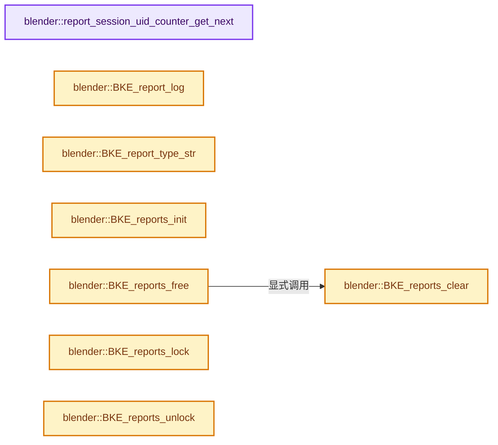
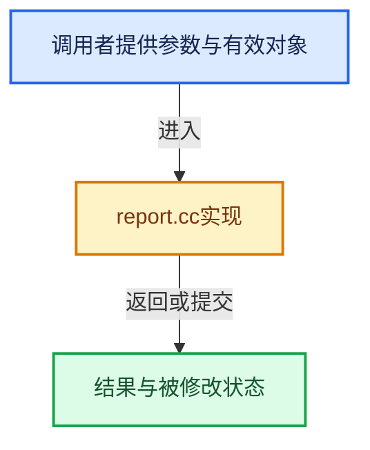

# 实现依赖专题：source/blender/blenkernel/intern/report.cc

[实现依赖导航](../../README.md) · [符号索引](../../../00-课程指南/02-源码与提交索引/符号依赖与实现索引.md)

本专题从正文实际调用进入，集中保存共享实现。函数有稳定锚点，可从调用处直接跳到对应完整函数；递归与互相调用通过回链组织。

## 本文件的实现关系






## 完整成员与函数实现

<a id="f-3213b4bb40cbb06d"></a>

### `blender::report_session_uid_counter_get_next`

实现位置：[source/blender/blenkernel/intern/report.cc](../../../../../../../source/blender/blenkernel/intern/report.cc) · L36—L40。

**教学注释版**

<!-- annotated:9522058533c3fb -->

```cpp
static int report_session_uid_counter_get_next()
{
  static std::atomic<int> report_session_uid_counter{0};
  return report_session_uid_counter.fetch_add(1, std::memory_order_relaxed) + 1;
}
```

<details>
<summary>核对原始源码：source/blender/blenkernel/intern/report.cc · L36—L40</summary>

<!-- original:9522058533c3fb:source/blender/blenkernel/intern/report.cc:36:40 -->

```cpp
static int report_session_uid_counter_get_next()
{
  static std::atomic<int> report_session_uid_counter{0};
  return report_session_uid_counter.fetch_add(1, std::memory_order_relaxed) + 1;
}
```

</details>

**结果出口**

- `return report_session_uid_counter.fetch_add(1, std::memory_order_relaxed) + 1;`

**继续追踪实现**

- `report_session_uid_counter.fetch_add` → [外部契约](https://eel.is/c++draft/)：这个边界按实际表达式及所属类型核对参数、返回值、寿命与失败行为。这里提供接口入口，不声称已解释该第三方版本的内部实现。

<a id="f-330829acc3b50256"></a>

### `blender::BKE_report_log`

实现位置：[source/blender/blenkernel/intern/report.cc](../../../../../../../source/blender/blenkernel/intern/report.cc) · L42—L63。

接口参数：

- `eReportType type`
- `const char *message`
- `CLG_LogRef *log`

**教学注释版**

<!-- annotated:56eaa80ba7bebe -->

```cpp
void BKE_report_log(eReportType type, const char *message, CLG_LogRef *log)
{
  switch (type) {
    case RPT_DEBUG:
      CLOG_STR_DEBUG(log, message);
      break;
    case RPT_INFO:
    case RPT_OPERATOR:
    case RPT_PROPERTY:
      CLOG_INFO_NOCHECK(log, "%s", message);
      break;
    case RPT_WARNING:
      CLOG_STR_WARN(log, message);
      break;
    case RPT_ERROR:
    case RPT_ERROR_INVALID_INPUT:
    case RPT_ERROR_INVALID_CONTEXT:
    case RPT_ERROR_OUT_OF_MEMORY:
      CLOG_STR_ERROR(log, message);
      break;
  }
}
```

<details>
<summary>核对原始源码：source/blender/blenkernel/intern/report.cc · L42—L63</summary>

<!-- original:56eaa80ba7bebe:source/blender/blenkernel/intern/report.cc:42:63 -->

```cpp
void BKE_report_log(eReportType type, const char *message, CLG_LogRef *log)
{
  switch (type) {
    case RPT_DEBUG:
      CLOG_STR_DEBUG(log, message);
      break;
    case RPT_INFO:
    case RPT_OPERATOR:
    case RPT_PROPERTY:
      CLOG_INFO_NOCHECK(log, "%s", message);
      break;
    case RPT_WARNING:
      CLOG_STR_WARN(log, message);
      break;
    case RPT_ERROR:
    case RPT_ERROR_INVALID_INPUT:
    case RPT_ERROR_INVALID_CONTEXT:
    case RPT_ERROR_OUT_OF_MEMORY:
      CLOG_STR_ERROR(log, message);
      break;
  }
}
```

</details>

**继续追踪实现**

- `CLOG_STR_DEBUG` → [CLOG_STR_DEBUG · L199](../../07-Intern运行时与平台/clog/CLG_log.h.md#m-232b8c944d3a)。宏定义由构建条件选择。
- `CLOG_INFO_NOCHECK` → [CLOG_INFO_NOCHECK · L204](../../07-Intern运行时与平台/clog/CLG_log.h.md#m-0ee99c46381d)。宏定义由构建条件选择。
- `CLOG_STR_WARN` → [CLOG_STR_WARN · L197](../../07-Intern运行时与平台/clog/CLG_log.h.md#m-b5afc8a6dde4)。宏定义由构建条件选择。
- `CLOG_STR_ERROR` → [CLOG_STR_ERROR · L196](../../07-Intern运行时与平台/clog/CLG_log.h.md#m-dcd74e148724)。宏定义由构建条件选择。

<a id="f-0dd5a10eb3fe7208"></a>

### `blender::BKE_report_type_str`

实现位置：[source/blender/blenkernel/intern/report.cc](../../../../../../../source/blender/blenkernel/intern/report.cc) · L65—L89。

接口参数：

- `eReportType type`

**教学注释版**

<!-- annotated:3d9cd3d90aab69 -->

```cpp
const char *BKE_report_type_str(eReportType type)
{
  switch (type) {
    case RPT_DEBUG:
      return RPT_("Debug");
    case RPT_INFO:
      return RPT_("Info");
    case RPT_OPERATOR:
      return RPT_("Operator");
    case RPT_PROPERTY:
      return RPT_("Property");
    case RPT_WARNING:
      return RPT_("Warning");
    case RPT_ERROR:
      return RPT_("Error");
    case RPT_ERROR_INVALID_INPUT:
      return RPT_("Invalid Input Error");
    case RPT_ERROR_INVALID_CONTEXT:
      return RPT_("Invalid Context Error");
    case RPT_ERROR_OUT_OF_MEMORY:
      return RPT_("Out Of Memory Error");
    default:
      return RPT_("Undefined Type");
  }
}
```

<details>
<summary>核对原始源码：source/blender/blenkernel/intern/report.cc · L65—L89</summary>

<!-- original:3d9cd3d90aab69:source/blender/blenkernel/intern/report.cc:65:89 -->

```cpp
const char *BKE_report_type_str(eReportType type)
{
  switch (type) {
    case RPT_DEBUG:
      return RPT_("Debug");
    case RPT_INFO:
      return RPT_("Info");
    case RPT_OPERATOR:
      return RPT_("Operator");
    case RPT_PROPERTY:
      return RPT_("Property");
    case RPT_WARNING:
      return RPT_("Warning");
    case RPT_ERROR:
      return RPT_("Error");
    case RPT_ERROR_INVALID_INPUT:
      return RPT_("Invalid Input Error");
    case RPT_ERROR_INVALID_CONTEXT:
      return RPT_("Invalid Context Error");
    case RPT_ERROR_OUT_OF_MEMORY:
      return RPT_("Out Of Memory Error");
    default:
      return RPT_("Undefined Type");
  }
}
```

</details>

**结果出口**

- `return RPT_("Debug");`
- `return RPT_("Info");`
- `return RPT_("Operator");`
- `return RPT_("Property");`
- `return RPT_("Warning");`
- `return RPT_("Error");`
- `return RPT_("Invalid Input Error");`
- `return RPT_("Invalid Context Error");`
- `return RPT_("Out Of Memory Error");`
- `return RPT_("Undefined Type");`

**继续追踪实现**

- `RPT_` → [RPT_ · L51](../../08-其他Blender模块/blentranslation/BLT_translation.hh.md#m-c13f94a1a934)。宏定义由构建条件选择。

<a id="f-b8685fdb2b35bb7d"></a>

### `blender::BKE_reports_init`

实现位置：[source/blender/blenkernel/intern/report.cc](../../../../../../../source/blender/blenkernel/intern/report.cc) · L91—L104。

接口参数：

- `ReportList *reports`
- `int flag`

**教学注释版**

<!-- annotated:f2640e3fe6cf45 -->

```cpp
void BKE_reports_init(ReportList *reports, int flag)
{
  if (!reports) {
    return;
  }

  *reports = ReportList{};

  reports->storelevel = RPT_INFO;
  reports->printlevel = RPT_ERROR;
  reports->flag = flag;

  reports->lock = MEM_new<std::mutex>(__func__);
}
```

<details>
<summary>核对原始源码：source/blender/blenkernel/intern/report.cc · L91—L104</summary>

<!-- original:f2640e3fe6cf45:source/blender/blenkernel/intern/report.cc:91:104 -->

```cpp
void BKE_reports_init(ReportList *reports, int flag)
{
  if (!reports) {
    return;
  }

  *reports = ReportList{};

  reports->storelevel = RPT_INFO;
  reports->printlevel = RPT_ERROR;
  reports->flag = flag;

  reports->lock = MEM_new<std::mutex>(__func__);
}
```

</details>

**沿实际写入检查状态**

- `reports->storelevel = RPT_INFO;`
- `reports->printlevel = RPT_ERROR;`
- `reports->flag = flag;`
- `reports->lock = MEM_new<std::mutex>(__func__);`

**继续追踪实现**

- `MEM_new<std::mutex>` → [MEM_new · L351](../../07-Intern运行时与平台/guardedalloc/MEM_guardedalloc.h.md#f-115f9b6784f89912)。

<a id="f-14b48393664f8c21"></a>

### `blender::BKE_reports_free`

实现位置：[source/blender/blenkernel/intern/report.cc](../../../../../../../source/blender/blenkernel/intern/report.cc) · L106—L116。

接口参数：

- `ReportList *reports`

**教学注释版**

<!-- annotated:2ba161e4eafea8 -->

```cpp
void BKE_reports_free(ReportList *reports)
{
  if (!reports) {
    return;
  }

  BKE_reports_clear(reports);

  MEM_delete(reports->lock);
  reports->lock = nullptr;
}
```

<details>
<summary>核对原始源码：source/blender/blenkernel/intern/report.cc · L106—L116</summary>

<!-- original:2ba161e4eafea8:source/blender/blenkernel/intern/report.cc:106:116 -->

```cpp
void BKE_reports_free(ReportList *reports)
{
  if (!reports) {
    return;
  }

  BKE_reports_clear(reports);

  MEM_delete(reports->lock);
  reports->lock = nullptr;
}
```

</details>

**沿实际写入检查状态**

- `reports->lock = nullptr;`

**继续追踪实现**

- `BKE_reports_clear` → [blender::BKE_reports_clear · L118](report.cc.md#f-32835c4d9382c2a7)。
- `MEM_delete` → [MEM_delete · L400](../../07-Intern运行时与平台/guardedalloc/MEM_guardedalloc.h.md#f-9049ffdd1682887c)。

<a id="f-32835c4d9382c2a7"></a>

### `blender::BKE_reports_clear`

实现位置：[source/blender/blenkernel/intern/report.cc](../../../../../../../source/blender/blenkernel/intern/report.cc) · L118—L138。

接口参数：

- `ReportList *reports`

**教学注释版**

<!-- annotated:59bcafd23e674c -->

```cpp
void BKE_reports_clear(ReportList *reports)
{
  Report *report, *report_next;

  if (!reports) {
    return;
  }

  std::scoped_lock lock(*reports->lock);

  report = reports->list.first();

  while (report) {
    report_next = report->next;
    MEM_delete(report->message);
    MEM_delete(report);
    report = report_next;
  }

  reports->list.clear_no_delete();
}
```

<details>
<summary>核对原始源码：source/blender/blenkernel/intern/report.cc · L118—L138</summary>

<!-- original:59bcafd23e674c:source/blender/blenkernel/intern/report.cc:118:138 -->

```cpp
void BKE_reports_clear(ReportList *reports)
{
  Report *report, *report_next;

  if (!reports) {
    return;
  }

  std::scoped_lock lock(*reports->lock);

  report = reports->list.first();

  while (report) {
    report_next = report->next;
    MEM_delete(report->message);
    MEM_delete(report);
    report = report_next;
  }

  reports->list.clear_no_delete();
}
```

</details>

**沿实际写入检查状态**

- `report = reports->list.first();`
- `report_next = report->next;`
- `report = report_next;`

**继续追踪实现**

- `reports->list.first` → [调用协议](../../../00-课程指南/01-路线与规范/模板宏与动态分派协议.md)：接收对象类型依赖auto、返回值或模板实例；不按同名猜测目标。调用位置L128。
- `MEM_delete` → [MEM_delete · L400](../../07-Intern运行时与平台/guardedalloc/MEM_guardedalloc.h.md#f-9049ffdd1682887c)。
- `reports->list.clear_no_delete` → [调用协议](../../../00-课程指南/01-路线与规范/模板宏与动态分派协议.md)：接收对象类型依赖auto、返回值或模板实例；不按同名猜测目标。调用位置L137。

<a id="f-878baca4af4ae208"></a>

### `blender::BKE_reports_lock`

实现位置：[source/blender/blenkernel/intern/report.cc](../../../../../../../source/blender/blenkernel/intern/report.cc) · L140—L143。

接口参数：

- `ReportList *reports`

**教学注释版**

<!-- annotated:39243847cb9150 -->

```cpp
void BKE_reports_lock(ReportList *reports)
{
  reports->lock->lock();
}
```

<details>
<summary>核对原始源码：source/blender/blenkernel/intern/report.cc · L140—L143</summary>

<!-- original:39243847cb9150:source/blender/blenkernel/intern/report.cc:140:143 -->

```cpp
void BKE_reports_lock(ReportList *reports)
{
  reports->lock->lock();
}
```

</details>

**继续追踪实现**

- `reports->lock->lock` → [调用协议](../../../00-课程指南/01-路线与规范/模板宏与动态分派协议.md)：接收对象类型依赖auto、返回值或模板实例；不按同名猜测目标。调用位置L142。

<a id="f-4dab4a4d5b5bcbe4"></a>

### `blender::BKE_reports_unlock`

实现位置：[source/blender/blenkernel/intern/report.cc](../../../../../../../source/blender/blenkernel/intern/report.cc) · L145—L148。

接口参数：

- `ReportList *reports`

**教学注释版**

<!-- annotated:659af64778fa97 -->

```cpp
void BKE_reports_unlock(ReportList *reports)
{
  reports->lock->unlock();
}
```

<details>
<summary>核对原始源码：source/blender/blenkernel/intern/report.cc · L145—L148</summary>

<!-- original:659af64778fa97:source/blender/blenkernel/intern/report.cc:145:148 -->

```cpp
void BKE_reports_unlock(ReportList *reports)
{
  reports->lock->unlock();
}
```

</details>

**继续追踪实现**

- `reports->lock->unlock` → [调用协议](../../../00-课程指南/01-路线与规范/模板宏与动态分派协议.md)：接收对象类型依赖auto、返回值或模板实例；不按同名猜测目标。调用位置L147。

<a id="f-b63ab0b56ee03476"></a>

### `blender::BKE_reports_move_to_reports`

实现位置：[source/blender/blenkernel/intern/report.cc](../../../../../../../source/blender/blenkernel/intern/report.cc) · L150—L160。

接口参数：

- `ReportList *reports_dst`
- `ReportList *reports_src`

**教学注释版**

<!-- annotated:354548d03a9f5c -->

```cpp
void BKE_reports_move_to_reports(ReportList *reports_dst, ReportList *reports_src)
{
  BLI_assert(reports_dst);
  if (!reports_src) {
    return;
  }

  std::scoped_lock lock(*reports_src->lock, *reports_dst->lock);

  BLI_movelisttolist(&reports_dst->list, &reports_src->list);
}
```

<details>
<summary>核对原始源码：source/blender/blenkernel/intern/report.cc · L150—L160</summary>

<!-- original:354548d03a9f5c:source/blender/blenkernel/intern/report.cc:150:160 -->

```cpp
void BKE_reports_move_to_reports(ReportList *reports_dst, ReportList *reports_src)
{
  BLI_assert(reports_dst);
  if (!reports_src) {
    return;
  }

  std::scoped_lock lock(*reports_src->lock, *reports_dst->lock);

  BLI_movelisttolist(&reports_dst->list, &reports_src->list);
}
```

</details>

**继续追踪实现**

- `BLI_assert` → [BLI_assert · L48](../../01-BLI基础库/BLI_assert.hh.md#m-57a88495704d)；[BLI_assert · L63](../../01-BLI基础库/BLI_assert.hh.md#m-d07050020cb5)。宏定义由构建条件选择。
- `BLI_movelisttolist` → [blender::BLI_movelisttolist · L32](../../01-BLI基础库/intern/listbase.cc.md#f-c7a706073038a4be)。

<a id="f-56816f68adfe537b"></a>

### `blender::BKE_report`

实现位置：[source/blender/blenkernel/intern/report.cc](../../../../../../../source/blender/blenkernel/intern/report.cc) · L162—L189。

接口参数：

- `ReportList *reports`
- `eReportType type`
- `const char *_message`

**教学注释版**

<!-- annotated:36f14295bb4faa -->

```cpp
void BKE_report(ReportList *reports, eReportType type, const char *_message)
{
  Report *report;
  int len;
  const char *message = RPT_(_message);

  if (BKE_reports_print_test(reports, type)) {
    BKE_report_log(type, message, &LOG);
    fflush(stdout); /* this ensures the message is printed before a crash */
  }

  if (reports && (reports->flag & RPT_STORE) && (type >= reports->storelevel)) {
    std::scoped_lock lock(*reports->lock);

    char *message_alloc;
    report = MEM_new<Report>("Report");
    report->type = type;
    report->typestr = BKE_report_type_str(type);

    len = strlen(message);
    message_alloc = MEM_new_array_uninitialized<char>(size_t(len) + 1, "ReportMessage");
    // [讲解] memcpy：复制字节，源与目标不应重叠。类型生命周期、对齐和可复制表示须由调用者证明，不是任意对象的复制构造。
    memcpy(message_alloc, message, sizeof(char) * (len + 1));
    report->message = message_alloc;
    report->len = len;
    report->session_uid = report_session_uid_counter_get_next();
    BLI_addtail(&reports->list, report);
  }
}
```

<details>
<summary>核对原始源码：source/blender/blenkernel/intern/report.cc · L162—L189</summary>

<!-- original:36f14295bb4faa:source/blender/blenkernel/intern/report.cc:162:189 -->

```cpp
void BKE_report(ReportList *reports, eReportType type, const char *_message)
{
  Report *report;
  int len;
  const char *message = RPT_(_message);

  if (BKE_reports_print_test(reports, type)) {
    BKE_report_log(type, message, &LOG);
    fflush(stdout); /* this ensures the message is printed before a crash */
  }

  if (reports && (reports->flag & RPT_STORE) && (type >= reports->storelevel)) {
    std::scoped_lock lock(*reports->lock);

    char *message_alloc;
    report = MEM_new<Report>("Report");
    report->type = type;
    report->typestr = BKE_report_type_str(type);

    len = strlen(message);
    message_alloc = MEM_new_array_uninitialized<char>(size_t(len) + 1, "ReportMessage");
    memcpy(message_alloc, message, sizeof(char) * (len + 1));
    report->message = message_alloc;
    report->len = len;
    report->session_uid = report_session_uid_counter_get_next();
    BLI_addtail(&reports->list, report);
  }
}
```

</details>

**沿实际写入检查状态**

- `report = MEM_new<Report>("Report");`
- `report->type = type;`
- `report->typestr = BKE_report_type_str(type);`
- `len = strlen(message);`
- `message_alloc = MEM_new_array_uninitialized<char>(size_t(len) + 1, "ReportMessage");`
- `report->message = message_alloc;`
- `report->len = len;`
- `report->session_uid = report_session_uid_counter_get_next();`

**继续追踪实现**

- `RPT_` → [RPT_ · L51](../../08-其他Blender模块/blentranslation/BLT_translation.hh.md#m-c13f94a1a934)。宏定义由构建条件选择。
- `BKE_reports_print_test` → [blender::BKE_reports_print_test · L336](report.cc.md#f-e1a1f6c915f8fd3f)。
- `BKE_report_log` → [blender::BKE_report_log · L42](report.cc.md#f-330829acc3b50256)。
- `fflush` → [调用协议](../../../00-课程指南/01-路线与规范/模板宏与动态分派协议.md)：函数指针、局部可调用对象或未展开的宏；必须结合调用者环境。调用位置L170。
- `MEM_new<Report>` → [MEM_new · L351](../../07-Intern运行时与平台/guardedalloc/MEM_guardedalloc.h.md#f-115f9b6784f89912)。
- `BKE_report_type_str` → [blender::BKE_report_type_str · L65](report.cc.md#f-0dd5a10eb3fe7208)。
- `strlen` → [外部契约](https://eel.is/c++draft/)：这个边界按实际表达式及所属类型核对参数、返回值、寿命与失败行为。这里提供接口入口，不声称已解释该第三方版本的内部实现。
- `MEM_new_array_uninitialized<char>` → [MEM_new_array_uninitialized · L608](../../07-Intern运行时与平台/guardedalloc/MEM_guardedalloc.h.md#f-b7103eae8eb57b05)；[MEM_new_array_uninitialized · L129](../../07-Intern运行时与平台/guardedalloc/intern/mallocn.cc.md#f-bf6ef4ddcfb6e5df)。同名重载需按实参类型选择。
- `memcpy` → [外部契约](https://eel.is/c++draft/cstring.syn)：复制字节，源与目标不应重叠。类型生命周期、对齐和可复制表示须由调用者证明，不是任意对象的复制构造。
- `report_session_uid_counter_get_next` → [blender::report_session_uid_counter_get_next · L36](report.cc.md#f-3213b4bb40cbb06d)。
- `BLI_addtail` → [blender::BLI_addtail · L118](../../01-BLI基础库/intern/listbase.cc.md#f-4fb027713fa3115b)。

<a id="f-e776fc632ffb42b3"></a>

### `blender::BKE_reportf`

实现位置：[source/blender/blenkernel/intern/report.cc](../../../../../../../source/blender/blenkernel/intern/report.cc) · L191—L222。

接口参数：

- `ReportList *reports`
- `eReportType type`
- `const char *_format`

**教学注释版**

<!-- annotated:404f1e16034920 -->

```cpp
void BKE_reportf(ReportList *reports, eReportType type, const char *_format, ...)
{
  Report *report;
  va_list args;
  const char *format = RPT_(_format);

  if (BKE_reports_print_test(reports, type)) {
    va_start(args, _format);
    const char *message = BLI_vsprintfN(format, args);
    va_end(args);
    BKE_report_log(type, message, &LOG);
    fflush(stdout); /* this ensures the message is printed before a crash */
    MEM_delete(message);
  }

  if (reports && (reports->flag & RPT_STORE) && (type >= reports->storelevel)) {
    std::scoped_lock lock(*reports->lock);

    report = MEM_new<Report>("Report");

    va_start(args, _format);
    report->message = BLI_vsprintfN(format, args);
    va_end(args);

    report->len = strlen(report->message);
    report->type = type;
    report->typestr = BKE_report_type_str(type);
    report->session_uid = report_session_uid_counter_get_next();

    BLI_addtail(&reports->list, report);
  }
}
```

<details>
<summary>核对原始源码：source/blender/blenkernel/intern/report.cc · L191—L222</summary>

<!-- original:404f1e16034920:source/blender/blenkernel/intern/report.cc:191:222 -->

```cpp
void BKE_reportf(ReportList *reports, eReportType type, const char *_format, ...)
{
  Report *report;
  va_list args;
  const char *format = RPT_(_format);

  if (BKE_reports_print_test(reports, type)) {
    va_start(args, _format);
    const char *message = BLI_vsprintfN(format, args);
    va_end(args);
    BKE_report_log(type, message, &LOG);
    fflush(stdout); /* this ensures the message is printed before a crash */
    MEM_delete(message);
  }

  if (reports && (reports->flag & RPT_STORE) && (type >= reports->storelevel)) {
    std::scoped_lock lock(*reports->lock);

    report = MEM_new<Report>("Report");

    va_start(args, _format);
    report->message = BLI_vsprintfN(format, args);
    va_end(args);

    report->len = strlen(report->message);
    report->type = type;
    report->typestr = BKE_report_type_str(type);
    report->session_uid = report_session_uid_counter_get_next();

    BLI_addtail(&reports->list, report);
  }
}
```

</details>

**沿实际写入检查状态**

- `report = MEM_new<Report>("Report");`
- `report->message = BLI_vsprintfN(format, args);`
- `report->len = strlen(report->message);`
- `report->type = type;`
- `report->typestr = BKE_report_type_str(type);`
- `report->session_uid = report_session_uid_counter_get_next();`

**继续追踪实现**

- `RPT_` → [RPT_ · L51](../../08-其他Blender模块/blentranslation/BLT_translation.hh.md#m-c13f94a1a934)。宏定义由构建条件选择。
- `BKE_reports_print_test` → [blender::BKE_reports_print_test · L336](report.cc.md#f-e1a1f6c915f8fd3f)。
- `va_start` → [调用协议](../../../00-课程指南/01-路线与规范/模板宏与动态分派协议.md)：函数指针、局部可调用对象或未展开的宏；必须结合调用者环境。调用位置L198。
- `BLI_vsprintfN` → [blender::BLI_vsprintfN · L314](../../01-BLI基础库/intern/string.cc.md#f-f9f2b319f94c0309)。
- `va_end` → [调用协议](../../../00-课程指南/01-路线与规范/模板宏与动态分派协议.md)：函数指针、局部可调用对象或未展开的宏；必须结合调用者环境。调用位置L200。
- `BKE_report_log` → [blender::BKE_report_log · L42](report.cc.md#f-330829acc3b50256)。
- `fflush` → [调用协议](../../../00-课程指南/01-路线与规范/模板宏与动态分派协议.md)：函数指针、局部可调用对象或未展开的宏；必须结合调用者环境。调用位置L202。
- `MEM_delete` → [MEM_delete · L400](../../07-Intern运行时与平台/guardedalloc/MEM_guardedalloc.h.md#f-9049ffdd1682887c)。
- `MEM_new<Report>` → [MEM_new · L351](../../07-Intern运行时与平台/guardedalloc/MEM_guardedalloc.h.md#f-115f9b6784f89912)。
- `strlen` → [外部契约](https://eel.is/c++draft/)：这个边界按实际表达式及所属类型核对参数、返回值、寿命与失败行为。这里提供接口入口，不声称已解释该第三方版本的内部实现。
- `BKE_report_type_str` → [blender::BKE_report_type_str · L65](report.cc.md#f-0dd5a10eb3fe7208)。
- `report_session_uid_counter_get_next` → [blender::report_session_uid_counter_get_next · L36](report.cc.md#f-3213b4bb40cbb06d)。
- `BLI_addtail` → [blender::BLI_addtail · L118](../../01-BLI基础库/intern/listbase.cc.md#f-4fb027713fa3115b)。

<a id="f-8b074095e449900c"></a>

### `blender::BKE_report_print_level_set`

实现位置：[source/blender/blenkernel/intern/report.cc](../../../../../../../source/blender/blenkernel/intern/report.cc) · L276—L285。

接口参数：

- `ReportList *reports`
- `eReportType level`

**教学注释版**

<!-- annotated:b0c48b445cd07a -->

```cpp
void BKE_report_print_level_set(ReportList *reports, eReportType level)
{
  if (!reports) {
    return;
  }

  std::scoped_lock lock(*reports->lock);

  reports->printlevel = level;
}
```

<details>
<summary>核对原始源码：source/blender/blenkernel/intern/report.cc · L276—L285</summary>

<!-- original:b0c48b445cd07a:source/blender/blenkernel/intern/report.cc:276:285 -->

```cpp
void BKE_report_print_level_set(ReportList *reports, eReportType level)
{
  if (!reports) {
    return;
  }

  std::scoped_lock lock(*reports->lock);

  reports->printlevel = level;
}
```

</details>

**沿实际写入检查状态**

- `reports->printlevel = level;`

**继续追踪实现**

本实现没有需要继续展开的显式调用；检查返回表达式、对象转换和调用者前置条件。

<a id="f-fe8d0d4202fa9120"></a>

### `blender::BKE_reports_string`

实现位置：[source/blender/blenkernel/intern/report.cc](../../../../../../../source/blender/blenkernel/intern/report.cc) · L307—L334。

接口参数：

- `ReportList *reports`
- `eReportType level`

**教学注释版**

<!-- annotated:e98875ded2baa6 -->

```cpp
char *BKE_reports_string(ReportList *reports, eReportType level)
{
  DynStr *ds;
  char *cstring;

  if (!reports || !reports->list.first()) {
    return nullptr;
  }

  std::scoped_lock lock(*reports->lock);

  ds = BLI_dynstr_new();
  for (Report &report : reports->list) {
    if (report.type >= level) {
      BLI_dynstr_appendf(ds, "%s: %s\n", report.typestr, report.message);
    }
  }

  if (BLI_dynstr_get_len(ds)) {
    cstring = BLI_dynstr_get_cstring(ds);
  }
  else {
    cstring = nullptr;
  }

  BLI_dynstr_free(ds);
  return cstring;
}
```

<details>
<summary>核对原始源码：source/blender/blenkernel/intern/report.cc · L307—L334</summary>

<!-- original:e98875ded2baa6:source/blender/blenkernel/intern/report.cc:307:334 -->

```cpp
char *BKE_reports_string(ReportList *reports, eReportType level)
{
  DynStr *ds;
  char *cstring;

  if (!reports || !reports->list.first()) {
    return nullptr;
  }

  std::scoped_lock lock(*reports->lock);

  ds = BLI_dynstr_new();
  for (Report &report : reports->list) {
    if (report.type >= level) {
      BLI_dynstr_appendf(ds, "%s: %s\n", report.typestr, report.message);
    }
  }

  if (BLI_dynstr_get_len(ds)) {
    cstring = BLI_dynstr_get_cstring(ds);
  }
  else {
    cstring = nullptr;
  }

  BLI_dynstr_free(ds);
  return cstring;
}
```

</details>

**沿实际写入检查状态**

- `ds = BLI_dynstr_new();`
- `cstring = BLI_dynstr_get_cstring(ds);`
- `cstring = nullptr;`

**结果出口**

- `return nullptr;`
- `return cstring;`

**继续追踪实现**

- `reports->list.first` → [调用协议](../../../00-课程指南/01-路线与规范/模板宏与动态分派协议.md)：接收对象类型依赖auto、返回值或模板实例；不按同名猜测目标。调用位置L312。
- `BLI_dynstr_new` → [blender::BLI_dynstr_new · L39](../../01-BLI基础库/intern/BLI_dynstr.cc.md#f-175f7e29ab0bb527)。
- `BLI_dynstr_appendf` → [blender::BLI_dynstr_appendf · L108](../../01-BLI基础库/intern/BLI_dynstr.cc.md#f-4c5a9394eb5ed39c)。
- `BLI_dynstr_get_len` → [blender::BLI_dynstr_get_len · L124](../../01-BLI基础库/intern/BLI_dynstr.cc.md#f-b531ee8abf4f54d9)。
- `BLI_dynstr_get_cstring` → [blender::BLI_dynstr_get_cstring · L145](../../01-BLI基础库/intern/BLI_dynstr.cc.md#f-96bf160f2e4e8179)。
- `BLI_dynstr_free` → [blender::BLI_dynstr_free · L170](../../01-BLI基础库/intern/BLI_dynstr.cc.md#f-9c73673642d1e91f)。

<a id="f-e1a1f6c915f8fd3f"></a>

### `blender::BKE_reports_print_test`

实现位置：[source/blender/blenkernel/intern/report.cc](../../../../../../../source/blender/blenkernel/intern/report.cc) · L336—L352。

接口参数：

- `const ReportList *reports`
- `eReportType type`

**教学注释版**

<!-- annotated:e19b49a7dfd528 -->

```cpp
bool BKE_reports_print_test(const ReportList *reports, eReportType type)
{
  if (reports == nullptr) {
    return true;
  }
  if (reports->flag & RPT_PRINT_HANDLED_BY_OWNER) {
    return false;
  }
  /* In background mode always print otherwise there are cases the errors won't be displayed,
   * but still add to the report list since this is used for Python exception handling. */
  if (G.background) {
    return true;
  }

  /* Common case. */
  return (reports->flag & RPT_PRINT) && (type >= reports->printlevel);
}
```

<details>
<summary>核对原始源码：source/blender/blenkernel/intern/report.cc · L336—L352</summary>

<!-- original:e19b49a7dfd528:source/blender/blenkernel/intern/report.cc:336:352 -->

```cpp
bool BKE_reports_print_test(const ReportList *reports, eReportType type)
{
  if (reports == nullptr) {
    return true;
  }
  if (reports->flag & RPT_PRINT_HANDLED_BY_OWNER) {
    return false;
  }
  /* In background mode always print otherwise there are cases the errors won't be displayed,
   * but still add to the report list since this is used for Python exception handling. */
  if (G.background) {
    return true;
  }

  /* Common case. */
  return (reports->flag & RPT_PRINT) && (type >= reports->printlevel);
}
```

</details>

**结果出口**

- `return true;`
- `return false;`
- `return (reports->flag & RPT_PRINT) && (type >= reports->printlevel);`

**继续追踪实现**

本实现没有需要继续展开的显式调用；检查返回表达式、对象转换和调用者前置条件。

<a id="f-4b04faadc2a2df46"></a>

### `blender::BKE_reports_log`

实现位置：[source/blender/blenkernel/intern/report.cc](../../../../../../../source/blender/blenkernel/intern/report.cc) · L354—L365。

接口参数：

- `ReportList *reports`
- `eReportType level`
- `CLG_LogRef *log`

**教学注释版**

<!-- annotated:1ca69e52996eda -->

```cpp
void BKE_reports_log(ReportList *reports, eReportType level, CLG_LogRef *log)
{
  if (reports == nullptr) {
    return;
  }

  for (Report &report : reports->list) {
    if (report.type >= level) {
      BKE_report_log(eReportType(report.type), report.message, log);
    }
  }
}
```

<details>
<summary>核对原始源码：source/blender/blenkernel/intern/report.cc · L354—L365</summary>

<!-- original:1ca69e52996eda:source/blender/blenkernel/intern/report.cc:354:365 -->

```cpp
void BKE_reports_log(ReportList *reports, eReportType level, CLG_LogRef *log)
{
  if (reports == nullptr) {
    return;
  }

  for (Report &report : reports->list) {
    if (report.type >= level) {
      BKE_report_log(eReportType(report.type), report.message, log);
    }
  }
}
```

</details>

**继续追踪实现**

- `BKE_report_log` → [blender::BKE_report_log · L42](report.cc.md#f-330829acc3b50256)。
- `eReportType` → [blender::eReportType](../../08-其他Blender模块/blenloader/BLO_read_write.hh.md#t-252e2b809ee5)；[blender::eReportType](../BKE_report.hh.md#t-51cb77cd79a0)；[blender::eReportType](../../08-其他Blender模块/editors/include/ED_object.hh.md#t-5398020e6f16)。

<a id="f-1284522d0eafd19e"></a>

### `blender::BKE_reports_contain`

实现位置：[source/blender/blenkernel/intern/report.cc](../../../../../../../source/blender/blenkernel/intern/report.cc) · L394—L406。

接口参数：

- `ReportList *reports`
- `eReportType level`

**教学注释版**

<!-- annotated:2a7fa87ecabe06 -->

```cpp
bool BKE_reports_contain(ReportList *reports, eReportType level)
{
  if (reports != nullptr) {
    std::scoped_lock lock(*reports->lock);

    for (Report &report : reports->list) {
      if (report.type >= level) {
        return true;
      }
    }
  }
  return false;
}
```

<details>
<summary>核对原始源码：source/blender/blenkernel/intern/report.cc · L394—L406</summary>

<!-- original:2a7fa87ecabe06:source/blender/blenkernel/intern/report.cc:394:406 -->

```cpp
bool BKE_reports_contain(ReportList *reports, eReportType level)
{
  if (reports != nullptr) {
    std::scoped_lock lock(*reports->lock);

    for (Report &report : reports->list) {
      if (report.type >= level) {
        return true;
      }
    }
  }
  return false;
}
```

</details>

**结果出口**

- `return true;`
- `return false;`

**继续追踪实现**

本实现没有需要继续展开的显式调用；检查返回表达式、对象转换和调用者前置条件。
