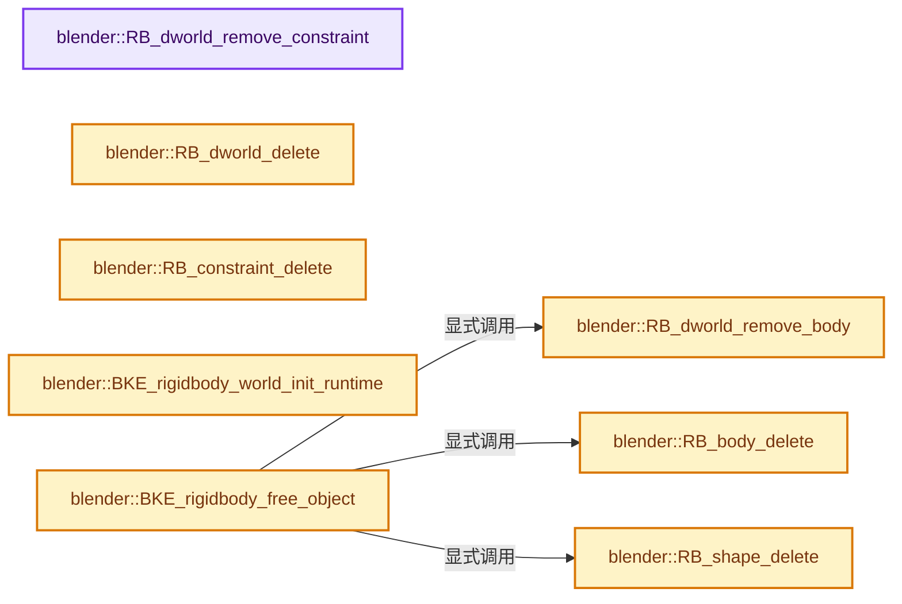
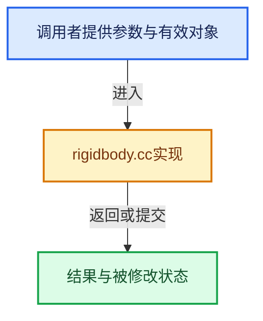

# 实现依赖专题：source/blender/blenkernel/intern/rigidbody.cc

[实现依赖导航](../../README.md) · [符号索引](../../../00-课程指南/02-源码与提交索引/符号依赖与实现索引.md)

本专题从正文实际调用进入，集中保存共享实现。函数有稳定锚点，可从调用处直接跳到对应完整函数；递归与互相调用通过回链组织。

## 本文件的实现关系






## 完整成员与函数实现

<a id="f-3bb283ddc6eac8b0"></a>

### `blender::RB_dworld_remove_constraint`

实现位置：[source/blender/blenkernel/intern/rigidbody.cc](../../../../../../../source/blender/blenkernel/intern/rigidbody.cc) · L78—L78。

接口参数：

- `void *`
- `void *`

**教学注释版**

<!-- annotated:86f4a1e281b9c7 -->

```cpp
static void RB_dworld_remove_constraint(void * /*world*/, void * /*con*/) {}
```

<details>
<summary>核对原始源码：source/blender/blenkernel/intern/rigidbody.cc · L78—L78</summary>

<!-- original:86f4a1e281b9c7:source/blender/blenkernel/intern/rigidbody.cc:78:78 -->

```cpp
static void RB_dworld_remove_constraint(void * /*world*/, void * /*con*/) {}
```

</details>

**继续追踪实现**

本实现没有需要继续展开的显式调用；检查返回表达式、对象转换和调用者前置条件。

<a id="f-b001632702b2664a"></a>

### `blender::RB_dworld_remove_body`

实现位置：[source/blender/blenkernel/intern/rigidbody.cc](../../../../../../../source/blender/blenkernel/intern/rigidbody.cc) · L79—L79。

接口参数：

- `void *`
- `void *`

**教学注释版**

<!-- annotated:c5feececc92e37 -->

```cpp
static void RB_dworld_remove_body(void * /*world*/, void * /*body*/) {}
```

<details>
<summary>核对原始源码：source/blender/blenkernel/intern/rigidbody.cc · L79—L79</summary>

<!-- original:c5feececc92e37:source/blender/blenkernel/intern/rigidbody.cc:79:79 -->

```cpp
static void RB_dworld_remove_body(void * /*world*/, void * /*body*/) {}
```

</details>

**继续追踪实现**

本实现没有需要继续展开的显式调用；检查返回表达式、对象转换和调用者前置条件。

<a id="f-7c728cae0617309a"></a>

### `blender::RB_dworld_delete`

实现位置：[source/blender/blenkernel/intern/rigidbody.cc](../../../../../../../source/blender/blenkernel/intern/rigidbody.cc) · L80—L80。

接口参数：

- `void *`

**教学注释版**

<!-- annotated:ac7f92f2395163 -->

```cpp
static void RB_dworld_delete(void * /*world*/) {}
```

<details>
<summary>核对原始源码：source/blender/blenkernel/intern/rigidbody.cc · L80—L80</summary>

<!-- original:ac7f92f2395163:source/blender/blenkernel/intern/rigidbody.cc:80:80 -->

```cpp
static void RB_dworld_delete(void * /*world*/) {}
```

</details>

**继续追踪实现**

本实现没有需要继续展开的显式调用；检查返回表达式、对象转换和调用者前置条件。

<a id="f-b6519e6b3c6ad0ba"></a>

### `blender::RB_body_delete`

实现位置：[source/blender/blenkernel/intern/rigidbody.cc](../../../../../../../source/blender/blenkernel/intern/rigidbody.cc) · L81—L81。

接口参数：

- `void *`

**教学注释版**

<!-- annotated:4786620571717c -->

```cpp
static void RB_body_delete(void * /*body*/) {}
```

<details>
<summary>核对原始源码：source/blender/blenkernel/intern/rigidbody.cc · L81—L81</summary>

<!-- original:4786620571717c:source/blender/blenkernel/intern/rigidbody.cc:81:81 -->

```cpp
static void RB_body_delete(void * /*body*/) {}
```

</details>

**继续追踪实现**

本实现没有需要继续展开的显式调用；检查返回表达式、对象转换和调用者前置条件。

<a id="f-214ac7b021215459"></a>

### `blender::RB_shape_delete`

实现位置：[source/blender/blenkernel/intern/rigidbody.cc](../../../../../../../source/blender/blenkernel/intern/rigidbody.cc) · L82—L82。

接口参数：

- `void *`

**教学注释版**

<!-- annotated:b98b625b38d014 -->

```cpp
static void RB_shape_delete(void * /*shape*/) {}
```

<details>
<summary>核对原始源码：source/blender/blenkernel/intern/rigidbody.cc · L82—L82</summary>

<!-- original:b98b625b38d014:source/blender/blenkernel/intern/rigidbody.cc:82:82 -->

```cpp
static void RB_shape_delete(void * /*shape*/) {}
```

</details>

**继续追踪实现**

本实现没有需要继续展开的显式调用；检查返回表达式、对象转换和调用者前置条件。

<a id="f-44cf5cae77e451a1"></a>

### `blender::RB_constraint_delete`

实现位置：[source/blender/blenkernel/intern/rigidbody.cc](../../../../../../../source/blender/blenkernel/intern/rigidbody.cc) · L83—L83。

接口参数：

- `void *`

**教学注释版**

<!-- annotated:13b80c23be15b8 -->

```cpp
static void RB_constraint_delete(void * /*con*/) {}
```

<details>
<summary>核对原始源码：source/blender/blenkernel/intern/rigidbody.cc · L83—L83</summary>

<!-- original:13b80c23be15b8:source/blender/blenkernel/intern/rigidbody.cc:83:83 -->

```cpp
static void RB_constraint_delete(void * /*con*/) {}
```

</details>

**继续追踪实现**

本实现没有需要继续展开的显式调用；检查返回表达式、对象转换和调用者前置条件。

<a id="f-0189749b09bf048a"></a>

### `blender::BKE_rigidbody_world_init_runtime`

实现位置：[source/blender/blenkernel/intern/rigidbody.cc](../../../../../../../source/blender/blenkernel/intern/rigidbody.cc) · L98—L103。

接口参数：

- `RigidBodyWorld *rbw`

**教学注释版**

<!-- annotated:3ca7333b2f2b9f -->

```cpp
void BKE_rigidbody_world_init_runtime(RigidBodyWorld *rbw)
{
  if (rbw->shared) {
    rbw->shared->runtime = MEM_new<RigidBodyWorld_Runtime>(__func__);
  }
}
```

<details>
<summary>核对原始源码：source/blender/blenkernel/intern/rigidbody.cc · L98—L103</summary>

<!-- original:3ca7333b2f2b9f:source/blender/blenkernel/intern/rigidbody.cc:98:103 -->

```cpp
void BKE_rigidbody_world_init_runtime(RigidBodyWorld *rbw)
{
  if (rbw->shared) {
    rbw->shared->runtime = MEM_new<RigidBodyWorld_Runtime>(__func__);
  }
}
```

</details>

**沿实际写入检查状态**

- `rbw->shared->runtime = MEM_new<RigidBodyWorld_Runtime>(__func__);`

**继续追踪实现**

- `MEM_new<RigidBodyWorld_Runtime>` → [MEM_new · L351](../../07-Intern运行时与平台/guardedalloc/MEM_guardedalloc.h.md#f-115f9b6784f89912)。

<a id="f-ab0dfb10b37837cd"></a>

### `blender::BKE_rigidbody_free_object`

实现位置：[source/blender/blenkernel/intern/rigidbody.cc](../../../../../../../source/blender/blenkernel/intern/rigidbody.cc) · L166—L215。

接口参数：

- `Object *ob`
- `RigidBodyWorld *rbw`

**教学注释版**

<!-- annotated:6732219a077336 -->

```cpp
void BKE_rigidbody_free_object(Object *ob, RigidBodyWorld *rbw)
{
  bool is_orig = (ob->id.tag & ID_TAG_COPIED_ON_EVAL) == 0;
  RigidBodyOb *rbo = ob->rigidbody_object;

  /* sanity check */
  if (rbo == nullptr) {
    return;
  }

  /* free physics references */
  if (is_orig) {
    if (rbo->shared->physics_object) {
      if (rbw != nullptr && rbw->shared->runtime->physics_world != nullptr) {
        /* We can only remove the body from the world if the world is known.
         * The world is generally only unknown if it's an evaluated copy of
         * an object that's being freed, in which case this code isn't run anyway. */
        RB_dworld_remove_body(rbw->shared->runtime->physics_world,
                              static_cast<rbRigidBody *>(rbo->shared->physics_object));
      }
      else {
        /* We have no access to 'owner' RBW when deleting the object ID itself... No choice bu to
         * loop over all scenes then. */
        for (Scene *scene = G_MAIN->scenes.first(); scene != nullptr;
             scene = static_cast<Scene *>(scene->id.next))
        {
          RigidBodyWorld *scene_rbw = scene->rigidbody_world;
          if (scene_rbw != nullptr && scene_rbw->shared->runtime->physics_world != nullptr) {
            RB_dworld_remove_body(scene_rbw->shared->runtime->physics_world,
                                  static_cast<rbRigidBody *>(rbo->shared->physics_object));
          }
        }
      }

      RB_body_delete(static_cast<rbRigidBody *>(rbo->shared->physics_object));
      rbo->shared->physics_object = nullptr;
    }

    if (rbo->shared->physics_shape) {
      RB_shape_delete(static_cast<rbCollisionShape *>(rbo->shared->physics_shape));
      rbo->shared->physics_shape = nullptr;
    }

    MEM_delete(rbo->shared);
  }

  /* free data itself */
  MEM_delete(rbo);
  ob->rigidbody_object = nullptr;
}
```

<details>
<summary>核对原始源码：source/blender/blenkernel/intern/rigidbody.cc · L166—L215</summary>

<!-- original:6732219a077336:source/blender/blenkernel/intern/rigidbody.cc:166:215 -->

```cpp
void BKE_rigidbody_free_object(Object *ob, RigidBodyWorld *rbw)
{
  bool is_orig = (ob->id.tag & ID_TAG_COPIED_ON_EVAL) == 0;
  RigidBodyOb *rbo = ob->rigidbody_object;

  /* sanity check */
  if (rbo == nullptr) {
    return;
  }

  /* free physics references */
  if (is_orig) {
    if (rbo->shared->physics_object) {
      if (rbw != nullptr && rbw->shared->runtime->physics_world != nullptr) {
        /* We can only remove the body from the world if the world is known.
         * The world is generally only unknown if it's an evaluated copy of
         * an object that's being freed, in which case this code isn't run anyway. */
        RB_dworld_remove_body(rbw->shared->runtime->physics_world,
                              static_cast<rbRigidBody *>(rbo->shared->physics_object));
      }
      else {
        /* We have no access to 'owner' RBW when deleting the object ID itself... No choice bu to
         * loop over all scenes then. */
        for (Scene *scene = G_MAIN->scenes.first(); scene != nullptr;
             scene = static_cast<Scene *>(scene->id.next))
        {
          RigidBodyWorld *scene_rbw = scene->rigidbody_world;
          if (scene_rbw != nullptr && scene_rbw->shared->runtime->physics_world != nullptr) {
            RB_dworld_remove_body(scene_rbw->shared->runtime->physics_world,
                                  static_cast<rbRigidBody *>(rbo->shared->physics_object));
          }
        }
      }

      RB_body_delete(static_cast<rbRigidBody *>(rbo->shared->physics_object));
      rbo->shared->physics_object = nullptr;
    }

    if (rbo->shared->physics_shape) {
      RB_shape_delete(static_cast<rbCollisionShape *>(rbo->shared->physics_shape));
      rbo->shared->physics_shape = nullptr;
    }

    MEM_delete(rbo->shared);
  }

  /* free data itself */
  MEM_delete(rbo);
  ob->rigidbody_object = nullptr;
}
```

</details>

**沿实际写入检查状态**

- `scene = static_cast<Scene *>(scene->id.next))`
- `rbo->shared->physics_object = nullptr;`
- `rbo->shared->physics_shape = nullptr;`
- `ob->rigidbody_object = nullptr;`

**继续追踪实现**

- `RB_dworld_remove_body` → [blender::RB_dworld_remove_body · L79](rigidbody.cc.md#f-b001632702b2664a)。
- `G_MAIN->scenes.first` → [调用协议](../../../00-课程指南/01-路线与规范/模板宏与动态分派协议.md)：接收对象类型依赖auto、返回值或模板实例；不按同名猜测目标。调用位置L189。
- `RB_body_delete` → [blender::RB_body_delete · L81](rigidbody.cc.md#f-b6519e6b3c6ad0ba)。
- `RB_shape_delete` → [blender::RB_shape_delete · L82](rigidbody.cc.md#f-214ac7b021215459)。
- `MEM_delete` → [MEM_delete · L400](../../07-Intern运行时与平台/guardedalloc/MEM_guardedalloc.h.md#f-9049ffdd1682887c)。

<a id="f-7569a34092e80862"></a>

### `blender::BKE_rigidbody_free_constraint`

实现位置：[source/blender/blenkernel/intern/rigidbody.cc](../../../../../../../source/blender/blenkernel/intern/rigidbody.cc) · L217—L235。

接口参数：

- `Object *ob`

**教学注释版**

<!-- annotated:9eba1af171cbb5 -->

```cpp
void BKE_rigidbody_free_constraint(Object *ob)
{
  RigidBodyCon *rbc = (ob) ? ob->rigidbody_constraint : nullptr;

  /* sanity check */
  if (rbc == nullptr) {
    return;
  }

  /* free physics reference */
  if (rbc->physics_constraint) {
    RB_constraint_delete(static_cast<rbConstraint *>(rbc->physics_constraint));
    rbc->physics_constraint = nullptr;
  }

  /* free data itself */
  MEM_delete(rbc);
  ob->rigidbody_constraint = nullptr;
}
```

<details>
<summary>核对原始源码：source/blender/blenkernel/intern/rigidbody.cc · L217—L235</summary>

<!-- original:9eba1af171cbb5:source/blender/blenkernel/intern/rigidbody.cc:217:235 -->

```cpp
void BKE_rigidbody_free_constraint(Object *ob)
{
  RigidBodyCon *rbc = (ob) ? ob->rigidbody_constraint : nullptr;

  /* sanity check */
  if (rbc == nullptr) {
    return;
  }

  /* free physics reference */
  if (rbc->physics_constraint) {
    RB_constraint_delete(static_cast<rbConstraint *>(rbc->physics_constraint));
    rbc->physics_constraint = nullptr;
  }

  /* free data itself */
  MEM_delete(rbc);
  ob->rigidbody_constraint = nullptr;
}
```

</details>

**沿实际写入检查状态**

- `rbc->physics_constraint = nullptr;`
- `ob->rigidbody_constraint = nullptr;`

**继续追踪实现**

- `RB_constraint_delete` → [blender::RB_constraint_delete · L83](rigidbody.cc.md#f-44cf5cae77e451a1)。
- `MEM_delete` → [MEM_delete · L400](../../07-Intern运行时与平台/guardedalloc/MEM_guardedalloc.h.md#f-9049ffdd1682887c)。

<a id="f-20a9a47b952a2bb1"></a>

### `blender::BKE_rigidbody_is_affected_by_simulation`

实现位置：[source/blender/blenkernel/intern/rigidbody.cc](../../../../../../../source/blender/blenkernel/intern/rigidbody.cc) · L237—L253。

接口参数：

- `Object *ob`

**教学注释版**

<!-- annotated:33489074f9e176 -->

```cpp
bool BKE_rigidbody_is_affected_by_simulation(Object *ob)
{
  /* Check if the object will have its transform changed by the rigidbody simulation. */

  /* True if the shape of this object's parent is of type compound */
  bool obCompoundParent = (ob->parent != nullptr && ob->parent->rigidbody_object != nullptr &&
                           ob->parent->rigidbody_object->shape == RB_SHAPE_COMPOUND);

  RigidBodyOb *rbo = ob->rigidbody_object;
  if (rbo == nullptr || rbo->flag & RBO_FLAG_KINEMATIC || rbo->type == RBO_TYPE_PASSIVE ||
      obCompoundParent)
  {
    return false;
  }

  return true;
}
```

<details>
<summary>核对原始源码：source/blender/blenkernel/intern/rigidbody.cc · L237—L253</summary>

<!-- original:33489074f9e176:source/blender/blenkernel/intern/rigidbody.cc:237:253 -->

```cpp
bool BKE_rigidbody_is_affected_by_simulation(Object *ob)
{
  /* Check if the object will have its transform changed by the rigidbody simulation. */

  /* True if the shape of this object's parent is of type compound */
  bool obCompoundParent = (ob->parent != nullptr && ob->parent->rigidbody_object != nullptr &&
                           ob->parent->rigidbody_object->shape == RB_SHAPE_COMPOUND);

  RigidBodyOb *rbo = ob->rigidbody_object;
  if (rbo == nullptr || rbo->flag & RBO_FLAG_KINEMATIC || rbo->type == RBO_TYPE_PASSIVE ||
      obCompoundParent)
  {
    return false;
  }

  return true;
}
```

</details>

**结果出口**

- `return false;`
- `return true;`

**继续追踪实现**

本实现没有需要继续展开的显式调用；检查返回表达式、对象转换和调用者前置条件。

<a id="f-87f5daf4c2dc94ef"></a>

### `blender::rigidbody_get_mesh`

实现位置：[source/blender/blenkernel/intern/rigidbody.cc](../../../../../../../source/blender/blenkernel/intern/rigidbody.cc) · L261—L281。

接口参数：

- `Object *ob`

**教学注释版**

<!-- annotated:303855847e1e4e -->

```cpp
static const Mesh *rigidbody_get_mesh(Object *ob)
{
  BLI_assert(ob->type == OB_MESH);

  switch (ob->rigidbody_object->mesh_source) {
    case RBO_MESH_DEFORM:
      return BKE_object_get_mesh_deform_eval(ob);
    case RBO_MESH_FINAL:
      return BKE_object_get_evaluated_mesh(ob);
    case RBO_MESH_BASE:
      /* This mesh may be used for computing corner_tris, which should be done
       * on the original; otherwise every time the evaluated copy is recreated it will
       * have to be recomputed. */
      BLI_assert(ob->rigidbody_object->mesh_source == RBO_MESH_BASE);
      return (Mesh *)ob->runtime->data_orig;
  }

  /* Just return something sensible so that at least Blender won't crash. */
  BLI_assert_msg(0, "Unknown mesh source");
  return BKE_object_get_evaluated_mesh(ob);
}
```

<details>
<summary>核对原始源码：source/blender/blenkernel/intern/rigidbody.cc · L261—L281</summary>

<!-- original:303855847e1e4e:source/blender/blenkernel/intern/rigidbody.cc:261:281 -->

```cpp
static const Mesh *rigidbody_get_mesh(Object *ob)
{
  BLI_assert(ob->type == OB_MESH);

  switch (ob->rigidbody_object->mesh_source) {
    case RBO_MESH_DEFORM:
      return BKE_object_get_mesh_deform_eval(ob);
    case RBO_MESH_FINAL:
      return BKE_object_get_evaluated_mesh(ob);
    case RBO_MESH_BASE:
      /* This mesh may be used for computing corner_tris, which should be done
       * on the original; otherwise every time the evaluated copy is recreated it will
       * have to be recomputed. */
      BLI_assert(ob->rigidbody_object->mesh_source == RBO_MESH_BASE);
      return (Mesh *)ob->runtime->data_orig;
  }

  /* Just return something sensible so that at least Blender won't crash. */
  BLI_assert_msg(0, "Unknown mesh source");
  return BKE_object_get_evaluated_mesh(ob);
}
```

</details>

**结果出口**

- `return BKE_object_get_mesh_deform_eval(ob);`
- `return BKE_object_get_evaluated_mesh(ob);`
- `return (Mesh *)ob->runtime->data_orig;`

**继续追踪实现**

- `BLI_assert` → [BLI_assert · L48](../../01-BLI基础库/BLI_assert.hh.md#m-57a88495704d)；[BLI_assert · L63](../../01-BLI基础库/BLI_assert.hh.md#m-d07050020cb5)。宏定义由构建条件选择。
- `BKE_object_get_mesh_deform_eval` → [blender::BKE_object_get_mesh_deform_eval · L4519](object.cc.md#f-41fb97d04e1f9583)。
- `BKE_object_get_evaluated_mesh` → [blender::BKE_object_get_evaluated_mesh · L4436](object.cc.md#f-51b5453b29547868)。
- `BLI_assert_msg` → [BLI_assert_msg · L55](../../01-BLI基础库/BLI_assert.hh.md#m-695eed20dceb)；[BLI_assert_msg · L64](../../01-BLI基础库/BLI_assert.hh.md#m-7de5563de4db)。宏定义由构建条件选择。

<a id="f-ce5557a6f4edc3ca"></a>

### `blender::rigidbody_get_shape_convexhull_from_mesh`

实现位置：[source/blender/blenkernel/intern/rigidbody.cc](../../../../../../../source/blender/blenkernel/intern/rigidbody.cc) · L284—L312。

接口参数：

- `Object *ob`
- `float margin`
- `bool *can_embed`

**教学注释版**

<!-- annotated:cb0d89516a4188 -->

```cpp
static rbCollisionShape *rigidbody_get_shape_convexhull_from_mesh(Object *ob,
                                                                  float margin,
                                                                  bool *can_embed)
{
  rbCollisionShape *shape = nullptr;
  const Mesh *mesh = nullptr;
  const float (*positions)[3] = nullptr;
  int totvert = 0;

  if (ob->type == OB_MESH && ob->data) {
    mesh = rigidbody_get_mesh(ob);
    positions = (mesh) ? reinterpret_cast<const float (*)[3]>(mesh->vert_positions().data()) :
                         nullptr;
    totvert = (mesh) ? mesh->verts_num : 0;
  }
  else {
    CLOG_ERROR(&LOG, "cannot make Convex Hull collision shape for non-Mesh object");
  }

  if (totvert) {
    shape = RB_shape_new_convex_hull(
        (float *)positions, sizeof(float[3]), totvert, margin, can_embed);
  }
  else {
    CLOG_ERROR(&LOG, "no vertices to define Convex Hull collision shape with");
  }

  return shape;
}
```

<details>
<summary>核对原始源码：source/blender/blenkernel/intern/rigidbody.cc · L284—L312</summary>

<!-- original:cb0d89516a4188:source/blender/blenkernel/intern/rigidbody.cc:284:312 -->

```cpp
static rbCollisionShape *rigidbody_get_shape_convexhull_from_mesh(Object *ob,
                                                                  float margin,
                                                                  bool *can_embed)
{
  rbCollisionShape *shape = nullptr;
  const Mesh *mesh = nullptr;
  const float (*positions)[3] = nullptr;
  int totvert = 0;

  if (ob->type == OB_MESH && ob->data) {
    mesh = rigidbody_get_mesh(ob);
    positions = (mesh) ? reinterpret_cast<const float (*)[3]>(mesh->vert_positions().data()) :
                         nullptr;
    totvert = (mesh) ? mesh->verts_num : 0;
  }
  else {
    CLOG_ERROR(&LOG, "cannot make Convex Hull collision shape for non-Mesh object");
  }

  if (totvert) {
    shape = RB_shape_new_convex_hull(
        (float *)positions, sizeof(float[3]), totvert, margin, can_embed);
  }
  else {
    CLOG_ERROR(&LOG, "no vertices to define Convex Hull collision shape with");
  }

  return shape;
}
```

</details>

**沿实际写入检查状态**

- `mesh = rigidbody_get_mesh(ob);`
- `positions = (mesh) ? reinterpret_cast<const float (*)[3]>(mesh->vert_positions().data()) :`
- `totvert = (mesh) ? mesh->verts_num : 0;`
- `shape = RB_shape_new_convex_hull(`

**结果出口**

- `return shape;`

**继续追踪实现**

- `rigidbody_get_mesh` → [blender::rigidbody_get_mesh · L261](rigidbody.cc.md#f-87f5daf4c2dc94ef)。
- `mesh->vert_positions().data` → [调用协议](../../../00-课程指南/01-路线与规范/模板宏与动态分派协议.md)：接收对象类型依赖auto、返回值或模板实例；不按同名猜测目标。调用位置L295。
- `mesh->vert_positions` → [Mesh::vert_positions · L1193](../../../05-几何存储与拓扑映射/03-MPoly迁移与兼容.md#f-ae4177e5c5f2b371)。
- `CLOG_ERROR` → [CLOG_ERROR · L188](../../07-Intern运行时与平台/clog/CLG_log.h.md#m-081575cdc8d0)。宏定义由构建条件选择。
- `RB_shape_new_convex_hull` → [RB_shape_new_convex_hull · L710](../../07-Intern运行时与平台/rigidbody/rb_bullet_api.cpp.md#f-a029a3ecacaa908b)。

<a id="f-e2fc7786a9362250"></a>

### `blender::rigidbody_get_shape_trimesh_from_mesh`

实现位置：[source/blender/blenkernel/intern/rigidbody.cc](../../../../../../../source/blender/blenkernel/intern/rigidbody.cc) · L317—L388。

接口参数：

- `Object *ob`

**教学注释版**

<!-- annotated:1990bf717d4814 -->

```cpp
static rbCollisionShape *rigidbody_get_shape_trimesh_from_mesh(Object *ob)
{
  rbCollisionShape *shape = nullptr;

  if (ob->type == OB_MESH) {
    const Mesh *mesh = rigidbody_get_mesh(ob);
    if (mesh == nullptr) {
      return nullptr;
    }

    const Span<float3> positions = mesh->vert_positions();
    const int totvert = mesh->verts_num;
    const Span<int3> corner_tris = mesh->corner_tris();
    // [讲解] corner_tris.size：查询视图长度或生成对应有效索引区间。
    const int tottri = corner_tris.size();
    const Span<int> corner_verts = mesh->corner_verts();

    /* sanity checking - potential case when no data will be present */
    if ((totvert == 0) || (tottri == 0)) {
      CLOG_WARN(
          &LOG, "no geometry data converted for Mesh Collision Shape (ob = %s)", ob->id.name + 2);
    }
    else {
      rbMeshData *mdata;
      int i;

      /* init mesh data for collision shape */
      mdata = RB_trimesh_data_new(tottri, totvert);

      // [讲解] positions.data：返回借用范围的地址。
      RB_trimesh_add_vertices(mdata, (float *)positions.data(), totvert, sizeof(float[3]));

      /* loop over all faces, adding them as triangles to the collision shape
       * (so for some faces, more than triangle will get added)
       */
      if (positions.data()) {
        for (i = 0; i < tottri; i++) {
          /* add first triangle - verts 1,2,3 */
          const int3 &tri = corner_tris[i];
          int vtri[3];

          vtri[0] = corner_verts[tri[0]];
          vtri[1] = corner_verts[tri[1]];
          vtri[2] = corner_verts[tri[2]];

          RB_trimesh_add_triangle_indices(mdata, i, UNPACK3(vtri));
        }
      }

      RB_trimesh_finish(mdata);

      /* construct collision shape
       *
       * These have been chosen to get better speed/accuracy tradeoffs with regards
       * to limitations of each:
       *    - BVH-Triangle Mesh: for passive objects only. Despite having greater
       *                         speed/accuracy, they cannot be used for moving objects.
       *    - GImpact Mesh:      for active objects. These are slower and less stable,
       *                         but are more flexible for general usage.
       */
      if (ob->rigidbody_object->type == RBO_TYPE_PASSIVE) {
        shape = RB_shape_new_trimesh(mdata);
      }
      else {
        shape = RB_shape_new_gimpact_mesh(mdata);
      }
    }
  }
  else {
    CLOG_ERROR(&LOG, "cannot make Triangular Mesh collision shape for non-Mesh object");
  }

  return shape;
}
```

<details>
<summary>核对原始源码：source/blender/blenkernel/intern/rigidbody.cc · L317—L388</summary>

<!-- original:1990bf717d4814:source/blender/blenkernel/intern/rigidbody.cc:317:388 -->

```cpp
static rbCollisionShape *rigidbody_get_shape_trimesh_from_mesh(Object *ob)
{
  rbCollisionShape *shape = nullptr;

  if (ob->type == OB_MESH) {
    const Mesh *mesh = rigidbody_get_mesh(ob);
    if (mesh == nullptr) {
      return nullptr;
    }

    const Span<float3> positions = mesh->vert_positions();
    const int totvert = mesh->verts_num;
    const Span<int3> corner_tris = mesh->corner_tris();
    const int tottri = corner_tris.size();
    const Span<int> corner_verts = mesh->corner_verts();

    /* sanity checking - potential case when no data will be present */
    if ((totvert == 0) || (tottri == 0)) {
      CLOG_WARN(
          &LOG, "no geometry data converted for Mesh Collision Shape (ob = %s)", ob->id.name + 2);
    }
    else {
      rbMeshData *mdata;
      int i;

      /* init mesh data for collision shape */
      mdata = RB_trimesh_data_new(tottri, totvert);

      RB_trimesh_add_vertices(mdata, (float *)positions.data(), totvert, sizeof(float[3]));

      /* loop over all faces, adding them as triangles to the collision shape
       * (so for some faces, more than triangle will get added)
       */
      if (positions.data()) {
        for (i = 0; i < tottri; i++) {
          /* add first triangle - verts 1,2,3 */
          const int3 &tri = corner_tris[i];
          int vtri[3];

          vtri[0] = corner_verts[tri[0]];
          vtri[1] = corner_verts[tri[1]];
          vtri[2] = corner_verts[tri[2]];

          RB_trimesh_add_triangle_indices(mdata, i, UNPACK3(vtri));
        }
      }

      RB_trimesh_finish(mdata);

      /* construct collision shape
       *
       * These have been chosen to get better speed/accuracy tradeoffs with regards
       * to limitations of each:
       *    - BVH-Triangle Mesh: for passive objects only. Despite having greater
       *                         speed/accuracy, they cannot be used for moving objects.
       *    - GImpact Mesh:      for active objects. These are slower and less stable,
       *                         but are more flexible for general usage.
       */
      if (ob->rigidbody_object->type == RBO_TYPE_PASSIVE) {
        shape = RB_shape_new_trimesh(mdata);
      }
      else {
        shape = RB_shape_new_gimpact_mesh(mdata);
      }
    }
  }
  else {
    CLOG_ERROR(&LOG, "cannot make Triangular Mesh collision shape for non-Mesh object");
  }

  return shape;
}
```

</details>

**沿实际写入检查状态**

- `mdata = RB_trimesh_data_new(tottri, totvert);`
- `vtri[0] = corner_verts[tri[0]];`
- `vtri[1] = corner_verts[tri[1]];`
- `vtri[2] = corner_verts[tri[2]];`
- `shape = RB_shape_new_trimesh(mdata);`
- `shape = RB_shape_new_gimpact_mesh(mdata);`

**结果出口**

- `return nullptr;`
- `return shape;`

**继续追踪实现**

- `rigidbody_get_mesh` → [blender::rigidbody_get_mesh · L261](rigidbody.cc.md#f-87f5daf4c2dc94ef)。
- `mesh->vert_positions` → [Mesh::vert_positions · L1193](../../../05-几何存储与拓扑映射/03-MPoly迁移与兼容.md#f-ae4177e5c5f2b371)。
- `mesh->corner_tris` → [blender::Mesh::corner_tris · L264](../../../06-隐式共享与缓存系统/10-局部更新与失效修复.md#f-9bb421790000fc20)。
- `corner_tris.size` → [blender::Span::size · L256](../../../01-基础容器与现代CPP/05-Span只读连续视图.md#f-5f80fa006089c998)。
- `mesh->corner_verts` → [Mesh::corner_verts · L1238](../../../05-几何存储与拓扑映射/03-MPoly迁移与兼容.md#f-a59c61f583b64bc4)。
- `CLOG_WARN` → [CLOG_WARN · L189](../../07-Intern运行时与平台/clog/CLG_log.h.md#m-9da21a06cdbe)。宏定义由构建条件选择。
- `RB_trimesh_data_new` → [RB_trimesh_data_new · L737](../../07-Intern运行时与平台/rigidbody/rb_bullet_api.cpp.md#f-285639986bbaf259)。
- `RB_trimesh_add_vertices` → [RB_trimesh_add_vertices · L756](../../07-Intern运行时与平台/rigidbody/rb_bullet_api.cpp.md#f-da3d8ba1ca990c7b)。
- `positions.data` → [blender::Span::data · L219](../../../01-基础容器与现代CPP/05-Span只读连续视图.md#f-10c5889198935800)。
- `RB_trimesh_add_triangle_indices` → [RB_trimesh_add_triangle_indices · L765](../../07-Intern运行时与平台/rigidbody/rb_bullet_api.cpp.md#f-55e7963ac578f768)。
- `UNPACK3` → [UNPACK3 · L23](../../07-Intern运行时与平台/ghost/intern/GHOST_utildefines.hh.md#m-f882324eb80a)；[UNPACK3 · L235](../../01-BLI基础库/BLI_utildefines.hh.md#m-bbbbdcf09d3b)；[UNPACK3 · L14](../../08-其他Blender模块/gpu/shaders/common/gpu_shader_utildefines.bsl.hh.md#m-b4e3357a0310)。宏定义由构建条件选择。
- `RB_trimesh_finish` → [RB_trimesh_finish · L772](../../07-Intern运行时与平台/rigidbody/rb_bullet_api.cpp.md#f-e375ecef8cdcb887)。
- `RB_shape_new_trimesh` → [RB_shape_new_trimesh · L782](../../07-Intern运行时与平台/rigidbody/rb_bullet_api.cpp.md#f-3707ebb08a7f87eb)。
- `RB_shape_new_gimpact_mesh` → [RB_shape_new_gimpact_mesh · L827](../../07-Intern运行时与平台/rigidbody/rb_bullet_api.cpp.md#f-21e936918babb162)。
- `CLOG_ERROR` → [CLOG_ERROR · L188](../../07-Intern运行时与平台/clog/CLG_log.h.md#m-081575cdc8d0)。宏定义由构建条件选择。

<a id="f-6e2e1b7cac3f558e"></a>

### `blender::rigidbody_validate_sim_shape_helper`

实现位置：[source/blender/blenkernel/intern/rigidbody.cc](../../../../../../../source/blender/blenkernel/intern/rigidbody.cc) · L393—L499。

接口参数：

- `RigidBodyWorld *rbw`
- `Object *ob`

**教学注释版**

<!-- annotated:93a18369ce67e3 -->

```cpp
static rbCollisionShape *rigidbody_validate_sim_shape_helper(RigidBodyWorld *rbw, Object *ob)
{
  RigidBodyOb *rbo = ob->rigidbody_object;
  rbCollisionShape *new_shape = nullptr;
  float size[3] = {1.0f, 1.0f, 1.0f};
  float radius = 1.0f;
  float height = 1.0f;
  float capsule_height;
  float hull_margin = 0.0f;
  bool can_embed = true;
  bool has_volume;

  /* sanity check */
  if (rbo == nullptr) {
    return nullptr;
  }

  /* if automatically determining dimensions, use the Object's boundbox
   * - assume that all quadrics are standing upright on local z-axis
   * - assume even distribution of mass around the Object's pivot
   *   (i.e. Object pivot is centralized in boundbox)
   */
  /* XXX: all dimensions are auto-determined now... later can add stored settings for this */
  /* get object dimensions without scaling */
  if (const std::optional<Bounds<float3>> bounds = BKE_object_boundbox_get(ob)) {
    copy_v3_v3(size, bounds->max - bounds->min);
  }
  mul_v3_fl(size, 0.5f);

  if (ELEM(rbo->shape, RB_SHAPE_CAPSULE, RB_SHAPE_CYLINDER, RB_SHAPE_CONE)) {
    /* take radius as largest x/y dimension, and height as z-dimension */
    // [讲解] std::max：按比较关系选取较大值。本讲解中的增长公式同时满足最低请求和几何增长；若保存返回引用，还需注意实参寿命。
    radius = std::max(size[0], size[1]);
    height = size[2];
  }
  else if (rbo->shape == RB_SHAPE_SPHERE) {
    /* take radius to the largest dimension to try and encompass everything */
    radius = std::max({size[0], size[1], size[2]});
  }

  /* create new shape */
  switch (rbo->shape) {
    case RB_SHAPE_BOX:
      new_shape = RB_shape_new_box(size[0], size[1], size[2]);
      break;

    case RB_SHAPE_SPHERE:
      new_shape = RB_shape_new_sphere(radius);
      break;

    case RB_SHAPE_CAPSULE:
      capsule_height = (height - radius) * 2.0f;
      new_shape = RB_shape_new_capsule(radius, (capsule_height > 0.0f) ? capsule_height : 0.0f);
      break;
    case RB_SHAPE_CYLINDER:
      new_shape = RB_shape_new_cylinder(radius, height);
      break;
    case RB_SHAPE_CONE:
      new_shape = RB_shape_new_cone(radius, height * 2.0f);
      break;

    case RB_SHAPE_CONVEXH:
      /* try to embed collision margin */
      // [讲解] std::min：按比较关系选取较小值；截断范围时还需先满足非负和可表示范围，min本身不会证明边界安全。
      has_volume = (std::min({size[0], size[1], size[2]}) > 0.0f);

      if (!(rbo->flag & RBO_FLAG_USE_MARGIN) && has_volume) {
        hull_margin = 0.04f;
      }
      new_shape = rigidbody_get_shape_convexhull_from_mesh(ob, hull_margin, &can_embed);
      if (!(rbo->flag & RBO_FLAG_USE_MARGIN)) {
        rbo->margin = (can_embed && has_volume) ?
                          0.04f :
                          0.0f; /* RB_TODO ideally we shouldn't directly change the margin here */
      }
      break;
    case RB_SHAPE_TRIMESH:
      new_shape = rigidbody_get_shape_trimesh_from_mesh(ob);
      break;
    case RB_SHAPE_COMPOUND:
      new_shape = RB_shape_new_compound();
      rbCollisionShape *childShape = nullptr;
      float loc[3], rot[4];
      float mat[4][4];
      /* Add children to the compound shape */
      FOREACH_COLLECTION_OBJECT_RECURSIVE_BEGIN (rbw->group, childObject) {
        if (childObject->parent == ob) {
          childShape = rigidbody_validate_sim_shape_helper(rbw, childObject);
          if (childShape) {
            BKE_object_matrix_local_get(childObject, mat);
            mat4_to_loc_quat(loc, rot, mat);
            RB_compound_add_child_shape(new_shape, childShape, loc, rot);
          }
        }
      }
      FOREACH_COLLECTION_OBJECT_RECURSIVE_END;

      break;
  }
  /* use box shape if it failed to create new shape */
  if (new_shape == nullptr) {
    new_shape = RB_shape_new_box(size[0], size[1], size[2]);
  }
  if (new_shape) {
    RB_shape_set_margin(new_shape, RBO_GET_MARGIN(rbo));
  }

  return new_shape;
}
```

<details>
<summary>核对原始源码：source/blender/blenkernel/intern/rigidbody.cc · L393—L499</summary>

<!-- original:93a18369ce67e3:source/blender/blenkernel/intern/rigidbody.cc:393:499 -->

```cpp
static rbCollisionShape *rigidbody_validate_sim_shape_helper(RigidBodyWorld *rbw, Object *ob)
{
  RigidBodyOb *rbo = ob->rigidbody_object;
  rbCollisionShape *new_shape = nullptr;
  float size[3] = {1.0f, 1.0f, 1.0f};
  float radius = 1.0f;
  float height = 1.0f;
  float capsule_height;
  float hull_margin = 0.0f;
  bool can_embed = true;
  bool has_volume;

  /* sanity check */
  if (rbo == nullptr) {
    return nullptr;
  }

  /* if automatically determining dimensions, use the Object's boundbox
   * - assume that all quadrics are standing upright on local z-axis
   * - assume even distribution of mass around the Object's pivot
   *   (i.e. Object pivot is centralized in boundbox)
   */
  /* XXX: all dimensions are auto-determined now... later can add stored settings for this */
  /* get object dimensions without scaling */
  if (const std::optional<Bounds<float3>> bounds = BKE_object_boundbox_get(ob)) {
    copy_v3_v3(size, bounds->max - bounds->min);
  }
  mul_v3_fl(size, 0.5f);

  if (ELEM(rbo->shape, RB_SHAPE_CAPSULE, RB_SHAPE_CYLINDER, RB_SHAPE_CONE)) {
    /* take radius as largest x/y dimension, and height as z-dimension */
    radius = std::max(size[0], size[1]);
    height = size[2];
  }
  else if (rbo->shape == RB_SHAPE_SPHERE) {
    /* take radius to the largest dimension to try and encompass everything */
    radius = std::max({size[0], size[1], size[2]});
  }

  /* create new shape */
  switch (rbo->shape) {
    case RB_SHAPE_BOX:
      new_shape = RB_shape_new_box(size[0], size[1], size[2]);
      break;

    case RB_SHAPE_SPHERE:
      new_shape = RB_shape_new_sphere(radius);
      break;

    case RB_SHAPE_CAPSULE:
      capsule_height = (height - radius) * 2.0f;
      new_shape = RB_shape_new_capsule(radius, (capsule_height > 0.0f) ? capsule_height : 0.0f);
      break;
    case RB_SHAPE_CYLINDER:
      new_shape = RB_shape_new_cylinder(radius, height);
      break;
    case RB_SHAPE_CONE:
      new_shape = RB_shape_new_cone(radius, height * 2.0f);
      break;

    case RB_SHAPE_CONVEXH:
      /* try to embed collision margin */
      has_volume = (std::min({size[0], size[1], size[2]}) > 0.0f);

      if (!(rbo->flag & RBO_FLAG_USE_MARGIN) && has_volume) {
        hull_margin = 0.04f;
      }
      new_shape = rigidbody_get_shape_convexhull_from_mesh(ob, hull_margin, &can_embed);
      if (!(rbo->flag & RBO_FLAG_USE_MARGIN)) {
        rbo->margin = (can_embed && has_volume) ?
                          0.04f :
                          0.0f; /* RB_TODO ideally we shouldn't directly change the margin here */
      }
      break;
    case RB_SHAPE_TRIMESH:
      new_shape = rigidbody_get_shape_trimesh_from_mesh(ob);
      break;
    case RB_SHAPE_COMPOUND:
      new_shape = RB_shape_new_compound();
      rbCollisionShape *childShape = nullptr;
      float loc[3], rot[4];
      float mat[4][4];
      /* Add children to the compound shape */
      FOREACH_COLLECTION_OBJECT_RECURSIVE_BEGIN (rbw->group, childObject) {
        if (childObject->parent == ob) {
          childShape = rigidbody_validate_sim_shape_helper(rbw, childObject);
          if (childShape) {
            BKE_object_matrix_local_get(childObject, mat);
            mat4_to_loc_quat(loc, rot, mat);
            RB_compound_add_child_shape(new_shape, childShape, loc, rot);
          }
        }
      }
      FOREACH_COLLECTION_OBJECT_RECURSIVE_END;

      break;
  }
  /* use box shape if it failed to create new shape */
  if (new_shape == nullptr) {
    new_shape = RB_shape_new_box(size[0], size[1], size[2]);
  }
  if (new_shape) {
    RB_shape_set_margin(new_shape, RBO_GET_MARGIN(rbo));
  }

  return new_shape;
}
```

</details>

**沿实际写入检查状态**

- `radius = std::max(size[0], size[1]);`
- `height = size[2];`
- `radius = std::max({size[0], size[1], size[2]});`
- `new_shape = RB_shape_new_box(size[0], size[1], size[2]);`
- `new_shape = RB_shape_new_sphere(radius);`
- `capsule_height = (height - radius) * 2.0f;`
- `new_shape = RB_shape_new_capsule(radius, (capsule_height > 0.0f) ? capsule_height : 0.0f);`
- `new_shape = RB_shape_new_cylinder(radius, height);`
- `new_shape = RB_shape_new_cone(radius, height * 2.0f);`
- `has_volume = (std::min({size[0], size[1], size[2]}) > 0.0f);`
- `hull_margin = 0.04f;`
- `new_shape = rigidbody_get_shape_convexhull_from_mesh(ob, hull_margin, &can_embed);`
- `rbo->margin = (can_embed && has_volume) ?`
- `new_shape = rigidbody_get_shape_trimesh_from_mesh(ob);`
- `new_shape = RB_shape_new_compound();`
- `childShape = rigidbody_validate_sim_shape_helper(rbw, childObject);`

**结果出口**

- `return nullptr;`
- `return new_shape;`

**继续追踪实现**

- `BKE_object_boundbox_get` → [blender::BKE_object_boundbox_get · L3726](object.cc.md#f-481d74b53ca88ae2)。
- `copy_v3_v3` → [blender::copy_v3_v3 · L47](../../01-BLI基础库/intern/math_vector_inline.cc.md#f-037a0d5fa5060bd6)。
- `mul_v3_fl` → [blender::mul_v3_fl · L414](../../01-BLI基础库/intern/math_vector_inline.cc.md#f-00165156a06d1224)。
- `ELEM` → [ELEM · L88](../../07-Intern运行时与平台/ghost/intern/GHOST_utildefines.hh.md#m-d28724a15928)；[ELEM · L135](../../01-BLI基础库/BLI_utildefines.hh.md#m-d6572de7cae0)。宏定义由构建条件选择。
- `std::max` → [外部契约](https://eel.is/c++draft/alg.min.max)：按比较关系选取较大值。本讲解中的增长公式同时满足最低请求和几何增长；若保存返回引用，还需注意实参寿命。
- `RB_shape_new_box` → [RB_shape_new_box · L658](../../07-Intern运行时与平台/rigidbody/rb_bullet_api.cpp.md#f-a3b317f27b8590d8)。
- `RB_shape_new_sphere` → [RB_shape_new_sphere · L668](../../07-Intern运行时与平台/rigidbody/rb_bullet_api.cpp.md#f-c3f8b504f9fd15a0)。
- `RB_shape_new_capsule` → [RB_shape_new_capsule · L678](../../07-Intern运行时与平台/rigidbody/rb_bullet_api.cpp.md#f-313e121aac4daca1)。
- `RB_shape_new_cylinder` → [RB_shape_new_cylinder · L698](../../07-Intern运行时与平台/rigidbody/rb_bullet_api.cpp.md#f-cb0fb1331d4a215c)。
- `RB_shape_new_cone` → [RB_shape_new_cone · L688](../../07-Intern运行时与平台/rigidbody/rb_bullet_api.cpp.md#f-584d20a2a3247165)。
- `std::min` → [外部契约](https://eel.is/c++draft/alg.min.max)：按比较关系选取较小值；截断范围时还需先满足非负和可表示范围，min本身不会证明边界安全。
- `rigidbody_get_shape_convexhull_from_mesh` → [blender::rigidbody_get_shape_convexhull_from_mesh · L284](rigidbody.cc.md#f-ce5557a6f4edc3ca)。
- `rigidbody_get_shape_trimesh_from_mesh` → [blender::rigidbody_get_shape_trimesh_from_mesh · L317](rigidbody.cc.md#f-e2fc7786a9362250)。
- `RB_shape_new_compound` → [RB_shape_new_compound · L843](../../07-Intern运行时与平台/rigidbody/rb_bullet_api.cpp.md#f-0cbe554b0e363199)。
- `FOREACH_COLLECTION_OBJECT_RECURSIVE_BEGIN` → [FOREACH_COLLECTION_OBJECT_RECURSIVE_BEGIN · L485](../BKE_collection.hh.md#m-056dd72ee5fb)。宏定义由构建条件选择。
- `rigidbody_validate_sim_shape_helper` → [blender::rigidbody_validate_sim_shape_helper · L393](rigidbody.cc.md#f-6e2e1b7cac3f558e)。
- `BKE_object_matrix_local_get` → [blender::BKE_object_matrix_local_get · L3136](object.cc.md#f-ad228ecddb5704b9)。
- `mat4_to_loc_quat` → [blender::mat4_to_loc_quat · L2042](../../01-BLI基础库/intern/math_matrix_c.cc.md#f-5255d0decc61eaee)。
- `RB_compound_add_child_shape` → [RB_compound_add_child_shape · L855](../../07-Intern运行时与平台/rigidbody/rb_bullet_api.cpp.md#f-7dc6acb629fddfd3)。
- `RB_shape_set_margin` → [RB_shape_set_margin · L909](../../07-Intern运行时与平台/rigidbody/rb_bullet_api.cpp.md#f-d2161ad2dc898ab6)。
- `RBO_GET_MARGIN` → [RBO_GET_MARGIN · L191](../BKE_rigidbody.h.md#m-7bfcef0746cd)。宏定义由构建条件选择。

<a id="f-e6087dff1ab7e38f"></a>

### `blender::rigidbody_validate_sim_shape`

实现位置：[source/blender/blenkernel/intern/rigidbody.cc](../../../../../../../source/blender/blenkernel/intern/rigidbody.cc) · L504—L539。

接口参数：

- `RigidBodyWorld *rbw`
- `Object *ob`
- `bool rebuild`

**教学注释版**

<!-- annotated:aefdd276c38ab9 -->

```cpp
static void rigidbody_validate_sim_shape(RigidBodyWorld *rbw, Object *ob, bool rebuild)
{
  RigidBodyOb *rbo = ob->rigidbody_object;
  rbCollisionShape *new_shape = nullptr;

  /* sanity check */
  if (rbo == nullptr) {
    return;
  }

  /* don't create a new shape if we already have one and don't want to rebuild it */
  if (rbo->shared->physics_shape && !rebuild) {
    return;
  }

  /* Also don't create a shape if this object is parent of a compound shape */
  if (ob->parent != nullptr && ob->parent->rigidbody_object != nullptr &&
      ob->parent->rigidbody_object->shape == RB_SHAPE_COMPOUND)
  {
    return;
  }

  new_shape = rigidbody_validate_sim_shape_helper(rbw, ob);

  /* assign new collision shape if creation was successful */
  if (new_shape) {
    if (rbo->shared->physics_shape) {
      RB_shape_delete(static_cast<rbCollisionShape *>(rbo->shared->physics_shape));
    }
    rbo->shared->physics_shape = new_shape;
    if (rbo->shared->physics_object) {
      RB_body_set_collision_shape(static_cast<rbRigidBody *>(rbo->shared->physics_object),
                                  static_cast<rbCollisionShape *>(rbo->shared->physics_shape));
    }
  }
}
```

<details>
<summary>核对原始源码：source/blender/blenkernel/intern/rigidbody.cc · L504—L539</summary>

<!-- original:aefdd276c38ab9:source/blender/blenkernel/intern/rigidbody.cc:504:539 -->

```cpp
static void rigidbody_validate_sim_shape(RigidBodyWorld *rbw, Object *ob, bool rebuild)
{
  RigidBodyOb *rbo = ob->rigidbody_object;
  rbCollisionShape *new_shape = nullptr;

  /* sanity check */
  if (rbo == nullptr) {
    return;
  }

  /* don't create a new shape if we already have one and don't want to rebuild it */
  if (rbo->shared->physics_shape && !rebuild) {
    return;
  }

  /* Also don't create a shape if this object is parent of a compound shape */
  if (ob->parent != nullptr && ob->parent->rigidbody_object != nullptr &&
      ob->parent->rigidbody_object->shape == RB_SHAPE_COMPOUND)
  {
    return;
  }

  new_shape = rigidbody_validate_sim_shape_helper(rbw, ob);

  /* assign new collision shape if creation was successful */
  if (new_shape) {
    if (rbo->shared->physics_shape) {
      RB_shape_delete(static_cast<rbCollisionShape *>(rbo->shared->physics_shape));
    }
    rbo->shared->physics_shape = new_shape;
    if (rbo->shared->physics_object) {
      RB_body_set_collision_shape(static_cast<rbRigidBody *>(rbo->shared->physics_object),
                                  static_cast<rbCollisionShape *>(rbo->shared->physics_shape));
    }
  }
}
```

</details>

**沿实际写入检查状态**

- `new_shape = rigidbody_validate_sim_shape_helper(rbw, ob);`
- `rbo->shared->physics_shape = new_shape;`

**继续追踪实现**

- `rigidbody_validate_sim_shape_helper` → [blender::rigidbody_validate_sim_shape_helper · L393](rigidbody.cc.md#f-6e2e1b7cac3f558e)。
- `RB_shape_delete` → [blender::RB_shape_delete · L82](rigidbody.cc.md#f-214ac7b021215459)。
- `RB_body_set_collision_shape` → [RB_body_set_collision_shape · L361](../../07-Intern运行时与平台/rigidbody/rb_bullet_api.cpp.md#f-87454ac28ab4946b)。

<a id="f-92c72d423dde9fa7"></a>

### `blender::rigidbody_validate_sim_object`

实现位置：[source/blender/blenkernel/intern/rigidbody.cc](../../../../../../../source/blender/blenkernel/intern/rigidbody.cc) · L702—L782。

接口参数：

- `RigidBodyWorld *rbw`
- `Object *ob`
- `bool rebuild`

**教学注释版**

<!-- annotated:598e48256bcb20 -->

```cpp
static void rigidbody_validate_sim_object(RigidBodyWorld *rbw, Object *ob, bool rebuild)
{
  RigidBodyOb *rbo = (ob) ? ob->rigidbody_object : nullptr;
  float loc[3];
  float rot[4];

  /* sanity checks:
   * - object doesn't have RigidBody info already: then why is it here?
   */
  if (rbo == nullptr) {
    return;
  }

  /* make sure collision shape exists */
  /* FIXME we shouldn't always have to rebuild collision shapes when rebuilding objects,
   * but it's needed for constraints to update correctly. */
  if (rbo->shared->physics_shape == nullptr || rebuild) {
    rigidbody_validate_sim_shape(rbw, ob, true);
  }

  if (rbo->shared->physics_object && !rebuild) {
    /* Don't remove body on rebuild as it has already been removed when deleting and rebuilding the
     * world. */
    RB_dworld_remove_body(rbw->shared->runtime->physics_world,
                          static_cast<rbRigidBody *>(rbo->shared->physics_object));
  }
  if (!rbo->shared->physics_object || rebuild) {
    /* remove rigid body if it already exists before creating a new one */
    if (rbo->shared->physics_object) {
      RB_body_delete(static_cast<rbRigidBody *>(rbo->shared->physics_object));
      rbo->shared->physics_object = nullptr;
    }
    /* Don't create rigid body object if the parent is a compound shape */
    if (ob->parent != nullptr && ob->parent->rigidbody_object != nullptr &&
        ob->parent->rigidbody_object->shape == RB_SHAPE_COMPOUND)
    {
      return;
    }

    mat4_to_loc_quat(loc, rot, ob->object_to_world().ptr());

    rbo->shared->physics_object = RB_body_new(
        static_cast<rbCollisionShape *>(rbo->shared->physics_shape), loc, rot);

    RB_body_set_friction(static_cast<rbRigidBody *>(rbo->shared->physics_object), rbo->friction);
    RB_body_set_restitution(static_cast<rbRigidBody *>(rbo->shared->physics_object),
                            rbo->restitution);

    RB_body_set_damping(static_cast<rbRigidBody *>(rbo->shared->physics_object),
                        rbo->lin_damping,
                        rbo->ang_damping);
    RB_body_set_sleep_thresh(static_cast<rbRigidBody *>(rbo->shared->physics_object),
                             rbo->lin_sleep_thresh,
                             rbo->ang_sleep_thresh);
    RB_body_set_activation_state(static_cast<rbRigidBody *>(rbo->shared->physics_object),
                                 rbo->flag & RBO_FLAG_USE_DEACTIVATION);

    if (rbo->type == RBO_TYPE_PASSIVE || rbo->flag & RBO_FLAG_START_DEACTIVATED) {
      RB_body_deactivate(static_cast<rbRigidBody *>(rbo->shared->physics_object));
    }

    RB_body_set_linear_factor(static_cast<rbRigidBody *>(rbo->shared->physics_object),
                              (ob->protectflag & OB_LOCK_LOCX) == 0,
                              (ob->protectflag & OB_LOCK_LOCY) == 0,
                              (ob->protectflag & OB_LOCK_LOCZ) == 0);
    RB_body_set_angular_factor(static_cast<rbRigidBody *>(rbo->shared->physics_object),
                               (ob->protectflag & OB_LOCK_ROTX) == 0,
                               (ob->protectflag & OB_LOCK_ROTY) == 0,
                               (ob->protectflag & OB_LOCK_ROTZ) == 0);

    RB_body_set_mass(static_cast<rbRigidBody *>(rbo->shared->physics_object), RBO_GET_MASS(rbo));
    RB_body_set_kinematic_state(static_cast<rbRigidBody *>(rbo->shared->physics_object),
                                rbo->flag & RBO_FLAG_KINEMATIC || rbo->flag & RBO_FLAG_DISABLED);
  }

  if (rbw && rbw->shared->runtime->physics_world && rbo->shared->physics_object) {
    RB_dworld_add_body(rbw->shared->runtime->physics_world,
                       static_cast<rbRigidBody *>(rbo->shared->physics_object),
                       rbo->col_groups);
  }
}
```

<details>
<summary>核对原始源码：source/blender/blenkernel/intern/rigidbody.cc · L702—L782</summary>

<!-- original:598e48256bcb20:source/blender/blenkernel/intern/rigidbody.cc:702:782 -->

```cpp
static void rigidbody_validate_sim_object(RigidBodyWorld *rbw, Object *ob, bool rebuild)
{
  RigidBodyOb *rbo = (ob) ? ob->rigidbody_object : nullptr;
  float loc[3];
  float rot[4];

  /* sanity checks:
   * - object doesn't have RigidBody info already: then why is it here?
   */
  if (rbo == nullptr) {
    return;
  }

  /* make sure collision shape exists */
  /* FIXME we shouldn't always have to rebuild collision shapes when rebuilding objects,
   * but it's needed for constraints to update correctly. */
  if (rbo->shared->physics_shape == nullptr || rebuild) {
    rigidbody_validate_sim_shape(rbw, ob, true);
  }

  if (rbo->shared->physics_object && !rebuild) {
    /* Don't remove body on rebuild as it has already been removed when deleting and rebuilding the
     * world. */
    RB_dworld_remove_body(rbw->shared->runtime->physics_world,
                          static_cast<rbRigidBody *>(rbo->shared->physics_object));
  }
  if (!rbo->shared->physics_object || rebuild) {
    /* remove rigid body if it already exists before creating a new one */
    if (rbo->shared->physics_object) {
      RB_body_delete(static_cast<rbRigidBody *>(rbo->shared->physics_object));
      rbo->shared->physics_object = nullptr;
    }
    /* Don't create rigid body object if the parent is a compound shape */
    if (ob->parent != nullptr && ob->parent->rigidbody_object != nullptr &&
        ob->parent->rigidbody_object->shape == RB_SHAPE_COMPOUND)
    {
      return;
    }

    mat4_to_loc_quat(loc, rot, ob->object_to_world().ptr());

    rbo->shared->physics_object = RB_body_new(
        static_cast<rbCollisionShape *>(rbo->shared->physics_shape), loc, rot);

    RB_body_set_friction(static_cast<rbRigidBody *>(rbo->shared->physics_object), rbo->friction);
    RB_body_set_restitution(static_cast<rbRigidBody *>(rbo->shared->physics_object),
                            rbo->restitution);

    RB_body_set_damping(static_cast<rbRigidBody *>(rbo->shared->physics_object),
                        rbo->lin_damping,
                        rbo->ang_damping);
    RB_body_set_sleep_thresh(static_cast<rbRigidBody *>(rbo->shared->physics_object),
                             rbo->lin_sleep_thresh,
                             rbo->ang_sleep_thresh);
    RB_body_set_activation_state(static_cast<rbRigidBody *>(rbo->shared->physics_object),
                                 rbo->flag & RBO_FLAG_USE_DEACTIVATION);

    if (rbo->type == RBO_TYPE_PASSIVE || rbo->flag & RBO_FLAG_START_DEACTIVATED) {
      RB_body_deactivate(static_cast<rbRigidBody *>(rbo->shared->physics_object));
    }

    RB_body_set_linear_factor(static_cast<rbRigidBody *>(rbo->shared->physics_object),
                              (ob->protectflag & OB_LOCK_LOCX) == 0,
                              (ob->protectflag & OB_LOCK_LOCY) == 0,
                              (ob->protectflag & OB_LOCK_LOCZ) == 0);
    RB_body_set_angular_factor(static_cast<rbRigidBody *>(rbo->shared->physics_object),
                               (ob->protectflag & OB_LOCK_ROTX) == 0,
                               (ob->protectflag & OB_LOCK_ROTY) == 0,
                               (ob->protectflag & OB_LOCK_ROTZ) == 0);

    RB_body_set_mass(static_cast<rbRigidBody *>(rbo->shared->physics_object), RBO_GET_MASS(rbo));
    RB_body_set_kinematic_state(static_cast<rbRigidBody *>(rbo->shared->physics_object),
                                rbo->flag & RBO_FLAG_KINEMATIC || rbo->flag & RBO_FLAG_DISABLED);
  }

  if (rbw && rbw->shared->runtime->physics_world && rbo->shared->physics_object) {
    RB_dworld_add_body(rbw->shared->runtime->physics_world,
                       static_cast<rbRigidBody *>(rbo->shared->physics_object),
                       rbo->col_groups);
  }
}
```

</details>

**沿实际写入检查状态**

- `rbo->shared->physics_object = nullptr;`
- `rbo->shared->physics_object = RB_body_new(`

**继续追踪实现**

- `rigidbody_validate_sim_shape` → [blender::rigidbody_validate_sim_shape · L504](rigidbody.cc.md#f-e6087dff1ab7e38f)。
- `RB_dworld_remove_body` → [blender::RB_dworld_remove_body · L79](rigidbody.cc.md#f-b001632702b2664a)。
- `RB_body_delete` → [blender::RB_body_delete · L81](rigidbody.cc.md#f-b6519e6b3c6ad0ba)。
- `mat4_to_loc_quat` → [blender::mat4_to_loc_quat · L2042](../../01-BLI基础库/intern/math_matrix_c.cc.md#f-5255d0decc61eaee)。
- `ob->object_to_world().ptr` → [调用协议](../../../00-课程指南/01-路线与规范/模板宏与动态分派协议.md)：接收对象类型依赖auto、返回值或模板实例；不按同名猜测目标。调用位置L741。
- `ob->object_to_world` → [blender::Object::object_to_world · L5761](object.cc.md#f-12fc20026327d50c)。
- `RB_body_new` → [RB_body_new · L312](../../07-Intern运行时与平台/rigidbody/rb_bullet_api.cpp.md#f-3f7d318178c47350)。
- `RB_body_set_friction` → [RB_body_set_friction · L415](../../07-Intern运行时与平台/rigidbody/rb_bullet_api.cpp.md#f-1f774d7d7ac5321a)。
- `RB_body_set_restitution` → [RB_body_set_restitution · L427](../../07-Intern运行时与平台/rigidbody/rb_bullet_api.cpp.md#f-91b2c6a509bc00c2)。
- `RB_body_set_damping` → [RB_body_set_damping · L455](../../07-Intern运行时与平台/rigidbody/rb_bullet_api.cpp.md#f-c0168b57f8cad1e8)。
- `RB_body_set_sleep_thresh` → [RB_body_set_sleep_thresh · L483](../../07-Intern运行时与平台/rigidbody/rb_bullet_api.cpp.md#f-e3f1254bc23686d9)。
- `RB_body_set_activation_state` → [RB_body_set_activation_state · L546](../../07-Intern运行时与平台/rigidbody/rb_bullet_api.cpp.md#f-3bf6431f6dbd89bd)。
- `RB_body_deactivate` → [RB_body_deactivate · L561](../../07-Intern运行时与平台/rigidbody/rb_bullet_api.cpp.md#f-64e15418008d254c)。
- `RB_body_set_linear_factor` → [RB_body_set_linear_factor · L519](../../07-Intern运行时与平台/rigidbody/rb_bullet_api.cpp.md#f-47167dc429109907)。
- `RB_body_set_angular_factor` → [RB_body_set_angular_factor · L525](../../07-Intern运行时与平台/rigidbody/rb_bullet_api.cpp.md#f-1224e71f3b2b7345)。
- `RB_body_set_mass` → [RB_body_set_mass · L390](../../07-Intern运行时与平台/rigidbody/rb_bullet_api.cpp.md#f-80f79ecb46a09442)。
- `RBO_GET_MASS` → [RBO_GET_MASS · L182](../BKE_rigidbody.h.md#m-ce170f8eade9)。宏定义由构建条件选择。
- `RB_body_set_kinematic_state` → [RB_body_set_kinematic_state · L533](../../07-Intern运行时与平台/rigidbody/rb_bullet_api.cpp.md#f-e44dc5d8ab1454f3)。
- `RB_dworld_add_body` → [RB_dworld_add_body · L230](../../07-Intern运行时与平台/rigidbody/rb_bullet_api.cpp.md#f-ee3b1dd014fdc8db)。

<a id="f-ef87d0fcfb61cedf"></a>

### `blender::rigidbody_constraint_init_spring`

实现位置：[source/blender/blenkernel/intern/rigidbody.cc](../../../../../../../source/blender/blenkernel/intern/rigidbody.cc) · L786—L847。

接口参数：

- `RigidBodyCon *rbc`
- `void (*set_spring)(rbConstraint *, int, int)`
- `rbConstraint *`
- `int`
- `int`
- `void (*set_stiffness)(rbConstraint *, int, float)`
- `rbConstraint *`
- `int`
- `float`
- `void (*set_damping)(rbConstraint *, int, float)`
- `rbConstraint *`
- `int`
- `float`

**教学注释版**

<!-- annotated:600f8359912b4d -->

```cpp
static void rigidbody_constraint_init_spring(RigidBodyCon *rbc,
                                             void (*set_spring)(rbConstraint *, int, int),
                                             void (*set_stiffness)(rbConstraint *, int, float),
                                             void (*set_damping)(rbConstraint *, int, float))
{
  set_spring(static_cast<rbConstraint *>(rbc->physics_constraint),
             RB_LIMIT_LIN_X,
             rbc->flag & RBC_FLAG_USE_SPRING_X);
  set_stiffness(static_cast<rbConstraint *>(rbc->physics_constraint),
                RB_LIMIT_LIN_X,
                rbc->spring_stiffness_x);
  set_damping(
      static_cast<rbConstraint *>(rbc->physics_constraint), RB_LIMIT_LIN_X, rbc->spring_damping_x);

  set_spring(static_cast<rbConstraint *>(rbc->physics_constraint),
             RB_LIMIT_LIN_Y,
             rbc->flag & RBC_FLAG_USE_SPRING_Y);
  set_stiffness(static_cast<rbConstraint *>(rbc->physics_constraint),
                RB_LIMIT_LIN_Y,
                rbc->spring_stiffness_y);
  set_damping(
      static_cast<rbConstraint *>(rbc->physics_constraint), RB_LIMIT_LIN_Y, rbc->spring_damping_y);

  set_spring(static_cast<rbConstraint *>(rbc->physics_constraint),
             RB_LIMIT_LIN_Z,
             rbc->flag & RBC_FLAG_USE_SPRING_Z);
  set_stiffness(static_cast<rbConstraint *>(rbc->physics_constraint),
                RB_LIMIT_LIN_Z,
                rbc->spring_stiffness_z);
  set_damping(
      static_cast<rbConstraint *>(rbc->physics_constraint), RB_LIMIT_LIN_Z, rbc->spring_damping_z);

  set_spring(static_cast<rbConstraint *>(rbc->physics_constraint),
             RB_LIMIT_ANG_X,
             rbc->flag & RBC_FLAG_USE_SPRING_ANG_X);
  set_stiffness(static_cast<rbConstraint *>(rbc->physics_constraint),
                RB_LIMIT_ANG_X,
                rbc->spring_stiffness_ang_x);
  set_damping(static_cast<rbConstraint *>(rbc->physics_constraint),
              RB_LIMIT_ANG_X,
              rbc->spring_damping_ang_x);

  set_spring(static_cast<rbConstraint *>(rbc->physics_constraint),
             RB_LIMIT_ANG_Y,
             rbc->flag & RBC_FLAG_USE_SPRING_ANG_Y);
  set_stiffness(static_cast<rbConstraint *>(rbc->physics_constraint),
                RB_LIMIT_ANG_Y,
                rbc->spring_stiffness_ang_y);
  set_damping(static_cast<rbConstraint *>(rbc->physics_constraint),
              RB_LIMIT_ANG_Y,
              rbc->spring_damping_ang_y);

  set_spring(static_cast<rbConstraint *>(rbc->physics_constraint),
             RB_LIMIT_ANG_Z,
             rbc->flag & RBC_FLAG_USE_SPRING_ANG_Z);
  set_stiffness(static_cast<rbConstraint *>(rbc->physics_constraint),
                RB_LIMIT_ANG_Z,
                rbc->spring_stiffness_ang_z);
  set_damping(static_cast<rbConstraint *>(rbc->physics_constraint),
              RB_LIMIT_ANG_Z,
              rbc->spring_damping_ang_z);
}
```

<details>
<summary>核对原始源码：source/blender/blenkernel/intern/rigidbody.cc · L786—L847</summary>

<!-- original:600f8359912b4d:source/blender/blenkernel/intern/rigidbody.cc:786:847 -->

```cpp
static void rigidbody_constraint_init_spring(RigidBodyCon *rbc,
                                             void (*set_spring)(rbConstraint *, int, int),
                                             void (*set_stiffness)(rbConstraint *, int, float),
                                             void (*set_damping)(rbConstraint *, int, float))
{
  set_spring(static_cast<rbConstraint *>(rbc->physics_constraint),
             RB_LIMIT_LIN_X,
             rbc->flag & RBC_FLAG_USE_SPRING_X);
  set_stiffness(static_cast<rbConstraint *>(rbc->physics_constraint),
                RB_LIMIT_LIN_X,
                rbc->spring_stiffness_x);
  set_damping(
      static_cast<rbConstraint *>(rbc->physics_constraint), RB_LIMIT_LIN_X, rbc->spring_damping_x);

  set_spring(static_cast<rbConstraint *>(rbc->physics_constraint),
             RB_LIMIT_LIN_Y,
             rbc->flag & RBC_FLAG_USE_SPRING_Y);
  set_stiffness(static_cast<rbConstraint *>(rbc->physics_constraint),
                RB_LIMIT_LIN_Y,
                rbc->spring_stiffness_y);
  set_damping(
      static_cast<rbConstraint *>(rbc->physics_constraint), RB_LIMIT_LIN_Y, rbc->spring_damping_y);

  set_spring(static_cast<rbConstraint *>(rbc->physics_constraint),
             RB_LIMIT_LIN_Z,
             rbc->flag & RBC_FLAG_USE_SPRING_Z);
  set_stiffness(static_cast<rbConstraint *>(rbc->physics_constraint),
                RB_LIMIT_LIN_Z,
                rbc->spring_stiffness_z);
  set_damping(
      static_cast<rbConstraint *>(rbc->physics_constraint), RB_LIMIT_LIN_Z, rbc->spring_damping_z);

  set_spring(static_cast<rbConstraint *>(rbc->physics_constraint),
             RB_LIMIT_ANG_X,
             rbc->flag & RBC_FLAG_USE_SPRING_ANG_X);
  set_stiffness(static_cast<rbConstraint *>(rbc->physics_constraint),
                RB_LIMIT_ANG_X,
                rbc->spring_stiffness_ang_x);
  set_damping(static_cast<rbConstraint *>(rbc->physics_constraint),
              RB_LIMIT_ANG_X,
              rbc->spring_damping_ang_x);

  set_spring(static_cast<rbConstraint *>(rbc->physics_constraint),
             RB_LIMIT_ANG_Y,
             rbc->flag & RBC_FLAG_USE_SPRING_ANG_Y);
  set_stiffness(static_cast<rbConstraint *>(rbc->physics_constraint),
                RB_LIMIT_ANG_Y,
                rbc->spring_stiffness_ang_y);
  set_damping(static_cast<rbConstraint *>(rbc->physics_constraint),
              RB_LIMIT_ANG_Y,
              rbc->spring_damping_ang_y);

  set_spring(static_cast<rbConstraint *>(rbc->physics_constraint),
             RB_LIMIT_ANG_Z,
             rbc->flag & RBC_FLAG_USE_SPRING_ANG_Z);
  set_stiffness(static_cast<rbConstraint *>(rbc->physics_constraint),
                RB_LIMIT_ANG_Z,
                rbc->spring_stiffness_ang_z);
  set_damping(static_cast<rbConstraint *>(rbc->physics_constraint),
              RB_LIMIT_ANG_Z,
              rbc->spring_damping_ang_z);
}
```

</details>

**继续追踪实现**

- `set_spring` → [调用协议](../../../00-课程指南/01-路线与规范/模板宏与动态分派协议.md)：局部可调用对象，须结合其初始化与捕获环境。调用位置L791。
- `set_stiffness` → [调用协议](../../../00-课程指南/01-路线与规范/模板宏与动态分派协议.md)：局部可调用对象，须结合其初始化与捕获环境。调用位置L794。
- `set_damping` → [调用协议](../../../00-课程指南/01-路线与规范/模板宏与动态分派协议.md)：局部可调用对象，须结合其初始化与捕获环境。调用位置L797。

<a id="f-419ffebce13f0d42"></a>

### `blender::rigidbody_constraint_set_limits`

实现位置：[source/blender/blenkernel/intern/rigidbody.cc](../../../../../../../source/blender/blenkernel/intern/rigidbody.cc) · L849—L911。

接口参数：

- `RigidBodyCon *rbc`
- `void (*set_limits)(rbConstraint *, int, float, float)`
- `rbConstraint *`
- `int`
- `float`
- `float`

**教学注释版**

<!-- annotated:146bd986206fdb -->

```cpp
static void rigidbody_constraint_set_limits(RigidBodyCon *rbc,
                                            void (*set_limits)(rbConstraint *, int, float, float))
{
  if (rbc->flag & RBC_FLAG_USE_LIMIT_LIN_X) {
    set_limits(static_cast<rbConstraint *>(rbc->physics_constraint),
               RB_LIMIT_LIN_X,
               rbc->limit_lin_x_lower,
               rbc->limit_lin_x_upper);
  }
  else {
    set_limits(static_cast<rbConstraint *>(rbc->physics_constraint), RB_LIMIT_LIN_X, 0.0f, -1.0f);
  }

  if (rbc->flag & RBC_FLAG_USE_LIMIT_LIN_Y) {
    set_limits(static_cast<rbConstraint *>(rbc->physics_constraint),
               RB_LIMIT_LIN_Y,
               rbc->limit_lin_y_lower,
               rbc->limit_lin_y_upper);
  }
  else {
    set_limits(static_cast<rbConstraint *>(rbc->physics_constraint), RB_LIMIT_LIN_Y, 0.0f, -1.0f);
  }

  if (rbc->flag & RBC_FLAG_USE_LIMIT_LIN_Z) {
    set_limits(static_cast<rbConstraint *>(rbc->physics_constraint),
               RB_LIMIT_LIN_Z,
               rbc->limit_lin_z_lower,
               rbc->limit_lin_z_upper);
  }
  else {
    set_limits(static_cast<rbConstraint *>(rbc->physics_constraint), RB_LIMIT_LIN_Z, 0.0f, -1.0f);
  }

  if (rbc->flag & RBC_FLAG_USE_LIMIT_ANG_X) {
    set_limits(static_cast<rbConstraint *>(rbc->physics_constraint),
               RB_LIMIT_ANG_X,
               rbc->limit_ang_x_lower,
               rbc->limit_ang_x_upper);
  }
  else {
    set_limits(static_cast<rbConstraint *>(rbc->physics_constraint), RB_LIMIT_ANG_X, 0.0f, -1.0f);
  }

  if (rbc->flag & RBC_FLAG_USE_LIMIT_ANG_Y) {
    set_limits(static_cast<rbConstraint *>(rbc->physics_constraint),
               RB_LIMIT_ANG_Y,
               rbc->limit_ang_y_lower,
               rbc->limit_ang_y_upper);
  }
  else {
    set_limits(static_cast<rbConstraint *>(rbc->physics_constraint), RB_LIMIT_ANG_Y, 0.0f, -1.0f);
  }

  if (rbc->flag & RBC_FLAG_USE_LIMIT_ANG_Z) {
    set_limits(static_cast<rbConstraint *>(rbc->physics_constraint),
               RB_LIMIT_ANG_Z,
               rbc->limit_ang_z_lower,
               rbc->limit_ang_z_upper);
  }
  else {
    set_limits(static_cast<rbConstraint *>(rbc->physics_constraint), RB_LIMIT_ANG_Z, 0.0f, -1.0f);
  }
}
```

<details>
<summary>核对原始源码：source/blender/blenkernel/intern/rigidbody.cc · L849—L911</summary>

<!-- original:146bd986206fdb:source/blender/blenkernel/intern/rigidbody.cc:849:911 -->

```cpp
static void rigidbody_constraint_set_limits(RigidBodyCon *rbc,
                                            void (*set_limits)(rbConstraint *, int, float, float))
{
  if (rbc->flag & RBC_FLAG_USE_LIMIT_LIN_X) {
    set_limits(static_cast<rbConstraint *>(rbc->physics_constraint),
               RB_LIMIT_LIN_X,
               rbc->limit_lin_x_lower,
               rbc->limit_lin_x_upper);
  }
  else {
    set_limits(static_cast<rbConstraint *>(rbc->physics_constraint), RB_LIMIT_LIN_X, 0.0f, -1.0f);
  }

  if (rbc->flag & RBC_FLAG_USE_LIMIT_LIN_Y) {
    set_limits(static_cast<rbConstraint *>(rbc->physics_constraint),
               RB_LIMIT_LIN_Y,
               rbc->limit_lin_y_lower,
               rbc->limit_lin_y_upper);
  }
  else {
    set_limits(static_cast<rbConstraint *>(rbc->physics_constraint), RB_LIMIT_LIN_Y, 0.0f, -1.0f);
  }

  if (rbc->flag & RBC_FLAG_USE_LIMIT_LIN_Z) {
    set_limits(static_cast<rbConstraint *>(rbc->physics_constraint),
               RB_LIMIT_LIN_Z,
               rbc->limit_lin_z_lower,
               rbc->limit_lin_z_upper);
  }
  else {
    set_limits(static_cast<rbConstraint *>(rbc->physics_constraint), RB_LIMIT_LIN_Z, 0.0f, -1.0f);
  }

  if (rbc->flag & RBC_FLAG_USE_LIMIT_ANG_X) {
    set_limits(static_cast<rbConstraint *>(rbc->physics_constraint),
               RB_LIMIT_ANG_X,
               rbc->limit_ang_x_lower,
               rbc->limit_ang_x_upper);
  }
  else {
    set_limits(static_cast<rbConstraint *>(rbc->physics_constraint), RB_LIMIT_ANG_X, 0.0f, -1.0f);
  }

  if (rbc->flag & RBC_FLAG_USE_LIMIT_ANG_Y) {
    set_limits(static_cast<rbConstraint *>(rbc->physics_constraint),
               RB_LIMIT_ANG_Y,
               rbc->limit_ang_y_lower,
               rbc->limit_ang_y_upper);
  }
  else {
    set_limits(static_cast<rbConstraint *>(rbc->physics_constraint), RB_LIMIT_ANG_Y, 0.0f, -1.0f);
  }

  if (rbc->flag & RBC_FLAG_USE_LIMIT_ANG_Z) {
    set_limits(static_cast<rbConstraint *>(rbc->physics_constraint),
               RB_LIMIT_ANG_Z,
               rbc->limit_ang_z_lower,
               rbc->limit_ang_z_upper);
  }
  else {
    set_limits(static_cast<rbConstraint *>(rbc->physics_constraint), RB_LIMIT_ANG_Z, 0.0f, -1.0f);
  }
}
```

</details>

**继续追踪实现**

- `set_limits` → [调用协议](../../../00-课程指南/01-路线与规范/模板宏与动态分派协议.md)：局部可调用对象，须结合其初始化与捕获环境。调用位置L853。

<a id="f-f759def1a2bae483"></a>

### `blender::rigidbody_validate_sim_constraint`

实现位置：[source/blender/blenkernel/intern/rigidbody.cc](../../../../../../../source/blender/blenkernel/intern/rigidbody.cc) · L918—L1105。

接口参数：

- `RigidBodyWorld *rbw`
- `Object *ob`
- `bool rebuild`

**教学注释版**

<!-- annotated:afb584e9fa059f -->

```cpp
static void rigidbody_validate_sim_constraint(RigidBodyWorld *rbw, Object *ob, bool rebuild)
{
  RigidBodyCon *rbc = (ob) ? ob->rigidbody_constraint : nullptr;
  float loc[3];
  float rot[4];
  float lin_lower;
  float lin_upper;
  float ang_lower;
  float ang_upper;

  /* sanity checks:
   * - object should have a rigid body constraint
   * - rigid body constraint should have at least one constrained object
   */
  if (rbc == nullptr) {
    return;
  }

  if (ELEM(nullptr, rbc->ob1, rbc->ob1->rigidbody_object, rbc->ob2, rbc->ob2->rigidbody_object)) {
    if (rbc->physics_constraint) {
      RB_dworld_remove_constraint(rbw->shared->runtime->physics_world,
                                  static_cast<rbConstraint *>(rbc->physics_constraint));
      RB_constraint_delete(static_cast<rbConstraint *>(rbc->physics_constraint));
      rbc->physics_constraint = nullptr;
    }
    return;
  }

  if (rbc->physics_constraint && rebuild == false) {
    RB_dworld_remove_constraint(rbw->shared->runtime->physics_world,
                                static_cast<rbConstraint *>(rbc->physics_constraint));
  }
  if (rbc->physics_constraint == nullptr || rebuild) {
    rbRigidBody *rb1 = static_cast<rbRigidBody *>(
        rbc->ob1->rigidbody_object->shared->physics_object);
    rbRigidBody *rb2 = static_cast<rbRigidBody *>(
        rbc->ob2->rigidbody_object->shared->physics_object);

    /* remove constraint if it already exists before creating a new one */
    if (rbc->physics_constraint) {
      RB_constraint_delete(static_cast<rbConstraint *>(rbc->physics_constraint));
      rbc->physics_constraint = nullptr;
    }

    mat4_to_loc_quat(loc, rot, ob->object_to_world().ptr());

    if (rb1 && rb2) {
      switch (rbc->type) {
        case RBC_TYPE_POINT:
          rbc->physics_constraint = RB_constraint_new_point(loc, rb1, rb2);
          break;
        case RBC_TYPE_FIXED:
          rbc->physics_constraint = RB_constraint_new_fixed(loc, rot, rb1, rb2);
          break;
        case RBC_TYPE_HINGE:
          rbc->physics_constraint = RB_constraint_new_hinge(loc, rot, rb1, rb2);
          if (rbc->flag & RBC_FLAG_USE_LIMIT_ANG_Z) {
            RB_constraint_set_limits_hinge(static_cast<rbConstraint *>(rbc->physics_constraint),
                                           rbc->limit_ang_z_lower,
                                           rbc->limit_ang_z_upper);
          }
          else {
            RB_constraint_set_limits_hinge(
                static_cast<rbConstraint *>(rbc->physics_constraint), 0.0f, -1.0f);
          }
          break;
        case RBC_TYPE_SLIDER:
          rbc->physics_constraint = RB_constraint_new_slider(loc, rot, rb1, rb2);
          if (rbc->flag & RBC_FLAG_USE_LIMIT_LIN_X) {
            RB_constraint_set_limits_slider(static_cast<rbConstraint *>(rbc->physics_constraint),
                                            rbc->limit_lin_x_lower,
                                            rbc->limit_lin_x_upper);
          }
          else {
            RB_constraint_set_limits_slider(
                static_cast<rbConstraint *>(rbc->physics_constraint), 0.0f, -1.0f);
          }
          break;
        case RBC_TYPE_PISTON:
          rbc->physics_constraint = RB_constraint_new_piston(loc, rot, rb1, rb2);
          if (rbc->flag & RBC_FLAG_USE_LIMIT_LIN_X) {
            lin_lower = rbc->limit_lin_x_lower;
            lin_upper = rbc->limit_lin_x_upper;
          }
          else {
            lin_lower = 0.0f;
            lin_upper = -1.0f;
          }
          if (rbc->flag & RBC_FLAG_USE_LIMIT_ANG_X) {
            ang_lower = rbc->limit_ang_x_lower;
            ang_upper = rbc->limit_ang_x_upper;
          }
          else {
            ang_lower = 0.0f;
            ang_upper = -1.0f;
          }
          RB_constraint_set_limits_piston(static_cast<rbConstraint *>(rbc->physics_constraint),
                                          lin_lower,
                                          lin_upper,
                                          ang_lower,
                                          ang_upper);
          break;
        case RBC_TYPE_6DOF_SPRING:
          if (rbc->spring_type == RBC_SPRING_TYPE2) {
            rbc->physics_constraint = RB_constraint_new_6dof_spring2(loc, rot, rb1, rb2);

            rigidbody_constraint_init_spring(rbc,
                                             RB_constraint_set_spring_6dof_spring2,
                                             RB_constraint_set_stiffness_6dof_spring2,
                                             RB_constraint_set_damping_6dof_spring2);

            RB_constraint_set_equilibrium_6dof_spring2(
                static_cast<rbConstraint *>(rbc->physics_constraint));

            rigidbody_constraint_set_limits(rbc, RB_constraint_set_limits_6dof_spring2);
          }
          else {
            rbc->physics_constraint = RB_constraint_new_6dof_spring(loc, rot, rb1, rb2);

            rigidbody_constraint_init_spring(rbc,
                                             RB_constraint_set_spring_6dof_spring,
                                             RB_constraint_set_stiffness_6dof_spring,
                                             RB_constraint_set_damping_6dof_spring);

            RB_constraint_set_equilibrium_6dof_spring(
                static_cast<rbConstraint *>(rbc->physics_constraint));

            rigidbody_constraint_set_limits(rbc, RB_constraint_set_limits_6dof);
          }
          break;
        case RBC_TYPE_6DOF:
          rbc->physics_constraint = RB_constraint_new_6dof(loc, rot, rb1, rb2);

          rigidbody_constraint_set_limits(rbc, RB_constraint_set_limits_6dof);
          break;
        case RBC_TYPE_MOTOR:
          rbc->physics_constraint = RB_constraint_new_motor(loc, rot, rb1, rb2);

          RB_constraint_set_enable_motor(static_cast<rbConstraint *>(rbc->physics_constraint),
                                         rbc->flag & RBC_FLAG_USE_MOTOR_LIN,
                                         rbc->flag & RBC_FLAG_USE_MOTOR_ANG);
          RB_constraint_set_max_impulse_motor(static_cast<rbConstraint *>(rbc->physics_constraint),
                                              rbc->motor_lin_max_impulse,
                                              rbc->motor_ang_max_impulse);
          RB_constraint_set_target_velocity_motor(
              static_cast<rbConstraint *>(rbc->physics_constraint),
              rbc->motor_lin_target_velocity,
              rbc->motor_ang_target_velocity);
          break;
      }
    }
    else { /* can't create constraint without both rigid bodies */
      return;
    }

    /* When 'rbc->type' is unknown. */
    if (rbc->physics_constraint == nullptr) {
      return;
    }

    RB_constraint_set_enabled(static_cast<rbConstraint *>(rbc->physics_constraint),
                              rbc->flag & RBC_FLAG_ENABLED);

    if (rbc->flag & RBC_FLAG_USE_BREAKING) {
      RB_constraint_set_breaking_threshold(static_cast<rbConstraint *>(rbc->physics_constraint),
                                           rbc->breaking_threshold);
    }
    else {
      RB_constraint_set_breaking_threshold(static_cast<rbConstraint *>(rbc->physics_constraint),
                                           FLT_MAX);
    }

    if (rbc->flag & RBC_FLAG_OVERRIDE_SOLVER_ITERATIONS) {
      RB_constraint_set_solver_iterations(static_cast<rbConstraint *>(rbc->physics_constraint),
                                          rbc->num_solver_iterations);
    }
    else {
      RB_constraint_set_solver_iterations(static_cast<rbConstraint *>(rbc->physics_constraint),
                                          -1);
    }
  }

  if (rbw && rbw->shared->runtime->physics_world && rbc->physics_constraint) {
    RB_dworld_add_constraint(rbw->shared->runtime->physics_world,
                             static_cast<rbConstraint *>(rbc->physics_constraint),
                             rbc->flag & RBC_FLAG_DISABLE_COLLISIONS);
  }
}
```

<details>
<summary>核对原始源码：source/blender/blenkernel/intern/rigidbody.cc · L918—L1105</summary>

<!-- original:afb584e9fa059f:source/blender/blenkernel/intern/rigidbody.cc:918:1105 -->

```cpp
static void rigidbody_validate_sim_constraint(RigidBodyWorld *rbw, Object *ob, bool rebuild)
{
  RigidBodyCon *rbc = (ob) ? ob->rigidbody_constraint : nullptr;
  float loc[3];
  float rot[4];
  float lin_lower;
  float lin_upper;
  float ang_lower;
  float ang_upper;

  /* sanity checks:
   * - object should have a rigid body constraint
   * - rigid body constraint should have at least one constrained object
   */
  if (rbc == nullptr) {
    return;
  }

  if (ELEM(nullptr, rbc->ob1, rbc->ob1->rigidbody_object, rbc->ob2, rbc->ob2->rigidbody_object)) {
    if (rbc->physics_constraint) {
      RB_dworld_remove_constraint(rbw->shared->runtime->physics_world,
                                  static_cast<rbConstraint *>(rbc->physics_constraint));
      RB_constraint_delete(static_cast<rbConstraint *>(rbc->physics_constraint));
      rbc->physics_constraint = nullptr;
    }
    return;
  }

  if (rbc->physics_constraint && rebuild == false) {
    RB_dworld_remove_constraint(rbw->shared->runtime->physics_world,
                                static_cast<rbConstraint *>(rbc->physics_constraint));
  }
  if (rbc->physics_constraint == nullptr || rebuild) {
    rbRigidBody *rb1 = static_cast<rbRigidBody *>(
        rbc->ob1->rigidbody_object->shared->physics_object);
    rbRigidBody *rb2 = static_cast<rbRigidBody *>(
        rbc->ob2->rigidbody_object->shared->physics_object);

    /* remove constraint if it already exists before creating a new one */
    if (rbc->physics_constraint) {
      RB_constraint_delete(static_cast<rbConstraint *>(rbc->physics_constraint));
      rbc->physics_constraint = nullptr;
    }

    mat4_to_loc_quat(loc, rot, ob->object_to_world().ptr());

    if (rb1 && rb2) {
      switch (rbc->type) {
        case RBC_TYPE_POINT:
          rbc->physics_constraint = RB_constraint_new_point(loc, rb1, rb2);
          break;
        case RBC_TYPE_FIXED:
          rbc->physics_constraint = RB_constraint_new_fixed(loc, rot, rb1, rb2);
          break;
        case RBC_TYPE_HINGE:
          rbc->physics_constraint = RB_constraint_new_hinge(loc, rot, rb1, rb2);
          if (rbc->flag & RBC_FLAG_USE_LIMIT_ANG_Z) {
            RB_constraint_set_limits_hinge(static_cast<rbConstraint *>(rbc->physics_constraint),
                                           rbc->limit_ang_z_lower,
                                           rbc->limit_ang_z_upper);
          }
          else {
            RB_constraint_set_limits_hinge(
                static_cast<rbConstraint *>(rbc->physics_constraint), 0.0f, -1.0f);
          }
          break;
        case RBC_TYPE_SLIDER:
          rbc->physics_constraint = RB_constraint_new_slider(loc, rot, rb1, rb2);
          if (rbc->flag & RBC_FLAG_USE_LIMIT_LIN_X) {
            RB_constraint_set_limits_slider(static_cast<rbConstraint *>(rbc->physics_constraint),
                                            rbc->limit_lin_x_lower,
                                            rbc->limit_lin_x_upper);
          }
          else {
            RB_constraint_set_limits_slider(
                static_cast<rbConstraint *>(rbc->physics_constraint), 0.0f, -1.0f);
          }
          break;
        case RBC_TYPE_PISTON:
          rbc->physics_constraint = RB_constraint_new_piston(loc, rot, rb1, rb2);
          if (rbc->flag & RBC_FLAG_USE_LIMIT_LIN_X) {
            lin_lower = rbc->limit_lin_x_lower;
            lin_upper = rbc->limit_lin_x_upper;
          }
          else {
            lin_lower = 0.0f;
            lin_upper = -1.0f;
          }
          if (rbc->flag & RBC_FLAG_USE_LIMIT_ANG_X) {
            ang_lower = rbc->limit_ang_x_lower;
            ang_upper = rbc->limit_ang_x_upper;
          }
          else {
            ang_lower = 0.0f;
            ang_upper = -1.0f;
          }
          RB_constraint_set_limits_piston(static_cast<rbConstraint *>(rbc->physics_constraint),
                                          lin_lower,
                                          lin_upper,
                                          ang_lower,
                                          ang_upper);
          break;
        case RBC_TYPE_6DOF_SPRING:
          if (rbc->spring_type == RBC_SPRING_TYPE2) {
            rbc->physics_constraint = RB_constraint_new_6dof_spring2(loc, rot, rb1, rb2);

            rigidbody_constraint_init_spring(rbc,
                                             RB_constraint_set_spring_6dof_spring2,
                                             RB_constraint_set_stiffness_6dof_spring2,
                                             RB_constraint_set_damping_6dof_spring2);

            RB_constraint_set_equilibrium_6dof_spring2(
                static_cast<rbConstraint *>(rbc->physics_constraint));

            rigidbody_constraint_set_limits(rbc, RB_constraint_set_limits_6dof_spring2);
          }
          else {
            rbc->physics_constraint = RB_constraint_new_6dof_spring(loc, rot, rb1, rb2);

            rigidbody_constraint_init_spring(rbc,
                                             RB_constraint_set_spring_6dof_spring,
                                             RB_constraint_set_stiffness_6dof_spring,
                                             RB_constraint_set_damping_6dof_spring);

            RB_constraint_set_equilibrium_6dof_spring(
                static_cast<rbConstraint *>(rbc->physics_constraint));

            rigidbody_constraint_set_limits(rbc, RB_constraint_set_limits_6dof);
          }
          break;
        case RBC_TYPE_6DOF:
          rbc->physics_constraint = RB_constraint_new_6dof(loc, rot, rb1, rb2);

          rigidbody_constraint_set_limits(rbc, RB_constraint_set_limits_6dof);
          break;
        case RBC_TYPE_MOTOR:
          rbc->physics_constraint = RB_constraint_new_motor(loc, rot, rb1, rb2);

          RB_constraint_set_enable_motor(static_cast<rbConstraint *>(rbc->physics_constraint),
                                         rbc->flag & RBC_FLAG_USE_MOTOR_LIN,
                                         rbc->flag & RBC_FLAG_USE_MOTOR_ANG);
          RB_constraint_set_max_impulse_motor(static_cast<rbConstraint *>(rbc->physics_constraint),
                                              rbc->motor_lin_max_impulse,
                                              rbc->motor_ang_max_impulse);
          RB_constraint_set_target_velocity_motor(
              static_cast<rbConstraint *>(rbc->physics_constraint),
              rbc->motor_lin_target_velocity,
              rbc->motor_ang_target_velocity);
          break;
      }
    }
    else { /* can't create constraint without both rigid bodies */
      return;
    }

    /* When 'rbc->type' is unknown. */
    if (rbc->physics_constraint == nullptr) {
      return;
    }

    RB_constraint_set_enabled(static_cast<rbConstraint *>(rbc->physics_constraint),
                              rbc->flag & RBC_FLAG_ENABLED);

    if (rbc->flag & RBC_FLAG_USE_BREAKING) {
      RB_constraint_set_breaking_threshold(static_cast<rbConstraint *>(rbc->physics_constraint),
                                           rbc->breaking_threshold);
    }
    else {
      RB_constraint_set_breaking_threshold(static_cast<rbConstraint *>(rbc->physics_constraint),
                                           FLT_MAX);
    }

    if (rbc->flag & RBC_FLAG_OVERRIDE_SOLVER_ITERATIONS) {
      RB_constraint_set_solver_iterations(static_cast<rbConstraint *>(rbc->physics_constraint),
                                          rbc->num_solver_iterations);
    }
    else {
      RB_constraint_set_solver_iterations(static_cast<rbConstraint *>(rbc->physics_constraint),
                                          -1);
    }
  }

  if (rbw && rbw->shared->runtime->physics_world && rbc->physics_constraint) {
    RB_dworld_add_constraint(rbw->shared->runtime->physics_world,
                             static_cast<rbConstraint *>(rbc->physics_constraint),
                             rbc->flag & RBC_FLAG_DISABLE_COLLISIONS);
  }
}
```

</details>

**沿实际写入检查状态**

- `rbc->physics_constraint = nullptr;`
- `rbc->physics_constraint = RB_constraint_new_point(loc, rb1, rb2);`
- `rbc->physics_constraint = RB_constraint_new_fixed(loc, rot, rb1, rb2);`
- `rbc->physics_constraint = RB_constraint_new_hinge(loc, rot, rb1, rb2);`
- `rbc->physics_constraint = RB_constraint_new_slider(loc, rot, rb1, rb2);`
- `rbc->physics_constraint = RB_constraint_new_piston(loc, rot, rb1, rb2);`
- `lin_lower = rbc->limit_lin_x_lower;`
- `lin_upper = rbc->limit_lin_x_upper;`
- `lin_lower = 0.0f;`
- `lin_upper = -1.0f;`
- `ang_lower = rbc->limit_ang_x_lower;`
- `ang_upper = rbc->limit_ang_x_upper;`
- `ang_lower = 0.0f;`
- `ang_upper = -1.0f;`
- `rbc->physics_constraint = RB_constraint_new_6dof_spring2(loc, rot, rb1, rb2);`
- `rbc->physics_constraint = RB_constraint_new_6dof_spring(loc, rot, rb1, rb2);`
- `rbc->physics_constraint = RB_constraint_new_6dof(loc, rot, rb1, rb2);`
- `rbc->physics_constraint = RB_constraint_new_motor(loc, rot, rb1, rb2);`

**继续追踪实现**

- `ELEM` → [ELEM · L88](../../07-Intern运行时与平台/ghost/intern/GHOST_utildefines.hh.md#m-d28724a15928)；[ELEM · L135](../../01-BLI基础库/BLI_utildefines.hh.md#m-d6572de7cae0)。宏定义由构建条件选择。
- `RB_dworld_remove_constraint` → [blender::RB_dworld_remove_constraint · L78](rigidbody.cc.md#f-3bb283ddc6eac8b0)。
- `RB_constraint_delete` → [blender::RB_constraint_delete · L83](rigidbody.cc.md#f-44cf5cae77e451a1)。
- `mat4_to_loc_quat` → [blender::mat4_to_loc_quat · L2042](../../01-BLI基础库/intern/math_matrix_c.cc.md#f-5255d0decc61eaee)。
- `ob->object_to_world().ptr` → [调用协议](../../../00-课程指南/01-路线与规范/模板宏与动态分派协议.md)：接收对象类型依赖auto、返回值或模板实例；不按同名猜测目标。调用位置L962。
- `ob->object_to_world` → [blender::Object::object_to_world · L5761](object.cc.md#f-12fc20026327d50c)。
- `RB_constraint_new_point` → [RB_constraint_new_point · L955](../../07-Intern运行时与平台/rigidbody/rb_bullet_api.cpp.md#f-9bab7860744c3805)。
- `RB_constraint_new_fixed` → [RB_constraint_new_fixed · L970](../../07-Intern运行时与平台/rigidbody/rb_bullet_api.cpp.md#f-36850f5dd7beb961)。
- `RB_constraint_new_hinge` → [RB_constraint_new_hinge · L987](../../07-Intern运行时与平台/rigidbody/rb_bullet_api.cpp.md#f-68db0f510cf5efe3)。
- `RB_constraint_set_limits_hinge` → [RB_constraint_set_limits_hinge · L1142](../../07-Intern运行时与平台/rigidbody/rb_bullet_api.cpp.md#f-d0060c2fea2f09ae)。
- `RB_constraint_new_slider` → [RB_constraint_new_slider · L1004](../../07-Intern运行时与平台/rigidbody/rb_bullet_api.cpp.md#f-3728dcfde8a8d89f)。
- `RB_constraint_set_limits_slider` → [RB_constraint_set_limits_slider · L1154](../../07-Intern运行时与平台/rigidbody/rb_bullet_api.cpp.md#f-d471ff56f501c13e)。
- `RB_constraint_new_piston` → [RB_constraint_new_piston · L1021](../../07-Intern运行时与平台/rigidbody/rb_bullet_api.cpp.md#f-57615f02e793e5da)。
- `RB_constraint_set_limits_piston` → [RB_constraint_set_limits_piston · L1162](../../07-Intern运行时与平台/rigidbody/rb_bullet_api.cpp.md#f-164669ed142d8970)。
- `RB_constraint_new_6dof_spring2` → [RB_constraint_new_6dof_spring2 · L1075](../../07-Intern运行时与平台/rigidbody/rb_bullet_api.cpp.md#f-431564fd06011265)。
- `rigidbody_constraint_init_spring` → [blender::rigidbody_constraint_init_spring · L786](rigidbody.cc.md#f-ef87d0fcfb61cedf)。
- `RB_constraint_set_equilibrium_6dof_spring2` → [RB_constraint_set_equilibrium_6dof_spring2 · L1247](../../07-Intern运行时与平台/rigidbody/rb_bullet_api.cpp.md#f-61774c6f7f08036b)。
- `rigidbody_constraint_set_limits` → [blender::rigidbody_constraint_set_limits · L849](rigidbody.cc.md#f-419ffebce13f0d42)。
- `RB_constraint_new_6dof_spring` → [RB_constraint_new_6dof_spring · L1057](../../07-Intern运行时与平台/rigidbody/rb_bullet_api.cpp.md#f-e1f06be3d469453f)。
- `RB_constraint_set_equilibrium_6dof_spring` → [RB_constraint_set_equilibrium_6dof_spring · L1215](../../07-Intern运行时与平台/rigidbody/rb_bullet_api.cpp.md#f-90e034e62c3d82e0)。
- `RB_constraint_new_6dof` → [RB_constraint_new_6dof · L1039](../../07-Intern运行时与平台/rigidbody/rb_bullet_api.cpp.md#f-362f5c8a61733f87)。
- `RB_constraint_new_motor` → [RB_constraint_new_motor · L1093](../../07-Intern运行时与平台/rigidbody/rb_bullet_api.cpp.md#f-56a9a2b1f1331325)。
- `RB_constraint_set_enable_motor` → [RB_constraint_set_enable_motor · L1269](../../07-Intern运行时与平台/rigidbody/rb_bullet_api.cpp.md#f-a9f3b23c42a1814a)。
- `RB_constraint_set_max_impulse_motor` → [RB_constraint_set_max_impulse_motor · L1277](../../07-Intern运行时与平台/rigidbody/rb_bullet_api.cpp.md#f-5ca08611dc997066)。
- `RB_constraint_set_target_velocity_motor` → [RB_constraint_set_target_velocity_motor · L1287](../../07-Intern运行时与平台/rigidbody/rb_bullet_api.cpp.md#f-453c20a535abd14e)。
- `RB_constraint_set_enabled` → [RB_constraint_set_enabled · L1135](../../07-Intern运行时与平台/rigidbody/rb_bullet_api.cpp.md#f-6bc9f4d29218d27d)。
- `RB_constraint_set_breaking_threshold` → [RB_constraint_set_breaking_threshold · L1262](../../07-Intern运行时与平台/rigidbody/rb_bullet_api.cpp.md#f-a1b5f59cdaf72a93)。
- `RB_constraint_set_solver_iterations` → [RB_constraint_set_solver_iterations · L1255](../../07-Intern运行时与平台/rigidbody/rb_bullet_api.cpp.md#f-4c78587272d8596d)。
- `RB_dworld_add_constraint` → [RB_dworld_add_constraint · L923](../../07-Intern运行时与平台/rigidbody/rb_bullet_api.cpp.md#f-66a2709a352aecea)。

<a id="f-8bc7d28be7536efb"></a>

### `blender::BKE_rigidbody_validate_sim_world`

实现位置：[source/blender/blenkernel/intern/rigidbody.cc](../../../../../../../source/blender/blenkernel/intern/rigidbody.cc) · L1109—L1127。

接口参数：

- `Scene *scene`
- `RigidBodyWorld *rbw`
- `bool rebuild`

**教学注释版**

<!-- annotated:abe3176e9af437 -->

```cpp
void BKE_rigidbody_validate_sim_world(Scene *scene, RigidBodyWorld *rbw, bool rebuild)
{
  /* sanity checks */
  if (rbw == nullptr) {
    return;
  }

  /* create new sim world */
  if (rebuild || rbw->shared->runtime->physics_world == nullptr) {
    if (rbw->shared->runtime->physics_world) {
      RB_dworld_delete(rbw->shared->runtime->physics_world);
    }
    rbw->shared->runtime->physics_world = RB_dworld_new(scene->physics_settings.gravity);
  }

  RB_dworld_set_solver_iterations(rbw->shared->runtime->physics_world, rbw->num_solver_iterations);
  RB_dworld_set_split_impulse(rbw->shared->runtime->physics_world,
                              rbw->flag & RBW_FLAG_USE_SPLIT_IMPULSE);
}
```

<details>
<summary>核对原始源码：source/blender/blenkernel/intern/rigidbody.cc · L1109—L1127</summary>

<!-- original:abe3176e9af437:source/blender/blenkernel/intern/rigidbody.cc:1109:1127 -->

```cpp
void BKE_rigidbody_validate_sim_world(Scene *scene, RigidBodyWorld *rbw, bool rebuild)
{
  /* sanity checks */
  if (rbw == nullptr) {
    return;
  }

  /* create new sim world */
  if (rebuild || rbw->shared->runtime->physics_world == nullptr) {
    if (rbw->shared->runtime->physics_world) {
      RB_dworld_delete(rbw->shared->runtime->physics_world);
    }
    rbw->shared->runtime->physics_world = RB_dworld_new(scene->physics_settings.gravity);
  }

  RB_dworld_set_solver_iterations(rbw->shared->runtime->physics_world, rbw->num_solver_iterations);
  RB_dworld_set_split_impulse(rbw->shared->runtime->physics_world,
                              rbw->flag & RBW_FLAG_USE_SPLIT_IMPULSE);
}
```

</details>

**沿实际写入检查状态**

- `rbw->shared->runtime->physics_world = RB_dworld_new(scene->physics_settings.gravity);`

**继续追踪实现**

- `RB_dworld_delete` → [blender::RB_dworld_delete · L80](rigidbody.cc.md#f-7c728cae0617309a)。
- `RB_dworld_new` → [RB_dworld_new · L124](../../07-Intern运行时与平台/rigidbody/rb_bullet_api.cpp.md#f-80a251f052a0b5c5)。
- `RB_dworld_set_solver_iterations` → [RB_dworld_set_solver_iterations · L179](../../07-Intern运行时与平台/rigidbody/rb_bullet_api.cpp.md#f-8f8674cb22dcb8ca)。
- `RB_dworld_set_split_impulse` → [RB_dworld_set_split_impulse · L188](../../07-Intern运行时与平台/rigidbody/rb_bullet_api.cpp.md#f-6b79f2c31e3022bb)。

<a id="f-9a405fe87d20a06a"></a>

### `blender::BKE_rigidbody_create_object`

实现位置：[source/blender/blenkernel/intern/rigidbody.cc](../../../../../../../source/blender/blenkernel/intern/rigidbody.cc) · L1208—L1268。

接口参数：

- `Scene *scene`
- `Object *ob`
- `eRigidBodyOb_Type type`

**教学注释版**

<!-- annotated:db38e76fa5d683 -->

```cpp
RigidBodyOb *BKE_rigidbody_create_object(Scene *scene, Object *ob, eRigidBodyOb_Type type)
{
  RigidBodyOb *rbo;
  RigidBodyWorld *rbw = scene->rigidbody_world;

  /* sanity checks
   * - rigidbody world must exist
   * - object must exist
   * - cannot add rigid body if it already exists
   */
  if (ob == nullptr) {
    return nullptr;
  }
  if (ob->rigidbody_object != nullptr) {
    return ob->rigidbody_object;
  }

  /* create new settings data, and link it up */
  rbo = MEM_new<RigidBodyOb>("RigidBodyOb");
  rbo->shared = MEM_new<RigidBodyOb_Shared>("RigidBodyOb_Shared");

  /* set default settings */
  rbo->type = type;

  rbo->mass = 1.0f;

  rbo->friction = 0.5f;    /* best when non-zero. 0.5 is Bullet default */
  rbo->restitution = 0.0f; /* best when zero. 0.0 is Bullet default */

  rbo->margin = 0.04f; /* 0.04 (in meters) is Bullet default */

  rbo->lin_sleep_thresh = 0.4f; /* 0.4 is half of Bullet default */
  rbo->ang_sleep_thresh = 0.5f; /* 0.5 is half of Bullet default */

  rbo->lin_damping = 0.04f;
  rbo->ang_damping = 0.1f;

  rbo->col_groups = 1;

  /* use triangle meshes for passive objects
   * use convex hulls for active objects since dynamic triangle meshes are very unstable
   */
  if (type == RBO_TYPE_ACTIVE) {
    rbo->shape = RB_SHAPE_CONVEXH;
  }
  else {
    rbo->shape = RB_SHAPE_TRIMESH;
  }

  rbo->mesh_source = RBO_MESH_DEFORM;

  /* set initial transform */
  mat4_to_loc_quat(rbo->pos, rbo->orn, ob->object_to_world().ptr());

  /* flag cache as outdated */
  BKE_rigidbody_cache_reset(rbw);
  rbo->flag |= (RBO_FLAG_NEEDS_VALIDATE | RBO_FLAG_NEEDS_RESHAPE);

  /* return this object */
  return rbo;
}
```

<details>
<summary>核对原始源码：source/blender/blenkernel/intern/rigidbody.cc · L1208—L1268</summary>

<!-- original:db38e76fa5d683:source/blender/blenkernel/intern/rigidbody.cc:1208:1268 -->

```cpp
RigidBodyOb *BKE_rigidbody_create_object(Scene *scene, Object *ob, eRigidBodyOb_Type type)
{
  RigidBodyOb *rbo;
  RigidBodyWorld *rbw = scene->rigidbody_world;

  /* sanity checks
   * - rigidbody world must exist
   * - object must exist
   * - cannot add rigid body if it already exists
   */
  if (ob == nullptr) {
    return nullptr;
  }
  if (ob->rigidbody_object != nullptr) {
    return ob->rigidbody_object;
  }

  /* create new settings data, and link it up */
  rbo = MEM_new<RigidBodyOb>("RigidBodyOb");
  rbo->shared = MEM_new<RigidBodyOb_Shared>("RigidBodyOb_Shared");

  /* set default settings */
  rbo->type = type;

  rbo->mass = 1.0f;

  rbo->friction = 0.5f;    /* best when non-zero. 0.5 is Bullet default */
  rbo->restitution = 0.0f; /* best when zero. 0.0 is Bullet default */

  rbo->margin = 0.04f; /* 0.04 (in meters) is Bullet default */

  rbo->lin_sleep_thresh = 0.4f; /* 0.4 is half of Bullet default */
  rbo->ang_sleep_thresh = 0.5f; /* 0.5 is half of Bullet default */

  rbo->lin_damping = 0.04f;
  rbo->ang_damping = 0.1f;

  rbo->col_groups = 1;

  /* use triangle meshes for passive objects
   * use convex hulls for active objects since dynamic triangle meshes are very unstable
   */
  if (type == RBO_TYPE_ACTIVE) {
    rbo->shape = RB_SHAPE_CONVEXH;
  }
  else {
    rbo->shape = RB_SHAPE_TRIMESH;
  }

  rbo->mesh_source = RBO_MESH_DEFORM;

  /* set initial transform */
  mat4_to_loc_quat(rbo->pos, rbo->orn, ob->object_to_world().ptr());

  /* flag cache as outdated */
  BKE_rigidbody_cache_reset(rbw);
  rbo->flag |= (RBO_FLAG_NEEDS_VALIDATE | RBO_FLAG_NEEDS_RESHAPE);

  /* return this object */
  return rbo;
}
```

</details>

**沿实际写入检查状态**

- `rbo = MEM_new<RigidBodyOb>("RigidBodyOb");`
- `rbo->shared = MEM_new<RigidBodyOb_Shared>("RigidBodyOb_Shared");`
- `rbo->type = type;`
- `rbo->mass = 1.0f;`
- `rbo->friction = 0.5f;    /* best when non-zero. 0.5 is Bullet default */`
- `rbo->restitution = 0.0f; /* best when zero. 0.0 is Bullet default */`
- `rbo->margin = 0.04f; /* 0.04 (in meters) is Bullet default */`
- `rbo->lin_sleep_thresh = 0.4f; /* 0.4 is half of Bullet default */`
- `rbo->ang_sleep_thresh = 0.5f; /* 0.5 is half of Bullet default */`
- `rbo->lin_damping = 0.04f;`
- `rbo->ang_damping = 0.1f;`
- `rbo->col_groups = 1;`
- `rbo->shape = RB_SHAPE_CONVEXH;`
- `rbo->shape = RB_SHAPE_TRIMESH;`
- `rbo->mesh_source = RBO_MESH_DEFORM;`
- `rbo->flag |= (RBO_FLAG_NEEDS_VALIDATE | RBO_FLAG_NEEDS_RESHAPE);`

**结果出口**

- `return nullptr;`
- `return ob->rigidbody_object;`
- `return rbo;`

**继续追踪实现**

- `MEM_new<RigidBodyOb>` → [MEM_new · L351](../../07-Intern运行时与平台/guardedalloc/MEM_guardedalloc.h.md#f-115f9b6784f89912)。
- `MEM_new<RigidBodyOb_Shared>` → [MEM_new · L351](../../07-Intern运行时与平台/guardedalloc/MEM_guardedalloc.h.md#f-115f9b6784f89912)。
- `mat4_to_loc_quat` → [blender::mat4_to_loc_quat · L2042](../../01-BLI基础库/intern/math_matrix_c.cc.md#f-5255d0decc61eaee)。
- `ob->object_to_world().ptr` → [调用协议](../../../00-课程指南/01-路线与规范/模板宏与动态分派协议.md)：接收对象类型依赖auto、返回值或模板实例；不按同名猜测目标。调用位置L1260。
- `ob->object_to_world` → [blender::Object::object_to_world · L5761](object.cc.md#f-12fc20026327d50c)。
- `BKE_rigidbody_cache_reset` → [blender::BKE_rigidbody_cache_reset · L2160](rigidbody.cc.md#f-9f99731edd8569da)；[blender::BKE_rigidbody_cache_reset · L2359](rigidbody.cc.md#f-a71ab9ad3f836bdb)。同名重载需按实参类型选择。

<a id="f-0cb87e4f75414d7d"></a>

### `blender::BKE_rigidbody_create_constraint`

实现位置：[source/blender/blenkernel/intern/rigidbody.cc](../../../../../../../source/blender/blenkernel/intern/rigidbody.cc) · L1270—L1338。

接口参数：

- `Scene *scene`
- `Object *ob`
- `eRigidBodyCon_Type type`

**教学注释版**

<!-- annotated:024ba843e8bda8 -->

```cpp
RigidBodyCon *BKE_rigidbody_create_constraint(Scene *scene, Object *ob, eRigidBodyCon_Type type)
{
  RigidBodyCon *rbc;
  RigidBodyWorld *rbw = scene->rigidbody_world;

  /* sanity checks
   * - rigidbody world must exist
   * - object must exist
   * - cannot add constraint if it already exists
   */
  if (ob == nullptr || (ob->rigidbody_constraint != nullptr)) {
    return nullptr;
  }

  /* create new settings data, and link it up */
  rbc = MEM_new<RigidBodyCon>("RigidBodyCon");

  /* set default settings */
  rbc->type = type;

  rbc->ob1 = nullptr;
  rbc->ob2 = nullptr;

  rbc->flag |= RBC_FLAG_ENABLED;
  rbc->flag |= RBC_FLAG_DISABLE_COLLISIONS;
  rbc->flag |= RBC_FLAG_NEEDS_VALIDATE;

  rbc->spring_type = RBC_SPRING_TYPE2;

  rbc->breaking_threshold = 10.0f; /* no good default here, just use 10 for now */
  rbc->num_solver_iterations = 10; /* 10 is Bullet default */

  rbc->limit_lin_x_lower = -1.0f;
  rbc->limit_lin_x_upper = 1.0f;
  rbc->limit_lin_y_lower = -1.0f;
  rbc->limit_lin_y_upper = 1.0f;
  rbc->limit_lin_z_lower = -1.0f;
  rbc->limit_lin_z_upper = 1.0f;
  rbc->limit_ang_x_lower = -M_PI_4;
  rbc->limit_ang_x_upper = M_PI_4;
  rbc->limit_ang_y_lower = -M_PI_4;
  rbc->limit_ang_y_upper = M_PI_4;
  rbc->limit_ang_z_lower = -M_PI_4;
  rbc->limit_ang_z_upper = M_PI_4;

  rbc->spring_damping_x = 0.5f;
  rbc->spring_damping_y = 0.5f;
  rbc->spring_damping_z = 0.5f;
  rbc->spring_damping_ang_x = 0.5f;
  rbc->spring_damping_ang_y = 0.5f;
  rbc->spring_damping_ang_z = 0.5f;
  rbc->spring_stiffness_x = 10.0f;
  rbc->spring_stiffness_y = 10.0f;
  rbc->spring_stiffness_z = 10.0f;
  rbc->spring_stiffness_ang_x = 10.0f;
  rbc->spring_stiffness_ang_y = 10.0f;
  rbc->spring_stiffness_ang_z = 10.0f;

  rbc->motor_lin_max_impulse = 1.0f;
  rbc->motor_lin_target_velocity = 1.0f;
  rbc->motor_ang_max_impulse = 1.0f;
  rbc->motor_ang_target_velocity = 1.0f;

  /* flag cache as outdated */
  BKE_rigidbody_cache_reset(rbw);

  /* return this object */
  return rbc;
}
```

<details>
<summary>核对原始源码：source/blender/blenkernel/intern/rigidbody.cc · L1270—L1338</summary>

<!-- original:024ba843e8bda8:source/blender/blenkernel/intern/rigidbody.cc:1270:1338 -->

```cpp
RigidBodyCon *BKE_rigidbody_create_constraint(Scene *scene, Object *ob, eRigidBodyCon_Type type)
{
  RigidBodyCon *rbc;
  RigidBodyWorld *rbw = scene->rigidbody_world;

  /* sanity checks
   * - rigidbody world must exist
   * - object must exist
   * - cannot add constraint if it already exists
   */
  if (ob == nullptr || (ob->rigidbody_constraint != nullptr)) {
    return nullptr;
  }

  /* create new settings data, and link it up */
  rbc = MEM_new<RigidBodyCon>("RigidBodyCon");

  /* set default settings */
  rbc->type = type;

  rbc->ob1 = nullptr;
  rbc->ob2 = nullptr;

  rbc->flag |= RBC_FLAG_ENABLED;
  rbc->flag |= RBC_FLAG_DISABLE_COLLISIONS;
  rbc->flag |= RBC_FLAG_NEEDS_VALIDATE;

  rbc->spring_type = RBC_SPRING_TYPE2;

  rbc->breaking_threshold = 10.0f; /* no good default here, just use 10 for now */
  rbc->num_solver_iterations = 10; /* 10 is Bullet default */

  rbc->limit_lin_x_lower = -1.0f;
  rbc->limit_lin_x_upper = 1.0f;
  rbc->limit_lin_y_lower = -1.0f;
  rbc->limit_lin_y_upper = 1.0f;
  rbc->limit_lin_z_lower = -1.0f;
  rbc->limit_lin_z_upper = 1.0f;
  rbc->limit_ang_x_lower = -M_PI_4;
  rbc->limit_ang_x_upper = M_PI_4;
  rbc->limit_ang_y_lower = -M_PI_4;
  rbc->limit_ang_y_upper = M_PI_4;
  rbc->limit_ang_z_lower = -M_PI_4;
  rbc->limit_ang_z_upper = M_PI_4;

  rbc->spring_damping_x = 0.5f;
  rbc->spring_damping_y = 0.5f;
  rbc->spring_damping_z = 0.5f;
  rbc->spring_damping_ang_x = 0.5f;
  rbc->spring_damping_ang_y = 0.5f;
  rbc->spring_damping_ang_z = 0.5f;
  rbc->spring_stiffness_x = 10.0f;
  rbc->spring_stiffness_y = 10.0f;
  rbc->spring_stiffness_z = 10.0f;
  rbc->spring_stiffness_ang_x = 10.0f;
  rbc->spring_stiffness_ang_y = 10.0f;
  rbc->spring_stiffness_ang_z = 10.0f;

  rbc->motor_lin_max_impulse = 1.0f;
  rbc->motor_lin_target_velocity = 1.0f;
  rbc->motor_ang_max_impulse = 1.0f;
  rbc->motor_ang_target_velocity = 1.0f;

  /* flag cache as outdated */
  BKE_rigidbody_cache_reset(rbw);

  /* return this object */
  return rbc;
}
```

</details>

**沿实际写入检查状态**

- `rbc = MEM_new<RigidBodyCon>("RigidBodyCon");`
- `rbc->type = type;`
- `rbc->ob1 = nullptr;`
- `rbc->ob2 = nullptr;`
- `rbc->flag |= RBC_FLAG_ENABLED;`
- `rbc->flag |= RBC_FLAG_DISABLE_COLLISIONS;`
- `rbc->flag |= RBC_FLAG_NEEDS_VALIDATE;`
- `rbc->spring_type = RBC_SPRING_TYPE2;`
- `rbc->breaking_threshold = 10.0f; /* no good default here, just use 10 for now */`
- `rbc->num_solver_iterations = 10; /* 10 is Bullet default */`
- `rbc->limit_lin_x_lower = -1.0f;`
- `rbc->limit_lin_x_upper = 1.0f;`
- `rbc->limit_lin_y_lower = -1.0f;`
- `rbc->limit_lin_y_upper = 1.0f;`
- `rbc->limit_lin_z_lower = -1.0f;`
- `rbc->limit_lin_z_upper = 1.0f;`
- `rbc->limit_ang_x_lower = -M_PI_4;`
- `rbc->limit_ang_x_upper = M_PI_4;`
- `rbc->limit_ang_y_lower = -M_PI_4;`
- `rbc->limit_ang_y_upper = M_PI_4;`
- `rbc->limit_ang_z_lower = -M_PI_4;`
- `rbc->limit_ang_z_upper = M_PI_4;`
- `rbc->spring_damping_x = 0.5f;`
- `rbc->spring_damping_y = 0.5f;`
- `rbc->spring_damping_z = 0.5f;`
- `rbc->spring_damping_ang_x = 0.5f;`
- `rbc->spring_damping_ang_y = 0.5f;`
- `rbc->spring_damping_ang_z = 0.5f;`
- `rbc->spring_stiffness_x = 10.0f;`
- `rbc->spring_stiffness_y = 10.0f;`
- `rbc->spring_stiffness_z = 10.0f;`
- `rbc->spring_stiffness_ang_x = 10.0f;`
- `rbc->spring_stiffness_ang_y = 10.0f;`
- `rbc->spring_stiffness_ang_z = 10.0f;`
- `rbc->motor_lin_max_impulse = 1.0f;`
- `rbc->motor_lin_target_velocity = 1.0f;`
- `rbc->motor_ang_max_impulse = 1.0f;`
- `rbc->motor_ang_target_velocity = 1.0f;`

**结果出口**

- `return nullptr;`
- `return rbc;`

**继续追踪实现**

- `MEM_new<RigidBodyCon>` → [MEM_new · L351](../../07-Intern运行时与平台/guardedalloc/MEM_guardedalloc.h.md#f-115f9b6784f89912)。
- `BKE_rigidbody_cache_reset` → [blender::BKE_rigidbody_cache_reset · L2160](rigidbody.cc.md#f-9f99731edd8569da)；[blender::BKE_rigidbody_cache_reset · L2359](rigidbody.cc.md#f-a71ab9ad3f836bdb)。同名重载需按实参类型选择。

<a id="f-b610f0c6fe0d196e"></a>

### `blender::BKE_rigidbody_objects_collection_validate`

实现位置：[source/blender/blenkernel/intern/rigidbody.cc](../../../../../../../source/blender/blenkernel/intern/rigidbody.cc) · L1340—L1353。

接口参数：

- `Main *bmain`
- `Scene *scene`
- `RigidBodyWorld *rbw`

**教学注释版**

<!-- annotated:a8109fb123e26d -->

```cpp
void BKE_rigidbody_objects_collection_validate(Main *bmain, Scene *scene, RigidBodyWorld *rbw)
{
  if (rbw->group != nullptr) {
    FOREACH_COLLECTION_OBJECT_RECURSIVE_BEGIN (rbw->group, object) {
      if (object->type != OB_MESH || object->rigidbody_object != nullptr) {
        continue;
      }
      object->rigidbody_object = BKE_rigidbody_create_object(scene, object, RBO_TYPE_ACTIVE);
      DEG_id_tag_update(&object->id, ID_RECALC_TRANSFORM);
    }
    FOREACH_COLLECTION_OBJECT_RECURSIVE_END;
    DEG_relations_tag_update(bmain);
  }
}
```

<details>
<summary>核对原始源码：source/blender/blenkernel/intern/rigidbody.cc · L1340—L1353</summary>

<!-- original:a8109fb123e26d:source/blender/blenkernel/intern/rigidbody.cc:1340:1353 -->

```cpp
void BKE_rigidbody_objects_collection_validate(Main *bmain, Scene *scene, RigidBodyWorld *rbw)
{
  if (rbw->group != nullptr) {
    FOREACH_COLLECTION_OBJECT_RECURSIVE_BEGIN (rbw->group, object) {
      if (object->type != OB_MESH || object->rigidbody_object != nullptr) {
        continue;
      }
      object->rigidbody_object = BKE_rigidbody_create_object(scene, object, RBO_TYPE_ACTIVE);
      DEG_id_tag_update(&object->id, ID_RECALC_TRANSFORM);
    }
    FOREACH_COLLECTION_OBJECT_RECURSIVE_END;
    DEG_relations_tag_update(bmain);
  }
}
```

</details>

**沿实际写入检查状态**

- `object->rigidbody_object = BKE_rigidbody_create_object(scene, object, RBO_TYPE_ACTIVE);`

**继续追踪实现**

- `FOREACH_COLLECTION_OBJECT_RECURSIVE_BEGIN` → [FOREACH_COLLECTION_OBJECT_RECURSIVE_BEGIN · L485](../BKE_collection.hh.md#m-056dd72ee5fb)。宏定义由构建条件选择。
- `BKE_rigidbody_create_object` → [blender::BKE_rigidbody_create_object · L1208](rigidbody.cc.md#f-9a405fe87d20a06a)；[blender::BKE_rigidbody_create_object · L2326](rigidbody.cc.md#f-56c8506bf293ac03)。同名重载需按实参类型选择。
- `DEG_id_tag_update` → [blender::DEG_id_tag_update · L844](../../06-Depsgraph依赖图/intern/depsgraph_tag.cc.md#f-62d2949dd168bb81)。
- `DEG_relations_tag_update` → [blender::DEG_relations_tag_update · L350](../../06-Depsgraph依赖图/intern/depsgraph_build.cc.md#f-2910c78540652980)。

<a id="f-da56ac330dce2ba9"></a>

### `blender::BKE_rigidbody_constraints_collection_validate`

实现位置：[source/blender/blenkernel/intern/rigidbody.cc](../../../../../../../source/blender/blenkernel/intern/rigidbody.cc) · L1355—L1367。

接口参数：

- `Scene *scene`
- `RigidBodyWorld *rbw`

**教学注释版**

<!-- annotated:4ff258f3473fc4 -->

```cpp
void BKE_rigidbody_constraints_collection_validate(Scene *scene, RigidBodyWorld *rbw)
{
  if (rbw->constraints != nullptr) {
    FOREACH_COLLECTION_OBJECT_RECURSIVE_BEGIN (rbw->constraints, object) {
      if (object->rigidbody_constraint != nullptr) {
        continue;
      }
      object->rigidbody_constraint = BKE_rigidbody_create_constraint(
          scene, object, RBC_TYPE_FIXED);
    }
    FOREACH_COLLECTION_OBJECT_RECURSIVE_END;
  }
}
```

<details>
<summary>核对原始源码：source/blender/blenkernel/intern/rigidbody.cc · L1355—L1367</summary>

<!-- original:4ff258f3473fc4:source/blender/blenkernel/intern/rigidbody.cc:1355:1367 -->

```cpp
void BKE_rigidbody_constraints_collection_validate(Scene *scene, RigidBodyWorld *rbw)
{
  if (rbw->constraints != nullptr) {
    FOREACH_COLLECTION_OBJECT_RECURSIVE_BEGIN (rbw->constraints, object) {
      if (object->rigidbody_constraint != nullptr) {
        continue;
      }
      object->rigidbody_constraint = BKE_rigidbody_create_constraint(
          scene, object, RBC_TYPE_FIXED);
    }
    FOREACH_COLLECTION_OBJECT_RECURSIVE_END;
  }
}
```

</details>

**沿实际写入检查状态**

- `object->rigidbody_constraint = BKE_rigidbody_create_constraint(`

**继续追踪实现**

- `FOREACH_COLLECTION_OBJECT_RECURSIVE_BEGIN` → [FOREACH_COLLECTION_OBJECT_RECURSIVE_BEGIN · L485](../BKE_collection.hh.md#m-056dd72ee5fb)。宏定义由构建条件选择。
- `BKE_rigidbody_create_constraint` → [blender::BKE_rigidbody_create_constraint · L1270](rigidbody.cc.md#f-0cb87e4f75414d7d)；[blender::BKE_rigidbody_create_constraint · L2330](rigidbody.cc.md#f-938f1585a6d15d17)。同名重载需按实参类型选择。

<a id="f-7b2f721619ccb5e8"></a>

### `blender::BKE_rigidbody_main_collection_object_add`

实现位置：[source/blender/blenkernel/intern/rigidbody.cc](../../../../../../../source/blender/blenkernel/intern/rigidbody.cc) · L1369—L1387。

接口参数：

- `Main *bmain`
- `Collection *collection`
- `Object *object`

**教学注释版**

<!-- annotated:c5e826d7970ef4 -->

```cpp
void BKE_rigidbody_main_collection_object_add(Main *bmain, Collection *collection, Object *object)
{
  for (Scene *scene = bmain->scenes.first(); scene; scene = static_cast<Scene *>(scene->id.next)) {
    RigidBodyWorld *rbw = scene->rigidbody_world;

    if (rbw == nullptr) {
      continue;
    }

    if (rbw->group == collection && object->type == OB_MESH && object->rigidbody_object == nullptr)
    {
      object->rigidbody_object = BKE_rigidbody_create_object(scene, object, RBO_TYPE_ACTIVE);
    }
    if (rbw->constraints == collection && object->rigidbody_constraint == nullptr) {
      object->rigidbody_constraint = BKE_rigidbody_create_constraint(
          scene, object, RBC_TYPE_FIXED);
    }
  }
}
```

<details>
<summary>核对原始源码：source/blender/blenkernel/intern/rigidbody.cc · L1369—L1387</summary>

<!-- original:c5e826d7970ef4:source/blender/blenkernel/intern/rigidbody.cc:1369:1387 -->

```cpp
void BKE_rigidbody_main_collection_object_add(Main *bmain, Collection *collection, Object *object)
{
  for (Scene *scene = bmain->scenes.first(); scene; scene = static_cast<Scene *>(scene->id.next)) {
    RigidBodyWorld *rbw = scene->rigidbody_world;

    if (rbw == nullptr) {
      continue;
    }

    if (rbw->group == collection && object->type == OB_MESH && object->rigidbody_object == nullptr)
    {
      object->rigidbody_object = BKE_rigidbody_create_object(scene, object, RBO_TYPE_ACTIVE);
    }
    if (rbw->constraints == collection && object->rigidbody_constraint == nullptr) {
      object->rigidbody_constraint = BKE_rigidbody_create_constraint(
          scene, object, RBC_TYPE_FIXED);
    }
  }
}
```

</details>

**沿实际写入检查状态**

- `object->rigidbody_object = BKE_rigidbody_create_object(scene, object, RBO_TYPE_ACTIVE);`
- `object->rigidbody_constraint = BKE_rigidbody_create_constraint(`

**继续追踪实现**

- `bmain->scenes.first` → [调用协议](../../../00-课程指南/01-路线与规范/模板宏与动态分派协议.md)：接收对象类型依赖auto、返回值或模板实例；不按同名猜测目标。调用位置L1371。
- `BKE_rigidbody_create_object` → [blender::BKE_rigidbody_create_object · L1208](rigidbody.cc.md#f-9a405fe87d20a06a)；[blender::BKE_rigidbody_create_object · L2326](rigidbody.cc.md#f-56c8506bf293ac03)。同名重载需按实参类型选择。
- `BKE_rigidbody_create_constraint` → [blender::BKE_rigidbody_create_constraint · L1270](rigidbody.cc.md#f-0cb87e4f75414d7d)；[blender::BKE_rigidbody_create_constraint · L2330](rigidbody.cc.md#f-938f1585a6d15d17)。同名重载需按实参类型选择。

<a id="f-e286e2de520b7071"></a>

### `blender::BKE_rigidbody_remove_object`

实现位置：[source/blender/blenkernel/intern/rigidbody.cc](../../../../../../../source/blender/blenkernel/intern/rigidbody.cc) · L1509—L1574。

接口参数：

- `Main *bmain`
- `Scene *scene`
- `Object *ob`
- `const bool free_us`

**教学注释版**

<!-- annotated:fa6044639ab7b9 -->

```cpp
void BKE_rigidbody_remove_object(Main *bmain, Scene *scene, Object *ob, const bool free_us)
{
  RigidBodyWorld *rbw = scene->rigidbody_world;
  RigidBodyCon *rbc;
  int i;

  if (rbw) {

    /* remove object from array */
    if (rbw->objects) {
      for (i = 0; i < rbw->numbodies; i++) {
        if (rbw->objects[i] == ob) {
          rbw->objects[i] = nullptr;
          break;
        }
      }
    }

    /* remove object from rigid body constraints */
    if (rbw->constraints) {
      FOREACH_COLLECTION_OBJECT_RECURSIVE_BEGIN (rbw->constraints, obt) {
        if (obt && obt->rigidbody_constraint) {
          rbc = obt->rigidbody_constraint;
          if (rbc->ob1 == ob) {
            rbc->ob1 = nullptr;
            DEG_id_tag_update(&obt->id, ID_RECALC_SYNC_TO_EVAL);
            rigidbody_validate_sim_constraint(rbw, obt, false);
          }
          if (rbc->ob2 == ob) {
            rbc->ob2 = nullptr;
            DEG_id_tag_update(&obt->id, ID_RECALC_SYNC_TO_EVAL);
            rigidbody_validate_sim_constraint(rbw, obt, false);
          }
        }
      }
      FOREACH_COLLECTION_OBJECT_RECURSIVE_END;
    }

    /* Relying on user-count of the object should be OK, and it is much cheaper than looping in all
     * collections to check whether the object is already in another one... */
    if (ID_REAL_USERS(&ob->id) == 1) {
      /* Some users seems to find it funny to use a view-layer instancing collection
       * as RBW collection... Despite this being a bad (ab)use of the system, avoid losing objects
       * when we remove them from RB simulation. */
      BKE_collection_object_add(bmain, scene->master_collection, ob);
    }
    if (rbw->group) {
      BKE_collection_object_remove(bmain, rbw->group, ob, free_us);
      DEG_id_tag_update(&rbw->group->id, ID_RECALC_SYNC_TO_EVAL);
    }

    /* flag cache as outdated */
    BKE_rigidbody_cache_reset(rbw);
    /* Reset cache as the object order probably changed after freeing the object. */
    PTCacheID pid;
    BKE_ptcache_id_from_rigidbody(&pid, nullptr, rbw);
    BKE_ptcache_id_reset(scene, &pid, PTCACHE_RESET_OUTDATED);
  }

  /* remove object's settings */
  BKE_rigidbody_free_object(ob, rbw);

  /* Dependency graph update */
  DEG_relations_tag_update(bmain);
  DEG_id_tag_update(&ob->id, ID_RECALC_TRANSFORM);
}
```

<details>
<summary>核对原始源码：source/blender/blenkernel/intern/rigidbody.cc · L1509—L1574</summary>

<!-- original:fa6044639ab7b9:source/blender/blenkernel/intern/rigidbody.cc:1509:1574 -->

```cpp
void BKE_rigidbody_remove_object(Main *bmain, Scene *scene, Object *ob, const bool free_us)
{
  RigidBodyWorld *rbw = scene->rigidbody_world;
  RigidBodyCon *rbc;
  int i;

  if (rbw) {

    /* remove object from array */
    if (rbw->objects) {
      for (i = 0; i < rbw->numbodies; i++) {
        if (rbw->objects[i] == ob) {
          rbw->objects[i] = nullptr;
          break;
        }
      }
    }

    /* remove object from rigid body constraints */
    if (rbw->constraints) {
      FOREACH_COLLECTION_OBJECT_RECURSIVE_BEGIN (rbw->constraints, obt) {
        if (obt && obt->rigidbody_constraint) {
          rbc = obt->rigidbody_constraint;
          if (rbc->ob1 == ob) {
            rbc->ob1 = nullptr;
            DEG_id_tag_update(&obt->id, ID_RECALC_SYNC_TO_EVAL);
            rigidbody_validate_sim_constraint(rbw, obt, false);
          }
          if (rbc->ob2 == ob) {
            rbc->ob2 = nullptr;
            DEG_id_tag_update(&obt->id, ID_RECALC_SYNC_TO_EVAL);
            rigidbody_validate_sim_constraint(rbw, obt, false);
          }
        }
      }
      FOREACH_COLLECTION_OBJECT_RECURSIVE_END;
    }

    /* Relying on user-count of the object should be OK, and it is much cheaper than looping in all
     * collections to check whether the object is already in another one... */
    if (ID_REAL_USERS(&ob->id) == 1) {
      /* Some users seems to find it funny to use a view-layer instancing collection
       * as RBW collection... Despite this being a bad (ab)use of the system, avoid losing objects
       * when we remove them from RB simulation. */
      BKE_collection_object_add(bmain, scene->master_collection, ob);
    }
    if (rbw->group) {
      BKE_collection_object_remove(bmain, rbw->group, ob, free_us);
      DEG_id_tag_update(&rbw->group->id, ID_RECALC_SYNC_TO_EVAL);
    }

    /* flag cache as outdated */
    BKE_rigidbody_cache_reset(rbw);
    /* Reset cache as the object order probably changed after freeing the object. */
    PTCacheID pid;
    BKE_ptcache_id_from_rigidbody(&pid, nullptr, rbw);
    BKE_ptcache_id_reset(scene, &pid, PTCACHE_RESET_OUTDATED);
  }

  /* remove object's settings */
  BKE_rigidbody_free_object(ob, rbw);

  /* Dependency graph update */
  DEG_relations_tag_update(bmain);
  DEG_id_tag_update(&ob->id, ID_RECALC_TRANSFORM);
}
```

</details>

**沿实际写入检查状态**

- `rbw->objects[i] = nullptr;`
- `rbc = obt->rigidbody_constraint;`
- `rbc->ob1 = nullptr;`
- `rbc->ob2 = nullptr;`

**继续追踪实现**

- `FOREACH_COLLECTION_OBJECT_RECURSIVE_BEGIN` → [FOREACH_COLLECTION_OBJECT_RECURSIVE_BEGIN · L485](../BKE_collection.hh.md#m-056dd72ee5fb)。宏定义由构建条件选择。
- `DEG_id_tag_update` → [blender::DEG_id_tag_update · L844](../../06-Depsgraph依赖图/intern/depsgraph_tag.cc.md#f-62d2949dd168bb81)。
- `rigidbody_validate_sim_constraint` → [blender::rigidbody_validate_sim_constraint · L918](rigidbody.cc.md#f-f759def1a2bae483)。
- `ID_REAL_USERS` → [ID_REAL_USERS · L679](../../08-其他Blender模块/makesdna/DNA_ID.h.md#m-269119997db1)。宏定义由构建条件选择。
- `BKE_collection_object_add` → [blender::BKE_collection_object_add · L1720](collection.cc.md#f-4424453676b90bc1)。
- `BKE_collection_object_remove` → [blender::BKE_collection_object_remove · L1766](collection.cc.md#f-16338aae950cf383)。
- `BKE_rigidbody_cache_reset` → [blender::BKE_rigidbody_cache_reset · L2160](rigidbody.cc.md#f-9f99731edd8569da)；[blender::BKE_rigidbody_cache_reset · L2359](rigidbody.cc.md#f-a71ab9ad3f836bdb)。同名重载需按实参类型选择。
- `BKE_ptcache_id_from_rigidbody` → [blender::BKE_ptcache_id_from_rigidbody · L1062](pointcache.cc.md#f-1526c9c71bfa7156)。
- `BKE_ptcache_id_reset` → [blender::BKE_ptcache_id_reset · L2802](pointcache.cc.md#f-4d5cd8885ad535e3)。
- `BKE_rigidbody_free_object` → [blender::BKE_rigidbody_free_object · L166](rigidbody.cc.md#f-ab0dfb10b37837cd)。
- `DEG_relations_tag_update` → [blender::DEG_relations_tag_update · L350](../../06-Depsgraph依赖图/intern/depsgraph_build.cc.md#f-2910c78540652980)。

<a id="f-656ddf961be5d65c"></a>

### `blender::BKE_rigidbody_remove_constraint`

实现位置：[source/blender/blenkernel/intern/rigidbody.cc](../../../../../../../source/blender/blenkernel/intern/rigidbody.cc) · L1576—L1600。

接口参数：

- `Main *bmain`
- `Scene *scene`
- `Object *ob`
- `const bool free_us`

**教学注释版**

<!-- annotated:03cf17d2ad0ccc -->

```cpp
void BKE_rigidbody_remove_constraint(Main *bmain, Scene *scene, Object *ob, const bool free_us)
{
  RigidBodyWorld *rbw = scene->rigidbody_world;
  RigidBodyCon *rbc = ob->rigidbody_constraint;

  if (rbw != nullptr) {
    /* Remove from RBW constraints collection. */
    if (rbw->constraints != nullptr) {
      BKE_collection_object_remove(bmain, rbw->constraints, ob, free_us);
      DEG_id_tag_update(&rbw->constraints->id, ID_RECALC_SYNC_TO_EVAL);
    }

    /* remove from rigidbody world, free object won't do this */
    if (rbw->shared->runtime->physics_world && rbc->physics_constraint) {
      RB_dworld_remove_constraint(rbw->shared->runtime->physics_world,
                                  static_cast<rbConstraint *>(rbc->physics_constraint));
    }
  }

  /* remove object's settings */
  BKE_rigidbody_free_constraint(ob);

  /* flag cache as outdated */
  BKE_rigidbody_cache_reset(rbw);
}
```

<details>
<summary>核对原始源码：source/blender/blenkernel/intern/rigidbody.cc · L1576—L1600</summary>

<!-- original:03cf17d2ad0ccc:source/blender/blenkernel/intern/rigidbody.cc:1576:1600 -->

```cpp
void BKE_rigidbody_remove_constraint(Main *bmain, Scene *scene, Object *ob, const bool free_us)
{
  RigidBodyWorld *rbw = scene->rigidbody_world;
  RigidBodyCon *rbc = ob->rigidbody_constraint;

  if (rbw != nullptr) {
    /* Remove from RBW constraints collection. */
    if (rbw->constraints != nullptr) {
      BKE_collection_object_remove(bmain, rbw->constraints, ob, free_us);
      DEG_id_tag_update(&rbw->constraints->id, ID_RECALC_SYNC_TO_EVAL);
    }

    /* remove from rigidbody world, free object won't do this */
    if (rbw->shared->runtime->physics_world && rbc->physics_constraint) {
      RB_dworld_remove_constraint(rbw->shared->runtime->physics_world,
                                  static_cast<rbConstraint *>(rbc->physics_constraint));
    }
  }

  /* remove object's settings */
  BKE_rigidbody_free_constraint(ob);

  /* flag cache as outdated */
  BKE_rigidbody_cache_reset(rbw);
}
```

</details>

**继续追踪实现**

- `BKE_collection_object_remove` → [blender::BKE_collection_object_remove · L1766](collection.cc.md#f-16338aae950cf383)。
- `DEG_id_tag_update` → [blender::DEG_id_tag_update · L844](../../06-Depsgraph依赖图/intern/depsgraph_tag.cc.md#f-62d2949dd168bb81)。
- `RB_dworld_remove_constraint` → [blender::RB_dworld_remove_constraint · L78](rigidbody.cc.md#f-3bb283ddc6eac8b0)。
- `BKE_rigidbody_free_constraint` → [blender::BKE_rigidbody_free_constraint · L217](rigidbody.cc.md#f-7569a34092e80862)。
- `BKE_rigidbody_cache_reset` → [blender::BKE_rigidbody_cache_reset · L2160](rigidbody.cc.md#f-9f99731edd8569da)；[blender::BKE_rigidbody_cache_reset · L2359](rigidbody.cc.md#f-a71ab9ad3f836bdb)。同名重载需按实参类型选择。

<a id="f-3dc0d5785ee071c8"></a>

### `blender::rigidbody_update_ob_array`

实现位置：[source/blender/blenkernel/intern/rigidbody.cc](../../../../../../../source/blender/blenkernel/intern/rigidbody.cc) · L1606—L1643。

接口参数：

- `RigidBodyWorld *rbw`

**教学注释版**

<!-- annotated:9de12d27764254 -->

```cpp
static void rigidbody_update_ob_array(RigidBodyWorld *rbw)
{
  if (rbw->group == nullptr) {
    rbw->numbodies = 0;
    // [讲解] realloc：可能取得新地址并释放旧分配；成功后旧地址失效，失败行为与C++对象迁移不同，不可直接替代非平凡对象迁移。
    rbw->objects = static_cast<Object **>(realloc(rbw->objects, 0));
    return;
  }

  int n = 0;
  FOREACH_COLLECTION_OBJECT_RECURSIVE_BEGIN (rbw->group, object) {
    (void)object;
    /* Ignore if this object is the direct child of an object with a compound shape */
    if (object->parent == nullptr || object->parent->rigidbody_object == nullptr ||
        object->parent->rigidbody_object->shape != RB_SHAPE_COMPOUND)
    {
      n++;
    }
  }
  FOREACH_COLLECTION_OBJECT_RECURSIVE_END;

  if (rbw->numbodies != n) {
    rbw->numbodies = n;
    rbw->objects = static_cast<Object **>(
        realloc(rbw->objects, sizeof(Object *) * rbw->numbodies));
  }

  int i = 0;
  FOREACH_COLLECTION_OBJECT_RECURSIVE_BEGIN (rbw->group, object) {
    /* Ignore if this object is the direct child of an object with a compound shape */
    if (object->parent == nullptr || object->parent->rigidbody_object == nullptr ||
        object->parent->rigidbody_object->shape != RB_SHAPE_COMPOUND)
    {
      rbw->objects[i] = object;
      i++;
    }
  }
  FOREACH_COLLECTION_OBJECT_RECURSIVE_END;
}
```

<details>
<summary>核对原始源码：source/blender/blenkernel/intern/rigidbody.cc · L1606—L1643</summary>

<!-- original:9de12d27764254:source/blender/blenkernel/intern/rigidbody.cc:1606:1643 -->

```cpp
static void rigidbody_update_ob_array(RigidBodyWorld *rbw)
{
  if (rbw->group == nullptr) {
    rbw->numbodies = 0;
    rbw->objects = static_cast<Object **>(realloc(rbw->objects, 0));
    return;
  }

  int n = 0;
  FOREACH_COLLECTION_OBJECT_RECURSIVE_BEGIN (rbw->group, object) {
    (void)object;
    /* Ignore if this object is the direct child of an object with a compound shape */
    if (object->parent == nullptr || object->parent->rigidbody_object == nullptr ||
        object->parent->rigidbody_object->shape != RB_SHAPE_COMPOUND)
    {
      n++;
    }
  }
  FOREACH_COLLECTION_OBJECT_RECURSIVE_END;

  if (rbw->numbodies != n) {
    rbw->numbodies = n;
    rbw->objects = static_cast<Object **>(
        realloc(rbw->objects, sizeof(Object *) * rbw->numbodies));
  }

  int i = 0;
  FOREACH_COLLECTION_OBJECT_RECURSIVE_BEGIN (rbw->group, object) {
    /* Ignore if this object is the direct child of an object with a compound shape */
    if (object->parent == nullptr || object->parent->rigidbody_object == nullptr ||
        object->parent->rigidbody_object->shape != RB_SHAPE_COMPOUND)
    {
      rbw->objects[i] = object;
      i++;
    }
  }
  FOREACH_COLLECTION_OBJECT_RECURSIVE_END;
}
```

</details>

**沿实际写入检查状态**

- `rbw->numbodies = 0;`
- `rbw->objects = static_cast<Object **>(realloc(rbw->objects, 0));`
- `rbw->numbodies = n;`
- `rbw->objects = static_cast<Object **>(`
- `rbw->objects[i] = object;`

**继续追踪实现**

- `realloc` → [外部契约](https://eel.is/c++draft/c.malloc)：可能取得新地址并释放旧分配；成功后旧地址失效，失败行为与C++对象迁移不同，不可直接替代非平凡对象迁移。
- `FOREACH_COLLECTION_OBJECT_RECURSIVE_BEGIN` → [FOREACH_COLLECTION_OBJECT_RECURSIVE_BEGIN · L485](../BKE_collection.hh.md#m-056dd72ee5fb)。宏定义由构建条件选择。

<a id="f-9c3e60168290b142"></a>

### `blender::rigidbody_update_sim_world`

实现位置：[source/blender/blenkernel/intern/rigidbody.cc](../../../../../../../source/blender/blenkernel/intern/rigidbody.cc) · L1645—L1664。

接口参数：

- `Scene *scene`
- `RigidBodyWorld *rbw`

**教学注释版**

<!-- annotated:029eaef8109c8d -->

```cpp
static void rigidbody_update_sim_world(Scene *scene, RigidBodyWorld *rbw)
{
  float adj_gravity[3];

  /* adjust gravity to take effector weights into account */
  if (scene->physics_settings.flag & PHYS_GLOBAL_GRAVITY) {
    copy_v3_v3(adj_gravity, scene->physics_settings.gravity);
    mul_v3_fl(adj_gravity,
              rbw->effector_weights->global_gravity * rbw->effector_weights->weight[0]);
  }
  else {
    zero_v3(adj_gravity);
  }

  /* update gravity, since this RNA setting is not part of RigidBody settings */
  RB_dworld_set_gravity(rbw->shared->runtime->physics_world, adj_gravity);

  /* update object array in case there are changes */
  rigidbody_update_ob_array(rbw);
}
```

<details>
<summary>核对原始源码：source/blender/blenkernel/intern/rigidbody.cc · L1645—L1664</summary>

<!-- original:029eaef8109c8d:source/blender/blenkernel/intern/rigidbody.cc:1645:1664 -->

```cpp
static void rigidbody_update_sim_world(Scene *scene, RigidBodyWorld *rbw)
{
  float adj_gravity[3];

  /* adjust gravity to take effector weights into account */
  if (scene->physics_settings.flag & PHYS_GLOBAL_GRAVITY) {
    copy_v3_v3(adj_gravity, scene->physics_settings.gravity);
    mul_v3_fl(adj_gravity,
              rbw->effector_weights->global_gravity * rbw->effector_weights->weight[0]);
  }
  else {
    zero_v3(adj_gravity);
  }

  /* update gravity, since this RNA setting is not part of RigidBody settings */
  RB_dworld_set_gravity(rbw->shared->runtime->physics_world, adj_gravity);

  /* update object array in case there are changes */
  rigidbody_update_ob_array(rbw);
}
```

</details>

**继续追踪实现**

- `copy_v3_v3` → [blender::copy_v3_v3 · L47](../../01-BLI基础库/intern/math_vector_inline.cc.md#f-037a0d5fa5060bd6)。
- `mul_v3_fl` → [blender::mul_v3_fl · L414](../../01-BLI基础库/intern/math_vector_inline.cc.md#f-00165156a06d1224)。
- `zero_v3` → [blender::zero_v3 · L26](../../01-BLI基础库/intern/math_vector_inline.cc.md#f-13235b08fdecb098)。
- `RB_dworld_set_gravity` → [RB_dworld_set_gravity · L172](../../07-Intern运行时与平台/rigidbody/rb_bullet_api.cpp.md#f-f160afb1899a8921)。
- `rigidbody_update_ob_array` → [blender::rigidbody_update_ob_array · L1606](rigidbody.cc.md#f-3dc0d5785ee071c8)。

<a id="f-7c16caa1702f17d6"></a>

### `blender::rigidbody_update_sim_ob`

实现位置：[source/blender/blenkernel/intern/rigidbody.cc](../../../../../../../source/blender/blenkernel/intern/rigidbody.cc) · L1666—L1724。

接口参数：

- `Depsgraph *depsgraph`
- `Object *ob`
- `RigidBodyOb *rbo`

**教学注释版**

<!-- annotated:79f69173e4405e -->

```cpp
static void rigidbody_update_sim_ob(Depsgraph *depsgraph, Object *ob, RigidBodyOb *rbo)
{
  /* only update if rigid body exists */
  if (rbo->shared->physics_object == nullptr) {
    return;
  }

  const Scene *scene = DEG_get_input_scene(depsgraph);
  ViewLayer *view_layer = DEG_get_input_view_layer(depsgraph);
  BKE_view_layer_synced_ensure(*DEG_get_bmain(depsgraph), scene, view_layer);
  Base *base = BKE_view_layer_base_find(view_layer, ob);
  const bool is_selected = base ? (base->flag & BASE_SELECTED) != 0 : false;

  if (rbo->shape == RB_SHAPE_TRIMESH && rbo->flag & RBO_FLAG_USE_DEFORM) {
    const Mesh *mesh = BKE_object_get_mesh_deform_eval(ob);
    if (mesh) {
      const float (*positions)[3] = reinterpret_cast<const float (*)[3]>(
          mesh->vert_positions().data());
      int totvert = mesh->verts_num;
      const std::optional<Bounds<float3>> bounds = BKE_object_boundbox_get(ob);

      RB_shape_trimesh_update(static_cast<rbCollisionShape *>(rbo->shared->physics_shape),
                              (float *)positions,
                              totvert,
                              sizeof(float[3]),
                              bounds->min,
                              bounds->max);
    }
  }

  if (!(rbo->flag & RBO_FLAG_KINEMATIC)) {
    /* update scale for all non kinematic objects */
    float new_scale[3], old_scale[3];
    mat4_to_size(new_scale, ob->object_to_world().ptr());
    RB_body_get_scale(static_cast<rbRigidBody *>(rbo->shared->physics_object), old_scale);

    /* Avoid updating collision shape AABBs if scale didn't change. */
    if (!compare_size_v3v3(old_scale, new_scale, 0.001f)) {
      RB_body_set_scale(static_cast<rbRigidBody *>(rbo->shared->physics_object), new_scale);
      /* compensate for embedded convex hull collision margin */
      if (!(rbo->flag & RBO_FLAG_USE_MARGIN) && rbo->shape == RB_SHAPE_CONVEXH) {
        RB_shape_set_margin(static_cast<rbCollisionShape *>(rbo->shared->physics_shape),
                            RBO_GET_MARGIN(rbo) *
                                // [讲解] std::min：按比较关系选取较小值；截断范围时还需先满足非负和可表示范围，min本身不会证明边界安全。
                                std::min({new_scale[0], new_scale[1], new_scale[2]}));
      }
    }
  }

  /* Make transformed objects temporarily kinematic
   * so that they can be moved by the user during simulation. */
  if (is_selected && (G.moving & G_TRANSFORM_OBJ)) {
    RB_body_set_kinematic_state(static_cast<rbRigidBody *>(rbo->shared->physics_object), true);
    RB_body_set_mass(static_cast<rbRigidBody *>(rbo->shared->physics_object), 0.0f);
  }

  /* NOTE: no other settings need to be explicitly updated here,
   * since RNA setters take care of the rest :)
   */
}
```

<details>
<summary>核对原始源码：source/blender/blenkernel/intern/rigidbody.cc · L1666—L1724</summary>

<!-- original:79f69173e4405e:source/blender/blenkernel/intern/rigidbody.cc:1666:1724 -->

```cpp
static void rigidbody_update_sim_ob(Depsgraph *depsgraph, Object *ob, RigidBodyOb *rbo)
{
  /* only update if rigid body exists */
  if (rbo->shared->physics_object == nullptr) {
    return;
  }

  const Scene *scene = DEG_get_input_scene(depsgraph);
  ViewLayer *view_layer = DEG_get_input_view_layer(depsgraph);
  BKE_view_layer_synced_ensure(*DEG_get_bmain(depsgraph), scene, view_layer);
  Base *base = BKE_view_layer_base_find(view_layer, ob);
  const bool is_selected = base ? (base->flag & BASE_SELECTED) != 0 : false;

  if (rbo->shape == RB_SHAPE_TRIMESH && rbo->flag & RBO_FLAG_USE_DEFORM) {
    const Mesh *mesh = BKE_object_get_mesh_deform_eval(ob);
    if (mesh) {
      const float (*positions)[3] = reinterpret_cast<const float (*)[3]>(
          mesh->vert_positions().data());
      int totvert = mesh->verts_num;
      const std::optional<Bounds<float3>> bounds = BKE_object_boundbox_get(ob);

      RB_shape_trimesh_update(static_cast<rbCollisionShape *>(rbo->shared->physics_shape),
                              (float *)positions,
                              totvert,
                              sizeof(float[3]),
                              bounds->min,
                              bounds->max);
    }
  }

  if (!(rbo->flag & RBO_FLAG_KINEMATIC)) {
    /* update scale for all non kinematic objects */
    float new_scale[3], old_scale[3];
    mat4_to_size(new_scale, ob->object_to_world().ptr());
    RB_body_get_scale(static_cast<rbRigidBody *>(rbo->shared->physics_object), old_scale);

    /* Avoid updating collision shape AABBs if scale didn't change. */
    if (!compare_size_v3v3(old_scale, new_scale, 0.001f)) {
      RB_body_set_scale(static_cast<rbRigidBody *>(rbo->shared->physics_object), new_scale);
      /* compensate for embedded convex hull collision margin */
      if (!(rbo->flag & RBO_FLAG_USE_MARGIN) && rbo->shape == RB_SHAPE_CONVEXH) {
        RB_shape_set_margin(static_cast<rbCollisionShape *>(rbo->shared->physics_shape),
                            RBO_GET_MARGIN(rbo) *
                                std::min({new_scale[0], new_scale[1], new_scale[2]}));
      }
    }
  }

  /* Make transformed objects temporarily kinematic
   * so that they can be moved by the user during simulation. */
  if (is_selected && (G.moving & G_TRANSFORM_OBJ)) {
    RB_body_set_kinematic_state(static_cast<rbRigidBody *>(rbo->shared->physics_object), true);
    RB_body_set_mass(static_cast<rbRigidBody *>(rbo->shared->physics_object), 0.0f);
  }

  /* NOTE: no other settings need to be explicitly updated here,
   * since RNA setters take care of the rest :)
   */
}
```

</details>

**继续追踪实现**

- `DEG_get_input_scene` → [blender::DEG_get_input_scene · L81](../../06-Depsgraph依赖图/intern/depsgraph_query.cc.md#f-674b6004195dc1ed)。
- `DEG_get_input_view_layer` → [blender::DEG_get_input_view_layer · L87](../../06-Depsgraph依赖图/intern/depsgraph_query.cc.md#f-ee9cdeb518197b8c)。
- `BKE_view_layer_synced_ensure` → [blender::BKE_view_layer_synced_ensure · L1035](layer.cc.md#f-602c088654ebcb63)。
- `DEG_get_bmain` → [blender::DEG_get_bmain · L93](../../06-Depsgraph依赖图/intern/depsgraph_query.cc.md#f-9dfed3e433db8080)。
- `BKE_view_layer_base_find` → [blender::BKE_view_layer_base_find · L400](layer.cc.md#f-17d87edb9b906c67)。
- `BKE_object_get_mesh_deform_eval` → [blender::BKE_object_get_mesh_deform_eval · L4519](object.cc.md#f-41fb97d04e1f9583)。
- `mesh->vert_positions().data` → [调用协议](../../../00-课程指南/01-路线与规范/模板宏与动态分派协议.md)：接收对象类型依赖auto、返回值或模板实例；不按同名猜测目标。调用位置L1683。
- `mesh->vert_positions` → [Mesh::vert_positions · L1193](../../../05-几何存储与拓扑映射/03-MPoly迁移与兼容.md#f-ae4177e5c5f2b371)。
- `BKE_object_boundbox_get` → [blender::BKE_object_boundbox_get · L3726](object.cc.md#f-481d74b53ca88ae2)。
- `RB_shape_trimesh_update` → [RB_shape_trimesh_update · L798](../../07-Intern运行时与平台/rigidbody/rb_bullet_api.cpp.md#f-443364a3480913ba)。
- `mat4_to_size` → [blender::mat4_to_size · L1973](../../01-BLI基础库/intern/math_matrix_c.cc.md#f-1a66af933c403533)。
- `ob->object_to_world().ptr` → [调用协议](../../../00-课程指南/01-路线与规范/模板宏与动态分派协议.md)：接收对象类型依赖auto、返回值或模板实例；不按同名猜测目标。调用位置L1699。
- `ob->object_to_world` → [blender::Object::object_to_world · L5761](object.cc.md#f-12fc20026327d50c)。
- `RB_body_get_scale` → [RB_body_get_scale · L633](../../07-Intern运行时与平台/rigidbody/rb_bullet_api.cpp.md#f-b2d106006060c20b)。
- `compare_size_v3v3` → [blender::compare_size_v3v3 · L1045](../../01-BLI基础库/intern/math_vector_inline.cc.md#f-f25025b1c128d9fb)。
- `RB_body_set_scale` → [RB_body_set_scale · L600](../../07-Intern运行时与平台/rigidbody/rb_bullet_api.cpp.md#f-1b6875645c0e26b9)。
- `RB_shape_set_margin` → [RB_shape_set_margin · L909](../../07-Intern运行时与平台/rigidbody/rb_bullet_api.cpp.md#f-d2161ad2dc898ab6)。
- `RBO_GET_MARGIN` → [RBO_GET_MARGIN · L191](../BKE_rigidbody.h.md#m-7bfcef0746cd)。宏定义由构建条件选择。
- `std::min` → [外部契约](https://eel.is/c++draft/alg.min.max)：按比较关系选取较小值；截断范围时还需先满足非负和可表示范围，min本身不会证明边界安全。
- `RB_body_set_kinematic_state` → [RB_body_set_kinematic_state · L533](../../07-Intern运行时与平台/rigidbody/rb_bullet_api.cpp.md#f-e44dc5d8ab1454f3)。
- `RB_body_set_mass` → [RB_body_set_mass · L390](../../07-Intern运行时与平台/rigidbody/rb_bullet_api.cpp.md#f-80f79ecb46a09442)。

<a id="f-82e8b7d54379eadf"></a>

### `blender::rigidbody_update_simulation`

实现位置：[source/blender/blenkernel/intern/rigidbody.cc](../../../../../../../source/blender/blenkernel/intern/rigidbody.cc) · L1731—L1860。

接口参数：

- `Depsgraph *depsgraph`
- `Scene *scene`
- `RigidBodyWorld *rbw`
- `bool rebuild`

**教学注释版**

<!-- annotated:850317aa74c2a9 -->

```cpp
static void rigidbody_update_simulation(Depsgraph *depsgraph,
                                        Scene *scene,
                                        RigidBodyWorld *rbw,
                                        bool rebuild)
{
  /* update world */
  /* Note physics_world can get nullptr when undoing the deletion of the last object in it (see
   * #70667). */
  if (rebuild || rbw->shared->runtime->physics_world == nullptr) {
    BKE_rigidbody_validate_sim_world(scene, rbw, rebuild);
    /* We have rebuilt the world so we need to make sure the rest is rebuilt as well. */
    rebuild = true;
  }

  rigidbody_update_sim_world(scene, rbw);

  /* XXX TODO: For rebuild: remove all constraints first.
   * Otherwise we can end up deleting objects that are still
   * referenced by constraints, corrupting bullet's internal list.
   *
   * Memory management needs redesign here, this is just a dirty workaround.
   */
  if (rebuild && rbw->constraints) {
    FOREACH_COLLECTION_OBJECT_RECURSIVE_BEGIN (rbw->constraints, ob) {
      RigidBodyCon *rbc = ob->rigidbody_constraint;
      if (rbc && rbc->physics_constraint) {
        RB_dworld_remove_constraint(rbw->shared->runtime->physics_world,
                                    static_cast<rbConstraint *>(rbc->physics_constraint));
        RB_constraint_delete(static_cast<rbConstraint *>(rbc->physics_constraint));
        rbc->physics_constraint = nullptr;
      }
    }
    FOREACH_COLLECTION_OBJECT_RECURSIVE_END;
  }

  /* update objects */
  FOREACH_COLLECTION_OBJECT_RECURSIVE_BEGIN (rbw->group, ob) {
    if (ob->type == OB_MESH) {
      /* validate that we've got valid object set up here... */
      RigidBodyOb *rbo = ob->rigidbody_object;

      /* TODO: remove this whole block once we are sure we never get nullptr rbo here anymore. */
      /* This cannot be done in copy-on-eval evaluation context anymore... */
      if (rbo == nullptr) {
        BLI_assert_msg(0,
                       "Evaluated object part of RBW object collection without RB object data, "
                       "should not happen.\n");
        /* Since this object is included in the sim group but doesn't have
         * rigid body settings (perhaps it was added manually), add!
         * - assume object to be active? That is the default for newly added settings...
         */
        ob->rigidbody_object = BKE_rigidbody_create_object(scene, ob, RBO_TYPE_ACTIVE);
        rigidbody_validate_sim_object(rbw, ob, true);

        rbo = ob->rigidbody_object;
      }
      else {
        /* perform simulation data updates as tagged */
        /* refresh object... */
        if (rebuild) {
          /* World has been rebuilt so rebuild object */
          /* TODO(Sybren): rigidbody_validate_sim_object() can call rigidbody_validate_sim_shape(),
           * but neither resets the RBO_FLAG_NEEDS_RESHAPE flag nor
           * calls RB_body_set_collision_shape().
           * This results in the collision shape being created twice, which is unnecessary. */
          rigidbody_validate_sim_object(rbw, ob, true);
        }
        else if (rbo->flag & RBO_FLAG_NEEDS_VALIDATE) {
          rigidbody_validate_sim_object(rbw, ob, false);
        }
        /* refresh shape... */
        if (rbo->flag & RBO_FLAG_NEEDS_RESHAPE) {
          /* mesh/shape data changed, so force shape refresh */
          rigidbody_validate_sim_shape(rbw, ob, true);
          /* now tell RB sim about it */
          /* XXX: we assume that this can only get applied for active/passive shapes
           * that will be included as rigid-bodies. */
          if (rbo->shared->physics_object != nullptr && rbo->shared->physics_shape != nullptr) {
            RB_body_set_collision_shape(
                static_cast<rbRigidBody *>(rbo->shared->physics_object),
                static_cast<rbCollisionShape *>(rbo->shared->physics_shape));
          }
        }
      }
      rbo->flag &= ~(RBO_FLAG_NEEDS_VALIDATE | RBO_FLAG_NEEDS_RESHAPE);

      /* update simulation object... */
      rigidbody_update_sim_ob(depsgraph, ob, rbo);
    }
  }
  FOREACH_COLLECTION_OBJECT_RECURSIVE_END;

  /* update constraints */
  if (rbw->constraints == nullptr) { /* no constraints, move on */
    return;
  }

  FOREACH_COLLECTION_OBJECT_RECURSIVE_BEGIN (rbw->constraints, ob) {
    /* validate that we've got valid object set up here... */
    RigidBodyCon *rbc = ob->rigidbody_constraint;

    /* TODO: remove this whole block once we are sure we never get nullptr rbo here anymore. */
    /* This cannot be done in copy-on-eval evaluation context anymore... */
    if (rbc == nullptr) {
      BLI_assert_msg(
          0,
          "Evaluated object part of RBW constraints collection without RB constraint data, "
          "should not happen.\n");
      /* Since this object is included in the group but doesn't have
       * constraint settings (perhaps it was added manually), add!
       */
      ob->rigidbody_constraint = BKE_rigidbody_create_constraint(scene, ob, RBC_TYPE_FIXED);
      rigidbody_validate_sim_constraint(rbw, ob, true);

      rbc = ob->rigidbody_constraint;
    }
    else {
      /* perform simulation data updates as tagged */
      if (rebuild) {
        /* World has been rebuilt so rebuild constraint */
        rigidbody_validate_sim_constraint(rbw, ob, true);
      }
      else if (rbc->flag & RBC_FLAG_NEEDS_VALIDATE) {
        rigidbody_validate_sim_constraint(rbw, ob, false);
      }
    }
    rbc->flag &= ~RBC_FLAG_NEEDS_VALIDATE;
  }
  FOREACH_COLLECTION_OBJECT_RECURSIVE_END;
}
```

<details>
<summary>核对原始源码：source/blender/blenkernel/intern/rigidbody.cc · L1731—L1860</summary>

<!-- original:850317aa74c2a9:source/blender/blenkernel/intern/rigidbody.cc:1731:1860 -->

```cpp
static void rigidbody_update_simulation(Depsgraph *depsgraph,
                                        Scene *scene,
                                        RigidBodyWorld *rbw,
                                        bool rebuild)
{
  /* update world */
  /* Note physics_world can get nullptr when undoing the deletion of the last object in it (see
   * #70667). */
  if (rebuild || rbw->shared->runtime->physics_world == nullptr) {
    BKE_rigidbody_validate_sim_world(scene, rbw, rebuild);
    /* We have rebuilt the world so we need to make sure the rest is rebuilt as well. */
    rebuild = true;
  }

  rigidbody_update_sim_world(scene, rbw);

  /* XXX TODO: For rebuild: remove all constraints first.
   * Otherwise we can end up deleting objects that are still
   * referenced by constraints, corrupting bullet's internal list.
   *
   * Memory management needs redesign here, this is just a dirty workaround.
   */
  if (rebuild && rbw->constraints) {
    FOREACH_COLLECTION_OBJECT_RECURSIVE_BEGIN (rbw->constraints, ob) {
      RigidBodyCon *rbc = ob->rigidbody_constraint;
      if (rbc && rbc->physics_constraint) {
        RB_dworld_remove_constraint(rbw->shared->runtime->physics_world,
                                    static_cast<rbConstraint *>(rbc->physics_constraint));
        RB_constraint_delete(static_cast<rbConstraint *>(rbc->physics_constraint));
        rbc->physics_constraint = nullptr;
      }
    }
    FOREACH_COLLECTION_OBJECT_RECURSIVE_END;
  }

  /* update objects */
  FOREACH_COLLECTION_OBJECT_RECURSIVE_BEGIN (rbw->group, ob) {
    if (ob->type == OB_MESH) {
      /* validate that we've got valid object set up here... */
      RigidBodyOb *rbo = ob->rigidbody_object;

      /* TODO: remove this whole block once we are sure we never get nullptr rbo here anymore. */
      /* This cannot be done in copy-on-eval evaluation context anymore... */
      if (rbo == nullptr) {
        BLI_assert_msg(0,
                       "Evaluated object part of RBW object collection without RB object data, "
                       "should not happen.\n");
        /* Since this object is included in the sim group but doesn't have
         * rigid body settings (perhaps it was added manually), add!
         * - assume object to be active? That is the default for newly added settings...
         */
        ob->rigidbody_object = BKE_rigidbody_create_object(scene, ob, RBO_TYPE_ACTIVE);
        rigidbody_validate_sim_object(rbw, ob, true);

        rbo = ob->rigidbody_object;
      }
      else {
        /* perform simulation data updates as tagged */
        /* refresh object... */
        if (rebuild) {
          /* World has been rebuilt so rebuild object */
          /* TODO(Sybren): rigidbody_validate_sim_object() can call rigidbody_validate_sim_shape(),
           * but neither resets the RBO_FLAG_NEEDS_RESHAPE flag nor
           * calls RB_body_set_collision_shape().
           * This results in the collision shape being created twice, which is unnecessary. */
          rigidbody_validate_sim_object(rbw, ob, true);
        }
        else if (rbo->flag & RBO_FLAG_NEEDS_VALIDATE) {
          rigidbody_validate_sim_object(rbw, ob, false);
        }
        /* refresh shape... */
        if (rbo->flag & RBO_FLAG_NEEDS_RESHAPE) {
          /* mesh/shape data changed, so force shape refresh */
          rigidbody_validate_sim_shape(rbw, ob, true);
          /* now tell RB sim about it */
          /* XXX: we assume that this can only get applied for active/passive shapes
           * that will be included as rigid-bodies. */
          if (rbo->shared->physics_object != nullptr && rbo->shared->physics_shape != nullptr) {
            RB_body_set_collision_shape(
                static_cast<rbRigidBody *>(rbo->shared->physics_object),
                static_cast<rbCollisionShape *>(rbo->shared->physics_shape));
          }
        }
      }
      rbo->flag &= ~(RBO_FLAG_NEEDS_VALIDATE | RBO_FLAG_NEEDS_RESHAPE);

      /* update simulation object... */
      rigidbody_update_sim_ob(depsgraph, ob, rbo);
    }
  }
  FOREACH_COLLECTION_OBJECT_RECURSIVE_END;

  /* update constraints */
  if (rbw->constraints == nullptr) { /* no constraints, move on */
    return;
  }

  FOREACH_COLLECTION_OBJECT_RECURSIVE_BEGIN (rbw->constraints, ob) {
    /* validate that we've got valid object set up here... */
    RigidBodyCon *rbc = ob->rigidbody_constraint;

    /* TODO: remove this whole block once we are sure we never get nullptr rbo here anymore. */
    /* This cannot be done in copy-on-eval evaluation context anymore... */
    if (rbc == nullptr) {
      BLI_assert_msg(
          0,
          "Evaluated object part of RBW constraints collection without RB constraint data, "
          "should not happen.\n");
      /* Since this object is included in the group but doesn't have
       * constraint settings (perhaps it was added manually), add!
       */
      ob->rigidbody_constraint = BKE_rigidbody_create_constraint(scene, ob, RBC_TYPE_FIXED);
      rigidbody_validate_sim_constraint(rbw, ob, true);

      rbc = ob->rigidbody_constraint;
    }
    else {
      /* perform simulation data updates as tagged */
      if (rebuild) {
        /* World has been rebuilt so rebuild constraint */
        rigidbody_validate_sim_constraint(rbw, ob, true);
      }
      else if (rbc->flag & RBC_FLAG_NEEDS_VALIDATE) {
        rigidbody_validate_sim_constraint(rbw, ob, false);
      }
    }
    rbc->flag &= ~RBC_FLAG_NEEDS_VALIDATE;
  }
  FOREACH_COLLECTION_OBJECT_RECURSIVE_END;
}
```

</details>

**沿实际写入检查状态**

- `rebuild = true;`
- `rbc->physics_constraint = nullptr;`
- `ob->rigidbody_object = BKE_rigidbody_create_object(scene, ob, RBO_TYPE_ACTIVE);`
- `rbo = ob->rigidbody_object;`
- `rbo->flag &= ~(RBO_FLAG_NEEDS_VALIDATE | RBO_FLAG_NEEDS_RESHAPE);`
- `ob->rigidbody_constraint = BKE_rigidbody_create_constraint(scene, ob, RBC_TYPE_FIXED);`
- `rbc = ob->rigidbody_constraint;`
- `rbc->flag &= ~RBC_FLAG_NEEDS_VALIDATE;`

**继续追踪实现**

- `BKE_rigidbody_validate_sim_world` → [blender::BKE_rigidbody_validate_sim_world · L1109](rigidbody.cc.md#f-8bc7d28be7536efb)；[blender::BKE_rigidbody_validate_sim_world · L2305](rigidbody.cc.md#f-754ab61a27ac1104)。同名重载需按实参类型选择。
- `rigidbody_update_sim_world` → [blender::rigidbody_update_sim_world · L1645](rigidbody.cc.md#f-9c3e60168290b142)。
- `FOREACH_COLLECTION_OBJECT_RECURSIVE_BEGIN` → [FOREACH_COLLECTION_OBJECT_RECURSIVE_BEGIN · L485](../BKE_collection.hh.md#m-056dd72ee5fb)。宏定义由构建条件选择。
- `RB_dworld_remove_constraint` → [blender::RB_dworld_remove_constraint · L78](rigidbody.cc.md#f-3bb283ddc6eac8b0)。
- `RB_constraint_delete` → [blender::RB_constraint_delete · L83](rigidbody.cc.md#f-44cf5cae77e451a1)。
- `BLI_assert_msg` → [BLI_assert_msg · L55](../../01-BLI基础库/BLI_assert.hh.md#m-695eed20dceb)；[BLI_assert_msg · L64](../../01-BLI基础库/BLI_assert.hh.md#m-7de5563de4db)。宏定义由构建条件选择。
- `BKE_rigidbody_create_object` → [blender::BKE_rigidbody_create_object · L1208](rigidbody.cc.md#f-9a405fe87d20a06a)；[blender::BKE_rigidbody_create_object · L2326](rigidbody.cc.md#f-56c8506bf293ac03)。同名重载需按实参类型选择。
- `rigidbody_validate_sim_object` → [blender::rigidbody_validate_sim_object · L702](rigidbody.cc.md#f-92c72d423dde9fa7)。
- `rigidbody_validate_sim_shape` → [blender::rigidbody_validate_sim_shape · L504](rigidbody.cc.md#f-e6087dff1ab7e38f)。
- `RB_body_set_collision_shape` → [RB_body_set_collision_shape · L361](../../07-Intern运行时与平台/rigidbody/rb_bullet_api.cpp.md#f-87454ac28ab4946b)。
- `rigidbody_update_sim_ob` → [blender::rigidbody_update_sim_ob · L1666](rigidbody.cc.md#f-7c16caa1702f17d6)。
- `BKE_rigidbody_create_constraint` → [blender::BKE_rigidbody_create_constraint · L1270](rigidbody.cc.md#f-0cb87e4f75414d7d)；[blender::BKE_rigidbody_create_constraint · L2330](rigidbody.cc.md#f-938f1585a6d15d17)。同名重载需按实参类型选择。
- `rigidbody_validate_sim_constraint` → [blender::rigidbody_validate_sim_constraint · L918](rigidbody.cc.md#f-f759def1a2bae483)。

<a id="f-fc496a190de82d62"></a>

### `blender::rigidbody_create_substep_data`

实现位置：[source/blender/blenkernel/intern/rigidbody.cc](../../../../../../../source/blender/blenkernel/intern/rigidbody.cc) · L1873—L1915。

接口参数：

- `RigidBodyWorld *rbw`

**教学注释版**

<!-- annotated:b96a563ff66e45 -->

```cpp
static ListBaseT<LinkData> rigidbody_create_substep_data(RigidBodyWorld *rbw)
{
  /* Objects that we want to update substep location/rotation for. */
  ListBaseT<LinkData> substep_targets = {nullptr, nullptr};

  FOREACH_COLLECTION_OBJECT_RECURSIVE_BEGIN (rbw->group, ob) {
    RigidBodyOb *rbo = ob->rigidbody_object;
    /* only update if rigid body exists */
    if (!rbo || rbo->shared->physics_object == nullptr) {
      continue;
    }

    if (rbo->flag & RBO_FLAG_KINEMATIC) {
      float loc[3], rot[4], scale[3];

      KinematicSubstepData *data = MEM_new_zeroed<KinematicSubstepData>("RigidBody Substep data");

      data->rbo = rbo;

      RB_body_get_position(static_cast<rbRigidBody *>(rbo->shared->physics_object), loc);
      RB_body_get_orientation(static_cast<rbRigidBody *>(rbo->shared->physics_object), rot);
      RB_body_get_scale(static_cast<rbRigidBody *>(rbo->shared->physics_object), scale);

      copy_v3_v3(data->old_pos, loc);
      copy_v4_v4(data->old_rot, rot);
      copy_v3_v3(data->old_scale, scale);

      mat4_decompose(loc, rot, scale, ob->object_to_world().ptr());

      copy_v3_v3(data->new_pos, loc);
      copy_v4_v4(data->new_rot, rot);
      copy_v3_v3(data->new_scale, scale);

      data->scale_changed = !compare_size_v3v3(data->old_scale, data->new_scale, 0.001f);

      LinkData *ob_link = BLI_genericNodeN(data);
      BLI_addtail(&substep_targets, ob_link);
    }
  }
  FOREACH_COLLECTION_OBJECT_RECURSIVE_END;

  return substep_targets;
}
```

<details>
<summary>核对原始源码：source/blender/blenkernel/intern/rigidbody.cc · L1873—L1915</summary>

<!-- original:b96a563ff66e45:source/blender/blenkernel/intern/rigidbody.cc:1873:1915 -->

```cpp
static ListBaseT<LinkData> rigidbody_create_substep_data(RigidBodyWorld *rbw)
{
  /* Objects that we want to update substep location/rotation for. */
  ListBaseT<LinkData> substep_targets = {nullptr, nullptr};

  FOREACH_COLLECTION_OBJECT_RECURSIVE_BEGIN (rbw->group, ob) {
    RigidBodyOb *rbo = ob->rigidbody_object;
    /* only update if rigid body exists */
    if (!rbo || rbo->shared->physics_object == nullptr) {
      continue;
    }

    if (rbo->flag & RBO_FLAG_KINEMATIC) {
      float loc[3], rot[4], scale[3];

      KinematicSubstepData *data = MEM_new_zeroed<KinematicSubstepData>("RigidBody Substep data");

      data->rbo = rbo;

      RB_body_get_position(static_cast<rbRigidBody *>(rbo->shared->physics_object), loc);
      RB_body_get_orientation(static_cast<rbRigidBody *>(rbo->shared->physics_object), rot);
      RB_body_get_scale(static_cast<rbRigidBody *>(rbo->shared->physics_object), scale);

      copy_v3_v3(data->old_pos, loc);
      copy_v4_v4(data->old_rot, rot);
      copy_v3_v3(data->old_scale, scale);

      mat4_decompose(loc, rot, scale, ob->object_to_world().ptr());

      copy_v3_v3(data->new_pos, loc);
      copy_v4_v4(data->new_rot, rot);
      copy_v3_v3(data->new_scale, scale);

      data->scale_changed = !compare_size_v3v3(data->old_scale, data->new_scale, 0.001f);

      LinkData *ob_link = BLI_genericNodeN(data);
      BLI_addtail(&substep_targets, ob_link);
    }
  }
  FOREACH_COLLECTION_OBJECT_RECURSIVE_END;

  return substep_targets;
}
```

</details>

**沿实际写入检查状态**

- `data->rbo = rbo;`
- `data->scale_changed = !compare_size_v3v3(data->old_scale, data->new_scale, 0.001f);`

**结果出口**

- `return substep_targets;`

**继续追踪实现**

- `FOREACH_COLLECTION_OBJECT_RECURSIVE_BEGIN` → [FOREACH_COLLECTION_OBJECT_RECURSIVE_BEGIN · L485](../BKE_collection.hh.md#m-056dd72ee5fb)。宏定义由构建条件选择。
- `MEM_new_zeroed<KinematicSubstepData>` → [MEM_new_zeroed · L550](../../07-Intern运行时与平台/guardedalloc/MEM_guardedalloc.h.md#f-eeb1e2a7f57dd231)；[MEM_new_zeroed · L114](../../07-Intern运行时与平台/guardedalloc/intern/mallocn.cc.md#f-e04cf01c64c8b180)。同名重载需按实参类型选择。
- `RB_body_get_position` → [RB_body_get_position · L619](../../07-Intern运行时与平台/rigidbody/rb_bullet_api.cpp.md#f-de949074811a1789)。
- `RB_body_get_orientation` → [RB_body_get_orientation · L626](../../07-Intern运行时与平台/rigidbody/rb_bullet_api.cpp.md#f-04dd24ba1537cc65)。
- `RB_body_get_scale` → [RB_body_get_scale · L633](../../07-Intern运行时与平台/rigidbody/rb_bullet_api.cpp.md#f-b2d106006060c20b)。
- `copy_v3_v3` → [blender::copy_v3_v3 · L47](../../01-BLI基础库/intern/math_vector_inline.cc.md#f-037a0d5fa5060bd6)。
- `copy_v4_v4` → [blender::copy_v4_v4 · L54](../../01-BLI基础库/intern/math_vector_inline.cc.md#f-0cf225fc326edf4a)。
- `mat4_decompose` → [blender::mat4_decompose · L2054](../../01-BLI基础库/intern/math_matrix_c.cc.md#f-865a406736f0bb0e)。
- `ob->object_to_world().ptr` → [调用协议](../../../00-课程指南/01-路线与规范/模板宏与动态分派协议.md)：接收对象类型依赖auto、返回值或模板实例；不按同名猜测目标。调用位置L1900。
- `ob->object_to_world` → [调用协议](../../../00-课程指南/01-路线与规范/模板宏与动态分派协议.md)：接收对象类型依赖auto、返回值或模板实例；不按同名猜测目标。调用位置L1900。
- `compare_size_v3v3` → [blender::compare_size_v3v3 · L1045](../../01-BLI基础库/intern/math_vector_inline.cc.md#f-f25025b1c128d9fb)。
- `BLI_genericNodeN` → [blender::BLI_genericNodeN · L936](../../01-BLI基础库/intern/listbase.cc.md#f-a3f8fad9ff74a185)。
- `BLI_addtail` → [blender::BLI_addtail · L118](../../01-BLI基础库/intern/listbase.cc.md#f-4fb027713fa3115b)。

<a id="f-9b0527e9b5c2f87a"></a>

### `blender::rigidbody_update_kinematic_obj_substep`

实现位置：[source/blender/blenkernel/intern/rigidbody.cc](../../../../../../../source/blender/blenkernel/intern/rigidbody.cc) · L1917—L1949。

接口参数：

- `ListBaseT<LinkData> *substep_targets`
- `float interp_fac`

**教学注释版**

<!-- annotated:a4da5dfc4d3c58 -->

```cpp
static void rigidbody_update_kinematic_obj_substep(ListBaseT<LinkData> *substep_targets,
                                                   float interp_fac)
{
  for (LinkData &link : *substep_targets) {
    KinematicSubstepData *data = static_cast<KinematicSubstepData *>(link.data);
    RigidBodyOb *rbo = data->rbo;

    float loc[3], rot[4];

    interp_v3_v3v3(loc, data->old_pos, data->new_pos, interp_fac);
    interp_qt_qtqt(rot, data->old_rot, data->new_rot, interp_fac);

    RB_body_activate(static_cast<rbRigidBody *>(rbo->shared->physics_object));
    RB_body_set_loc_rot(static_cast<rbRigidBody *>(rbo->shared->physics_object), loc, rot);

    if (!data->scale_changed) {
      /* Avoid having to rebuild the collision shape AABBs if scale didn't change. */
      continue;
    }

    float scale[3];

    interp_v3_v3v3(scale, data->old_scale, data->new_scale, interp_fac);

    RB_body_set_scale(static_cast<rbRigidBody *>(rbo->shared->physics_object), scale);

    /* compensate for embedded convex hull collision margin */
    if (!(rbo->flag & RBO_FLAG_USE_MARGIN) && rbo->shape == RB_SHAPE_CONVEXH) {
      RB_shape_set_margin(static_cast<rbCollisionShape *>(rbo->shared->physics_shape),
                          // [讲解] std::min：按比较关系选取较小值；截断范围时还需先满足非负和可表示范围，min本身不会证明边界安全。
                          RBO_GET_MARGIN(rbo) * std::min({scale[0], scale[1], scale[2]}));
    }
  }
}
```

<details>
<summary>核对原始源码：source/blender/blenkernel/intern/rigidbody.cc · L1917—L1949</summary>

<!-- original:a4da5dfc4d3c58:source/blender/blenkernel/intern/rigidbody.cc:1917:1949 -->

```cpp
static void rigidbody_update_kinematic_obj_substep(ListBaseT<LinkData> *substep_targets,
                                                   float interp_fac)
{
  for (LinkData &link : *substep_targets) {
    KinematicSubstepData *data = static_cast<KinematicSubstepData *>(link.data);
    RigidBodyOb *rbo = data->rbo;

    float loc[3], rot[4];

    interp_v3_v3v3(loc, data->old_pos, data->new_pos, interp_fac);
    interp_qt_qtqt(rot, data->old_rot, data->new_rot, interp_fac);

    RB_body_activate(static_cast<rbRigidBody *>(rbo->shared->physics_object));
    RB_body_set_loc_rot(static_cast<rbRigidBody *>(rbo->shared->physics_object), loc, rot);

    if (!data->scale_changed) {
      /* Avoid having to rebuild the collision shape AABBs if scale didn't change. */
      continue;
    }

    float scale[3];

    interp_v3_v3v3(scale, data->old_scale, data->new_scale, interp_fac);

    RB_body_set_scale(static_cast<rbRigidBody *>(rbo->shared->physics_object), scale);

    /* compensate for embedded convex hull collision margin */
    if (!(rbo->flag & RBO_FLAG_USE_MARGIN) && rbo->shape == RB_SHAPE_CONVEXH) {
      RB_shape_set_margin(static_cast<rbCollisionShape *>(rbo->shared->physics_shape),
                          RBO_GET_MARGIN(rbo) * std::min({scale[0], scale[1], scale[2]}));
    }
  }
}
```

</details>

**继续追踪实现**

- `interp_v3_v3v3` → [blender::interp_v3_v3v3 · L41](../../01-BLI基础库/intern/math_vector.cc.md#f-18251c70c00824d7)。
- `interp_qt_qtqt` → [blender::interp_qt_qtqt · L900](../../01-BLI基础库/intern/math_rotation_c.cc.md#f-f74c2afc010cc3f9)。
- `RB_body_activate` → [RB_body_activate · L556](../../07-Intern运行时与平台/rigidbody/rb_bullet_api.cpp.md#f-975cf6acfd2af66f)。
- `RB_body_set_loc_rot` → [RB_body_set_loc_rot · L586](../../07-Intern运行时与平台/rigidbody/rb_bullet_api.cpp.md#f-c985024508a275d4)。
- `RB_body_set_scale` → [RB_body_set_scale · L600](../../07-Intern运行时与平台/rigidbody/rb_bullet_api.cpp.md#f-1b6875645c0e26b9)。
- `RB_shape_set_margin` → [RB_shape_set_margin · L909](../../07-Intern运行时与平台/rigidbody/rb_bullet_api.cpp.md#f-d2161ad2dc898ab6)。
- `RBO_GET_MARGIN` → [RBO_GET_MARGIN · L191](../BKE_rigidbody.h.md#m-7bfcef0746cd)。宏定义由构建条件选择。
- `std::min` → [外部契约](https://eel.is/c++draft/alg.min.max)：按比较关系选取较小值；截断范围时还需先满足非负和可表示范围，min本身不会证明边界安全。

<a id="f-a7a0647b62a5c04e"></a>

### `blender::rigidbody_update_external_forces`

实现位置：[source/blender/blenkernel/intern/rigidbody.cc](../../../../../../../source/blender/blenkernel/intern/rigidbody.cc) · L1951—L2018。

接口参数：

- `Depsgraph *depsgraph`
- `Scene *scene`
- `RigidBodyWorld *rbw`

**教学注释版**

<!-- annotated:1cfd0326a4adc4 -->

```cpp
static void rigidbody_update_external_forces(Depsgraph *depsgraph,
                                             Scene *scene,
                                             RigidBodyWorld *rbw)
{
  FOREACH_COLLECTION_OBJECT_RECURSIVE_BEGIN (rbw->group, ob) {
    /* only update if rigid body exists */
    RigidBodyOb *rbo = ob->rigidbody_object;
    if (ob->type != OB_MESH || rbo->shared->physics_object == nullptr) {
      continue;
    }

    /* update influence of effectors - but don't do it on an effector */
    /* only dynamic bodies need effector update */
    if (rbo->type == RBO_TYPE_ACTIVE &&
        ((ob->pd == nullptr) || (ob->pd->forcefield == PFIELD_NULL)))
    {
      EffectorWeights *effector_weights = rbw->effector_weights;
      EffectedPoint epoint;
      ListBaseT<EffectorCache> *effectors;

      /* get effectors present in the group specified by effector_weights */
      effectors = BKE_effectors_create(depsgraph, ob, nullptr, effector_weights, false);
      if (effectors) {
        float eff_force[3] = {0.0f, 0.0f, 0.0f};
        float eff_loc[3], eff_vel[3];

        /* create dummy 'point' which represents last known position of object as result of sim
         */
        /* XXX: this can create some inaccuracies with sim position,
         * but is probably better than using un-simulated values? */
        RB_body_get_position(static_cast<rbRigidBody *>(rbo->shared->physics_object), eff_loc);
        RB_body_get_linear_velocity(static_cast<rbRigidBody *>(rbo->shared->physics_object),
                                    eff_vel);

        pd_point_from_loc(scene, eff_loc, eff_vel, 0, &epoint);

        /* Calculate net force of effectors, and apply to sim object:
         * - we use 'central force' since apply force requires a "relative position"
         *   which we don't have... */
        BKE_effectors_apply(
            effectors, nullptr, effector_weights, &epoint, eff_force, nullptr, nullptr);
        if (G.f & G_DEBUG) {
          printf("\tapplying force (%f,%f,%f) to '%s'\n",
                 eff_force[0],
                 eff_force[1],
                 eff_force[2],
                 ob->id.name + 2);
        }
        /* activate object in case it is deactivated */
        if (!is_zero_v3(eff_force)) {
          RB_body_activate(static_cast<rbRigidBody *>(rbo->shared->physics_object));
        }
        if ((rbo->flag & RBO_FLAG_DISABLED) == 0) {
          RB_body_apply_central_force(static_cast<rbRigidBody *>(rbo->shared->physics_object),
                                      eff_force);
        }
      }
      else if (G.f & G_DEBUG) {
        printf("\tno forces to apply to '%s'\n", ob->id.name + 2);
      }

      /* cleanup */
      BKE_effectors_free(effectors);
    }
    /* NOTE: passive objects don't need to be updated since they don't move */
  }
  FOREACH_COLLECTION_OBJECT_RECURSIVE_END;
}
```

<details>
<summary>核对原始源码：source/blender/blenkernel/intern/rigidbody.cc · L1951—L2018</summary>

<!-- original:1cfd0326a4adc4:source/blender/blenkernel/intern/rigidbody.cc:1951:2018 -->

```cpp
static void rigidbody_update_external_forces(Depsgraph *depsgraph,
                                             Scene *scene,
                                             RigidBodyWorld *rbw)
{
  FOREACH_COLLECTION_OBJECT_RECURSIVE_BEGIN (rbw->group, ob) {
    /* only update if rigid body exists */
    RigidBodyOb *rbo = ob->rigidbody_object;
    if (ob->type != OB_MESH || rbo->shared->physics_object == nullptr) {
      continue;
    }

    /* update influence of effectors - but don't do it on an effector */
    /* only dynamic bodies need effector update */
    if (rbo->type == RBO_TYPE_ACTIVE &&
        ((ob->pd == nullptr) || (ob->pd->forcefield == PFIELD_NULL)))
    {
      EffectorWeights *effector_weights = rbw->effector_weights;
      EffectedPoint epoint;
      ListBaseT<EffectorCache> *effectors;

      /* get effectors present in the group specified by effector_weights */
      effectors = BKE_effectors_create(depsgraph, ob, nullptr, effector_weights, false);
      if (effectors) {
        float eff_force[3] = {0.0f, 0.0f, 0.0f};
        float eff_loc[3], eff_vel[3];

        /* create dummy 'point' which represents last known position of object as result of sim
         */
        /* XXX: this can create some inaccuracies with sim position,
         * but is probably better than using un-simulated values? */
        RB_body_get_position(static_cast<rbRigidBody *>(rbo->shared->physics_object), eff_loc);
        RB_body_get_linear_velocity(static_cast<rbRigidBody *>(rbo->shared->physics_object),
                                    eff_vel);

        pd_point_from_loc(scene, eff_loc, eff_vel, 0, &epoint);

        /* Calculate net force of effectors, and apply to sim object:
         * - we use 'central force' since apply force requires a "relative position"
         *   which we don't have... */
        BKE_effectors_apply(
            effectors, nullptr, effector_weights, &epoint, eff_force, nullptr, nullptr);
        if (G.f & G_DEBUG) {
          printf("\tapplying force (%f,%f,%f) to '%s'\n",
                 eff_force[0],
                 eff_force[1],
                 eff_force[2],
                 ob->id.name + 2);
        }
        /* activate object in case it is deactivated */
        if (!is_zero_v3(eff_force)) {
          RB_body_activate(static_cast<rbRigidBody *>(rbo->shared->physics_object));
        }
        if ((rbo->flag & RBO_FLAG_DISABLED) == 0) {
          RB_body_apply_central_force(static_cast<rbRigidBody *>(rbo->shared->physics_object),
                                      eff_force);
        }
      }
      else if (G.f & G_DEBUG) {
        printf("\tno forces to apply to '%s'\n", ob->id.name + 2);
      }

      /* cleanup */
      BKE_effectors_free(effectors);
    }
    /* NOTE: passive objects don't need to be updated since they don't move */
  }
  FOREACH_COLLECTION_OBJECT_RECURSIVE_END;
}
```

</details>

**沿实际写入检查状态**

- `effectors = BKE_effectors_create(depsgraph, ob, nullptr, effector_weights, false);`

**继续追踪实现**

- `FOREACH_COLLECTION_OBJECT_RECURSIVE_BEGIN` → [FOREACH_COLLECTION_OBJECT_RECURSIVE_BEGIN · L485](../BKE_collection.hh.md#m-056dd72ee5fb)。宏定义由构建条件选择。
- `BKE_effectors_create` → [blender::BKE_effectors_create · L316](effect.cc.md#f-a898c2a45455f9c7)。
- `RB_body_get_position` → [RB_body_get_position · L619](../../07-Intern运行时与平台/rigidbody/rb_bullet_api.cpp.md#f-de949074811a1789)。
- `RB_body_get_linear_velocity` → [RB_body_get_linear_velocity · L491](../../07-Intern运行时与平台/rigidbody/rb_bullet_api.cpp.md#f-eb8220428c78553d)。
- `pd_point_from_loc` → [blender::pd_point_from_loc · L424](effect.cc.md#f-c6a0e283b271201a)。
- `BKE_effectors_apply` → [blender::BKE_effectors_apply · L1134](effect.cc.md#f-4cbe970efb58ee4f)。
- `printf` → [外部契约](https://eel.is/c++draft/)：这个边界按实际表达式及所属类型核对参数、返回值、寿命与失败行为。这里提供接口入口，不声称已解释该第三方版本的内部实现。
- `is_zero_v3` → [blender::is_zero_v3 · L963](../../01-BLI基础库/intern/math_vector_inline.cc.md#f-80d0c8ecffdfad5b)。
- `RB_body_activate` → [RB_body_activate · L556](../../07-Intern运行时与平台/rigidbody/rb_bullet_api.cpp.md#f-975cf6acfd2af66f)。
- `RB_body_apply_central_force` → [RB_body_apply_central_force · L646](../../07-Intern运行时与平台/rigidbody/rb_bullet_api.cpp.md#f-6e41222a94d354f8)。
- `BKE_effectors_free` → [blender::BKE_effectors_free · L371](effect.cc.md#f-f2d6b72c063db590)。

<a id="f-8de4650799b137f8"></a>

### `blender::rigidbody_free_substep_data`

实现位置：[source/blender/blenkernel/intern/rigidbody.cc](../../../../../../../source/blender/blenkernel/intern/rigidbody.cc) · L2020—L2028。

接口参数：

- `ListBaseT<LinkData> *substep_targets`

**教学注释版**

<!-- annotated:4195d2f39989a7 -->

```cpp
static void rigidbody_free_substep_data(ListBaseT<LinkData> *substep_targets)
{
  for (LinkData &link : *substep_targets) {
    KinematicSubstepData *data = static_cast<KinematicSubstepData *>(link.data);
    MEM_delete(data);
  }

  substep_targets->free_no_destruct();
}
```

<details>
<summary>核对原始源码：source/blender/blenkernel/intern/rigidbody.cc · L2020—L2028</summary>

<!-- original:4195d2f39989a7:source/blender/blenkernel/intern/rigidbody.cc:2020:2028 -->

```cpp
static void rigidbody_free_substep_data(ListBaseT<LinkData> *substep_targets)
{
  for (LinkData &link : *substep_targets) {
    KinematicSubstepData *data = static_cast<KinematicSubstepData *>(link.data);
    MEM_delete(data);
  }

  substep_targets->free_no_destruct();
}
```

</details>

**继续追踪实现**

- `MEM_delete` → [MEM_delete · L400](../../07-Intern运行时与平台/guardedalloc/MEM_guardedalloc.h.md#f-9049ffdd1682887c)。
- `substep_targets->free_no_destruct` → [blender::ListBaseT::free_no_destruct · L78](../../08-其他Blender模块/makesdna/DNA_listBase.h.md#f-8656670edd0f6b7e)。

<a id="f-505c54c5b6ccafb8"></a>

### `blender::rigidbody_update_simulation_post_step`

实现位置：[source/blender/blenkernel/intern/rigidbody.cc](../../../../../../../source/blender/blenkernel/intern/rigidbody.cc) · L2029—L2052。

接口参数：

- `Depsgraph *depsgraph`
- `RigidBodyWorld *rbw`

**教学注释版**

<!-- annotated:31b9afdafc4c5c -->

```cpp
static void rigidbody_update_simulation_post_step(Depsgraph *depsgraph, RigidBodyWorld *rbw)
{
  const Scene *scene = DEG_get_input_scene(depsgraph);
  ViewLayer *view_layer = DEG_get_input_view_layer(depsgraph);
  BKE_view_layer_synced_ensure(*DEG_get_bmain(depsgraph), scene, view_layer);

  FOREACH_COLLECTION_OBJECT_RECURSIVE_BEGIN (rbw->group, ob) {
    Base *base = BKE_view_layer_base_find(view_layer, ob);
    RigidBodyOb *rbo = ob->rigidbody_object;
    /* Reset kinematic state for transformed objects. */
    if (rbo && base && (base->flag & BASE_SELECTED) && (G.moving & G_TRANSFORM_OBJ) &&
        rbo->shared->physics_object)
    {
      RB_body_set_kinematic_state(static_cast<rbRigidBody *>(rbo->shared->physics_object),
                                  rbo->flag & RBO_FLAG_KINEMATIC || rbo->flag & RBO_FLAG_DISABLED);
      RB_body_set_mass(static_cast<rbRigidBody *>(rbo->shared->physics_object), RBO_GET_MASS(rbo));
      /* Deactivate passive objects so they don't interfere with deactivation of active objects. */
      if (rbo->type == RBO_TYPE_PASSIVE) {
        RB_body_deactivate(static_cast<rbRigidBody *>(rbo->shared->physics_object));
      }
    }
  }
  FOREACH_COLLECTION_OBJECT_RECURSIVE_END;
}
```

<details>
<summary>核对原始源码：source/blender/blenkernel/intern/rigidbody.cc · L2029—L2052</summary>

<!-- original:31b9afdafc4c5c:source/blender/blenkernel/intern/rigidbody.cc:2029:2052 -->

```cpp
static void rigidbody_update_simulation_post_step(Depsgraph *depsgraph, RigidBodyWorld *rbw)
{
  const Scene *scene = DEG_get_input_scene(depsgraph);
  ViewLayer *view_layer = DEG_get_input_view_layer(depsgraph);
  BKE_view_layer_synced_ensure(*DEG_get_bmain(depsgraph), scene, view_layer);

  FOREACH_COLLECTION_OBJECT_RECURSIVE_BEGIN (rbw->group, ob) {
    Base *base = BKE_view_layer_base_find(view_layer, ob);
    RigidBodyOb *rbo = ob->rigidbody_object;
    /* Reset kinematic state for transformed objects. */
    if (rbo && base && (base->flag & BASE_SELECTED) && (G.moving & G_TRANSFORM_OBJ) &&
        rbo->shared->physics_object)
    {
      RB_body_set_kinematic_state(static_cast<rbRigidBody *>(rbo->shared->physics_object),
                                  rbo->flag & RBO_FLAG_KINEMATIC || rbo->flag & RBO_FLAG_DISABLED);
      RB_body_set_mass(static_cast<rbRigidBody *>(rbo->shared->physics_object), RBO_GET_MASS(rbo));
      /* Deactivate passive objects so they don't interfere with deactivation of active objects. */
      if (rbo->type == RBO_TYPE_PASSIVE) {
        RB_body_deactivate(static_cast<rbRigidBody *>(rbo->shared->physics_object));
      }
    }
  }
  FOREACH_COLLECTION_OBJECT_RECURSIVE_END;
}
```

</details>

**继续追踪实现**

- `DEG_get_input_scene` → [blender::DEG_get_input_scene · L81](../../06-Depsgraph依赖图/intern/depsgraph_query.cc.md#f-674b6004195dc1ed)。
- `DEG_get_input_view_layer` → [blender::DEG_get_input_view_layer · L87](../../06-Depsgraph依赖图/intern/depsgraph_query.cc.md#f-ee9cdeb518197b8c)。
- `BKE_view_layer_synced_ensure` → [blender::BKE_view_layer_synced_ensure · L1035](layer.cc.md#f-602c088654ebcb63)。
- `DEG_get_bmain` → [blender::DEG_get_bmain · L93](../../06-Depsgraph依赖图/intern/depsgraph_query.cc.md#f-9dfed3e433db8080)。
- `FOREACH_COLLECTION_OBJECT_RECURSIVE_BEGIN` → [FOREACH_COLLECTION_OBJECT_RECURSIVE_BEGIN · L485](../BKE_collection.hh.md#m-056dd72ee5fb)。宏定义由构建条件选择。
- `BKE_view_layer_base_find` → [blender::BKE_view_layer_base_find · L400](layer.cc.md#f-17d87edb9b906c67)。
- `RB_body_set_kinematic_state` → [RB_body_set_kinematic_state · L533](../../07-Intern运行时与平台/rigidbody/rb_bullet_api.cpp.md#f-e44dc5d8ab1454f3)。
- `RB_body_set_mass` → [RB_body_set_mass · L390](../../07-Intern运行时与平台/rigidbody/rb_bullet_api.cpp.md#f-80f79ecb46a09442)。
- `RBO_GET_MASS` → [RBO_GET_MASS · L182](../BKE_rigidbody.h.md#m-ce170f8eade9)。宏定义由构建条件选择。
- `RB_body_deactivate` → [RB_body_deactivate · L561](../../07-Intern运行时与平台/rigidbody/rb_bullet_api.cpp.md#f-64e15418008d254c)。

<a id="f-4eacdf95998f9547"></a>

### `blender::BKE_rigidbody_check_sim_running`

实现位置：[source/blender/blenkernel/intern/rigidbody.cc](../../../../../../../source/blender/blenkernel/intern/rigidbody.cc) · L2054—L2057。

接口参数：

- `RigidBodyWorld *rbw`
- `float ctime`

**教学注释版**

<!-- annotated:844fb3d2304e8f -->

```cpp
bool BKE_rigidbody_check_sim_running(RigidBodyWorld *rbw, float ctime)
{
  return (rbw && (rbw->flag & RBW_FLAG_MUTED) == 0 && ctime > rbw->shared->pointcache->startframe);
}
```

<details>
<summary>核对原始源码：source/blender/blenkernel/intern/rigidbody.cc · L2054—L2057</summary>

<!-- original:844fb3d2304e8f:source/blender/blenkernel/intern/rigidbody.cc:2054:2057 -->

```cpp
bool BKE_rigidbody_check_sim_running(RigidBodyWorld *rbw, float ctime)
{
  return (rbw && (rbw->flag & RBW_FLAG_MUTED) == 0 && ctime > rbw->shared->pointcache->startframe);
}
```

</details>

**结果出口**

- `return (rbw && (rbw->flag & RBW_FLAG_MUTED) == 0 && ctime > rbw->shared->pointcache->startframe);`

**继续追踪实现**

本实现没有需要继续展开的显式调用；检查返回表达式、对象转换和调用者前置条件。

<a id="f-9ba1a640edce5eca"></a>

### `blender::BKE_rigidbody_sync_transforms`

实现位置：[source/blender/blenkernel/intern/rigidbody.cc](../../../../../../../source/blender/blenkernel/intern/rigidbody.cc) · L2059—L2088。

接口参数：

- `RigidBodyWorld *rbw`
- `Object *ob`
- `float ctime`

**教学注释版**

<!-- annotated:57b711819be6dc -->

```cpp
void BKE_rigidbody_sync_transforms(RigidBodyWorld *rbw, Object *ob, float ctime)
{
  if (!BKE_rigidbody_is_affected_by_simulation(ob)) {
    /* Don't sync transforms for objects that are not affected/changed by the simulation. */
    return;
  }

  RigidBodyOb *rbo = ob->rigidbody_object;

  /* use rigid body transform after cache start frame if objects is not being transformed */
  if (BKE_rigidbody_check_sim_running(rbw, ctime) &&
      !(ob->base_flag & BASE_SELECTED && G.moving & G_TRANSFORM_OBJ))
  {
    float mat[4][4], size_mat[4][4], size[3];

    normalize_qt(rbo->orn); /* RB_TODO investigate why quaternion isn't normalized at this point */
    quat_to_mat4(mat, rbo->orn);
    copy_v3_v3(mat[3], rbo->pos);

    mat4_to_size(size, ob->object_to_world().ptr());
    size_to_mat4(size_mat, size);
    mul_m4_m4m4(mat, mat, size_mat);

    copy_m4_m4(ob->runtime->object_to_world.ptr(), mat);
  }
  /* otherwise set rigid body transform to current obmat */
  else {
    mat4_to_loc_quat(rbo->pos, rbo->orn, ob->object_to_world().ptr());
  }
}
```

<details>
<summary>核对原始源码：source/blender/blenkernel/intern/rigidbody.cc · L2059—L2088</summary>

<!-- original:57b711819be6dc:source/blender/blenkernel/intern/rigidbody.cc:2059:2088 -->

```cpp
void BKE_rigidbody_sync_transforms(RigidBodyWorld *rbw, Object *ob, float ctime)
{
  if (!BKE_rigidbody_is_affected_by_simulation(ob)) {
    /* Don't sync transforms for objects that are not affected/changed by the simulation. */
    return;
  }

  RigidBodyOb *rbo = ob->rigidbody_object;

  /* use rigid body transform after cache start frame if objects is not being transformed */
  if (BKE_rigidbody_check_sim_running(rbw, ctime) &&
      !(ob->base_flag & BASE_SELECTED && G.moving & G_TRANSFORM_OBJ))
  {
    float mat[4][4], size_mat[4][4], size[3];

    normalize_qt(rbo->orn); /* RB_TODO investigate why quaternion isn't normalized at this point */
    quat_to_mat4(mat, rbo->orn);
    copy_v3_v3(mat[3], rbo->pos);

    mat4_to_size(size, ob->object_to_world().ptr());
    size_to_mat4(size_mat, size);
    mul_m4_m4m4(mat, mat, size_mat);

    copy_m4_m4(ob->runtime->object_to_world.ptr(), mat);
  }
  /* otherwise set rigid body transform to current obmat */
  else {
    mat4_to_loc_quat(rbo->pos, rbo->orn, ob->object_to_world().ptr());
  }
}
```

</details>

**继续追踪实现**

- `BKE_rigidbody_is_affected_by_simulation` → [blender::BKE_rigidbody_is_affected_by_simulation · L237](rigidbody.cc.md#f-20a9a47b952a2bb1)。
- `BKE_rigidbody_check_sim_running` → [blender::BKE_rigidbody_check_sim_running · L2054](rigidbody.cc.md#f-4eacdf95998f9547)；[blender::BKE_rigidbody_check_sim_running · L2355](rigidbody.cc.md#f-19c6a10a3b6be25b)。同名重载需按实参类型选择。
- `normalize_qt` → [blender::normalize_qt · L472](../../01-BLI基础库/intern/math_rotation_c.cc.md#f-375ad5b9de98fb74)。
- `quat_to_mat4` → [blender::quat_to_mat4 · L244](../../01-BLI基础库/intern/math_rotation_c.cc.md#f-bc5e4af4dfd4dff1)。
- `copy_v3_v3` → [blender::copy_v3_v3 · L47](../../01-BLI基础库/intern/math_vector_inline.cc.md#f-037a0d5fa5060bd6)。
- `mat4_to_size` → [blender::mat4_to_size · L1973](../../01-BLI基础库/intern/math_matrix_c.cc.md#f-1a66af933c403533)。
- `ob->object_to_world().ptr` → [调用协议](../../../00-课程指南/01-路线与规范/模板宏与动态分派协议.md)：接收对象类型依赖auto、返回值或模板实例；不按同名猜测目标。调用位置L2078。
- `ob->object_to_world` → [blender::Object::object_to_world · L5761](object.cc.md#f-12fc20026327d50c)。
- `size_to_mat4` → [blender::size_to_mat4 · L1946](../../01-BLI基础库/intern/math_matrix_c.cc.md#f-1a37b62a40d1fae2)。
- `mul_m4_m4m4` → [blender::mul_m4_m4m4 · L217](../../01-BLI基础库/intern/math_matrix_c.cc.md#f-b5272136b543b73b)。
- `copy_m4_m4` → [blender::copy_m4_m4 · L84](../../01-BLI基础库/intern/math_matrix_c.cc.md#f-b4390cf8c94710f5)。
- `ob->runtime->object_to_world.ptr` → [调用协议](../../../00-课程指南/01-路线与规范/模板宏与动态分派协议.md)：接收对象类型依赖auto、返回值或模板实例；不按同名猜测目标。调用位置L2082。
- `mat4_to_loc_quat` → [blender::mat4_to_loc_quat · L2042](../../01-BLI基础库/intern/math_matrix_c.cc.md#f-5255d0decc61eaee)。

<a id="f-9f99731edd8569da"></a>

### `blender::BKE_rigidbody_cache_reset`

实现位置：[source/blender/blenkernel/intern/rigidbody.cc](../../../../../../../source/blender/blenkernel/intern/rigidbody.cc) · L2160—L2165。

接口参数：

- `RigidBodyWorld *rbw`

**教学注释版**

<!-- annotated:8070098b43dac6 -->

```cpp
void BKE_rigidbody_cache_reset(RigidBodyWorld *rbw)
{
  if (rbw) {
    rbw->shared->pointcache->flag |= PTCACHE_OUTDATED;
  }
}
```

<details>
<summary>核对原始源码：source/blender/blenkernel/intern/rigidbody.cc · L2160—L2165</summary>

<!-- original:8070098b43dac6:source/blender/blenkernel/intern/rigidbody.cc:2160:2165 -->

```cpp
void BKE_rigidbody_cache_reset(RigidBodyWorld *rbw)
{
  if (rbw) {
    rbw->shared->pointcache->flag |= PTCACHE_OUTDATED;
  }
}
```

</details>

**沿实际写入检查状态**

- `rbw->shared->pointcache->flag |= PTCACHE_OUTDATED;`

**继续追踪实现**

本实现没有需要继续展开的显式调用；检查返回表达式、对象转换和调用者前置条件。

<a id="f-7c79574fc0b3464f"></a>

### `blender::BKE_rigidbody_rebuild_world`

实现位置：[source/blender/blenkernel/intern/rigidbody.cc](../../../../../../../source/blender/blenkernel/intern/rigidbody.cc) · L2169—L2210。

接口参数：

- `Depsgraph *depsgraph`
- `Scene *scene`
- `float ctime`

**教学注释版**

<!-- annotated:a987608a5dbe88 -->

```cpp
void BKE_rigidbody_rebuild_world(Depsgraph *depsgraph, Scene *scene, float ctime)
{
  RigidBodyWorld *rbw = scene->rigidbody_world;
  PointCache *cache;
  PTCacheID pid;
  int startframe, endframe;

  /* Avoid multiple depsgraph evaluations accessing the same shared data. */
  std::unique_lock lock(rbw->shared->runtime->mutex);

  BKE_ptcache_id_from_rigidbody(&pid, nullptr, rbw);
  BKE_ptcache_id_time(&pid, scene, ctime, &startframe, &endframe, nullptr);
  cache = rbw->shared->pointcache;

  /* Flag cache as outdated if we don't have a world or number of objects
   * in the simulation has changed. */
  int n = 0;
  FOREACH_COLLECTION_OBJECT_RECURSIVE_BEGIN (rbw->group, object) {
    (void)object;
    /* Ignore if this object is the direct child of an object with a compound shape */
    if (object->parent == nullptr || object->parent->rigidbody_object == nullptr ||
        object->parent->rigidbody_object->shape != RB_SHAPE_COMPOUND)
    {
      n++;
    }
  }
  FOREACH_COLLECTION_OBJECT_RECURSIVE_END;

  if (rbw->shared->runtime->physics_world == nullptr || rbw->numbodies != n) {
    cache->flag |= PTCACHE_OUTDATED;
  }

  if (ctime == startframe + 1 && rbw->ltime == startframe) {
    if (cache->flag & PTCACHE_OUTDATED) {
      BKE_ptcache_id_reset(scene, &pid, PTCACHE_RESET_OUTDATED);
      rigidbody_update_simulation(depsgraph, scene, rbw, true);
      BKE_ptcache_validate(cache, int(ctime));
      cache->last_exact = 0;
      cache->flag &= ~PTCACHE_REDO_NEEDED;
    }
  }
}
```

<details>
<summary>核对原始源码：source/blender/blenkernel/intern/rigidbody.cc · L2169—L2210</summary>

<!-- original:a987608a5dbe88:source/blender/blenkernel/intern/rigidbody.cc:2169:2210 -->

```cpp
void BKE_rigidbody_rebuild_world(Depsgraph *depsgraph, Scene *scene, float ctime)
{
  RigidBodyWorld *rbw = scene->rigidbody_world;
  PointCache *cache;
  PTCacheID pid;
  int startframe, endframe;

  /* Avoid multiple depsgraph evaluations accessing the same shared data. */
  std::unique_lock lock(rbw->shared->runtime->mutex);

  BKE_ptcache_id_from_rigidbody(&pid, nullptr, rbw);
  BKE_ptcache_id_time(&pid, scene, ctime, &startframe, &endframe, nullptr);
  cache = rbw->shared->pointcache;

  /* Flag cache as outdated if we don't have a world or number of objects
   * in the simulation has changed. */
  int n = 0;
  FOREACH_COLLECTION_OBJECT_RECURSIVE_BEGIN (rbw->group, object) {
    (void)object;
    /* Ignore if this object is the direct child of an object with a compound shape */
    if (object->parent == nullptr || object->parent->rigidbody_object == nullptr ||
        object->parent->rigidbody_object->shape != RB_SHAPE_COMPOUND)
    {
      n++;
    }
  }
  FOREACH_COLLECTION_OBJECT_RECURSIVE_END;

  if (rbw->shared->runtime->physics_world == nullptr || rbw->numbodies != n) {
    cache->flag |= PTCACHE_OUTDATED;
  }

  if (ctime == startframe + 1 && rbw->ltime == startframe) {
    if (cache->flag & PTCACHE_OUTDATED) {
      BKE_ptcache_id_reset(scene, &pid, PTCACHE_RESET_OUTDATED);
      rigidbody_update_simulation(depsgraph, scene, rbw, true);
      BKE_ptcache_validate(cache, int(ctime));
      cache->last_exact = 0;
      cache->flag &= ~PTCACHE_REDO_NEEDED;
    }
  }
}
```

</details>

**沿实际写入检查状态**

- `cache = rbw->shared->pointcache;`
- `cache->flag |= PTCACHE_OUTDATED;`
- `cache->last_exact = 0;`
- `cache->flag &= ~PTCACHE_REDO_NEEDED;`

**继续追踪实现**

- `BKE_ptcache_id_from_rigidbody` → [blender::BKE_ptcache_id_from_rigidbody · L1062](pointcache.cc.md#f-1526c9c71bfa7156)。
- `BKE_ptcache_id_time` → [blender::BKE_ptcache_id_time · L2705](pointcache.cc.md#f-e331db2530c7f490)。
- `FOREACH_COLLECTION_OBJECT_RECURSIVE_BEGIN` → [FOREACH_COLLECTION_OBJECT_RECURSIVE_BEGIN · L485](../BKE_collection.hh.md#m-056dd72ee5fb)。宏定义由构建条件选择。
- `BKE_ptcache_id_reset` → [blender::BKE_ptcache_id_reset · L2802](pointcache.cc.md#f-4d5cd8885ad535e3)。
- `rigidbody_update_simulation` → [blender::rigidbody_update_simulation · L1731](rigidbody.cc.md#f-82e8b7d54379eadf)。
- `BKE_ptcache_validate` → [blender::BKE_ptcache_validate · L3722](pointcache.cc.md#f-f906f26c794a2885)。

<a id="f-07aa4614354ff51f"></a>

### `blender::BKE_rigidbody_do_simulation`

实现位置：[source/blender/blenkernel/intern/rigidbody.cc](../../../../../../../source/blender/blenkernel/intern/rigidbody.cc) · L2212—L2291。

接口参数：

- `Depsgraph *depsgraph`
- `Scene *scene`
- `float ctime`

**教学注释版**

<!-- annotated:2967e5327367ee -->

```cpp
void BKE_rigidbody_do_simulation(Depsgraph *depsgraph, Scene *scene, float ctime)
{
  RigidBodyWorld *rbw = scene->rigidbody_world;
  PointCache *cache;
  PTCacheID pid;
  int startframe, endframe;

  BKE_ptcache_id_from_rigidbody(&pid, nullptr, rbw);
  BKE_ptcache_id_time(&pid, scene, ctime, &startframe, &endframe, nullptr);
  cache = rbw->shared->pointcache;

  if (ctime <= startframe) {
    rbw->ltime = startframe;
    return;
  }
  /* make sure we don't go out of cache frame range */
  // [讲解] std::min<float>：按比较关系选取较小值；截断范围时还需先满足非负和可表示范围，min本身不会证明边界安全。
  ctime = std::min<float>(ctime, endframe);

  /* don't try to run the simulation if we don't have a world yet but allow reading baked cache */
  if (rbw->shared->runtime->physics_world == nullptr && !(cache->flag & PTCACHE_BAKED)) {
    return;
  }
  if (rbw->objects == nullptr) {
    rigidbody_update_ob_array(rbw);
  }

  /* try to read from cache */
  /* RB_TODO deal with interpolated, old and baked results */
  bool can_simulate = (ctime == rbw->ltime + 1) && !(cache->flag & PTCACHE_BAKED);

  if (BKE_ptcache_read(&pid, ctime, can_simulate) == PTCACHE_READ_EXACT) {
    BKE_ptcache_validate(cache, int(ctime));
    rbw->ltime = ctime;
    return;
  }

  if (!DEG_is_active(depsgraph)) {
    /* When the depsgraph is inactive we should neither write to the cache
     * nor run the simulation. */
    return;
  }

  /* advance simulation, we can only step one frame forward */
  if (compare_ff_relative(ctime, rbw->ltime + 1, FLT_EPSILON, 64)) {
    /* write cache for first frame when on second frame */
    if (rbw->ltime == startframe && (cache->flag & PTCACHE_OUTDATED || cache->last_exact == 0)) {
      BKE_ptcache_write(&pid, startframe);
    }

    const float frame_diff = ctime - rbw->ltime;
    /* calculate how much time elapsed since last step in seconds */
    const float timestep = 1.0f / float(scene->frames_per_second()) * frame_diff * rbw->time_scale;

    const float substep = timestep / rbw->substeps_per_frame;

    ListBaseT<LinkData> kinematic_substep_targets = rigidbody_create_substep_data(rbw);

    const float interp_step = 1.0f / rbw->substeps_per_frame;
    float cur_interp_val = interp_step;

    /* update and validate simulation */
    rigidbody_update_simulation(depsgraph, scene, rbw, false);

    for (int i = 0; i < rbw->substeps_per_frame; i++) {
      rigidbody_update_external_forces(depsgraph, scene, rbw);
      rigidbody_update_kinematic_obj_substep(&kinematic_substep_targets, cur_interp_val);
      RB_dworld_step_simulation(rbw->shared->runtime->physics_world, substep, 0, substep);
      cur_interp_val += interp_step;
    }
    rigidbody_free_substep_data(&kinematic_substep_targets);

    rigidbody_update_simulation_post_step(depsgraph, rbw);

    /* write cache for current frame */
    BKE_ptcache_validate(cache, int(ctime));
    BKE_ptcache_write(&pid, uint(ctime));

    rbw->ltime = ctime;
  }
}
```

<details>
<summary>核对原始源码：source/blender/blenkernel/intern/rigidbody.cc · L2212—L2291</summary>

<!-- original:2967e5327367ee:source/blender/blenkernel/intern/rigidbody.cc:2212:2291 -->

```cpp
void BKE_rigidbody_do_simulation(Depsgraph *depsgraph, Scene *scene, float ctime)
{
  RigidBodyWorld *rbw = scene->rigidbody_world;
  PointCache *cache;
  PTCacheID pid;
  int startframe, endframe;

  BKE_ptcache_id_from_rigidbody(&pid, nullptr, rbw);
  BKE_ptcache_id_time(&pid, scene, ctime, &startframe, &endframe, nullptr);
  cache = rbw->shared->pointcache;

  if (ctime <= startframe) {
    rbw->ltime = startframe;
    return;
  }
  /* make sure we don't go out of cache frame range */
  ctime = std::min<float>(ctime, endframe);

  /* don't try to run the simulation if we don't have a world yet but allow reading baked cache */
  if (rbw->shared->runtime->physics_world == nullptr && !(cache->flag & PTCACHE_BAKED)) {
    return;
  }
  if (rbw->objects == nullptr) {
    rigidbody_update_ob_array(rbw);
  }

  /* try to read from cache */
  /* RB_TODO deal with interpolated, old and baked results */
  bool can_simulate = (ctime == rbw->ltime + 1) && !(cache->flag & PTCACHE_BAKED);

  if (BKE_ptcache_read(&pid, ctime, can_simulate) == PTCACHE_READ_EXACT) {
    BKE_ptcache_validate(cache, int(ctime));
    rbw->ltime = ctime;
    return;
  }

  if (!DEG_is_active(depsgraph)) {
    /* When the depsgraph is inactive we should neither write to the cache
     * nor run the simulation. */
    return;
  }

  /* advance simulation, we can only step one frame forward */
  if (compare_ff_relative(ctime, rbw->ltime + 1, FLT_EPSILON, 64)) {
    /* write cache for first frame when on second frame */
    if (rbw->ltime == startframe && (cache->flag & PTCACHE_OUTDATED || cache->last_exact == 0)) {
      BKE_ptcache_write(&pid, startframe);
    }

    const float frame_diff = ctime - rbw->ltime;
    /* calculate how much time elapsed since last step in seconds */
    const float timestep = 1.0f / float(scene->frames_per_second()) * frame_diff * rbw->time_scale;

    const float substep = timestep / rbw->substeps_per_frame;

    ListBaseT<LinkData> kinematic_substep_targets = rigidbody_create_substep_data(rbw);

    const float interp_step = 1.0f / rbw->substeps_per_frame;
    float cur_interp_val = interp_step;

    /* update and validate simulation */
    rigidbody_update_simulation(depsgraph, scene, rbw, false);

    for (int i = 0; i < rbw->substeps_per_frame; i++) {
      rigidbody_update_external_forces(depsgraph, scene, rbw);
      rigidbody_update_kinematic_obj_substep(&kinematic_substep_targets, cur_interp_val);
      RB_dworld_step_simulation(rbw->shared->runtime->physics_world, substep, 0, substep);
      cur_interp_val += interp_step;
    }
    rigidbody_free_substep_data(&kinematic_substep_targets);

    rigidbody_update_simulation_post_step(depsgraph, rbw);

    /* write cache for current frame */
    BKE_ptcache_validate(cache, int(ctime));
    BKE_ptcache_write(&pid, uint(ctime));

    rbw->ltime = ctime;
  }
}
```

</details>

**沿实际写入检查状态**

- `cache = rbw->shared->pointcache;`
- `rbw->ltime = startframe;`
- `ctime = std::min<float>(ctime, endframe);`
- `rbw->ltime = ctime;`
- `cur_interp_val += interp_step;`

**继续追踪实现**

- `BKE_ptcache_id_from_rigidbody` → [blender::BKE_ptcache_id_from_rigidbody · L1062](pointcache.cc.md#f-1526c9c71bfa7156)。
- `BKE_ptcache_id_time` → [blender::BKE_ptcache_id_time · L2705](pointcache.cc.md#f-e331db2530c7f490)。
- `std::min<float>` → [外部契约](https://eel.is/c++draft/alg.min.max)：按比较关系选取较小值；截断范围时还需先满足非负和可表示范围，min本身不会证明边界安全。
- `rigidbody_update_ob_array` → [blender::rigidbody_update_ob_array · L1606](rigidbody.cc.md#f-3dc0d5785ee071c8)。
- `BKE_ptcache_read` → [blender::BKE_ptcache_read · L2210](pointcache.cc.md#f-aed4ca8933fce7ea)。
- `BKE_ptcache_validate` → [blender::BKE_ptcache_validate · L3722](pointcache.cc.md#f-f906f26c794a2885)。
- `DEG_is_active` → [blender::DEG_is_active · L324](../../06-Depsgraph依赖图/intern/depsgraph.cc.md#f-d561ff15ce03c64a)。
- `compare_ff_relative` → [blender::compare_ff_relative · L452](../../01-BLI基础库/intern/math_base_inline.cc.md#f-5b29e5b24e8dd45d)。
- `BKE_ptcache_write` → [blender::BKE_ptcache_write · L2470](pointcache.cc.md#f-93dac1fa06b96892)。
- `scene->frames_per_second` → [blender::Scene::frames_per_second · L1704](scene.cc.md#f-76be2374a615ddd5)。
- `rigidbody_create_substep_data` → [blender::rigidbody_create_substep_data · L1873](rigidbody.cc.md#f-fc496a190de82d62)。
- `rigidbody_update_simulation` → [blender::rigidbody_update_simulation · L1731](rigidbody.cc.md#f-82e8b7d54379eadf)。
- `rigidbody_update_external_forces` → [blender::rigidbody_update_external_forces · L1951](rigidbody.cc.md#f-a7a0647b62a5c04e)。
- `rigidbody_update_kinematic_obj_substep` → [blender::rigidbody_update_kinematic_obj_substep · L1917](rigidbody.cc.md#f-9b0527e9b5c2f87a)。
- `RB_dworld_step_simulation` → [RB_dworld_step_simulation · L197](../../07-Intern运行时与平台/rigidbody/rb_bullet_api.cpp.md#f-63423877c9c19a81)。
- `rigidbody_free_substep_data` → [blender::rigidbody_free_substep_data · L2020](rigidbody.cc.md#f-8de4650799b137f8)。
- `rigidbody_update_simulation_post_step` → [blender::rigidbody_update_simulation_post_step · L2029](rigidbody.cc.md#f-505c54c5b6ccafb8)。

<a id="f-754ab61a27ac1104"></a>

### `blender::BKE_rigidbody_validate_sim_world`

实现位置：[source/blender/blenkernel/intern/rigidbody.cc](../../../../../../../source/blender/blenkernel/intern/rigidbody.cc) · L2305—L2305。

接口参数：

- `Scene *scene`
- `RigidBodyWorld *rbw`
- `bool rebuild`

**教学注释版**

<!-- annotated:07dd9bf30da729 -->

```cpp
void BKE_rigidbody_validate_sim_world(Scene *scene, RigidBodyWorld *rbw, bool rebuild) {}
```

<details>
<summary>核对原始源码：source/blender/blenkernel/intern/rigidbody.cc · L2305—L2305</summary>

<!-- original:07dd9bf30da729:source/blender/blenkernel/intern/rigidbody.cc:2305:2305 -->

```cpp
void BKE_rigidbody_validate_sim_world(Scene *scene, RigidBodyWorld *rbw, bool rebuild) {}
```

</details>

**继续追踪实现**

本实现没有需要继续展开的显式调用；检查返回表达式、对象转换和调用者前置条件。

<a id="f-56c8506bf293ac03"></a>

### `blender::BKE_rigidbody_create_object`

实现位置：[source/blender/blenkernel/intern/rigidbody.cc](../../../../../../../source/blender/blenkernel/intern/rigidbody.cc) · L2326—L2329。

接口参数：

- `Scene *scene`
- `Object *ob`
- `eRigidBodyOb_Type type`

**教学注释版**

<!-- annotated:f7f26070d63668 -->

```cpp
RigidBodyOb *BKE_rigidbody_create_object(Scene *scene, Object *ob, eRigidBodyOb_Type type)
{
  return nullptr;
}
```

<details>
<summary>核对原始源码：source/blender/blenkernel/intern/rigidbody.cc · L2326—L2329</summary>

<!-- original:f7f26070d63668:source/blender/blenkernel/intern/rigidbody.cc:2326:2329 -->

```cpp
RigidBodyOb *BKE_rigidbody_create_object(Scene *scene, Object *ob, eRigidBodyOb_Type type)
{
  return nullptr;
}
```

</details>

**结果出口**

- `return nullptr;`

**继续追踪实现**

本实现没有需要继续展开的显式调用；检查返回表达式、对象转换和调用者前置条件。

<a id="f-938f1585a6d15d17"></a>

### `blender::BKE_rigidbody_create_constraint`

实现位置：[source/blender/blenkernel/intern/rigidbody.cc](../../../../../../../source/blender/blenkernel/intern/rigidbody.cc) · L2330—L2333。

接口参数：

- `Scene *scene`
- `Object *ob`
- `eRigidBodyCon_Type type`

**教学注释版**

<!-- annotated:64b89fb59e600f -->

```cpp
RigidBodyCon *BKE_rigidbody_create_constraint(Scene *scene, Object *ob, eRigidBodyCon_Type type)
{
  return nullptr;
}
```

<details>
<summary>核对原始源码：source/blender/blenkernel/intern/rigidbody.cc · L2330—L2333</summary>

<!-- original:64b89fb59e600f:source/blender/blenkernel/intern/rigidbody.cc:2330:2333 -->

```cpp
RigidBodyCon *BKE_rigidbody_create_constraint(Scene *scene, Object *ob, eRigidBodyCon_Type type)
{
  return nullptr;
}
```

</details>

**结果出口**

- `return nullptr;`

**继续追踪实现**

本实现没有需要继续展开的显式调用；检查返回表达式、对象转换和调用者前置条件。

<a id="f-0a6c0025db589fe6"></a>

### `blender::BKE_rigidbody_remove_object`

实现位置：[source/blender/blenkernel/intern/rigidbody.cc](../../../../../../../source/blender/blenkernel/intern/rigidbody.cc) · L2348—L2348。

接口参数：

- `Main *bmain`
- `Scene *scene`
- `Object *ob`
- `const bool free_us`

**教学注释版**

<!-- annotated:b725b410778484 -->

```cpp
void BKE_rigidbody_remove_object(Main *bmain, Scene *scene, Object *ob, const bool free_us) {}
```

<details>
<summary>核对原始源码：source/blender/blenkernel/intern/rigidbody.cc · L2348—L2348</summary>

<!-- original:b725b410778484:source/blender/blenkernel/intern/rigidbody.cc:2348:2348 -->

```cpp
void BKE_rigidbody_remove_object(Main *bmain, Scene *scene, Object *ob, const bool free_us) {}
```

</details>

**继续追踪实现**

本实现没有需要继续展开的显式调用；检查返回表达式、对象转换和调用者前置条件。

<a id="f-3215369088f0a0e5"></a>

### `blender::BKE_rigidbody_remove_constraint`

实现位置：[source/blender/blenkernel/intern/rigidbody.cc](../../../../../../../source/blender/blenkernel/intern/rigidbody.cc) · L2349—L2349。

接口参数：

- `Main *bmain`
- `Scene *scene`
- `Object *ob`
- `const bool free_us`

**教学注释版**

<!-- annotated:44663b73fb3b86 -->

```cpp
void BKE_rigidbody_remove_constraint(Main *bmain, Scene *scene, Object *ob, const bool free_us) {}
```

<details>
<summary>核对原始源码：source/blender/blenkernel/intern/rigidbody.cc · L2349—L2349</summary>

<!-- original:44663b73fb3b86:source/blender/blenkernel/intern/rigidbody.cc:2349:2349 -->

```cpp
void BKE_rigidbody_remove_constraint(Main *bmain, Scene *scene, Object *ob, const bool free_us) {}
```

</details>

**继续追踪实现**

本实现没有需要继续展开的显式调用；检查返回表达式、对象转换和调用者前置条件。

<a id="f-4ef3740cefca4ada"></a>

### `blender::BKE_rigidbody_sync_transforms`

实现位置：[source/blender/blenkernel/intern/rigidbody.cc](../../../../../../../source/blender/blenkernel/intern/rigidbody.cc) · L2350—L2350。

接口参数：

- `RigidBodyWorld *rbw`
- `Object *ob`
- `float ctime`

**教学注释版**

<!-- annotated:6595ed303b58ca -->

```cpp
void BKE_rigidbody_sync_transforms(RigidBodyWorld *rbw, Object *ob, float ctime) {}
```

<details>
<summary>核对原始源码：source/blender/blenkernel/intern/rigidbody.cc · L2350—L2350</summary>

<!-- original:6595ed303b58ca:source/blender/blenkernel/intern/rigidbody.cc:2350:2350 -->

```cpp
void BKE_rigidbody_sync_transforms(RigidBodyWorld *rbw, Object *ob, float ctime) {}
```

</details>

**继续追踪实现**

本实现没有需要继续展开的显式调用；检查返回表达式、对象转换和调用者前置条件。

<a id="f-19c6a10a3b6be25b"></a>

### `blender::BKE_rigidbody_check_sim_running`

实现位置：[source/blender/blenkernel/intern/rigidbody.cc](../../../../../../../source/blender/blenkernel/intern/rigidbody.cc) · L2355—L2358。

接口参数：

- `RigidBodyWorld *rbw`
- `float ctime`

**教学注释版**

<!-- annotated:18aeb5c96636cf -->

```cpp
bool BKE_rigidbody_check_sim_running(RigidBodyWorld *rbw, float ctime)
{
  return false;
}
```

<details>
<summary>核对原始源码：source/blender/blenkernel/intern/rigidbody.cc · L2355—L2358</summary>

<!-- original:18aeb5c96636cf:source/blender/blenkernel/intern/rigidbody.cc:2355:2358 -->

```cpp
bool BKE_rigidbody_check_sim_running(RigidBodyWorld *rbw, float ctime)
{
  return false;
}
```

</details>

**结果出口**

- `return false;`

**继续追踪实现**

本实现没有需要继续展开的显式调用；检查返回表达式、对象转换和调用者前置条件。

<a id="f-a71ab9ad3f836bdb"></a>

### `blender::BKE_rigidbody_cache_reset`

实现位置：[source/blender/blenkernel/intern/rigidbody.cc](../../../../../../../source/blender/blenkernel/intern/rigidbody.cc) · L2359—L2359。

接口参数：

- `RigidBodyWorld *rbw`

**教学注释版**

<!-- annotated:ea86e48f3c8c56 -->

```cpp
void BKE_rigidbody_cache_reset(RigidBodyWorld *rbw) {}
```

<details>
<summary>核对原始源码：source/blender/blenkernel/intern/rigidbody.cc · L2359—L2359</summary>

<!-- original:ea86e48f3c8c56:source/blender/blenkernel/intern/rigidbody.cc:2359:2359 -->

```cpp
void BKE_rigidbody_cache_reset(RigidBodyWorld *rbw) {}
```

</details>

**继续追踪实现**

本实现没有需要继续展开的显式调用；检查返回表达式、对象转换和调用者前置条件。

<a id="f-079b92bf8ce9bec2"></a>

### `blender::BKE_rigidbody_rebuild_world`

实现位置：[source/blender/blenkernel/intern/rigidbody.cc](../../../../../../../source/blender/blenkernel/intern/rigidbody.cc) · L2360—L2360。

接口参数：

- `Depsgraph *depsgraph`
- `Scene *scene`
- `float ctime`

**教学注释版**

<!-- annotated:740971f4e29ad3 -->

```cpp
void BKE_rigidbody_rebuild_world(Depsgraph *depsgraph, Scene *scene, float ctime) {}
```

<details>
<summary>核对原始源码：source/blender/blenkernel/intern/rigidbody.cc · L2360—L2360</summary>

<!-- original:740971f4e29ad3:source/blender/blenkernel/intern/rigidbody.cc:2360:2360 -->

```cpp
void BKE_rigidbody_rebuild_world(Depsgraph *depsgraph, Scene *scene, float ctime) {}
```

</details>

**继续追踪实现**

本实现没有需要继续展开的显式调用；检查返回表达式、对象转换和调用者前置条件。

<a id="f-5516ec64e78f243e"></a>

### `blender::BKE_rigidbody_do_simulation`

实现位置：[source/blender/blenkernel/intern/rigidbody.cc](../../../../../../../source/blender/blenkernel/intern/rigidbody.cc) · L2361—L2361。

接口参数：

- `Depsgraph *depsgraph`
- `Scene *scene`
- `float ctime`

**教学注释版**

<!-- annotated:27da224c256541 -->

```cpp
void BKE_rigidbody_do_simulation(Depsgraph *depsgraph, Scene *scene, float ctime) {}
```

<details>
<summary>核对原始源码：source/blender/blenkernel/intern/rigidbody.cc · L2361—L2361</summary>

<!-- original:27da224c256541:source/blender/blenkernel/intern/rigidbody.cc:2361:2361 -->

```cpp
void BKE_rigidbody_do_simulation(Depsgraph *depsgraph, Scene *scene, float ctime) {}
```

</details>

**继续追踪实现**

本实现没有需要继续展开的显式调用；检查返回表达式、对象转换和调用者前置条件。

<a id="f-e385eb0d8e9f59d9"></a>

### `blender::BKE_rigidbody_objects_collection_validate`

实现位置：[source/blender/blenkernel/intern/rigidbody.cc](../../../../../../../source/blender/blenkernel/intern/rigidbody.cc) · L2362—L2362。

接口参数：

- `Main *bmain`
- `Scene *scene`
- `RigidBodyWorld *rbw`

**教学注释版**

<!-- annotated:210cef2f40b2c6 -->

```cpp
void BKE_rigidbody_objects_collection_validate(Main *bmain, Scene *scene, RigidBodyWorld *rbw) {}
```

<details>
<summary>核对原始源码：source/blender/blenkernel/intern/rigidbody.cc · L2362—L2362</summary>

<!-- original:210cef2f40b2c6:source/blender/blenkernel/intern/rigidbody.cc:2362:2362 -->

```cpp
void BKE_rigidbody_objects_collection_validate(Main *bmain, Scene *scene, RigidBodyWorld *rbw) {}
```

</details>

**继续追踪实现**

本实现没有需要继续展开的显式调用；检查返回表达式、对象转换和调用者前置条件。

<a id="f-52c4634fbfa4c0d6"></a>

### `blender::BKE_rigidbody_constraints_collection_validate`

实现位置：[source/blender/blenkernel/intern/rigidbody.cc](../../../../../../../source/blender/blenkernel/intern/rigidbody.cc) · L2363—L2363。

接口参数：

- `Scene *scene`
- `RigidBodyWorld *rbw`

**教学注释版**

<!-- annotated:ebef821f4a336c -->

```cpp
void BKE_rigidbody_constraints_collection_validate(Scene *scene, RigidBodyWorld *rbw) {}
```

<details>
<summary>核对原始源码：source/blender/blenkernel/intern/rigidbody.cc · L2363—L2363</summary>

<!-- original:ebef821f4a336c:source/blender/blenkernel/intern/rigidbody.cc:2363:2363 -->

```cpp
void BKE_rigidbody_constraints_collection_validate(Scene *scene, RigidBodyWorld *rbw) {}
```

</details>

**继续追踪实现**

本实现没有需要继续展开的显式调用；检查返回表达式、对象转换和调用者前置条件。

<a id="f-a5ae0cd440fe9f1d"></a>

### `blender::BKE_rigidbody_main_collection_object_add`

实现位置：[source/blender/blenkernel/intern/rigidbody.cc](../../../../../../../source/blender/blenkernel/intern/rigidbody.cc) · L2364—L2366。

接口参数：

- `Main *bmain`
- `Collection *collection`
- `Object *object`

**教学注释版**

<!-- annotated:0d617a72de6add -->

```cpp
void BKE_rigidbody_main_collection_object_add(Main *bmain, Collection *collection, Object *object)
{
}
```

<details>
<summary>核对原始源码：source/blender/blenkernel/intern/rigidbody.cc · L2364—L2366</summary>

<!-- original:0d617a72de6add:source/blender/blenkernel/intern/rigidbody.cc:2364:2366 -->

```cpp
void BKE_rigidbody_main_collection_object_add(Main *bmain, Collection *collection, Object *object)
{
}
```

</details>

**继续追踪实现**

本实现没有需要继续展开的显式调用；检查返回表达式、对象转换和调用者前置条件。

<a id="f-a12ae8633d1b62bf"></a>

### `blender::BKE_rigidbody_rebuild_sim`

实现位置：[source/blender/blenkernel/intern/rigidbody.cc](../../../../../../../source/blender/blenkernel/intern/rigidbody.cc) · L2377—L2385。

接口参数：

- `Depsgraph *depsgraph`
- `Scene *scene`

**教学注释版**

<!-- annotated:38d91bbd3b25f2 -->

```cpp
void BKE_rigidbody_rebuild_sim(Depsgraph *depsgraph, Scene *scene)
{
  float ctime = DEG_get_ctime(depsgraph);
  DEG_debug_print_eval_time(depsgraph, __func__, scene->id.name, scene, ctime);
  /* rebuild sim data (i.e. after resetting to start of timeline) */
  if (BKE_scene_check_rigidbody_active(scene)) {
    BKE_rigidbody_rebuild_world(depsgraph, scene, ctime);
  }
}
```

<details>
<summary>核对原始源码：source/blender/blenkernel/intern/rigidbody.cc · L2377—L2385</summary>

<!-- original:38d91bbd3b25f2:source/blender/blenkernel/intern/rigidbody.cc:2377:2385 -->

```cpp
void BKE_rigidbody_rebuild_sim(Depsgraph *depsgraph, Scene *scene)
{
  float ctime = DEG_get_ctime(depsgraph);
  DEG_debug_print_eval_time(depsgraph, __func__, scene->id.name, scene, ctime);
  /* rebuild sim data (i.e. after resetting to start of timeline) */
  if (BKE_scene_check_rigidbody_active(scene)) {
    BKE_rigidbody_rebuild_world(depsgraph, scene, ctime);
  }
}
```

</details>

**继续追踪实现**

- `DEG_get_ctime` → [blender::DEG_get_ctime · L105](../../06-Depsgraph依赖图/intern/depsgraph_query.cc.md#f-156dee0918a22f2f)。
- `DEG_debug_print_eval_time` → [blender::DEG_debug_print_eval_time · L342](../../06-Depsgraph依赖图/intern/depsgraph_debug.cc.md#f-924ae49e9b573bb1)。
- `BKE_scene_check_rigidbody_active` → [blender::BKE_scene_check_rigidbody_active · L3145](scene.cc.md#f-cca36b64bb48c219)。
- `BKE_rigidbody_rebuild_world` → [blender::BKE_rigidbody_rebuild_world · L2169](rigidbody.cc.md#f-7c79574fc0b3464f)；[blender::BKE_rigidbody_rebuild_world · L2360](rigidbody.cc.md#f-079b92bf8ce9bec2)。同名重载需按实参类型选择。

<a id="f-b779f5f7ed8ba4d6"></a>

### `blender::BKE_rigidbody_eval_simulation`

实现位置：[source/blender/blenkernel/intern/rigidbody.cc](../../../../../../../source/blender/blenkernel/intern/rigidbody.cc) · L2387—L2397。

接口参数：

- `Depsgraph *depsgraph`
- `Scene *scene`

**教学注释版**

<!-- annotated:773ab033d5f5a7 -->

```cpp
void BKE_rigidbody_eval_simulation(Depsgraph *depsgraph, Scene *scene)
{
  float ctime = DEG_get_ctime(depsgraph);
  DEG_debug_print_eval_time(depsgraph, __func__, scene->id.name, scene, ctime);

  /* evaluate rigidbody sim */
  if (!BKE_scene_check_rigidbody_active(scene)) {
    return;
  }
  BKE_rigidbody_do_simulation(depsgraph, scene, ctime);
}
```

<details>
<summary>核对原始源码：source/blender/blenkernel/intern/rigidbody.cc · L2387—L2397</summary>

<!-- original:773ab033d5f5a7:source/blender/blenkernel/intern/rigidbody.cc:2387:2397 -->

```cpp
void BKE_rigidbody_eval_simulation(Depsgraph *depsgraph, Scene *scene)
{
  float ctime = DEG_get_ctime(depsgraph);
  DEG_debug_print_eval_time(depsgraph, __func__, scene->id.name, scene, ctime);

  /* evaluate rigidbody sim */
  if (!BKE_scene_check_rigidbody_active(scene)) {
    return;
  }
  BKE_rigidbody_do_simulation(depsgraph, scene, ctime);
}
```

</details>

**继续追踪实现**

- `DEG_get_ctime` → [blender::DEG_get_ctime · L105](../../06-Depsgraph依赖图/intern/depsgraph_query.cc.md#f-156dee0918a22f2f)。
- `DEG_debug_print_eval_time` → [blender::DEG_debug_print_eval_time · L342](../../06-Depsgraph依赖图/intern/depsgraph_debug.cc.md#f-924ae49e9b573bb1)。
- `BKE_scene_check_rigidbody_active` → [blender::BKE_scene_check_rigidbody_active · L3145](scene.cc.md#f-cca36b64bb48c219)。
- `BKE_rigidbody_do_simulation` → [blender::BKE_rigidbody_do_simulation · L2212](rigidbody.cc.md#f-07aa4614354ff51f)；[blender::BKE_rigidbody_do_simulation · L2361](rigidbody.cc.md#f-5516ec64e78f243e)。同名重载需按实参类型选择。

<a id="f-a63f64c2a7c4b0ce"></a>

### `blender::BKE_rigidbody_object_sync_transforms`

实现位置：[source/blender/blenkernel/intern/rigidbody.cc](../../../../../../../source/blender/blenkernel/intern/rigidbody.cc) · L2399—L2406。

接口参数：

- `Depsgraph *depsgraph`
- `Scene *scene`
- `Object *ob`

**教学注释版**

<!-- annotated:6bcfffbcfd66cf -->

```cpp
void BKE_rigidbody_object_sync_transforms(Depsgraph *depsgraph, Scene *scene, Object *ob)
{
  RigidBodyWorld *rbw = scene->rigidbody_world;
  float ctime = DEG_get_ctime(depsgraph);
  DEG_debug_print_eval_time(depsgraph, __func__, ob->id.name, ob, ctime);
  /* read values pushed into RBO from sim/cache... */
  BKE_rigidbody_sync_transforms(rbw, ob, ctime);
}
```

<details>
<summary>核对原始源码：source/blender/blenkernel/intern/rigidbody.cc · L2399—L2406</summary>

<!-- original:6bcfffbcfd66cf:source/blender/blenkernel/intern/rigidbody.cc:2399:2406 -->

```cpp
void BKE_rigidbody_object_sync_transforms(Depsgraph *depsgraph, Scene *scene, Object *ob)
{
  RigidBodyWorld *rbw = scene->rigidbody_world;
  float ctime = DEG_get_ctime(depsgraph);
  DEG_debug_print_eval_time(depsgraph, __func__, ob->id.name, ob, ctime);
  /* read values pushed into RBO from sim/cache... */
  BKE_rigidbody_sync_transforms(rbw, ob, ctime);
}
```

</details>

**继续追踪实现**

- `DEG_get_ctime` → [blender::DEG_get_ctime · L105](../../06-Depsgraph依赖图/intern/depsgraph_query.cc.md#f-156dee0918a22f2f)。
- `DEG_debug_print_eval_time` → [blender::DEG_debug_print_eval_time · L342](../../06-Depsgraph依赖图/intern/depsgraph_debug.cc.md#f-924ae49e9b573bb1)。
- `BKE_rigidbody_sync_transforms` → [blender::BKE_rigidbody_sync_transforms · L2059](rigidbody.cc.md#f-9ba1a640edce5eca)；[blender::BKE_rigidbody_sync_transforms · L2350](rigidbody.cc.md#f-4ef3740cefca4ada)。同名重载需按实参类型选择。
