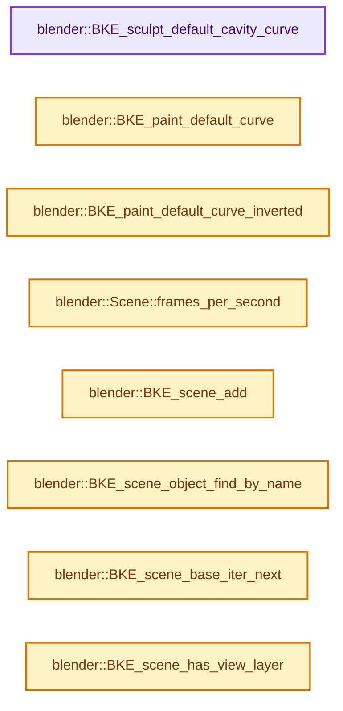
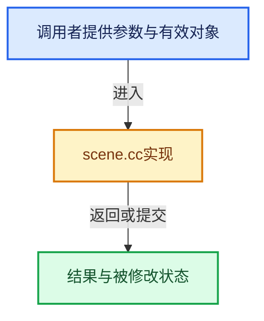

# 实现依赖专题：source/blender/blenkernel/intern/scene.cc

[实现依赖导航](../../README.md) · [符号索引](../../../00-课程指南/02-源码与提交索引/符号依赖与实现索引.md)

本专题从正文实际调用进入，集中保存共享实现。函数有稳定锚点，可从调用处直接跳到对应完整函数；递归与互相调用通过回链组织。

## 本文件的实现关系






## 完整成员与函数实现

<a id="f-40f769dceab05d08"></a>

### `blender::BKE_sculpt_default_cavity_curve`

实现位置：[source/blender/blenkernel/intern/scene.cc](../../../../../../../source/blender/blenkernel/intern/scene.cc) · L142—L155。

**教学注释版**

<!-- annotated:aa4c3865cbfe01 -->

```cpp
CurveMapping *BKE_sculpt_default_cavity_curve()

{
  CurveMapping *cumap = BKE_curvemapping_add(1, 0, 0, 1, 1);

  cumap->flag &= ~CUMA_EXTEND_EXTRAPOLATE;
  cumap->preset = CURVE_PRESET_LINE;

  BKE_curvemap_reset(cumap->cm, &cumap->clipr, cumap->preset, CurveMapSlopeType::Positive);
  BKE_curvemapping_changed(cumap, false);
  BKE_curvemapping_init(cumap);

  return cumap;
}
```

<details>
<summary>核对原始源码：source/blender/blenkernel/intern/scene.cc · L142—L155</summary>

<!-- original:aa4c3865cbfe01:source/blender/blenkernel/intern/scene.cc:142:155 -->

```cpp
CurveMapping *BKE_sculpt_default_cavity_curve()

{
  CurveMapping *cumap = BKE_curvemapping_add(1, 0, 0, 1, 1);

  cumap->flag &= ~CUMA_EXTEND_EXTRAPOLATE;
  cumap->preset = CURVE_PRESET_LINE;

  BKE_curvemap_reset(cumap->cm, &cumap->clipr, cumap->preset, CurveMapSlopeType::Positive);
  BKE_curvemapping_changed(cumap, false);
  BKE_curvemapping_init(cumap);

  return cumap;
}
```

</details>

**沿实际写入检查状态**

- `cumap->flag &= ~CUMA_EXTEND_EXTRAPOLATE;`
- `cumap->preset = CURVE_PRESET_LINE;`

**结果出口**

- `return cumap;`

**继续追踪实现**

- `BKE_curvemapping_add` → [blender::BKE_curvemapping_add · L99](colortools.cc.md#f-5eb2107731235af2)。
- `BKE_curvemap_reset` → [blender::BKE_curvemap_reset · L301](colortools.cc.md#f-1994e7546d0d653c)。
- `BKE_curvemapping_changed` → [blender::BKE_curvemapping_changed · L1049](colortools.cc.md#f-32891a25dc0d6fd9)。
- `BKE_curvemapping_init` → [blender::BKE_curvemapping_init · L1441](colortools.cc.md#f-f7d75fd7ad2a5ee6)。

<a id="f-90d6e20c471079f4"></a>

### `blender::BKE_paint_default_curve`

实现位置：[source/blender/blenkernel/intern/scene.cc](../../../../../../../source/blender/blenkernel/intern/scene.cc) · L157—L164。

**教学注释版**

<!-- annotated:7169464ea28395 -->

```cpp
CurveMapping *BKE_paint_default_curve()
{
  CurveMapping *cumap = BKE_curvemapping_add(1, 0, 0, 1, 1);
  BKE_curvemap_reset(cumap->cm, &cumap->clipr, CURVE_PRESET_LINE, CurveMapSlopeType::Positive);
  BKE_curvemapping_init(cumap);

  return cumap;
}
```

<details>
<summary>核对原始源码：source/blender/blenkernel/intern/scene.cc · L157—L164</summary>

<!-- original:7169464ea28395:source/blender/blenkernel/intern/scene.cc:157:164 -->

```cpp
CurveMapping *BKE_paint_default_curve()
{
  CurveMapping *cumap = BKE_curvemapping_add(1, 0, 0, 1, 1);
  BKE_curvemap_reset(cumap->cm, &cumap->clipr, CURVE_PRESET_LINE, CurveMapSlopeType::Positive);
  BKE_curvemapping_init(cumap);

  return cumap;
}
```

</details>

**结果出口**

- `return cumap;`

**继续追踪实现**

- `BKE_curvemapping_add` → [blender::BKE_curvemapping_add · L99](colortools.cc.md#f-5eb2107731235af2)。
- `BKE_curvemap_reset` → [blender::BKE_curvemap_reset · L301](colortools.cc.md#f-1994e7546d0d653c)。
- `BKE_curvemapping_init` → [blender::BKE_curvemapping_init · L1441](colortools.cc.md#f-f7d75fd7ad2a5ee6)。

<a id="f-bc3696ee2b18a3e9"></a>

### `blender::BKE_paint_default_curve_inverted`

实现位置：[source/blender/blenkernel/intern/scene.cc](../../../../../../../source/blender/blenkernel/intern/scene.cc) · L166—L173。

**教学注释版**

<!-- annotated:a2f7230233a342 -->

```cpp
CurveMapping *BKE_paint_default_curve_inverted()
{
  CurveMapping *cumap = BKE_curvemapping_add(1, 0, 0, 1, 1);
  BKE_curvemap_reset(cumap->cm, &cumap->clipr, CURVE_PRESET_LINE, CurveMapSlopeType::Negative);
  BKE_curvemapping_init(cumap);

  return cumap;
}
```

<details>
<summary>核对原始源码：source/blender/blenkernel/intern/scene.cc · L166—L173</summary>

<!-- original:a2f7230233a342:source/blender/blenkernel/intern/scene.cc:166:173 -->

```cpp
CurveMapping *BKE_paint_default_curve_inverted()
{
  CurveMapping *cumap = BKE_curvemapping_add(1, 0, 0, 1, 1);
  BKE_curvemap_reset(cumap->cm, &cumap->clipr, CURVE_PRESET_LINE, CurveMapSlopeType::Negative);
  BKE_curvemapping_init(cumap);

  return cumap;
}
```

</details>

**结果出口**

- `return cumap;`

**继续追踪实现**

- `BKE_curvemapping_add` → [blender::BKE_curvemapping_add · L99](colortools.cc.md#f-5eb2107731235af2)。
- `BKE_curvemap_reset` → [blender::BKE_curvemap_reset · L301](colortools.cc.md#f-1994e7546d0d653c)。
- `BKE_curvemapping_init` → [blender::BKE_curvemapping_init · L1441](colortools.cc.md#f-f7d75fd7ad2a5ee6)。

<a id="f-76be2374a615ddd5"></a>

### `blender::Scene::frames_per_second`

实现位置：[source/blender/blenkernel/intern/scene.cc](../../../../../../../source/blender/blenkernel/intern/scene.cc) · L1704—L1707。

**教学注释版**

<!-- annotated:7bd8fbac85f26f -->

```cpp
double Scene::frames_per_second() const
{
  return double(this->r.frs_sec) / double(this->r.frs_sec_base);
}
```

<details>
<summary>核对原始源码：source/blender/blenkernel/intern/scene.cc · L1704—L1707</summary>

<!-- original:7bd8fbac85f26f:source/blender/blenkernel/intern/scene.cc:1704:1707 -->

```cpp
double Scene::frames_per_second() const
{
  return double(this->r.frs_sec) / double(this->r.frs_sec_base);
}
```

</details>

**结果出口**

- `return double(this->r.frs_sec) / double(this->r.frs_sec_base);`

**继续追踪实现**

本实现没有需要继续展开的显式调用；检查返回表达式、对象转换和调用者前置条件。

<a id="f-0e2c427b06e97e9d"></a>

### `blender::BKE_scene_add`

实现位置：[source/blender/blenkernel/intern/scene.cc](../../../../../../../source/blender/blenkernel/intern/scene.cc) · L2210—L2217。

接口参数：

- `Main *bmain`
- `const char *name`

**教学注释版**

<!-- annotated:45fa6059e3fe28 -->

```cpp
Scene *BKE_scene_add(Main *bmain, const char *name)
{
  Scene *sce = BKE_id_new<Scene>(bmain, name);
  id_us_min(&sce->id);
  id_us_ensure_real(&sce->id);

  return sce;
}
```

<details>
<summary>核对原始源码：source/blender/blenkernel/intern/scene.cc · L2210—L2217</summary>

<!-- original:45fa6059e3fe28:source/blender/blenkernel/intern/scene.cc:2210:2217 -->

```cpp
Scene *BKE_scene_add(Main *bmain, const char *name)
{
  Scene *sce = BKE_id_new<Scene>(bmain, name);
  id_us_min(&sce->id);
  id_us_ensure_real(&sce->id);

  return sce;
}
```

</details>

**结果出口**

- `return sce;`

**继续追踪实现**

- `BKE_id_new<Scene>` → [blender::BKE_id_new · L1612](lib_id.cc.md#f-5335c97ce0a8fbc8)。
- `id_us_min` → [blender::id_us_min · L441](lib_id.cc.md#f-c5e5246a79962257)。
- `id_us_ensure_real` → [blender::id_us_ensure_real · L388](lib_id.cc.md#f-6faedd694354706a)。

<a id="f-76cf849136526934"></a>

### `blender::BKE_scene_object_find_by_name`

实现位置：[source/blender/blenkernel/intern/scene.cc](../../../../../../../source/blender/blenkernel/intern/scene.cc) · L2230—L2241。

接口参数：

- `const Main &bmain`
- `const Scene *scene`
- `const char *name`

**教学注释版**

<!-- annotated:babf1680beac32 -->

```cpp
Object *BKE_scene_object_find_by_name(const Main &bmain, const Scene *scene, const char *name)
{
  for (ViewLayer &view_layer : scene->view_layers) {
    BKE_view_layer_synced_ensure(bmain, scene, &view_layer);
    for (Base &base : *BKE_view_layer_object_bases_get(&view_layer)) {
      if (STREQ(base.object->id.name + 2, name)) {
        return base.object;
      }
    }
  }
  return nullptr;
}
```

<details>
<summary>核对原始源码：source/blender/blenkernel/intern/scene.cc · L2230—L2241</summary>

<!-- original:babf1680beac32:source/blender/blenkernel/intern/scene.cc:2230:2241 -->

```cpp
Object *BKE_scene_object_find_by_name(const Main &bmain, const Scene *scene, const char *name)
{
  for (ViewLayer &view_layer : scene->view_layers) {
    BKE_view_layer_synced_ensure(bmain, scene, &view_layer);
    for (Base &base : *BKE_view_layer_object_bases_get(&view_layer)) {
      if (STREQ(base.object->id.name + 2, name)) {
        return base.object;
      }
    }
  }
  return nullptr;
}
```

</details>

**结果出口**

- `return base.object;`
- `return nullptr;`

**继续追踪实现**

- `BKE_view_layer_synced_ensure` → [blender::BKE_view_layer_synced_ensure · L1035](layer.cc.md#f-602c088654ebcb63)。
- `BKE_view_layer_object_bases_get` → [blender::BKE_view_layer_object_bases_get · L202](layer_utils.cc.md#f-f7b3adc8941172e4)。
- `STREQ` → [STREQ · L112](../../07-Intern运行时与平台/ghost/intern/GHOST_utildefines.hh.md#m-9549fb6aafd2)；[STREQ · L451](../../01-BLI基础库/BLI_utildefines.hh.md#m-c7b745bcfad2)；[STREQ · L55](../../07-Intern运行时与平台/clog/clog.cc.md#m-96e78f386894)。宏定义由构建条件选择。

<a id="f-3bf7a317c96dd9cc"></a>

### `blender::BKE_scene_base_iter_next`

实现位置：[source/blender/blenkernel/intern/scene.cc](../../../../../../../source/blender/blenkernel/intern/scene.cc) · L2278—L2430。

接口参数：

- `Depsgraph *depsgraph`
- `SceneBaseIter *iter`
- `Scene **scene`
- `int val`
- `Base **base`
- `Object **ob`

**教学注释版**

<!-- annotated:7885fdf05cde87 -->

```cpp
int BKE_scene_base_iter_next(
    Depsgraph *depsgraph, SceneBaseIter *iter, Scene **scene, int val, Base **base, Object **ob)
{
  bool run_again = true;

  const Main *bmain = depsgraph ? DEG_get_bmain(depsgraph) : nullptr;

  /* init */
  if (val == 0) {
    iter->phase = F_START;
    iter->dupob = nullptr;
    iter->dupob_index = -1;
    iter->duplilist.clear();
    iter->dupli_refob = nullptr;
  }
  else {
    /* run_again is set when a duplilist has been ended */
    while (run_again) {
      run_again = false;

      /* the first base */
      if (iter->phase == F_START) {
        ViewLayer *view_layer = (depsgraph) ? DEG_get_evaluated_view_layer(depsgraph) :
                                              BKE_view_layer_context_active_PLACEHOLDER(*scene);
        if (bmain) {
          BKE_view_layer_synced_ensure(*bmain, *scene, view_layer);
        }
        else {
          BLI_assert(BKE_view_layer_is_synced(*view_layer));
        }
        *base = BKE_view_layer_object_bases_get(view_layer)->first();
        if (*base) {
          *ob = (*base)->object;
          iter->phase = F_SCENE;
        }
        else {
          /* exception: empty scene layer */
          while ((*scene)->set) {
            (*scene) = (*scene)->set;
            ViewLayer *view_layer_set = BKE_view_layer_default_render(*scene);
            if (bmain) {
              BKE_view_layer_synced_ensure(*bmain, *scene, view_layer_set);
            }
            else {
              BLI_assert(BKE_view_layer_is_synced(*view_layer_set));
            }
            ListBaseT<Base> *object_bases = BKE_view_layer_object_bases_get(view_layer_set);
            if (object_bases->first()) {
              *base = object_bases->first();
              *ob = (*base)->object;
              iter->phase = F_SCENE;
              break;
            }
          }
        }
      }
      else {
        if (*base && iter->phase != F_DUPLI) {
          *base = (*base)->next;
          if (*base) {
            *ob = (*base)->object;
          }
          else {
            if (iter->phase == F_SCENE) {
              /* (*scene) is finished, now do the set */
              while ((*scene)->set) {
                (*scene) = (*scene)->set;
                ViewLayer *view_layer_set = BKE_view_layer_default_render(*scene);
                if (bmain) {
                  BKE_view_layer_synced_ensure(*bmain, *scene, view_layer_set);
                }
                else {
                  BLI_assert(BKE_view_layer_is_synced(*view_layer_set));
                }
                ListBaseT<Base> *object_bases = BKE_view_layer_object_bases_get(view_layer_set);
                if (object_bases->first()) {
                  *base = object_bases->first();
                  *ob = (*base)->object;
                  break;
                }
              }
            }
          }
        }
      }

      if (*base == nullptr) {
        iter->phase = F_START;
      }
      else {
        if (iter->phase != F_DUPLI) {
          if (depsgraph && (*base)->object->transflag & OB_DUPLI) {
            /* Collections cannot be duplicated for meta-balls yet,
             * this enters eternal loop because of
             * makeDispListMBall getting called inside of collection_duplilist */
            if ((*base)->object->instance_collection == nullptr) {
              object_duplilist(depsgraph, (*base)->object, nullptr, iter->duplilist);

              iter->dupob = iter->duplilist.is_empty() ? nullptr : &iter->duplilist.first();
              iter->dupob_index = 0;

              if (!iter->dupob) {
                iter->duplilist.clear();
                iter->dupob_index = -1;
              }
              iter->dupli_refob = nullptr;
            }
          }
        }
        /* handle dupli's */
        if (iter->dupob) {
          (*base)->flag_legacy |= OB_FROMDUPLI;
          *ob = iter->dupob->ob;
          iter->phase = F_DUPLI;

          if (iter->dupli_refob != *ob) {
            if (iter->dupli_refob) {
              /* Restore previous object's real matrix. */
              copy_m4_m4(iter->dupli_refob->runtime->object_to_world.ptr(), iter->omat);
            }
            /* Backup new object's real matrix. */
            iter->dupli_refob = *ob;
            copy_m4_m4(iter->omat, iter->dupli_refob->object_to_world().ptr());
          }
          copy_m4_m4((*ob)->runtime->object_to_world.ptr(), iter->dupob->mat);

          if (++iter->dupob_index < iter->duplilist.size()) {
            iter->dupob = &iter->duplilist[iter->dupob_index];
          }
          else {
            iter->dupob = nullptr;
            iter->dupob_index = -1;
          }
        }
        else if (iter->phase == F_DUPLI) {
          iter->phase = F_SCENE;
          (*base)->flag_legacy &= ~OB_FROMDUPLI;

          if (iter->dupli_refob) {
            /* Restore last object's real matrix. */
            copy_m4_m4(iter->dupli_refob->runtime->object_to_world.ptr(), iter->omat);
            iter->dupli_refob = nullptr;
          }

          iter->duplilist.clear();
          run_again = true;
        }
      }
    }
  }

  return iter->phase;
}
```

<details>
<summary>核对原始源码：source/blender/blenkernel/intern/scene.cc · L2278—L2430</summary>

<!-- original:7885fdf05cde87:source/blender/blenkernel/intern/scene.cc:2278:2430 -->

```cpp
int BKE_scene_base_iter_next(
    Depsgraph *depsgraph, SceneBaseIter *iter, Scene **scene, int val, Base **base, Object **ob)
{
  bool run_again = true;

  const Main *bmain = depsgraph ? DEG_get_bmain(depsgraph) : nullptr;

  /* init */
  if (val == 0) {
    iter->phase = F_START;
    iter->dupob = nullptr;
    iter->dupob_index = -1;
    iter->duplilist.clear();
    iter->dupli_refob = nullptr;
  }
  else {
    /* run_again is set when a duplilist has been ended */
    while (run_again) {
      run_again = false;

      /* the first base */
      if (iter->phase == F_START) {
        ViewLayer *view_layer = (depsgraph) ? DEG_get_evaluated_view_layer(depsgraph) :
                                              BKE_view_layer_context_active_PLACEHOLDER(*scene);
        if (bmain) {
          BKE_view_layer_synced_ensure(*bmain, *scene, view_layer);
        }
        else {
          BLI_assert(BKE_view_layer_is_synced(*view_layer));
        }
        *base = BKE_view_layer_object_bases_get(view_layer)->first();
        if (*base) {
          *ob = (*base)->object;
          iter->phase = F_SCENE;
        }
        else {
          /* exception: empty scene layer */
          while ((*scene)->set) {
            (*scene) = (*scene)->set;
            ViewLayer *view_layer_set = BKE_view_layer_default_render(*scene);
            if (bmain) {
              BKE_view_layer_synced_ensure(*bmain, *scene, view_layer_set);
            }
            else {
              BLI_assert(BKE_view_layer_is_synced(*view_layer_set));
            }
            ListBaseT<Base> *object_bases = BKE_view_layer_object_bases_get(view_layer_set);
            if (object_bases->first()) {
              *base = object_bases->first();
              *ob = (*base)->object;
              iter->phase = F_SCENE;
              break;
            }
          }
        }
      }
      else {
        if (*base && iter->phase != F_DUPLI) {
          *base = (*base)->next;
          if (*base) {
            *ob = (*base)->object;
          }
          else {
            if (iter->phase == F_SCENE) {
              /* (*scene) is finished, now do the set */
              while ((*scene)->set) {
                (*scene) = (*scene)->set;
                ViewLayer *view_layer_set = BKE_view_layer_default_render(*scene);
                if (bmain) {
                  BKE_view_layer_synced_ensure(*bmain, *scene, view_layer_set);
                }
                else {
                  BLI_assert(BKE_view_layer_is_synced(*view_layer_set));
                }
                ListBaseT<Base> *object_bases = BKE_view_layer_object_bases_get(view_layer_set);
                if (object_bases->first()) {
                  *base = object_bases->first();
                  *ob = (*base)->object;
                  break;
                }
              }
            }
          }
        }
      }

      if (*base == nullptr) {
        iter->phase = F_START;
      }
      else {
        if (iter->phase != F_DUPLI) {
          if (depsgraph && (*base)->object->transflag & OB_DUPLI) {
            /* Collections cannot be duplicated for meta-balls yet,
             * this enters eternal loop because of
             * makeDispListMBall getting called inside of collection_duplilist */
            if ((*base)->object->instance_collection == nullptr) {
              object_duplilist(depsgraph, (*base)->object, nullptr, iter->duplilist);

              iter->dupob = iter->duplilist.is_empty() ? nullptr : &iter->duplilist.first();
              iter->dupob_index = 0;

              if (!iter->dupob) {
                iter->duplilist.clear();
                iter->dupob_index = -1;
              }
              iter->dupli_refob = nullptr;
            }
          }
        }
        /* handle dupli's */
        if (iter->dupob) {
          (*base)->flag_legacy |= OB_FROMDUPLI;
          *ob = iter->dupob->ob;
          iter->phase = F_DUPLI;

          if (iter->dupli_refob != *ob) {
            if (iter->dupli_refob) {
              /* Restore previous object's real matrix. */
              copy_m4_m4(iter->dupli_refob->runtime->object_to_world.ptr(), iter->omat);
            }
            /* Backup new object's real matrix. */
            iter->dupli_refob = *ob;
            copy_m4_m4(iter->omat, iter->dupli_refob->object_to_world().ptr());
          }
          copy_m4_m4((*ob)->runtime->object_to_world.ptr(), iter->dupob->mat);

          if (++iter->dupob_index < iter->duplilist.size()) {
            iter->dupob = &iter->duplilist[iter->dupob_index];
          }
          else {
            iter->dupob = nullptr;
            iter->dupob_index = -1;
          }
        }
        else if (iter->phase == F_DUPLI) {
          iter->phase = F_SCENE;
          (*base)->flag_legacy &= ~OB_FROMDUPLI;

          if (iter->dupli_refob) {
            /* Restore last object's real matrix. */
            copy_m4_m4(iter->dupli_refob->runtime->object_to_world.ptr(), iter->omat);
            iter->dupli_refob = nullptr;
          }

          iter->duplilist.clear();
          run_again = true;
        }
      }
    }
  }

  return iter->phase;
}
```

</details>

**沿实际写入检查状态**

- `iter->phase = F_START;`
- `iter->dupob = nullptr;`
- `iter->dupob_index = -1;`
- `iter->dupli_refob = nullptr;`
- `run_again = false;`
- `iter->phase = F_SCENE;`
- `iter->dupob = iter->duplilist.is_empty() ? nullptr : &iter->duplilist.first();`
- `iter->dupob_index = 0;`
- `iter->phase = F_DUPLI;`
- `iter->dupli_refob = *ob;`
- `iter->dupob = &iter->duplilist[iter->dupob_index];`
- `run_again = true;`

**结果出口**

- `return iter->phase;`

**继续追踪实现**

- `DEG_get_bmain` → [blender::DEG_get_bmain · L93](../../06-Depsgraph依赖图/intern/depsgraph_query.cc.md#f-9dfed3e433db8080)。
- `iter->duplilist.clear` → [调用协议](../../../00-课程指南/01-路线与规范/模板宏与动态分派协议.md)：接收对象类型依赖auto、返回值或模板实例；不按同名猜测目标。调用位置L2290。
- `DEG_get_evaluated_view_layer` → [blender::DEG_get_evaluated_view_layer · L222](../../06-Depsgraph依赖图/intern/depsgraph_query.cc.md#f-3962e192bc426a3c)。
- `BKE_view_layer_context_active_PLACEHOLDER` → [blender::BKE_view_layer_context_active_PLACEHOLDER · L161](layer.cc.md#f-16d5df923b866290)。
- `BKE_view_layer_synced_ensure` → [blender::BKE_view_layer_synced_ensure · L1035](layer.cc.md#f-602c088654ebcb63)。
- `BLI_assert` → [BLI_assert · L48](../../01-BLI基础库/BLI_assert.hh.md#m-57a88495704d)；[BLI_assert · L63](../../01-BLI基础库/BLI_assert.hh.md#m-d07050020cb5)。宏定义由构建条件选择。
- `BKE_view_layer_is_synced` → [blender::BKE_view_layer_is_synced · L1018](layer.cc.md#f-50faaff99a536e93)。
- `BKE_view_layer_object_bases_get(view_layer)->first` → [调用协议](../../../00-课程指南/01-路线与规范/模板宏与动态分派协议.md)：接收对象类型依赖auto、返回值或模板实例；不按同名猜测目标。调用位置L2308。
- `BKE_view_layer_object_bases_get` → [blender::BKE_view_layer_object_bases_get · L202](layer_utils.cc.md#f-f7b3adc8941172e4)。
- `BKE_view_layer_default_render` → [blender::BKE_view_layer_default_render · L138](layer.cc.md#f-0b2725adbb12f328)。
- `object_bases->first` → [blender::ListBaseT::first · L102](../../08-其他Blender模块/makesdna/DNA_listBase.h.md#f-3d12ff35da057c9e)；[blender::ListBaseT::first · L106](../../08-其他Blender模块/makesdna/DNA_listBase.h.md#f-0df87c3480e059f9)。同名重载需按实参类型选择。
- `object_duplilist` → [blender::object_duplilist · L1809](object_dupli.cc.md#f-c7a1cea399b12daf)。
- `iter->duplilist.is_empty` → [调用协议](../../../00-课程指南/01-路线与规范/模板宏与动态分派协议.md)：接收对象类型依赖auto、返回值或模板实例；不按同名猜测目标。调用位置L2376。
- `iter->duplilist.first` → [调用协议](../../../00-课程指南/01-路线与规范/模板宏与动态分派协议.md)：接收对象类型依赖auto、返回值或模板实例；不按同名猜测目标。调用位置L2376。
- `copy_m4_m4` → [blender::copy_m4_m4 · L84](../../01-BLI基础库/intern/math_matrix_c.cc.md#f-b4390cf8c94710f5)。
- `iter->dupli_refob->runtime->object_to_world.ptr` → [调用协议](../../../00-课程指南/01-路线与规范/模板宏与动态分派协议.md)：接收对象类型依赖auto、返回值或模板实例；不按同名猜测目标。调用位置L2396。
- `iter->dupli_refob->object_to_world().ptr` → [调用协议](../../../00-课程指南/01-路线与规范/模板宏与动态分派协议.md)：接收对象类型依赖auto、返回值或模板实例；不按同名猜测目标。调用位置L2400。
- `iter->dupli_refob->object_to_world` → [调用协议](../../../00-课程指南/01-路线与规范/模板宏与动态分派协议.md)：接收对象类型依赖auto、返回值或模板实例；不按同名猜测目标。调用位置L2400。
- `(*ob)->runtime->object_to_world.ptr` → [调用协议](../../../00-课程指南/01-路线与规范/模板宏与动态分派协议.md)：接收对象类型依赖auto、返回值或模板实例；不按同名猜测目标。调用位置L2402。
- `iter->duplilist.size` → [调用协议](../../../00-课程指南/01-路线与规范/模板宏与动态分派协议.md)：接收对象类型依赖auto、返回值或模板实例；不按同名猜测目标。调用位置L2404。

<a id="f-261601a23386a520"></a>

### `blender::BKE_scene_has_view_layer`

实现位置：[source/blender/blenkernel/intern/scene.cc](../../../../../../../source/blender/blenkernel/intern/scene.cc) · L2432—L2435。

接口参数：

- `const Scene *scene`
- `const ViewLayer *layer`

**教学注释版**

<!-- annotated:dafac3e5321223 -->

```cpp
bool BKE_scene_has_view_layer(const Scene *scene, const ViewLayer *layer)
{
  return BLI_findindex(&scene->view_layers, layer) != -1;
}
```

<details>
<summary>核对原始源码：source/blender/blenkernel/intern/scene.cc · L2432—L2435</summary>

<!-- original:dafac3e5321223:source/blender/blenkernel/intern/scene.cc:2432:2435 -->

```cpp
bool BKE_scene_has_view_layer(const Scene *scene, const ViewLayer *layer)
{
  return BLI_findindex(&scene->view_layers, layer) != -1;
}
```

</details>

**结果出口**

- `return BLI_findindex(&scene->view_layers, layer) != -1;`

**继续追踪实现**

- `BLI_findindex` → [blender::BLI_findindex · L593](../../01-BLI基础库/intern/listbase.cc.md#f-cb9036f12bd486b7)。

<a id="f-b19a12dfa349481c"></a>

### `blender::BKE_scene_camera_switch_find`

实现位置：[source/blender/blenkernel/intern/scene.cc](../../../../../../../source/blender/blenkernel/intern/scene.cc) · L2450—L2488。

接口参数：

- `const Scene *scene`
- `const int time`

**教学注释版**

<!-- annotated:67e0aed16bd05b -->

```cpp
Object *BKE_scene_camera_switch_find(const Scene *scene, const int time)
{
  if (scene->r.mode & R_NO_CAMERA_SWITCH) {
    return nullptr;
  }

  int frame = -(MAXFRAME + 1);
  int min_frame = MAXFRAME + 1;
  Object *camera = nullptr;
  Object *first_camera = nullptr;

  for (TimeMarker &m : scene->markers) {
    if (m.camera && (m.camera->visibility_flag & OB_HIDE_RENDER) == 0) {
      if ((m.frame <= time) && (m.frame > frame)) {
        camera = m.camera;
        frame = m.frame;

        if (frame == time) {
          break;
        }
      }

      if (m.frame < min_frame) {
        first_camera = m.camera;
        min_frame = m.frame;
      }
    }
  }

  if (camera == nullptr) {
    /* If there's no marker to the left of current frame,
     * use camera from left-most marker to solve all sort
     * of Schrodinger uncertainties.
     */
    return first_camera;
  }

  return camera;
}
```

<details>
<summary>核对原始源码：source/blender/blenkernel/intern/scene.cc · L2450—L2488</summary>

<!-- original:67e0aed16bd05b:source/blender/blenkernel/intern/scene.cc:2450:2488 -->

```cpp
Object *BKE_scene_camera_switch_find(const Scene *scene, const int time)
{
  if (scene->r.mode & R_NO_CAMERA_SWITCH) {
    return nullptr;
  }

  int frame = -(MAXFRAME + 1);
  int min_frame = MAXFRAME + 1;
  Object *camera = nullptr;
  Object *first_camera = nullptr;

  for (TimeMarker &m : scene->markers) {
    if (m.camera && (m.camera->visibility_flag & OB_HIDE_RENDER) == 0) {
      if ((m.frame <= time) && (m.frame > frame)) {
        camera = m.camera;
        frame = m.frame;

        if (frame == time) {
          break;
        }
      }

      if (m.frame < min_frame) {
        first_camera = m.camera;
        min_frame = m.frame;
      }
    }
  }

  if (camera == nullptr) {
    /* If there's no marker to the left of current frame,
     * use camera from left-most marker to solve all sort
     * of Schrodinger uncertainties.
     */
    return first_camera;
  }

  return camera;
}
```

</details>

**沿实际写入检查状态**

- `camera = m.camera;`
- `frame = m.frame;`
- `first_camera = m.camera;`
- `min_frame = m.frame;`

**结果出口**

- `return nullptr;`
- `return first_camera;`
- `return camera;`

**继续追踪实现**

本实现没有需要继续展开的显式调用；检查返回表达式、对象转换和调用者前置条件。

<a id="f-09fb19d0fe6111bf"></a>

### `blender::BKE_scene_camera_switch_update`

实现位置：[source/blender/blenkernel/intern/scene.cc](../../../../../../../source/blender/blenkernel/intern/scene.cc) · L2490—L2499。

接口参数：

- `Scene *scene`

**教学注释版**

<!-- annotated:20fc5faec2e6b6 -->

```cpp
bool BKE_scene_camera_switch_update(Scene *scene)
{
  Object *camera = BKE_scene_camera_switch_find(scene, int(BKE_scene_ctime_get(scene)));
  if (camera && (camera != scene->camera)) {
    scene->camera = camera;
    DEG_id_tag_update(&scene->id, ID_RECALC_SYNC_TO_EVAL | ID_RECALC_PARAMETERS);
    return true;
  }
  return false;
}
```

<details>
<summary>核对原始源码：source/blender/blenkernel/intern/scene.cc · L2490—L2499</summary>

<!-- original:20fc5faec2e6b6:source/blender/blenkernel/intern/scene.cc:2490:2499 -->

```cpp
bool BKE_scene_camera_switch_update(Scene *scene)
{
  Object *camera = BKE_scene_camera_switch_find(scene, int(BKE_scene_ctime_get(scene)));
  if (camera && (camera != scene->camera)) {
    scene->camera = camera;
    DEG_id_tag_update(&scene->id, ID_RECALC_SYNC_TO_EVAL | ID_RECALC_PARAMETERS);
    return true;
  }
  return false;
}
```

</details>

**沿实际写入检查状态**

- `scene->camera = camera;`

**结果出口**

- `return true;`
- `return false;`

**继续追踪实现**

- `BKE_scene_camera_switch_find` → [blender::BKE_scene_camera_switch_find · L2450](scene.cc.md#f-b19a12dfa349481c)。
- `BKE_scene_ctime_get` → [blender::BKE_scene_ctime_get · L2591](scene.cc.md#f-5e28483f19a62bf5)。
- `DEG_id_tag_update` → [blender::DEG_id_tag_update · L844](../../06-Depsgraph依赖图/intern/depsgraph_tag.cc.md#f-62d2949dd168bb81)。

<a id="f-da8d800bb589b2f8"></a>

### `blender::BKE_scene_find_marker_name`

实现位置：[source/blender/blenkernel/intern/scene.cc](../../../../../../../source/blender/blenkernel/intern/scene.cc) · L2501—L2522。

接口参数：

- `const Scene *scene`
- `int frame`

**教学注释版**

<!-- annotated:7bf3d21fe2579a -->

```cpp
const char *BKE_scene_find_marker_name(const Scene *scene, int frame)
{
  const ListBaseT<TimeMarker> *markers = &scene->markers;
  const TimeMarker *m1, *m2;

  /* search through markers for match */
  for (m1 = markers->first(), m2 = markers->last(); m1 && m2; m1 = m1->next, m2 = m2->prev) {
    if (m1->frame == frame) {
      return m1->name;
    }

    if (m1 == m2) {
      break;
    }

    if (m2->frame == frame) {
      return m2->name;
    }
  }

  return nullptr;
}
```

<details>
<summary>核对原始源码：source/blender/blenkernel/intern/scene.cc · L2501—L2522</summary>

<!-- original:7bf3d21fe2579a:source/blender/blenkernel/intern/scene.cc:2501:2522 -->

```cpp
const char *BKE_scene_find_marker_name(const Scene *scene, int frame)
{
  const ListBaseT<TimeMarker> *markers = &scene->markers;
  const TimeMarker *m1, *m2;

  /* search through markers for match */
  for (m1 = markers->first(), m2 = markers->last(); m1 && m2; m1 = m1->next, m2 = m2->prev) {
    if (m1->frame == frame) {
      return m1->name;
    }

    if (m1 == m2) {
      break;
    }

    if (m2->frame == frame) {
      return m2->name;
    }
  }

  return nullptr;
}
```

</details>

**结果出口**

- `return m1->name;`
- `return m2->name;`
- `return nullptr;`

**继续追踪实现**

- `markers->first` → [blender::ListBaseT::first · L102](../../08-其他Blender模块/makesdna/DNA_listBase.h.md#f-3d12ff35da057c9e)；[blender::ListBaseT::first · L106](../../08-其他Blender模块/makesdna/DNA_listBase.h.md#f-0df87c3480e059f9)。同名重载需按实参类型选择。
- `markers->last` → [blender::ListBaseT::last · L110](../../08-其他Blender模块/makesdna/DNA_listBase.h.md#f-7b7d35c25b6d06a4)；[blender::ListBaseT::last · L114](../../08-其他Blender模块/makesdna/DNA_listBase.h.md#f-1376db91ee7f5ddb)。同名重载需按实参类型选择。

<a id="f-16426b326e9ae547"></a>

### `blender::BKE_scene_remove_rigidbody_object`

实现位置：[source/blender/blenkernel/intern/scene.cc](../../../../../../../source/blender/blenkernel/intern/scene.cc) · L2557—L2567。

接口参数：

- `Main *bmain`
- `Scene *scene`
- `Object *ob`
- `const bool free_us`

**教学注释版**

<!-- annotated:796439ddc0357b -->

```cpp
void BKE_scene_remove_rigidbody_object(Main *bmain, Scene *scene, Object *ob, const bool free_us)
{
  /* remove rigid body constraint from world before removing object */
  if (ob->rigidbody_constraint) {
    BKE_rigidbody_remove_constraint(bmain, scene, ob, free_us);
  }
  /* remove rigid body object from world before removing object */
  if (ob->rigidbody_object) {
    BKE_rigidbody_remove_object(bmain, scene, ob, free_us);
  }
}
```

<details>
<summary>核对原始源码：source/blender/blenkernel/intern/scene.cc · L2557—L2567</summary>

<!-- original:796439ddc0357b:source/blender/blenkernel/intern/scene.cc:2557:2567 -->

```cpp
void BKE_scene_remove_rigidbody_object(Main *bmain, Scene *scene, Object *ob, const bool free_us)
{
  /* remove rigid body constraint from world before removing object */
  if (ob->rigidbody_constraint) {
    BKE_rigidbody_remove_constraint(bmain, scene, ob, free_us);
  }
  /* remove rigid body object from world before removing object */
  if (ob->rigidbody_object) {
    BKE_rigidbody_remove_object(bmain, scene, ob, free_us);
  }
}
```

</details>

**继续追踪实现**

- `BKE_rigidbody_remove_constraint` → [blender::BKE_rigidbody_remove_constraint · L1576](rigidbody.cc.md#f-656ddf961be5d65c)；[blender::BKE_rigidbody_remove_constraint · L2349](rigidbody.cc.md#f-3215369088f0a0e5)。同名重载需按实参类型选择。
- `BKE_rigidbody_remove_object` → [blender::BKE_rigidbody_remove_object · L1509](rigidbody.cc.md#f-e286e2de520b7071)；[blender::BKE_rigidbody_remove_object · L2348](rigidbody.cc.md#f-0a6c0025db589fe6)。同名重载需按实参类型选择。

<a id="f-5e28483f19a62bf5"></a>

### `blender::BKE_scene_ctime_get`

实现位置：[source/blender/blenkernel/intern/scene.cc](../../../../../../../source/blender/blenkernel/intern/scene.cc) · L2591—L2594。

接口参数：

- `const Scene *scene`

**教学注释版**

<!-- annotated:b9cef83951d0ec -->

```cpp
float BKE_scene_ctime_get(const Scene *scene)
{
  return BKE_scene_frame_to_ctime(scene, scene->r.cfra);
}
```

<details>
<summary>核对原始源码：source/blender/blenkernel/intern/scene.cc · L2591—L2594</summary>

<!-- original:b9cef83951d0ec:source/blender/blenkernel/intern/scene.cc:2591:2594 -->

```cpp
float BKE_scene_ctime_get(const Scene *scene)
{
  return BKE_scene_frame_to_ctime(scene, scene->r.cfra);
}
```

</details>

**结果出口**

- `return BKE_scene_frame_to_ctime(scene, scene->r.cfra);`

**继续追踪实现**

- `BKE_scene_frame_to_ctime` → [blender::BKE_scene_frame_to_ctime · L2596](scene.cc.md#f-53108ac5f75b4753)。

<a id="f-53108ac5f75b4753"></a>

### `blender::BKE_scene_frame_to_ctime`

实现位置：[source/blender/blenkernel/intern/scene.cc](../../../../../../../source/blender/blenkernel/intern/scene.cc) · L2596—L2603。

接口参数：

- `const Scene *scene`
- `const int frame`

**教学注释版**

<!-- annotated:520eebafb7b9b5 -->

```cpp
float BKE_scene_frame_to_ctime(const Scene *scene, const int frame)
{
  float ctime = frame;
  ctime += scene->r.subframe;
  ctime *= scene->r.framelen;

  return ctime;
}
```

<details>
<summary>核对原始源码：source/blender/blenkernel/intern/scene.cc · L2596—L2603</summary>

<!-- original:520eebafb7b9b5:source/blender/blenkernel/intern/scene.cc:2596:2603 -->

```cpp
float BKE_scene_frame_to_ctime(const Scene *scene, const int frame)
{
  float ctime = frame;
  ctime += scene->r.subframe;
  ctime *= scene->r.framelen;

  return ctime;
}
```

</details>

**沿实际写入检查状态**

- `ctime += scene->r.subframe;`
- `ctime *= scene->r.framelen;`

**结果出口**

- `return ctime;`

**继续追踪实现**

本实现没有需要继续展开的显式调用；检查返回表达式、对象转换和调用者前置条件。

<a id="f-f5a9b57ad7195b79"></a>

### `blender::BKE_scene_frame_get`

实现位置：[source/blender/blenkernel/intern/scene.cc](../../../../../../../source/blender/blenkernel/intern/scene.cc) · L2605—L2608。

接口参数：

- `const Scene *scene`

**教学注释版**

<!-- annotated:dbebc8601318c4 -->

```cpp
float BKE_scene_frame_get(const Scene *scene)
{
  return scene->r.cfra + scene->r.subframe;
}
```

<details>
<summary>核对原始源码：source/blender/blenkernel/intern/scene.cc · L2605—L2608</summary>

<!-- original:dbebc8601318c4:source/blender/blenkernel/intern/scene.cc:2605:2608 -->

```cpp
float BKE_scene_frame_get(const Scene *scene)
{
  return scene->r.cfra + scene->r.subframe;
}
```

</details>

**结果出口**

- `return scene->r.cfra + scene->r.subframe;`

**继续追踪实现**

本实现没有需要继续展开的显式调用；检查返回表达式、对象转换和调用者前置条件。

<a id="f-6be529b23561f739"></a>

### `blender::BKE_scene_frame_set`

实现位置：[source/blender/blenkernel/intern/scene.cc](../../../../../../../source/blender/blenkernel/intern/scene.cc) · L2610—L2615。

接口参数：

- `Scene *scene`
- `float frame`

**教学注释版**

<!-- annotated:adcf40d5280933 -->

```cpp
void BKE_scene_frame_set(Scene *scene, float frame)
{
  double intpart;
  scene->r.subframe = modf(double(frame), &intpart);
  scene->r.cfra = int(intpart);
}
```

<details>
<summary>核对原始源码：source/blender/blenkernel/intern/scene.cc · L2610—L2615</summary>

<!-- original:adcf40d5280933:source/blender/blenkernel/intern/scene.cc:2610:2615 -->

```cpp
void BKE_scene_frame_set(Scene *scene, float frame)
{
  double intpart;
  scene->r.subframe = modf(double(frame), &intpart);
  scene->r.cfra = int(intpart);
}
```

</details>

**沿实际写入检查状态**

- `scene->r.subframe = modf(double(frame), &intpart);`
- `scene->r.cfra = int(intpart);`

**继续追踪实现**

- `modf` → [modf · L115](../../08-其他Blender模块/gpu/shaders/compat/gpu_shader_cxx_builtin.hh.md#m-3f8be846bac5)。宏定义由构建条件选择。

<a id="f-d74113b8620f06c1"></a>

### `blender::check_rendered_viewport_visible`

实现位置：[source/blender/blenkernel/intern/scene.cc](../../../../../../../source/blender/blenkernel/intern/scene.cc) · L2702—L2725。

接口参数：

- `Main *bmain`

**教学注释版**

<!-- annotated:b11efa07011307 -->

```cpp
static bool check_rendered_viewport_visible(Main *bmain)
{
  wmWindowManager *wm = bmain->wm.first();
  for (const wmWindow &window : wm->windows) {
    const bScreen *screen = BKE_workspace_active_screen_get(window.workspace_hook);
    Scene *scene = window.scene;
    RenderEngineType *type = RE_engines_find(scene->r.engine);

    if (type->draw_engine || !type->render) {
      continue;
    }

    for (ScrArea &area : screen->areabase) {
      View3D *v3d = area.spacedata.first_as<View3D>();
      if (area.spacetype != SPACE_VIEW3D) {
        continue;
      }
      if (v3d->shading.type == OB_RENDER) {
        return true;
      }
    }
  }
  return false;
}
```

<details>
<summary>核对原始源码：source/blender/blenkernel/intern/scene.cc · L2702—L2725</summary>

<!-- original:b11efa07011307:source/blender/blenkernel/intern/scene.cc:2702:2725 -->

```cpp
static bool check_rendered_viewport_visible(Main *bmain)
{
  wmWindowManager *wm = bmain->wm.first();
  for (const wmWindow &window : wm->windows) {
    const bScreen *screen = BKE_workspace_active_screen_get(window.workspace_hook);
    Scene *scene = window.scene;
    RenderEngineType *type = RE_engines_find(scene->r.engine);

    if (type->draw_engine || !type->render) {
      continue;
    }

    for (ScrArea &area : screen->areabase) {
      View3D *v3d = area.spacedata.first_as<View3D>();
      if (area.spacetype != SPACE_VIEW3D) {
        continue;
      }
      if (v3d->shading.type == OB_RENDER) {
        return true;
      }
    }
  }
  return false;
}
```

</details>

**结果出口**

- `return true;`
- `return false;`

**继续追踪实现**

- `bmain->wm.first` → [调用协议](../../../00-课程指南/01-路线与规范/模板宏与动态分派协议.md)：接收对象类型依赖auto、返回值或模板实例；不按同名猜测目标。调用位置L2704。
- `BKE_workspace_active_screen_get` → [blender::BKE_workspace_active_screen_get · L684](workspace.cc.md#f-514f5bcbd6245e5d)。
- `RE_engines_find` → [blender::RE_engines_find · L104](../../08-其他Blender模块/render/intern/engine.cc.md#f-ac7af80bac61d49c)。
- `area.spacedata.first_as<View3D>` → [调用协议](../../../00-课程指南/01-路线与规范/模板宏与动态分派协议.md)：接收对象类型依赖auto、返回值或模板实例；不按同名猜测目标。调用位置L2715。

<a id="f-7d32f172435ff919"></a>

### `blender::prepare_mesh_for_viewport_render`

实现位置：[source/blender/blenkernel/intern/scene.cc](../../../../../../../source/blender/blenkernel/intern/scene.cc) · L2729—L2758。

接口参数：

- `Main *bmain`
- `const Scene *scene`
- `ViewLayer *view_layer`

**教学注释版**

<!-- annotated:5c29cad06edd55 -->

```cpp
static void prepare_mesh_for_viewport_render(Main *bmain,
                                             const Scene *scene,
                                             ViewLayer *view_layer)
{
  /* This is needed to prepare mesh to be used by the render
   * engine from the viewport rendering. We do loading here
   * so all the objects which shares the same mesh datablock
   * are nicely tagged for update and updated.
   *
   * This makes it so viewport render engine doesn't need to
   * call loading of the edit data for the mesh objects.
   */
  BKE_view_layer_synced_ensure(*bmain, scene, view_layer);
  Object *obedit = BKE_view_layer_edit_object_get(view_layer);
  if (obedit) {
    if ((obedit->type == OB_MESH) &&
        ((obedit->id.recalc & ID_RECALC_ALL) || (obedit->data->recalc & ID_RECALC_ALL)))
    {
      if (check_rendered_viewport_visible(bmain)) {
        Mesh *mesh = id_cast<Mesh *>(obedit->data);
        BMesh *bm = BKE_editmesh_bmesh_get_for_write(mesh);
        BMeshToMeshParams params{};
        params.calc_object_remap = true;
        params.update_shapekey_indices = true;
        BM_mesh_bm_to_me(bmain, bm, mesh, &params);
        DEG_id_tag_update(&mesh->id, 0);
      }
    }
  }
}
```

<details>
<summary>核对原始源码：source/blender/blenkernel/intern/scene.cc · L2729—L2758</summary>

<!-- original:5c29cad06edd55:source/blender/blenkernel/intern/scene.cc:2729:2758 -->

```cpp
static void prepare_mesh_for_viewport_render(Main *bmain,
                                             const Scene *scene,
                                             ViewLayer *view_layer)
{
  /* This is needed to prepare mesh to be used by the render
   * engine from the viewport rendering. We do loading here
   * so all the objects which shares the same mesh datablock
   * are nicely tagged for update and updated.
   *
   * This makes it so viewport render engine doesn't need to
   * call loading of the edit data for the mesh objects.
   */
  BKE_view_layer_synced_ensure(*bmain, scene, view_layer);
  Object *obedit = BKE_view_layer_edit_object_get(view_layer);
  if (obedit) {
    if ((obedit->type == OB_MESH) &&
        ((obedit->id.recalc & ID_RECALC_ALL) || (obedit->data->recalc & ID_RECALC_ALL)))
    {
      if (check_rendered_viewport_visible(bmain)) {
        Mesh *mesh = id_cast<Mesh *>(obedit->data);
        BMesh *bm = BKE_editmesh_bmesh_get_for_write(mesh);
        BMeshToMeshParams params{};
        params.calc_object_remap = true;
        params.update_shapekey_indices = true;
        BM_mesh_bm_to_me(bmain, bm, mesh, &params);
        DEG_id_tag_update(&mesh->id, 0);
      }
    }
  }
}
```

</details>

**沿实际写入检查状态**

- `params.calc_object_remap = true;`
- `params.update_shapekey_indices = true;`

**继续追踪实现**

- `BKE_view_layer_synced_ensure` → [blender::BKE_view_layer_synced_ensure · L1035](layer.cc.md#f-602c088654ebcb63)。
- `BKE_view_layer_edit_object_get` → [blender::BKE_view_layer_edit_object_get · L292](layer_utils.cc.md#f-c8613cfff236cca1)。
- `check_rendered_viewport_visible` → [blender::check_rendered_viewport_visible · L2702](scene.cc.md#f-d74113b8620f06c1)。
- `id_cast<Mesh *>` → [blender::id_cast · L1417](../../08-其他Blender模块/makesdna/DNA_ID.h.md#f-6c8ac6412850ac5a)。
- `BKE_editmesh_bmesh_get_for_write` → [blender::BKE_editmesh_bmesh_get_for_write · L79](editmesh.cc.md#f-fa556ba8fafc4b41)；[blender::BKE_editmesh_bmesh_get_for_write · L87](editmesh.cc.md#f-6137590869c86e48)。同名重载需按实参类型选择。
- `BM_mesh_bm_to_me` → [blender::BM_mesh_bm_to_me · L1668](../../08-其他Blender模块/bmesh/intern/bmesh_mesh_convert.cc.md#f-32502224f5928f98)。
- `DEG_id_tag_update` → [blender::DEG_id_tag_update · L844](../../06-Depsgraph依赖图/intern/depsgraph_tag.cc.md#f-62d2949dd168bb81)。

<a id="f-9f07ff4c78bf9515"></a>

### `blender::BKE_scene_update_sound`

实现位置：[source/blender/blenkernel/intern/scene.cc](../../../../../../../source/blender/blenkernel/intern/scene.cc) · L2760—L2783。

接口参数：

- `Depsgraph *depsgraph`
- `Main *bmain`

**教学注释版**

<!-- annotated:f6a4d95f9188e0 -->

```cpp
void BKE_scene_update_sound(Depsgraph *depsgraph, Main *bmain)
{
  Scene *scene = DEG_get_evaluated_scene(depsgraph);
  const int recalc = scene->id.recalc;
  BKE_sound_ensure_scene(scene);
  if (recalc & ID_RECALC_FRAME_CHANGE) {
    BKE_sound_seek_scene(bmain, scene);
  }
  if (recalc & ID_RECALC_AUDIO_FPS) {
    BKE_sound_update_fps(bmain, scene);
  }
  if (recalc & ID_RECALC_AUDIO_VOLUME) {
    BKE_sound_set_scene_volume(scene, scene->audio.volume);
  }
  if (recalc & ID_RECALC_AUDIO_MUTE) {
    const bool is_mute = (DEG_get_mode(depsgraph) == DAG_EVAL_VIEWPORT) &&
                         (scene->audio.flag & AUDIO_MUTE);
    BKE_sound_mute_scene(scene, is_mute);
  }
  if (recalc & ID_RECALC_AUDIO_LISTENER) {
    BKE_sound_update_scene_listener(scene);
  }
  BKE_sound_update_scene(depsgraph, scene);
}
```

<details>
<summary>核对原始源码：source/blender/blenkernel/intern/scene.cc · L2760—L2783</summary>

<!-- original:f6a4d95f9188e0:source/blender/blenkernel/intern/scene.cc:2760:2783 -->

```cpp
void BKE_scene_update_sound(Depsgraph *depsgraph, Main *bmain)
{
  Scene *scene = DEG_get_evaluated_scene(depsgraph);
  const int recalc = scene->id.recalc;
  BKE_sound_ensure_scene(scene);
  if (recalc & ID_RECALC_FRAME_CHANGE) {
    BKE_sound_seek_scene(bmain, scene);
  }
  if (recalc & ID_RECALC_AUDIO_FPS) {
    BKE_sound_update_fps(bmain, scene);
  }
  if (recalc & ID_RECALC_AUDIO_VOLUME) {
    BKE_sound_set_scene_volume(scene, scene->audio.volume);
  }
  if (recalc & ID_RECALC_AUDIO_MUTE) {
    const bool is_mute = (DEG_get_mode(depsgraph) == DAG_EVAL_VIEWPORT) &&
                         (scene->audio.flag & AUDIO_MUTE);
    BKE_sound_mute_scene(scene, is_mute);
  }
  if (recalc & ID_RECALC_AUDIO_LISTENER) {
    BKE_sound_update_scene_listener(scene);
  }
  BKE_sound_update_scene(depsgraph, scene);
}
```

</details>

**继续追踪实现**

- `DEG_get_evaluated_scene` → [blender::DEG_get_evaluated_scene · L212](../../06-Depsgraph依赖图/intern/depsgraph_query.cc.md#f-be7729d26a71d3fd)。
- `BKE_sound_ensure_scene` → [blender::BKE_sound_ensure_scene · L2058](sound.cc.md#f-d9bd478feb1afb9c)。
- `BKE_sound_seek_scene` → [blender::BKE_sound_seek_scene · L1191](sound.cc.md#f-4cfc908d9adb75e5)；[blender::BKE_sound_seek_scene · L1965](sound.cc.md#f-ef6282b37725f970)。同名重载需按实参类型选择。
- `BKE_sound_update_fps` → [blender::BKE_sound_update_fps · L907](sound.cc.md#f-f6e0f2fb6e8e608f)；[blender::BKE_sound_update_fps · L1982](sound.cc.md#f-413fb7ab3e464bb6)。同名重载需按实参类型选择。
- `BKE_sound_set_scene_volume` → [blender::BKE_sound_set_scene_volume · L1052](sound.cc.md#f-377cbc6a59e2052a)；[blender::BKE_sound_set_scene_volume · L1995](sound.cc.md#f-b6f36513367df49e)。同名重载需按实参类型选择。
- `DEG_get_mode` → [blender::DEG_get_mode · L99](../../06-Depsgraph依赖图/intern/depsgraph_query.cc.md#f-fa117f51322cd95c)。
- `BKE_sound_mute_scene` → [blender::BKE_sound_mute_scene · L899](sound.cc.md#f-7661dd80db2f8205)；[blender::BKE_sound_mute_scene · L1943](sound.cc.md#f-1e900f28b3b9a0fa)。同名重载需按实参类型选择。
- `BKE_sound_update_scene_listener` → [blender::BKE_sound_update_scene_listener · L918](sound.cc.md#f-17a36ecdf430d711)；[blender::BKE_sound_update_scene_listener · L1981](sound.cc.md#f-d2413bce224b613b)。同名重载需按实参类型选择。
- `BKE_sound_update_scene` → [blender::BKE_sound_update_scene · L1481](sound.cc.md#f-c10e695e5d7fdc89)；[blender::BKE_sound_update_scene · L1979](sound.cc.md#f-1e23b2cfd1b0fe6e)。同名重载需按实参类型选择。

<a id="f-57efea04f3c6ab51"></a>

### `blender::BKE_scene_update_tag_audio_volume`

实现位置：[source/blender/blenkernel/intern/scene.cc](../../../../../../../source/blender/blenkernel/intern/scene.cc) · L2785—L2791。

接口参数：

- `Depsgraph *`
- `Scene *scene`

**教学注释版**

<!-- annotated:fa21567b8008d3 -->

```cpp
void BKE_scene_update_tag_audio_volume(Depsgraph * /*depsgraph*/, Scene *scene)
{
  BLI_assert(DEG_is_evaluated(scene));
  /* The volume is actually updated in BKE_scene_update_sound(), from either
   * scene_graph_update_tagged() or from BKE_scene_graph_update_for_newframe(). */
  scene->id.recalc |= ID_RECALC_AUDIO_VOLUME;
}
```

<details>
<summary>核对原始源码：source/blender/blenkernel/intern/scene.cc · L2785—L2791</summary>

<!-- original:fa21567b8008d3:source/blender/blenkernel/intern/scene.cc:2785:2791 -->

```cpp
void BKE_scene_update_tag_audio_volume(Depsgraph * /*depsgraph*/, Scene *scene)
{
  BLI_assert(DEG_is_evaluated(scene));
  /* The volume is actually updated in BKE_scene_update_sound(), from either
   * scene_graph_update_tagged() or from BKE_scene_graph_update_for_newframe(). */
  scene->id.recalc |= ID_RECALC_AUDIO_VOLUME;
}
```

</details>

**沿实际写入检查状态**

- `scene->id.recalc |= ID_RECALC_AUDIO_VOLUME;`

**继续追踪实现**

- `BLI_assert` → [BLI_assert · L48](../../01-BLI基础库/BLI_assert.hh.md#m-57a88495704d)；[BLI_assert · L63](../../01-BLI基础库/BLI_assert.hh.md#m-d07050020cb5)。宏定义由构建条件选择。
- `DEG_is_evaluated` → [blender::DEG_is_evaluated · L170](../../06-Depsgraph依赖图/DEG_depsgraph_query.hh.md#f-23a1423b8d446719)。

<a id="f-d46643515988b1e5"></a>

### `blender::scene_graph_update_tagged`

实现位置：[source/blender/blenkernel/intern/scene.cc](../../../../../../../source/blender/blenkernel/intern/scene.cc) · L2799—L2875。

接口参数：

- `Depsgraph *depsgraph`
- `Main *bmain`
- `bool only_if_tagged`

**教学注释版**

<!-- annotated:a4d6a8909956c7 -->

```cpp
static void scene_graph_update_tagged(Depsgraph *depsgraph, Main *bmain, bool only_if_tagged)
{
  if (only_if_tagged && DEG_is_fully_evaluated(depsgraph)) {
    return;
  }

  Scene *scene = DEG_get_input_scene(depsgraph);
  ViewLayer *view_layer = DEG_get_input_view_layer(depsgraph);
  bool used_multiple_passes = false;

  bool run_callbacks = DEG_id_type_any_updated(depsgraph);
  if (run_callbacks) {
    BKE_callback_exec_id(bmain, &scene->id, BKE_CB_EVT_DEPSGRAPH_UPDATE_PRE);
  }

  /* Cannot limit this to the currently evaluated scene/view layer, as the depsgraph may have
   * dependencies on others, see e.g. #158225, which pulls in another scene. */
  /* TODO: If this becomes a performance issue, we'll likely have to find a way in the depsgraph
   * itself to gather all 'known' scenes, and ensure that their viewlayers / collections
   * hierarchies are in sync. */
  BKE_main_view_layers_synced_ensure(bmain);

  for (int pass = 0; pass < 2; pass++) {
    /* (Re-)build dependency graph if needed. */
    DEG_graph_relations_update(depsgraph);
    /* Uncomment this to check if graph was properly tagged for update. */
    // DEG_debug_graph_relations_validate(depsgraph, bmain, scene, view_layer);
    /* Flush editing data if needed. */
    prepare_mesh_for_viewport_render(bmain, scene, view_layer);
    /* Update all objects: drivers, matrices, etc. flags set
     * by depsgraph or manual, no layer check here, gets correct flushed. */
    DEG_evaluate_on_refresh(depsgraph, DEG_EVALUATE_SYNC_WRITEBACK_YES);
    /* Update sound system. */
    BKE_scene_update_sound(depsgraph, bmain);
    /* Notify python about depsgraph update. */
    if (run_callbacks) {
      BKE_callback_exec_id_depsgraph(
          bmain, &scene->id, depsgraph, BKE_CB_EVT_DEPSGRAPH_UPDATE_POST);

      /* It is possible that the custom callback modified scene and removed some IDs from the main
       * database. In this case DEG_editors_update() will crash because it iterates over all IDs
       * which depsgraph was built for.
       *
       * The solution is to update relations prior to this call, avoiding access to freed IDs.
       * Should be safe because relations update is supposed to preserve flags of all IDs which are
       * still a part of the dependency graph. If an ID is kicked out of the dependency graph it
       * should also be fine because when/if it's added to another dependency graph it will need to
       * be tagged for an update anyway.
       *
       * If there are no relations changed by the callback this call will do nothing. */
      DEG_graph_relations_update(depsgraph);
    }

    /* If user callback did not tag anything for update we can skip second iteration.
     * Otherwise we update scene once again, but without running callbacks to bring
     * scene to a fully evaluated state with user modifications taken into account. */
    if (DEG_is_fully_evaluated(depsgraph)) {
      break;
    }

    /* Clear recalc flags for second pass, but back them up for editors update. */
    const bool backup = true;
    DEG_ids_clear_recalc(depsgraph, backup);
    used_multiple_passes = true;
    run_callbacks = false;
  }

  /* Inform editors about changes, using recalc flags from both passes. */
  if (used_multiple_passes) {
    DEG_ids_restore_recalc(depsgraph);
  }
  const bool is_time_update = false;
  DEG_editors_update(depsgraph, is_time_update);

  const bool backup = false;
  DEG_ids_clear_recalc(depsgraph, backup);
}
```

<details>
<summary>核对原始源码：source/blender/blenkernel/intern/scene.cc · L2799—L2875</summary>

<!-- original:a4d6a8909956c7:source/blender/blenkernel/intern/scene.cc:2799:2875 -->

```cpp
static void scene_graph_update_tagged(Depsgraph *depsgraph, Main *bmain, bool only_if_tagged)
{
  if (only_if_tagged && DEG_is_fully_evaluated(depsgraph)) {
    return;
  }

  Scene *scene = DEG_get_input_scene(depsgraph);
  ViewLayer *view_layer = DEG_get_input_view_layer(depsgraph);
  bool used_multiple_passes = false;

  bool run_callbacks = DEG_id_type_any_updated(depsgraph);
  if (run_callbacks) {
    BKE_callback_exec_id(bmain, &scene->id, BKE_CB_EVT_DEPSGRAPH_UPDATE_PRE);
  }

  /* Cannot limit this to the currently evaluated scene/view layer, as the depsgraph may have
   * dependencies on others, see e.g. #158225, which pulls in another scene. */
  /* TODO: If this becomes a performance issue, we'll likely have to find a way in the depsgraph
   * itself to gather all 'known' scenes, and ensure that their viewlayers / collections
   * hierarchies are in sync. */
  BKE_main_view_layers_synced_ensure(bmain);

  for (int pass = 0; pass < 2; pass++) {
    /* (Re-)build dependency graph if needed. */
    DEG_graph_relations_update(depsgraph);
    /* Uncomment this to check if graph was properly tagged for update. */
    // DEG_debug_graph_relations_validate(depsgraph, bmain, scene, view_layer);
    /* Flush editing data if needed. */
    prepare_mesh_for_viewport_render(bmain, scene, view_layer);
    /* Update all objects: drivers, matrices, etc. flags set
     * by depsgraph or manual, no layer check here, gets correct flushed. */
    DEG_evaluate_on_refresh(depsgraph, DEG_EVALUATE_SYNC_WRITEBACK_YES);
    /* Update sound system. */
    BKE_scene_update_sound(depsgraph, bmain);
    /* Notify python about depsgraph update. */
    if (run_callbacks) {
      BKE_callback_exec_id_depsgraph(
          bmain, &scene->id, depsgraph, BKE_CB_EVT_DEPSGRAPH_UPDATE_POST);

      /* It is possible that the custom callback modified scene and removed some IDs from the main
       * database. In this case DEG_editors_update() will crash because it iterates over all IDs
       * which depsgraph was built for.
       *
       * The solution is to update relations prior to this call, avoiding access to freed IDs.
       * Should be safe because relations update is supposed to preserve flags of all IDs which are
       * still a part of the dependency graph. If an ID is kicked out of the dependency graph it
       * should also be fine because when/if it's added to another dependency graph it will need to
       * be tagged for an update anyway.
       *
       * If there are no relations changed by the callback this call will do nothing. */
      DEG_graph_relations_update(depsgraph);
    }

    /* If user callback did not tag anything for update we can skip second iteration.
     * Otherwise we update scene once again, but without running callbacks to bring
     * scene to a fully evaluated state with user modifications taken into account. */
    if (DEG_is_fully_evaluated(depsgraph)) {
      break;
    }

    /* Clear recalc flags for second pass, but back them up for editors update. */
    const bool backup = true;
    DEG_ids_clear_recalc(depsgraph, backup);
    used_multiple_passes = true;
    run_callbacks = false;
  }

  /* Inform editors about changes, using recalc flags from both passes. */
  if (used_multiple_passes) {
    DEG_ids_restore_recalc(depsgraph);
  }
  const bool is_time_update = false;
  DEG_editors_update(depsgraph, is_time_update);

  const bool backup = false;
  DEG_ids_clear_recalc(depsgraph, backup);
}
```

</details>

**沿实际写入检查状态**

- `used_multiple_passes = true;`
- `run_callbacks = false;`

**继续追踪实现**

- `DEG_is_fully_evaluated` → [blender::DEG_is_fully_evaluated · L343](../../06-Depsgraph依赖图/intern/depsgraph_query.cc.md#f-b301f4062ec09fd4)。
- `DEG_get_input_scene` → [blender::DEG_get_input_scene · L81](../../06-Depsgraph依赖图/intern/depsgraph_query.cc.md#f-674b6004195dc1ed)。
- `DEG_get_input_view_layer` → [blender::DEG_get_input_view_layer · L87](../../06-Depsgraph依赖图/intern/depsgraph_query.cc.md#f-ee9cdeb518197b8c)。
- `DEG_id_type_any_updated` → [blender::DEG_id_type_any_updated · L117](../../06-Depsgraph依赖图/intern/depsgraph_query.cc.md#f-f222717e000db539)。
- `BKE_callback_exec_id` → [blender::BKE_callback_exec_id · L45](callbacks.cc.md#f-e8d8375e78975c0b)。
- `BKE_main_view_layers_synced_ensure` → [blender::BKE_main_view_layers_synced_ensure · L1064](layer.cc.md#f-4f462c89a5e08922)。
- `DEG_graph_relations_update` → [blender::DEG_graph_relations_update · L340](../../06-Depsgraph依赖图/intern/depsgraph_build.cc.md#f-69595312f2edad41)。
- `prepare_mesh_for_viewport_render` → [blender::prepare_mesh_for_viewport_render · L2729](scene.cc.md#f-7d32f172435ff919)。
- `DEG_evaluate_on_refresh` → [blender::DEG_evaluate_on_refresh · L55](../../06-Depsgraph依赖图/intern/depsgraph_eval.cc.md#f-3d603c2c11473772)。
- `BKE_scene_update_sound` → [blender::BKE_scene_update_sound · L2760](scene.cc.md#f-9f07ff4c78bf9515)。
- `BKE_callback_exec_id_depsgraph` → [blender::BKE_callback_exec_id_depsgraph · L54](callbacks.cc.md#f-dc1249b08da9bc27)。
- `DEG_ids_clear_recalc` → [blender::DEG_ids_clear_recalc · L959](../../06-Depsgraph依赖图/intern/depsgraph_tag.cc.md#f-cbdf7f439484ba56)。
- `DEG_ids_restore_recalc` → [blender::DEG_ids_restore_recalc · L996](../../06-Depsgraph依赖图/intern/depsgraph_tag.cc.md#f-1b5f6b5ef298b7f0)。
- `DEG_editors_update` → [blender::DEG_editors_update · L928](../../06-Depsgraph依赖图/intern/depsgraph_tag.cc.md#f-12d8938cb6c0028e)。

<a id="f-676c7e68a5b20e76"></a>

### `blender::BKE_scene_graph_update_tagged`

实现位置：[source/blender/blenkernel/intern/scene.cc](../../../../../../../source/blender/blenkernel/intern/scene.cc) · L2877—L2880。

接口参数：

- `Depsgraph *depsgraph`
- `Main *bmain`

**教学注释版**

<!-- annotated:d59d6add3bb600 -->

```cpp
void BKE_scene_graph_update_tagged(Depsgraph *depsgraph, Main *bmain)
{
  scene_graph_update_tagged(depsgraph, bmain, false);
}
```

<details>
<summary>核对原始源码：source/blender/blenkernel/intern/scene.cc · L2877—L2880</summary>

<!-- original:d59d6add3bb600:source/blender/blenkernel/intern/scene.cc:2877:2880 -->

```cpp
void BKE_scene_graph_update_tagged(Depsgraph *depsgraph, Main *bmain)
{
  scene_graph_update_tagged(depsgraph, bmain, false);
}
```

</details>

**继续追踪实现**

- `scene_graph_update_tagged` → [blender::scene_graph_update_tagged · L2799](scene.cc.md#f-d46643515988b1e5)。

<a id="f-eceb832a338c7e4a"></a>

### `blender::BKE_scene_graph_evaluated_ensure`

实现位置：[source/blender/blenkernel/intern/scene.cc](../../../../../../../source/blender/blenkernel/intern/scene.cc) · L2882—L2885。

接口参数：

- `Depsgraph *depsgraph`
- `Main *bmain`

**教学注释版**

<!-- annotated:4846bbff7d07b9 -->

```cpp
void BKE_scene_graph_evaluated_ensure(Depsgraph *depsgraph, Main *bmain)
{
  scene_graph_update_tagged(depsgraph, bmain, true);
}
```

<details>
<summary>核对原始源码：source/blender/blenkernel/intern/scene.cc · L2882—L2885</summary>

<!-- original:4846bbff7d07b9:source/blender/blenkernel/intern/scene.cc:2882:2885 -->

```cpp
void BKE_scene_graph_evaluated_ensure(Depsgraph *depsgraph, Main *bmain)
{
  scene_graph_update_tagged(depsgraph, bmain, true);
}
```

</details>

**继续追踪实现**

- `scene_graph_update_tagged` → [blender::scene_graph_update_tagged · L2799](scene.cc.md#f-d46643515988b1e5)。

<a id="f-4973f4c9c3929166"></a>

### `blender::BKE_scene_graph_update_for_newframe_ex`

实现位置：[source/blender/blenkernel/intern/scene.cc](../../../../../../../source/blender/blenkernel/intern/scene.cc) · L2887—L2961。

接口参数：

- `Depsgraph *depsgraph`
- `const bool clear_recalc`

**教学注释版**

<!-- annotated:b2c81ac1c5c26c -->

```cpp
void BKE_scene_graph_update_for_newframe_ex(Depsgraph *depsgraph, const bool clear_recalc)
{
  Scene *scene = DEG_get_input_scene(depsgraph);
  Main *bmain = DEG_get_bmain(depsgraph);
  bool used_multiple_passes = false;

  /* Keep this first. */
  BKE_callback_exec_id(bmain, &scene->id, BKE_CB_EVT_FRAME_CHANGE_PRE);

  /* Cannot limit this to the currently evaluated scene/view layer, as the depsgraph may have
   * dependencies on others, see e.g. #158225, which pulls in another scene. */
  /* TODO: If this becomes a performance issue, we'll likely have to find a way in the depsgraph
   * itself to gather all 'known' scenes, and ensure that their viewlayers / collections
   * hierarchies are in sync. */
  BKE_main_view_layers_synced_ensure(bmain);

  for (int pass = 0; pass < 2; pass++) {
    /* Update animated image textures for particles, modifiers, gpu, etc,
     * call this at the start so modifiers with textures don't lag 1 frame.
     */
    BKE_image_editors_update_frame(bmain, scene->r.cfra);
    DEG_graph_relations_update(depsgraph);
    /* Update all objects: drivers, matrices, etc. flags set
     * by depsgraph or manual, no layer check here, gets correct flushed.
     *
     * NOTE: Only update for new frame on first iteration. Second iteration is for ensuring user
     * edits from callback are properly taken into account. Doing a time update on those would
     * lose any possible unkeyed changes made by the handler. */
    if (pass == 0) {
      const float frame = BKE_scene_frame_get(scene);
      DEG_evaluate_on_framechange(depsgraph, frame, DEG_EVALUATE_SYNC_WRITEBACK_YES);
    }
    else {
      DEG_evaluate_on_refresh(depsgraph, DEG_EVALUATE_SYNC_WRITEBACK_YES);
    }
    /* Update sound system animation. */
    BKE_scene_update_sound(depsgraph, bmain);

    /* Notify editors and python about recalc. */
    if (pass == 0) {
      BKE_callback_exec_id_depsgraph(bmain, &scene->id, depsgraph, BKE_CB_EVT_FRAME_CHANGE_POST);

      /* NOTE: Similar to this case in scene_graph_update_tagged(). Need to ensure that
       * DEG_editors_update() doesn't access freed memory of possibly removed ID. */
      DEG_graph_relations_update(depsgraph);
    }

    /* If user callback did not tag anything for update we can skip second iteration.
     * Otherwise we update scene once again, but without running callbacks to bring
     * scene to a fully evaluated state with user modifications taken into account. */
    if (DEG_is_fully_evaluated(depsgraph)) {
      break;
    }

    /* Clear recalc flags for second pass, but back them up for editors update. */
    const bool backup = true;
    DEG_ids_clear_recalc(depsgraph, backup);
    used_multiple_passes = true;
  }

  /* Inform editors about changes, using recalc flags from both passes. */
  if (used_multiple_passes) {
    DEG_ids_restore_recalc(depsgraph);
  }

  const bool is_time_update = true;
  DEG_editors_update(depsgraph, is_time_update);

  /* Clear recalc flags, can be skipped for example renderers that will read these
   * and clear the flags later. */
  if (clear_recalc) {
    const bool backup = false;
    DEG_ids_clear_recalc(depsgraph, backup);
  }
}
```

<details>
<summary>核对原始源码：source/blender/blenkernel/intern/scene.cc · L2887—L2961</summary>

<!-- original:b2c81ac1c5c26c:source/blender/blenkernel/intern/scene.cc:2887:2961 -->

```cpp
void BKE_scene_graph_update_for_newframe_ex(Depsgraph *depsgraph, const bool clear_recalc)
{
  Scene *scene = DEG_get_input_scene(depsgraph);
  Main *bmain = DEG_get_bmain(depsgraph);
  bool used_multiple_passes = false;

  /* Keep this first. */
  BKE_callback_exec_id(bmain, &scene->id, BKE_CB_EVT_FRAME_CHANGE_PRE);

  /* Cannot limit this to the currently evaluated scene/view layer, as the depsgraph may have
   * dependencies on others, see e.g. #158225, which pulls in another scene. */
  /* TODO: If this becomes a performance issue, we'll likely have to find a way in the depsgraph
   * itself to gather all 'known' scenes, and ensure that their viewlayers / collections
   * hierarchies are in sync. */
  BKE_main_view_layers_synced_ensure(bmain);

  for (int pass = 0; pass < 2; pass++) {
    /* Update animated image textures for particles, modifiers, gpu, etc,
     * call this at the start so modifiers with textures don't lag 1 frame.
     */
    BKE_image_editors_update_frame(bmain, scene->r.cfra);
    DEG_graph_relations_update(depsgraph);
    /* Update all objects: drivers, matrices, etc. flags set
     * by depsgraph or manual, no layer check here, gets correct flushed.
     *
     * NOTE: Only update for new frame on first iteration. Second iteration is for ensuring user
     * edits from callback are properly taken into account. Doing a time update on those would
     * lose any possible unkeyed changes made by the handler. */
    if (pass == 0) {
      const float frame = BKE_scene_frame_get(scene);
      DEG_evaluate_on_framechange(depsgraph, frame, DEG_EVALUATE_SYNC_WRITEBACK_YES);
    }
    else {
      DEG_evaluate_on_refresh(depsgraph, DEG_EVALUATE_SYNC_WRITEBACK_YES);
    }
    /* Update sound system animation. */
    BKE_scene_update_sound(depsgraph, bmain);

    /* Notify editors and python about recalc. */
    if (pass == 0) {
      BKE_callback_exec_id_depsgraph(bmain, &scene->id, depsgraph, BKE_CB_EVT_FRAME_CHANGE_POST);

      /* NOTE: Similar to this case in scene_graph_update_tagged(). Need to ensure that
       * DEG_editors_update() doesn't access freed memory of possibly removed ID. */
      DEG_graph_relations_update(depsgraph);
    }

    /* If user callback did not tag anything for update we can skip second iteration.
     * Otherwise we update scene once again, but without running callbacks to bring
     * scene to a fully evaluated state with user modifications taken into account. */
    if (DEG_is_fully_evaluated(depsgraph)) {
      break;
    }

    /* Clear recalc flags for second pass, but back them up for editors update. */
    const bool backup = true;
    DEG_ids_clear_recalc(depsgraph, backup);
    used_multiple_passes = true;
  }

  /* Inform editors about changes, using recalc flags from both passes. */
  if (used_multiple_passes) {
    DEG_ids_restore_recalc(depsgraph);
  }

  const bool is_time_update = true;
  DEG_editors_update(depsgraph, is_time_update);

  /* Clear recalc flags, can be skipped for example renderers that will read these
   * and clear the flags later. */
  if (clear_recalc) {
    const bool backup = false;
    DEG_ids_clear_recalc(depsgraph, backup);
  }
}
```

</details>

**沿实际写入检查状态**

- `used_multiple_passes = true;`

**继续追踪实现**

- `DEG_get_input_scene` → [blender::DEG_get_input_scene · L81](../../06-Depsgraph依赖图/intern/depsgraph_query.cc.md#f-674b6004195dc1ed)。
- `DEG_get_bmain` → [blender::DEG_get_bmain · L93](../../06-Depsgraph依赖图/intern/depsgraph_query.cc.md#f-9dfed3e433db8080)。
- `BKE_callback_exec_id` → [blender::BKE_callback_exec_id · L45](callbacks.cc.md#f-e8d8375e78975c0b)。
- `BKE_main_view_layers_synced_ensure` → [blender::BKE_main_view_layers_synced_ensure · L1064](layer.cc.md#f-4f462c89a5e08922)。
- `BKE_image_editors_update_frame` → [blender::BKE_image_editors_update_frame · L5420](image.cc.md#f-88448947988a4eb5)。
- `DEG_graph_relations_update` → [blender::DEG_graph_relations_update · L340](../../06-Depsgraph依赖图/intern/depsgraph_build.cc.md#f-69595312f2edad41)。
- `BKE_scene_frame_get` → [blender::BKE_scene_frame_get · L2605](scene.cc.md#f-f5a9b57ad7195b79)。
- `DEG_evaluate_on_framechange` → [blender::DEG_evaluate_on_framechange · L79](../../06-Depsgraph依赖图/intern/depsgraph_eval.cc.md#f-76a97d2b0968d4a2)。
- `DEG_evaluate_on_refresh` → [blender::DEG_evaluate_on_refresh · L55](../../06-Depsgraph依赖图/intern/depsgraph_eval.cc.md#f-3d603c2c11473772)。
- `BKE_scene_update_sound` → [blender::BKE_scene_update_sound · L2760](scene.cc.md#f-9f07ff4c78bf9515)。
- `BKE_callback_exec_id_depsgraph` → [blender::BKE_callback_exec_id_depsgraph · L54](callbacks.cc.md#f-dc1249b08da9bc27)。
- `DEG_is_fully_evaluated` → [blender::DEG_is_fully_evaluated · L343](../../06-Depsgraph依赖图/intern/depsgraph_query.cc.md#f-b301f4062ec09fd4)。
- `DEG_ids_clear_recalc` → [blender::DEG_ids_clear_recalc · L959](../../06-Depsgraph依赖图/intern/depsgraph_tag.cc.md#f-cbdf7f439484ba56)。
- `DEG_ids_restore_recalc` → [blender::DEG_ids_restore_recalc · L996](../../06-Depsgraph依赖图/intern/depsgraph_tag.cc.md#f-1b5f6b5ef298b7f0)。
- `DEG_editors_update` → [blender::DEG_editors_update · L928](../../06-Depsgraph依赖图/intern/depsgraph_tag.cc.md#f-12d8938cb6c0028e)。

<a id="f-27c598ccfc7fc374"></a>

### `blender::BKE_scene_graph_update_for_newframe`

实现位置：[source/blender/blenkernel/intern/scene.cc](../../../../../../../source/blender/blenkernel/intern/scene.cc) · L2963—L2966。

接口参数：

- `Depsgraph *depsgraph`

**教学注释版**

<!-- annotated:43b8cdb375a5a5 -->

```cpp
void BKE_scene_graph_update_for_newframe(Depsgraph *depsgraph)
{
  BKE_scene_graph_update_for_newframe_ex(depsgraph, true);
}
```

<details>
<summary>核对原始源码：source/blender/blenkernel/intern/scene.cc · L2963—L2966</summary>

<!-- original:43b8cdb375a5a5:source/blender/blenkernel/intern/scene.cc:2963:2966 -->

```cpp
void BKE_scene_graph_update_for_newframe(Depsgraph *depsgraph)
{
  BKE_scene_graph_update_for_newframe_ex(depsgraph, true);
}
```

</details>

**继续追踪实现**

- `BKE_scene_graph_update_for_newframe_ex` → [blender::BKE_scene_graph_update_for_newframe_ex · L2887](scene.cc.md#f-4973f4c9c3929166)。

<a id="f-140200a6386908f9"></a>

### `blender::BKE_scene_add_render_view`

实现位置：[source/blender/blenkernel/intern/scene.cc](../../../../../../../source/blender/blenkernel/intern/scene.cc) · L2975—L2992。

接口参数：

- `Scene *sce`
- `const char *name`

**教学注释版**

<!-- annotated:8e74f1d0452b12 -->

```cpp
SceneRenderView *BKE_scene_add_render_view(Scene *sce, const char *name)
{
  if (!name) {
    name = DATA_("RenderView");
  }

  SceneRenderView *srv = MEM_new<SceneRenderView>(__func__);
  STRNCPY_UTF8(srv->name, name);
  BLI_uniquename(&sce->r.views,
                 srv,
                 DATA_("RenderView"),
                 '.',
                 offsetof(SceneRenderView, name),
                 sizeof(srv->name));
  BLI_addtail(&sce->r.views, srv);

  return srv;
}
```

<details>
<summary>核对原始源码：source/blender/blenkernel/intern/scene.cc · L2975—L2992</summary>

<!-- original:8e74f1d0452b12:source/blender/blenkernel/intern/scene.cc:2975:2992 -->

```cpp
SceneRenderView *BKE_scene_add_render_view(Scene *sce, const char *name)
{
  if (!name) {
    name = DATA_("RenderView");
  }

  SceneRenderView *srv = MEM_new<SceneRenderView>(__func__);
  STRNCPY_UTF8(srv->name, name);
  BLI_uniquename(&sce->r.views,
                 srv,
                 DATA_("RenderView"),
                 '.',
                 offsetof(SceneRenderView, name),
                 sizeof(srv->name));
  BLI_addtail(&sce->r.views, srv);

  return srv;
}
```

</details>

**沿实际写入检查状态**

- `name = DATA_("RenderView");`

**结果出口**

- `return srv;`

**继续追踪实现**

- `DATA_` → [DATA_ · L52](../../08-其他Blender模块/blentranslation/BLT_translation.hh.md#m-178736083f83)。宏定义由构建条件选择。
- `MEM_new<SceneRenderView>` → [MEM_new · L351](../../07-Intern运行时与平台/guardedalloc/MEM_guardedalloc.h.md#f-115f9b6784f89912)。
- `STRNCPY_UTF8` → [STRNCPY_UTF8 · L335](../../01-BLI基础库/BLI_string_utf8.hh.md#m-222967f0ab6a)。宏定义由构建条件选择。
- `BLI_uniquename` → [blender::BLI_uniquename · L491](../../01-BLI基础库/intern/string_utils.cc.md#f-bcf1a000dbfb87d1)。
- `BLI_addtail` → [blender::BLI_addtail · L118](../../01-BLI基础库/intern/listbase.cc.md#f-4fb027713fa3115b)。

<a id="f-a87e1e516b7a9874"></a>

### `blender::get_render_subsurf_level`

实现位置：[source/blender/blenkernel/intern/scene.cc](../../../../../../../source/blender/blenkernel/intern/scene.cc) · L3016—L3027。

接口参数：

- `const RenderData *r`
- `int lvl`
- `bool for_render`

**教学注释版**

<!-- annotated:efb2c3a3155c86 -->

```cpp
int get_render_subsurf_level(const RenderData *r, int lvl, bool for_render)
{
  if (r->mode & R_SIMPLIFY) {
    if (for_render) {
      return min_ii(r->simplify_subsurf_render, lvl);
    }

    return min_ii(r->simplify_subsurf, lvl);
  }

  return lvl;
}
```

<details>
<summary>核对原始源码：source/blender/blenkernel/intern/scene.cc · L3016—L3027</summary>

<!-- original:efb2c3a3155c86:source/blender/blenkernel/intern/scene.cc:3016:3027 -->

```cpp
int get_render_subsurf_level(const RenderData *r, int lvl, bool for_render)
{
  if (r->mode & R_SIMPLIFY) {
    if (for_render) {
      return min_ii(r->simplify_subsurf_render, lvl);
    }

    return min_ii(r->simplify_subsurf, lvl);
  }

  return lvl;
}
```

</details>

**结果出口**

- `return min_ii(r->simplify_subsurf_render, lvl);`
- `return min_ii(r->simplify_subsurf, lvl);`
- `return lvl;`

**继续追踪实现**

- `min_ii` → [blender::min_ii · L364](../../01-BLI基础库/intern/math_base_inline.cc.md#f-30336db35b2810b8)。

<a id="f-e4525570beff733b"></a>

### `blender::get_render_child_particle_number`

实现位置：[source/blender/blenkernel/intern/scene.cc](../../../../../../../source/blender/blenkernel/intern/scene.cc) · L3029—L3040。

接口参数：

- `const RenderData *r`
- `int child_num`
- `bool for_render`

**教学注释版**

<!-- annotated:69757fdb8b0b8a -->

```cpp
int get_render_child_particle_number(const RenderData *r, int child_num, bool for_render)
{
  if (r->mode & R_SIMPLIFY) {
    if (for_render) {
      return int(r->simplify_particles_render * child_num);
    }

    return int(r->simplify_particles * child_num);
  }

  return child_num;
}
```

<details>
<summary>核对原始源码：source/blender/blenkernel/intern/scene.cc · L3029—L3040</summary>

<!-- original:69757fdb8b0b8a:source/blender/blenkernel/intern/scene.cc:3029:3040 -->

```cpp
int get_render_child_particle_number(const RenderData *r, int child_num, bool for_render)
{
  if (r->mode & R_SIMPLIFY) {
    if (for_render) {
      return int(r->simplify_particles_render * child_num);
    }

    return int(r->simplify_particles * child_num);
  }

  return child_num;
}
```

</details>

**结果出口**

- `return int(r->simplify_particles_render * child_num);`
- `return int(r->simplify_particles * child_num);`
- `return child_num;`

**继续追踪实现**

本实现没有需要继续展开的显式调用；检查返回表达式、对象转换和调用者前置条件。

<a id="f-bc3405e74475b588"></a>

### `blender::BKE_scene_uses_blender_eevee`

实现位置：[source/blender/blenkernel/intern/scene.cc](../../../../../../../source/blender/blenkernel/intern/scene.cc) · L3087—L3090。

接口参数：

- `const Scene *scene`

**教学注释版**

<!-- annotated:bc3923bfe3ecff -->

```cpp
bool BKE_scene_uses_blender_eevee(const Scene *scene)
{
  return STREQ(scene->r.engine, RE_engine_id_BLENDER_EEVEE);
}
```

<details>
<summary>核对原始源码：source/blender/blenkernel/intern/scene.cc · L3087—L3090</summary>

<!-- original:bc3923bfe3ecff:source/blender/blenkernel/intern/scene.cc:3087:3090 -->

```cpp
bool BKE_scene_uses_blender_eevee(const Scene *scene)
{
  return STREQ(scene->r.engine, RE_engine_id_BLENDER_EEVEE);
}
```

</details>

**结果出口**

- `return STREQ(scene->r.engine, RE_engine_id_BLENDER_EEVEE);`

**继续追踪实现**

- `STREQ` → [STREQ · L112](../../07-Intern运行时与平台/ghost/intern/GHOST_utildefines.hh.md#m-9549fb6aafd2)；[STREQ · L451](../../01-BLI基础库/BLI_utildefines.hh.md#m-c7b745bcfad2)；[STREQ · L55](../../07-Intern运行时与平台/clog/clog.cc.md#m-96e78f386894)。宏定义由构建条件选择。

<a id="f-194d9b3003c95111"></a>

### `blender::BKE_scene_uses_blender_workbench`

实现位置：[source/blender/blenkernel/intern/scene.cc](../../../../../../../source/blender/blenkernel/intern/scene.cc) · L3092—L3095。

接口参数：

- `const Scene *scene`

**教学注释版**

<!-- annotated:f2c9a8740ca57d -->

```cpp
bool BKE_scene_uses_blender_workbench(const Scene *scene)
{
  return STREQ(scene->r.engine, RE_engine_id_BLENDER_WORKBENCH);
}
```

<details>
<summary>核对原始源码：source/blender/blenkernel/intern/scene.cc · L3092—L3095</summary>

<!-- original:f2c9a8740ca57d:source/blender/blenkernel/intern/scene.cc:3092:3095 -->

```cpp
bool BKE_scene_uses_blender_workbench(const Scene *scene)
{
  return STREQ(scene->r.engine, RE_engine_id_BLENDER_WORKBENCH);
}
```

</details>

**结果出口**

- `return STREQ(scene->r.engine, RE_engine_id_BLENDER_WORKBENCH);`

**继续追踪实现**

- `STREQ` → [STREQ · L112](../../07-Intern运行时与平台/ghost/intern/GHOST_utildefines.hh.md#m-9549fb6aafd2)；[STREQ · L451](../../01-BLI基础库/BLI_utildefines.hh.md#m-c7b745bcfad2)；[STREQ · L55](../../07-Intern运行时与平台/clog/clog.cc.md#m-96e78f386894)。宏定义由构建条件选择。

<a id="f-5c4a94fbcd2daf41"></a>

### `blender::BKE_scene_object_base_flag_sync_from_base`

实现位置：[source/blender/blenkernel/intern/scene.cc](../../../../../../../source/blender/blenkernel/intern/scene.cc) · L3121—L3125。

接口参数：

- `Base *base`

**教学注释版**

<!-- annotated:86dfb4c24ef4a4 -->

```cpp
void BKE_scene_object_base_flag_sync_from_base(Base *base)
{
  Object *ob = base->object;
  ob->base_flag = base->flag;
}
```

<details>
<summary>核对原始源码：source/blender/blenkernel/intern/scene.cc · L3121—L3125</summary>

<!-- original:86dfb4c24ef4a4:source/blender/blenkernel/intern/scene.cc:3121:3125 -->

```cpp
void BKE_scene_object_base_flag_sync_from_base(Base *base)
{
  Object *ob = base->object;
  ob->base_flag = base->flag;
}
```

</details>

**沿实际写入检查状态**

- `ob->base_flag = base->flag;`

**继续追踪实现**

本实现没有需要继续展开的显式调用；检查返回表达式、对象转换和调用者前置条件。

<a id="f-bed60534b6270df4"></a>

### `blender::BKE_scene_disable_color_management`

实现位置：[source/blender/blenkernel/intern/scene.cc](../../../../../../../source/blender/blenkernel/intern/scene.cc) · L3127—L3143。

接口参数：

- `Scene *scene`

**教学注释版**

<!-- annotated:a973a0a5b1df65 -->

```cpp
void BKE_scene_disable_color_management(Scene *scene)
{
  ColorManagedDisplaySettings *display_settings = &scene->display_settings;
  ColorManagedViewSettings *view_settings = &scene->view_settings;
  const char *view;
  const char *none_display_name;

  none_display_name = IMB_colormanagement_display_get_none_name();

  STRNCPY_UTF8(display_settings->display_device, none_display_name);

  view = IMB_colormanagement_view_get_raw_or_default_name(display_settings->display_device);

  if (view) {
    STRNCPY_UTF8(view_settings->view_transform, view);
  }
}
```

<details>
<summary>核对原始源码：source/blender/blenkernel/intern/scene.cc · L3127—L3143</summary>

<!-- original:a973a0a5b1df65:source/blender/blenkernel/intern/scene.cc:3127:3143 -->

```cpp
void BKE_scene_disable_color_management(Scene *scene)
{
  ColorManagedDisplaySettings *display_settings = &scene->display_settings;
  ColorManagedViewSettings *view_settings = &scene->view_settings;
  const char *view;
  const char *none_display_name;

  none_display_name = IMB_colormanagement_display_get_none_name();

  STRNCPY_UTF8(display_settings->display_device, none_display_name);

  view = IMB_colormanagement_view_get_raw_or_default_name(display_settings->display_device);

  if (view) {
    STRNCPY_UTF8(view_settings->view_transform, view);
  }
}
```

</details>

**沿实际写入检查状态**

- `none_display_name = IMB_colormanagement_display_get_none_name();`
- `view = IMB_colormanagement_view_get_raw_or_default_name(display_settings->display_device);`

**继续追踪实现**

- `IMB_colormanagement_display_get_none_name` → [blender::IMB_colormanagement_display_get_none_name · L2938](../../08-其他Blender模块/imbuf/intern/colormanagement.cc.md#f-f71299b502c84054)。
- `STRNCPY_UTF8` → [STRNCPY_UTF8 · L335](../../01-BLI基础库/BLI_string_utf8.hh.md#m-222967f0ab6a)。宏定义由构建条件选择。
- `IMB_colormanagement_view_get_raw_or_default_name` → [blender::IMB_colormanagement_view_get_raw_or_default_name · L3081](../../08-其他Blender模块/imbuf/intern/colormanagement.cc.md#f-1e86e680313ad8cc)。

<a id="f-cca36b64bb48c219"></a>

### `blender::BKE_scene_check_rigidbody_active`

实现位置：[source/blender/blenkernel/intern/scene.cc](../../../../../../../source/blender/blenkernel/intern/scene.cc) · L3145—L3149。

接口参数：

- `const Scene *scene`

**教学注释版**

<!-- annotated:6af3bf764b2f85 -->

```cpp
bool BKE_scene_check_rigidbody_active(const Scene *scene)
{
  return scene && scene->rigidbody_world && scene->rigidbody_world->group &&
         !(scene->rigidbody_world->flag & RBW_FLAG_MUTED);
}
```

<details>
<summary>核对原始源码：source/blender/blenkernel/intern/scene.cc · L3145—L3149</summary>

<!-- original:6af3bf764b2f85:source/blender/blenkernel/intern/scene.cc:3145:3149 -->

```cpp
bool BKE_scene_check_rigidbody_active(const Scene *scene)
{
  return scene && scene->rigidbody_world && scene->rigidbody_world->group &&
         !(scene->rigidbody_world->flag & RBW_FLAG_MUTED);
}
```

</details>

**结果出口**

- `return scene && scene->rigidbody_world && scene->rigidbody_world->group &&`

**继续追踪实现**

本实现没有需要继续展开的显式调用；检查返回表达式、对象转换和调用者前置条件。

<a id="f-d48728d4926748cc"></a>

### `blender::BKE_render_num_threads`

实现位置：[source/blender/blenkernel/intern/scene.cc](../../../../../../../source/blender/blenkernel/intern/scene.cc) · L3151—L3171。

接口参数：

- `const RenderData *rd`

**教学注释版**

<!-- annotated:fd81115cd4d249 -->

```cpp
int BKE_render_num_threads(const RenderData *rd)
{
  int threads;

  /* override set from command line? */
  threads = BLI_system_num_threads_override_get();

  if (threads > 0) {
    return threads;
  }

  /* fixed number of threads specified in scene? */
  if (rd->mode & R_FIXED_THREADS) {
    threads = rd->threads;
  }
  else {
    threads = BLI_system_thread_count();
  }

  return max_ii(threads, 1);
}
```

<details>
<summary>核对原始源码：source/blender/blenkernel/intern/scene.cc · L3151—L3171</summary>

<!-- original:fd81115cd4d249:source/blender/blenkernel/intern/scene.cc:3151:3171 -->

```cpp
int BKE_render_num_threads(const RenderData *rd)
{
  int threads;

  /* override set from command line? */
  threads = BLI_system_num_threads_override_get();

  if (threads > 0) {
    return threads;
  }

  /* fixed number of threads specified in scene? */
  if (rd->mode & R_FIXED_THREADS) {
    threads = rd->threads;
  }
  else {
    threads = BLI_system_thread_count();
  }

  return max_ii(threads, 1);
}
```

</details>

**沿实际写入检查状态**

- `threads = BLI_system_num_threads_override_get();`
- `threads = rd->threads;`
- `threads = BLI_system_thread_count();`

**结果出口**

- `return threads;`
- `return max_ii(threads, 1);`

**继续追踪实现**

- `BLI_system_num_threads_override_get` → [BLI_system_num_threads_override_get · L299](../../01-BLI基础库/intern/threads.cc.md#f-60300d2554231109)。
- `BLI_system_thread_count` → [BLI_system_thread_count · L258](../../01-BLI基础库/intern/threads.cc.md#f-12aff71a24fecec4)。
- `max_ii` → [blender::max_ii · L368](../../01-BLI基础库/intern/math_base_inline.cc.md#f-c45aa7b373adb94c)。

<a id="f-5cb7226862765ace"></a>

### `blender::BKE_scene_num_threads`

实现位置：[source/blender/blenkernel/intern/scene.cc](../../../../../../../source/blender/blenkernel/intern/scene.cc) · L3173—L3176。

接口参数：

- `const Scene *scene`

**教学注释版**

<!-- annotated:bfce7f04f59719 -->

```cpp
int BKE_scene_num_threads(const Scene *scene)
{
  return BKE_render_num_threads(&scene->r);
}
```

<details>
<summary>核对原始源码：source/blender/blenkernel/intern/scene.cc · L3173—L3176</summary>

<!-- original:bfce7f04f59719:source/blender/blenkernel/intern/scene.cc:3173:3176 -->

```cpp
int BKE_scene_num_threads(const Scene *scene)
{
  return BKE_render_num_threads(&scene->r);
}
```

</details>

**结果出口**

- `return BKE_render_num_threads(&scene->r);`

**继续追踪实现**

- `BKE_render_num_threads` → [blender::BKE_render_num_threads · L3151](scene.cc.md#f-d48728d4926748cc)。

<a id="f-ecc3710832a4e09f"></a>

### `blender::BKE_render_resolution`

实现位置：[source/blender/blenkernel/intern/scene.cc](../../../../../../../source/blender/blenkernel/intern/scene.cc) · L3178—L3191。

接口参数：

- `const RenderData *r`
- `const bool use_crop`
- `int *r_width`
- `int *r_height`

**教学注释版**

<!-- annotated:7216cdd277a856 -->

```cpp
void BKE_render_resolution(const RenderData *r, const bool use_crop, int *r_width, int *r_height)
{
  *r_width = (r->xsch * r->size) / 100;
  *r_height = (r->ysch * r->size) / 100;

  if (use_crop && (r->mode & R_BORDER) && (r->mode & R_CROP)) {
    /* Compute the difference between the integer bounds instead of multiplying by the float
     * border size directly to be consistent with how the render pipeline computes render size, see
     * for instance render_init_from_main. That's because difference in rounding and imprecisions
     * can cause off by one errors. */
    *r_width = int(r->border.xmax * *r_width) - int(r->border.xmin * *r_width);
    *r_height = int(r->border.ymax * *r_height) - int(r->border.ymin * *r_height);
  }
}
```

<details>
<summary>核对原始源码：source/blender/blenkernel/intern/scene.cc · L3178—L3191</summary>

<!-- original:7216cdd277a856:source/blender/blenkernel/intern/scene.cc:3178:3191 -->

```cpp
void BKE_render_resolution(const RenderData *r, const bool use_crop, int *r_width, int *r_height)
{
  *r_width = (r->xsch * r->size) / 100;
  *r_height = (r->ysch * r->size) / 100;

  if (use_crop && (r->mode & R_BORDER) && (r->mode & R_CROP)) {
    /* Compute the difference between the integer bounds instead of multiplying by the float
     * border size directly to be consistent with how the render pipeline computes render size, see
     * for instance render_init_from_main. That's because difference in rounding and imprecisions
     * can cause off by one errors. */
    *r_width = int(r->border.xmax * *r_width) - int(r->border.xmin * *r_width);
    *r_height = int(r->border.ymax * *r_height) - int(r->border.ymin * *r_height);
  }
}
```

</details>

**继续追踪实现**

本实现没有需要继续展开的显式调用；检查返回表达式、对象转换和调用者前置条件。

<a id="f-b407f63f896a5661"></a>

### `blender::BKE_scene_multiview_is_render_view_active`

实现位置：[source/blender/blenkernel/intern/scene.cc](../../../../../../../source/blender/blenkernel/intern/scene.cc) · L3251—L3275。

接口参数：

- `const RenderData *rd`
- `const SceneRenderView *srv`

**教学注释版**

<!-- annotated:b4dee56708d799 -->

```cpp
bool BKE_scene_multiview_is_render_view_active(const RenderData *rd, const SceneRenderView *srv)
{
  if (srv == nullptr) {
    return false;
  }

  if ((rd->scemode & R_MULTIVIEW) == 0) {
    return false;
  }

  if (srv->viewflag & SCE_VIEW_DISABLE) {
    return false;
  }

  if (rd->views_format == SCE_VIEWS_FORMAT_MULTIVIEW) {
    return true;
  }

  /* SCE_VIEWS_SETUP_BASIC */
  if (STR_ELEM(srv->name, STEREO_LEFT_NAME, STEREO_RIGHT_NAME)) {
    return true;
  }

  return false;
}
```

<details>
<summary>核对原始源码：source/blender/blenkernel/intern/scene.cc · L3251—L3275</summary>

<!-- original:b4dee56708d799:source/blender/blenkernel/intern/scene.cc:3251:3275 -->

```cpp
bool BKE_scene_multiview_is_render_view_active(const RenderData *rd, const SceneRenderView *srv)
{
  if (srv == nullptr) {
    return false;
  }

  if ((rd->scemode & R_MULTIVIEW) == 0) {
    return false;
  }

  if (srv->viewflag & SCE_VIEW_DISABLE) {
    return false;
  }

  if (rd->views_format == SCE_VIEWS_FORMAT_MULTIVIEW) {
    return true;
  }

  /* SCE_VIEWS_SETUP_BASIC */
  if (STR_ELEM(srv->name, STEREO_LEFT_NAME, STEREO_RIGHT_NAME)) {
    return true;
  }

  return false;
}
```

</details>

**结果出口**

- `return false;`
- `return true;`

**继续追踪实现**

- `STR_ELEM` → [STR_ELEM · L658](../../01-BLI基础库/BLI_string.hh.md#m-101109e97582)。宏定义由构建条件选择。

<a id="f-4bf5631622aca64e"></a>

### `blender::BKE_scene_multiview_view_id_get`

实现位置：[source/blender/blenkernel/intern/scene.cc](../../../../../../../source/blender/blenkernel/intern/scene.cc) · L3345—L3369。

接口参数：

- `const RenderData *rd`
- `const char *viewname`

**教学注释版**

<!-- annotated:83c72dac01410a -->

```cpp
int BKE_scene_multiview_view_id_get(const RenderData *rd, const char *viewname)
{
  SceneRenderView *srv;
  size_t nr;

  if ((!rd) || ((rd->scemode & R_MULTIVIEW) == 0)) {
    return 0;
  }

  if ((!viewname) || (!viewname[0])) {
    return 0;
  }

  for (srv = rd->views.first(), nr = 0; srv; srv = srv->next) {
    if (BKE_scene_multiview_is_render_view_active(rd, srv)) {
      if (STREQ(viewname, srv->name)) {
        return nr;
      }

      nr += 1;
    }
  }

  return 0;
}
```

<details>
<summary>核对原始源码：source/blender/blenkernel/intern/scene.cc · L3345—L3369</summary>

<!-- original:83c72dac01410a:source/blender/blenkernel/intern/scene.cc:3345:3369 -->

```cpp
int BKE_scene_multiview_view_id_get(const RenderData *rd, const char *viewname)
{
  SceneRenderView *srv;
  size_t nr;

  if ((!rd) || ((rd->scemode & R_MULTIVIEW) == 0)) {
    return 0;
  }

  if ((!viewname) || (!viewname[0])) {
    return 0;
  }

  for (srv = rd->views.first(), nr = 0; srv; srv = srv->next) {
    if (BKE_scene_multiview_is_render_view_active(rd, srv)) {
      if (STREQ(viewname, srv->name)) {
        return nr;
      }

      nr += 1;
    }
  }

  return 0;
}
```

</details>

**沿实际写入检查状态**

- `nr += 1;`

**结果出口**

- `return 0;`
- `return nr;`

**继续追踪实现**

- `rd->views.first` → [调用协议](../../../00-课程指南/01-路线与规范/模板宏与动态分派协议.md)：接收对象类型依赖auto、返回值或模板实例；不按同名猜测目标。调用位置L3358。
- `BKE_scene_multiview_is_render_view_active` → [blender::BKE_scene_multiview_is_render_view_active · L3251](scene.cc.md#f-b407f63f896a5661)。
- `STREQ` → [STREQ · L112](../../07-Intern运行时与平台/ghost/intern/GHOST_utildefines.hh.md#m-9549fb6aafd2)；[STREQ · L451](../../01-BLI基础库/BLI_utildefines.hh.md#m-c7b745bcfad2)；[STREQ · L55](../../07-Intern运行时与平台/clog/clog.cc.md#m-96e78f386894)。宏定义由构建条件选择。

<a id="f-c7d649f1d7317fac"></a>

### `blender::BKE_scene_multiview_view_suffix_get`

实现位置：[source/blender/blenkernel/intern/scene.cc](../../../../../../../source/blender/blenkernel/intern/scene.cc) · L3400—L3415。

接口参数：

- `const RenderData *rd`
- `const char *viewname`

**教学注释版**

<!-- annotated:9a2af381a49a30 -->

```cpp
const char *BKE_scene_multiview_view_suffix_get(const RenderData *rd, const char *viewname)
{
  SceneRenderView *srv;

  if ((viewname == nullptr) || (viewname[0] == '\0')) {
    return viewname;
  }

  srv = static_cast<SceneRenderView *>(
      BLI_findstring(&rd->views, viewname, offsetof(SceneRenderView, name)));
  if (srv) {
    return srv->suffix;
  }

  return viewname;
}
```

<details>
<summary>核对原始源码：source/blender/blenkernel/intern/scene.cc · L3400—L3415</summary>

<!-- original:9a2af381a49a30:source/blender/blenkernel/intern/scene.cc:3400:3415 -->

```cpp
const char *BKE_scene_multiview_view_suffix_get(const RenderData *rd, const char *viewname)
{
  SceneRenderView *srv;

  if ((viewname == nullptr) || (viewname[0] == '\0')) {
    return viewname;
  }

  srv = static_cast<SceneRenderView *>(
      BLI_findstring(&rd->views, viewname, offsetof(SceneRenderView, name)));
  if (srv) {
    return srv->suffix;
  }

  return viewname;
}
```

</details>

**沿实际写入检查状态**

- `srv = static_cast<SceneRenderView *>(`

**结果出口**

- `return viewname;`
- `return srv->suffix;`

**继续追踪实现**

- `BLI_findstring` → [blender::BLI_findstring · L615](../../01-BLI基础库/intern/listbase.cc.md#f-d913b13b2651348e)。

<a id="f-de9d2fd37c89ba92"></a>

### `blender::BKE_scene_ppm_get`

实现位置：[source/blender/blenkernel/intern/scene.cc](../../../../../../../source/blender/blenkernel/intern/scene.cc) · L3497—L3521。

接口参数：

- `const RenderData *rd`
- `double r_ppm[2]`

**教学注释版**

<!-- annotated:56d1ff92210bf2 -->

```cpp
void BKE_scene_ppm_get(const RenderData *rd, double r_ppm[2])
{
  /* Should not be zero, prevent divide by zero if it is. */
  if (rd->ppm_base == 0.0f) [[unlikely]] {
    /* Zero PPM should be ignored. */
    r_ppm[0] = 0.0;
    r_ppm[1] = 0.0;
  }
  /* Non-square aspects result in a lower density on one dimension to indicate
   * the image should be stretched to match the original size causing the pixel
   * density to be lower on that dimension. */
  double xasp = 1.0, yasp = 1.0;
  if (rd->xasp < rd->yasp) {
    yasp = double(rd->xasp) / double(rd->yasp);
  }
  else if (rd->xasp > rd->yasp) {
    xasp = double(rd->yasp) / double(rd->xasp);
  }

  const double ppm_base = rd->ppm_base;
  const double ppm_factor = rd->ppm_factor;

  r_ppm[0] = (ppm_factor / ppm_base) * xasp;
  r_ppm[1] = (ppm_factor / ppm_base) * yasp;
}
```

<details>
<summary>核对原始源码：source/blender/blenkernel/intern/scene.cc · L3497—L3521</summary>

<!-- original:56d1ff92210bf2:source/blender/blenkernel/intern/scene.cc:3497:3521 -->

```cpp
void BKE_scene_ppm_get(const RenderData *rd, double r_ppm[2])
{
  /* Should not be zero, prevent divide by zero if it is. */
  if (rd->ppm_base == 0.0f) [[unlikely]] {
    /* Zero PPM should be ignored. */
    r_ppm[0] = 0.0;
    r_ppm[1] = 0.0;
  }
  /* Non-square aspects result in a lower density on one dimension to indicate
   * the image should be stretched to match the original size causing the pixel
   * density to be lower on that dimension. */
  double xasp = 1.0, yasp = 1.0;
  if (rd->xasp < rd->yasp) {
    yasp = double(rd->xasp) / double(rd->yasp);
  }
  else if (rd->xasp > rd->yasp) {
    xasp = double(rd->yasp) / double(rd->xasp);
  }

  const double ppm_base = rd->ppm_base;
  const double ppm_factor = rd->ppm_factor;

  r_ppm[0] = (ppm_factor / ppm_base) * xasp;
  r_ppm[1] = (ppm_factor / ppm_base) * yasp;
}
```

</details>

**沿实际写入检查状态**

- `r_ppm[0] = 0.0;`
- `r_ppm[1] = 0.0;`
- `yasp = double(rd->xasp) / double(rd->yasp);`
- `xasp = double(rd->yasp) / double(rd->xasp);`
- `r_ppm[0] = (ppm_factor / ppm_base) * xasp;`
- `r_ppm[1] = (ppm_factor / ppm_base) * yasp;`

**继续追踪实现**

本实现没有需要继续展开的显式调用；检查返回表达式、对象转换和调用者前置条件。

<a id="f-50a9f26335f0cebf"></a>

### `blender::BKE_scene_allocate_depsgraph_hash`

实现位置：[source/blender/blenkernel/intern/scene.cc](../../../../../../../source/blender/blenkernel/intern/scene.cc) · L3546—L3549。

接口参数：

- `Scene *scene`

**教学注释版**

<!-- annotated:534a058af73748 -->

```cpp
void BKE_scene_allocate_depsgraph_hash(Scene *scene)
{
  scene->depsgraph_hash = MEM_new<SceneDepsgraphsMap>("Scene Depsgraph Hash");
}
```

<details>
<summary>核对原始源码：source/blender/blenkernel/intern/scene.cc · L3546—L3549</summary>

<!-- original:534a058af73748:source/blender/blenkernel/intern/scene.cc:3546:3549 -->

```cpp
void BKE_scene_allocate_depsgraph_hash(Scene *scene)
{
  scene->depsgraph_hash = MEM_new<SceneDepsgraphsMap>("Scene Depsgraph Hash");
}
```

</details>

**沿实际写入检查状态**

- `scene->depsgraph_hash = MEM_new<SceneDepsgraphsMap>("Scene Depsgraph Hash");`

**继续追踪实现**

- `MEM_new<SceneDepsgraphsMap>` → [MEM_new · L351](../../07-Intern运行时与平台/guardedalloc/MEM_guardedalloc.h.md#f-115f9b6784f89912)。

<a id="f-50b22afb7e8b14b7"></a>

### `blender::BKE_scene_ensure_depsgraph_hash`

实现位置：[source/blender/blenkernel/intern/scene.cc](../../../../../../../source/blender/blenkernel/intern/scene.cc) · L3551—L3556。

接口参数：

- `Scene *scene`

**教学注释版**

<!-- annotated:0ea8c5205b7b3d -->

```cpp
void BKE_scene_ensure_depsgraph_hash(Scene *scene)
{
  if (scene->depsgraph_hash == nullptr) {
    BKE_scene_allocate_depsgraph_hash(scene);
  }
}
```

<details>
<summary>核对原始源码：source/blender/blenkernel/intern/scene.cc · L3551—L3556</summary>

<!-- original:0ea8c5205b7b3d:source/blender/blenkernel/intern/scene.cc:3551:3556 -->

```cpp
void BKE_scene_ensure_depsgraph_hash(Scene *scene)
{
  if (scene->depsgraph_hash == nullptr) {
    BKE_scene_allocate_depsgraph_hash(scene);
  }
}
```

</details>

**继续追踪实现**

- `BKE_scene_allocate_depsgraph_hash` → [blender::BKE_scene_allocate_depsgraph_hash · L3546](scene.cc.md#f-50a9f26335f0cebf)。

<a id="f-7328414a9ec6748f"></a>

### `blender::scene_get_depsgraph_p`

实现位置：[source/blender/blenkernel/intern/scene.cc](../../../../../../../source/blender/blenkernel/intern/scene.cc) · L3582—L3607。

接口参数：

- `Scene *scene`
- `ViewLayer *view_layer`
- `const bool allocate_ghash_entry`

**教学注释版**

<!-- annotated:393e2d79b59ed2 -->

```cpp
static Depsgraph **scene_get_depsgraph_p(Scene *scene,
                                         ViewLayer *view_layer,
                                         const bool allocate_ghash_entry)
{
  /* bmain may be nullptr here! */
  BLI_assert(scene != nullptr);
  BLI_assert(view_layer != nullptr);
  BLI_assert(BKE_scene_has_view_layer(scene, view_layer));

  /* Make sure hash itself exists. */
  if (allocate_ghash_entry) {
    BKE_scene_ensure_depsgraph_hash(scene);
  }
  if (scene->depsgraph_hash == nullptr) {
    return nullptr;
  }

  DepsgraphKey key;
  key.view_layer = view_layer;

  if (!allocate_ghash_entry) {
    return scene->depsgraph_hash->lookup_ptr(key);
  }

  return &scene->depsgraph_hash->lookup_or_add(key, nullptr);
}
```

<details>
<summary>核对原始源码：source/blender/blenkernel/intern/scene.cc · L3582—L3607</summary>

<!-- original:393e2d79b59ed2:source/blender/blenkernel/intern/scene.cc:3582:3607 -->

```cpp
static Depsgraph **scene_get_depsgraph_p(Scene *scene,
                                         ViewLayer *view_layer,
                                         const bool allocate_ghash_entry)
{
  /* bmain may be nullptr here! */
  BLI_assert(scene != nullptr);
  BLI_assert(view_layer != nullptr);
  BLI_assert(BKE_scene_has_view_layer(scene, view_layer));

  /* Make sure hash itself exists. */
  if (allocate_ghash_entry) {
    BKE_scene_ensure_depsgraph_hash(scene);
  }
  if (scene->depsgraph_hash == nullptr) {
    return nullptr;
  }

  DepsgraphKey key;
  key.view_layer = view_layer;

  if (!allocate_ghash_entry) {
    return scene->depsgraph_hash->lookup_ptr(key);
  }

  return &scene->depsgraph_hash->lookup_or_add(key, nullptr);
}
```

</details>

**沿实际写入检查状态**

- `key.view_layer = view_layer;`

**结果出口**

- `return nullptr;`
- `return scene->depsgraph_hash->lookup_ptr(key);`
- `return &scene->depsgraph_hash->lookup_or_add(key, nullptr);`

**继续追踪实现**

- `BLI_assert` → [BLI_assert · L48](../../01-BLI基础库/BLI_assert.hh.md#m-57a88495704d)；[BLI_assert · L63](../../01-BLI基础库/BLI_assert.hh.md#m-d07050020cb5)。宏定义由构建条件选择。
- `BKE_scene_has_view_layer` → [blender::BKE_scene_has_view_layer · L2432](scene.cc.md#f-261601a23386a520)。
- `BKE_scene_ensure_depsgraph_hash` → [blender::BKE_scene_ensure_depsgraph_hash · L3551](scene.cc.md#f-50b22afb7e8b14b7)。
- `scene->depsgraph_hash->lookup_ptr` → [调用协议](../../../00-课程指南/01-路线与规范/模板宏与动态分派协议.md)：接收对象类型依赖auto、返回值或模板实例；不按同名猜测目标。调用位置L3603。
- `scene->depsgraph_hash->lookup_or_add` → [调用协议](../../../00-课程指南/01-路线与规范/模板宏与动态分派协议.md)：接收对象类型依赖auto、返回值或模板实例；不按同名猜测目标。调用位置L3606。

<a id="f-54c7d361632cb87a"></a>

### `blender::scene_ensure_depsgraph_p`

实现位置：[source/blender/blenkernel/intern/scene.cc](../../../../../../../source/blender/blenkernel/intern/scene.cc) · L3609—L3639。

接口参数：

- `Main *bmain`
- `Scene *scene`
- `ViewLayer *view_layer`

**教学注释版**

<!-- annotated:ec2e21cd7a42fe -->

```cpp
static Depsgraph **scene_ensure_depsgraph_p(Main *bmain, Scene *scene, ViewLayer *view_layer)
{
  BLI_assert(bmain != nullptr);

  Depsgraph **depsgraph_ptr = scene_get_depsgraph_p(scene, view_layer, true);
  if (depsgraph_ptr == nullptr) {
    /* The scene has no depsgraph hash. */
    return nullptr;
  }
  if (*depsgraph_ptr != nullptr) {
    /* The depsgraph was found, no need to allocate. */
    return depsgraph_ptr;
  }

  /* Allocate a new depsgraph. scene_get_depsgraph_p() already ensured that the pointer is stored
   * in the scene's depsgraph hash. */
  *depsgraph_ptr = DEG_graph_new(bmain, scene, view_layer, DAG_EVAL_VIEWPORT);

  /* TODO(sergey): Would be cool to avoid string format print,
   * but is a bit tricky because we can't know in advance whether
   * we will ever enable debug messages for this depsgraph.
   */
  char name[1024];
  SNPRINTF_UTF8(name, "%s :: %s", scene->id.name, view_layer->name);
  DEG_debug_name_set(*depsgraph_ptr, name);

  /* These viewport depsgraphs communicate changes to the editors. */
  DEG_enable_editors_update(*depsgraph_ptr);

  return depsgraph_ptr;
}
```

<details>
<summary>核对原始源码：source/blender/blenkernel/intern/scene.cc · L3609—L3639</summary>

<!-- original:ec2e21cd7a42fe:source/blender/blenkernel/intern/scene.cc:3609:3639 -->

```cpp
static Depsgraph **scene_ensure_depsgraph_p(Main *bmain, Scene *scene, ViewLayer *view_layer)
{
  BLI_assert(bmain != nullptr);

  Depsgraph **depsgraph_ptr = scene_get_depsgraph_p(scene, view_layer, true);
  if (depsgraph_ptr == nullptr) {
    /* The scene has no depsgraph hash. */
    return nullptr;
  }
  if (*depsgraph_ptr != nullptr) {
    /* The depsgraph was found, no need to allocate. */
    return depsgraph_ptr;
  }

  /* Allocate a new depsgraph. scene_get_depsgraph_p() already ensured that the pointer is stored
   * in the scene's depsgraph hash. */
  *depsgraph_ptr = DEG_graph_new(bmain, scene, view_layer, DAG_EVAL_VIEWPORT);

  /* TODO(sergey): Would be cool to avoid string format print,
   * but is a bit tricky because we can't know in advance whether
   * we will ever enable debug messages for this depsgraph.
   */
  char name[1024];
  SNPRINTF_UTF8(name, "%s :: %s", scene->id.name, view_layer->name);
  DEG_debug_name_set(*depsgraph_ptr, name);

  /* These viewport depsgraphs communicate changes to the editors. */
  DEG_enable_editors_update(*depsgraph_ptr);

  return depsgraph_ptr;
}
```

</details>

**结果出口**

- `return nullptr;`
- `return depsgraph_ptr;`

**继续追踪实现**

- `BLI_assert` → [BLI_assert · L48](../../01-BLI基础库/BLI_assert.hh.md#m-57a88495704d)；[BLI_assert · L63](../../01-BLI基础库/BLI_assert.hh.md#m-d07050020cb5)。宏定义由构建条件选择。
- `scene_get_depsgraph_p` → [blender::scene_get_depsgraph_p · L3582](scene.cc.md#f-7328414a9ec6748f)。
- `DEG_graph_new` → [blender::DEG_graph_new · L279](../../06-Depsgraph依赖图/intern/depsgraph.cc.md#f-11a9e5374e07d3c0)。
- `SNPRINTF_UTF8` → [SNPRINTF_UTF8 · L340](../../01-BLI基础库/BLI_string_utf8.hh.md#m-5e57d7a30c64)。宏定义由构建条件选择。
- `DEG_debug_name_set` → [blender::DEG_debug_name_set · L43](../../06-Depsgraph依赖图/intern/depsgraph_debug.cc.md#f-3282e7f60ed22e0a)。
- `DEG_enable_editors_update` → [blender::DEG_enable_editors_update · L922](../../06-Depsgraph依赖图/intern/depsgraph_tag.cc.md#f-2d2225cabd63e7e0)。

<a id="f-eb26d00ccbfb6c0a"></a>

### `blender::BKE_scene_ensure_depsgraph`

实现位置：[source/blender/blenkernel/intern/scene.cc](../../../../../../../source/blender/blenkernel/intern/scene.cc) · L3654—L3658。

接口参数：

- `Main *bmain`
- `Scene *scene`
- `ViewLayer *view_layer`

**教学注释版**

<!-- annotated:bf21f3050a7fe7 -->

```cpp
Depsgraph *BKE_scene_ensure_depsgraph(Main *bmain, Scene *scene, ViewLayer *view_layer)
{
  Depsgraph **depsgraph_ptr = scene_ensure_depsgraph_p(bmain, scene, view_layer);
  return (depsgraph_ptr != nullptr) ? *depsgraph_ptr : nullptr;
}
```

<details>
<summary>核对原始源码：source/blender/blenkernel/intern/scene.cc · L3654—L3658</summary>

<!-- original:bf21f3050a7fe7:source/blender/blenkernel/intern/scene.cc:3654:3658 -->

```cpp
Depsgraph *BKE_scene_ensure_depsgraph(Main *bmain, Scene *scene, ViewLayer *view_layer)
{
  Depsgraph **depsgraph_ptr = scene_ensure_depsgraph_p(bmain, scene, view_layer);
  return (depsgraph_ptr != nullptr) ? *depsgraph_ptr : nullptr;
}
```

</details>

**结果出口**

- `return (depsgraph_ptr != nullptr) ? *depsgraph_ptr : nullptr;`

**继续追踪实现**

- `scene_ensure_depsgraph_p` → [blender::scene_ensure_depsgraph_p · L3609](scene.cc.md#f-54c7d361632cb87a)。
