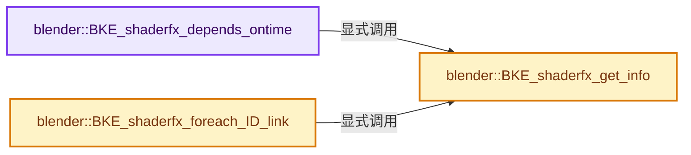
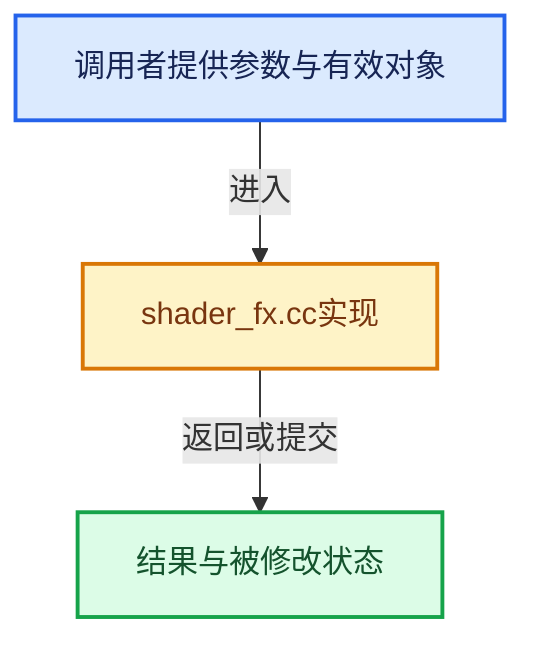

# 实现依赖专题：source/blender/blenkernel/intern/shader_fx.cc

[实现依赖导航](../../README.md) · [符号索引](../../../00-课程指南/02-源码与提交索引/符号依赖与实现索引.md)

本专题从正文实际调用进入，集中保存共享实现。函数有稳定锚点，可从调用处直接跳到对应完整函数；递归与互相调用通过回链组织。

## 本文件的实现关系






## 完整成员与函数实现

<a id="f-3219b7a51f50dcd3"></a>

### `blender::BKE_shaderfx_depends_ontime`

实现位置：[source/blender/blenkernel/intern/shader_fx.cc](../../../../../../../source/blender/blenkernel/intern/shader_fx.cc) · L127—L132。

接口参数：

- `ShaderFxData *fx`

**教学注释版**

<!-- annotated:18528c68c8f3b7 -->

```cpp
bool BKE_shaderfx_depends_ontime(ShaderFxData *fx)
{
  const ShaderFxTypeInfo *fxi = BKE_shaderfx_get_info(ShaderFxType(fx->type));

  return fxi->depends_on_time && fxi->depends_on_time(fx);
}
```

<details>
<summary>核对原始源码：source/blender/blenkernel/intern/shader_fx.cc · L127—L132</summary>

<!-- original:18528c68c8f3b7:source/blender/blenkernel/intern/shader_fx.cc:127:132 -->

```cpp
bool BKE_shaderfx_depends_ontime(ShaderFxData *fx)
{
  const ShaderFxTypeInfo *fxi = BKE_shaderfx_get_info(ShaderFxType(fx->type));

  return fxi->depends_on_time && fxi->depends_on_time(fx);
}
```

</details>

**结果出口**

- `return fxi->depends_on_time && fxi->depends_on_time(fx);`

**继续追踪实现**

- `BKE_shaderfx_get_info` → [blender::BKE_shaderfx_get_info · L134](shader_fx.cc.md#f-09b14e788d683a6b)。
- `ShaderFxType` → [blender::ShaderFxType](../../08-其他Blender模块/makesdna/DNA_shader_fx_types.h.md#t-ac85e8b68fec)。
- `fxi->depends_on_time` → [blender::depends_on_time · L303](../../08-其他Blender模块/modifiers/intern/MOD_weightvgproximity.cc.md#f-b8637851155e55f0)；[blender::depends_on_time · L143](../../08-其他Blender模块/modifiers/intern/MOD_weightvgmix.cc.md#f-88d8fbb65e6fcc75)；[blender::depends_on_time · L97](../../08-其他Blender模块/modifiers/intern/MOD_weightvgedit.cc.md#f-901243a5209b91f9)；[blender::depends_on_time · L75](../../08-其他Blender模块/modifiers/intern/MOD_grease_pencil_noise.cc.md#f-ea608cbb79fc8845)；[blender::depends_on_time · L51](../../08-其他Blender模块/modifiers/intern/MOD_wave.cc.md#f-f0a406faa15df7ae)；[blender::depends_on_time · L96](../../08-其他Blender模块/modifiers/intern/MOD_warp.cc.md#f-c5e0bd536d5480c7)；[blender::depends_on_time · L87](../../08-其他Blender模块/modifiers/intern/MOD_volume_displace.cc.md#f-a3cb1432d858b58b)；[blender::depends_on_time · L138](../../08-其他Blender模块/modifiers/intern/MOD_fluid.cc.md#f-5fb0bd41f1dd7229)；[blender::depends_on_time · L82](../../08-其他Blender模块/modifiers/intern/MOD_explode.cc.md#f-bfc63e8f13a644dd)；[blender::depends_on_time · L73](../../08-其他Blender模块/modifiers/intern/MOD_surface.cc.md#f-0ee31349451cba32)；[blender::depends_on_time · L137](../../08-其他Blender模块/modifiers/intern/MOD_dynamicpaint.cc.md#f-b0918e45ab9bdeaf)；[blender::depends_on_time · L72](../../08-其他Blender模块/modifiers/intern/MOD_displace.cc.md#f-aace5c916ee7ae31)；[blender::depends_on_time · L70](../../08-其他Blender模块/modifiers/intern/MOD_collision.cc.md#f-65a0ea2aa8dfffe3)；[blender::depends_on_time · L193](../../08-其他Blender模块/modifiers/intern/MOD_cloth.cc.md#f-c6403bc2d5884a87)；[blender::depends_on_time · L46](../../08-其他Blender模块/modifiers/intern/MOD_build.cc.md#f-bbcacfbc405bb2e1)；[blender::depends_on_time · L45](../../08-其他Blender模块/modifiers/intern/MOD_softbody.cc.md#f-2e044e08636ab602)；[blender::depends_on_time · L242](../../08-其他Blender模块/modifiers/intern/MOD_nodes.cc.md#f-bc6514f62da0dede)；[blender::depends_on_time · L296](../../08-其他Blender模块/modifiers/intern/MOD_meshsequencecache.cc.md#f-e2da1a2d5646fa01)；[blender::depends_on_time · L54](../../08-其他Blender模块/modifiers/intern/MOD_meshcache.cc.md#f-386e66c10ebefa17)。同名重载需按实参类型选择。

<a id="f-09b14e788d683a6b"></a>

### `blender::BKE_shaderfx_get_info`

实现位置：[source/blender/blenkernel/intern/shader_fx.cc](../../../../../../../source/blender/blenkernel/intern/shader_fx.cc) · L134—L142。

接口参数：

- `ShaderFxType type`

**教学注释版**

<!-- annotated:0a5f9946d3bca8 -->

```cpp
const ShaderFxTypeInfo *BKE_shaderfx_get_info(ShaderFxType type)
{
  /* type unsigned, no need to check < 0 */
  if (type < NUM_SHADER_FX_TYPES && type > 0 && shader_fx_types[type]->name[0] != '\0') {
    return shader_fx_types[type];
  }

  return nullptr;
}
```

<details>
<summary>核对原始源码：source/blender/blenkernel/intern/shader_fx.cc · L134—L142</summary>

<!-- original:0a5f9946d3bca8:source/blender/blenkernel/intern/shader_fx.cc:134:142 -->

```cpp
const ShaderFxTypeInfo *BKE_shaderfx_get_info(ShaderFxType type)
{
  /* type unsigned, no need to check < 0 */
  if (type < NUM_SHADER_FX_TYPES && type > 0 && shader_fx_types[type]->name[0] != '\0') {
    return shader_fx_types[type];
  }

  return nullptr;
}
```

</details>

**结果出口**

- `return shader_fx_types[type];`
- `return nullptr;`

**继续追踪实现**

本实现没有需要继续展开的显式调用；检查返回表达式、对象转换和调用者前置条件。

<a id="f-639177886584935b"></a>

### `blender::BKE_shaderfx_foreach_ID_link`

实现位置：[source/blender/blenkernel/intern/shader_fx.cc](../../../../../../../source/blender/blenkernel/intern/shader_fx.cc) · L239—L250。

接口参数：

- `Object *ob`
- `ShaderFxIDWalkFunc walk`
- `void *user_data`

**教学注释版**

<!-- annotated:d465fd53ba29de -->

```cpp
void BKE_shaderfx_foreach_ID_link(Object *ob, ShaderFxIDWalkFunc walk, void *user_data)
{
  ShaderFxData *fx = ob->shader_fx.first();

  for (; fx; fx = fx->next) {
    const ShaderFxTypeInfo *fxi = BKE_shaderfx_get_info(ShaderFxType(fx->type));

    if (fxi->foreach_ID_link) {
      fxi->foreach_ID_link(fx, ob, walk, user_data);
    }
  }
}
```

<details>
<summary>核对原始源码：source/blender/blenkernel/intern/shader_fx.cc · L239—L250</summary>

<!-- original:d465fd53ba29de:source/blender/blenkernel/intern/shader_fx.cc:239:250 -->

```cpp
void BKE_shaderfx_foreach_ID_link(Object *ob, ShaderFxIDWalkFunc walk, void *user_data)
{
  ShaderFxData *fx = ob->shader_fx.first();

  for (; fx; fx = fx->next) {
    const ShaderFxTypeInfo *fxi = BKE_shaderfx_get_info(ShaderFxType(fx->type));

    if (fxi->foreach_ID_link) {
      fxi->foreach_ID_link(fx, ob, walk, user_data);
    }
  }
}
```

</details>

**继续追踪实现**

- `ob->shader_fx.first` → [调用协议](../../../00-课程指南/01-路线与规范/模板宏与动态分派协议.md)：接收对象类型依赖auto、返回值或模板实例；不按同名猜测目标。调用位置L241。
- `BKE_shaderfx_get_info` → [blender::BKE_shaderfx_get_info · L134](shader_fx.cc.md#f-09b14e788d683a6b)。
- `ShaderFxType` → [blender::ShaderFxType](../../08-其他Blender模块/makesdna/DNA_shader_fx_types.h.md#t-ac85e8b68fec)。
- `fxi->foreach_ID_link` → [blender::foreach_ID_link · L61](../../08-其他Blender模块/shader_fx/intern/FX_shader_swirl.cc.md#f-624ffd8ef1929253)；[blender::foreach_ID_link · L74](../../08-其他Blender模块/shader_fx/intern/FX_shader_shadow.cc.md#f-ba0bc12adf2b9e28)；[blender::foreach_ID_link · L313](../../08-其他Blender模块/modifiers/intern/MOD_weightvgproximity.cc.md#f-3349f71bda299934)；[blender::foreach_ID_link · L153](../../08-其他Blender模块/modifiers/intern/MOD_weightvgmix.cc.md#f-86bd96bafcdaf1be)；[blender::foreach_ID_link · L107](../../08-其他Blender模块/modifiers/intern/MOD_weightvgedit.cc.md#f-588fea49738fdf80)；[blender::foreach_ID_link · L272](../../08-其他Blender模块/modifiers/intern/MOD_grease_pencil_noise.cc.md#f-24aff8a16d0b3487)；[blender::foreach_ID_link · L69](../../08-其他Blender模块/modifiers/intern/MOD_grease_pencil_multiply.cc.md#f-784727fdac316c73)；[blender::foreach_ID_link · L56](../../08-其他Blender模块/modifiers/intern/MOD_wave.cc.md#f-d03ad3f698b40ad1)；[blender::foreach_ID_link · L62](../../08-其他Blender模块/modifiers/intern/MOD_grease_pencil_mirror.cc.md#f-ce011295654a0642)；[blender::foreach_ID_link · L120](../../08-其他Blender模块/modifiers/intern/MOD_warp.cc.md#f-664b8d929a3b4a55)；[blender::foreach_ID_link · L68](../../08-其他Blender模块/modifiers/intern/MOD_volume_to_mesh.cc.md#f-43444339e908a376)；[blender::foreach_ID_link · L73](../../08-其他Blender模块/modifiers/intern/MOD_volume_displace.cc.md#f-e657d49db24766eb)；[blender::foreach_ID_link · L65](../../08-其他Blender模块/modifiers/intern/MOD_grease_pencil_length.cc.md#f-3ed0cfe08486d0de)；[blender::foreach_ID_link · L224](../../08-其他Blender模块/modifiers/intern/MOD_uvwarp.cc.md#f-9ea823fd71b6fb78)；[blender::foreach_ID_link · L59](../../08-其他Blender模块/modifiers/intern/MOD_uvproject.cc.md#f-7a84f03a144c35f8)；[blender::foreach_ID_link · L62](../../08-其他Blender模块/modifiers/intern/MOD_grease_pencil_lattice.cc.md#f-91bc010628f6b5a4)；[blender::foreach_ID_link · L84](../../08-其他Blender模块/modifiers/intern/MOD_grease_pencil_hook.cc.md#f-8ace23ea2fc1ce9a)；[blender::foreach_ID_link · L64](../../08-其他Blender模块/modifiers/intern/MOD_grease_pencil_envelope.cc.md#f-4e59b89eafdc3d8a)；[blender::foreach_ID_link · L80](../../08-其他Blender模块/modifiers/intern/MOD_grease_pencil_dash.cc.md#f-d1486862b6f104e6)；[blender::foreach_ID_link · L69](../../08-其他Blender模块/modifiers/intern/MOD_grease_pencil_color.cc.md#f-405e731e4b9631e3)；[blender::foreach_ID_link · L69](../../08-其他Blender模块/modifiers/intern/MOD_grease_pencil_build.cc.md#f-9efcf4d9f0ea9e7a)；[blender::foreach_ID_link · L69](../../08-其他Blender模块/modifiers/intern/MOD_grease_pencil_array.cc.md#f-0179cdf8612697d5)；[blender::foreach_ID_link · L254](../../08-其他Blender模块/modifiers/intern/MOD_surfacedeform.cc.md#f-0028eb0143a39536)；[blender::foreach_ID_link · L69](../../08-其他Blender模块/modifiers/intern/MOD_grease_pencil_armature.cc.md#f-6d967cb3cfbfe21e)；[blender::foreach_ID_link · L188](../../08-其他Blender模块/modifiers/intern/MOD_fluid.cc.md#f-98368271a676fdad)；[blender::foreach_ID_link · L142](../../08-其他Blender模块/modifiers/intern/MOD_dynamicpaint.cc.md#f-88fbf106ff0570fe)；[blender::foreach_ID_link · L83](../../08-其他Blender模块/modifiers/intern/MOD_displace.cc.md#f-6a655dcb551a066b)；[blender::foreach_ID_link · L84](../../08-其他Blender模块/modifiers/intern/MOD_datatransfer.cc.md#f-166e1359e1a66ac1)；[blender::foreach_ID_link · L67](../../08-其他Blender模块/modifiers/intern/MOD_curve.cc.md#f-fcfe4735b430f223)；[blender::foreach_ID_link · L237](../../08-其他Blender模块/modifiers/intern/MOD_cloth.cc.md#f-a5fd681b7408cce9)；[blender::foreach_ID_link · L65](../../08-其他Blender模块/modifiers/intern/MOD_cast.cc.md#f-9726c811e9837b83)；[blender::foreach_ID_link · L82](../../08-其他Blender模块/modifiers/intern/MOD_boolean.cc.md#f-b57958a0b00ef930)；[blender::foreach_ID_link · L64](../../08-其他Blender模块/modifiers/intern/MOD_array.cc.md#f-58bee7f1040012ed)；[blender::foreach_ID_link · L76](../../08-其他Blender模块/modifiers/intern/MOD_armature.cc.md#f-af1634a00f579e50)；[blender::foreach_ID_link · L407](../../08-其他Blender模块/modifiers/intern/MOD_simpledeform.cc.md#f-0f0f551e5cbcafb6)；[blender::foreach_ID_link · L69](../../08-其他Blender模块/modifiers/intern/MOD_shrinkwrap.cc.md#f-2783308b7e5ae798)；[blender::foreach_ID_link · L1037](../../08-其他Blender模块/modifiers/intern/MOD_screw.cc.md#f-19aa555f4f1c8700)；[blender::foreach_ID_link · L119](../../08-其他Blender模块/modifiers/intern/MOD_particleinstance.cc.md#f-baaa847e0b48e812)；[blender::foreach_ID_link · L573](../../08-其他Blender模块/modifiers/intern/MOD_normal_edit.cc.md#f-8552fdcc0a59008b)；[blender::foreach_ID_link · L261](../../08-其他Blender模块/modifiers/intern/MOD_nodes.cc.md#f-f2ded6cff5dae987)；[blender::foreach_ID_link · L43](../../08-其他Blender模块/modifiers/intern/MOD_mirror.cc.md#f-0f60683acb48c332)；[blender::foreach_ID_link · L62](../../08-其他Blender模块/modifiers/intern/MOD_mesh_to_volume.cc.md#f-441e947bc69d54bb)；[blender::foreach_ID_link · L307](../../08-其他Blender模块/modifiers/intern/MOD_meshsequencecache.cc.md#f-5bc9d968f42fdad3)；[blender::foreach_ID_link · L126](../../08-其他Blender模块/modifiers/intern/MOD_meshdeform.cc.md#f-0ce00988ea7ecb9e)；[blender::foreach_ID_link · L58](../../08-其他Blender模块/modifiers/intern/MOD_mask.cc.md#f-6e3eab0cee511ce7)；[blender::foreach_ID_link · L250](../../08-其他Blender模块/modifiers/intern/MOD_lineart.cc.md#f-918d7b92a8dd5870)；[blender::foreach_ID_link · L66](../../08-其他Blender模块/modifiers/intern/MOD_lattice.cc.md#f-5aa450ccff6f6c2d)；[blender::foreach_ID_link · L100](../../08-其他Blender模块/modifiers/intern/MOD_hook.cc.md#f-2a29f3a371afb5df)；[blender::foreach_ID_link · L71](../../08-其他Blender模块/modifiers/intern/MOD_grease_pencil_weight_proximity.cc.md#f-adcd54430d75cb0d)；[blender::foreach_ID_link · L74](../../08-其他Blender模块/modifiers/intern/MOD_grease_pencil_weight_angle.cc.md#f-a03a99c4ca900f84)；[blender::foreach_ID_link · L97](../../08-其他Blender模块/modifiers/intern/MOD_grease_pencil_tint.cc.md#f-b61bd09b4b386e0b)；[blender::foreach_ID_link · L81](../../08-其他Blender模块/modifiers/intern/MOD_grease_pencil_time.cc.md#f-52431ba120508393)；[blender::foreach_ID_link · L60](../../08-其他Blender模块/modifiers/intern/MOD_grease_pencil_thickness.cc.md#f-6202e6a7f448cec1)；[blender::foreach_ID_link · L68](../../08-其他Blender模块/modifiers/intern/MOD_grease_pencil_texture.cc.md#f-12cb91d85cd45a19)；[blender::foreach_ID_link · L154](../../08-其他Blender模块/modifiers/intern/MOD_grease_pencil_subdiv.cc.md#f-132f19d5fe7d4063)；[blender::foreach_ID_link · L62](../../08-其他Blender模块/modifiers/intern/MOD_grease_pencil_smooth.cc.md#f-a52ea3a2a870d0e3)；[blender::foreach_ID_link · L185](../../08-其他Blender模块/modifiers/intern/MOD_grease_pencil_simplify.cc.md#f-a5395502b7274b0c)；[blender::foreach_ID_link · L77](../../08-其他Blender模块/modifiers/intern/MOD_grease_pencil_shrinkwrap.cc.md#f-c27b5c4b02a06aaf)；[blender::foreach_ID_link · L78](../../08-其他Blender模块/modifiers/intern/MOD_grease_pencil_outline.cc.md#f-6ac666b46d601dd4)；[blender::foreach_ID_link · L62](../../08-其他Blender模块/modifiers/intern/MOD_grease_pencil_opacity.cc.md#f-ab0f828d6a5455f2)；[blender::foreach_ID_link · L64](../../08-其他Blender模块/modifiers/intern/MOD_grease_pencil_offset.cc.md#f-1d0bd0307c8ff199)。同名重载需按实参类型选择。
