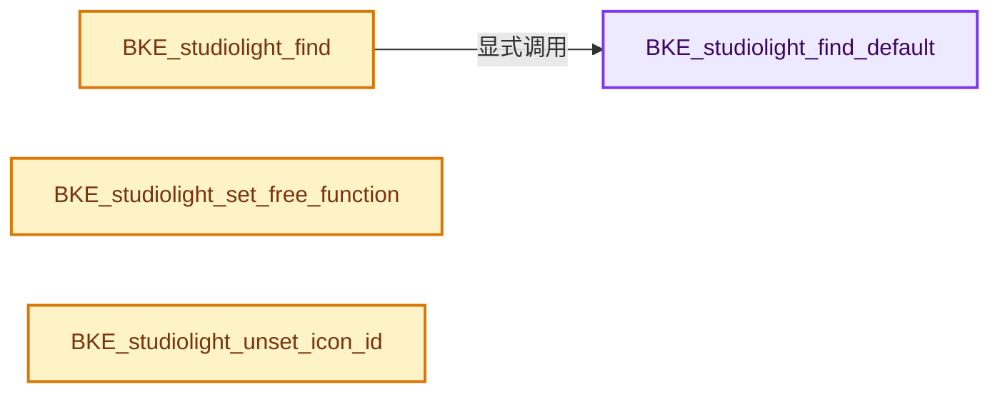
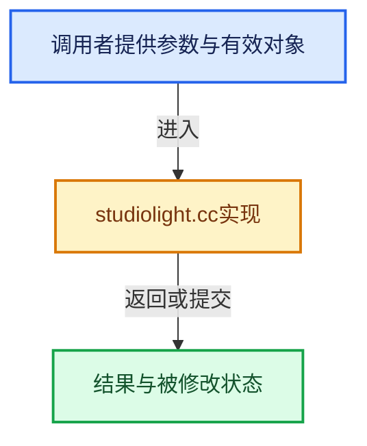

# 实现依赖专题：source/blender/blenkernel/intern/studiolight.cc

[实现依赖导航](../../README.md) · [符号索引](../../../00-课程指南/02-源码与提交索引/符号依赖与实现索引.md)

本专题从正文实际调用进入，集中保存共享实现。函数有稳定锚点，可从调用处直接跳到对应完整函数；递归与互相调用通过回链组织。

## 本文件的实现关系






## 完整成员与函数实现

<a id="f-ea16fbb430295308"></a>

### `BKE_studiolight_find_default`

实现位置：[source/blender/blenkernel/intern/studiolight.cc](../../../../../../../source/blender/blenkernel/intern/studiolight.cc) · L840—L863。

接口参数：

- `int flag`

**教学注释版**

<!-- annotated:de9ca8abc99d50 -->

```cpp
StudioLight *BKE_studiolight_find_default(int flag)
{
  const char *default_name = "";

  if (flag & STUDIOLIGHT_TYPE_WORLD) {
    default_name = STUDIOLIGHT_WORLD_DEFAULT;
  }
  else if (flag & STUDIOLIGHT_TYPE_MATCAP) {
    default_name = STUDIOLIGHT_MATCAP_DEFAULT;
  }

  for (StudioLight &sl : studiolights) {
    if ((sl.flag & flag) && STREQ(sl.name, default_name)) {
      return &sl;
    }
  }

  for (StudioLight &sl : studiolights) {
    if (sl.flag & flag) {
      return &sl;
    }
  }
  return nullptr;
}
```

<details>
<summary>核对原始源码：source/blender/blenkernel/intern/studiolight.cc · L840—L863</summary>

<!-- original:de9ca8abc99d50:source/blender/blenkernel/intern/studiolight.cc:840:863 -->

```cpp
StudioLight *BKE_studiolight_find_default(int flag)
{
  const char *default_name = "";

  if (flag & STUDIOLIGHT_TYPE_WORLD) {
    default_name = STUDIOLIGHT_WORLD_DEFAULT;
  }
  else if (flag & STUDIOLIGHT_TYPE_MATCAP) {
    default_name = STUDIOLIGHT_MATCAP_DEFAULT;
  }

  for (StudioLight &sl : studiolights) {
    if ((sl.flag & flag) && STREQ(sl.name, default_name)) {
      return &sl;
    }
  }

  for (StudioLight &sl : studiolights) {
    if (sl.flag & flag) {
      return &sl;
    }
  }
  return nullptr;
}
```

</details>

**沿实际写入检查状态**

- `default_name = STUDIOLIGHT_WORLD_DEFAULT;`
- `default_name = STUDIOLIGHT_MATCAP_DEFAULT;`

**结果出口**

- `return &sl;`
- `return nullptr;`

**继续追踪实现**

- `STREQ` → [STREQ · L112](../../07-Intern运行时与平台/ghost/intern/GHOST_utildefines.hh.md#m-9549fb6aafd2)；[STREQ · L451](../../01-BLI基础库/BLI_utildefines.hh.md#m-c7b745bcfad2)；[STREQ · L55](../../07-Intern运行时与平台/clog/clog.cc.md#m-96e78f386894)。宏定义由构建条件选择。

<a id="f-7808af8e21c0b75e"></a>

### `BKE_studiolight_find`

实现位置：[source/blender/blenkernel/intern/studiolight.cc](../../../../../../../source/blender/blenkernel/intern/studiolight.cc) · L865—L879。

接口参数：

- `const char *name`
- `int flag`

**教学注释版**

<!-- annotated:6254fdc7bbb857 -->

```cpp
StudioLight *BKE_studiolight_find(const char *name, int flag)
{
  for (StudioLight &sl : studiolights) {
    if (STREQLEN(sl.name, name, FILE_MAXFILE)) {
      if (sl.flag & flag) {
        return &sl;
      }

      /* flags do not match, so use default */
      return BKE_studiolight_find_default(flag);
    }
  }
  /* When not found, use the default studio light */
  return BKE_studiolight_find_default(flag);
}
```

<details>
<summary>核对原始源码：source/blender/blenkernel/intern/studiolight.cc · L865—L879</summary>

<!-- original:6254fdc7bbb857:source/blender/blenkernel/intern/studiolight.cc:865:879 -->

```cpp
StudioLight *BKE_studiolight_find(const char *name, int flag)
{
  for (StudioLight &sl : studiolights) {
    if (STREQLEN(sl.name, name, FILE_MAXFILE)) {
      if (sl.flag & flag) {
        return &sl;
      }

      /* flags do not match, so use default */
      return BKE_studiolight_find_default(flag);
    }
  }
  /* When not found, use the default studio light */
  return BKE_studiolight_find_default(flag);
}
```

</details>

**结果出口**

- `return &sl;`
- `return BKE_studiolight_find_default(flag);`

**继续追踪实现**

- `STREQLEN` → [STREQLEN · L114](../../07-Intern运行时与平台/ghost/intern/GHOST_utildefines.hh.md#m-4c9fb75cc1d1)；[STREQLEN · L453](../../01-BLI基础库/BLI_utildefines.hh.md#m-c74c1422ab62)；[STREQLEN · L56](../../07-Intern运行时与平台/clog/clog.cc.md#m-c4a18b1393b9)。宏定义由构建条件选择。
- `BKE_studiolight_find_default` → [BKE_studiolight_find_default · L840](studiolight.cc.md#f-ea16fbb430295308)。

<a id="f-d8cf982d316f0e8f"></a>

### `BKE_studiolight_set_free_function`

实现位置：[source/blender/blenkernel/intern/studiolight.cc](../../../../../../../source/blender/blenkernel/intern/studiolight.cc) · L1006—L1012。

接口参数：

- `StudioLight *sl`
- `StudioLightFreeFunction *free_function`
- `void *data`

**教学注释版**

<!-- annotated:097e0c57e6a21b -->

```cpp
void BKE_studiolight_set_free_function(StudioLight *sl,
                                       StudioLightFreeFunction *free_function,
                                       void *data)
{
  sl->free_function = free_function;
  sl->free_function_data = data;
}
```

<details>
<summary>核对原始源码：source/blender/blenkernel/intern/studiolight.cc · L1006—L1012</summary>

<!-- original:097e0c57e6a21b:source/blender/blenkernel/intern/studiolight.cc:1006:1012 -->

```cpp
void BKE_studiolight_set_free_function(StudioLight *sl,
                                       StudioLightFreeFunction *free_function,
                                       void *data)
{
  sl->free_function = free_function;
  sl->free_function_data = data;
}
```

</details>

**沿实际写入检查状态**

- `sl->free_function = free_function;`
- `sl->free_function_data = data;`

**继续追踪实现**

本实现没有需要继续展开的显式调用；检查返回表达式、对象转换和调用者前置条件。

<a id="f-1ff7aab040702102"></a>

### `BKE_studiolight_unset_icon_id`

实现位置：[source/blender/blenkernel/intern/studiolight.cc](../../../../../../../source/blender/blenkernel/intern/studiolight.cc) · L1014—L1029。

接口参数：

- `StudioLight *sl`
- `int icon_id`

**教学注释版**

<!-- annotated:2d07b7739daf33 -->

```cpp
void BKE_studiolight_unset_icon_id(StudioLight *sl, int icon_id)
{
  BLI_assert(sl != nullptr);
  if (sl->icon_id_radiance == icon_id) {
    sl->icon_id_radiance = 0;
  }
  if (sl->icon_id_irradiance == icon_id) {
    sl->icon_id_irradiance = 0;
  }
  if (sl->icon_id_matcap == icon_id) {
    sl->icon_id_matcap = 0;
  }
  if (sl->icon_id_matcap_flipped == icon_id) {
    sl->icon_id_matcap_flipped = 0;
  }
}
```

<details>
<summary>核对原始源码：source/blender/blenkernel/intern/studiolight.cc · L1014—L1029</summary>

<!-- original:2d07b7739daf33:source/blender/blenkernel/intern/studiolight.cc:1014:1029 -->

```cpp
void BKE_studiolight_unset_icon_id(StudioLight *sl, int icon_id)
{
  BLI_assert(sl != nullptr);
  if (sl->icon_id_radiance == icon_id) {
    sl->icon_id_radiance = 0;
  }
  if (sl->icon_id_irradiance == icon_id) {
    sl->icon_id_irradiance = 0;
  }
  if (sl->icon_id_matcap == icon_id) {
    sl->icon_id_matcap = 0;
  }
  if (sl->icon_id_matcap_flipped == icon_id) {
    sl->icon_id_matcap_flipped = 0;
  }
}
```

</details>

**沿实际写入检查状态**

- `sl->icon_id_radiance = 0;`
- `sl->icon_id_irradiance = 0;`
- `sl->icon_id_matcap = 0;`
- `sl->icon_id_matcap_flipped = 0;`

**继续追踪实现**

- `BLI_assert` → [BLI_assert · L48](../../01-BLI基础库/BLI_assert.hh.md#m-57a88495704d)；[BLI_assert · L63](../../01-BLI基础库/BLI_assert.hh.md#m-d07050020cb5)。宏定义由构建条件选择。
