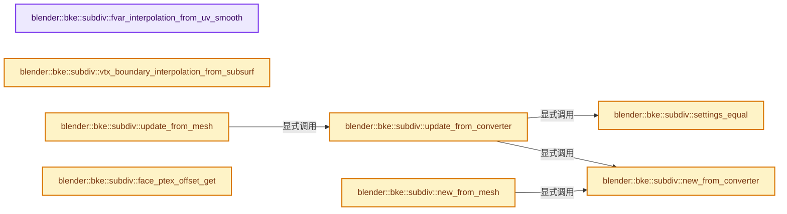
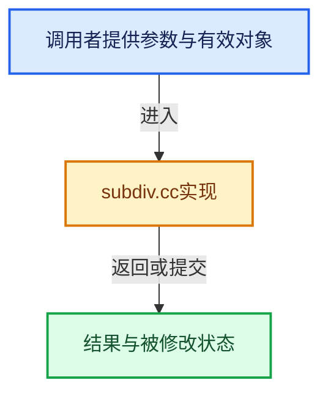

# 实现依赖专题：source/blender/blenkernel/intern/subdiv.cc

[实现依赖导航](../../README.md) · [符号索引](../../../00-课程指南/02-源码与提交索引/符号依赖与实现索引.md)

本专题从正文实际调用进入，集中保存共享实现。函数有稳定锚点，可从调用处直接跳到对应完整函数；递归与互相调用通过回链组织。

## 本文件的实现关系






## 完整成员与函数实现

<a id="f-767f64d27fdc130d"></a>

### `blender::bke::subdiv::fvar_interpolation_from_uv_smooth`

实现位置：[source/blender/blenkernel/intern/subdiv.cc](../../../../../../../source/blender/blenkernel/intern/subdiv.cc) · L49—L67。

接口参数：

- `int uv_smooth`

**教学注释版**

<!-- annotated:62dfcb68a06f52 -->

```cpp
FVarLinearInterpolation fvar_interpolation_from_uv_smooth(int uv_smooth)
{
  switch (uv_smooth) {
    case SUBSURF_UV_SMOOTH_NONE:
      return SUBDIV_FVAR_LINEAR_INTERPOLATION_ALL;
    case SUBSURF_UV_SMOOTH_PRESERVE_CORNERS:
      return SUBDIV_FVAR_LINEAR_INTERPOLATION_CORNERS_ONLY;
    case SUBSURF_UV_SMOOTH_PRESERVE_CORNERS_AND_JUNCTIONS:
      return SUBDIV_FVAR_LINEAR_INTERPOLATION_CORNERS_AND_JUNCTIONS;
    case SUBSURF_UV_SMOOTH_PRESERVE_CORNERS_JUNCTIONS_AND_CONCAVE:
      return SUBDIV_FVAR_LINEAR_INTERPOLATION_CORNERS_JUNCTIONS_AND_CONCAVE;
    case SUBSURF_UV_SMOOTH_PRESERVE_BOUNDARIES:
      return SUBDIV_FVAR_LINEAR_INTERPOLATION_BOUNDARIES;
    case SUBSURF_UV_SMOOTH_ALL:
      return SUBDIV_FVAR_LINEAR_INTERPOLATION_NONE;
  }
  BLI_assert_msg(0, "Unknown uv smooth flag");
  return SUBDIV_FVAR_LINEAR_INTERPOLATION_ALL;
}
```

<details>
<summary>核对原始源码：source/blender/blenkernel/intern/subdiv.cc · L49—L67</summary>

<!-- original:62dfcb68a06f52:source/blender/blenkernel/intern/subdiv.cc:49:67 -->

```cpp
FVarLinearInterpolation fvar_interpolation_from_uv_smooth(int uv_smooth)
{
  switch (uv_smooth) {
    case SUBSURF_UV_SMOOTH_NONE:
      return SUBDIV_FVAR_LINEAR_INTERPOLATION_ALL;
    case SUBSURF_UV_SMOOTH_PRESERVE_CORNERS:
      return SUBDIV_FVAR_LINEAR_INTERPOLATION_CORNERS_ONLY;
    case SUBSURF_UV_SMOOTH_PRESERVE_CORNERS_AND_JUNCTIONS:
      return SUBDIV_FVAR_LINEAR_INTERPOLATION_CORNERS_AND_JUNCTIONS;
    case SUBSURF_UV_SMOOTH_PRESERVE_CORNERS_JUNCTIONS_AND_CONCAVE:
      return SUBDIV_FVAR_LINEAR_INTERPOLATION_CORNERS_JUNCTIONS_AND_CONCAVE;
    case SUBSURF_UV_SMOOTH_PRESERVE_BOUNDARIES:
      return SUBDIV_FVAR_LINEAR_INTERPOLATION_BOUNDARIES;
    case SUBSURF_UV_SMOOTH_ALL:
      return SUBDIV_FVAR_LINEAR_INTERPOLATION_NONE;
  }
  BLI_assert_msg(0, "Unknown uv smooth flag");
  return SUBDIV_FVAR_LINEAR_INTERPOLATION_ALL;
}
```

</details>

**结果出口**

- `return SUBDIV_FVAR_LINEAR_INTERPOLATION_ALL;`
- `return SUBDIV_FVAR_LINEAR_INTERPOLATION_CORNERS_ONLY;`
- `return SUBDIV_FVAR_LINEAR_INTERPOLATION_CORNERS_AND_JUNCTIONS;`
- `return SUBDIV_FVAR_LINEAR_INTERPOLATION_CORNERS_JUNCTIONS_AND_CONCAVE;`
- `return SUBDIV_FVAR_LINEAR_INTERPOLATION_BOUNDARIES;`
- `return SUBDIV_FVAR_LINEAR_INTERPOLATION_NONE;`

**继续追踪实现**

- `BLI_assert_msg` → [BLI_assert_msg · L55](../../01-BLI基础库/BLI_assert.hh.md#m-695eed20dceb)；[BLI_assert_msg · L64](../../01-BLI基础库/BLI_assert.hh.md#m-7de5563de4db)。宏定义由构建条件选择。

<a id="f-933a39ad7057338e"></a>

### `blender::bke::subdiv::vtx_boundary_interpolation_from_subsurf`

实现位置：[source/blender/blenkernel/intern/subdiv.cc](../../../../../../../source/blender/blenkernel/intern/subdiv.cc) · L69—L79。

接口参数：

- `int boundary_smooth`

**教学注释版**

<!-- annotated:6d7ee2933320a6 -->

```cpp
VtxBoundaryInterpolation vtx_boundary_interpolation_from_subsurf(int boundary_smooth)
{
  switch (boundary_smooth) {
    case SUBSURF_BOUNDARY_SMOOTH_PRESERVE_CORNERS:
      return SUBDIV_VTX_BOUNDARY_EDGE_AND_CORNER;
    case SUBSURF_BOUNDARY_SMOOTH_ALL:
      return SUBDIV_VTX_BOUNDARY_EDGE_ONLY;
  }
  BLI_assert_msg(0, "Unknown boundary smooth flag");
  return SUBDIV_VTX_BOUNDARY_EDGE_ONLY;
}
```

<details>
<summary>核对原始源码：source/blender/blenkernel/intern/subdiv.cc · L69—L79</summary>

<!-- original:6d7ee2933320a6:source/blender/blenkernel/intern/subdiv.cc:69:79 -->

```cpp
VtxBoundaryInterpolation vtx_boundary_interpolation_from_subsurf(int boundary_smooth)
{
  switch (boundary_smooth) {
    case SUBSURF_BOUNDARY_SMOOTH_PRESERVE_CORNERS:
      return SUBDIV_VTX_BOUNDARY_EDGE_AND_CORNER;
    case SUBSURF_BOUNDARY_SMOOTH_ALL:
      return SUBDIV_VTX_BOUNDARY_EDGE_ONLY;
  }
  BLI_assert_msg(0, "Unknown boundary smooth flag");
  return SUBDIV_VTX_BOUNDARY_EDGE_ONLY;
}
```

</details>

**结果出口**

- `return SUBDIV_VTX_BOUNDARY_EDGE_AND_CORNER;`
- `return SUBDIV_VTX_BOUNDARY_EDGE_ONLY;`

**继续追踪实现**

- `BLI_assert_msg` → [BLI_assert_msg · L55](../../01-BLI基础库/BLI_assert.hh.md#m-695eed20dceb)；[BLI_assert_msg · L64](../../01-BLI基础库/BLI_assert.hh.md#m-7de5563de4db)。宏定义由构建条件选择。

<a id="f-3ec65419d5b37329"></a>

### `blender::bke::subdiv::settings_equal`

实现位置：[source/blender/blenkernel/intern/subdiv.cc](../../../../../../../source/blender/blenkernel/intern/subdiv.cc) · L85—L92。

接口参数：

- `const Settings *settings_a`
- `const Settings *settings_b`

**教学注释版**

<!-- annotated:7c3fd88c8d5efa -->

```cpp
bool settings_equal(const Settings *settings_a, const Settings *settings_b)
{
  return (settings_a->is_simple == settings_b->is_simple &&
          settings_a->is_adaptive == settings_b->is_adaptive &&
          settings_a->level == settings_b->level &&
          settings_a->vtx_boundary_interpolation == settings_b->vtx_boundary_interpolation &&
          settings_a->fvar_linear_interpolation == settings_b->fvar_linear_interpolation);
}
```

<details>
<summary>核对原始源码：source/blender/blenkernel/intern/subdiv.cc · L85—L92</summary>

<!-- original:7c3fd88c8d5efa:source/blender/blenkernel/intern/subdiv.cc:85:92 -->

```cpp
bool settings_equal(const Settings *settings_a, const Settings *settings_b)
{
  return (settings_a->is_simple == settings_b->is_simple &&
          settings_a->is_adaptive == settings_b->is_adaptive &&
          settings_a->level == settings_b->level &&
          settings_a->vtx_boundary_interpolation == settings_b->vtx_boundary_interpolation &&
          settings_a->fvar_linear_interpolation == settings_b->fvar_linear_interpolation);
}
```

</details>

**结果出口**

- `return (settings_a->is_simple == settings_b->is_simple &&`

**继续追踪实现**

本实现没有需要继续展开的显式调用；检查返回表达式、对象转换和调用者前置条件。

<a id="f-665aa0c873b427e8"></a>

### `blender::bke::subdiv::new_from_converter`

实现位置：[source/blender/blenkernel/intern/subdiv.cc](../../../../../../../source/blender/blenkernel/intern/subdiv.cc) · L100—L131。

接口参数：

- `const Settings *settings`
- `OpenSubdiv_Converter *converter`

**教学注释版**

<!-- annotated:797d6129185e23 -->

```cpp
Subdiv *new_from_converter(const Settings *settings, OpenSubdiv_Converter *converter)
{
#ifdef WITH_OPENSUBDIV
  SubdivStats stats;
  stats_init(&stats);
  stats_begin(&stats, SUBDIV_STATS_TOPOLOGY_REFINER_CREATION_TIME);
  OpenSubdiv_TopologyRefinerSettings topology_refiner_settings;
  topology_refiner_settings.level = settings->level;
  topology_refiner_settings.is_adaptive = settings->is_adaptive;
  opensubdiv::TopologyRefinerImpl *osd_topology_refiner = nullptr;
  if (converter->verts_num != 0) {
    osd_topology_refiner = opensubdiv::TopologyRefinerImpl::createFromConverter(
        converter, topology_refiner_settings);
  }
  else {
    /* TODO(sergey): Check whether original geometry had any vertices.
     * The thing here is: OpenSubdiv can only deal with faces, but our
     * side of subdiv also deals with loose vertices and edges. */
  }
  Subdiv *subdiv = MEM_new<Subdiv>(__func__);
  subdiv->settings = *settings;
  subdiv->topology_refiner = osd_topology_refiner;
  subdiv->evaluator = nullptr;
  subdiv->displacement_evaluator = nullptr;
  stats_end(&stats, SUBDIV_STATS_TOPOLOGY_REFINER_CREATION_TIME);
  subdiv->stats = stats;
  return subdiv;
#else
  UNUSED_VARS(settings, converter);
  return nullptr;
#endif
}
```

<details>
<summary>核对原始源码：source/blender/blenkernel/intern/subdiv.cc · L100—L131</summary>

<!-- original:797d6129185e23:source/blender/blenkernel/intern/subdiv.cc:100:131 -->

```cpp
Subdiv *new_from_converter(const Settings *settings, OpenSubdiv_Converter *converter)
{
#ifdef WITH_OPENSUBDIV
  SubdivStats stats;
  stats_init(&stats);
  stats_begin(&stats, SUBDIV_STATS_TOPOLOGY_REFINER_CREATION_TIME);
  OpenSubdiv_TopologyRefinerSettings topology_refiner_settings;
  topology_refiner_settings.level = settings->level;
  topology_refiner_settings.is_adaptive = settings->is_adaptive;
  opensubdiv::TopologyRefinerImpl *osd_topology_refiner = nullptr;
  if (converter->verts_num != 0) {
    osd_topology_refiner = opensubdiv::TopologyRefinerImpl::createFromConverter(
        converter, topology_refiner_settings);
  }
  else {
    /* TODO(sergey): Check whether original geometry had any vertices.
     * The thing here is: OpenSubdiv can only deal with faces, but our
     * side of subdiv also deals with loose vertices and edges. */
  }
  Subdiv *subdiv = MEM_new<Subdiv>(__func__);
  subdiv->settings = *settings;
  subdiv->topology_refiner = osd_topology_refiner;
  subdiv->evaluator = nullptr;
  subdiv->displacement_evaluator = nullptr;
  stats_end(&stats, SUBDIV_STATS_TOPOLOGY_REFINER_CREATION_TIME);
  subdiv->stats = stats;
  return subdiv;
#else
  UNUSED_VARS(settings, converter);
  return nullptr;
#endif
}
```

</details>

**沿实际写入检查状态**

- `topology_refiner_settings.level = settings->level;`
- `topology_refiner_settings.is_adaptive = settings->is_adaptive;`
- `osd_topology_refiner = opensubdiv::TopologyRefinerImpl::createFromConverter(`
- `subdiv->settings = *settings;`
- `subdiv->topology_refiner = osd_topology_refiner;`
- `subdiv->evaluator = nullptr;`
- `subdiv->displacement_evaluator = nullptr;`
- `subdiv->stats = stats;`

**结果出口**

- `return subdiv;`
- `return nullptr;`

**继续追踪实现**

- `stats_init` → [blender::bke::subdiv::stats_init · L17](subdiv_stats.cc.md#f-e319b4c12c925550)。
- `stats_begin` → [blender::bke::subdiv::stats_begin · L29](subdiv_stats.cc.md#f-46e30181ec51de7f)。
- `opensubdiv::TopologyRefinerImpl::createFromConverter` → [blender::opensubdiv::TopologyRefinerImpl::createFromConverter · L338](../../07-Intern运行时与平台/opensubdiv/internal/topology/topology_refiner_factory.cc.md#f-8053e22756186663)。
- `MEM_new<Subdiv>` → [MEM_new · L351](../../07-Intern运行时与平台/guardedalloc/MEM_guardedalloc.h.md#f-115f9b6784f89912)。
- `stats_end` → [blender::bke::subdiv::stats_end · L34](subdiv_stats.cc.md#f-f613b2e2856775cb)。
- `UNUSED_VARS` → [UNUSED_VARS · L522](../../01-BLI基础库/BLI_utildefines.hh.md#m-013582537634)；[UNUSED_VARS · L41](../../08-其他Blender模块/gpu/GPU_shader_shared_utils.hh.md#m-05d9d7a33da0)；[UNUSED_VARS · L62](../../08-其他Blender模块/gpu/GPU_shader_shared_utils.hh.md#m-e12c683a4aca)。宏定义由构建条件选择。

<a id="f-27cfb852fa96dc80"></a>

### `blender::bke::subdiv::new_from_mesh`

实现位置：[source/blender/blenkernel/intern/subdiv.cc](../../../../../../../source/blender/blenkernel/intern/subdiv.cc) · L133—L143。

接口参数：

- `const Settings *settings`
- `const Mesh *mesh`

**教学注释版**

<!-- annotated:e6f1c3d075773c -->

```cpp
Subdiv *new_from_mesh(const Settings *settings, const Mesh *mesh)
{
  if (mesh->verts_num == 0) {
    return nullptr;
  }
  OpenSubdiv_Converter converter;
  converter_init_for_mesh(&converter, settings, mesh);
  Subdiv *subdiv = new_from_converter(settings, &converter);
  converter_free(&converter);
  return subdiv;
}
```

<details>
<summary>核对原始源码：source/blender/blenkernel/intern/subdiv.cc · L133—L143</summary>

<!-- original:e6f1c3d075773c:source/blender/blenkernel/intern/subdiv.cc:133:143 -->

```cpp
Subdiv *new_from_mesh(const Settings *settings, const Mesh *mesh)
{
  if (mesh->verts_num == 0) {
    return nullptr;
  }
  OpenSubdiv_Converter converter;
  converter_init_for_mesh(&converter, settings, mesh);
  Subdiv *subdiv = new_from_converter(settings, &converter);
  converter_free(&converter);
  return subdiv;
}
```

</details>

**结果出口**

- `return nullptr;`
- `return subdiv;`

**继续追踪实现**

- `converter_init_for_mesh` → [blender::bke::subdiv::converter_init_for_mesh · L405](subdiv_converter_mesh.cc.md#f-266c51ca08322a69)。
- `new_from_converter` → [blender::bke::subdiv::new_from_converter · L100](subdiv.cc.md#f-665aa0c873b427e8)。
- `converter_free` → [blender::bke::subdiv::converter_free · L15](subdiv_converter.cc.md#f-cb699c2ac85acac1)。

<a id="f-c010a67793aaf847"></a>

### `blender::bke::subdiv::update_from_converter`

实现位置：[source/blender/blenkernel/intern/subdiv.cc](../../../../../../../source/blender/blenkernel/intern/subdiv.cc) · L147—L179。

接口参数：

- `Subdiv *subdiv`
- `const Settings *settings`
- `OpenSubdiv_Converter *converter`

**教学注释版**

<!-- annotated:1d0e9e7ee6c342 -->

```cpp
Subdiv *update_from_converter(Subdiv *subdiv,
                              const Settings *settings,
                              OpenSubdiv_Converter *converter)
{
#ifdef WITH_OPENSUBDIV
  /* Check if the existing descriptor can be re-used. */
  bool can_reuse_subdiv = true;
  if (subdiv != nullptr && subdiv->topology_refiner != nullptr) {
    if (!settings_equal(&subdiv->settings, settings)) {
      can_reuse_subdiv = false;
    }
    else {
      stats_begin(&subdiv->stats, SUBDIV_STATS_TOPOLOGY_COMPARE);
      can_reuse_subdiv = subdiv->topology_refiner->isEqualToConverter(converter);
      stats_end(&subdiv->stats, SUBDIV_STATS_TOPOLOGY_COMPARE);
    }
  }
  else {
    can_reuse_subdiv = false;
  }
  if (can_reuse_subdiv) {
    return subdiv;
  }
  /* Create new subdiv. */
  if (subdiv != nullptr) {
    // [讲解] free：归还相匹配的C分配存储，不自动执行C++析构；不可用于Windows的_aligned_malloc结果。
    free(subdiv);
  }
  return new_from_converter(settings, converter);
#else
  UNUSED_VARS(subdiv, settings, converter);
  return nullptr;
#endif
}
```

<details>
<summary>核对原始源码：source/blender/blenkernel/intern/subdiv.cc · L147—L179</summary>

<!-- original:1d0e9e7ee6c342:source/blender/blenkernel/intern/subdiv.cc:147:179 -->

```cpp
Subdiv *update_from_converter(Subdiv *subdiv,
                              const Settings *settings,
                              OpenSubdiv_Converter *converter)
{
#ifdef WITH_OPENSUBDIV
  /* Check if the existing descriptor can be re-used. */
  bool can_reuse_subdiv = true;
  if (subdiv != nullptr && subdiv->topology_refiner != nullptr) {
    if (!settings_equal(&subdiv->settings, settings)) {
      can_reuse_subdiv = false;
    }
    else {
      stats_begin(&subdiv->stats, SUBDIV_STATS_TOPOLOGY_COMPARE);
      can_reuse_subdiv = subdiv->topology_refiner->isEqualToConverter(converter);
      stats_end(&subdiv->stats, SUBDIV_STATS_TOPOLOGY_COMPARE);
    }
  }
  else {
    can_reuse_subdiv = false;
  }
  if (can_reuse_subdiv) {
    return subdiv;
  }
  /* Create new subdiv. */
  if (subdiv != nullptr) {
    free(subdiv);
  }
  return new_from_converter(settings, converter);
#else
  UNUSED_VARS(subdiv, settings, converter);
  return nullptr;
#endif
}
```

</details>

**沿实际写入检查状态**

- `can_reuse_subdiv = false;`
- `can_reuse_subdiv = subdiv->topology_refiner->isEqualToConverter(converter);`

**结果出口**

- `return subdiv;`
- `return new_from_converter(settings, converter);`
- `return nullptr;`

**继续追踪实现**

- `settings_equal` → [blender::bke::subdiv::settings_equal · L85](subdiv.cc.md#f-3ec65419d5b37329)。
- `stats_begin` → [blender::bke::subdiv::stats_begin · L29](subdiv_stats.cc.md#f-46e30181ec51de7f)。
- `subdiv->topology_refiner->isEqualToConverter` → [调用协议](../../../00-课程指南/01-路线与规范/模板宏与动态分派协议.md)：接收对象类型依赖auto、返回值或模板实例；不按同名猜测目标。调用位置L160。
- `stats_end` → [blender::bke::subdiv::stats_end · L34](subdiv_stats.cc.md#f-f613b2e2856775cb)。
- `free` → [外部契约](https://eel.is/c++draft/c.malloc)：归还相匹配的C分配存储，不自动执行C++析构；不可用于Windows的_aligned_malloc结果。
- `new_from_converter` → [blender::bke::subdiv::new_from_converter · L100](subdiv.cc.md#f-665aa0c873b427e8)。
- `UNUSED_VARS` → [UNUSED_VARS · L522](../../01-BLI基础库/BLI_utildefines.hh.md#m-013582537634)；[UNUSED_VARS · L41](../../08-其他Blender模块/gpu/GPU_shader_shared_utils.hh.md#m-05d9d7a33da0)；[UNUSED_VARS · L62](../../08-其他Blender模块/gpu/GPU_shader_shared_utils.hh.md#m-e12c683a4aca)。宏定义由构建条件选择。

<a id="f-a1de41130c6ac9c9"></a>

### `blender::bke::subdiv::update_from_mesh`

实现位置：[source/blender/blenkernel/intern/subdiv.cc](../../../../../../../source/blender/blenkernel/intern/subdiv.cc) · L181—L188。

接口参数：

- `Subdiv *subdiv`
- `const Settings *settings`
- `const Mesh *mesh`

**教学注释版**

<!-- annotated:129470b875b9c2 -->

```cpp
Subdiv *update_from_mesh(Subdiv *subdiv, const Settings *settings, const Mesh *mesh)
{
  OpenSubdiv_Converter converter;
  converter_init_for_mesh(&converter, settings, mesh);
  subdiv = update_from_converter(subdiv, settings, &converter);
  converter_free(&converter);
  return subdiv;
}
```

<details>
<summary>核对原始源码：source/blender/blenkernel/intern/subdiv.cc · L181—L188</summary>

<!-- original:129470b875b9c2:source/blender/blenkernel/intern/subdiv.cc:181:188 -->

```cpp
Subdiv *update_from_mesh(Subdiv *subdiv, const Settings *settings, const Mesh *mesh)
{
  OpenSubdiv_Converter converter;
  converter_init_for_mesh(&converter, settings, mesh);
  subdiv = update_from_converter(subdiv, settings, &converter);
  converter_free(&converter);
  return subdiv;
}
```

</details>

**沿实际写入检查状态**

- `subdiv = update_from_converter(subdiv, settings, &converter);`

**结果出口**

- `return subdiv;`

**继续追踪实现**

- `converter_init_for_mesh` → [blender::bke::subdiv::converter_init_for_mesh · L405](subdiv_converter_mesh.cc.md#f-266c51ca08322a69)。
- `update_from_converter` → [blender::bke::subdiv::update_from_converter · L147](subdiv.cc.md#f-c010a67793aaf847)。
- `converter_free` → [blender::bke::subdiv::converter_free · L15](subdiv_converter.cc.md#f-cb699c2ac85acac1)。

<a id="f-028aad6f12dcdad1"></a>

### `blender::bke::subdiv::face_ptex_offset_get`

实现位置：[source/blender/blenkernel/intern/subdiv.cc](../../../../../../../source/blender/blenkernel/intern/subdiv.cc) · L216—L241。

接口参数：

- `Subdiv *subdiv`

**教学注释版**

<!-- annotated:9a481d975e5147 -->

```cpp
Span<int> face_ptex_offset_get(Subdiv *subdiv)
{
#ifdef WITH_OPENSUBDIV
  if (!subdiv->cache_.face_ptex_offset.is_empty()) {
    return subdiv->cache_.face_ptex_offset;
  }
  const opensubdiv::TopologyRefinerImpl *topology_refiner = subdiv->topology_refiner;
  if (topology_refiner == nullptr) {
    return Span<int>();
  }
  const int num_coarse_faces = topology_refiner->base_level().GetNumFaces();
  subdiv->cache_.face_ptex_offset.reinitialize(num_coarse_faces + 1);
  int ptex_offset = 0;
  for (int face_index = 0; face_index < num_coarse_faces; face_index++) {
    const int face_size = topology_refiner->base_level().GetFaceVertices(face_index).size();
    const int num_ptex_faces = face_size == 4 ? 1 : face_size;
    subdiv->cache_.face_ptex_offset[face_index] = ptex_offset;
    ptex_offset += num_ptex_faces;
  }
  subdiv->cache_.face_ptex_offset[num_coarse_faces] = ptex_offset;
  return subdiv->cache_.face_ptex_offset;
#else
  UNUSED_VARS(subdiv);
  return Span<int>();
#endif
}
```

<details>
<summary>核对原始源码：source/blender/blenkernel/intern/subdiv.cc · L216—L241</summary>

<!-- original:9a481d975e5147:source/blender/blenkernel/intern/subdiv.cc:216:241 -->

```cpp
Span<int> face_ptex_offset_get(Subdiv *subdiv)
{
#ifdef WITH_OPENSUBDIV
  if (!subdiv->cache_.face_ptex_offset.is_empty()) {
    return subdiv->cache_.face_ptex_offset;
  }
  const opensubdiv::TopologyRefinerImpl *topology_refiner = subdiv->topology_refiner;
  if (topology_refiner == nullptr) {
    return Span<int>();
  }
  const int num_coarse_faces = topology_refiner->base_level().GetNumFaces();
  subdiv->cache_.face_ptex_offset.reinitialize(num_coarse_faces + 1);
  int ptex_offset = 0;
  for (int face_index = 0; face_index < num_coarse_faces; face_index++) {
    const int face_size = topology_refiner->base_level().GetFaceVertices(face_index).size();
    const int num_ptex_faces = face_size == 4 ? 1 : face_size;
    subdiv->cache_.face_ptex_offset[face_index] = ptex_offset;
    ptex_offset += num_ptex_faces;
  }
  subdiv->cache_.face_ptex_offset[num_coarse_faces] = ptex_offset;
  return subdiv->cache_.face_ptex_offset;
#else
  UNUSED_VARS(subdiv);
  return Span<int>();
#endif
}
```

</details>

**沿实际写入检查状态**

- `subdiv->cache_.face_ptex_offset[face_index] = ptex_offset;`
- `ptex_offset += num_ptex_faces;`
- `subdiv->cache_.face_ptex_offset[num_coarse_faces] = ptex_offset;`

**结果出口**

- `return subdiv->cache_.face_ptex_offset;`
- `return Span<int>();`

**继续追踪实现**

- `subdiv->cache_.face_ptex_offset.is_empty` → [调用协议](../../../00-课程指南/01-路线与规范/模板宏与动态分派协议.md)：接收对象类型依赖auto、返回值或模板实例；不按同名猜测目标。调用位置L219。
- `Span<int>` → [blender::Span](../../01-BLI基础库/BLI_span.hh.md#t-8765a8e0c1d5)；[blender::Span](../../01-BLI基础库/BLI_index_range.hh.md#t-86091874a1c0)；[blender::Span](../../08-其他Blender模块/makesdna/DNA_pointcloud_types.h.md#t-112aa6ed842c)；[blender::Span](../../08-其他Blender模块/makesdna/DNA_node_types.h.md#t-49ec6fbb9b69)；[blender::Span](../../08-其他Blender模块/makesdna/DNA_mesh_types.h.md#t-184fd48fb638)；[blender::Span](../../08-其他Blender模块/makesdna/DNA_anim_types.h.md#t-d841071994c2)；[blender::Span](../../08-其他Blender模块/makesrna/RNA_path_fwd.hh.md#t-4dbb08969e41)。
- `topology_refiner->base_level().GetNumFaces` → [调用协议](../../../00-课程指南/01-路线与规范/模板宏与动态分派协议.md)：接收对象类型依赖auto、返回值或模板实例；不按同名猜测目标。调用位置L226。
- `topology_refiner->base_level` → [blender::opensubdiv::TopologyRefinerImpl::base_level · L44](../../07-Intern运行时与平台/opensubdiv/opensubdiv_topology_refiner.hh.md#f-9d10c8cedec9c211)。
- `subdiv->cache_.face_ptex_offset.reinitialize` → [调用协议](../../../00-课程指南/01-路线与规范/模板宏与动态分派协议.md)：接收对象类型依赖auto、返回值或模板实例；不按同名猜测目标。调用位置L227。
- `topology_refiner->base_level().GetFaceVertices(face_index).size` → [调用协议](../../../00-课程指南/01-路线与规范/模板宏与动态分派协议.md)：接收对象类型依赖auto、返回值或模板实例；不按同名猜测目标。调用位置L230。
- `topology_refiner->base_level().GetFaceVertices` → [调用协议](../../../00-课程指南/01-路线与规范/模板宏与动态分派协议.md)：接收对象类型依赖auto、返回值或模板实例；不按同名猜测目标。调用位置L230。
- `UNUSED_VARS` → [UNUSED_VARS · L522](../../01-BLI基础库/BLI_utildefines.hh.md#m-013582537634)；[UNUSED_VARS · L41](../../08-其他Blender模块/gpu/GPU_shader_shared_utils.hh.md#m-05d9d7a33da0)；[UNUSED_VARS · L62](../../08-其他Blender模块/gpu/GPU_shader_shared_utils.hh.md#m-e12c683a4aca)。宏定义由构建条件选择。
