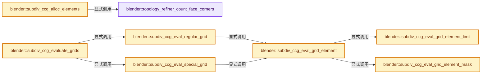
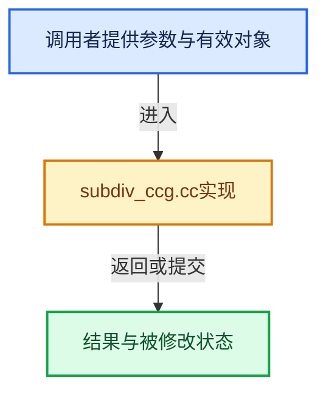

# 实现依赖专题：source/blender/blenkernel/intern/subdiv_ccg.cc

[实现依赖导航](../../README.md) · [符号索引](../../../00-课程指南/02-源码与提交索引/符号依赖与实现索引.md)

本专题从正文实际调用进入，集中保存共享实现。函数有稳定锚点，可从调用处直接跳到对应完整函数；递归与互相调用通过回链组织。

## 本文件的实现关系






## 完整成员与函数实现

<a id="f-ac58a58c684b8090"></a>

### `blender::topology_refiner_count_face_corners`

实现位置：[source/blender/blenkernel/intern/subdiv_ccg.cc](../../../../../../../source/blender/blenkernel/intern/subdiv_ccg.cc) · L58—L67。

接口参数：

- `const opensubdiv::TopologyRefinerImpl *topology_refiner`

**教学注释版**

<!-- annotated:3ce73ac6816df8 -->

```cpp
static int topology_refiner_count_face_corners(
    const opensubdiv::TopologyRefinerImpl *topology_refiner)
{
  const int num_faces = topology_refiner->base_level().GetNumFaces();
  int num_corners = 0;
  for (int face_index = 0; face_index < num_faces; face_index++) {
    num_corners += topology_refiner->base_level().GetFaceVertices(face_index).size();
  }
  return num_corners;
}
```

<details>
<summary>核对原始源码：source/blender/blenkernel/intern/subdiv_ccg.cc · L58—L67</summary>

<!-- original:3ce73ac6816df8:source/blender/blenkernel/intern/subdiv_ccg.cc:58:67 -->

```cpp
static int topology_refiner_count_face_corners(
    const opensubdiv::TopologyRefinerImpl *topology_refiner)
{
  const int num_faces = topology_refiner->base_level().GetNumFaces();
  int num_corners = 0;
  for (int face_index = 0; face_index < num_faces; face_index++) {
    num_corners += topology_refiner->base_level().GetFaceVertices(face_index).size();
  }
  return num_corners;
}
```

</details>

**沿实际写入检查状态**

- `num_corners += topology_refiner->base_level().GetFaceVertices(face_index).size();`

**结果出口**

- `return num_corners;`

**继续追踪实现**

- `topology_refiner->base_level().GetNumFaces` → [调用协议](../../../00-课程指南/01-路线与规范/模板宏与动态分派协议.md)：接收对象类型依赖auto、返回值或模板实例；不按同名猜测目标。调用位置L61。
- `topology_refiner->base_level` → [blender::opensubdiv::TopologyRefinerImpl::base_level · L44](../../07-Intern运行时与平台/opensubdiv/opensubdiv_topology_refiner.hh.md#f-9d10c8cedec9c211)。
- `topology_refiner->base_level().GetFaceVertices(face_index).size` → [调用协议](../../../00-课程指南/01-路线与规范/模板宏与动态分派协议.md)：接收对象类型依赖auto、返回值或模板实例；不按同名猜测目标。调用位置L64。
- `topology_refiner->base_level().GetFaceVertices` → [调用协议](../../../00-课程指南/01-路线与规范/模板宏与动态分派协议.md)：接收对象类型依赖auto、返回值或模板实例；不按同名猜测目标。调用位置L64。

<a id="f-5778ad5f0a4e026a"></a>

### `blender::subdiv_ccg_alloc_elements`

实现位置：[source/blender/blenkernel/intern/subdiv_ccg.cc](../../../../../../../source/blender/blenkernel/intern/subdiv_ccg.cc) · L71—L88。

接口参数：

- `SubdivCCG &subdiv_ccg`
- `Subdiv &subdiv`
- `const SubdivToCCGSettings &settings`

**教学注释版**

<!-- annotated:0f0edec0404f87 -->

```cpp
static void subdiv_ccg_alloc_elements(SubdivCCG &subdiv_ccg,
                                      Subdiv &subdiv,
                                      const SubdivToCCGSettings &settings)
{
  const opensubdiv::TopologyRefinerImpl *topology_refiner = subdiv.topology_refiner;
  /* Allocate memory for surface grids. */
  const int64_t num_grids = topology_refiner_count_face_corners(topology_refiner);
  const int64_t grid_size = grid_size_from_level(subdiv_ccg.level);
  const int64_t grid_area = grid_size * grid_size;
  subdiv_ccg.positions.reinitialize(num_grids * grid_area);
  if (settings.need_normal) {
    subdiv_ccg.normals.reinitialize(num_grids * grid_area);
  }
  if (settings.need_mask) {
    subdiv_ccg.masks.reinitialize(num_grids * grid_area);
  }
  /* TODO(sergey): Allocate memory for loose elements. */
}
```

<details>
<summary>核对原始源码：source/blender/blenkernel/intern/subdiv_ccg.cc · L71—L88</summary>

<!-- original:0f0edec0404f87:source/blender/blenkernel/intern/subdiv_ccg.cc:71:88 -->

```cpp
static void subdiv_ccg_alloc_elements(SubdivCCG &subdiv_ccg,
                                      Subdiv &subdiv,
                                      const SubdivToCCGSettings &settings)
{
  const opensubdiv::TopologyRefinerImpl *topology_refiner = subdiv.topology_refiner;
  /* Allocate memory for surface grids. */
  const int64_t num_grids = topology_refiner_count_face_corners(topology_refiner);
  const int64_t grid_size = grid_size_from_level(subdiv_ccg.level);
  const int64_t grid_area = grid_size * grid_size;
  subdiv_ccg.positions.reinitialize(num_grids * grid_area);
  if (settings.need_normal) {
    subdiv_ccg.normals.reinitialize(num_grids * grid_area);
  }
  if (settings.need_mask) {
    subdiv_ccg.masks.reinitialize(num_grids * grid_area);
  }
  /* TODO(sergey): Allocate memory for loose elements. */
}
```

</details>

**继续追踪实现**

- `topology_refiner_count_face_corners` → [blender::topology_refiner_count_face_corners · L58](subdiv_ccg.cc.md#f-ac58a58c684b8090)。
- `grid_size_from_level` → [blender::bke::subdiv::grid_size_from_level · L43](subdiv_inline.hh.md#f-b1d46bbf8975e481)。
- `subdiv_ccg.positions.reinitialize` → [调用协议](../../../00-课程指南/01-路线与规范/模板宏与动态分派协议.md)：接收对象类型依赖auto、返回值或模板实例；不按同名猜测目标。调用位置L80。
- `subdiv_ccg.normals.reinitialize` → [调用协议](../../../00-课程指南/01-路线与规范/模板宏与动态分派协议.md)：接收对象类型依赖auto、返回值或模板实例；不按同名猜测目标。调用位置L82。
- `subdiv_ccg.masks.reinitialize` → [调用协议](../../../00-课程指南/01-路线与规范/模板宏与动态分派协议.md)：接收对象类型依赖auto、返回值或模板实例；不按同名猜测目标。调用位置L85。

<a id="f-4dd8acadc7afd44b"></a>

### `blender::subdiv_ccg_eval_grid_element_limit`

实现位置：[source/blender/blenkernel/intern/subdiv_ccg.cc](../../../../../../../source/blender/blenkernel/intern/subdiv_ccg.cc) · L96—L117。

接口参数：

- `Subdiv &subdiv`
- `SubdivCCG &subdiv_ccg`
- `const int ptex_face_index`
- `const float u`
- `const float v`
- `const int element`

**教学注释版**

<!-- annotated:2f09041dd96271 -->

```cpp
static void subdiv_ccg_eval_grid_element_limit(Subdiv &subdiv,
                                               SubdivCCG &subdiv_ccg,
                                               const int ptex_face_index,
                                               const float u,
                                               const float v,
                                               const int element)
{
  if (subdiv.displacement_evaluator != nullptr) {
    subdiv_ccg.positions[element] = eval_final_point(&subdiv, ptex_face_index, u, v);
  }
  else if (!subdiv_ccg.normals.is_empty()) {
    eval_limit_point_and_normal(&subdiv,
                                ptex_face_index,
                                u,
                                v,
                                subdiv_ccg.positions[element],
                                subdiv_ccg.normals[element]);
  }
  else {
    subdiv_ccg.positions[element] = eval_limit_point(&subdiv, ptex_face_index, u, v);
  }
}
```

<details>
<summary>核对原始源码：source/blender/blenkernel/intern/subdiv_ccg.cc · L96—L117</summary>

<!-- original:2f09041dd96271:source/blender/blenkernel/intern/subdiv_ccg.cc:96:117 -->

```cpp
static void subdiv_ccg_eval_grid_element_limit(Subdiv &subdiv,
                                               SubdivCCG &subdiv_ccg,
                                               const int ptex_face_index,
                                               const float u,
                                               const float v,
                                               const int element)
{
  if (subdiv.displacement_evaluator != nullptr) {
    subdiv_ccg.positions[element] = eval_final_point(&subdiv, ptex_face_index, u, v);
  }
  else if (!subdiv_ccg.normals.is_empty()) {
    eval_limit_point_and_normal(&subdiv,
                                ptex_face_index,
                                u,
                                v,
                                subdiv_ccg.positions[element],
                                subdiv_ccg.normals[element]);
  }
  else {
    subdiv_ccg.positions[element] = eval_limit_point(&subdiv, ptex_face_index, u, v);
  }
}
```

</details>

**沿实际写入检查状态**

- `subdiv_ccg.positions[element] = eval_final_point(&subdiv, ptex_face_index, u, v);`
- `subdiv_ccg.positions[element] = eval_limit_point(&subdiv, ptex_face_index, u, v);`

**继续追踪实现**

- `eval_final_point` → [blender::bke::subdiv::eval_final_point · L383](subdiv_eval.cc.md#f-29cf765bee4f323d)。
- `subdiv_ccg.normals.is_empty` → [调用协议](../../../00-课程指南/01-路线与规范/模板宏与动态分派协议.md)：接收对象类型依赖auto、返回值或模板实例；不按同名猜测目标。调用位置L106。
- `eval_limit_point_and_normal` → [blender::bke::subdiv::eval_limit_point_and_normal · L329](subdiv_eval.cc.md#f-af380a8a3a9b0c34)。
- `eval_limit_point` → [blender::bke::subdiv::eval_limit_point · L286](subdiv_eval.cc.md#f-ffd3074245b37661)。

<a id="f-0ac76f4e9a8d0d95"></a>

### `blender::subdiv_ccg_eval_grid_element_mask`

实现位置：[source/blender/blenkernel/intern/subdiv_ccg.cc](../../../../../../../source/blender/blenkernel/intern/subdiv_ccg.cc) · L119—L135。

接口参数：

- `SubdivCCG &subdiv_ccg`
- `SubdivCCGMaskEvaluator *mask_evaluator`
- `const int ptex_face_index`
- `const float u`
- `const float v`
- `const int element`

**教学注释版**

<!-- annotated:a307500d73400f -->

```cpp
static void subdiv_ccg_eval_grid_element_mask(SubdivCCG &subdiv_ccg,
                                              SubdivCCGMaskEvaluator *mask_evaluator,
                                              const int ptex_face_index,
                                              const float u,
                                              const float v,
                                              const int element)
{
  if (subdiv_ccg.masks.is_empty()) {
    return;
  }
  if (mask_evaluator != nullptr) {
    subdiv_ccg.masks[element] = mask_evaluator->eval_mask(mask_evaluator, ptex_face_index, u, v);
  }
  else {
    subdiv_ccg.masks[element] = 0.0f;
  }
}
```

<details>
<summary>核对原始源码：source/blender/blenkernel/intern/subdiv_ccg.cc · L119—L135</summary>

<!-- original:a307500d73400f:source/blender/blenkernel/intern/subdiv_ccg.cc:119:135 -->

```cpp
static void subdiv_ccg_eval_grid_element_mask(SubdivCCG &subdiv_ccg,
                                              SubdivCCGMaskEvaluator *mask_evaluator,
                                              const int ptex_face_index,
                                              const float u,
                                              const float v,
                                              const int element)
{
  if (subdiv_ccg.masks.is_empty()) {
    return;
  }
  if (mask_evaluator != nullptr) {
    subdiv_ccg.masks[element] = mask_evaluator->eval_mask(mask_evaluator, ptex_face_index, u, v);
  }
  else {
    subdiv_ccg.masks[element] = 0.0f;
  }
}
```

</details>

**沿实际写入检查状态**

- `subdiv_ccg.masks[element] = mask_evaluator->eval_mask(mask_evaluator, ptex_face_index, u, v);`
- `subdiv_ccg.masks[element] = 0.0f;`

**继续追踪实现**

- `subdiv_ccg.masks.is_empty` → [调用协议](../../../00-课程指南/01-路线与规范/模板宏与动态分派协议.md)：接收对象类型依赖auto、返回值或模板实例；不按同名猜测目标。调用位置L126。
- `mask_evaluator->eval_mask` → [blender::eval_mask · L82](subdiv_ccg_mask.cc.md#f-c7f2ca4d94e514af)。

<a id="f-a7dbd79e2f1de3e9"></a>

### `blender::subdiv_ccg_eval_grid_element`

实现位置：[source/blender/blenkernel/intern/subdiv_ccg.cc](../../../../../../../source/blender/blenkernel/intern/subdiv_ccg.cc) · L137—L147。

接口参数：

- `Subdiv &subdiv`
- `SubdivCCG &subdiv_ccg`
- `SubdivCCGMaskEvaluator *mask_evaluator`
- `const int ptex_face_index`
- `const float u`
- `const float v`
- `const int element`

**教学注释版**

<!-- annotated:42939919978e58 -->

```cpp
static void subdiv_ccg_eval_grid_element(Subdiv &subdiv,
                                         SubdivCCG &subdiv_ccg,
                                         SubdivCCGMaskEvaluator *mask_evaluator,
                                         const int ptex_face_index,
                                         const float u,
                                         const float v,
                                         const int element)
{
  subdiv_ccg_eval_grid_element_limit(subdiv, subdiv_ccg, ptex_face_index, u, v, element);
  subdiv_ccg_eval_grid_element_mask(subdiv_ccg, mask_evaluator, ptex_face_index, u, v, element);
}
```

<details>
<summary>核对原始源码：source/blender/blenkernel/intern/subdiv_ccg.cc · L137—L147</summary>

<!-- original:42939919978e58:source/blender/blenkernel/intern/subdiv_ccg.cc:137:147 -->

```cpp
static void subdiv_ccg_eval_grid_element(Subdiv &subdiv,
                                         SubdivCCG &subdiv_ccg,
                                         SubdivCCGMaskEvaluator *mask_evaluator,
                                         const int ptex_face_index,
                                         const float u,
                                         const float v,
                                         const int element)
{
  subdiv_ccg_eval_grid_element_limit(subdiv, subdiv_ccg, ptex_face_index, u, v, element);
  subdiv_ccg_eval_grid_element_mask(subdiv_ccg, mask_evaluator, ptex_face_index, u, v, element);
}
```

</details>

**继续追踪实现**

- `subdiv_ccg_eval_grid_element_limit` → [blender::subdiv_ccg_eval_grid_element_limit · L96](subdiv_ccg.cc.md#f-4dd8acadc7afd44b)。
- `subdiv_ccg_eval_grid_element_mask` → [blender::subdiv_ccg_eval_grid_element_mask · L119](subdiv_ccg.cc.md#f-0ac76f4e9a8d0d95)。

<a id="f-871c84296732a16f"></a>

### `blender::subdiv_ccg_eval_regular_grid`

实现位置：[source/blender/blenkernel/intern/subdiv_ccg.cc](../../../../../../../source/blender/blenkernel/intern/subdiv_ccg.cc) · L149—L175。

接口参数：

- `Subdiv &subdiv`
- `SubdivCCG &subdiv_ccg`
- `const Span<int> face_ptex_offset`
- `SubdivCCGMaskEvaluator *mask_evaluator`
- `const int face_index`

**教学注释版**

<!-- annotated:f4ca34b40d43ef -->

```cpp
static void subdiv_ccg_eval_regular_grid(Subdiv &subdiv,
                                         SubdivCCG &subdiv_ccg,
                                         const Span<int> face_ptex_offset,
                                         SubdivCCGMaskEvaluator *mask_evaluator,
                                         const int face_index)
{
  const int ptex_face_index = face_ptex_offset[face_index];
  const int grid_size = subdiv_ccg.grid_size;
  const int grid_area = subdiv_ccg.grid_area;
  const float grid_size_1_inv = 1.0f / (grid_size - 1);
  const IndexRange face = subdiv_ccg.faces[face_index];
  // [讲解] face.size：读取连续区间或分组的边界信息。
  for (int corner = 0; corner < face.size(); corner++) {
    // [讲解] face.start：读取连续区间或分组的边界信息。
    const int grid_index = face.start() + corner;
    const IndexRange range = grid_range(grid_area, grid_index);
    for (int y = 0; y < grid_size; y++) {
      const float grid_v = y * grid_size_1_inv;
      for (int x = 0; x < grid_size; x++) {
        const float grid_u = x * grid_size_1_inv;
        float u, v;
        rotate_grid_to_quad(corner, grid_u, grid_v, &u, &v);
        const int element = range[CCG_grid_xy_to_index(grid_size, x, y)];
        subdiv_ccg_eval_grid_element(
            subdiv, subdiv_ccg, mask_evaluator, ptex_face_index, u, v, element);
      }
    }
  }
}
```

<details>
<summary>核对原始源码：source/blender/blenkernel/intern/subdiv_ccg.cc · L149—L175</summary>

<!-- original:f4ca34b40d43ef:source/blender/blenkernel/intern/subdiv_ccg.cc:149:175 -->

```cpp
static void subdiv_ccg_eval_regular_grid(Subdiv &subdiv,
                                         SubdivCCG &subdiv_ccg,
                                         const Span<int> face_ptex_offset,
                                         SubdivCCGMaskEvaluator *mask_evaluator,
                                         const int face_index)
{
  const int ptex_face_index = face_ptex_offset[face_index];
  const int grid_size = subdiv_ccg.grid_size;
  const int grid_area = subdiv_ccg.grid_area;
  const float grid_size_1_inv = 1.0f / (grid_size - 1);
  const IndexRange face = subdiv_ccg.faces[face_index];
  for (int corner = 0; corner < face.size(); corner++) {
    const int grid_index = face.start() + corner;
    const IndexRange range = grid_range(grid_area, grid_index);
    for (int y = 0; y < grid_size; y++) {
      const float grid_v = y * grid_size_1_inv;
      for (int x = 0; x < grid_size; x++) {
        const float grid_u = x * grid_size_1_inv;
        float u, v;
        rotate_grid_to_quad(corner, grid_u, grid_v, &u, &v);
        const int element = range[CCG_grid_xy_to_index(grid_size, x, y)];
        subdiv_ccg_eval_grid_element(
            subdiv, subdiv_ccg, mask_evaluator, ptex_face_index, u, v, element);
      }
    }
  }
}
```

</details>

**继续追踪实现**

- `face.size` → [blender::IndexRange::size · L156](../../../01-基础容器与现代CPP/04-IndexRange连续整数区间.md#f-05f66c3ebb2fdfec)。
- `face.start` → [blender::IndexRange::start · L243](../../../01-基础容器与现代CPP/04-IndexRange连续整数区间.md#f-99d2195bd9cfd1f0)。
- `grid_range` → [blender::bke::ccg::grid_range · L354](../BKE_subdiv_ccg.hh.md#f-9bddb2329ec72943)；[blender::bke::ccg::grid_range · L358](../BKE_subdiv_ccg.hh.md#f-7249652bbdaf1279)。同名重载需按实参类型选择。
- `rotate_grid_to_quad` → [blender::bke::subdiv::rotate_grid_to_quad · L94](subdiv_inline.hh.md#f-3f989276798d0773)。
- `CCG_grid_xy_to_index` → [blender::CCG_grid_xy_to_index · L75](../BKE_ccg.hh.md#f-cb617293b1c08b35)。
- `subdiv_ccg_eval_grid_element` → [blender::subdiv_ccg_eval_grid_element · L137](subdiv_ccg.cc.md#f-a7dbd79e2f1de3e9)。

<a id="f-e1ed46954a32567a"></a>

### `blender::subdiv_ccg_eval_special_grid`

实现位置：[source/blender/blenkernel/intern/subdiv_ccg.cc](../../../../../../../source/blender/blenkernel/intern/subdiv_ccg.cc) · L177—L201。

接口参数：

- `Subdiv &subdiv`
- `SubdivCCG &subdiv_ccg`
- `const Span<int> face_ptex_offset`
- `SubdivCCGMaskEvaluator *mask_evaluator`
- `const int face_index`

**教学注释版**

<!-- annotated:0bb1b8dc43ffdc -->

```cpp
static void subdiv_ccg_eval_special_grid(Subdiv &subdiv,
                                         SubdivCCG &subdiv_ccg,
                                         const Span<int> face_ptex_offset,
                                         SubdivCCGMaskEvaluator *mask_evaluator,
                                         const int face_index)
{
  const int grid_size = subdiv_ccg.grid_size;
  const int grid_area = subdiv_ccg.grid_area;
  const float grid_size_1_inv = 1.0f / (grid_size - 1);
  const IndexRange face = subdiv_ccg.faces[face_index];
  // [讲解] face.size：读取连续区间或分组的边界信息。
  for (int corner = 0; corner < face.size(); corner++) {
    // [讲解] face.start：读取连续区间或分组的边界信息。
    const int grid_index = face.start() + corner;
    const int ptex_face_index = face_ptex_offset[face_index] + corner;
    const IndexRange range = grid_range(grid_area, grid_index);
    for (int y = 0; y < grid_size; y++) {
      const float u = 1.0f - (y * grid_size_1_inv);
      for (int x = 0; x < grid_size; x++) {
        const float v = 1.0f - (x * grid_size_1_inv);
        const int element = range[CCG_grid_xy_to_index(grid_size, x, y)];
        subdiv_ccg_eval_grid_element(
            subdiv, subdiv_ccg, mask_evaluator, ptex_face_index, u, v, element);
      }
    }
  }
}
```

<details>
<summary>核对原始源码：source/blender/blenkernel/intern/subdiv_ccg.cc · L177—L201</summary>

<!-- original:0bb1b8dc43ffdc:source/blender/blenkernel/intern/subdiv_ccg.cc:177:201 -->

```cpp
static void subdiv_ccg_eval_special_grid(Subdiv &subdiv,
                                         SubdivCCG &subdiv_ccg,
                                         const Span<int> face_ptex_offset,
                                         SubdivCCGMaskEvaluator *mask_evaluator,
                                         const int face_index)
{
  const int grid_size = subdiv_ccg.grid_size;
  const int grid_area = subdiv_ccg.grid_area;
  const float grid_size_1_inv = 1.0f / (grid_size - 1);
  const IndexRange face = subdiv_ccg.faces[face_index];
  for (int corner = 0; corner < face.size(); corner++) {
    const int grid_index = face.start() + corner;
    const int ptex_face_index = face_ptex_offset[face_index] + corner;
    const IndexRange range = grid_range(grid_area, grid_index);
    for (int y = 0; y < grid_size; y++) {
      const float u = 1.0f - (y * grid_size_1_inv);
      for (int x = 0; x < grid_size; x++) {
        const float v = 1.0f - (x * grid_size_1_inv);
        const int element = range[CCG_grid_xy_to_index(grid_size, x, y)];
        subdiv_ccg_eval_grid_element(
            subdiv, subdiv_ccg, mask_evaluator, ptex_face_index, u, v, element);
      }
    }
  }
}
```

</details>

**继续追踪实现**

- `face.size` → [blender::IndexRange::size · L156](../../../01-基础容器与现代CPP/04-IndexRange连续整数区间.md#f-05f66c3ebb2fdfec)。
- `face.start` → [blender::IndexRange::start · L243](../../../01-基础容器与现代CPP/04-IndexRange连续整数区间.md#f-99d2195bd9cfd1f0)。
- `grid_range` → [blender::bke::ccg::grid_range · L354](../BKE_subdiv_ccg.hh.md#f-9bddb2329ec72943)；[blender::bke::ccg::grid_range · L358](../BKE_subdiv_ccg.hh.md#f-7249652bbdaf1279)。同名重载需按实参类型选择。
- `CCG_grid_xy_to_index` → [blender::CCG_grid_xy_to_index · L75](../BKE_ccg.hh.md#f-cb617293b1c08b35)。
- `subdiv_ccg_eval_grid_element` → [blender::subdiv_ccg_eval_grid_element · L137](subdiv_ccg.cc.md#f-a7dbd79e2f1de3e9)。

<a id="f-ae7b516b98c7eff4"></a>

### `blender::subdiv_ccg_evaluate_grids`

实现位置：[source/blender/blenkernel/intern/subdiv_ccg.cc](../../../../../../../source/blender/blenkernel/intern/subdiv_ccg.cc) · L203—L229。

接口参数：

- `SubdivCCG &subdiv_ccg`
- `Subdiv &subdiv`
- `SubdivCCGMaskEvaluator *mask_evaluator`

**教学注释版**

<!-- annotated:46596ffad83b6e -->

```cpp
static bool subdiv_ccg_evaluate_grids(SubdivCCG &subdiv_ccg,
                                      Subdiv &subdiv,
                                      SubdivCCGMaskEvaluator *mask_evaluator)
{
  const opensubdiv::TopologyRefinerImpl *topology_refiner = subdiv.topology_refiner;
  const int num_faces = topology_refiner->base_level().GetNumFaces();
  const Span<int> face_ptex_offset = face_ptex_offset_get(&subdiv);
  // [讲解] face_ptex_offset.size：查询视图长度或生成对应有效索引区间。
  BLI_assert(face_ptex_offset.size() == subdiv_ccg.faces.size() + 1);
  threading::parallel_for(IndexRange(num_faces), 1024, [&](const IndexRange range) {
    for (const int face_index : range) {
      if (subdiv_ccg.faces[face_index].size() == 4) {
        subdiv_ccg_eval_regular_grid(
            subdiv, subdiv_ccg, face_ptex_offset, mask_evaluator, face_index);
      }
      else {
        subdiv_ccg_eval_special_grid(
            subdiv, subdiv_ccg, face_ptex_offset, mask_evaluator, face_index);
      }
    }
  });
  /* If displacement is used, need to calculate normals after all final
   * coordinates are known. */
  if (subdiv.displacement_evaluator != nullptr) {
    BKE_subdiv_ccg_recalc_normals(subdiv_ccg);
  }
  return true;
}
```

<details>
<summary>核对原始源码：source/blender/blenkernel/intern/subdiv_ccg.cc · L203—L229</summary>

<!-- original:46596ffad83b6e:source/blender/blenkernel/intern/subdiv_ccg.cc:203:229 -->

```cpp
static bool subdiv_ccg_evaluate_grids(SubdivCCG &subdiv_ccg,
                                      Subdiv &subdiv,
                                      SubdivCCGMaskEvaluator *mask_evaluator)
{
  const opensubdiv::TopologyRefinerImpl *topology_refiner = subdiv.topology_refiner;
  const int num_faces = topology_refiner->base_level().GetNumFaces();
  const Span<int> face_ptex_offset = face_ptex_offset_get(&subdiv);
  BLI_assert(face_ptex_offset.size() == subdiv_ccg.faces.size() + 1);
  threading::parallel_for(IndexRange(num_faces), 1024, [&](const IndexRange range) {
    for (const int face_index : range) {
      if (subdiv_ccg.faces[face_index].size() == 4) {
        subdiv_ccg_eval_regular_grid(
            subdiv, subdiv_ccg, face_ptex_offset, mask_evaluator, face_index);
      }
      else {
        subdiv_ccg_eval_special_grid(
            subdiv, subdiv_ccg, face_ptex_offset, mask_evaluator, face_index);
      }
    }
  });
  /* If displacement is used, need to calculate normals after all final
   * coordinates are known. */
  if (subdiv.displacement_evaluator != nullptr) {
    BKE_subdiv_ccg_recalc_normals(subdiv_ccg);
  }
  return true;
}
```

</details>

**结果出口**

- `return true;`

**继续追踪实现**

- `topology_refiner->base_level().GetNumFaces` → [调用协议](../../../00-课程指南/01-路线与规范/模板宏与动态分派协议.md)：接收对象类型依赖auto、返回值或模板实例；不按同名猜测目标。调用位置L208。
- `topology_refiner->base_level` → [blender::opensubdiv::TopologyRefinerImpl::base_level · L44](../../07-Intern运行时与平台/opensubdiv/opensubdiv_topology_refiner.hh.md#f-9d10c8cedec9c211)。
- `face_ptex_offset_get` → [blender::bke::subdiv::face_ptex_offset_get · L216](subdiv.cc.md#f-028aad6f12dcdad1)。
- `BLI_assert` → [BLI_assert · L48](../../01-BLI基础库/BLI_assert.hh.md#m-57a88495704d)；[BLI_assert · L63](../../01-BLI基础库/BLI_assert.hh.md#m-d07050020cb5)。宏定义由构建条件选择。
- `face_ptex_offset.size` → [blender::Span::size · L256](../../../01-基础容器与现代CPP/05-Span只读连续视图.md#f-5f80fa006089c998)。
- `subdiv_ccg.faces.size` → [调用协议](../../../00-课程指南/01-路线与规范/模板宏与动态分派协议.md)：接收对象类型依赖auto、返回值或模板实例；不按同名猜测目标。调用位置L210。
- `threading::parallel_for` → [blender::threading::parallel_for · L68](../../../11-Depsgraph与并行任务系统/07-任务池与TBB接入.md#f-838294754c24426c)。
- `IndexRange` → [blender::IndexRange](../../01-BLI基础库/BLI_index_range.hh.md#t-caa3466d6776)；[blender::gpu::shader::parser::IndexRange](../../08-其他Blender模块/gpu/shader_tool/utils.hh.md#t-82d2bd4ea71c)；[blender::IndexRange](../../08-其他Blender模块/makesdna/DNA_node_types.h.md#t-0448cc889d39)。
- `subdiv_ccg.faces[face_index].size` → [调用协议](../../../00-课程指南/01-路线与规范/模板宏与动态分派协议.md)：接收对象类型依赖auto、返回值或模板实例；不按同名猜测目标。调用位置L213。
- `subdiv_ccg_eval_regular_grid` → [blender::subdiv_ccg_eval_regular_grid · L149](subdiv_ccg.cc.md#f-871c84296732a16f)。
- `subdiv_ccg_eval_special_grid` → [blender::subdiv_ccg_eval_special_grid · L177](subdiv_ccg.cc.md#f-e1ed46954a32567a)。
- `BKE_subdiv_ccg_recalc_normals` → [blender::BKE_subdiv_ccg_recalc_normals · L571](subdiv_ccg.cc.md#f-4bb3779fd776e84b)。

<a id="f-279f460ebfeadbad"></a>

### `blender::subdiv_ccg_allocate_adjacent_edges`

实现位置：[source/blender/blenkernel/intern/subdiv_ccg.cc](../../../../../../../source/blender/blenkernel/intern/subdiv_ccg.cc) · L231—L234。

接口参数：

- `SubdivCCG &subdiv_ccg`
- `const int num_edges`

**教学注释版**

<!-- annotated:b1c4cac6058ec8 -->

```cpp
static void subdiv_ccg_allocate_adjacent_edges(SubdivCCG &subdiv_ccg, const int num_edges)
{
  subdiv_ccg.adjacent_edges = Array<SubdivCCGAdjacentEdge>(num_edges, SubdivCCGAdjacentEdge{});
}
```

<details>
<summary>核对原始源码：source/blender/blenkernel/intern/subdiv_ccg.cc · L231—L234</summary>

<!-- original:b1c4cac6058ec8:source/blender/blenkernel/intern/subdiv_ccg.cc:231:234 -->

```cpp
static void subdiv_ccg_allocate_adjacent_edges(SubdivCCG &subdiv_ccg, const int num_edges)
{
  subdiv_ccg.adjacent_edges = Array<SubdivCCGAdjacentEdge>(num_edges, SubdivCCGAdjacentEdge{});
}
```

</details>

**沿实际写入检查状态**

- `subdiv_ccg.adjacent_edges = Array<SubdivCCGAdjacentEdge>(num_edges, SubdivCCGAdjacentEdge{});`

**继续追踪实现**

- `Array<SubdivCCGAdjacentEdge>` → [blender::Array::Array · L78](../../../01-基础容器与现代CPP/07-Array构造与存储.md#f-001fd5eb3c658238)；[blender::Array::Array · L84](../../../01-基础容器与现代CPP/07-Array构造与存储.md#f-674e2f10361a462b)；[blender::Array::Array · L89](../../../01-基础容器与现代CPP/07-Array构造与存储.md#f-aa1e5908a9b67557)；[blender::Array::Array · L103](../../../01-基础容器与现代CPP/07-Array构造与存储.md#f-b141be39084346f3)；[blender::Array::Array · L110](../../../01-基础容器与现代CPP/07-Array构造与存储.md#f-452e276f39e81a2a)；[blender::Array::Array · L123](../../../01-基础容器与现代CPP/07-Array构造与存储.md#f-646aa58152ec44f6)；[blender::Array::Array · L135](../../../01-基础容器与现代CPP/07-Array构造与存储.md#f-0a9de4a549125f99)；[blender::Array::Array · L168](../../../01-基础容器与现代CPP/07-Array构造与存储.md#f-31f001eb92069e9d)；[blender::Array::Array · L176](../../../01-基础容器与现代CPP/07-Array构造与存储.md#f-cf8148f06fc6747a)；[blender::Array::Array · L178](../../../01-基础容器与现代CPP/07-Array构造与存储.md#f-2ddca2fb9dd964b3)。同名重载需按实参类型选择。

<a id="f-7fe79fa9c23848e7"></a>

### `blender::subdiv_ccg_coord`

实现位置：[source/blender/blenkernel/intern/subdiv_ccg.cc](../../../../../../../source/blender/blenkernel/intern/subdiv_ccg.cc) · L236—L243。

接口参数：

- `int grid_index`
- `int x`
- `int y`

**教学注释版**

<!-- annotated:13795ffc1ad9b2 -->

```cpp
static SubdivCCGCoord subdiv_ccg_coord(int grid_index, int x, int y)
{
  SubdivCCGCoord coord{};
  coord.grid_index = grid_index;
  coord.x = x;
  coord.y = y;
  return coord;
}
```

<details>
<summary>核对原始源码：source/blender/blenkernel/intern/subdiv_ccg.cc · L236—L243</summary>

<!-- original:13795ffc1ad9b2:source/blender/blenkernel/intern/subdiv_ccg.cc:236:243 -->

```cpp
static SubdivCCGCoord subdiv_ccg_coord(int grid_index, int x, int y)
{
  SubdivCCGCoord coord{};
  coord.grid_index = grid_index;
  coord.x = x;
  coord.y = y;
  return coord;
}
```

</details>

**沿实际写入检查状态**

- `coord.grid_index = grid_index;`
- `coord.x = x;`
- `coord.y = y;`

**结果出口**

- `return coord;`

**继续追踪实现**

本实现没有需要继续展开的显式调用；检查返回表达式、对象转换和调用者前置条件。

<a id="f-00b0d9319e82a056"></a>

### `blender::subdiv_ccg_adjacent_edge_add_face`

实现位置：[source/blender/blenkernel/intern/subdiv_ccg.cc](../../../../../../../source/blender/blenkernel/intern/subdiv_ccg.cc) · L246—L252。

接口参数：

- `const int num_elements`
- `SubdivCCGAdjacentEdge &adjacent_edge`

**教学注释版**

<!-- annotated:5dc2be56acba69 -->

```cpp
static MutableSpan<SubdivCCGCoord> subdiv_ccg_adjacent_edge_add_face(
    const int num_elements, SubdivCCGAdjacentEdge &adjacent_edge)
{
  Array<SubdivCCGCoord> coords(num_elements);
  // [讲解] std::move：把表达式转换成可供移动重载选择的值类别；不保证真的移动，不结束源对象寿命，对const值可能选择复制。
  adjacent_edge.boundary_coords.append(std::move(coords));
  return adjacent_edge.boundary_coords[adjacent_edge.boundary_coords.size() - 1];
}
```

<details>
<summary>核对原始源码：source/blender/blenkernel/intern/subdiv_ccg.cc · L246—L252</summary>

<!-- original:5dc2be56acba69:source/blender/blenkernel/intern/subdiv_ccg.cc:246:252 -->

```cpp
static MutableSpan<SubdivCCGCoord> subdiv_ccg_adjacent_edge_add_face(
    const int num_elements, SubdivCCGAdjacentEdge &adjacent_edge)
{
  Array<SubdivCCGCoord> coords(num_elements);
  adjacent_edge.boundary_coords.append(std::move(coords));
  return adjacent_edge.boundary_coords[adjacent_edge.boundary_coords.size() - 1];
}
```

</details>

**结果出口**

- `return adjacent_edge.boundary_coords[adjacent_edge.boundary_coords.size() - 1];`

**继续追踪实现**

- `adjacent_edge.boundary_coords.append` → [调用协议](../../../00-课程指南/01-路线与规范/模板宏与动态分派协议.md)：接收对象类型依赖auto、返回值或模板实例；不按同名猜测目标。调用位置L250。
- `std::move` → [外部契约](https://eel.is/c++draft/utility.forward)：把表达式转换成可供移动重载选择的值类别；不保证真的移动，不结束源对象寿命，对const值可能选择复制。
- `adjacent_edge.boundary_coords.size` → [调用协议](../../../00-课程指南/01-路线与规范/模板宏与动态分派协议.md)：接收对象类型依赖auto、返回值或模板实例；不按同名猜测目标。调用位置L251。

<a id="f-4eb54981ef9959a5"></a>

### `blender::subdiv_ccg_init_faces_edge_neighborhood`

实现位置：[source/blender/blenkernel/intern/subdiv_ccg.cc](../../../../../../../source/blender/blenkernel/intern/subdiv_ccg.cc) · L254—L314。

接口参数：

- `SubdivCCG &subdiv_ccg`

**教学注释版**

<!-- annotated:3ae18dad576cdd -->

```cpp
static void subdiv_ccg_init_faces_edge_neighborhood(SubdivCCG &subdiv_ccg)
{
  Subdiv *subdiv = subdiv_ccg.subdiv;
  const OffsetIndices<int> faces = subdiv_ccg.faces;
  const OpenSubdiv::Far::TopologyLevel &base_level = subdiv->topology_refiner->base_level();
  const int num_edges = base_level.GetNumEdges();
  const int grid_size = subdiv_ccg.grid_size;
  if (num_edges == 0) {
    /* Early output, nothing to do in this case. */
    return;
  }
  subdiv_ccg_allocate_adjacent_edges(subdiv_ccg, num_edges);

  /* Store adjacency for all faces. */
  for (const int face_index : faces.index_range()) {
    const IndexRange face = faces[face_index];
    // [讲解] face.size：读取连续区间或分组的边界信息。
    const int num_face_grids = face.size();
    const OpenSubdiv::Far::ConstIndexArray face_vertices = base_level.GetFaceVertices(face_index);
    /* Note that order of edges is same as order of MLoops, which also
     * means it's the same as order of grids. */
    const OpenSubdiv::Far::ConstIndexArray face_edges = base_level.GetFaceEdges(face_index);
    /* Store grids adjacency for this edge. */
    for (int corner = 0; corner < num_face_grids; corner++) {
      const int vertex_index = face_vertices[corner];
      const int edge_index = face_edges[corner];
      const OpenSubdiv::Far::ConstIndexArray edge_vertices = base_level.GetEdgeVertices(
          edge_index);
      const bool is_edge_flipped = (edge_vertices[0] != vertex_index);
      /* Grid which is adjacent to the current corner. */
      // [讲解] face.start：读取连续区间或分组的边界信息。
      const int current_grid_index = face.start() + corner;
      /* Grid which is adjacent to the next corner. */
      const int next_grid_index = face.start() + (corner + 1) % num_face_grids;
      /* Add new face to the adjacent edge. */
      SubdivCCGAdjacentEdge &adjacent_edge = subdiv_ccg.adjacent_edges[edge_index];
      MutableSpan<SubdivCCGCoord> boundary_coords = subdiv_ccg_adjacent_edge_add_face(
          grid_size * 2, adjacent_edge);
      /* Fill CCG elements along the edge. */
      int boundary_element_index = 0;
      if (is_edge_flipped) {
        for (int i = 0; i < grid_size; i++) {
          boundary_coords[boundary_element_index++] = subdiv_ccg_coord(
              next_grid_index, grid_size - i - 1, grid_size - 1);
        }
        for (int i = 0; i < grid_size; i++) {
          boundary_coords[boundary_element_index++] = subdiv_ccg_coord(
              current_grid_index, grid_size - 1, i);
        }
      }
      else {
        for (int i = 0; i < grid_size; i++) {
          boundary_coords[boundary_element_index++] = subdiv_ccg_coord(
              current_grid_index, grid_size - 1, grid_size - i - 1);
        }
        for (int i = 0; i < grid_size; i++) {
          boundary_coords[boundary_element_index++] = subdiv_ccg_coord(
              next_grid_index, i, grid_size - 1);
        }
      }
    }
  }
}
```

<details>
<summary>核对原始源码：source/blender/blenkernel/intern/subdiv_ccg.cc · L254—L314</summary>

<!-- original:3ae18dad576cdd:source/blender/blenkernel/intern/subdiv_ccg.cc:254:314 -->

```cpp
static void subdiv_ccg_init_faces_edge_neighborhood(SubdivCCG &subdiv_ccg)
{
  Subdiv *subdiv = subdiv_ccg.subdiv;
  const OffsetIndices<int> faces = subdiv_ccg.faces;
  const OpenSubdiv::Far::TopologyLevel &base_level = subdiv->topology_refiner->base_level();
  const int num_edges = base_level.GetNumEdges();
  const int grid_size = subdiv_ccg.grid_size;
  if (num_edges == 0) {
    /* Early output, nothing to do in this case. */
    return;
  }
  subdiv_ccg_allocate_adjacent_edges(subdiv_ccg, num_edges);

  /* Store adjacency for all faces. */
  for (const int face_index : faces.index_range()) {
    const IndexRange face = faces[face_index];
    const int num_face_grids = face.size();
    const OpenSubdiv::Far::ConstIndexArray face_vertices = base_level.GetFaceVertices(face_index);
    /* Note that order of edges is same as order of MLoops, which also
     * means it's the same as order of grids. */
    const OpenSubdiv::Far::ConstIndexArray face_edges = base_level.GetFaceEdges(face_index);
    /* Store grids adjacency for this edge. */
    for (int corner = 0; corner < num_face_grids; corner++) {
      const int vertex_index = face_vertices[corner];
      const int edge_index = face_edges[corner];
      const OpenSubdiv::Far::ConstIndexArray edge_vertices = base_level.GetEdgeVertices(
          edge_index);
      const bool is_edge_flipped = (edge_vertices[0] != vertex_index);
      /* Grid which is adjacent to the current corner. */
      const int current_grid_index = face.start() + corner;
      /* Grid which is adjacent to the next corner. */
      const int next_grid_index = face.start() + (corner + 1) % num_face_grids;
      /* Add new face to the adjacent edge. */
      SubdivCCGAdjacentEdge &adjacent_edge = subdiv_ccg.adjacent_edges[edge_index];
      MutableSpan<SubdivCCGCoord> boundary_coords = subdiv_ccg_adjacent_edge_add_face(
          grid_size * 2, adjacent_edge);
      /* Fill CCG elements along the edge. */
      int boundary_element_index = 0;
      if (is_edge_flipped) {
        for (int i = 0; i < grid_size; i++) {
          boundary_coords[boundary_element_index++] = subdiv_ccg_coord(
              next_grid_index, grid_size - i - 1, grid_size - 1);
        }
        for (int i = 0; i < grid_size; i++) {
          boundary_coords[boundary_element_index++] = subdiv_ccg_coord(
              current_grid_index, grid_size - 1, i);
        }
      }
      else {
        for (int i = 0; i < grid_size; i++) {
          boundary_coords[boundary_element_index++] = subdiv_ccg_coord(
              current_grid_index, grid_size - 1, grid_size - i - 1);
        }
        for (int i = 0; i < grid_size; i++) {
          boundary_coords[boundary_element_index++] = subdiv_ccg_coord(
              next_grid_index, i, grid_size - 1);
        }
      }
    }
  }
}
```

</details>

**继续追踪实现**

- `subdiv->topology_refiner->base_level` → [调用协议](../../../00-课程指南/01-路线与规范/模板宏与动态分派协议.md)：接收对象类型依赖auto、返回值或模板实例；不按同名猜测目标。调用位置L258。
- `base_level.GetNumEdges` → [调用协议](../../../00-课程指南/01-路线与规范/模板宏与动态分派协议.md)：由接收对象具体类型或运行时策略提供实现。调用位置L259。
- `subdiv_ccg_allocate_adjacent_edges` → [blender::subdiv_ccg_allocate_adjacent_edges · L231](subdiv_ccg.cc.md#f-279f460ebfeadbad)。
- `faces.index_range` → [blender::offset_indices::OffsetIndices::index_range · L77](../../../05-几何存储与拓扑映射/02-OffsetIndices完整接口.md#f-19b5ca1456de007d)。
- `face.size` → [blender::IndexRange::size · L156](../../../01-基础容器与现代CPP/04-IndexRange连续整数区间.md#f-05f66c3ebb2fdfec)。
- `base_level.GetFaceVertices` → [调用协议](../../../00-课程指南/01-路线与规范/模板宏与动态分派协议.md)：由接收对象具体类型或运行时策略提供实现。调用位置L271。
- `base_level.GetFaceEdges` → [调用协议](../../../00-课程指南/01-路线与规范/模板宏与动态分派协议.md)：由接收对象具体类型或运行时策略提供实现。调用位置L274。
- `base_level.GetEdgeVertices` → [调用协议](../../../00-课程指南/01-路线与规范/模板宏与动态分派协议.md)：由接收对象具体类型或运行时策略提供实现。调用位置L279。
- `face.start` → [blender::IndexRange::start · L243](../../../01-基础容器与现代CPP/04-IndexRange连续整数区间.md#f-99d2195bd9cfd1f0)。
- `subdiv_ccg_adjacent_edge_add_face` → [blender::subdiv_ccg_adjacent_edge_add_face · L246](subdiv_ccg.cc.md#f-00b0d9319e82a056)。
- `subdiv_ccg_coord` → [blender::subdiv_ccg_coord · L236](subdiv_ccg.cc.md#f-7fe79fa9c23848e7)。

<a id="f-0888c835aab9cd53"></a>

### `blender::subdiv_ccg_allocate_adjacent_vertices`

实现位置：[source/blender/blenkernel/intern/subdiv_ccg.cc](../../../../../../../source/blender/blenkernel/intern/subdiv_ccg.cc) · L316—L320。

接口参数：

- `SubdivCCG &subdiv_ccg`
- `const int num_vertices`

**教学注释版**

<!-- annotated:cdbec75ef000fc -->

```cpp
static void subdiv_ccg_allocate_adjacent_vertices(SubdivCCG &subdiv_ccg, const int num_vertices)
{
  subdiv_ccg.adjacent_verts = Array<SubdivCCGAdjacentVertex>(num_vertices,
                                                             SubdivCCGAdjacentVertex{});
}
```

<details>
<summary>核对原始源码：source/blender/blenkernel/intern/subdiv_ccg.cc · L316—L320</summary>

<!-- original:cdbec75ef000fc:source/blender/blenkernel/intern/subdiv_ccg.cc:316:320 -->

```cpp
static void subdiv_ccg_allocate_adjacent_vertices(SubdivCCG &subdiv_ccg, const int num_vertices)
{
  subdiv_ccg.adjacent_verts = Array<SubdivCCGAdjacentVertex>(num_vertices,
                                                             SubdivCCGAdjacentVertex{});
}
```

</details>

**沿实际写入检查状态**

- `subdiv_ccg.adjacent_verts = Array<SubdivCCGAdjacentVertex>(num_vertices,`

**继续追踪实现**

- `Array<SubdivCCGAdjacentVertex>` → [blender::Array::Array · L78](../../../01-基础容器与现代CPP/07-Array构造与存储.md#f-001fd5eb3c658238)；[blender::Array::Array · L84](../../../01-基础容器与现代CPP/07-Array构造与存储.md#f-674e2f10361a462b)；[blender::Array::Array · L89](../../../01-基础容器与现代CPP/07-Array构造与存储.md#f-aa1e5908a9b67557)；[blender::Array::Array · L103](../../../01-基础容器与现代CPP/07-Array构造与存储.md#f-b141be39084346f3)；[blender::Array::Array · L110](../../../01-基础容器与现代CPP/07-Array构造与存储.md#f-452e276f39e81a2a)；[blender::Array::Array · L123](../../../01-基础容器与现代CPP/07-Array构造与存储.md#f-646aa58152ec44f6)；[blender::Array::Array · L135](../../../01-基础容器与现代CPP/07-Array构造与存储.md#f-0a9de4a549125f99)；[blender::Array::Array · L168](../../../01-基础容器与现代CPP/07-Array构造与存储.md#f-31f001eb92069e9d)；[blender::Array::Array · L176](../../../01-基础容器与现代CPP/07-Array构造与存储.md#f-cf8148f06fc6747a)；[blender::Array::Array · L178](../../../01-基础容器与现代CPP/07-Array构造与存储.md#f-2ddca2fb9dd964b3)。同名重载需按实参类型选择。

<a id="f-bb6917cceb5e2a27"></a>

### `blender::subdiv_ccg_adjacent_vertex_add_face`

实现位置：[source/blender/blenkernel/intern/subdiv_ccg.cc](../../../../../../../source/blender/blenkernel/intern/subdiv_ccg.cc) · L324—L330。

接口参数：

- `SubdivCCGAdjacentVertex &adjacent_vertex`
- `const int grid_index`
- `const short x`
- `const short y`

**教学注释版**

<!-- annotated:78dbff56b24eb4 -->

```cpp
static void subdiv_ccg_adjacent_vertex_add_face(SubdivCCGAdjacentVertex &adjacent_vertex,
                                                const int grid_index,
                                                const short x,
                                                const short y)
{
  adjacent_vertex.corner_coords.append(SubdivCCGCoord{grid_index, x, y});
}
```

<details>
<summary>核对原始源码：source/blender/blenkernel/intern/subdiv_ccg.cc · L324—L330</summary>

<!-- original:78dbff56b24eb4:source/blender/blenkernel/intern/subdiv_ccg.cc:324:330 -->

```cpp
static void subdiv_ccg_adjacent_vertex_add_face(SubdivCCGAdjacentVertex &adjacent_vertex,
                                                const int grid_index,
                                                const short x,
                                                const short y)
{
  adjacent_vertex.corner_coords.append(SubdivCCGCoord{grid_index, x, y});
}
```

</details>

**继续追踪实现**

- `adjacent_vertex.corner_coords.append` → [调用协议](../../../00-课程指南/01-路线与规范/模板宏与动态分派协议.md)：接收对象类型依赖auto、返回值或模板实例；不按同名猜测目标。调用位置L329。

<a id="f-f8ba1a38af424146"></a>

### `blender::subdiv_ccg_init_faces_vertex_neighborhood`

实现位置：[source/blender/blenkernel/intern/subdiv_ccg.cc](../../../../../../../source/blender/blenkernel/intern/subdiv_ccg.cc) · L332—L360。

接口参数：

- `SubdivCCG &subdiv_ccg`

**教学注释版**

<!-- annotated:036d1cc26c8f39 -->

```cpp
static void subdiv_ccg_init_faces_vertex_neighborhood(SubdivCCG &subdiv_ccg)
{
  Subdiv *subdiv = subdiv_ccg.subdiv;
  const OffsetIndices<int> faces = subdiv_ccg.faces;
  const opensubdiv::TopologyRefinerImpl *topology_refiner = subdiv->topology_refiner;
  const int num_vertices = topology_refiner->base_level().GetNumVertices();
  const int grid_size = subdiv_ccg.grid_size;
  if (num_vertices == 0) {
    /* Early output, nothing to do in this case. */
    return;
  }
  subdiv_ccg_allocate_adjacent_vertices(subdiv_ccg, num_vertices);
  /* Store adjacency for all faces. */
  for (const int face_index : faces.index_range()) {
    const IndexRange face = faces[face_index];
    // [讲解] face.size：读取连续区间或分组的边界信息。
    const int num_face_grids = face.size();
    const OpenSubdiv::Far::ConstIndexArray face_vertices =
        topology_refiner->base_level().GetFaceVertices(face_index);
    for (int corner = 0; corner < num_face_grids; corner++) {
      const int vertex_index = face_vertices[corner];
      /* Grid which is adjacent to the current corner. */
      // [讲解] face.start：读取连续区间或分组的边界信息。
      const int grid_index = face.start() + corner;
      /* Add new face to the adjacent edge. */
      SubdivCCGAdjacentVertex &adjacent_vertex = subdiv_ccg.adjacent_verts[vertex_index];
      subdiv_ccg_adjacent_vertex_add_face(
          adjacent_vertex, grid_index, grid_size - 1, grid_size - 1);
    }
  }
}
```

<details>
<summary>核对原始源码：source/blender/blenkernel/intern/subdiv_ccg.cc · L332—L360</summary>

<!-- original:036d1cc26c8f39:source/blender/blenkernel/intern/subdiv_ccg.cc:332:360 -->

```cpp
static void subdiv_ccg_init_faces_vertex_neighborhood(SubdivCCG &subdiv_ccg)
{
  Subdiv *subdiv = subdiv_ccg.subdiv;
  const OffsetIndices<int> faces = subdiv_ccg.faces;
  const opensubdiv::TopologyRefinerImpl *topology_refiner = subdiv->topology_refiner;
  const int num_vertices = topology_refiner->base_level().GetNumVertices();
  const int grid_size = subdiv_ccg.grid_size;
  if (num_vertices == 0) {
    /* Early output, nothing to do in this case. */
    return;
  }
  subdiv_ccg_allocate_adjacent_vertices(subdiv_ccg, num_vertices);
  /* Store adjacency for all faces. */
  for (const int face_index : faces.index_range()) {
    const IndexRange face = faces[face_index];
    const int num_face_grids = face.size();
    const OpenSubdiv::Far::ConstIndexArray face_vertices =
        topology_refiner->base_level().GetFaceVertices(face_index);
    for (int corner = 0; corner < num_face_grids; corner++) {
      const int vertex_index = face_vertices[corner];
      /* Grid which is adjacent to the current corner. */
      const int grid_index = face.start() + corner;
      /* Add new face to the adjacent edge. */
      SubdivCCGAdjacentVertex &adjacent_vertex = subdiv_ccg.adjacent_verts[vertex_index];
      subdiv_ccg_adjacent_vertex_add_face(
          adjacent_vertex, grid_index, grid_size - 1, grid_size - 1);
    }
  }
}
```

</details>

**继续追踪实现**

- `topology_refiner->base_level().GetNumVertices` → [调用协议](../../../00-课程指南/01-路线与规范/模板宏与动态分派协议.md)：接收对象类型依赖auto、返回值或模板实例；不按同名猜测目标。调用位置L337。
- `topology_refiner->base_level` → [blender::opensubdiv::TopologyRefinerImpl::base_level · L44](../../07-Intern运行时与平台/opensubdiv/opensubdiv_topology_refiner.hh.md#f-9d10c8cedec9c211)。
- `subdiv_ccg_allocate_adjacent_vertices` → [blender::subdiv_ccg_allocate_adjacent_vertices · L316](subdiv_ccg.cc.md#f-0888c835aab9cd53)。
- `faces.index_range` → [blender::offset_indices::OffsetIndices::index_range · L77](../../../05-几何存储与拓扑映射/02-OffsetIndices完整接口.md#f-19b5ca1456de007d)。
- `face.size` → [blender::IndexRange::size · L156](../../../01-基础容器与现代CPP/04-IndexRange连续整数区间.md#f-05f66c3ebb2fdfec)。
- `topology_refiner->base_level().GetFaceVertices` → [调用协议](../../../00-课程指南/01-路线与规范/模板宏与动态分派协议.md)：接收对象类型依赖auto、返回值或模板实例；不按同名猜测目标。调用位置L349。
- `face.start` → [blender::IndexRange::start · L243](../../../01-基础容器与现代CPP/04-IndexRange连续整数区间.md#f-99d2195bd9cfd1f0)。
- `subdiv_ccg_adjacent_vertex_add_face` → [blender::subdiv_ccg_adjacent_vertex_add_face · L324](subdiv_ccg.cc.md#f-bb6917cceb5e2a27)。

<a id="f-e64ccb32b2b5ebcb"></a>

### `blender::subdiv_ccg_init_faces_neighborhood`

实现位置：[source/blender/blenkernel/intern/subdiv_ccg.cc](../../../../../../../source/blender/blenkernel/intern/subdiv_ccg.cc) · L362—L366。

接口参数：

- `SubdivCCG &subdiv_ccg`

**教学注释版**

<!-- annotated:5ca76163ee4934 -->

```cpp
static void subdiv_ccg_init_faces_neighborhood(SubdivCCG &subdiv_ccg)
{
  subdiv_ccg_init_faces_edge_neighborhood(subdiv_ccg);
  subdiv_ccg_init_faces_vertex_neighborhood(subdiv_ccg);
}
```

<details>
<summary>核对原始源码：source/blender/blenkernel/intern/subdiv_ccg.cc · L362—L366</summary>

<!-- original:5ca76163ee4934:source/blender/blenkernel/intern/subdiv_ccg.cc:362:366 -->

```cpp
static void subdiv_ccg_init_faces_neighborhood(SubdivCCG &subdiv_ccg)
{
  subdiv_ccg_init_faces_edge_neighborhood(subdiv_ccg);
  subdiv_ccg_init_faces_vertex_neighborhood(subdiv_ccg);
}
```

</details>

**继续追踪实现**

- `subdiv_ccg_init_faces_edge_neighborhood` → [blender::subdiv_ccg_init_faces_edge_neighborhood · L254](subdiv_ccg.cc.md#f-4eb54981ef9959a5)。
- `subdiv_ccg_init_faces_vertex_neighborhood` → [blender::subdiv_ccg_init_faces_vertex_neighborhood · L332](subdiv_ccg.cc.md#f-f8ba1a38af424146)。

<a id="f-04cad45775935a12"></a>

### `blender::BKE_subdiv_to_ccg`

实现位置：[source/blender/blenkernel/intern/subdiv_ccg.cc](../../../../../../../source/blender/blenkernel/intern/subdiv_ccg.cc) · L376—L406。

接口参数：

- `Subdiv &subdiv`
- `const SubdivToCCGSettings &settings`
- `const Mesh &coarse_mesh`
- `SubdivCCGMaskEvaluator *mask_evaluator`

**教学注释版**

<!-- annotated:863f36be0f50d8 -->

```cpp
std::unique_ptr<SubdivCCG> BKE_subdiv_to_ccg(Subdiv &subdiv,
                                             const SubdivToCCGSettings &settings,
                                             const Mesh &coarse_mesh,
                                             SubdivCCGMaskEvaluator *mask_evaluator)
{
#ifdef WITH_OPENSUBDIV
  stats_begin(&subdiv.stats, SUBDIV_STATS_SUBDIV_TO_CCG);
  // [讲解] std::make_unique<SubdivCCG>：创建独占拥有的对象，拥有关系可移动，get返回的借用指针不自动延长寿命。
  std::unique_ptr<SubdivCCG> subdiv_ccg = std::make_unique<SubdivCCG>();
  subdiv_ccg->subdiv = &subdiv;
  subdiv_ccg->level = bitscan_forward_i(settings.resolution - 1);
  subdiv_ccg->grid_size = grid_size_from_level(subdiv_ccg->level);
  subdiv_ccg->grid_area = subdiv_ccg->grid_size * subdiv_ccg->grid_size;
  subdiv_ccg->faces = coarse_mesh.faces();
  subdiv_ccg->grids_num = subdiv_ccg->faces.total_size();
  subdiv_ccg->grid_to_face_map = coarse_mesh.corner_to_face_map();
  if (coarse_mesh.corners_num) {
    BLI_assert(subdiv.topology_refiner);
    subdiv_ccg_alloc_elements(*subdiv_ccg, subdiv, settings);
    subdiv_ccg_init_faces_neighborhood(*subdiv_ccg);
    if (!subdiv_ccg_evaluate_grids(*subdiv_ccg, subdiv, mask_evaluator)) {
      stats_end(&subdiv.stats, SUBDIV_STATS_SUBDIV_TO_CCG);
      return nullptr;
    }
  }
  stats_end(&subdiv.stats, SUBDIV_STATS_SUBDIV_TO_CCG);
  return subdiv_ccg;
#else
  UNUSED_VARS(subdiv, settings, coarse_mesh, mask_evaluator);
  return {};
#endif
}
```

<details>
<summary>核对原始源码：source/blender/blenkernel/intern/subdiv_ccg.cc · L376—L406</summary>

<!-- original:863f36be0f50d8:source/blender/blenkernel/intern/subdiv_ccg.cc:376:406 -->

```cpp
std::unique_ptr<SubdivCCG> BKE_subdiv_to_ccg(Subdiv &subdiv,
                                             const SubdivToCCGSettings &settings,
                                             const Mesh &coarse_mesh,
                                             SubdivCCGMaskEvaluator *mask_evaluator)
{
#ifdef WITH_OPENSUBDIV
  stats_begin(&subdiv.stats, SUBDIV_STATS_SUBDIV_TO_CCG);
  std::unique_ptr<SubdivCCG> subdiv_ccg = std::make_unique<SubdivCCG>();
  subdiv_ccg->subdiv = &subdiv;
  subdiv_ccg->level = bitscan_forward_i(settings.resolution - 1);
  subdiv_ccg->grid_size = grid_size_from_level(subdiv_ccg->level);
  subdiv_ccg->grid_area = subdiv_ccg->grid_size * subdiv_ccg->grid_size;
  subdiv_ccg->faces = coarse_mesh.faces();
  subdiv_ccg->grids_num = subdiv_ccg->faces.total_size();
  subdiv_ccg->grid_to_face_map = coarse_mesh.corner_to_face_map();
  if (coarse_mesh.corners_num) {
    BLI_assert(subdiv.topology_refiner);
    subdiv_ccg_alloc_elements(*subdiv_ccg, subdiv, settings);
    subdiv_ccg_init_faces_neighborhood(*subdiv_ccg);
    if (!subdiv_ccg_evaluate_grids(*subdiv_ccg, subdiv, mask_evaluator)) {
      stats_end(&subdiv.stats, SUBDIV_STATS_SUBDIV_TO_CCG);
      return nullptr;
    }
  }
  stats_end(&subdiv.stats, SUBDIV_STATS_SUBDIV_TO_CCG);
  return subdiv_ccg;
#else
  UNUSED_VARS(subdiv, settings, coarse_mesh, mask_evaluator);
  return {};
#endif
}
```

</details>

**沿实际写入检查状态**

- `subdiv_ccg->subdiv = &subdiv;`
- `subdiv_ccg->level = bitscan_forward_i(settings.resolution - 1);`
- `subdiv_ccg->grid_size = grid_size_from_level(subdiv_ccg->level);`
- `subdiv_ccg->grid_area = subdiv_ccg->grid_size * subdiv_ccg->grid_size;`
- `subdiv_ccg->faces = coarse_mesh.faces();`
- `subdiv_ccg->grids_num = subdiv_ccg->faces.total_size();`
- `subdiv_ccg->grid_to_face_map = coarse_mesh.corner_to_face_map();`

**结果出口**

- `return nullptr;`
- `return subdiv_ccg;`
- `return {};`

**继续追踪实现**

- `stats_begin` → [blender::bke::subdiv::stats_begin · L29](subdiv_stats.cc.md#f-46e30181ec51de7f)。
- `std::make_unique<SubdivCCG>` → [外部契约](https://eel.is/c++draft/unique.ptr.create)：创建独占拥有的对象，拥有关系可移动，get返回的借用指针不自动延长寿命。
- `bitscan_forward_i` → [blender::bitscan_forward_i · L44](../../01-BLI基础库/intern/math_bits_inline.cc.md#f-37d030fe7de8bc33)。
- `grid_size_from_level` → [blender::bke::subdiv::grid_size_from_level · L43](subdiv_inline.hh.md#f-b1d46bbf8975e481)。
- `coarse_mesh.faces` → [Mesh::faces · L1217](../../../05-几何存储与拓扑映射/03-MPoly迁移与兼容.md#f-ea444760154e17b2)。
- `subdiv_ccg->faces.total_size` → [调用协议](../../../00-课程指南/01-路线与规范/模板宏与动态分派协议.md)：接收对象类型依赖auto、返回值或模板实例；不按同名猜测目标。调用位置L389。
- `coarse_mesh.corner_to_face_map` → [blender::Mesh::corner_to_face_map · L101](../../../06-隐式共享与缓存系统/10-局部更新与失效修复.md#f-43907d9811e2baa7)。
- `BLI_assert` → [BLI_assert · L48](../../01-BLI基础库/BLI_assert.hh.md#m-57a88495704d)；[BLI_assert · L63](../../01-BLI基础库/BLI_assert.hh.md#m-d07050020cb5)。宏定义由构建条件选择。
- `subdiv_ccg_alloc_elements` → [blender::subdiv_ccg_alloc_elements · L71](subdiv_ccg.cc.md#f-5778ad5f0a4e026a)。
- `subdiv_ccg_init_faces_neighborhood` → [blender::subdiv_ccg_init_faces_neighborhood · L362](subdiv_ccg.cc.md#f-e64ccb32b2b5ebcb)。
- `subdiv_ccg_evaluate_grids` → [blender::subdiv_ccg_evaluate_grids · L203](subdiv_ccg.cc.md#f-ae7b516b98c7eff4)。
- `stats_end` → [blender::bke::subdiv::stats_end · L34](subdiv_stats.cc.md#f-f613b2e2856775cb)。
- `UNUSED_VARS` → [UNUSED_VARS · L522](../../01-BLI基础库/BLI_utildefines.hh.md#m-013582537634)；[UNUSED_VARS · L41](../../08-其他Blender模块/gpu/GPU_shader_shared_utils.hh.md#m-05d9d7a33da0)；[UNUSED_VARS · L62](../../08-其他Blender模块/gpu/GPU_shader_shared_utils.hh.md#m-e12c683a4aca)。宏定义由构建条件选择。

<a id="f-64f42dce16f5df3f"></a>

### `blender::BKE_subdiv_to_ccg_mesh`

实现位置：[source/blender/blenkernel/intern/subdiv_ccg.cc](../../../../../../../source/blender/blenkernel/intern/subdiv_ccg.cc) · L408—L433。

接口参数：

- `Subdiv &subdiv`
- `const SubdivToCCGSettings &settings`
- `const Mesh &coarse_mesh`

**教学注释版**

<!-- annotated:906bb6281f56d3 -->

```cpp
Mesh *BKE_subdiv_to_ccg_mesh(Subdiv &subdiv,
                             const SubdivToCCGSettings &settings,
                             const Mesh &coarse_mesh)
{
  /* Make sure evaluator is ready. */
  stats_begin(&subdiv.stats, SUBDIV_STATS_SUBDIV_TO_CCG);
  if (!eval_begin_from_mesh(&subdiv, &coarse_mesh, SUBDIV_EVALUATOR_TYPE_CPU)) {
    if (coarse_mesh.faces_num) {
      return nullptr;
    }
  }
  stats_end(&subdiv.stats, SUBDIV_STATS_SUBDIV_TO_CCG);
  SubdivCCGMaskEvaluator mask_evaluator;
  bool has_mask = BKE_subdiv_ccg_mask_init_from_paint(&mask_evaluator, &coarse_mesh);
  std::unique_ptr<SubdivCCG> subdiv_ccg = BKE_subdiv_to_ccg(
      subdiv, settings, coarse_mesh, has_mask ? &mask_evaluator : nullptr);
  if (has_mask) {
    // [讲解] mask_evaluator.free：这个边界按实际表达式及所属类型核对参数、返回值、寿命与失败行为。这里提供接口入口，不声称已解释该第三方版本的内部实现。
    mask_evaluator.free(&mask_evaluator);
  }
  if (!subdiv_ccg) {
    return nullptr;
  }
  Mesh *result = BKE_mesh_copy_for_eval(coarse_mesh);
  // [讲解] std::move：把表达式转换成可供移动重载选择的值类别；不保证真的移动，不结束源对象寿命，对const值可能选择复制。
  result->runtime->subdiv_ccg = std::move(subdiv_ccg);
  return result;
}
```

<details>
<summary>核对原始源码：source/blender/blenkernel/intern/subdiv_ccg.cc · L408—L433</summary>

<!-- original:906bb6281f56d3:source/blender/blenkernel/intern/subdiv_ccg.cc:408:433 -->

```cpp
Mesh *BKE_subdiv_to_ccg_mesh(Subdiv &subdiv,
                             const SubdivToCCGSettings &settings,
                             const Mesh &coarse_mesh)
{
  /* Make sure evaluator is ready. */
  stats_begin(&subdiv.stats, SUBDIV_STATS_SUBDIV_TO_CCG);
  if (!eval_begin_from_mesh(&subdiv, &coarse_mesh, SUBDIV_EVALUATOR_TYPE_CPU)) {
    if (coarse_mesh.faces_num) {
      return nullptr;
    }
  }
  stats_end(&subdiv.stats, SUBDIV_STATS_SUBDIV_TO_CCG);
  SubdivCCGMaskEvaluator mask_evaluator;
  bool has_mask = BKE_subdiv_ccg_mask_init_from_paint(&mask_evaluator, &coarse_mesh);
  std::unique_ptr<SubdivCCG> subdiv_ccg = BKE_subdiv_to_ccg(
      subdiv, settings, coarse_mesh, has_mask ? &mask_evaluator : nullptr);
  if (has_mask) {
    mask_evaluator.free(&mask_evaluator);
  }
  if (!subdiv_ccg) {
    return nullptr;
  }
  Mesh *result = BKE_mesh_copy_for_eval(coarse_mesh);
  result->runtime->subdiv_ccg = std::move(subdiv_ccg);
  return result;
}
```

</details>

**沿实际写入检查状态**

- `result->runtime->subdiv_ccg = std::move(subdiv_ccg);`

**结果出口**

- `return nullptr;`
- `return result;`

**继续追踪实现**

- `stats_begin` → [blender::bke::subdiv::stats_begin · L29](subdiv_stats.cc.md#f-46e30181ec51de7f)。
- `eval_begin_from_mesh` → [blender::bke::subdiv::eval_begin_from_mesh · L216](subdiv_eval.cc.md#f-88372aa7a8ab8f7e)。
- `stats_end` → [blender::bke::subdiv::stats_end · L34](subdiv_stats.cc.md#f-f613b2e2856775cb)。
- `BKE_subdiv_ccg_mask_init_from_paint` → [blender::BKE_subdiv_ccg_mask_init_from_paint · L156](subdiv_ccg_mask.cc.md#f-62bf22e174b6bbf4)。
- `BKE_subdiv_to_ccg` → [blender::BKE_subdiv_to_ccg · L376](subdiv_ccg.cc.md#f-04cad45775935a12)。
- `mask_evaluator.free` → [外部契约](https://eel.is/c++draft/)：这个边界按实际表达式及所属类型核对参数、返回值、寿命与失败行为。这里提供接口入口，不声称已解释该第三方版本的内部实现。
- `BKE_mesh_copy_for_eval` → [BKE_mesh_copy_for_eval · L1577](../../../05-几何存储与拓扑映射/03-MPoly迁移与兼容.md#f-32e8f0e51faecc10)。
- `std::move` → [外部契约](https://eel.is/c++draft/utility.forward)：把表达式转换成可供移动重载选择的值类别；不保证真的移动，不结束源对象寿命，对const值可能选择复制。

<a id="f-b732547778bc7f26"></a>

### `blender::BKE_subdiv_ccg_key`

实现位置：[source/blender/blenkernel/intern/subdiv_ccg.cc](../../../../../../../source/blender/blenkernel/intern/subdiv_ccg.cc) · L442—L464。

接口参数：

- `const SubdivCCG &`
- `int level`

**教学注释版**

<!-- annotated:9894280fea3011 -->

```cpp
CCGKey BKE_subdiv_ccg_key(const SubdivCCG & /*subdiv_ccg*/, int level)
{
#ifdef WITH_OPENSUBDIV
  /* Most #CCGKey fields are unused for #SubdivCCG but still used in other areas of Blender.
   * Initialize them to invalid values to catch mistaken use more easily. */
  CCGKey key;
  key.level = level;
  key.elem_size = -1;
  key.grid_size = grid_size_from_level(level);
  key.grid_area = key.grid_size * key.grid_size;
  key.grid_bytes = -1;

  key.normal_offset = -1;
  key.mask_offset = -1;

  key.has_normals = false;
  key.has_mask = false;
  return key;
#else
  UNUSED_VARS(level);
  return {};
#endif
}
```

<details>
<summary>核对原始源码：source/blender/blenkernel/intern/subdiv_ccg.cc · L442—L464</summary>

<!-- original:9894280fea3011:source/blender/blenkernel/intern/subdiv_ccg.cc:442:464 -->

```cpp
CCGKey BKE_subdiv_ccg_key(const SubdivCCG & /*subdiv_ccg*/, int level)
{
#ifdef WITH_OPENSUBDIV
  /* Most #CCGKey fields are unused for #SubdivCCG but still used in other areas of Blender.
   * Initialize them to invalid values to catch mistaken use more easily. */
  CCGKey key;
  key.level = level;
  key.elem_size = -1;
  key.grid_size = grid_size_from_level(level);
  key.grid_area = key.grid_size * key.grid_size;
  key.grid_bytes = -1;

  key.normal_offset = -1;
  key.mask_offset = -1;

  key.has_normals = false;
  key.has_mask = false;
  return key;
#else
  UNUSED_VARS(level);
  return {};
#endif
}
```

</details>

**沿实际写入检查状态**

- `key.level = level;`
- `key.elem_size = -1;`
- `key.grid_size = grid_size_from_level(level);`
- `key.grid_area = key.grid_size * key.grid_size;`
- `key.grid_bytes = -1;`
- `key.normal_offset = -1;`
- `key.mask_offset = -1;`
- `key.has_normals = false;`
- `key.has_mask = false;`

**结果出口**

- `return key;`
- `return {};`

**继续追踪实现**

- `grid_size_from_level` → [blender::bke::subdiv::grid_size_from_level · L43](subdiv_inline.hh.md#f-b1d46bbf8975e481)。
- `UNUSED_VARS` → [UNUSED_VARS · L522](../../01-BLI基础库/BLI_utildefines.hh.md#m-013582537634)；[UNUSED_VARS · L41](../../08-其他Blender模块/gpu/GPU_shader_shared_utils.hh.md#m-05d9d7a33da0)；[UNUSED_VARS · L62](../../08-其他Blender模块/gpu/GPU_shader_shared_utils.hh.md#m-e12c683a4aca)。宏定义由构建条件选择。

<a id="f-2ead292e3dd583bd"></a>

### `blender::BKE_subdiv_ccg_key_top_level`

实现位置：[source/blender/blenkernel/intern/subdiv_ccg.cc](../../../../../../../source/blender/blenkernel/intern/subdiv_ccg.cc) · L466—L469。

接口参数：

- `const SubdivCCG &subdiv_ccg`

**教学注释版**

<!-- annotated:9b8c5e973a614d -->

```cpp
CCGKey BKE_subdiv_ccg_key_top_level(const SubdivCCG &subdiv_ccg)
{
  return BKE_subdiv_ccg_key(subdiv_ccg, subdiv_ccg.level);
}
```

<details>
<summary>核对原始源码：source/blender/blenkernel/intern/subdiv_ccg.cc · L466—L469</summary>

<!-- original:9b8c5e973a614d:source/blender/blenkernel/intern/subdiv_ccg.cc:466:469 -->

```cpp
CCGKey BKE_subdiv_ccg_key_top_level(const SubdivCCG &subdiv_ccg)
{
  return BKE_subdiv_ccg_key(subdiv_ccg, subdiv_ccg.level);
}
```

</details>

**结果出口**

- `return BKE_subdiv_ccg_key(subdiv_ccg, subdiv_ccg.level);`

**继续追踪实现**

- `BKE_subdiv_ccg_key` → [blender::BKE_subdiv_ccg_key · L442](subdiv_ccg.cc.md#f-b732547778bc7f26)。

<a id="f-99d8c773262cb236"></a>

### `blender::subdiv_ccg_recalc_inner_face_normals`

实现位置：[source/blender/blenkernel/intern/subdiv_ccg.cc](../../../../../../../source/blender/blenkernel/intern/subdiv_ccg.cc) · L484—L503。

接口参数：

- `const SubdivCCG &subdiv_ccg`
- `MutableSpan<float3> face_normals`
- `const int corner`

**教学注释版**

<!-- annotated:5f197cb99b2eab -->

```cpp
static void subdiv_ccg_recalc_inner_face_normals(const SubdivCCG &subdiv_ccg,
                                                 MutableSpan<float3> face_normals,
                                                 const int corner)
{
  const int grid_size = subdiv_ccg.grid_size;
  const int grid_area = subdiv_ccg.grid_area;
  const int grid_size_1 = grid_size - 1;
  const Span grid_positions = subdiv_ccg.positions.as_span().slice(grid_range(grid_area, corner));
  for (int y = 0; y < grid_size - 1; y++) {
    for (int x = 0; x < grid_size - 1; x++) {
      const int face_index = y * grid_size_1 + x;
      float *face_normal = face_normals[face_index];
      normal_quad_v3(face_normal,
                     grid_positions[CCG_grid_xy_to_index(grid_size, x, y + 1)],
                     grid_positions[CCG_grid_xy_to_index(grid_size, x + 1, y + 1)],
                     grid_positions[CCG_grid_xy_to_index(grid_size, x + 1, y)],
                     grid_positions[CCG_grid_xy_to_index(grid_size, x, y)]);
    }
  }
}
```

<details>
<summary>核对原始源码：source/blender/blenkernel/intern/subdiv_ccg.cc · L484—L503</summary>

<!-- original:5f197cb99b2eab:source/blender/blenkernel/intern/subdiv_ccg.cc:484:503 -->

```cpp
static void subdiv_ccg_recalc_inner_face_normals(const SubdivCCG &subdiv_ccg,
                                                 MutableSpan<float3> face_normals,
                                                 const int corner)
{
  const int grid_size = subdiv_ccg.grid_size;
  const int grid_area = subdiv_ccg.grid_area;
  const int grid_size_1 = grid_size - 1;
  const Span grid_positions = subdiv_ccg.positions.as_span().slice(grid_range(grid_area, corner));
  for (int y = 0; y < grid_size - 1; y++) {
    for (int x = 0; x < grid_size - 1; x++) {
      const int face_index = y * grid_size_1 + x;
      float *face_normal = face_normals[face_index];
      normal_quad_v3(face_normal,
                     grid_positions[CCG_grid_xy_to_index(grid_size, x, y + 1)],
                     grid_positions[CCG_grid_xy_to_index(grid_size, x + 1, y + 1)],
                     grid_positions[CCG_grid_xy_to_index(grid_size, x + 1, y)],
                     grid_positions[CCG_grid_xy_to_index(grid_size, x, y)]);
    }
  }
}
```

</details>

**继续追踪实现**

- `subdiv_ccg.positions.as_span().slice` → [调用协议](../../../00-课程指南/01-路线与规范/模板宏与动态分派协议.md)：接收对象类型依赖auto、返回值或模板实例；不按同名猜测目标。调用位置L491。
- `subdiv_ccg.positions.as_span` → [调用协议](../../../00-课程指南/01-路线与规范/模板宏与动态分派协议.md)：接收对象类型依赖auto、返回值或模板实例；不按同名猜测目标。调用位置L491。
- `grid_range` → [blender::bke::ccg::grid_range · L354](../BKE_subdiv_ccg.hh.md#f-9bddb2329ec72943)；[blender::bke::ccg::grid_range · L358](../BKE_subdiv_ccg.hh.md#f-7249652bbdaf1279)。同名重载需按实参类型选择。
- `normal_quad_v3` → [blender::normal_quad_v3 · L62](../../01-BLI基础库/intern/math_geom.cc.md#f-edc1a63efd858f34)。
- `CCG_grid_xy_to_index` → [blender::CCG_grid_xy_to_index · L75](../BKE_ccg.hh.md#f-cb617293b1c08b35)。

<a id="f-8d42e78e20c04523"></a>

### `blender::subdiv_ccg_average_inner_face_normals`

实现位置：[source/blender/blenkernel/intern/subdiv_ccg.cc](../../../../../../../source/blender/blenkernel/intern/subdiv_ccg.cc) · L506—L542。

接口参数：

- `SubdivCCG &subdiv_ccg`
- `const Span<float3> face_normals`
- `const int corner`

**教学注释版**

<!-- annotated:7cee4c8cc2f563 -->

```cpp
static void subdiv_ccg_average_inner_face_normals(SubdivCCG &subdiv_ccg,
                                                  const Span<float3> face_normals,
                                                  const int corner)
{
  const int grid_size = subdiv_ccg.grid_size;
  const int grid_area = subdiv_ccg.grid_area;
  const int grid_size_1 = grid_size - 1;
  MutableSpan grid_normals = subdiv_ccg.normals.as_mutable_span().slice(
      grid_range(grid_area, corner));
  for (int y = 0; y < grid_size; y++) {
    for (int x = 0; x < grid_size; x++) {
      float normal_acc[3] = {0.0f, 0.0f, 0.0f};
      int counter = 0;
      /* Accumulate normals of all adjacent faces. */
      if (x < grid_size_1 && y < grid_size_1) {
        add_v3_v3(normal_acc, face_normals[y * grid_size_1 + x]);
        counter++;
      }
      if (x >= 1) {
        if (y < grid_size_1) {
          add_v3_v3(normal_acc, face_normals[y * grid_size_1 + (x - 1)]);
          counter++;
        }
        if (y >= 1) {
          add_v3_v3(normal_acc, face_normals[(y - 1) * grid_size_1 + (x - 1)]);
          counter++;
        }
      }
      if (y >= 1 && x < grid_size_1) {
        add_v3_v3(normal_acc, face_normals[(y - 1) * grid_size_1 + x]);
        counter++;
      }
      /* Normalize and store. */
      mul_v3_v3fl(grid_normals[CCG_grid_xy_to_index(grid_size, x, y)], normal_acc, 1.0f / counter);
    }
  }
}
```

<details>
<summary>核对原始源码：source/blender/blenkernel/intern/subdiv_ccg.cc · L506—L542</summary>

<!-- original:7cee4c8cc2f563:source/blender/blenkernel/intern/subdiv_ccg.cc:506:542 -->

```cpp
static void subdiv_ccg_average_inner_face_normals(SubdivCCG &subdiv_ccg,
                                                  const Span<float3> face_normals,
                                                  const int corner)
{
  const int grid_size = subdiv_ccg.grid_size;
  const int grid_area = subdiv_ccg.grid_area;
  const int grid_size_1 = grid_size - 1;
  MutableSpan grid_normals = subdiv_ccg.normals.as_mutable_span().slice(
      grid_range(grid_area, corner));
  for (int y = 0; y < grid_size; y++) {
    for (int x = 0; x < grid_size; x++) {
      float normal_acc[3] = {0.0f, 0.0f, 0.0f};
      int counter = 0;
      /* Accumulate normals of all adjacent faces. */
      if (x < grid_size_1 && y < grid_size_1) {
        add_v3_v3(normal_acc, face_normals[y * grid_size_1 + x]);
        counter++;
      }
      if (x >= 1) {
        if (y < grid_size_1) {
          add_v3_v3(normal_acc, face_normals[y * grid_size_1 + (x - 1)]);
          counter++;
        }
        if (y >= 1) {
          add_v3_v3(normal_acc, face_normals[(y - 1) * grid_size_1 + (x - 1)]);
          counter++;
        }
      }
      if (y >= 1 && x < grid_size_1) {
        add_v3_v3(normal_acc, face_normals[(y - 1) * grid_size_1 + x]);
        counter++;
      }
      /* Normalize and store. */
      mul_v3_v3fl(grid_normals[CCG_grid_xy_to_index(grid_size, x, y)], normal_acc, 1.0f / counter);
    }
  }
}
```

</details>

**继续追踪实现**

- `subdiv_ccg.normals.as_mutable_span().slice` → [调用协议](../../../00-课程指南/01-路线与规范/模板宏与动态分派协议.md)：接收对象类型依赖auto、返回值或模板实例；不按同名猜测目标。调用位置L513。
- `subdiv_ccg.normals.as_mutable_span` → [调用协议](../../../00-课程指南/01-路线与规范/模板宏与动态分派协议.md)：接收对象类型依赖auto、返回值或模板实例；不按同名猜测目标。调用位置L513。
- `grid_range` → [blender::bke::ccg::grid_range · L354](../BKE_subdiv_ccg.hh.md#f-9bddb2329ec72943)；[blender::bke::ccg::grid_range · L358](../BKE_subdiv_ccg.hh.md#f-7249652bbdaf1279)。同名重载需按实参类型选择。
- `add_v3_v3` → [blender::add_v3_v3 · L286](../../01-BLI基础库/intern/math_vector_inline.cc.md#f-e7930c6fdefe462c)。
- `mul_v3_v3fl` → [blender::mul_v3_v3fl · L428](../../01-BLI基础库/intern/math_vector_inline.cc.md#f-c3cb822497b967a8)。
- `CCG_grid_xy_to_index` → [blender::CCG_grid_xy_to_index · L75](../BKE_ccg.hh.md#f-cb617293b1c08b35)。

<a id="f-b61de98478349b01"></a>

### `blender::subdiv_ccg_recalc_inner_grid_normals`

实现位置：[source/blender/blenkernel/intern/subdiv_ccg.cc](../../../../../../../source/blender/blenkernel/intern/subdiv_ccg.cc) · L545—L567。

接口参数：

- `SubdivCCG &subdiv_ccg`
- `const IndexMask &face_mask`

**教学注释版**

<!-- annotated:1a8b27824e5d21 -->

```cpp
static void subdiv_ccg_recalc_inner_grid_normals(SubdivCCG &subdiv_ccg, const IndexMask &face_mask)
{
  const CCGKey key = BKE_subdiv_ccg_key_top_level(subdiv_ccg);

  const int grid_size_1 = subdiv_ccg.grid_size - 1;
  threading::EnumerableThreadSpecific<Array<float3>> face_normals_tls(
      [&]() { return Array<float3>(grid_size_1 * grid_size_1); });

  const OffsetIndices<int> faces = subdiv_ccg.faces;
  face_mask.foreach_segment(
      [&](const IndexMaskSegment segment) {
        MutableSpan<float3> face_normals = face_normals_tls.local();
        for (const int face_index : segment) {
          const IndexRange face = faces[face_index];
          for (const int grid_index : face) {
            subdiv_ccg_recalc_inner_face_normals(subdiv_ccg, face_normals, grid_index);
            subdiv_ccg_average_inner_face_normals(subdiv_ccg, face_normals, grid_index);
          }
          subdiv_ccg_average_inner_face_grids(subdiv_ccg, key, face);
        }
      },
      exec_mode::grain_size(512));
}
```

<details>
<summary>核对原始源码：source/blender/blenkernel/intern/subdiv_ccg.cc · L545—L567</summary>

<!-- original:1a8b27824e5d21:source/blender/blenkernel/intern/subdiv_ccg.cc:545:567 -->

```cpp
static void subdiv_ccg_recalc_inner_grid_normals(SubdivCCG &subdiv_ccg, const IndexMask &face_mask)
{
  const CCGKey key = BKE_subdiv_ccg_key_top_level(subdiv_ccg);

  const int grid_size_1 = subdiv_ccg.grid_size - 1;
  threading::EnumerableThreadSpecific<Array<float3>> face_normals_tls(
      [&]() { return Array<float3>(grid_size_1 * grid_size_1); });

  const OffsetIndices<int> faces = subdiv_ccg.faces;
  face_mask.foreach_segment(
      [&](const IndexMaskSegment segment) {
        MutableSpan<float3> face_normals = face_normals_tls.local();
        for (const int face_index : segment) {
          const IndexRange face = faces[face_index];
          for (const int grid_index : face) {
            subdiv_ccg_recalc_inner_face_normals(subdiv_ccg, face_normals, grid_index);
            subdiv_ccg_average_inner_face_normals(subdiv_ccg, face_normals, grid_index);
          }
          subdiv_ccg_average_inner_face_grids(subdiv_ccg, key, face);
        }
      },
      exec_mode::grain_size(512));
}
```

</details>

**继续追踪实现**

- `BKE_subdiv_ccg_key_top_level` → [blender::BKE_subdiv_ccg_key_top_level · L466](subdiv_ccg.cc.md#f-2ead292e3dd583bd)。
- `Array<float3>` → [blender::Array::Array · L78](../../../01-基础容器与现代CPP/07-Array构造与存储.md#f-001fd5eb3c658238)；[blender::Array::Array · L84](../../../01-基础容器与现代CPP/07-Array构造与存储.md#f-674e2f10361a462b)；[blender::Array::Array · L89](../../../01-基础容器与现代CPP/07-Array构造与存储.md#f-aa1e5908a9b67557)；[blender::Array::Array · L103](../../../01-基础容器与现代CPP/07-Array构造与存储.md#f-b141be39084346f3)；[blender::Array::Array · L110](../../../01-基础容器与现代CPP/07-Array构造与存储.md#f-452e276f39e81a2a)；[blender::Array::Array · L123](../../../01-基础容器与现代CPP/07-Array构造与存储.md#f-646aa58152ec44f6)；[blender::Array::Array · L135](../../../01-基础容器与现代CPP/07-Array构造与存储.md#f-0a9de4a549125f99)；[blender::Array::Array · L168](../../../01-基础容器与现代CPP/07-Array构造与存储.md#f-31f001eb92069e9d)；[blender::Array::Array · L176](../../../01-基础容器与现代CPP/07-Array构造与存储.md#f-cf8148f06fc6747a)；[blender::Array::Array · L178](../../../01-基础容器与现代CPP/07-Array构造与存储.md#f-2ddca2fb9dd964b3)。同名重载需按实参类型选择。
- `face_mask.foreach_segment` → [blender::index_mask::IndexMask::foreach_segment · L1012](../../../04-虚拟数组与索引选择/12-重构历史与基准练习.md#f-ae3b9242dccf9a21)。
- `face_normals_tls.local` → [blender::threading::EnumerableThreadSpecific::local · L51](../../01-BLI基础库/BLI_enumerable_thread_specific.hh.md#f-38c6c32570e94c93)；[blender::threading::EnumerableThreadSpecific::local · L87](../../01-BLI基础库/BLI_enumerable_thread_specific.hh.md#f-3c8975467b7a35ba)。同名重载需按实参类型选择。
- `subdiv_ccg_recalc_inner_face_normals` → [blender::subdiv_ccg_recalc_inner_face_normals · L484](subdiv_ccg.cc.md#f-99d8c773262cb236)。
- `subdiv_ccg_average_inner_face_normals` → [blender::subdiv_ccg_average_inner_face_normals · L506](subdiv_ccg.cc.md#f-8d42e78e20c04523)。
- `subdiv_ccg_average_inner_face_grids` → [blender::subdiv_ccg_average_inner_face_grids · L684](subdiv_ccg.cc.md#f-236aed9887cdfeb9)。
- `exec_mode::grain_size` → [blender::exec_mode::grain_size · L79](../../01-BLI基础库/BLI_execution_mode.hh.md#f-0b4fc2f9fa6e66e7)。

<a id="f-4bb3779fd776e84b"></a>

### `blender::BKE_subdiv_ccg_recalc_normals`

实现位置：[source/blender/blenkernel/intern/subdiv_ccg.cc](../../../../../../../source/blender/blenkernel/intern/subdiv_ccg.cc) · L571—L583。

接口参数：

- `SubdivCCG &subdiv_ccg`

**教学注释版**

<!-- annotated:938656c1b0f852 -->

```cpp
void BKE_subdiv_ccg_recalc_normals(SubdivCCG &subdiv_ccg)
{
#ifdef WITH_OPENSUBDIV
  if (subdiv_ccg.normals.is_empty()) {
    /* Grids don't have normals, can do early output. */
    return;
  }
  subdiv_ccg_recalc_inner_grid_normals(subdiv_ccg, subdiv_ccg.faces.index_range());
  BKE_subdiv_ccg_average_grids(subdiv_ccg);
#else
  UNUSED_VARS(subdiv_ccg);
#endif
}
```

<details>
<summary>核对原始源码：source/blender/blenkernel/intern/subdiv_ccg.cc · L571—L583</summary>

<!-- original:938656c1b0f852:source/blender/blenkernel/intern/subdiv_ccg.cc:571:583 -->

```cpp
void BKE_subdiv_ccg_recalc_normals(SubdivCCG &subdiv_ccg)
{
#ifdef WITH_OPENSUBDIV
  if (subdiv_ccg.normals.is_empty()) {
    /* Grids don't have normals, can do early output. */
    return;
  }
  subdiv_ccg_recalc_inner_grid_normals(subdiv_ccg, subdiv_ccg.faces.index_range());
  BKE_subdiv_ccg_average_grids(subdiv_ccg);
#else
  UNUSED_VARS(subdiv_ccg);
#endif
}
```

</details>

**继续追踪实现**

- `subdiv_ccg.normals.is_empty` → [调用协议](../../../00-课程指南/01-路线与规范/模板宏与动态分派协议.md)：接收对象类型依赖auto、返回值或模板实例；不按同名猜测目标。调用位置L574。
- `subdiv_ccg_recalc_inner_grid_normals` → [blender::subdiv_ccg_recalc_inner_grid_normals · L545](subdiv_ccg.cc.md#f-b61de98478349b01)。
- `subdiv_ccg.faces.index_range` → [调用协议](../../../00-课程指南/01-路线与规范/模板宏与动态分派协议.md)：接收对象类型依赖auto、返回值或模板实例；不按同名猜测目标。调用位置L578。
- `BKE_subdiv_ccg_average_grids` → [blender::BKE_subdiv_ccg_average_grids · L813](subdiv_ccg.cc.md#f-106bbf784f6e9b88)。
- `UNUSED_VARS` → [UNUSED_VARS · L522](../../01-BLI基础库/BLI_utildefines.hh.md#m-013582537634)；[UNUSED_VARS · L41](../../08-其他Blender模块/gpu/GPU_shader_shared_utils.hh.md#m-05d9d7a33da0)；[UNUSED_VARS · L62](../../08-其他Blender模块/gpu/GPU_shader_shared_utils.hh.md#m-e12c683a4aca)。宏定义由构建条件选择。

<a id="f-875014cdc06f56b5"></a>

### `blender::BKE_subdiv_ccg_update_normals`

实现位置：[source/blender/blenkernel/intern/subdiv_ccg.cc](../../../../../../../source/blender/blenkernel/intern/subdiv_ccg.cc) · L585—L603。

接口参数：

- `SubdivCCG &subdiv_ccg`
- `const IndexMask &face_mask`

**教学注释版**

<!-- annotated:0fb7f83a368105 -->

```cpp
void BKE_subdiv_ccg_update_normals(SubdivCCG &subdiv_ccg, const IndexMask &face_mask)
{
#ifdef WITH_OPENSUBDIV
  if (subdiv_ccg.normals.is_empty()) {
    /* Grids don't have normals, can do early output. */
    return;
  }
  if (face_mask.is_empty()) {
    /* No faces changed, so nothing to do here. */
    return;
  }
  subdiv_ccg_recalc_inner_grid_normals(subdiv_ccg, face_mask);

  const CCGKey key = BKE_subdiv_ccg_key_top_level(subdiv_ccg);
  subdiv_ccg_average_faces_boundaries_and_corners(subdiv_ccg, key, face_mask);
#else
  UNUSED_VARS(subdiv_ccg, face_mask);
#endif
}
```

<details>
<summary>核对原始源码：source/blender/blenkernel/intern/subdiv_ccg.cc · L585—L603</summary>

<!-- original:0fb7f83a368105:source/blender/blenkernel/intern/subdiv_ccg.cc:585:603 -->

```cpp
void BKE_subdiv_ccg_update_normals(SubdivCCG &subdiv_ccg, const IndexMask &face_mask)
{
#ifdef WITH_OPENSUBDIV
  if (subdiv_ccg.normals.is_empty()) {
    /* Grids don't have normals, can do early output. */
    return;
  }
  if (face_mask.is_empty()) {
    /* No faces changed, so nothing to do here. */
    return;
  }
  subdiv_ccg_recalc_inner_grid_normals(subdiv_ccg, face_mask);

  const CCGKey key = BKE_subdiv_ccg_key_top_level(subdiv_ccg);
  subdiv_ccg_average_faces_boundaries_and_corners(subdiv_ccg, key, face_mask);
#else
  UNUSED_VARS(subdiv_ccg, face_mask);
#endif
}
```

</details>

**继续追踪实现**

- `subdiv_ccg.normals.is_empty` → [调用协议](../../../00-课程指南/01-路线与规范/模板宏与动态分派协议.md)：接收对象类型依赖auto、返回值或模板实例；不按同名猜测目标。调用位置L588。
- `face_mask.is_empty` → [blender::index_mask::IndexMask::is_empty · L748](../../../04-虚拟数组与索引选择/09-分段存储与遍历.md#f-190ac996386064f4)。
- `subdiv_ccg_recalc_inner_grid_normals` → [blender::subdiv_ccg_recalc_inner_grid_normals · L545](subdiv_ccg.cc.md#f-b61de98478349b01)。
- `BKE_subdiv_ccg_key_top_level` → [blender::BKE_subdiv_ccg_key_top_level · L466](subdiv_ccg.cc.md#f-2ead292e3dd583bd)。
- `subdiv_ccg_average_faces_boundaries_and_corners` → [blender::subdiv_ccg_average_faces_boundaries_and_corners · L848](subdiv_ccg.cc.md#f-d712df21399a6b4a)。
- `UNUSED_VARS` → [UNUSED_VARS · L522](../../01-BLI基础库/BLI_utildefines.hh.md#m-013582537634)；[UNUSED_VARS · L41](../../08-其他Blender模块/gpu/GPU_shader_shared_utils.hh.md#m-05d9d7a33da0)；[UNUSED_VARS · L62](../../08-其他Blender模块/gpu/GPU_shader_shared_utils.hh.md#m-e12c683a4aca)。宏定义由构建条件选择。

<a id="f-5a797342c1f1486a"></a>

### `blender::average_grid_element_value_v3`

实现位置：[source/blender/blenkernel/intern/subdiv_ccg.cc](../../../../../../../source/blender/blenkernel/intern/subdiv_ccg.cc) · L613—L618。

接口参数：

- `float a[3]`
- `float b[3]`

**教学注释版**

<!-- annotated:835352786429c4 -->

```cpp
static void average_grid_element_value_v3(float a[3], float b[3])
{
  add_v3_v3(a, b);
  mul_v3_fl(a, 0.5f);
  copy_v3_v3(b, a);
}
```

<details>
<summary>核对原始源码：source/blender/blenkernel/intern/subdiv_ccg.cc · L613—L618</summary>

<!-- original:835352786429c4:source/blender/blenkernel/intern/subdiv_ccg.cc:613:618 -->

```cpp
static void average_grid_element_value_v3(float a[3], float b[3])
{
  add_v3_v3(a, b);
  mul_v3_fl(a, 0.5f);
  copy_v3_v3(b, a);
}
```

</details>

**继续追踪实现**

- `add_v3_v3` → [blender::add_v3_v3 · L286](../../01-BLI基础库/intern/math_vector_inline.cc.md#f-e7930c6fdefe462c)。
- `mul_v3_fl` → [blender::mul_v3_fl · L414](../../01-BLI基础库/intern/math_vector_inline.cc.md#f-00165156a06d1224)。
- `copy_v3_v3` → [blender::copy_v3_v3 · L47](../../01-BLI基础库/intern/math_vector_inline.cc.md#f-037a0d5fa5060bd6)。

<a id="f-faa1be2def2c1456"></a>

### `blender::average_grid_element`

实现位置：[source/blender/blenkernel/intern/subdiv_ccg.cc](../../../../../../../source/blender/blenkernel/intern/subdiv_ccg.cc) · L620—L635。

接口参数：

- `SubdivCCG &subdiv_ccg`
- `const int grid_element_a`
- `const int grid_element_b`

**教学注释版**

<!-- annotated:abc34a18c5efcd -->

```cpp
static void average_grid_element(SubdivCCG &subdiv_ccg,
                                 const int grid_element_a,
                                 const int grid_element_b)
{
  average_grid_element_value_v3(subdiv_ccg.positions[grid_element_a],
                                subdiv_ccg.positions[grid_element_b]);
  if (!subdiv_ccg.normals.is_empty()) {
    average_grid_element_value_v3(subdiv_ccg.normals[grid_element_a],
                                  subdiv_ccg.normals[grid_element_b]);
  }
  if (!subdiv_ccg.masks.is_empty()) {
    float mask = (subdiv_ccg.masks[grid_element_a] + subdiv_ccg.masks[grid_element_b]) * 0.5f;
    subdiv_ccg.masks[grid_element_a] = mask;
    subdiv_ccg.masks[grid_element_b] = mask;
  }
}
```

<details>
<summary>核对原始源码：source/blender/blenkernel/intern/subdiv_ccg.cc · L620—L635</summary>

<!-- original:abc34a18c5efcd:source/blender/blenkernel/intern/subdiv_ccg.cc:620:635 -->

```cpp
static void average_grid_element(SubdivCCG &subdiv_ccg,
                                 const int grid_element_a,
                                 const int grid_element_b)
{
  average_grid_element_value_v3(subdiv_ccg.positions[grid_element_a],
                                subdiv_ccg.positions[grid_element_b]);
  if (!subdiv_ccg.normals.is_empty()) {
    average_grid_element_value_v3(subdiv_ccg.normals[grid_element_a],
                                  subdiv_ccg.normals[grid_element_b]);
  }
  if (!subdiv_ccg.masks.is_empty()) {
    float mask = (subdiv_ccg.masks[grid_element_a] + subdiv_ccg.masks[grid_element_b]) * 0.5f;
    subdiv_ccg.masks[grid_element_a] = mask;
    subdiv_ccg.masks[grid_element_b] = mask;
  }
}
```

</details>

**沿实际写入检查状态**

- `subdiv_ccg.masks[grid_element_a] = mask;`
- `subdiv_ccg.masks[grid_element_b] = mask;`

**继续追踪实现**

- `average_grid_element_value_v3` → [blender::average_grid_element_value_v3 · L613](subdiv_ccg.cc.md#f-5a797342c1f1486a)。
- `subdiv_ccg.normals.is_empty` → [调用协议](../../../00-课程指南/01-路线与规范/模板宏与动态分派协议.md)：接收对象类型依赖auto、返回值或模板实例；不按同名猜测目标。调用位置L626。
- `subdiv_ccg.masks.is_empty` → [调用协议](../../../00-课程指南/01-路线与规范/模板宏与动态分派协议.md)：接收对象类型依赖auto、返回值或模板实例；不按同名猜测目标。调用位置L630。

<a id="f-1d3d0d74ad7d6ef3"></a>

### `blender::element_accumulator_init`

实现位置：[source/blender/blenkernel/intern/subdiv_ccg.cc](../../../../../../../source/blender/blenkernel/intern/subdiv_ccg.cc) · L644—L649。

接口参数：

- `GridElementAccumulator &accumulator`

**教学注释版**

<!-- annotated:7f06c1aef164a5 -->

```cpp
static void element_accumulator_init(GridElementAccumulator &accumulator)
{
  zero_v3(accumulator.co);
  zero_v3(accumulator.no);
  accumulator.mask = 0.0f;
}
```

<details>
<summary>核对原始源码：source/blender/blenkernel/intern/subdiv_ccg.cc · L644—L649</summary>

<!-- original:7f06c1aef164a5:source/blender/blenkernel/intern/subdiv_ccg.cc:644:649 -->

```cpp
static void element_accumulator_init(GridElementAccumulator &accumulator)
{
  zero_v3(accumulator.co);
  zero_v3(accumulator.no);
  accumulator.mask = 0.0f;
}
```

</details>

**沿实际写入检查状态**

- `accumulator.mask = 0.0f;`

**继续追踪实现**

- `zero_v3` → [blender::zero_v3 · L26](../../01-BLI基础库/intern/math_vector_inline.cc.md#f-13235b08fdecb098)。

<a id="f-9666773d0f32e69a"></a>

### `blender::element_accumulator_add`

实现位置：[source/blender/blenkernel/intern/subdiv_ccg.cc](../../../../../../../source/blender/blenkernel/intern/subdiv_ccg.cc) · L651—L662。

接口参数：

- `GridElementAccumulator &accumulator`
- `const SubdivCCG &subdiv_ccg`
- `const int elem`

**教学注释版**

<!-- annotated:189add6609df9c -->

```cpp
static void element_accumulator_add(GridElementAccumulator &accumulator,
                                    const SubdivCCG &subdiv_ccg,
                                    const int elem)
{
  accumulator.co += subdiv_ccg.positions[elem];
  if (!subdiv_ccg.normals.is_empty()) {
    accumulator.no += subdiv_ccg.normals[elem];
  }
  if (!subdiv_ccg.masks.is_empty()) {
    accumulator.mask += subdiv_ccg.masks[elem];
  }
}
```

<details>
<summary>核对原始源码：source/blender/blenkernel/intern/subdiv_ccg.cc · L651—L662</summary>

<!-- original:189add6609df9c:source/blender/blenkernel/intern/subdiv_ccg.cc:651:662 -->

```cpp
static void element_accumulator_add(GridElementAccumulator &accumulator,
                                    const SubdivCCG &subdiv_ccg,
                                    const int elem)
{
  accumulator.co += subdiv_ccg.positions[elem];
  if (!subdiv_ccg.normals.is_empty()) {
    accumulator.no += subdiv_ccg.normals[elem];
  }
  if (!subdiv_ccg.masks.is_empty()) {
    accumulator.mask += subdiv_ccg.masks[elem];
  }
}
```

</details>

**沿实际写入检查状态**

- `accumulator.co += subdiv_ccg.positions[elem];`
- `accumulator.no += subdiv_ccg.normals[elem];`
- `accumulator.mask += subdiv_ccg.masks[elem];`

**继续追踪实现**

- `subdiv_ccg.normals.is_empty` → [调用协议](../../../00-课程指南/01-路线与规范/模板宏与动态分派协议.md)：接收对象类型依赖auto、返回值或模板实例；不按同名猜测目标。调用位置L656。
- `subdiv_ccg.masks.is_empty` → [调用协议](../../../00-课程指南/01-路线与规范/模板宏与动态分派协议.md)：接收对象类型依赖auto、返回值或模板实例；不按同名猜测目标。调用位置L659。

<a id="f-b6f0e3dc9a5d9ffa"></a>

### `blender::element_accumulator_mul_fl`

实现位置：[source/blender/blenkernel/intern/subdiv_ccg.cc](../../../../../../../source/blender/blenkernel/intern/subdiv_ccg.cc) · L664—L669。

接口参数：

- `GridElementAccumulator &accumulator`
- `const float f`

**教学注释版**

<!-- annotated:50954864df884e -->

```cpp
static void element_accumulator_mul_fl(GridElementAccumulator &accumulator, const float f)
{
  mul_v3_fl(accumulator.co, f);
  mul_v3_fl(accumulator.no, f);
  accumulator.mask *= f;
}
```

<details>
<summary>核对原始源码：source/blender/blenkernel/intern/subdiv_ccg.cc · L664—L669</summary>

<!-- original:50954864df884e:source/blender/blenkernel/intern/subdiv_ccg.cc:664:669 -->

```cpp
static void element_accumulator_mul_fl(GridElementAccumulator &accumulator, const float f)
{
  mul_v3_fl(accumulator.co, f);
  mul_v3_fl(accumulator.no, f);
  accumulator.mask *= f;
}
```

</details>

**沿实际写入检查状态**

- `accumulator.mask *= f;`

**继续追踪实现**

- `mul_v3_fl` → [blender::mul_v3_fl · L414](../../01-BLI基础库/intern/math_vector_inline.cc.md#f-00165156a06d1224)。

<a id="f-43fcc764f4d0f1c6"></a>

### `blender::element_accumulator_copy`

实现位置：[source/blender/blenkernel/intern/subdiv_ccg.cc](../../../../../../../source/blender/blenkernel/intern/subdiv_ccg.cc) · L671—L682。

接口参数：

- `SubdivCCG &subdiv_ccg`
- `const int destination`
- `const GridElementAccumulator &accumulator`

**教学注释版**

<!-- annotated:261334e3d69a15 -->

```cpp
static void element_accumulator_copy(SubdivCCG &subdiv_ccg,
                                     const int destination,
                                     const GridElementAccumulator &accumulator)
{
  subdiv_ccg.positions[destination] = accumulator.co;
  if (!subdiv_ccg.normals.is_empty()) {
    subdiv_ccg.normals[destination] = accumulator.no;
  }
  if (!subdiv_ccg.masks.is_empty()) {
    subdiv_ccg.masks[destination] = accumulator.mask;
  }
}
```

<details>
<summary>核对原始源码：source/blender/blenkernel/intern/subdiv_ccg.cc · L671—L682</summary>

<!-- original:261334e3d69a15:source/blender/blenkernel/intern/subdiv_ccg.cc:671:682 -->

```cpp
static void element_accumulator_copy(SubdivCCG &subdiv_ccg,
                                     const int destination,
                                     const GridElementAccumulator &accumulator)
{
  subdiv_ccg.positions[destination] = accumulator.co;
  if (!subdiv_ccg.normals.is_empty()) {
    subdiv_ccg.normals[destination] = accumulator.no;
  }
  if (!subdiv_ccg.masks.is_empty()) {
    subdiv_ccg.masks[destination] = accumulator.mask;
  }
}
```

</details>

**沿实际写入检查状态**

- `subdiv_ccg.positions[destination] = accumulator.co;`
- `subdiv_ccg.normals[destination] = accumulator.no;`
- `subdiv_ccg.masks[destination] = accumulator.mask;`

**继续追踪实现**

- `subdiv_ccg.normals.is_empty` → [调用协议](../../../00-课程指南/01-路线与规范/模板宏与动态分派协议.md)：接收对象类型依赖auto、返回值或模板实例；不按同名猜测目标。调用位置L676。
- `subdiv_ccg.masks.is_empty` → [调用协议](../../../00-课程指南/01-路线与规范/模板宏与动态分派协议.md)：接收对象类型依赖auto、返回值或模板实例；不按同名猜测目标。调用位置L679。

<a id="f-236aed9887cdfeb9"></a>

### `blender::subdiv_ccg_average_inner_face_grids`

实现位置：[source/blender/blenkernel/intern/subdiv_ccg.cc](../../../../../../../source/blender/blenkernel/intern/subdiv_ccg.cc) · L684—L713。

接口参数：

- `SubdivCCG &subdiv_ccg`
- `const CCGKey &key`
- `const IndexRange face`

**教学注释版**

<!-- annotated:e479e793852aa3 -->

```cpp
static void subdiv_ccg_average_inner_face_grids(SubdivCCG &subdiv_ccg,
                                                const CCGKey &key,
                                                const IndexRange face)
{
  // [讲解] face.size：读取连续区间或分组的边界信息。
  const int num_face_grids = face.size();
  const int grid_size = subdiv_ccg.grid_size;
  // [讲解] face.start：读取连续区间或分组的边界信息。
  int prev_grid = face.start() + num_face_grids - 1;
  /* Average boundary between neighbor grid. */
  for (const int grid : face) {
    for (int i = 1; i < grid_size; i++) {
      const int prev_grid_element = grid_xy_to_vert(key, prev_grid, i, 0);
      const int grid_element = grid_xy_to_vert(key, grid, 0, i);
      average_grid_element(subdiv_ccg, prev_grid_element, grid_element);
    }
    prev_grid = grid;
  }
  /* Average all grids centers into a single accumulator, and share it.
   * Guarantees correct and smooth averaging in the center. */
  GridElementAccumulator center_accumulator;
  element_accumulator_init(center_accumulator);
  for (const int grid : face) {
    const int grid_center_element = grid_xy_to_vert(key, grid, 0, 0);
    element_accumulator_add(center_accumulator, subdiv_ccg, grid_center_element);
  }
  element_accumulator_mul_fl(center_accumulator, 1.0f / num_face_grids);
  for (const int grid : face) {
    const int grid_center_element = grid_xy_to_vert(key, grid, 0, 0);
    element_accumulator_copy(subdiv_ccg, grid_center_element, center_accumulator);
  }
}
```

<details>
<summary>核对原始源码：source/blender/blenkernel/intern/subdiv_ccg.cc · L684—L713</summary>

<!-- original:e479e793852aa3:source/blender/blenkernel/intern/subdiv_ccg.cc:684:713 -->

```cpp
static void subdiv_ccg_average_inner_face_grids(SubdivCCG &subdiv_ccg,
                                                const CCGKey &key,
                                                const IndexRange face)
{
  const int num_face_grids = face.size();
  const int grid_size = subdiv_ccg.grid_size;
  int prev_grid = face.start() + num_face_grids - 1;
  /* Average boundary between neighbor grid. */
  for (const int grid : face) {
    for (int i = 1; i < grid_size; i++) {
      const int prev_grid_element = grid_xy_to_vert(key, prev_grid, i, 0);
      const int grid_element = grid_xy_to_vert(key, grid, 0, i);
      average_grid_element(subdiv_ccg, prev_grid_element, grid_element);
    }
    prev_grid = grid;
  }
  /* Average all grids centers into a single accumulator, and share it.
   * Guarantees correct and smooth averaging in the center. */
  GridElementAccumulator center_accumulator;
  element_accumulator_init(center_accumulator);
  for (const int grid : face) {
    const int grid_center_element = grid_xy_to_vert(key, grid, 0, 0);
    element_accumulator_add(center_accumulator, subdiv_ccg, grid_center_element);
  }
  element_accumulator_mul_fl(center_accumulator, 1.0f / num_face_grids);
  for (const int grid : face) {
    const int grid_center_element = grid_xy_to_vert(key, grid, 0, 0);
    element_accumulator_copy(subdiv_ccg, grid_center_element, center_accumulator);
  }
}
```

</details>

**沿实际写入检查状态**

- `prev_grid = grid;`

**继续追踪实现**

- `face.size` → [blender::IndexRange::size · L156](../../../01-基础容器与现代CPP/04-IndexRange连续整数区间.md#f-05f66c3ebb2fdfec)。
- `face.start` → [blender::IndexRange::start · L243](../../../01-基础容器与现代CPP/04-IndexRange连续整数区间.md#f-99d2195bd9cfd1f0)。
- `grid_xy_to_vert` → [blender::bke::ccg::grid_xy_to_vert · L375](../BKE_subdiv_ccg.hh.md#f-7576014dd26d80eb)。
- `average_grid_element` → [blender::average_grid_element · L620](subdiv_ccg.cc.md#f-faa1be2def2c1456)。
- `element_accumulator_init` → [blender::element_accumulator_init · L644](subdiv_ccg.cc.md#f-1d3d0d74ad7d6ef3)。
- `element_accumulator_add` → [blender::element_accumulator_add · L651](subdiv_ccg.cc.md#f-9666773d0f32e69a)。
- `element_accumulator_mul_fl` → [blender::element_accumulator_mul_fl · L664](subdiv_ccg.cc.md#f-b6f0e3dc9a5d9ffa)。
- `element_accumulator_copy` → [blender::element_accumulator_copy · L671](subdiv_ccg.cc.md#f-43fcc764f4d0f1c6)。

<a id="f-73a0f9aaa78176fb"></a>

### `blender::subdiv_ccg_average_grids_boundary`

实现位置：[source/blender/blenkernel/intern/subdiv_ccg.cc](../../../../../../../source/blender/blenkernel/intern/subdiv_ccg.cc) · L715—L745。

接口参数：

- `SubdivCCG &subdiv_ccg`
- `const CCGKey &key`
- `const SubdivCCGAdjacentEdge &adjacent_edge`
- `MutableSpan<GridElementAccumulator> accumulators`

**教学注释版**

<!-- annotated:6c7eebc7316407 -->

```cpp
static void subdiv_ccg_average_grids_boundary(SubdivCCG &subdiv_ccg,
                                              const CCGKey &key,
                                              const SubdivCCGAdjacentEdge &adjacent_edge,
                                              MutableSpan<GridElementAccumulator> accumulators)
{
  const int num_adjacent_faces = adjacent_edge.boundary_coords.size();
  const int grid_size2 = subdiv_ccg.grid_size * 2;
  if (num_adjacent_faces == 1) {
    /* Nothing to average with. */
    return;
  }
  for (int i = 1; i < grid_size2 - 1; i++) {
    element_accumulator_init(accumulators[i]);
  }
  for (int face_index = 0; face_index < num_adjacent_faces; face_index++) {
    for (int i = 1; i < grid_size2 - 1; i++) {
      const int grid_element = adjacent_edge.boundary_coords[face_index][i].to_index(key);
      element_accumulator_add(accumulators[i], subdiv_ccg, grid_element);
    }
  }
  for (int i = 1; i < grid_size2 - 1; i++) {
    element_accumulator_mul_fl(accumulators[i], 1.0f / num_adjacent_faces);
  }
  /* Copy averaged value to all the other faces. */
  for (int face_index = 0; face_index < num_adjacent_faces; face_index++) {
    for (int i = 1; i < grid_size2 - 1; i++) {
      const int grid_element = adjacent_edge.boundary_coords[face_index][i].to_index(key);
      element_accumulator_copy(subdiv_ccg, grid_element, accumulators[i]);
    }
  }
}
```

<details>
<summary>核对原始源码：source/blender/blenkernel/intern/subdiv_ccg.cc · L715—L745</summary>

<!-- original:6c7eebc7316407:source/blender/blenkernel/intern/subdiv_ccg.cc:715:745 -->

```cpp
static void subdiv_ccg_average_grids_boundary(SubdivCCG &subdiv_ccg,
                                              const CCGKey &key,
                                              const SubdivCCGAdjacentEdge &adjacent_edge,
                                              MutableSpan<GridElementAccumulator> accumulators)
{
  const int num_adjacent_faces = adjacent_edge.boundary_coords.size();
  const int grid_size2 = subdiv_ccg.grid_size * 2;
  if (num_adjacent_faces == 1) {
    /* Nothing to average with. */
    return;
  }
  for (int i = 1; i < grid_size2 - 1; i++) {
    element_accumulator_init(accumulators[i]);
  }
  for (int face_index = 0; face_index < num_adjacent_faces; face_index++) {
    for (int i = 1; i < grid_size2 - 1; i++) {
      const int grid_element = adjacent_edge.boundary_coords[face_index][i].to_index(key);
      element_accumulator_add(accumulators[i], subdiv_ccg, grid_element);
    }
  }
  for (int i = 1; i < grid_size2 - 1; i++) {
    element_accumulator_mul_fl(accumulators[i], 1.0f / num_adjacent_faces);
  }
  /* Copy averaged value to all the other faces. */
  for (int face_index = 0; face_index < num_adjacent_faces; face_index++) {
    for (int i = 1; i < grid_size2 - 1; i++) {
      const int grid_element = adjacent_edge.boundary_coords[face_index][i].to_index(key);
      element_accumulator_copy(subdiv_ccg, grid_element, accumulators[i]);
    }
  }
}
```

</details>

**继续追踪实现**

- `adjacent_edge.boundary_coords.size` → [调用协议](../../../00-课程指南/01-路线与规范/模板宏与动态分派协议.md)：接收对象类型依赖auto、返回值或模板实例；不按同名猜测目标。调用位置L720。
- `element_accumulator_init` → [blender::element_accumulator_init · L644](subdiv_ccg.cc.md#f-1d3d0d74ad7d6ef3)。
- `adjacent_edge.boundary_coords[face_index][i].to_index` → [调用协议](../../../00-课程指南/01-路线与规范/模板宏与动态分派协议.md)：接收对象类型依赖auto、返回值或模板实例；不按同名猜测目标。调用位置L731。
- `element_accumulator_add` → [blender::element_accumulator_add · L651](subdiv_ccg.cc.md#f-9666773d0f32e69a)。
- `element_accumulator_mul_fl` → [blender::element_accumulator_mul_fl · L664](subdiv_ccg.cc.md#f-b6f0e3dc9a5d9ffa)。
- `element_accumulator_copy` → [blender::element_accumulator_copy · L671](subdiv_ccg.cc.md#f-43fcc764f4d0f1c6)。

<a id="f-9ecced6a704b0a7c"></a>

### `blender::subdiv_ccg_average_grids_corners`

实现位置：[source/blender/blenkernel/intern/subdiv_ccg.cc](../../../../../../../source/blender/blenkernel/intern/subdiv_ccg.cc) · L747—L768。

接口参数：

- `SubdivCCG &subdiv_ccg`
- `const CCGKey &key`
- `const SubdivCCGAdjacentVertex &adjacent_vertex`

**教学注释版**

<!-- annotated:6ca1056317907d -->

```cpp
static void subdiv_ccg_average_grids_corners(SubdivCCG &subdiv_ccg,
                                             const CCGKey &key,
                                             const SubdivCCGAdjacentVertex &adjacent_vertex)
{
  const int num_adjacent_faces = adjacent_vertex.corner_coords.size();
  if (num_adjacent_faces == 1) {
    /* Nothing to average with. */
    return;
  }
  GridElementAccumulator accumulator;
  element_accumulator_init(accumulator);
  for (int face_index = 0; face_index < num_adjacent_faces; face_index++) {
    const int grid_element = adjacent_vertex.corner_coords[face_index].to_index(key);
    element_accumulator_add(accumulator, subdiv_ccg, grid_element);
  }
  element_accumulator_mul_fl(accumulator, 1.0f / num_adjacent_faces);
  /* Copy averaged value to all the other faces. */
  for (int face_index = 0; face_index < num_adjacent_faces; face_index++) {
    const int grid_element = adjacent_vertex.corner_coords[face_index].to_index(key);
    element_accumulator_copy(subdiv_ccg, grid_element, accumulator);
  }
}
```

<details>
<summary>核对原始源码：source/blender/blenkernel/intern/subdiv_ccg.cc · L747—L768</summary>

<!-- original:6ca1056317907d:source/blender/blenkernel/intern/subdiv_ccg.cc:747:768 -->

```cpp
static void subdiv_ccg_average_grids_corners(SubdivCCG &subdiv_ccg,
                                             const CCGKey &key,
                                             const SubdivCCGAdjacentVertex &adjacent_vertex)
{
  const int num_adjacent_faces = adjacent_vertex.corner_coords.size();
  if (num_adjacent_faces == 1) {
    /* Nothing to average with. */
    return;
  }
  GridElementAccumulator accumulator;
  element_accumulator_init(accumulator);
  for (int face_index = 0; face_index < num_adjacent_faces; face_index++) {
    const int grid_element = adjacent_vertex.corner_coords[face_index].to_index(key);
    element_accumulator_add(accumulator, subdiv_ccg, grid_element);
  }
  element_accumulator_mul_fl(accumulator, 1.0f / num_adjacent_faces);
  /* Copy averaged value to all the other faces. */
  for (int face_index = 0; face_index < num_adjacent_faces; face_index++) {
    const int grid_element = adjacent_vertex.corner_coords[face_index].to_index(key);
    element_accumulator_copy(subdiv_ccg, grid_element, accumulator);
  }
}
```

</details>

**继续追踪实现**

- `adjacent_vertex.corner_coords.size` → [调用协议](../../../00-课程指南/01-路线与规范/模板宏与动态分派协议.md)：接收对象类型依赖auto、返回值或模板实例；不按同名猜测目标。调用位置L751。
- `element_accumulator_init` → [blender::element_accumulator_init · L644](subdiv_ccg.cc.md#f-1d3d0d74ad7d6ef3)。
- `adjacent_vertex.corner_coords[face_index].to_index` → [调用协议](../../../00-课程指南/01-路线与规范/模板宏与动态分派协议.md)：接收对象类型依赖auto、返回值或模板实例；不按同名猜测目标。调用位置L759。
- `element_accumulator_add` → [blender::element_accumulator_add · L651](subdiv_ccg.cc.md#f-9666773d0f32e69a)。
- `element_accumulator_mul_fl` → [blender::element_accumulator_mul_fl · L664](subdiv_ccg.cc.md#f-b6f0e3dc9a5d9ffa)。
- `element_accumulator_copy` → [blender::element_accumulator_copy · L671](subdiv_ccg.cc.md#f-43fcc764f4d0f1c6)。

<a id="f-5a8f9915711bd7b5"></a>

### `blender::subdiv_ccg_average_boundaries`

实现位置：[source/blender/blenkernel/intern/subdiv_ccg.cc](../../../../../../../source/blender/blenkernel/intern/subdiv_ccg.cc) · L770—L786。

接口参数：

- `SubdivCCG &subdiv_ccg`
- `const CCGKey &key`
- `const IndexMask &adjacent_edge_mask`

**教学注释版**

<!-- annotated:39fa43decbf7ba -->

```cpp
static void subdiv_ccg_average_boundaries(SubdivCCG &subdiv_ccg,
                                          const CCGKey &key,
                                          const IndexMask &adjacent_edge_mask)
{
  threading::EnumerableThreadSpecific<Array<GridElementAccumulator>> all_accumulators(
      [&]() { return Array<GridElementAccumulator>(subdiv_ccg.grid_size * 2); });

  adjacent_edge_mask.foreach_segment(
      [&](const IndexMaskSegment segment) {
        MutableSpan<GridElementAccumulator> accumulators = all_accumulators.local();
        for (const int i : segment) {
          const SubdivCCGAdjacentEdge &adjacent_edge = subdiv_ccg.adjacent_edges[i];
          subdiv_ccg_average_grids_boundary(subdiv_ccg, key, adjacent_edge, accumulators);
        }
      },
      exec_mode::grain_size(1024));
}
```

<details>
<summary>核对原始源码：source/blender/blenkernel/intern/subdiv_ccg.cc · L770—L786</summary>

<!-- original:39fa43decbf7ba:source/blender/blenkernel/intern/subdiv_ccg.cc:770:786 -->

```cpp
static void subdiv_ccg_average_boundaries(SubdivCCG &subdiv_ccg,
                                          const CCGKey &key,
                                          const IndexMask &adjacent_edge_mask)
{
  threading::EnumerableThreadSpecific<Array<GridElementAccumulator>> all_accumulators(
      [&]() { return Array<GridElementAccumulator>(subdiv_ccg.grid_size * 2); });

  adjacent_edge_mask.foreach_segment(
      [&](const IndexMaskSegment segment) {
        MutableSpan<GridElementAccumulator> accumulators = all_accumulators.local();
        for (const int i : segment) {
          const SubdivCCGAdjacentEdge &adjacent_edge = subdiv_ccg.adjacent_edges[i];
          subdiv_ccg_average_grids_boundary(subdiv_ccg, key, adjacent_edge, accumulators);
        }
      },
      exec_mode::grain_size(1024));
}
```

</details>

**继续追踪实现**

- `Array<GridElementAccumulator>` → [blender::Array::Array · L78](../../../01-基础容器与现代CPP/07-Array构造与存储.md#f-001fd5eb3c658238)；[blender::Array::Array · L84](../../../01-基础容器与现代CPP/07-Array构造与存储.md#f-674e2f10361a462b)；[blender::Array::Array · L89](../../../01-基础容器与现代CPP/07-Array构造与存储.md#f-aa1e5908a9b67557)；[blender::Array::Array · L103](../../../01-基础容器与现代CPP/07-Array构造与存储.md#f-b141be39084346f3)；[blender::Array::Array · L110](../../../01-基础容器与现代CPP/07-Array构造与存储.md#f-452e276f39e81a2a)；[blender::Array::Array · L123](../../../01-基础容器与现代CPP/07-Array构造与存储.md#f-646aa58152ec44f6)；[blender::Array::Array · L135](../../../01-基础容器与现代CPP/07-Array构造与存储.md#f-0a9de4a549125f99)；[blender::Array::Array · L168](../../../01-基础容器与现代CPP/07-Array构造与存储.md#f-31f001eb92069e9d)；[blender::Array::Array · L176](../../../01-基础容器与现代CPP/07-Array构造与存储.md#f-cf8148f06fc6747a)；[blender::Array::Array · L178](../../../01-基础容器与现代CPP/07-Array构造与存储.md#f-2ddca2fb9dd964b3)。同名重载需按实参类型选择。
- `adjacent_edge_mask.foreach_segment` → [blender::index_mask::IndexMask::foreach_segment · L1012](../../../04-虚拟数组与索引选择/12-重构历史与基准练习.md#f-ae3b9242dccf9a21)。
- `all_accumulators.local` → [blender::threading::EnumerableThreadSpecific::local · L51](../../01-BLI基础库/BLI_enumerable_thread_specific.hh.md#f-38c6c32570e94c93)；[blender::threading::EnumerableThreadSpecific::local · L87](../../01-BLI基础库/BLI_enumerable_thread_specific.hh.md#f-3c8975467b7a35ba)。同名重载需按实参类型选择。
- `subdiv_ccg_average_grids_boundary` → [blender::subdiv_ccg_average_grids_boundary · L715](subdiv_ccg.cc.md#f-73a0f9aaa78176fb)。
- `exec_mode::grain_size` → [blender::exec_mode::grain_size · L79](../../01-BLI基础库/BLI_execution_mode.hh.md#f-0b4fc2f9fa6e66e7)。

<a id="f-cb7f6f35da193316"></a>

### `blender::subdiv_ccg_average_corners`

实现位置：[source/blender/blenkernel/intern/subdiv_ccg.cc](../../../../../../../source/blender/blenkernel/intern/subdiv_ccg.cc) · L788—L798。

接口参数：

- `SubdivCCG &subdiv_ccg`
- `const CCGKey &key`
- `const IndexMask &adjacent_vert_mask`

**教学注释版**

<!-- annotated:f8602597a11ecb -->

```cpp
static void subdiv_ccg_average_corners(SubdivCCG &subdiv_ccg,
                                       const CCGKey &key,
                                       const IndexMask &adjacent_vert_mask)
{
  adjacent_vert_mask.foreach_index(
      [&](const int i) {
        const SubdivCCGAdjacentVertex &adjacent_vert = subdiv_ccg.adjacent_verts[i];
        subdiv_ccg_average_grids_corners(subdiv_ccg, key, adjacent_vert);
      },
      exec_mode::grain_size(1024));
}
```

<details>
<summary>核对原始源码：source/blender/blenkernel/intern/subdiv_ccg.cc · L788—L798</summary>

<!-- original:f8602597a11ecb:source/blender/blenkernel/intern/subdiv_ccg.cc:788:798 -->

```cpp
static void subdiv_ccg_average_corners(SubdivCCG &subdiv_ccg,
                                       const CCGKey &key,
                                       const IndexMask &adjacent_vert_mask)
{
  adjacent_vert_mask.foreach_index(
      [&](const int i) {
        const SubdivCCGAdjacentVertex &adjacent_vert = subdiv_ccg.adjacent_verts[i];
        subdiv_ccg_average_grids_corners(subdiv_ccg, key, adjacent_vert);
      },
      exec_mode::grain_size(1024));
}
```

</details>

**继续追踪实现**

- `adjacent_vert_mask.foreach_index` → [blender::index_mask::IndexMask::foreach_index · L855](../../../04-虚拟数组与索引选择/09-分段存储与遍历.md#f-cd6cd317e2e2812c)。
- `subdiv_ccg_average_grids_corners` → [blender::subdiv_ccg_average_grids_corners · L747](subdiv_ccg.cc.md#f-9ecced6a704b0a7c)。
- `exec_mode::grain_size` → [blender::exec_mode::grain_size · L79](../../01-BLI基础库/BLI_execution_mode.hh.md#f-0b4fc2f9fa6e66e7)。

<a id="f-15f31671473857ba"></a>

### `blender::subdiv_ccg_average_inner_faces`

实现位置：[source/blender/blenkernel/intern/subdiv_ccg.cc](../../../../../../../source/blender/blenkernel/intern/subdiv_ccg.cc) · L800—L809。

接口参数：

- `SubdivCCG &subdiv_ccg`
- `const CCGKey &key`
- `const IndexMask &face_mask`

**教学注释版**

<!-- annotated:7089f7e68650ac -->

```cpp
static void subdiv_ccg_average_inner_faces(SubdivCCG &subdiv_ccg,
                                           const CCGKey &key,
                                           const IndexMask &face_mask)
{
  face_mask.foreach_index(
      [&](const int face_index) {
        subdiv_ccg_average_inner_face_grids(subdiv_ccg, key, subdiv_ccg.faces[face_index]);
      },
      exec_mode::grain_size(512));
}
```

<details>
<summary>核对原始源码：source/blender/blenkernel/intern/subdiv_ccg.cc · L800—L809</summary>

<!-- original:7089f7e68650ac:source/blender/blenkernel/intern/subdiv_ccg.cc:800:809 -->

```cpp
static void subdiv_ccg_average_inner_faces(SubdivCCG &subdiv_ccg,
                                           const CCGKey &key,
                                           const IndexMask &face_mask)
{
  face_mask.foreach_index(
      [&](const int face_index) {
        subdiv_ccg_average_inner_face_grids(subdiv_ccg, key, subdiv_ccg.faces[face_index]);
      },
      exec_mode::grain_size(512));
}
```

</details>

**继续追踪实现**

- `face_mask.foreach_index` → [blender::index_mask::IndexMask::foreach_index · L855](../../../04-虚拟数组与索引选择/09-分段存储与遍历.md#f-cd6cd317e2e2812c)。
- `subdiv_ccg_average_inner_face_grids` → [blender::subdiv_ccg_average_inner_face_grids · L684](subdiv_ccg.cc.md#f-236aed9887cdfeb9)。
- `exec_mode::grain_size` → [blender::exec_mode::grain_size · L79](../../01-BLI基础库/BLI_execution_mode.hh.md#f-0b4fc2f9fa6e66e7)。

<a id="f-106bbf784f6e9b88"></a>

### `blender::BKE_subdiv_ccg_average_grids`

实现位置：[source/blender/blenkernel/intern/subdiv_ccg.cc](../../../../../../../source/blender/blenkernel/intern/subdiv_ccg.cc) · L813—L825。

接口参数：

- `SubdivCCG &subdiv_ccg`

**教学注释版**

<!-- annotated:2af1d9529487ed -->

```cpp
void BKE_subdiv_ccg_average_grids(SubdivCCG &subdiv_ccg)
{
#ifdef WITH_OPENSUBDIV
  const CCGKey key = BKE_subdiv_ccg_key_top_level(subdiv_ccg);
  /* Average inner boundaries of grids (within one face), across faces
   * from different face-corners. */
  subdiv_ccg_average_inner_faces(subdiv_ccg, key, subdiv_ccg.faces.index_range());
  subdiv_ccg_average_boundaries(subdiv_ccg, key, subdiv_ccg.adjacent_edges.index_range());
  subdiv_ccg_average_corners(subdiv_ccg, key, subdiv_ccg.adjacent_verts.index_range());
#else
  UNUSED_VARS(subdiv_ccg);
#endif
}
```

<details>
<summary>核对原始源码：source/blender/blenkernel/intern/subdiv_ccg.cc · L813—L825</summary>

<!-- original:2af1d9529487ed:source/blender/blenkernel/intern/subdiv_ccg.cc:813:825 -->

```cpp
void BKE_subdiv_ccg_average_grids(SubdivCCG &subdiv_ccg)
{
#ifdef WITH_OPENSUBDIV
  const CCGKey key = BKE_subdiv_ccg_key_top_level(subdiv_ccg);
  /* Average inner boundaries of grids (within one face), across faces
   * from different face-corners. */
  subdiv_ccg_average_inner_faces(subdiv_ccg, key, subdiv_ccg.faces.index_range());
  subdiv_ccg_average_boundaries(subdiv_ccg, key, subdiv_ccg.adjacent_edges.index_range());
  subdiv_ccg_average_corners(subdiv_ccg, key, subdiv_ccg.adjacent_verts.index_range());
#else
  UNUSED_VARS(subdiv_ccg);
#endif
}
```

</details>

**继续追踪实现**

- `BKE_subdiv_ccg_key_top_level` → [blender::BKE_subdiv_ccg_key_top_level · L466](subdiv_ccg.cc.md#f-2ead292e3dd583bd)。
- `subdiv_ccg_average_inner_faces` → [blender::subdiv_ccg_average_inner_faces · L800](subdiv_ccg.cc.md#f-15f31671473857ba)。
- `subdiv_ccg.faces.index_range` → [调用协议](../../../00-课程指南/01-路线与规范/模板宏与动态分派协议.md)：接收对象类型依赖auto、返回值或模板实例；不按同名猜测目标。调用位置L819。
- `subdiv_ccg_average_boundaries` → [blender::subdiv_ccg_average_boundaries · L770](subdiv_ccg.cc.md#f-5a8f9915711bd7b5)。
- `subdiv_ccg.adjacent_edges.index_range` → [调用协议](../../../00-课程指南/01-路线与规范/模板宏与动态分派协议.md)：接收对象类型依赖auto、返回值或模板实例；不按同名猜测目标。调用位置L820。
- `subdiv_ccg_average_corners` → [blender::subdiv_ccg_average_corners · L788](subdiv_ccg.cc.md#f-cb7f6f35da193316)。
- `subdiv_ccg.adjacent_verts.index_range` → [调用协议](../../../00-课程指南/01-路线与规范/模板宏与动态分派协议.md)：接收对象类型依赖auto、返回值或模板实例；不按同名猜测目标。调用位置L821。
- `UNUSED_VARS` → [UNUSED_VARS · L522](../../01-BLI基础库/BLI_utildefines.hh.md#m-013582537634)；[UNUSED_VARS · L41](../../08-其他Blender模块/gpu/GPU_shader_shared_utils.hh.md#m-05d9d7a33da0)；[UNUSED_VARS · L62](../../08-其他Blender模块/gpu/GPU_shader_shared_utils.hh.md#m-e12c683a4aca)。宏定义由构建条件选择。

<a id="f-07057142b969a78f"></a>

### `blender::subdiv_ccg_affected_face_adjacency`

实现位置：[source/blender/blenkernel/intern/subdiv_ccg.cc](../../../../../../../source/blender/blenkernel/intern/subdiv_ccg.cc) · L829—L846。

接口参数：

- `SubdivCCG &subdiv_ccg`
- `const IndexMask &face_mask`
- `Set<int> &adjacent_verts`
- `Set<int> &adjacent_edges`

**教学注释版**

<!-- annotated:b2fbf36648ae22 -->

```cpp
static void subdiv_ccg_affected_face_adjacency(SubdivCCG &subdiv_ccg,
                                               const IndexMask &face_mask,
                                               Set<int> &adjacent_verts,
                                               Set<int> &adjacent_edges)
{
  Subdiv *subdiv = subdiv_ccg.subdiv;
  const opensubdiv::TopologyRefinerImpl *topology_refiner = subdiv->topology_refiner;

  face_mask.foreach_index([&](const int face_index) {
    const OpenSubdiv::Far::ConstIndexArray face_vertices =
        topology_refiner->base_level().GetFaceVertices(face_index);
    adjacent_verts.add_multiple({face_vertices.begin(), face_vertices.size()});

    const OpenSubdiv::Far::ConstIndexArray face_edges =
        topology_refiner->base_level().GetFaceEdges(face_index);
    adjacent_edges.add_multiple({face_edges.begin(), face_edges.size()});
  });
}
```

<details>
<summary>核对原始源码：source/blender/blenkernel/intern/subdiv_ccg.cc · L829—L846</summary>

<!-- original:b2fbf36648ae22:source/blender/blenkernel/intern/subdiv_ccg.cc:829:846 -->

```cpp
static void subdiv_ccg_affected_face_adjacency(SubdivCCG &subdiv_ccg,
                                               const IndexMask &face_mask,
                                               Set<int> &adjacent_verts,
                                               Set<int> &adjacent_edges)
{
  Subdiv *subdiv = subdiv_ccg.subdiv;
  const opensubdiv::TopologyRefinerImpl *topology_refiner = subdiv->topology_refiner;

  face_mask.foreach_index([&](const int face_index) {
    const OpenSubdiv::Far::ConstIndexArray face_vertices =
        topology_refiner->base_level().GetFaceVertices(face_index);
    adjacent_verts.add_multiple({face_vertices.begin(), face_vertices.size()});

    const OpenSubdiv::Far::ConstIndexArray face_edges =
        topology_refiner->base_level().GetFaceEdges(face_index);
    adjacent_edges.add_multiple({face_edges.begin(), face_edges.size()});
  });
}
```

</details>

**继续追踪实现**

- `face_mask.foreach_index` → [blender::index_mask::IndexMask::foreach_index · L855](../../../04-虚拟数组与索引选择/09-分段存储与遍历.md#f-cd6cd317e2e2812c)。
- `topology_refiner->base_level().GetFaceVertices` → [调用协议](../../../00-课程指南/01-路线与规范/模板宏与动态分派协议.md)：接收对象类型依赖auto、返回值或模板实例；不按同名猜测目标。调用位置L839。
- `topology_refiner->base_level` → [blender::opensubdiv::TopologyRefinerImpl::base_level · L44](../../07-Intern运行时与平台/opensubdiv/opensubdiv_topology_refiner.hh.md#f-9d10c8cedec9c211)。
- `adjacent_verts.add_multiple` → [blender::Set::add_multiple · L287](../../../02-哈希表与关联数据结构/08-Set与集合语义.md#f-18a099a39b0fcf37)。
- `face_vertices.begin` → [blender::StringRefBase::begin · L233](../../../01-基础容器与现代CPP/15-StringRef字符串视图.md#f-0fa50fe40314532d)。
- `face_vertices.size` → [blender::MainAllIDsIterator::size · L1291](main.cc.md#f-520d1311c646452f)。
- `topology_refiner->base_level().GetFaceEdges` → [调用协议](../../../00-课程指南/01-路线与规范/模板宏与动态分派协议.md)：接收对象类型依赖auto、返回值或模板实例；不按同名猜测目标。调用位置L843。
- `adjacent_edges.add_multiple` → [blender::Set::add_multiple · L287](../../../02-哈希表与关联数据结构/08-Set与集合语义.md#f-18a099a39b0fcf37)。
- `face_edges.begin` → [blender::StringRefBase::begin · L233](../../../01-基础容器与现代CPP/15-StringRef字符串视图.md#f-0fa50fe40314532d)。
- `face_edges.size` → [blender::MainAllIDsIterator::size · L1291](main.cc.md#f-520d1311c646452f)。

<a id="f-d712df21399a6b4a"></a>

### `blender::subdiv_ccg_average_faces_boundaries_and_corners`

实现位置：[source/blender/blenkernel/intern/subdiv_ccg.cc](../../../../../../../source/blender/blenkernel/intern/subdiv_ccg.cc) · L848—L875。

接口参数：

- `SubdivCCG &subdiv_ccg`
- `const CCGKey &key`
- `const IndexMask &face_mask`

**教学注释版**

<!-- annotated:9e4274c55496c0 -->

```cpp
void subdiv_ccg_average_faces_boundaries_and_corners(SubdivCCG &subdiv_ccg,
                                                     const CCGKey &key,
                                                     const IndexMask &face_mask)
{
  if (face_mask.size() == subdiv_ccg.faces.size()) {
    /* Avoid mask building for complete masks. */
    subdiv_ccg_average_boundaries(subdiv_ccg, key, subdiv_ccg.adjacent_edges.index_range());
    subdiv_ccg_average_corners(subdiv_ccg, key, subdiv_ccg.adjacent_verts.index_range());
    return;
  }

  Set<int> adjacent_vert_set;
  Set<int> adjacent_edge_set;
  subdiv_ccg_affected_face_adjacency(subdiv_ccg, face_mask, adjacent_vert_set, adjacent_edge_set);

  Vector<int> adjacent_verts(adjacent_vert_set.begin(), adjacent_vert_set.end());
  Vector<int> adjacent_edges(adjacent_edge_set.begin(), adjacent_edge_set.end());

  std::ranges::sort(adjacent_verts);
  std::ranges::sort(adjacent_edges);

  IndexMaskMemory memory;
  subdiv_ccg_average_boundaries(
      // [讲解] adjacent_edges.as_span：构造对当前有效元素区间的借用视图。
      subdiv_ccg, key, IndexMask::from_indices(adjacent_edges.as_span(), memory));

  subdiv_ccg_average_corners(
      subdiv_ccg, key, IndexMask::from_indices(adjacent_verts.as_span(), memory));
}
```

<details>
<summary>核对原始源码：source/blender/blenkernel/intern/subdiv_ccg.cc · L848—L875</summary>

<!-- original:9e4274c55496c0:source/blender/blenkernel/intern/subdiv_ccg.cc:848:875 -->

```cpp
void subdiv_ccg_average_faces_boundaries_and_corners(SubdivCCG &subdiv_ccg,
                                                     const CCGKey &key,
                                                     const IndexMask &face_mask)
{
  if (face_mask.size() == subdiv_ccg.faces.size()) {
    /* Avoid mask building for complete masks. */
    subdiv_ccg_average_boundaries(subdiv_ccg, key, subdiv_ccg.adjacent_edges.index_range());
    subdiv_ccg_average_corners(subdiv_ccg, key, subdiv_ccg.adjacent_verts.index_range());
    return;
  }

  Set<int> adjacent_vert_set;
  Set<int> adjacent_edge_set;
  subdiv_ccg_affected_face_adjacency(subdiv_ccg, face_mask, adjacent_vert_set, adjacent_edge_set);

  Vector<int> adjacent_verts(adjacent_vert_set.begin(), adjacent_vert_set.end());
  Vector<int> adjacent_edges(adjacent_edge_set.begin(), adjacent_edge_set.end());

  std::ranges::sort(adjacent_verts);
  std::ranges::sort(adjacent_edges);

  IndexMaskMemory memory;
  subdiv_ccg_average_boundaries(
      subdiv_ccg, key, IndexMask::from_indices(adjacent_edges.as_span(), memory));

  subdiv_ccg_average_corners(
      subdiv_ccg, key, IndexMask::from_indices(adjacent_verts.as_span(), memory));
}
```

</details>

**继续追踪实现**

- `face_mask.size` → [blender::index_mask::IndexMask::size · L743](../../../04-虚拟数组与索引选择/09-分段存储与遍历.md#f-0163b32abc9a0d9c)。
- `subdiv_ccg.faces.size` → [调用协议](../../../00-课程指南/01-路线与规范/模板宏与动态分派协议.md)：接收对象类型依赖auto、返回值或模板实例；不按同名猜测目标。调用位置L852。
- `subdiv_ccg_average_boundaries` → [blender::subdiv_ccg_average_boundaries · L770](subdiv_ccg.cc.md#f-5a8f9915711bd7b5)。
- `subdiv_ccg.adjacent_edges.index_range` → [调用协议](../../../00-课程指南/01-路线与规范/模板宏与动态分派协议.md)：接收对象类型依赖auto、返回值或模板实例；不按同名猜测目标。调用位置L854。
- `subdiv_ccg_average_corners` → [blender::subdiv_ccg_average_corners · L788](subdiv_ccg.cc.md#f-cb7f6f35da193316)。
- `subdiv_ccg.adjacent_verts.index_range` → [调用协议](../../../00-课程指南/01-路线与规范/模板宏与动态分派协议.md)：接收对象类型依赖auto、返回值或模板实例；不按同名猜测目标。调用位置L855。
- `subdiv_ccg_affected_face_adjacency` → [blender::subdiv_ccg_affected_face_adjacency · L829](subdiv_ccg.cc.md#f-07057142b969a78f)。
- `adjacent_vert_set.begin` → [blender::Set::begin · L499](../../../02-哈希表与关联数据结构/08-Set与集合语义.md#f-2885cc115ca7486f)。
- `adjacent_vert_set.end` → [blender::Set::end · L509](../../../02-哈希表与关联数据结构/08-Set与集合语义.md#f-553fc42e3d469eaa)。
- `adjacent_edge_set.begin` → [blender::Set::begin · L499](../../../02-哈希表与关联数据结构/08-Set与集合语义.md#f-2885cc115ca7486f)。
- `adjacent_edge_set.end` → [blender::Set::end · L509](../../../02-哈希表与关联数据结构/08-Set与集合语义.md#f-553fc42e3d469eaa)。
- `std::ranges::sort` → [外部契约](https://eel.is/c++draft/)：这个边界按实际表达式及所属类型核对参数、返回值、寿命与失败行为。这里提供接口入口，不声称已解释该第三方版本的内部实现。
- `IndexMask::from_indices` → [blender::index_mask::IndexMask::from_indices · L414](../../../04-虚拟数组与索引选择/10-IndexMask构建与并行.md#f-85c4cb3a40ba9bbe)。
- `adjacent_edges.as_span` → [blender::Vector::as_span · L390](../../../01-基础容器与现代CPP/10-Vector扩容与增长.md#f-e2eed03cefcdd2ff)。
- `adjacent_verts.as_span` → [blender::Vector::as_span · L390](../../../01-基础容器与现代CPP/10-Vector扩容与增长.md#f-e2eed03cefcdd2ff)。

<a id="f-1126967ba29fc093"></a>

### `blender::BKE_subdiv_ccg_topology_counters`

实现位置：[source/blender/blenkernel/intern/subdiv_ccg.cc](../../../../../../../source/blender/blenkernel/intern/subdiv_ccg.cc) · L890—L904。

接口参数：

- `const SubdivCCG &subdiv_ccg`
- `int &r_num_vertices`
- `int &r_num_edges`
- `int &r_num_faces`
- `int &r_num_loops`

**教学注释版**

<!-- annotated:de90c0ca01bd80 -->

```cpp
void BKE_subdiv_ccg_topology_counters(const SubdivCCG &subdiv_ccg,
                                      int &r_num_vertices,
                                      int &r_num_edges,
                                      int &r_num_faces,
                                      int &r_num_loops)
{
  const int num_grids = subdiv_ccg.grids_num;
  const int grid_size = subdiv_ccg.grid_size;
  const int grid_area = grid_size * grid_size;
  const int num_edges_per_grid = 2 * (grid_size * (grid_size - 1));
  r_num_vertices = num_grids * grid_area;
  r_num_edges = num_grids * num_edges_per_grid;
  r_num_faces = num_grids * (grid_size - 1) * (grid_size - 1);
  r_num_loops = r_num_faces * 4;
}
```

<details>
<summary>核对原始源码：source/blender/blenkernel/intern/subdiv_ccg.cc · L890—L904</summary>

<!-- original:de90c0ca01bd80:source/blender/blenkernel/intern/subdiv_ccg.cc:890:904 -->

```cpp
void BKE_subdiv_ccg_topology_counters(const SubdivCCG &subdiv_ccg,
                                      int &r_num_vertices,
                                      int &r_num_edges,
                                      int &r_num_faces,
                                      int &r_num_loops)
{
  const int num_grids = subdiv_ccg.grids_num;
  const int grid_size = subdiv_ccg.grid_size;
  const int grid_area = grid_size * grid_size;
  const int num_edges_per_grid = 2 * (grid_size * (grid_size - 1));
  r_num_vertices = num_grids * grid_area;
  r_num_edges = num_grids * num_edges_per_grid;
  r_num_faces = num_grids * (grid_size - 1) * (grid_size - 1);
  r_num_loops = r_num_faces * 4;
}
```

</details>

**沿实际写入检查状态**

- `r_num_vertices = num_grids * grid_area;`
- `r_num_edges = num_grids * num_edges_per_grid;`
- `r_num_faces = num_grids * (grid_size - 1) * (grid_size - 1);`
- `r_num_loops = r_num_faces * 4;`

**继续追踪实现**

本实现没有需要继续展开的显式调用；检查返回表达式、对象转换和调用者前置条件。

<a id="f-0f2ae712fd13f079"></a>

### `blender::BKE_subdiv_ccg_grid_hidden_ensure`

实现位置：[source/blender/blenkernel/intern/subdiv_ccg.cc](../../../../../../../source/blender/blenkernel/intern/subdiv_ccg.cc) · L1536—L1543。

接口参数：

- `SubdivCCG &subdiv_ccg`

**教学注释版**

<!-- annotated:e34baec886fbf8 -->

```cpp
BitGroupVector<> &BKE_subdiv_ccg_grid_hidden_ensure(SubdivCCG &subdiv_ccg)
{
  if (subdiv_ccg.grid_hidden.is_empty()) {
    const int grid_area = subdiv_ccg.grid_area;
    subdiv_ccg.grid_hidden = BitGroupVector<>(subdiv_ccg.grids_num, grid_area, false);
  }
  return subdiv_ccg.grid_hidden;
}
```

<details>
<summary>核对原始源码：source/blender/blenkernel/intern/subdiv_ccg.cc · L1536—L1543</summary>

<!-- original:e34baec886fbf8:source/blender/blenkernel/intern/subdiv_ccg.cc:1536:1543 -->

```cpp
BitGroupVector<> &BKE_subdiv_ccg_grid_hidden_ensure(SubdivCCG &subdiv_ccg)
{
  if (subdiv_ccg.grid_hidden.is_empty()) {
    const int grid_area = subdiv_ccg.grid_area;
    subdiv_ccg.grid_hidden = BitGroupVector<>(subdiv_ccg.grids_num, grid_area, false);
  }
  return subdiv_ccg.grid_hidden;
}
```

</details>

**沿实际写入检查状态**

- `subdiv_ccg.grid_hidden = BitGroupVector<>(subdiv_ccg.grids_num, grid_area, false);`

**结果出口**

- `return subdiv_ccg.grid_hidden;`

**继续追踪实现**

- `subdiv_ccg.grid_hidden.is_empty` → [调用协议](../../../00-课程指南/01-路线与规范/模板宏与动态分派协议.md)：接收对象类型依赖auto、返回值或模板实例；不按同名猜测目标。调用位置L1538。
- `BitGroupVector<>` → [blender::bits::BitGroupVector::BitGroupVector · L50](../../01-BLI基础库/BLI_bit_group_vector.hh.md#f-13c8ffd5a22df34b)；[blender::bits::BitGroupVector::BitGroupVector · L52](../../01-BLI基础库/BLI_bit_group_vector.hh.md#f-6951ed5a04ec925c)；[blender::bits::BitGroupVector::BitGroupVector · L57](../../01-BLI基础库/BLI_bit_group_vector.hh.md#f-b4e8e8f7dcfcb04a)；[blender::bits::BitGroupVector::BitGroupVector · L69](../../01-BLI基础库/BLI_bit_group_vector.hh.md#f-f3be75cba65f05d7)；[blender::bits::BitGroupVector::BitGroupVector · L76](../../01-BLI基础库/BLI_bit_group_vector.hh.md#f-17b45222d3a2aa31)。同名重载需按实参类型选择。

<a id="f-69be39ba9a314ce7"></a>

### `blender::BKE_subdiv_ccg_grid_hidden_free`

实现位置：[source/blender/blenkernel/intern/subdiv_ccg.cc](../../../../../../../source/blender/blenkernel/intern/subdiv_ccg.cc) · L1545—L1548。

接口参数：

- `SubdivCCG &subdiv_ccg`

**教学注释版**

<!-- annotated:7b5f362fae549b -->

```cpp
void BKE_subdiv_ccg_grid_hidden_free(SubdivCCG &subdiv_ccg)
{
  subdiv_ccg.grid_hidden = {};
}
```

<details>
<summary>核对原始源码：source/blender/blenkernel/intern/subdiv_ccg.cc · L1545—L1548</summary>

<!-- original:7b5f362fae549b:source/blender/blenkernel/intern/subdiv_ccg.cc:1545:1548 -->

```cpp
void BKE_subdiv_ccg_grid_hidden_free(SubdivCCG &subdiv_ccg)
{
  subdiv_ccg.grid_hidden = {};
}
```

</details>

**沿实际写入检查状态**

- `subdiv_ccg.grid_hidden = {};`

**继续追踪实现**

本实现没有需要继续展开的显式调用；检查返回表达式、对象转换和调用者前置条件。
