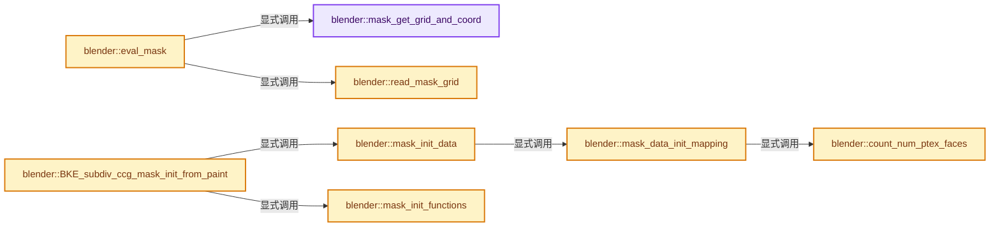

# 实现依赖专题：source/blender/blenkernel/intern/subdiv_ccg_mask.cc

[实现依赖导航](../../README.md) · [符号索引](../../../00-课程指南/02-源码与提交索引/符号依赖与实现索引.md)

本专题从正文实际调用进入，集中保存共享实现。函数有稳定锚点，可从调用处直接跳到对应完整函数；递归与互相调用通过回链组织。

## 本文件的实现关系




## 完整成员与函数实现

<a id="f-f9640594d92275e5"></a>

### `blender::mask_get_grid_and_coord`

实现位置：[source/blender/blenkernel/intern/subdiv_ccg_mask.cc](../../../../../../../source/blender/blenkernel/intern/subdiv_ccg_mask.cc) · L43—L67。

接口参数：

- `SubdivCCGMaskEvaluator *mask_evaluator`
- `const int ptex_face_index`
- `const float u`
- `const float v`
- `const GridPaintMask **r_mask_grid`
- `float *grid_u`
- `float *grid_v`

**教学注释版**

<!-- annotated:5b21f826ca5e6c -->

```cpp
static int mask_get_grid_and_coord(SubdivCCGMaskEvaluator *mask_evaluator,
                                   const int ptex_face_index,
                                   const float u,
                                   const float v,
                                   const GridPaintMask **r_mask_grid,
                                   float *grid_u,
                                   float *grid_v)
{
  GridPaintMaskData *data = static_cast<GridPaintMaskData *>(mask_evaluator->user_data);
  const PolyCornerIndex *poly_corner = &data->ptex_face_corner[ptex_face_index];
  const IndexRange face = data->faces[poly_corner->face_index];
  // [讲解] face.start：读取连续区间或分组的边界信息。
  const int start_grid_index = face.start() + poly_corner->corner;
  int corner = 0;
  // [讲解] face.size：读取连续区间或分组的边界信息。
  if (face.size() == 4) {
    float corner_u, corner_v;
    corner = rotate_quad_to_corner(u, v, &corner_u, &corner_v);
    *r_mask_grid = &data->grid_paint_mask[start_grid_index + corner];
    ptex_face_uv_to_grid_uv(corner_u, corner_v, grid_u, grid_v);
  }
  else {
    *r_mask_grid = &data->grid_paint_mask[start_grid_index];
    ptex_face_uv_to_grid_uv(u, v, grid_u, grid_v);
  }
  return corner;
}
```

<details>
<summary>核对原始源码：source/blender/blenkernel/intern/subdiv_ccg_mask.cc · L43—L67</summary>

<!-- original:5b21f826ca5e6c:source/blender/blenkernel/intern/subdiv_ccg_mask.cc:43:67 -->

```cpp
static int mask_get_grid_and_coord(SubdivCCGMaskEvaluator *mask_evaluator,
                                   const int ptex_face_index,
                                   const float u,
                                   const float v,
                                   const GridPaintMask **r_mask_grid,
                                   float *grid_u,
                                   float *grid_v)
{
  GridPaintMaskData *data = static_cast<GridPaintMaskData *>(mask_evaluator->user_data);
  const PolyCornerIndex *poly_corner = &data->ptex_face_corner[ptex_face_index];
  const IndexRange face = data->faces[poly_corner->face_index];
  const int start_grid_index = face.start() + poly_corner->corner;
  int corner = 0;
  if (face.size() == 4) {
    float corner_u, corner_v;
    corner = rotate_quad_to_corner(u, v, &corner_u, &corner_v);
    *r_mask_grid = &data->grid_paint_mask[start_grid_index + corner];
    ptex_face_uv_to_grid_uv(corner_u, corner_v, grid_u, grid_v);
  }
  else {
    *r_mask_grid = &data->grid_paint_mask[start_grid_index];
    ptex_face_uv_to_grid_uv(u, v, grid_u, grid_v);
  }
  return corner;
}
```

</details>

**沿实际写入检查状态**

- `corner = rotate_quad_to_corner(u, v, &corner_u, &corner_v);`

**结果出口**

- `return corner;`

**继续追踪实现**

- `face.start` → [blender::IndexRange::start · L243](../../../01-基础容器与现代CPP/04-IndexRange连续整数区间.md#f-99d2195bd9cfd1f0)。
- `face.size` → [blender::IndexRange::size · L156](../../../01-基础容器与现代CPP/04-IndexRange连续整数区间.md#f-05f66c3ebb2fdfec)。
- `rotate_quad_to_corner` → [blender::bke::subdiv::rotate_quad_to_corner · L48](subdiv_inline.hh.md#f-31cf4c6ec139b3c4)；[blender::bke::subdiv::rotate_quad_to_corner · L78](subdiv_inline.hh.md#f-58cee820add1c06a)。同名重载需按实参类型选择。
- `ptex_face_uv_to_grid_uv` → [blender::bke::subdiv::ptex_face_uv_to_grid_uv · L20](subdiv_inline.hh.md#f-a032e356af3209ac)；[blender::bke::subdiv::ptex_face_uv_to_grid_uv · L29](subdiv_inline.hh.md#f-0dab4f54d87c18ed)。同名重载需按实参类型选择。

<a id="f-a81a4f6534712ed2"></a>

### `blender::read_mask_grid`

实现位置：[source/blender/blenkernel/intern/subdiv_ccg_mask.cc](../../../../../../../source/blender/blenkernel/intern/subdiv_ccg_mask.cc) · L69—L80。

接口参数：

- `const GridPaintMask *mask_grid`
- `const float grid_u`
- `const float grid_v`

**教学注释版**

<!-- annotated:99b8c87a2aebca -->

```cpp
BLI_INLINE float read_mask_grid(const GridPaintMask *mask_grid,
                                const float grid_u,
                                const float grid_v)
{
  if (mask_grid->data == nullptr) {
    return 0;
  }
  const int grid_size = grid_size_from_level(mask_grid->level);
  const int x = roundf(grid_u * (grid_size - 1));
  const int y = roundf(grid_v * (grid_size - 1));
  return mask_grid->data[y * grid_size + x];
}
```

<details>
<summary>核对原始源码：source/blender/blenkernel/intern/subdiv_ccg_mask.cc · L69—L80</summary>

<!-- original:99b8c87a2aebca:source/blender/blenkernel/intern/subdiv_ccg_mask.cc:69:80 -->

```cpp
BLI_INLINE float read_mask_grid(const GridPaintMask *mask_grid,
                                const float grid_u,
                                const float grid_v)
{
  if (mask_grid->data == nullptr) {
    return 0;
  }
  const int grid_size = grid_size_from_level(mask_grid->level);
  const int x = roundf(grid_u * (grid_size - 1));
  const int y = roundf(grid_v * (grid_size - 1));
  return mask_grid->data[y * grid_size + x];
}
```

</details>

**结果出口**

- `return 0;`
- `return mask_grid->data[y * grid_size + x];`

**继续追踪实现**

- `grid_size_from_level` → [blender::bke::subdiv::grid_size_from_level · L43](subdiv_inline.hh.md#f-b1d46bbf8975e481)。
- `roundf` → [roundf · L174](../../07-Intern运行时与平台/cycles/kernel/device/oneapi/compat.h.md#m-bdf6eb01f4f1)；[roundf · L272](../../07-Intern运行时与平台/cycles/kernel/device/metal/compat.h.md#m-97b17e1586c9)。宏定义由构建条件选择。

<a id="f-c7f2ca4d94e514af"></a>

### `blender::eval_mask`

实现位置：[source/blender/blenkernel/intern/subdiv_ccg_mask.cc](../../../../../../../source/blender/blenkernel/intern/subdiv_ccg_mask.cc) · L82—L91。

接口参数：

- `SubdivCCGMaskEvaluator *mask_evaluator`
- `const int ptex_face_index`
- `const float u`
- `const float v`

**教学注释版**

<!-- annotated:832bbc77a39a95 -->

```cpp
static float eval_mask(SubdivCCGMaskEvaluator *mask_evaluator,
                       const int ptex_face_index,
                       const float u,
                       const float v)
{
  const GridPaintMask *mask_grid;
  float grid_u, grid_v;
  mask_get_grid_and_coord(mask_evaluator, ptex_face_index, u, v, &mask_grid, &grid_u, &grid_v);
  return read_mask_grid(mask_grid, grid_u, grid_v);
}
```

<details>
<summary>核对原始源码：source/blender/blenkernel/intern/subdiv_ccg_mask.cc · L82—L91</summary>

<!-- original:832bbc77a39a95:source/blender/blenkernel/intern/subdiv_ccg_mask.cc:82:91 -->

```cpp
static float eval_mask(SubdivCCGMaskEvaluator *mask_evaluator,
                       const int ptex_face_index,
                       const float u,
                       const float v)
{
  const GridPaintMask *mask_grid;
  float grid_u, grid_v;
  mask_get_grid_and_coord(mask_evaluator, ptex_face_index, u, v, &mask_grid, &grid_u, &grid_v);
  return read_mask_grid(mask_grid, grid_u, grid_v);
}
```

</details>

**结果出口**

- `return read_mask_grid(mask_grid, grid_u, grid_v);`

**继续追踪实现**

- `mask_get_grid_and_coord` → [blender::mask_get_grid_and_coord · L43](subdiv_ccg_mask.cc.md#f-f9640594d92275e5)。
- `read_mask_grid` → [blender::read_mask_grid · L69](subdiv_ccg_mask.cc.md#f-a81a4f6534712ed2)。

<a id="f-ce8c73273fa3c15a"></a>

### `blender::count_num_ptex_faces`

实现位置：[source/blender/blenkernel/intern/subdiv_ccg_mask.cc](../../../../../../../source/blender/blenkernel/intern/subdiv_ccg_mask.cc) · L103—L111。

接口参数：

- `const Mesh *mesh`

**教学注释版**

<!-- annotated:0cd24ba3f84c37 -->

```cpp
static int count_num_ptex_faces(const Mesh *mesh)
{
  int num_ptex_faces = 0;
  const OffsetIndices faces = mesh->faces();
  for (const int face_index : faces.index_range()) {
    num_ptex_faces += (faces[face_index].size() == 4) ? 1 : faces[face_index].size();
  }
  return num_ptex_faces;
}
```

<details>
<summary>核对原始源码：source/blender/blenkernel/intern/subdiv_ccg_mask.cc · L103—L111</summary>

<!-- original:0cd24ba3f84c37:source/blender/blenkernel/intern/subdiv_ccg_mask.cc:103:111 -->

```cpp
static int count_num_ptex_faces(const Mesh *mesh)
{
  int num_ptex_faces = 0;
  const OffsetIndices faces = mesh->faces();
  for (const int face_index : faces.index_range()) {
    num_ptex_faces += (faces[face_index].size() == 4) ? 1 : faces[face_index].size();
  }
  return num_ptex_faces;
}
```

</details>

**沿实际写入检查状态**

- `num_ptex_faces += (faces[face_index].size() == 4) ? 1 : faces[face_index].size();`

**结果出口**

- `return num_ptex_faces;`

**继续追踪实现**

- `mesh->faces` → [Mesh::faces · L1217](../../../05-几何存储与拓扑映射/03-MPoly迁移与兼容.md#f-ea444760154e17b2)。
- `faces.index_range` → [blender::offset_indices::OffsetIndices::index_range · L77](../../../05-几何存储与拓扑映射/02-OffsetIndices完整接口.md#f-19b5ca1456de007d)。
- `faces[face_index].size` → [调用协议](../../../00-课程指南/01-路线与规范/模板宏与动态分派协议.md)：接收对象类型依赖auto、返回值或模板实例；不按同名猜测目标。调用位置L108。

<a id="f-14cce2bdd905b5df"></a>

### `blender::mask_data_init_mapping`

实现位置：[source/blender/blenkernel/intern/subdiv_ccg_mask.cc](../../../../../../../source/blender/blenkernel/intern/subdiv_ccg_mask.cc) · L113—L139。

接口参数：

- `SubdivCCGMaskEvaluator *mask_evaluator`
- `const Mesh *mesh`

**教学注释版**

<!-- annotated:9a3f741486ffde -->

```cpp
static void mask_data_init_mapping(SubdivCCGMaskEvaluator *mask_evaluator, const Mesh *mesh)
{
  GridPaintMaskData *data = static_cast<GridPaintMaskData *>(mask_evaluator->user_data);
  const OffsetIndices faces = mesh->faces();
  const int num_ptex_faces = count_num_ptex_faces(mesh);
  /* Allocate memory. */
  data->ptex_face_corner = MEM_new_array_uninitialized<PolyCornerIndex>(size_t(num_ptex_faces),
                                                                        __func__);
  /* Fill in offsets. */
  int ptex_face_index = 0;
  PolyCornerIndex *ptex_face_corner = data->ptex_face_corner;
  for (const int face_index : faces.index_range()) {
    const IndexRange face = faces[face_index];
    // [讲解] face.size：读取连续区间或分组的边界信息。
    if (face.size() == 4) {
      ptex_face_corner[ptex_face_index].face_index = face_index;
      ptex_face_corner[ptex_face_index].corner = 0;
      ptex_face_index++;
    }
    else {
      for (int corner = 0; corner < face.size(); corner++) {
        ptex_face_corner[ptex_face_index].face_index = face_index;
        ptex_face_corner[ptex_face_index].corner = corner;
        ptex_face_index++;
      }
    }
  }
}
```

<details>
<summary>核对原始源码：source/blender/blenkernel/intern/subdiv_ccg_mask.cc · L113—L139</summary>

<!-- original:9a3f741486ffde:source/blender/blenkernel/intern/subdiv_ccg_mask.cc:113:139 -->

```cpp
static void mask_data_init_mapping(SubdivCCGMaskEvaluator *mask_evaluator, const Mesh *mesh)
{
  GridPaintMaskData *data = static_cast<GridPaintMaskData *>(mask_evaluator->user_data);
  const OffsetIndices faces = mesh->faces();
  const int num_ptex_faces = count_num_ptex_faces(mesh);
  /* Allocate memory. */
  data->ptex_face_corner = MEM_new_array_uninitialized<PolyCornerIndex>(size_t(num_ptex_faces),
                                                                        __func__);
  /* Fill in offsets. */
  int ptex_face_index = 0;
  PolyCornerIndex *ptex_face_corner = data->ptex_face_corner;
  for (const int face_index : faces.index_range()) {
    const IndexRange face = faces[face_index];
    if (face.size() == 4) {
      ptex_face_corner[ptex_face_index].face_index = face_index;
      ptex_face_corner[ptex_face_index].corner = 0;
      ptex_face_index++;
    }
    else {
      for (int corner = 0; corner < face.size(); corner++) {
        ptex_face_corner[ptex_face_index].face_index = face_index;
        ptex_face_corner[ptex_face_index].corner = corner;
        ptex_face_index++;
      }
    }
  }
}
```

</details>

**沿实际写入检查状态**

- `data->ptex_face_corner = MEM_new_array_uninitialized<PolyCornerIndex>(size_t(num_ptex_faces),`
- `ptex_face_corner[ptex_face_index].face_index = face_index;`
- `ptex_face_corner[ptex_face_index].corner = 0;`
- `ptex_face_corner[ptex_face_index].corner = corner;`

**继续追踪实现**

- `mesh->faces` → [Mesh::faces · L1217](../../../05-几何存储与拓扑映射/03-MPoly迁移与兼容.md#f-ea444760154e17b2)。
- `count_num_ptex_faces` → [blender::count_num_ptex_faces · L103](subdiv_ccg_mask.cc.md#f-ce8c73273fa3c15a)。
- `MEM_new_array_uninitialized<PolyCornerIndex>` → [MEM_new_array_uninitialized · L608](../../07-Intern运行时与平台/guardedalloc/MEM_guardedalloc.h.md#f-b7103eae8eb57b05)；[MEM_new_array_uninitialized · L129](../../07-Intern运行时与平台/guardedalloc/intern/mallocn.cc.md#f-bf6ef4ddcfb6e5df)。同名重载需按实参类型选择。
- `faces.index_range` → [blender::offset_indices::OffsetIndices::index_range · L77](../../../05-几何存储与拓扑映射/02-OffsetIndices完整接口.md#f-19b5ca1456de007d)。
- `face.size` → [blender::IndexRange::size · L156](../../../01-基础容器与现代CPP/04-IndexRange连续整数区间.md#f-05f66c3ebb2fdfec)。

<a id="f-b48b5bcc818d4739"></a>

### `blender::mask_init_data`

实现位置：[source/blender/blenkernel/intern/subdiv_ccg_mask.cc](../../../../../../../source/blender/blenkernel/intern/subdiv_ccg_mask.cc) · L141—L148。

接口参数：

- `SubdivCCGMaskEvaluator *mask_evaluator`
- `const Mesh *mesh`

**教学注释版**

<!-- annotated:0601ebe23ce90f -->

```cpp
static void mask_init_data(SubdivCCGMaskEvaluator *mask_evaluator, const Mesh *mesh)
{
  GridPaintMaskData *data = static_cast<GridPaintMaskData *>(mask_evaluator->user_data);
  data->faces = mesh->faces();
  data->grid_paint_mask = static_cast<const GridPaintMask *>(
      CustomData_get_layer(&mesh->corner_data, CD_GRID_PAINT_MASK));
  mask_data_init_mapping(mask_evaluator, mesh);
}
```

<details>
<summary>核对原始源码：source/blender/blenkernel/intern/subdiv_ccg_mask.cc · L141—L148</summary>

<!-- original:0601ebe23ce90f:source/blender/blenkernel/intern/subdiv_ccg_mask.cc:141:148 -->

```cpp
static void mask_init_data(SubdivCCGMaskEvaluator *mask_evaluator, const Mesh *mesh)
{
  GridPaintMaskData *data = static_cast<GridPaintMaskData *>(mask_evaluator->user_data);
  data->faces = mesh->faces();
  data->grid_paint_mask = static_cast<const GridPaintMask *>(
      CustomData_get_layer(&mesh->corner_data, CD_GRID_PAINT_MASK));
  mask_data_init_mapping(mask_evaluator, mesh);
}
```

</details>

**沿实际写入检查状态**

- `data->faces = mesh->faces();`
- `data->grid_paint_mask = static_cast<const GridPaintMask *>(`

**继续追踪实现**

- `mesh->faces` → [Mesh::faces · L1217](../../../05-几何存储与拓扑映射/03-MPoly迁移与兼容.md#f-ea444760154e17b2)。
- `CustomData_get_layer` → [blender::CustomData_get_layer · L3308](customdata.cc.md#f-add1273f3ef3e57b)。
- `mask_data_init_mapping` → [blender::mask_data_init_mapping · L113](subdiv_ccg_mask.cc.md#f-14cce2bdd905b5df)。

<a id="f-38ce017ef0b3232f"></a>

### `blender::mask_init_functions`

实现位置：[source/blender/blenkernel/intern/subdiv_ccg_mask.cc](../../../../../../../source/blender/blenkernel/intern/subdiv_ccg_mask.cc) · L150—L154。

接口参数：

- `SubdivCCGMaskEvaluator *mask_evaluator`

**教学注释版**

<!-- annotated:de1f8dac17b1d7 -->

```cpp
static void mask_init_functions(SubdivCCGMaskEvaluator *mask_evaluator)
{
  mask_evaluator->eval_mask = eval_mask;
  mask_evaluator->free = free_mask_data;
}
```

<details>
<summary>核对原始源码：source/blender/blenkernel/intern/subdiv_ccg_mask.cc · L150—L154</summary>

<!-- original:de1f8dac17b1d7:source/blender/blenkernel/intern/subdiv_ccg_mask.cc:150:154 -->

```cpp
static void mask_init_functions(SubdivCCGMaskEvaluator *mask_evaluator)
{
  mask_evaluator->eval_mask = eval_mask;
  mask_evaluator->free = free_mask_data;
}
```

</details>

**沿实际写入检查状态**

- `mask_evaluator->eval_mask = eval_mask;`
- `mask_evaluator->free = free_mask_data;`

**继续追踪实现**

本实现没有需要继续展开的显式调用；检查返回表达式、对象转换和调用者前置条件。

<a id="f-62bf22e174b6bbf4"></a>

### `blender::BKE_subdiv_ccg_mask_init_from_paint`

实现位置：[source/blender/blenkernel/intern/subdiv_ccg_mask.cc](../../../../../../../source/blender/blenkernel/intern/subdiv_ccg_mask.cc) · L156—L166。

接口参数：

- `SubdivCCGMaskEvaluator *mask_evaluator`
- `const Mesh *mesh`

**教学注释版**

<!-- annotated:cb39f4db9604e8 -->

```cpp
bool BKE_subdiv_ccg_mask_init_from_paint(SubdivCCGMaskEvaluator *mask_evaluator, const Mesh *mesh)
{
  if (!CustomData_get_layer(&mesh->corner_data, CD_GRID_PAINT_MASK)) {
    return false;
  }
  /* Allocate all required memory. */
  mask_evaluator->user_data = MEM_new<GridPaintMaskData>("mask from grid data");
  mask_init_data(mask_evaluator, mesh);
  mask_init_functions(mask_evaluator);
  return true;
}
```

<details>
<summary>核对原始源码：source/blender/blenkernel/intern/subdiv_ccg_mask.cc · L156—L166</summary>

<!-- original:cb39f4db9604e8:source/blender/blenkernel/intern/subdiv_ccg_mask.cc:156:166 -->

```cpp
bool BKE_subdiv_ccg_mask_init_from_paint(SubdivCCGMaskEvaluator *mask_evaluator, const Mesh *mesh)
{
  if (!CustomData_get_layer(&mesh->corner_data, CD_GRID_PAINT_MASK)) {
    return false;
  }
  /* Allocate all required memory. */
  mask_evaluator->user_data = MEM_new<GridPaintMaskData>("mask from grid data");
  mask_init_data(mask_evaluator, mesh);
  mask_init_functions(mask_evaluator);
  return true;
}
```

</details>

**沿实际写入检查状态**

- `mask_evaluator->user_data = MEM_new<GridPaintMaskData>("mask from grid data");`

**结果出口**

- `return false;`
- `return true;`

**继续追踪实现**

- `CustomData_get_layer` → [blender::CustomData_get_layer · L3308](customdata.cc.md#f-add1273f3ef3e57b)。
- `MEM_new<GridPaintMaskData>` → [MEM_new · L351](../../07-Intern运行时与平台/guardedalloc/MEM_guardedalloc.h.md#f-115f9b6784f89912)。
- `mask_init_data` → [blender::mask_init_data · L141](subdiv_ccg_mask.cc.md#f-b48b5bcc818d4739)。
- `mask_init_functions` → [blender::mask_init_functions · L150](subdiv_ccg_mask.cc.md#f-38ce017ef0b3232f)。
