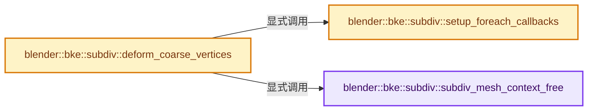
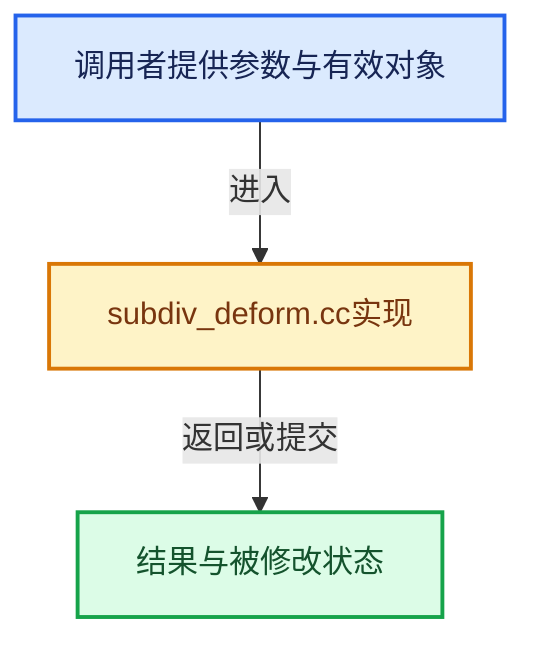

# 实现依赖专题：source/blender/blenkernel/intern/subdiv_deform.cc

[实现依赖导航](../../README.md) · [符号索引](../../../00-课程指南/02-源码与提交索引/符号依赖与实现索引.md)

本专题从正文实际调用进入，集中保存共享实现。函数有稳定锚点，可从调用处直接跳到对应完整函数；递归与互相调用通过回链组织。

## 本文件的实现关系






## 完整成员与函数实现

<a id="f-77a152f332d1c283"></a>

### `blender::bke::subdiv::subdiv_mesh_context_free`

实现位置：[source/blender/blenkernel/intern/subdiv_deform.cc](../../../../../../../source/blender/blenkernel/intern/subdiv_deform.cc) · L57—L60。

接口参数：

- `SubdivDeformContext *ctx`

**教学注释版**

<!-- annotated:db1ca70e6033ab -->

```cpp
static void subdiv_mesh_context_free(SubdivDeformContext *ctx)
{
  MEM_SAFE_DELETE(ctx->accumulated_counters);
}
```

<details>
<summary>核对原始源码：source/blender/blenkernel/intern/subdiv_deform.cc · L57—L60</summary>

<!-- original:db1ca70e6033ab:source/blender/blenkernel/intern/subdiv_deform.cc:57:60 -->

```cpp
static void subdiv_mesh_context_free(SubdivDeformContext *ctx)
{
  MEM_SAFE_DELETE(ctx->accumulated_counters);
}
```

</details>

**继续追踪实现**

- `MEM_SAFE_DELETE` → [MEM_SAFE_DELETE · L436](../../07-Intern运行时与平台/guardedalloc/MEM_guardedalloc.h.md#m-eadb3bc5b902)。宏定义由构建条件选择。

<a id="f-6c2c9d76326c1687"></a>

### `blender::bke::subdiv::setup_foreach_callbacks`

实现位置：[source/blender/blenkernel/intern/subdiv_deform.cc](../../../../../../../source/blender/blenkernel/intern/subdiv_deform.cc) · L163—L174。

接口参数：

- `const SubdivDeformContext *subdiv_context`
- `ForeachContext *foreach_context`

**教学注释版**

<!-- annotated:ad63cb4b0197cc -->

```cpp
static void setup_foreach_callbacks(const SubdivDeformContext *subdiv_context,
                                    ForeachContext *foreach_context)
{
  *foreach_context = {};
  /* General information. */
  foreach_context->topology_info = subdiv_mesh_topology_info;
  /* Every boundary geometry. Used for displacement and normals averaging. */
  if (subdiv_context->have_displacement) {
    foreach_context->vert_every_corner = subdiv_mesh_vert_every_corner;
  }
  foreach_context->vert_corner = subdiv_mesh_vert_corner;
}
```

<details>
<summary>核对原始源码：source/blender/blenkernel/intern/subdiv_deform.cc · L163—L174</summary>

<!-- original:ad63cb4b0197cc:source/blender/blenkernel/intern/subdiv_deform.cc:163:174 -->

```cpp
static void setup_foreach_callbacks(const SubdivDeformContext *subdiv_context,
                                    ForeachContext *foreach_context)
{
  *foreach_context = {};
  /* General information. */
  foreach_context->topology_info = subdiv_mesh_topology_info;
  /* Every boundary geometry. Used for displacement and normals averaging. */
  if (subdiv_context->have_displacement) {
    foreach_context->vert_every_corner = subdiv_mesh_vert_every_corner;
  }
  foreach_context->vert_corner = subdiv_mesh_vert_corner;
}
```

</details>

**沿实际写入检查状态**

- `foreach_context->topology_info = subdiv_mesh_topology_info;`
- `foreach_context->vert_every_corner = subdiv_mesh_vert_every_corner;`
- `foreach_context->vert_corner = subdiv_mesh_vert_corner;`

**继续追踪实现**

本实现没有需要继续展开的显式调用；检查返回表达式、对象转换和调用者前置条件。

<a id="f-5bab0e29c9adc4d5"></a>

### `blender::bke::subdiv::deform_coarse_vertices`

实现位置：[source/blender/blenkernel/intern/subdiv_deform.cc](../../../../../../../source/blender/blenkernel/intern/subdiv_deform.cc) · L182—L226。

接口参数：

- `Subdiv *subdiv`
- `const Mesh *coarse_mesh`
- `MutableSpan<float3> vert_positions`

**教学注释版**

<!-- annotated:e91f4ea5d5bf6e -->

```cpp
void deform_coarse_vertices(Subdiv *subdiv,
                            const Mesh *coarse_mesh,
                            MutableSpan<float3> vert_positions)
{
  stats_begin(&subdiv->stats, SUBDIV_STATS_SUBDIV_TO_MESH);
  /* Make sure evaluator is up to date with possible new topology, and that
   * is refined for the new positions of coarse vertices. */
  if (!eval_begin_from_mesh(subdiv, coarse_mesh, SUBDIV_EVALUATOR_TYPE_CPU, vert_positions)) {
    /* This could happen in two situations:
     * - OpenSubdiv is disabled.
     * - Something totally bad happened, and OpenSubdiv rejected our
     *   topology.
     * In either way, we can't safely continue. */
    if (coarse_mesh->faces_num) {
      stats_end(&subdiv->stats, SUBDIV_STATS_SUBDIV_TO_MESH);
      return;
    }
  }

  /* Initialize subdivision mesh creation context. */
  SubdivDeformContext subdiv_context = {nullptr};
  subdiv_context.coarse_mesh = coarse_mesh;
  subdiv_context.subdiv = subdiv;
  subdiv_context.vert_positions = vert_positions;
  subdiv_context.have_displacement = (subdiv->displacement_evaluator != nullptr);

  ForeachContext foreach_context;
  setup_foreach_callbacks(&subdiv_context, &foreach_context);
  foreach_context.user_data = &subdiv_context;

  /* Dummy mesh rasterization settings. */
  ToMeshSettings mesh_settings;
  mesh_settings.resolution = 1;
  mesh_settings.use_optimal_display = false;

  /* Multi-threaded traversal/evaluation. */
  stats_begin(&subdiv->stats, SUBDIV_STATS_SUBDIV_TO_MESH_GEOMETRY);
  foreach_subdiv_geometry(subdiv, &foreach_context, &mesh_settings, coarse_mesh);
  stats_end(&subdiv->stats, SUBDIV_STATS_SUBDIV_TO_MESH_GEOMETRY);

  stats_end(&subdiv->stats, SUBDIV_STATS_SUBDIV_TO_MESH);

  /* Free used memory. */
  subdiv_mesh_context_free(&subdiv_context);
}
```

<details>
<summary>核对原始源码：source/blender/blenkernel/intern/subdiv_deform.cc · L182—L226</summary>

<!-- original:e91f4ea5d5bf6e:source/blender/blenkernel/intern/subdiv_deform.cc:182:226 -->

```cpp
void deform_coarse_vertices(Subdiv *subdiv,
                            const Mesh *coarse_mesh,
                            MutableSpan<float3> vert_positions)
{
  stats_begin(&subdiv->stats, SUBDIV_STATS_SUBDIV_TO_MESH);
  /* Make sure evaluator is up to date with possible new topology, and that
   * is refined for the new positions of coarse vertices. */
  if (!eval_begin_from_mesh(subdiv, coarse_mesh, SUBDIV_EVALUATOR_TYPE_CPU, vert_positions)) {
    /* This could happen in two situations:
     * - OpenSubdiv is disabled.
     * - Something totally bad happened, and OpenSubdiv rejected our
     *   topology.
     * In either way, we can't safely continue. */
    if (coarse_mesh->faces_num) {
      stats_end(&subdiv->stats, SUBDIV_STATS_SUBDIV_TO_MESH);
      return;
    }
  }

  /* Initialize subdivision mesh creation context. */
  SubdivDeformContext subdiv_context = {nullptr};
  subdiv_context.coarse_mesh = coarse_mesh;
  subdiv_context.subdiv = subdiv;
  subdiv_context.vert_positions = vert_positions;
  subdiv_context.have_displacement = (subdiv->displacement_evaluator != nullptr);

  ForeachContext foreach_context;
  setup_foreach_callbacks(&subdiv_context, &foreach_context);
  foreach_context.user_data = &subdiv_context;

  /* Dummy mesh rasterization settings. */
  ToMeshSettings mesh_settings;
  mesh_settings.resolution = 1;
  mesh_settings.use_optimal_display = false;

  /* Multi-threaded traversal/evaluation. */
  stats_begin(&subdiv->stats, SUBDIV_STATS_SUBDIV_TO_MESH_GEOMETRY);
  foreach_subdiv_geometry(subdiv, &foreach_context, &mesh_settings, coarse_mesh);
  stats_end(&subdiv->stats, SUBDIV_STATS_SUBDIV_TO_MESH_GEOMETRY);

  stats_end(&subdiv->stats, SUBDIV_STATS_SUBDIV_TO_MESH);

  /* Free used memory. */
  subdiv_mesh_context_free(&subdiv_context);
}
```

</details>

**沿实际写入检查状态**

- `subdiv_context.coarse_mesh = coarse_mesh;`
- `subdiv_context.subdiv = subdiv;`
- `subdiv_context.vert_positions = vert_positions;`
- `subdiv_context.have_displacement = (subdiv->displacement_evaluator != nullptr);`
- `foreach_context.user_data = &subdiv_context;`
- `mesh_settings.resolution = 1;`
- `mesh_settings.use_optimal_display = false;`

**继续追踪实现**

- `stats_begin` → [blender::bke::subdiv::stats_begin · L29](subdiv_stats.cc.md#f-46e30181ec51de7f)。
- `eval_begin_from_mesh` → [blender::bke::subdiv::eval_begin_from_mesh · L216](subdiv_eval.cc.md#f-88372aa7a8ab8f7e)。
- `stats_end` → [blender::bke::subdiv::stats_end · L34](subdiv_stats.cc.md#f-f613b2e2856775cb)。
- `setup_foreach_callbacks` → [blender::bke::subdiv::setup_foreach_callbacks · L163](subdiv_deform.cc.md#f-6c2c9d76326c1687)。
- `foreach_subdiv_geometry` → [blender::bke::subdiv::foreach_subdiv_geometry · L1748](subdiv_foreach.cc.md#f-d3b417f57c73475c)。
- `subdiv_mesh_context_free` → [blender::bke::subdiv::subdiv_mesh_context_free · L57](subdiv_deform.cc.md#f-77a152f332d1c283)。
