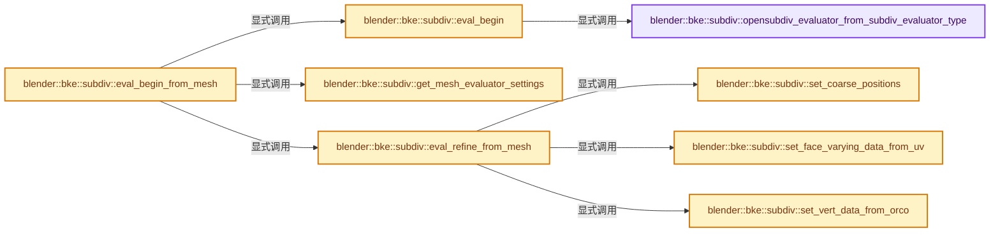
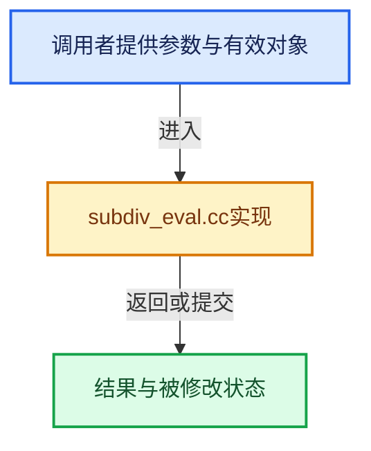

# 实现依赖专题：source/blender/blenkernel/intern/subdiv_eval.cc

[实现依赖导航](../../README.md) · [符号索引](../../../00-课程指南/02-源码与提交索引/符号依赖与实现索引.md)

本专题从正文实际调用进入，集中保存共享实现。函数有稳定锚点，可从调用处直接跳到对应完整函数；递归与互相调用通过回链组织。

## 本文件的实现关系






## 完整成员与函数实现

<a id="f-dca793dc724478a1"></a>

### `blender::bke::subdiv::opensubdiv_evaluator_from_subdiv_evaluator_type`

实现位置：[source/blender/blenkernel/intern/subdiv_eval.cc](../../../../../../../source/blender/blenkernel/intern/subdiv_eval.cc) · L37—L50。

接口参数：

- `eSubdivEvaluatorType evaluator_type`

**教学注释版**

<!-- annotated:2d214a8b6fc59c -->

```cpp
static eOpenSubdivEvaluator opensubdiv_evaluator_from_subdiv_evaluator_type(
    eSubdivEvaluatorType evaluator_type)
{
  switch (evaluator_type) {
    case SUBDIV_EVALUATOR_TYPE_CPU: {
      return OPENSUBDIV_EVALUATOR_CPU;
    }
    case SUBDIV_EVALUATOR_TYPE_GPU: {
      return OPENSUBDIV_EVALUATOR_GPU;
    }
  }
  BLI_assert_msg(0, "Unknown evaluator type");
  return OPENSUBDIV_EVALUATOR_CPU;
}
```

<details>
<summary>核对原始源码：source/blender/blenkernel/intern/subdiv_eval.cc · L37—L50</summary>

<!-- original:2d214a8b6fc59c:source/blender/blenkernel/intern/subdiv_eval.cc:37:50 -->

```cpp
static eOpenSubdivEvaluator opensubdiv_evaluator_from_subdiv_evaluator_type(
    eSubdivEvaluatorType evaluator_type)
{
  switch (evaluator_type) {
    case SUBDIV_EVALUATOR_TYPE_CPU: {
      return OPENSUBDIV_EVALUATOR_CPU;
    }
    case SUBDIV_EVALUATOR_TYPE_GPU: {
      return OPENSUBDIV_EVALUATOR_GPU;
    }
  }
  BLI_assert_msg(0, "Unknown evaluator type");
  return OPENSUBDIV_EVALUATOR_CPU;
}
```

</details>

**结果出口**

- `return OPENSUBDIV_EVALUATOR_CPU;`
- `return OPENSUBDIV_EVALUATOR_GPU;`

**继续追踪实现**

- `BLI_assert_msg` → [BLI_assert_msg · L55](../../01-BLI基础库/BLI_assert.hh.md#m-695eed20dceb)；[BLI_assert_msg · L64](../../01-BLI基础库/BLI_assert.hh.md#m-7de5563de4db)。宏定义由构建条件选择。

<a id="f-592ebf9f1506e4e3"></a>

### `blender::bke::subdiv::eval_begin`

实现位置：[source/blender/blenkernel/intern/subdiv_eval.cc](../../../../../../../source/blender/blenkernel/intern/subdiv_eval.cc) · L58—L91。

接口参数：

- `Subdiv *subdiv`
- `eSubdivEvaluatorType evaluator_type`
- `OpenSubdiv_EvaluatorCache *evaluator_cache`
- `const OpenSubdiv_EvaluatorSettings *settings`

**教学注释版**

<!-- annotated:e1cad7ebe60178 -->

```cpp
bool eval_begin(Subdiv *subdiv,
                eSubdivEvaluatorType evaluator_type,
                OpenSubdiv_EvaluatorCache *evaluator_cache,
                const OpenSubdiv_EvaluatorSettings *settings)
{
#ifdef WITH_OPENSUBDIV
  stats_reset(&subdiv->stats, SUBDIV_STATS_EVALUATOR_CREATE);
  if (subdiv->topology_refiner == nullptr) {
    /* Happens on input mesh with just loose geometry,
     * or when OpenSubdiv is disabled */
    return false;
  }
  if (subdiv->evaluator == nullptr) {
    eOpenSubdivEvaluator opensubdiv_evaluator_type =
        opensubdiv_evaluator_from_subdiv_evaluator_type(evaluator_type);
    stats_begin(&subdiv->stats, SUBDIV_STATS_EVALUATOR_CREATE);
    subdiv->evaluator = openSubdiv_createEvaluatorFromTopologyRefiner(
        subdiv->topology_refiner, opensubdiv_evaluator_type, evaluator_cache);
    stats_end(&subdiv->stats, SUBDIV_STATS_EVALUATOR_CREATE);
    if (subdiv->evaluator == nullptr) {
      return false;
    }
  }
  else {
    /* TODO(sergey): Check for topology change. */
  }
  subdiv->evaluator->eval_output->setSettings(settings);
  eval_init_displacement(subdiv);
  return true;
#else
  UNUSED_VARS(subdiv, evaluator_type, evaluator_cache, settings);
  return false;
#endif
}
```

<details>
<summary>核对原始源码：source/blender/blenkernel/intern/subdiv_eval.cc · L58—L91</summary>

<!-- original:e1cad7ebe60178:source/blender/blenkernel/intern/subdiv_eval.cc:58:91 -->

```cpp
bool eval_begin(Subdiv *subdiv,
                eSubdivEvaluatorType evaluator_type,
                OpenSubdiv_EvaluatorCache *evaluator_cache,
                const OpenSubdiv_EvaluatorSettings *settings)
{
#ifdef WITH_OPENSUBDIV
  stats_reset(&subdiv->stats, SUBDIV_STATS_EVALUATOR_CREATE);
  if (subdiv->topology_refiner == nullptr) {
    /* Happens on input mesh with just loose geometry,
     * or when OpenSubdiv is disabled */
    return false;
  }
  if (subdiv->evaluator == nullptr) {
    eOpenSubdivEvaluator opensubdiv_evaluator_type =
        opensubdiv_evaluator_from_subdiv_evaluator_type(evaluator_type);
    stats_begin(&subdiv->stats, SUBDIV_STATS_EVALUATOR_CREATE);
    subdiv->evaluator = openSubdiv_createEvaluatorFromTopologyRefiner(
        subdiv->topology_refiner, opensubdiv_evaluator_type, evaluator_cache);
    stats_end(&subdiv->stats, SUBDIV_STATS_EVALUATOR_CREATE);
    if (subdiv->evaluator == nullptr) {
      return false;
    }
  }
  else {
    /* TODO(sergey): Check for topology change. */
  }
  subdiv->evaluator->eval_output->setSettings(settings);
  eval_init_displacement(subdiv);
  return true;
#else
  UNUSED_VARS(subdiv, evaluator_type, evaluator_cache, settings);
  return false;
#endif
}
```

</details>

**沿实际写入检查状态**

- `subdiv->evaluator = openSubdiv_createEvaluatorFromTopologyRefiner(`

**结果出口**

- `return false;`
- `return true;`

**继续追踪实现**

- `stats_reset` → [blender::bke::subdiv::stats_reset · L39](subdiv_stats.cc.md#f-a2102e73187ac82f)。
- `opensubdiv_evaluator_from_subdiv_evaluator_type` → [blender::bke::subdiv::opensubdiv_evaluator_from_subdiv_evaluator_type · L37](subdiv_eval.cc.md#f-dca793dc724478a1)。
- `stats_begin` → [blender::bke::subdiv::stats_begin · L29](subdiv_stats.cc.md#f-46e30181ec51de7f)。
- `openSubdiv_createEvaluatorFromTopologyRefiner` → [openSubdiv_createEvaluatorFromTopologyRefiner · L424](../../07-Intern运行时与平台/opensubdiv/internal/evaluator/evaluator_impl.cc.md#f-fc0cb574f78671b9)。
- `stats_end` → [blender::bke::subdiv::stats_end · L34](subdiv_stats.cc.md#f-f613b2e2856775cb)。
- `subdiv->evaluator->eval_output->setSettings` → [调用协议](../../../00-课程指南/01-路线与规范/模板宏与动态分派协议.md)：接收对象类型依赖auto、返回值或模板实例；不按同名猜测目标。调用位置L84。
- `eval_init_displacement` → [blender::bke::subdiv::eval_init_displacement · L271](subdiv_eval.cc.md#f-6e5fad05436c20ff)。
- `UNUSED_VARS` → [UNUSED_VARS · L522](../../01-BLI基础库/BLI_utildefines.hh.md#m-013582537634)；[UNUSED_VARS · L41](../../08-其他Blender模块/gpu/GPU_shader_shared_utils.hh.md#m-05d9d7a33da0)；[UNUSED_VARS · L62](../../08-其他Blender模块/gpu/GPU_shader_shared_utils.hh.md#m-e12c683a4aca)。宏定义由构建条件选择。

<a id="f-21b1106c7c1947c9"></a>

### `blender::bke::subdiv::set_coarse_positions`

实现位置：[source/blender/blenkernel/intern/subdiv_eval.cc](../../../../../../../source/blender/blenkernel/intern/subdiv_eval.cc) · L95—L111。

接口参数：

- `Subdiv *subdiv`
- `const Span<float3> positions`
- `const IndexMask &verts_no_face`

**教学注释版**

<!-- annotated:41e517fcda09a9 -->

```cpp
static void set_coarse_positions(Subdiv *subdiv,
                                 const Span<float3> positions,
                                 const IndexMask &verts_no_face)
{
  OpenSubdiv_Evaluator *evaluator = subdiv->evaluator;
  if (verts_no_face.is_empty()) {
    evaluator->eval_output->setCoarsePositions(
        // [讲解] positions.data：返回借用范围的地址。
        reinterpret_cast<const float *>(positions.data()), 0, positions.size());
    return;
  }
  // [讲解] positions.size：查询视图长度或生成对应有效索引区间。
  Array<float3> used_vert_positions(positions.size() - verts_no_face.size());
  IndexMaskMemory memory;
  // [讲解] positions.index_range：查询视图长度或生成对应有效索引区间。
  const IndexMask verts = verts_no_face.complement(positions.index_range(), memory);
  // [讲解] used_vert_positions.as_mutable_span：提供数组的借用访问入口。
  array_utils::gather(positions, verts, used_vert_positions.as_mutable_span());
  evaluator->eval_output->setCoarsePositions(
      reinterpret_cast<const float *>(used_vert_positions.data()), 0, used_vert_positions.size());
}
```

<details>
<summary>核对原始源码：source/blender/blenkernel/intern/subdiv_eval.cc · L95—L111</summary>

<!-- original:41e517fcda09a9:source/blender/blenkernel/intern/subdiv_eval.cc:95:111 -->

```cpp
static void set_coarse_positions(Subdiv *subdiv,
                                 const Span<float3> positions,
                                 const IndexMask &verts_no_face)
{
  OpenSubdiv_Evaluator *evaluator = subdiv->evaluator;
  if (verts_no_face.is_empty()) {
    evaluator->eval_output->setCoarsePositions(
        reinterpret_cast<const float *>(positions.data()), 0, positions.size());
    return;
  }
  Array<float3> used_vert_positions(positions.size() - verts_no_face.size());
  IndexMaskMemory memory;
  const IndexMask verts = verts_no_face.complement(positions.index_range(), memory);
  array_utils::gather(positions, verts, used_vert_positions.as_mutable_span());
  evaluator->eval_output->setCoarsePositions(
      reinterpret_cast<const float *>(used_vert_positions.data()), 0, used_vert_positions.size());
}
```

</details>

**继续追踪实现**

- `verts_no_face.is_empty` → [blender::index_mask::IndexMask::is_empty · L748](../../../04-虚拟数组与索引选择/09-分段存储与遍历.md#f-190ac996386064f4)。
- `evaluator->eval_output->setCoarsePositions` → [调用协议](../../../00-课程指南/01-路线与规范/模板宏与动态分派协议.md)：接收对象类型依赖auto、返回值或模板实例；不按同名猜测目标。调用位置L101。
- `positions.data` → [blender::Span::data · L219](../../../01-基础容器与现代CPP/05-Span只读连续视图.md#f-10c5889198935800)。
- `positions.size` → [blender::Span::size · L256](../../../01-基础容器与现代CPP/05-Span只读连续视图.md#f-5f80fa006089c998)。
- `verts_no_face.size` → [blender::index_mask::IndexMask::size · L743](../../../04-虚拟数组与索引选择/09-分段存储与遍历.md#f-0163b32abc9a0d9c)。
- `verts_no_face.complement` → [blender::index_mask::IndexMask::complement · L407](../../../04-虚拟数组与索引选择/10-IndexMask构建与并行.md#f-1e9932d5baa6f719)。
- `positions.index_range` → [blender::Span::index_range · L405](../../../01-基础容器与现代CPP/05-Span只读连续视图.md#f-caaa9b06e13e53e0)。
- `array_utils::gather` → [blender::array_utils::gather · L187](../../../01-基础容器与现代CPP/20-容器选择与独立实现.md#f-1760adec5858a42f)；[blender::array_utils::gather · L209](../../../01-基础容器与现代CPP/20-容器选择与独立实现.md#f-a9f65820788454bf)；[blender::array_utils::gather · L225](../../../01-基础容器与现代CPP/20-容器选择与独立实现.md#f-279764b4196f0b63)；[blender::array_utils::gather · L237](../../../01-基础容器与现代CPP/20-容器选择与独立实现.md#f-e310fd489b49341b)；[blender::array_utils::gather · L268](../../../01-基础容器与现代CPP/20-容器选择与独立实现.md#f-7b21c29791903615)；[blender::array_utils::gather · L63](../../01-BLI基础库/intern/array_utils.cc.md#f-5c2b501b03ddbb1f)；[blender::array_utils::gather · L82](../../01-BLI基础库/intern/array_utils.cc.md#f-ea4dd9e673fe81e4)。同名重载需按实参类型选择。
- `used_vert_positions.as_mutable_span` → [blender::Array::as_mutable_span · L259](../../../01-基础容器与现代CPP/08-Array复制移动与销毁.md#f-4e91de9f1337c144)。
- `used_vert_positions.data` → [blender::Array::data · L323](../../../01-基础容器与现代CPP/08-Array复制移动与销毁.md#f-95648c799002f4ba)；[blender::Array::data · L327](../../../01-基础容器与现代CPP/08-Array复制移动与销毁.md#f-50c18301f8c40f9e)。同名重载需按实参类型选择。
- `used_vert_positions.size` → [blender::Array::size · L267](../../../01-基础容器与现代CPP/08-Array复制移动与销毁.md#f-c13f1b5a44f423b2)。

<a id="f-82d1f4842c1f2e6b"></a>

### `blender::bke::subdiv::set_face_varying_data_from_uv`

实现位置：[source/blender/blenkernel/intern/subdiv_eval.cc](../../../../../../../source/blender/blenkernel/intern/subdiv_eval.cc) · L142—L173。

接口参数：

- `Subdiv *subdiv`
- `const Mesh *mesh`
- `const Span<float2> uv_map`
- `const int layer_index`

**教学注释版**

<!-- annotated:125547e455fb8a -->

```cpp
static void set_face_varying_data_from_uv(Subdiv *subdiv,
                                          const Mesh *mesh,
                                          const Span<float2> uv_map,
                                          const int layer_index)
{
  opensubdiv::TopologyRefinerImpl *topology_refiner = subdiv->topology_refiner;
  OpenSubdiv_Evaluator *evaluator = subdiv->evaluator;
  const int num_faces = topology_refiner->base_level().GetNumFaces();

  const int num_fvar_values = topology_refiner->base_level().GetNumFVarValues(layer_index);
  /* Use a temporary buffer so we do not upload UVs one at a time to the GPU. */
  float (*buffer)[2] = MEM_new_array_uninitialized<float[2]>(size_t(num_fvar_values), __func__);

  FaceVaryingDataFromUVContext ctx;
  ctx.topology_refiner = topology_refiner;
  ctx.layer_index = layer_index;
  ctx.uv_map = uv_map;
  ctx.mesh = mesh;
  ctx.faces = mesh->faces();
  ctx.buffer = buffer;

  TaskParallelSettings parallel_range_settings;
  BLI_parallel_range_settings_defaults(&parallel_range_settings);
  parallel_range_settings.min_iter_per_thread = 1;

  BLI_task_parallel_range(
      0, num_faces, &ctx, set_face_varying_data_from_uv_task, &parallel_range_settings);

  evaluator->eval_output->setFaceVaryingData(layer_index, &buffer[0][0], 0, num_fvar_values);

  MEM_delete(buffer);
}
```

<details>
<summary>核对原始源码：source/blender/blenkernel/intern/subdiv_eval.cc · L142—L173</summary>

<!-- original:125547e455fb8a:source/blender/blenkernel/intern/subdiv_eval.cc:142:173 -->

```cpp
static void set_face_varying_data_from_uv(Subdiv *subdiv,
                                          const Mesh *mesh,
                                          const Span<float2> uv_map,
                                          const int layer_index)
{
  opensubdiv::TopologyRefinerImpl *topology_refiner = subdiv->topology_refiner;
  OpenSubdiv_Evaluator *evaluator = subdiv->evaluator;
  const int num_faces = topology_refiner->base_level().GetNumFaces();

  const int num_fvar_values = topology_refiner->base_level().GetNumFVarValues(layer_index);
  /* Use a temporary buffer so we do not upload UVs one at a time to the GPU. */
  float (*buffer)[2] = MEM_new_array_uninitialized<float[2]>(size_t(num_fvar_values), __func__);

  FaceVaryingDataFromUVContext ctx;
  ctx.topology_refiner = topology_refiner;
  ctx.layer_index = layer_index;
  ctx.uv_map = uv_map;
  ctx.mesh = mesh;
  ctx.faces = mesh->faces();
  ctx.buffer = buffer;

  TaskParallelSettings parallel_range_settings;
  BLI_parallel_range_settings_defaults(&parallel_range_settings);
  parallel_range_settings.min_iter_per_thread = 1;

  BLI_task_parallel_range(
      0, num_faces, &ctx, set_face_varying_data_from_uv_task, &parallel_range_settings);

  evaluator->eval_output->setFaceVaryingData(layer_index, &buffer[0][0], 0, num_fvar_values);

  MEM_delete(buffer);
}
```

</details>

**沿实际写入检查状态**

- `ctx.topology_refiner = topology_refiner;`
- `ctx.layer_index = layer_index;`
- `ctx.uv_map = uv_map;`
- `ctx.mesh = mesh;`
- `ctx.faces = mesh->faces();`
- `ctx.buffer = buffer;`
- `parallel_range_settings.min_iter_per_thread = 1;`

**继续追踪实现**

- `topology_refiner->base_level().GetNumFaces` → [调用协议](../../../00-课程指南/01-路线与规范/模板宏与动态分派协议.md)：接收对象类型依赖auto、返回值或模板实例；不按同名猜测目标。调用位置L149。
- `topology_refiner->base_level` → [blender::opensubdiv::TopologyRefinerImpl::base_level · L44](../../07-Intern运行时与平台/opensubdiv/opensubdiv_topology_refiner.hh.md#f-9d10c8cedec9c211)。
- `topology_refiner->base_level().GetNumFVarValues` → [调用协议](../../../00-课程指南/01-路线与规范/模板宏与动态分派协议.md)：接收对象类型依赖auto、返回值或模板实例；不按同名猜测目标。调用位置L151。
- `MEM_new_array_uninitialized<float[2]>` → [MEM_new_array_uninitialized · L608](../../07-Intern运行时与平台/guardedalloc/MEM_guardedalloc.h.md#f-b7103eae8eb57b05)；[MEM_new_array_uninitialized · L129](../../07-Intern运行时与平台/guardedalloc/intern/mallocn.cc.md#f-bf6ef4ddcfb6e5df)。同名重载需按实参类型选择。
- `mesh->faces` → [Mesh::faces · L1217](../../../05-几何存储与拓扑映射/03-MPoly迁移与兼容.md#f-ea444760154e17b2)。
- `BLI_parallel_range_settings_defaults` → [blender::BLI_parallel_range_settings_defaults · L218](../../01-BLI基础库/BLI_task_c.hh.md#f-3858ad801a98e123)。
- `BLI_task_parallel_range` → [blender::BLI_task_parallel_range · L101](../../../11-Depsgraph与并行任务系统/08-任务隔离死锁与实战.md#f-9d237d7e4e78d7e2)。
- `evaluator->eval_output->setFaceVaryingData` → [调用协议](../../../00-课程指南/01-路线与规范/模板宏与动态分派协议.md)：接收对象类型依赖auto、返回值或模板实例；不按同名猜测目标。调用位置L170。
- `MEM_delete` → [MEM_delete · L400](../../07-Intern运行时与平台/guardedalloc/MEM_guardedalloc.h.md#f-9049ffdd1682887c)。

<a id="f-344b1a60d218a4cd"></a>

### `blender::bke::subdiv::set_vert_data_from_orco`

实现位置：[source/blender/blenkernel/intern/subdiv_eval.cc](../../../../../../../source/blender/blenkernel/intern/subdiv_eval.cc) · L175—L206。

接口参数：

- `Subdiv *subdiv`
- `const Mesh *mesh`

**教学注释版**

<!-- annotated:c4f165cca4f5f1 -->

```cpp
static void set_vert_data_from_orco(Subdiv *subdiv, const Mesh *mesh)
{
  const float (*orco)[3] = static_cast<const float (*)[3]>(
      CustomData_get_layer(&mesh->vert_data, CD_ORCO));
  const float (*cloth_orco)[3] = static_cast<const float (*)[3]>(
      CustomData_get_layer(&mesh->vert_data, CD_CLOTH_ORCO));

  if (orco || cloth_orco) {
    opensubdiv::TopologyRefinerImpl *topology_refiner = subdiv->topology_refiner;
    OpenSubdiv_Evaluator *evaluator = subdiv->evaluator;
    const int num_verts = topology_refiner->base_level().GetNumVertices();

    if (orco && cloth_orco) {
      /* Set one by one if have both. */
      for (int i = 0; i < num_verts; i++) {
        float data[6];
        copy_v3_v3(data, orco[i]);
        copy_v3_v3(data + 3, cloth_orco[i]);
        evaluator->eval_output->setVertexData(data, i, 1);
      }
    }
    else {
      /* Faster single call if we have either. */
      if (orco) {
        evaluator->eval_output->setVertexData(orco[0], 0, num_verts);
      }
      else if (cloth_orco) {
        evaluator->eval_output->setVertexData(cloth_orco[0], 0, num_verts);
      }
    }
  }
}
```

<details>
<summary>核对原始源码：source/blender/blenkernel/intern/subdiv_eval.cc · L175—L206</summary>

<!-- original:c4f165cca4f5f1:source/blender/blenkernel/intern/subdiv_eval.cc:175:206 -->

```cpp
static void set_vert_data_from_orco(Subdiv *subdiv, const Mesh *mesh)
{
  const float (*orco)[3] = static_cast<const float (*)[3]>(
      CustomData_get_layer(&mesh->vert_data, CD_ORCO));
  const float (*cloth_orco)[3] = static_cast<const float (*)[3]>(
      CustomData_get_layer(&mesh->vert_data, CD_CLOTH_ORCO));

  if (orco || cloth_orco) {
    opensubdiv::TopologyRefinerImpl *topology_refiner = subdiv->topology_refiner;
    OpenSubdiv_Evaluator *evaluator = subdiv->evaluator;
    const int num_verts = topology_refiner->base_level().GetNumVertices();

    if (orco && cloth_orco) {
      /* Set one by one if have both. */
      for (int i = 0; i < num_verts; i++) {
        float data[6];
        copy_v3_v3(data, orco[i]);
        copy_v3_v3(data + 3, cloth_orco[i]);
        evaluator->eval_output->setVertexData(data, i, 1);
      }
    }
    else {
      /* Faster single call if we have either. */
      if (orco) {
        evaluator->eval_output->setVertexData(orco[0], 0, num_verts);
      }
      else if (cloth_orco) {
        evaluator->eval_output->setVertexData(cloth_orco[0], 0, num_verts);
      }
    }
  }
}
```

</details>

**继续追踪实现**

- `CustomData_get_layer` → [blender::CustomData_get_layer · L3308](customdata.cc.md#f-add1273f3ef3e57b)。
- `topology_refiner->base_level().GetNumVertices` → [调用协议](../../../00-课程指南/01-路线与规范/模板宏与动态分派协议.md)：接收对象类型依赖auto、返回值或模板实例；不按同名猜测目标。调用位置L185。
- `topology_refiner->base_level` → [blender::opensubdiv::TopologyRefinerImpl::base_level · L44](../../07-Intern运行时与平台/opensubdiv/opensubdiv_topology_refiner.hh.md#f-9d10c8cedec9c211)。
- `copy_v3_v3` → [调用协议](../../../00-课程指南/01-路线与规范/模板宏与动态分派协议.md)：函数指针、局部可调用对象或未展开的宏；必须结合调用者环境。调用位置L191。
- `evaluator->eval_output->setVertexData` → [调用协议](../../../00-课程指南/01-路线与规范/模板宏与动态分派协议.md)：接收对象类型依赖auto、返回值或模板实例；不按同名猜测目标。调用位置L193。

<a id="f-44b053f1cf633853"></a>

### `blender::bke::subdiv::get_mesh_evaluator_settings`

实现位置：[source/blender/blenkernel/intern/subdiv_eval.cc](../../../../../../../source/blender/blenkernel/intern/subdiv_eval.cc) · L208—L212。

接口参数：

- `OpenSubdiv_EvaluatorSettings *settings`
- `const Mesh *mesh`

**教学注释版**

<!-- annotated:70966bcdd9be88 -->

```cpp
static void get_mesh_evaluator_settings(OpenSubdiv_EvaluatorSettings *settings, const Mesh *mesh)
{
  settings->num_vertex_data = (CustomData_has_layer(&mesh->vert_data, CD_ORCO) ? 3 : 0) +
                              (CustomData_has_layer(&mesh->vert_data, CD_CLOTH_ORCO) ? 3 : 0);
}
```

<details>
<summary>核对原始源码：source/blender/blenkernel/intern/subdiv_eval.cc · L208—L212</summary>

<!-- original:70966bcdd9be88:source/blender/blenkernel/intern/subdiv_eval.cc:208:212 -->

```cpp
static void get_mesh_evaluator_settings(OpenSubdiv_EvaluatorSettings *settings, const Mesh *mesh)
{
  settings->num_vertex_data = (CustomData_has_layer(&mesh->vert_data, CD_ORCO) ? 3 : 0) +
                              (CustomData_has_layer(&mesh->vert_data, CD_CLOTH_ORCO) ? 3 : 0);
}
```

</details>

**沿实际写入检查状态**

- `settings->num_vertex_data = (CustomData_has_layer(&mesh->vert_data, CD_ORCO) ? 3 : 0) +`

**继续追踪实现**

- `CustomData_has_layer` → [blender::CustomData_has_layer · L3005](customdata.cc.md#f-7333340531d48ea3)。

<a id="f-88372aa7a8ab8f7e"></a>

### `blender::bke::subdiv::eval_begin_from_mesh`

实现位置：[source/blender/blenkernel/intern/subdiv_eval.cc](../../../../../../../source/blender/blenkernel/intern/subdiv_eval.cc) · L216—L233。

接口参数：

- `Subdiv *subdiv`
- `const Mesh *mesh`
- `eSubdivEvaluatorType evaluator_type`
- `const Span<float3> coarse_vert_positions`
- `OpenSubdiv_EvaluatorCache *evaluator_cache`

**教学注释版**

<!-- annotated:98efd13ab4da61 -->

```cpp
bool eval_begin_from_mesh(Subdiv *subdiv,
                          const Mesh *mesh,
                          eSubdivEvaluatorType evaluator_type,
                          const Span<float3> coarse_vert_positions,
                          OpenSubdiv_EvaluatorCache *evaluator_cache)
{
#ifdef WITH_OPENSUBDIV
  OpenSubdiv_EvaluatorSettings settings = {0};
  get_mesh_evaluator_settings(&settings, mesh);
  if (!eval_begin(subdiv, evaluator_type, evaluator_cache, &settings)) {
    return false;
  }
  return eval_refine_from_mesh(subdiv, mesh, coarse_vert_positions);
#else
  UNUSED_VARS(subdiv, mesh, coarse_vert_positions, evaluator_type, evaluator_cache);
  return false;
#endif
}
```

<details>
<summary>核对原始源码：source/blender/blenkernel/intern/subdiv_eval.cc · L216—L233</summary>

<!-- original:98efd13ab4da61:source/blender/blenkernel/intern/subdiv_eval.cc:216:233 -->

```cpp
bool eval_begin_from_mesh(Subdiv *subdiv,
                          const Mesh *mesh,
                          eSubdivEvaluatorType evaluator_type,
                          const Span<float3> coarse_vert_positions,
                          OpenSubdiv_EvaluatorCache *evaluator_cache)
{
#ifdef WITH_OPENSUBDIV
  OpenSubdiv_EvaluatorSettings settings = {0};
  get_mesh_evaluator_settings(&settings, mesh);
  if (!eval_begin(subdiv, evaluator_type, evaluator_cache, &settings)) {
    return false;
  }
  return eval_refine_from_mesh(subdiv, mesh, coarse_vert_positions);
#else
  UNUSED_VARS(subdiv, mesh, coarse_vert_positions, evaluator_type, evaluator_cache);
  return false;
#endif
}
```

</details>

**结果出口**

- `return false;`
- `return eval_refine_from_mesh(subdiv, mesh, coarse_vert_positions);`

**继续追踪实现**

- `get_mesh_evaluator_settings` → [blender::bke::subdiv::get_mesh_evaluator_settings · L208](subdiv_eval.cc.md#f-44b053f1cf633853)。
- `eval_begin` → [blender::bke::subdiv::eval_begin · L58](subdiv_eval.cc.md#f-592ebf9f1506e4e3)。
- `eval_refine_from_mesh` → [blender::bke::subdiv::eval_refine_from_mesh · L235](subdiv_eval.cc.md#f-960b680109c8019d)。
- `UNUSED_VARS` → [UNUSED_VARS · L522](../../01-BLI基础库/BLI_utildefines.hh.md#m-013582537634)；[UNUSED_VARS · L41](../../08-其他Blender模块/gpu/GPU_shader_shared_utils.hh.md#m-05d9d7a33da0)；[UNUSED_VARS · L62](../../08-其他Blender模块/gpu/GPU_shader_shared_utils.hh.md#m-e12c683a4aca)。宏定义由构建条件选择。

<a id="f-960b680109c8019d"></a>

### `blender::bke::subdiv::eval_refine_from_mesh`

实现位置：[source/blender/blenkernel/intern/subdiv_eval.cc](../../../../../../../source/blender/blenkernel/intern/subdiv_eval.cc) · L235—L269。

接口参数：

- `Subdiv *subdiv`
- `const Mesh *mesh`
- `const Span<float3> coarse_vert_positions`

**教学注释版**

<!-- annotated:6c2aaed1109994 -->

```cpp
bool eval_refine_from_mesh(Subdiv *subdiv,
                           const Mesh *mesh,
                           const Span<float3> coarse_vert_positions)
{
#ifdef WITH_OPENSUBDIV
  if (subdiv->evaluator == nullptr) {
    /* NOTE: This situation is supposed to be handled by begin(). */
    BLI_assert_msg(0, "Is not supposed to happen");
    return false;
  }
  /* Set coordinates of base mesh vertices. */
  set_coarse_positions(subdiv,
                       // [讲解] coarse_vert_positions.is_empty：查询视图长度或生成对应有效索引区间。
                       coarse_vert_positions.is_empty() ? mesh->vert_positions() :
                                                          coarse_vert_positions,
                       mesh->verts_no_face());

  /* Set face-varying data to UV maps. */
  const AttributeAccessor attributes = mesh->attributes();
  VectorSet<StringRefNull> uv_map_names = mesh->uv_map_names();
  for (const int i : uv_map_names.index_range()) {
    const VArraySpan uv_map = *attributes.lookup<float2>(uv_map_names[i], bke::AttrDomain::Corner);
    set_face_varying_data_from_uv(subdiv, mesh, uv_map, i);
  }
  /* Set vertex data to orco. */
  set_vert_data_from_orco(subdiv, mesh);
  /* Update evaluator to the new coarse geometry. */
  stats_begin(&subdiv->stats, SUBDIV_STATS_EVALUATOR_REFINE);
  subdiv->evaluator->eval_output->refine();
  stats_end(&subdiv->stats, SUBDIV_STATS_EVALUATOR_REFINE);
  return true;
#else
  UNUSED_VARS(subdiv, mesh, coarse_vert_positions);
  return false;
#endif
}
```

<details>
<summary>核对原始源码：source/blender/blenkernel/intern/subdiv_eval.cc · L235—L269</summary>

<!-- original:6c2aaed1109994:source/blender/blenkernel/intern/subdiv_eval.cc:235:269 -->

```cpp
bool eval_refine_from_mesh(Subdiv *subdiv,
                           const Mesh *mesh,
                           const Span<float3> coarse_vert_positions)
{
#ifdef WITH_OPENSUBDIV
  if (subdiv->evaluator == nullptr) {
    /* NOTE: This situation is supposed to be handled by begin(). */
    BLI_assert_msg(0, "Is not supposed to happen");
    return false;
  }
  /* Set coordinates of base mesh vertices. */
  set_coarse_positions(subdiv,
                       coarse_vert_positions.is_empty() ? mesh->vert_positions() :
                                                          coarse_vert_positions,
                       mesh->verts_no_face());

  /* Set face-varying data to UV maps. */
  const AttributeAccessor attributes = mesh->attributes();
  VectorSet<StringRefNull> uv_map_names = mesh->uv_map_names();
  for (const int i : uv_map_names.index_range()) {
    const VArraySpan uv_map = *attributes.lookup<float2>(uv_map_names[i], bke::AttrDomain::Corner);
    set_face_varying_data_from_uv(subdiv, mesh, uv_map, i);
  }
  /* Set vertex data to orco. */
  set_vert_data_from_orco(subdiv, mesh);
  /* Update evaluator to the new coarse geometry. */
  stats_begin(&subdiv->stats, SUBDIV_STATS_EVALUATOR_REFINE);
  subdiv->evaluator->eval_output->refine();
  stats_end(&subdiv->stats, SUBDIV_STATS_EVALUATOR_REFINE);
  return true;
#else
  UNUSED_VARS(subdiv, mesh, coarse_vert_positions);
  return false;
#endif
}
```

</details>

**结果出口**

- `return false;`
- `return true;`

**继续追踪实现**

- `BLI_assert_msg` → [BLI_assert_msg · L55](../../01-BLI基础库/BLI_assert.hh.md#m-695eed20dceb)；[BLI_assert_msg · L64](../../01-BLI基础库/BLI_assert.hh.md#m-7de5563de4db)。宏定义由构建条件选择。
- `set_coarse_positions` → [blender::bke::subdiv::set_coarse_positions · L95](subdiv_eval.cc.md#f-21b1106c7c1947c9)。
- `coarse_vert_positions.is_empty` → [blender::Span::is_empty · L264](../../../01-基础容器与现代CPP/05-Span只读连续视图.md#f-8cc1d7ba8feb50e6)。
- `mesh->vert_positions` → [Mesh::vert_positions · L1193](../../../05-几何存储与拓扑映射/03-MPoly迁移与兼容.md#f-ae4177e5c5f2b371)。
- `mesh->verts_no_face` → [blender::Mesh::verts_no_face · L176](../../../06-隐式共享与缓存系统/10-局部更新与失效修复.md#f-11b9bed425be6cbf)。
- `mesh->attributes` → [Mesh::attributes · L1298](../../../05-几何存储与拓扑映射/03-MPoly迁移与兼容.md#f-607bbfe3e57cfc7f)。
- `mesh->uv_map_names` → [Mesh::uv_map_names · L1308](../../../05-几何存储与拓扑映射/03-MPoly迁移与兼容.md#f-6f71b15466566fad)。
- `uv_map_names.index_range` → [blender::VectorSet::index_range · L589](../../../01-基础容器与现代CPP/14-VectorSet稳定索引与去重.md#f-da5115bdc28bb390)。
- `attributes.lookup<float2>` → [blender::bke::AttributeAccessor::lookup · L401](attribute_access.cc.md#f-4673351b7bb3b651)。
- `set_face_varying_data_from_uv` → [blender::bke::subdiv::set_face_varying_data_from_uv · L142](subdiv_eval.cc.md#f-82d1f4842c1f2e6b)。
- `set_vert_data_from_orco` → [blender::bke::subdiv::set_vert_data_from_orco · L175](subdiv_eval.cc.md#f-344b1a60d218a4cd)。
- `stats_begin` → [blender::bke::subdiv::stats_begin · L29](subdiv_stats.cc.md#f-46e30181ec51de7f)。
- `subdiv->evaluator->eval_output->refine` → [调用协议](../../../00-课程指南/01-路线与规范/模板宏与动态分派协议.md)：接收对象类型依赖auto、返回值或模板实例；不按同名猜测目标。调用位置L262。
- `stats_end` → [blender::bke::subdiv::stats_end · L34](subdiv_stats.cc.md#f-f613b2e2856775cb)。
- `UNUSED_VARS` → [UNUSED_VARS · L522](../../01-BLI基础库/BLI_utildefines.hh.md#m-013582537634)；[UNUSED_VARS · L41](../../08-其他Blender模块/gpu/GPU_shader_shared_utils.hh.md#m-05d9d7a33da0)；[UNUSED_VARS · L62](../../08-其他Blender模块/gpu/GPU_shader_shared_utils.hh.md#m-e12c683a4aca)。宏定义由构建条件选择。

<a id="f-6e5fad05436c20ff"></a>

### `blender::bke::subdiv::eval_init_displacement`

实现位置：[source/blender/blenkernel/intern/subdiv_eval.cc](../../../../../../../source/blender/blenkernel/intern/subdiv_eval.cc) · L271—L280。

接口参数：

- `Subdiv *subdiv`

**教学注释版**

<!-- annotated:ef4fe9cee488ca -->

```cpp
void eval_init_displacement(Subdiv *subdiv)
{
  if (subdiv->displacement_evaluator == nullptr) {
    return;
  }
  if (subdiv->displacement_evaluator->initialize == nullptr) {
    return;
  }
  subdiv->displacement_evaluator->initialize(subdiv->displacement_evaluator);
}
```

<details>
<summary>核对原始源码：source/blender/blenkernel/intern/subdiv_eval.cc · L271—L280</summary>

<!-- original:ef4fe9cee488ca:source/blender/blenkernel/intern/subdiv_eval.cc:271:280 -->

```cpp
void eval_init_displacement(Subdiv *subdiv)
{
  if (subdiv->displacement_evaluator == nullptr) {
    return;
  }
  if (subdiv->displacement_evaluator->initialize == nullptr) {
    return;
  }
  subdiv->displacement_evaluator->initialize(subdiv->displacement_evaluator);
}
```

</details>

**继续追踪实现**

- `subdiv->displacement_evaluator->initialize` → [调用协议](../../../00-课程指南/01-路线与规范/模板宏与动态分派协议.md)：接收对象类型依赖auto、返回值或模板实例；不按同名猜测目标。调用位置L279。

<a id="f-ffd3074245b37661"></a>

### `blender::bke::subdiv::eval_limit_point`

实现位置：[source/blender/blenkernel/intern/subdiv_eval.cc](../../../../../../../source/blender/blenkernel/intern/subdiv_eval.cc) · L286—L296。

接口参数：

- `Subdiv *subdiv`
- `const int ptex_face_index`
- `const float u`
- `const float v`

**教学注释版**

<!-- annotated:06f2a83264da46 -->

```cpp
float3 eval_limit_point(Subdiv *subdiv, const int ptex_face_index, const float u, const float v)
{
#ifdef WITH_OPENSUBDIV
  float3 r_P;
  subdiv->evaluator->eval_output->evaluateLimit(ptex_face_index, u, v, r_P, nullptr, nullptr);
  return r_P;
#else
  UNUSED_VARS(subdiv, ptex_face_index, u, v);
  return {0.0f, 0.0f, 0.0f};
#endif
}
```

<details>
<summary>核对原始源码：source/blender/blenkernel/intern/subdiv_eval.cc · L286—L296</summary>

<!-- original:06f2a83264da46:source/blender/blenkernel/intern/subdiv_eval.cc:286:296 -->

```cpp
float3 eval_limit_point(Subdiv *subdiv, const int ptex_face_index, const float u, const float v)
{
#ifdef WITH_OPENSUBDIV
  float3 r_P;
  subdiv->evaluator->eval_output->evaluateLimit(ptex_face_index, u, v, r_P, nullptr, nullptr);
  return r_P;
#else
  UNUSED_VARS(subdiv, ptex_face_index, u, v);
  return {0.0f, 0.0f, 0.0f};
#endif
}
```

</details>

**结果出口**

- `return r_P;`
- `return {0.0f, 0.0f, 0.0f};`

**继续追踪实现**

- `subdiv->evaluator->eval_output->evaluateLimit` → [调用协议](../../../00-课程指南/01-路线与规范/模板宏与动态分派协议.md)：接收对象类型依赖auto、返回值或模板实例；不按同名猜测目标。调用位置L290。
- `UNUSED_VARS` → [UNUSED_VARS · L522](../../01-BLI基础库/BLI_utildefines.hh.md#m-013582537634)；[UNUSED_VARS · L41](../../08-其他Blender模块/gpu/GPU_shader_shared_utils.hh.md#m-05d9d7a33da0)；[UNUSED_VARS · L62](../../08-其他Blender模块/gpu/GPU_shader_shared_utils.hh.md#m-e12c683a4aca)。宏定义由构建条件选择。

<a id="f-63f9a464f0c8988c"></a>

### `blender::bke::subdiv::eval_limit_point_and_derivatives`

实现位置：[source/blender/blenkernel/intern/subdiv_eval.cc](../../../../../../../source/blender/blenkernel/intern/subdiv_eval.cc) · L298—L327。

接口参数：

- `Subdiv *subdiv`
- `const int ptex_face_index`
- `const float u`
- `const float v`
- `float3 &r_P`
- `float3 &r_dPdu`
- `float3 &r_dPdv`

**教学注释版**

<!-- annotated:43075ea2d1db37 -->

```cpp
void eval_limit_point_and_derivatives(Subdiv *subdiv,
                                      const int ptex_face_index,
                                      const float u,
                                      const float v,
                                      float3 &r_P,
                                      float3 &r_dPdu,
                                      float3 &r_dPdv)
{
#ifdef WITH_OPENSUBDIV
  subdiv->evaluator->eval_output->evaluateLimit(ptex_face_index, u, v, r_P, r_dPdu, r_dPdv);

  /* NOTE: In a very rare occasions derivatives are evaluated to zeros or are exactly equal.
   * This happens, for example, in single vertex on Suzannne's nose (where two quads have 2 common
   * edges).
   *
   * This makes tangent space displacement (such as multi-resolution) impossible to be used in
   * those vertices, so those needs to be addressed in one way or another.
   *
   * Simplest thing to do: step inside of the face a little bit, where there is known patch at
   * which there must be proper derivatives. This might break continuity of normals, but is better
   * that giving totally unusable derivatives. */

  if ((math::is_zero(r_dPdu) || math::is_zero(r_dPdv)) || math::is_equal(r_dPdu, r_dPdv)) {
    subdiv->evaluator->eval_output->evaluateLimit(
        ptex_face_index, u * 0.999f + 0.0005f, v * 0.999f + 0.0005f, r_P, r_dPdu, r_dPdv);
  }
#else
  UNUSED_VARS(subdiv, ptex_face_index, u, v, r_P, r_dPdu, r_dPdv);
#endif
}
```

<details>
<summary>核对原始源码：source/blender/blenkernel/intern/subdiv_eval.cc · L298—L327</summary>

<!-- original:43075ea2d1db37:source/blender/blenkernel/intern/subdiv_eval.cc:298:327 -->

```cpp
void eval_limit_point_and_derivatives(Subdiv *subdiv,
                                      const int ptex_face_index,
                                      const float u,
                                      const float v,
                                      float3 &r_P,
                                      float3 &r_dPdu,
                                      float3 &r_dPdv)
{
#ifdef WITH_OPENSUBDIV
  subdiv->evaluator->eval_output->evaluateLimit(ptex_face_index, u, v, r_P, r_dPdu, r_dPdv);

  /* NOTE: In a very rare occasions derivatives are evaluated to zeros or are exactly equal.
   * This happens, for example, in single vertex on Suzannne's nose (where two quads have 2 common
   * edges).
   *
   * This makes tangent space displacement (such as multi-resolution) impossible to be used in
   * those vertices, so those needs to be addressed in one way or another.
   *
   * Simplest thing to do: step inside of the face a little bit, where there is known patch at
   * which there must be proper derivatives. This might break continuity of normals, but is better
   * that giving totally unusable derivatives. */

  if ((math::is_zero(r_dPdu) || math::is_zero(r_dPdv)) || math::is_equal(r_dPdu, r_dPdv)) {
    subdiv->evaluator->eval_output->evaluateLimit(
        ptex_face_index, u * 0.999f + 0.0005f, v * 0.999f + 0.0005f, r_P, r_dPdu, r_dPdv);
  }
#else
  UNUSED_VARS(subdiv, ptex_face_index, u, v, r_P, r_dPdu, r_dPdv);
#endif
}
```

</details>

**继续追踪实现**

- `subdiv->evaluator->eval_output->evaluateLimit` → [调用协议](../../../00-课程指南/01-路线与规范/模板宏与动态分派协议.md)：接收对象类型依赖auto、返回值或模板实例；不按同名猜测目标。调用位置L307。
- `math::is_zero` → [blender::math::is_zero · L784](../../01-BLI基础库/BLI_math_vector.hh.md#f-b05b3db842a9f17e)；[blender::math::is_zero · L108](../../01-BLI基础库/BLI_math_quaternion.hh.md#f-b97bee3fbc328c0d)；[blender::math::is_zero · L593](../../01-BLI基础库/BLI_math_matrix.hh.md#f-b879ac524126b464)；[blender::math::is_zero · L23](../../01-BLI基础库/BLI_math_base.hh.md#f-6fdcc74ca7338838)。同名重载需按实参类型选择。
- `math::is_equal` → [blender::math::is_equal · L765](../../01-BLI基础库/BLI_math_vector.hh.md#f-96ff5caf5461146e)；[blender::math::is_equal · L116](../../01-BLI基础库/BLI_math_quaternion.hh.md#f-97008e57597d3ffd)；[blender::math::is_equal · L509](../../01-BLI基础库/BLI_math_matrix.hh.md#f-86b4ef8483834e4e)。同名重载需按实参类型选择。
- `UNUSED_VARS` → [UNUSED_VARS · L522](../../01-BLI基础库/BLI_utildefines.hh.md#m-013582537634)；[UNUSED_VARS · L41](../../08-其他Blender模块/gpu/GPU_shader_shared_utils.hh.md#m-05d9d7a33da0)；[UNUSED_VARS · L62](../../08-其他Blender模块/gpu/GPU_shader_shared_utils.hh.md#m-e12c683a4aca)。宏定义由构建条件选择。

<a id="f-af380a8a3a9b0c34"></a>

### `blender::bke::subdiv::eval_limit_point_and_normal`

实现位置：[source/blender/blenkernel/intern/subdiv_eval.cc](../../../../../../../source/blender/blenkernel/intern/subdiv_eval.cc) · L329—L340。

接口参数：

- `Subdiv *subdiv`
- `const int ptex_face_index`
- `const float u`
- `const float v`
- `float3 &r_P`
- `float3 &r_N`

**教学注释版**

<!-- annotated:8a68c7824d7c7e -->

```cpp
void eval_limit_point_and_normal(Subdiv *subdiv,
                                 const int ptex_face_index,
                                 const float u,
                                 const float v,
                                 float3 &r_P,
                                 float3 &r_N)
{
  float3 dPdu;
  float3 dPdv;
  eval_limit_point_and_derivatives(subdiv, ptex_face_index, u, v, r_P, dPdu, dPdv);
  r_N = math::normalize(math::cross(dPdu, dPdv));
}
```

<details>
<summary>核对原始源码：source/blender/blenkernel/intern/subdiv_eval.cc · L329—L340</summary>

<!-- original:8a68c7824d7c7e:source/blender/blenkernel/intern/subdiv_eval.cc:329:340 -->

```cpp
void eval_limit_point_and_normal(Subdiv *subdiv,
                                 const int ptex_face_index,
                                 const float u,
                                 const float v,
                                 float3 &r_P,
                                 float3 &r_N)
{
  float3 dPdu;
  float3 dPdv;
  eval_limit_point_and_derivatives(subdiv, ptex_face_index, u, v, r_P, dPdu, dPdv);
  r_N = math::normalize(math::cross(dPdu, dPdv));
}
```

</details>

**沿实际写入检查状态**

- `r_N = math::normalize(math::cross(dPdu, dPdv));`

**继续追踪实现**

- `eval_limit_point_and_derivatives` → [blender::bke::subdiv::eval_limit_point_and_derivatives · L298](subdiv_eval.cc.md#f-63f9a464f0c8988c)。
- `math::normalize` → [blender::math::normalize · L542](../../01-BLI基础库/BLI_math_vector.hh.md#f-5bea914457e11f7f)；[blender::math::normalize · L258](../../01-BLI基础库/BLI_math_quaternion.hh.md#f-5bf6b351333e4054)；[blender::math::normalize · L450](../../01-BLI基础库/BLI_math_quaternion.hh.md#f-b852cee8f0cc9b6a)；[blender::math::normalize · L745](../../01-BLI基础库/BLI_math_matrix.hh.md#f-2235cb6f5ec7ff18)；[blender::math::normalize · L783](../../01-BLI基础库/BLI_math_matrix.hh.md#f-0386bc4ee9ac7425)。同名重载需按实参类型选择。
- `math::cross` → [blender::math::cross · L549](../../01-BLI基础库/BLI_math_vector.hh.md#f-cb1b14dc107aa107)；[blender::math::cross · L562](../../01-BLI基础库/BLI_math_vector.hh.md#f-8dcac1cc63a3672a)；[blender::math::cross · L217](../../01-BLI基础库/BLI_math_basis_types.hh.md#f-0cb9fb63f068f85e)。同名重载需按实参类型选择。

<a id="f-6274a68e06563527"></a>

### `blender::bke::subdiv::eval_displacement`

实现位置：[source/blender/blenkernel/intern/subdiv_eval.cc](../../../../../../../source/blender/blenkernel/intern/subdiv_eval.cc) · L367—L381。

接口参数：

- `Subdiv *subdiv`
- `const int ptex_face_index`
- `const float u`
- `const float v`
- `const float3 &dPdu`
- `const float3 &dPdv`
- `float3 &r_D`

**教学注释版**

<!-- annotated:701c4b190f86ab -->

```cpp
void eval_displacement(Subdiv *subdiv,
                       const int ptex_face_index,
                       const float u,
                       const float v,
                       const float3 &dPdu,
                       const float3 &dPdv,
                       float3 &r_D)
{
  if (subdiv->displacement_evaluator == nullptr) {
    r_D = float3(0.0f);
    return;
  }
  subdiv->displacement_evaluator->eval_displacement(
      subdiv->displacement_evaluator, ptex_face_index, u, v, dPdu, dPdv, r_D);
}
```

<details>
<summary>核对原始源码：source/blender/blenkernel/intern/subdiv_eval.cc · L367—L381</summary>

<!-- original:701c4b190f86ab:source/blender/blenkernel/intern/subdiv_eval.cc:367:381 -->

```cpp
void eval_displacement(Subdiv *subdiv,
                       const int ptex_face_index,
                       const float u,
                       const float v,
                       const float3 &dPdu,
                       const float3 &dPdv,
                       float3 &r_D)
{
  if (subdiv->displacement_evaluator == nullptr) {
    r_D = float3(0.0f);
    return;
  }
  subdiv->displacement_evaluator->eval_displacement(
      subdiv->displacement_evaluator, ptex_face_index, u, v, dPdu, dPdv, r_D);
}
```

</details>

**沿实际写入检查状态**

- `r_D = float3(0.0f);`

**继续追踪实现**

- `float3` → [float3 · L641](../../08-其他Blender模块/compositor/algorithms/intern/smaa.cc.md#m-0ea8254cfdb4)。宏定义由构建条件选择。
- `subdiv->displacement_evaluator->eval_displacement` → [调用协议](../../../00-课程指南/01-路线与规范/模板宏与动态分派协议.md)：接收对象类型依赖auto、返回值或模板实例；不按同名猜测目标。调用位置L379。

<a id="f-29cf765bee4f323d"></a>

### `blender::bke::subdiv::eval_final_point`

实现位置：[source/blender/blenkernel/intern/subdiv_eval.cc](../../../../../../../source/blender/blenkernel/intern/subdiv_eval.cc) · L383—L398。

接口参数：

- `Subdiv *subdiv`
- `const int ptex_face_index`
- `const float u`
- `const float v`

**教学注释版**

<!-- annotated:b725208606825d -->

```cpp
float3 eval_final_point(Subdiv *subdiv, const int ptex_face_index, const float u, const float v)
{
  float3 r_P;
  if (subdiv->displacement_evaluator) {
    float3 dPdu;
    float3 dPdv;
    float3 D;
    eval_limit_point_and_derivatives(subdiv, ptex_face_index, u, v, r_P, dPdu, dPdv);
    eval_displacement(subdiv, ptex_face_index, u, v, dPdu, dPdv, D);
    r_P += D;
  }
  else {
    r_P = eval_limit_point(subdiv, ptex_face_index, u, v);
  }
  return r_P;
}
```

<details>
<summary>核对原始源码：source/blender/blenkernel/intern/subdiv_eval.cc · L383—L398</summary>

<!-- original:b725208606825d:source/blender/blenkernel/intern/subdiv_eval.cc:383:398 -->

```cpp
float3 eval_final_point(Subdiv *subdiv, const int ptex_face_index, const float u, const float v)
{
  float3 r_P;
  if (subdiv->displacement_evaluator) {
    float3 dPdu;
    float3 dPdv;
    float3 D;
    eval_limit_point_and_derivatives(subdiv, ptex_face_index, u, v, r_P, dPdu, dPdv);
    eval_displacement(subdiv, ptex_face_index, u, v, dPdu, dPdv, D);
    r_P += D;
  }
  else {
    r_P = eval_limit_point(subdiv, ptex_face_index, u, v);
  }
  return r_P;
}
```

</details>

**沿实际写入检查状态**

- `r_P += D;`
- `r_P = eval_limit_point(subdiv, ptex_face_index, u, v);`

**结果出口**

- `return r_P;`

**继续追踪实现**

- `eval_limit_point_and_derivatives` → [blender::bke::subdiv::eval_limit_point_and_derivatives · L298](subdiv_eval.cc.md#f-63f9a464f0c8988c)。
- `eval_displacement` → [blender::bke::subdiv::eval_displacement · L367](subdiv_eval.cc.md#f-6274a68e06563527)。
- `eval_limit_point` → [blender::bke::subdiv::eval_limit_point · L286](subdiv_eval.cc.md#f-ffd3074245b37661)。
