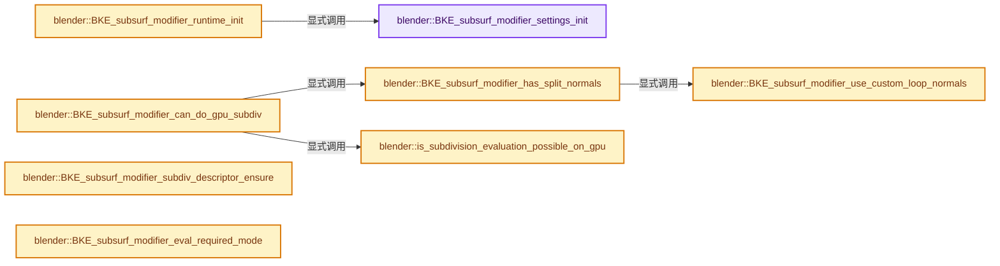
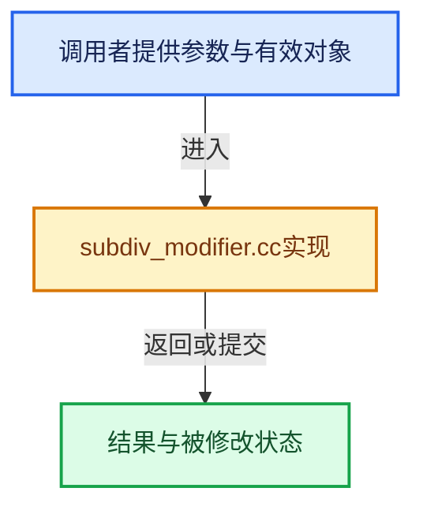

# 实现依赖专题：source/blender/blenkernel/intern/subdiv_modifier.cc

[实现依赖导航](../../README.md) · [符号索引](../../../00-课程指南/02-源码与提交索引/符号依赖与实现索引.md)

本专题从正文实际调用进入，集中保存共享实现。函数有稳定锚点，可从调用处直接跳到对应完整函数；递归与互相调用通过回链组织。

## 本文件的实现关系






## 完整成员与函数实现

<a id="f-2b6304c9e06e4b6a"></a>

### `blender::BKE_subsurf_modifier_settings_init`

实现位置：[source/blender/blenkernel/intern/subdiv_modifier.cc](../../../../../../../source/blender/blenkernel/intern/subdiv_modifier.cc) · L30—L46。

接口参数：

- `const SubsurfModifierData *smd`
- `const bool use_render_params`

**教学注释版**

<!-- annotated:45c5ac4000bd24 -->

```cpp
subdiv::Settings BKE_subsurf_modifier_settings_init(const SubsurfModifierData *smd,
                                                    const bool use_render_params)
{
  const int requested_levels = (use_render_params) ? smd->renderLevels : smd->levels;

  subdiv::Settings settings{};
  settings.is_simple = (smd->subdivType == SUBSURF_TYPE_SIMPLE);
  settings.is_adaptive = !(smd->flags & eSubsurfModifierFlag_UseRecursiveSubdivision);
  settings.level = settings.is_simple ? 1 :
                                        (settings.is_adaptive ? smd->quality : requested_levels);
  settings.use_creases = (smd->flags & eSubsurfModifierFlag_UseCrease);
  settings.vtx_boundary_interpolation = subdiv::vtx_boundary_interpolation_from_subsurf(
      smd->boundary_smooth);
  settings.fvar_linear_interpolation = subdiv::fvar_interpolation_from_uv_smooth(smd->uv_smooth);

  return settings;
}
```

<details>
<summary>核对原始源码：source/blender/blenkernel/intern/subdiv_modifier.cc · L30—L46</summary>

<!-- original:45c5ac4000bd24:source/blender/blenkernel/intern/subdiv_modifier.cc:30:46 -->

```cpp
subdiv::Settings BKE_subsurf_modifier_settings_init(const SubsurfModifierData *smd,
                                                    const bool use_render_params)
{
  const int requested_levels = (use_render_params) ? smd->renderLevels : smd->levels;

  subdiv::Settings settings{};
  settings.is_simple = (smd->subdivType == SUBSURF_TYPE_SIMPLE);
  settings.is_adaptive = !(smd->flags & eSubsurfModifierFlag_UseRecursiveSubdivision);
  settings.level = settings.is_simple ? 1 :
                                        (settings.is_adaptive ? smd->quality : requested_levels);
  settings.use_creases = (smd->flags & eSubsurfModifierFlag_UseCrease);
  settings.vtx_boundary_interpolation = subdiv::vtx_boundary_interpolation_from_subsurf(
      smd->boundary_smooth);
  settings.fvar_linear_interpolation = subdiv::fvar_interpolation_from_uv_smooth(smd->uv_smooth);

  return settings;
}
```

</details>

**沿实际写入检查状态**

- `settings.is_simple = (smd->subdivType == SUBSURF_TYPE_SIMPLE);`
- `settings.is_adaptive = !(smd->flags & eSubsurfModifierFlag_UseRecursiveSubdivision);`
- `settings.level = settings.is_simple ? 1 :`
- `settings.use_creases = (smd->flags & eSubsurfModifierFlag_UseCrease);`
- `settings.vtx_boundary_interpolation = subdiv::vtx_boundary_interpolation_from_subsurf(`
- `settings.fvar_linear_interpolation = subdiv::fvar_interpolation_from_uv_smooth(smd->uv_smooth);`

**结果出口**

- `return settings;`

**继续追踪实现**

- `subdiv::vtx_boundary_interpolation_from_subsurf` → [blender::bke::subdiv::vtx_boundary_interpolation_from_subsurf · L69](subdiv.cc.md#f-933a39ad7057338e)。
- `subdiv::fvar_interpolation_from_uv_smooth` → [blender::bke::subdiv::fvar_interpolation_from_uv_smooth · L49](subdiv.cc.md#f-767f64d27fdc130d)。

<a id="f-e9f9a7262ddf6787"></a>

### `blender::BKE_subsurf_modifier_runtime_init`

实现位置：[source/blender/blenkernel/intern/subdiv_modifier.cc](../../../../../../../source/blender/blenkernel/intern/subdiv_modifier.cc) · L48—L72。

接口参数：

- `SubsurfModifierData *smd`
- `const bool use_render_params`

**教学注释版**

<!-- annotated:4271cef63c91f3 -->

```cpp
bool BKE_subsurf_modifier_runtime_init(SubsurfModifierData *smd, const bool use_render_params)
{
  subdiv::Settings settings = BKE_subsurf_modifier_settings_init(smd, use_render_params);

  SubsurfRuntimeData *runtime_data = static_cast<SubsurfRuntimeData *>(smd->modifier.runtime);
  if (settings.level == 0) {
    /* Modifier is effectively disabled, but still update settings if runtime data
     * was already allocated. */
    if (runtime_data) {
      runtime_data->settings = settings;

      runtime_data->used_cpu = runtime_data->used_gpu = 0;
    }

    return false;
  }

  /* Allocate runtime data if it did not exist yet. */
  if (runtime_data == nullptr) {
    runtime_data = MEM_new_zeroed<SubsurfRuntimeData>(__func__);
    smd->modifier.runtime = runtime_data;
  }
  runtime_data->settings = settings;
  return true;
}
```

<details>
<summary>核对原始源码：source/blender/blenkernel/intern/subdiv_modifier.cc · L48—L72</summary>

<!-- original:4271cef63c91f3:source/blender/blenkernel/intern/subdiv_modifier.cc:48:72 -->

```cpp
bool BKE_subsurf_modifier_runtime_init(SubsurfModifierData *smd, const bool use_render_params)
{
  subdiv::Settings settings = BKE_subsurf_modifier_settings_init(smd, use_render_params);

  SubsurfRuntimeData *runtime_data = static_cast<SubsurfRuntimeData *>(smd->modifier.runtime);
  if (settings.level == 0) {
    /* Modifier is effectively disabled, but still update settings if runtime data
     * was already allocated. */
    if (runtime_data) {
      runtime_data->settings = settings;

      runtime_data->used_cpu = runtime_data->used_gpu = 0;
    }

    return false;
  }

  /* Allocate runtime data if it did not exist yet. */
  if (runtime_data == nullptr) {
    runtime_data = MEM_new_zeroed<SubsurfRuntimeData>(__func__);
    smd->modifier.runtime = runtime_data;
  }
  runtime_data->settings = settings;
  return true;
}
```

</details>

**沿实际写入检查状态**

- `runtime_data->settings = settings;`
- `runtime_data->used_cpu = runtime_data->used_gpu = 0;`
- `runtime_data = MEM_new_zeroed<SubsurfRuntimeData>(__func__);`
- `smd->modifier.runtime = runtime_data;`

**结果出口**

- `return false;`
- `return true;`

**继续追踪实现**

- `BKE_subsurf_modifier_settings_init` → [blender::BKE_subsurf_modifier_settings_init · L30](subdiv_modifier.cc.md#f-2b6304c9e06e4b6a)。
- `MEM_new_zeroed<SubsurfRuntimeData>` → [MEM_new_zeroed · L550](../../07-Intern运行时与平台/guardedalloc/MEM_guardedalloc.h.md#f-eeb1e2a7f57dd231)；[MEM_new_zeroed · L114](../../07-Intern运行时与平台/guardedalloc/intern/mallocn.cc.md#f-e04cf01c64c8b180)。同名重载需按实参类型选择。

<a id="f-d6cacee5adb47bd5"></a>

### `blender::BKE_subsurf_modifier_use_custom_loop_normals`

实现位置：[source/blender/blenkernel/intern/subdiv_modifier.cc](../../../../../../../source/blender/blenkernel/intern/subdiv_modifier.cc) · L74—L83。

接口参数：

- `const SubsurfModifierData *smd`
- `const Mesh *mesh`

**教学注释版**

<!-- annotated:bbfe7bf98e4888 -->

```cpp
bool BKE_subsurf_modifier_use_custom_loop_normals(const SubsurfModifierData *smd, const Mesh *mesh)
{
  if ((smd->flags & eSubsurfModifierFlag_UseCustomNormals) == 0) {
    return false;
  }
  const std::optional<AttributeMetaData> meta_data = mesh->attributes().lookup_meta_data(
      "custom_normal");
  return meta_data && meta_data->domain == AttrDomain::Corner &&
         meta_data->data_type == AttrType::Int16_2D;
}
```

<details>
<summary>核对原始源码：source/blender/blenkernel/intern/subdiv_modifier.cc · L74—L83</summary>

<!-- original:bbfe7bf98e4888:source/blender/blenkernel/intern/subdiv_modifier.cc:74:83 -->

```cpp
bool BKE_subsurf_modifier_use_custom_loop_normals(const SubsurfModifierData *smd, const Mesh *mesh)
{
  if ((smd->flags & eSubsurfModifierFlag_UseCustomNormals) == 0) {
    return false;
  }
  const std::optional<AttributeMetaData> meta_data = mesh->attributes().lookup_meta_data(
      "custom_normal");
  return meta_data && meta_data->domain == AttrDomain::Corner &&
         meta_data->data_type == AttrType::Int16_2D;
}
```

</details>

**结果出口**

- `return false;`
- `return meta_data && meta_data->domain == AttrDomain::Corner &&`

**继续追踪实现**

- `mesh->attributes().lookup_meta_data` → [调用协议](../../../00-课程指南/01-路线与规范/模板宏与动态分派协议.md)：接收对象类型依赖auto、返回值或模板实例；不按同名猜测目标。调用位置L79。
- `mesh->attributes` → [Mesh::attributes · L1298](../../../05-几何存储与拓扑映射/03-MPoly迁移与兼容.md#f-607bbfe3e57cfc7f)。

<a id="f-d2b0a9d4d185c7eb"></a>

### `blender::BKE_subsurf_modifier_has_split_normals`

实现位置：[source/blender/blenkernel/intern/subdiv_modifier.cc](../../../../../../../source/blender/blenkernel/intern/subdiv_modifier.cc) · L85—L89。

接口参数：

- `const SubsurfModifierData *smd`
- `const Mesh *mesh`

**教学注释版**

<!-- annotated:be201c586639c5 -->

```cpp
bool BKE_subsurf_modifier_has_split_normals(const SubsurfModifierData *smd, const Mesh *mesh)
{
  return BKE_subsurf_modifier_use_custom_loop_normals(smd, mesh) ||
         mesh->normals_domain() == MeshNormalDomain::Corner;
}
```

<details>
<summary>核对原始源码：source/blender/blenkernel/intern/subdiv_modifier.cc · L85—L89</summary>

<!-- original:be201c586639c5:source/blender/blenkernel/intern/subdiv_modifier.cc:85:89 -->

```cpp
bool BKE_subsurf_modifier_has_split_normals(const SubsurfModifierData *smd, const Mesh *mesh)
{
  return BKE_subsurf_modifier_use_custom_loop_normals(smd, mesh) ||
         mesh->normals_domain() == MeshNormalDomain::Corner;
}
```

</details>

**结果出口**

- `return BKE_subsurf_modifier_use_custom_loop_normals(smd, mesh) ||`

**继续追踪实现**

- `BKE_subsurf_modifier_use_custom_loop_normals` → [blender::BKE_subsurf_modifier_use_custom_loop_normals · L74](subdiv_modifier.cc.md#f-d6cacee5adb47bd5)。
- `mesh->normals_domain` → [blender::Mesh::normals_domain · L301](../../../06-隐式共享与缓存系统/08-法线缓存的真实依赖.md#f-303a2beb01515e4a)。

<a id="f-41863beb55620eff"></a>

### `blender::is_subdivision_evaluation_possible_on_gpu`

实现位置：[source/blender/blenkernel/intern/subdiv_modifier.cc](../../../../../../../source/blender/blenkernel/intern/subdiv_modifier.cc) · L91—L102。

**教学注释版**

<!-- annotated:f4723a2773c0a1 -->

```cpp
static bool is_subdivision_evaluation_possible_on_gpu()
{
  if (GPU_backend_get_type() == GPU_BACKEND_NONE) {
    return false;
  }

  if (GPU_max_compute_shader_storage_blocks() < MAX_GPU_SUBDIV_SSBOS) {
    return false;
  }

  return true;
}
```

<details>
<summary>核对原始源码：source/blender/blenkernel/intern/subdiv_modifier.cc · L91—L102</summary>

<!-- original:f4723a2773c0a1:source/blender/blenkernel/intern/subdiv_modifier.cc:91:102 -->

```cpp
static bool is_subdivision_evaluation_possible_on_gpu()
{
  if (GPU_backend_get_type() == GPU_BACKEND_NONE) {
    return false;
  }

  if (GPU_max_compute_shader_storage_blocks() < MAX_GPU_SUBDIV_SSBOS) {
    return false;
  }

  return true;
}
```

</details>

**结果出口**

- `return false;`
- `return true;`

**继续追踪实现**

- `GPU_backend_get_type` → [blender::GPU_backend_get_type · L613](../../08-其他Blender模块/gpu/intern/gpu_context.cc.md#f-f6a2f10bf5fbee87)。
- `GPU_max_compute_shader_storage_blocks` → [blender::GPU_max_compute_shader_storage_blocks · L192](../../08-其他Blender模块/gpu/intern/gpu_capabilities.cc.md#f-e53b0b0ccb26094a)。

<a id="f-a882930cd6c9ef47"></a>

### `blender::BKE_subsurf_modifier_can_do_gpu_subdiv`

实现位置：[source/blender/blenkernel/intern/subdiv_modifier.cc](../../../../../../../source/blender/blenkernel/intern/subdiv_modifier.cc) · L122—L127。

接口参数：

- `const SubsurfModifierData *smd`
- `const Mesh *mesh`

**教学注释版**

<!-- annotated:e2b523ad8c06a9 -->

```cpp
bool BKE_subsurf_modifier_can_do_gpu_subdiv(const SubsurfModifierData *smd, const Mesh *mesh)
{
  return (U.gpu_flag & USER_GPU_FLAG_SUBDIVISION_EVALUATION) &&
         is_subdivision_evaluation_possible_on_gpu() &&
         !BKE_subsurf_modifier_has_split_normals(smd, mesh);
}
```

<details>
<summary>核对原始源码：source/blender/blenkernel/intern/subdiv_modifier.cc · L122—L127</summary>

<!-- original:e2b523ad8c06a9:source/blender/blenkernel/intern/subdiv_modifier.cc:122:127 -->

```cpp
bool BKE_subsurf_modifier_can_do_gpu_subdiv(const SubsurfModifierData *smd, const Mesh *mesh)
{
  return (U.gpu_flag & USER_GPU_FLAG_SUBDIVISION_EVALUATION) &&
         is_subdivision_evaluation_possible_on_gpu() &&
         !BKE_subsurf_modifier_has_split_normals(smd, mesh);
}
```

</details>

**结果出口**

- `return (U.gpu_flag & USER_GPU_FLAG_SUBDIVISION_EVALUATION) &&`

**继续追踪实现**

- `is_subdivision_evaluation_possible_on_gpu` → [blender::is_subdivision_evaluation_possible_on_gpu · L91](subdiv_modifier.cc.md#f-41863beb55620eff)。
- `BKE_subsurf_modifier_has_split_normals` → [blender::BKE_subsurf_modifier_has_split_normals · L85](subdiv_modifier.cc.md#f-d2b0a9d4d185c7eb)。

<a id="f-634f64edee888a48"></a>

### `blender::BKE_subsurf_modifier_subdiv_descriptor_ensure`

实现位置：[source/blender/blenkernel/intern/subdiv_modifier.cc](../../../../../../../source/blender/blenkernel/intern/subdiv_modifier.cc) · L131—L144。

接口参数：

- `SubsurfRuntimeData *runtime_data`
- `const Mesh *mesh`
- `const bool for_draw_code`

**教学注释版**

<!-- annotated:96540ed5fd9903 -->

```cpp
subdiv::Subdiv *BKE_subsurf_modifier_subdiv_descriptor_ensure(SubsurfRuntimeData *runtime_data,
                                                              const Mesh *mesh,
                                                              const bool for_draw_code)
{
  if (for_draw_code) {
    runtime_data->used_gpu = 2; /* countdown in frames */

    return runtime_data->subdiv_gpu = subdiv::update_from_mesh(
               runtime_data->subdiv_gpu, &runtime_data->settings, mesh);
  }
  runtime_data->used_cpu = 2;
  return runtime_data->subdiv_cpu = subdiv::update_from_mesh(
             runtime_data->subdiv_cpu, &runtime_data->settings, mesh);
}
```

<details>
<summary>核对原始源码：source/blender/blenkernel/intern/subdiv_modifier.cc · L131—L144</summary>

<!-- original:96540ed5fd9903:source/blender/blenkernel/intern/subdiv_modifier.cc:131:144 -->

```cpp
subdiv::Subdiv *BKE_subsurf_modifier_subdiv_descriptor_ensure(SubsurfRuntimeData *runtime_data,
                                                              const Mesh *mesh,
                                                              const bool for_draw_code)
{
  if (for_draw_code) {
    runtime_data->used_gpu = 2; /* countdown in frames */

    return runtime_data->subdiv_gpu = subdiv::update_from_mesh(
               runtime_data->subdiv_gpu, &runtime_data->settings, mesh);
  }
  runtime_data->used_cpu = 2;
  return runtime_data->subdiv_cpu = subdiv::update_from_mesh(
             runtime_data->subdiv_cpu, &runtime_data->settings, mesh);
}
```

</details>

**沿实际写入检查状态**

- `runtime_data->used_gpu = 2; /* countdown in frames */`
- `runtime_data->used_cpu = 2;`

**结果出口**

- `return runtime_data->subdiv_gpu = subdiv::update_from_mesh(`
- `return runtime_data->subdiv_cpu = subdiv::update_from_mesh(`

**继续追踪实现**

- `subdiv::update_from_mesh` → [blender::bke::subdiv::update_from_mesh · L181](subdiv.cc.md#f-a1de41130c6ac9c9)。

<a id="f-dbbd341d956bf28c"></a>

### `blender::BKE_subsurf_modifier_eval_required_mode`

实现位置：[source/blender/blenkernel/intern/subdiv_modifier.cc](../../../../../../../source/blender/blenkernel/intern/subdiv_modifier.cc) · L146—L153。

接口参数：

- `bool is_final_render`
- `bool is_edit_mode`

**教学注释版**

<!-- annotated:96bec1245f216b -->

```cpp
int BKE_subsurf_modifier_eval_required_mode(bool is_final_render, bool is_edit_mode)
{
  if (is_final_render) {
    return eModifierMode_Render;
  }

  return eModifierMode_Realtime | (is_edit_mode ? int(eModifierMode_Editmode) : 0);
}
```

<details>
<summary>核对原始源码：source/blender/blenkernel/intern/subdiv_modifier.cc · L146—L153</summary>

<!-- original:96bec1245f216b:source/blender/blenkernel/intern/subdiv_modifier.cc:146:153 -->

```cpp
int BKE_subsurf_modifier_eval_required_mode(bool is_final_render, bool is_edit_mode)
{
  if (is_final_render) {
    return eModifierMode_Render;
  }

  return eModifierMode_Realtime | (is_edit_mode ? int(eModifierMode_Editmode) : 0);
}
```

</details>

**结果出口**

- `return eModifierMode_Render;`
- `return eModifierMode_Realtime | (is_edit_mode ? int(eModifierMode_Editmode) : 0);`

**继续追踪实现**

本实现没有需要继续展开的显式调用；检查返回表达式、对象转换和调用者前置条件。
