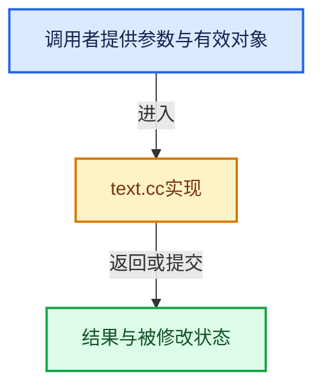

# 实现依赖专题：source/blender/blenkernel/intern/text.cc

[实现依赖导航](../../README.md) · [符号索引](../../../00-课程指南/02-源码与提交索引/符号依赖与实现索引.md)

本专题从正文实际调用进入，集中保存共享实现。函数有稳定锚点，可从调用处直接跳到对应完整函数；递归与互相调用通过回链组织。

## 本文件的实现关系





## 完整成员与函数实现

<a id="f-853dbdd12260654d"></a>

### `blender::txt_extended_ascii_as_utf8`

实现位置：[source/blender/blenkernel/intern/text.cc](../../../../../../../source/blender/blenkernel/intern/text.cc) · L297—L337。

接口参数：

- `char **str`

**教学注释版**

<!-- annotated:ad37d7aaee8bf2 -->

```cpp
int txt_extended_ascii_as_utf8(char **str)
{
  ptrdiff_t bad_char, i = 0;
  const ptrdiff_t length = ptrdiff_t(strlen(*str));
  int added = 0;

  while ((*str)[i]) {
    if ((bad_char = BLI_str_utf8_invalid_byte(*str + i, length - i)) == -1) {
      break;
    }

    added++;
    i += bad_char + 1;
  }

  if (added != 0) {
    char *newstr = MEM_new_array_uninitialized<char>(size_t(length) + size_t(added) + 1,
                                                     "text_line");
    ptrdiff_t mi = 0;
    i = 0;

    while ((*str)[i]) {
      if ((bad_char = BLI_str_utf8_invalid_byte((*str) + i, length - i)) == -1) {
        // [讲解] memcpy：复制字节，源与目标不应重叠。类型生命周期、对齐和可复制表示须由调用者证明，不是任意对象的复制构造。
        memcpy(newstr + mi, (*str) + i, length - i + 1);
        break;
      }

      memcpy(newstr + mi, (*str) + i, bad_char);

      const int mofs = mi + bad_char;
      BLI_str_utf8_from_unicode((*str)[i + bad_char], newstr + mofs, (length + added) - mofs);
      i += bad_char + 1;
      mi += bad_char + 2;
    }
    newstr[length + added] = '\0';
    MEM_delete(*str);
    *str = newstr;
  }

  return added;
}
```

<details>
<summary>核对原始源码：source/blender/blenkernel/intern/text.cc · L297—L337</summary>

<!-- original:ad37d7aaee8bf2:source/blender/blenkernel/intern/text.cc:297:337 -->

```cpp
int txt_extended_ascii_as_utf8(char **str)
{
  ptrdiff_t bad_char, i = 0;
  const ptrdiff_t length = ptrdiff_t(strlen(*str));
  int added = 0;

  while ((*str)[i]) {
    if ((bad_char = BLI_str_utf8_invalid_byte(*str + i, length - i)) == -1) {
      break;
    }

    added++;
    i += bad_char + 1;
  }

  if (added != 0) {
    char *newstr = MEM_new_array_uninitialized<char>(size_t(length) + size_t(added) + 1,
                                                     "text_line");
    ptrdiff_t mi = 0;
    i = 0;

    while ((*str)[i]) {
      if ((bad_char = BLI_str_utf8_invalid_byte((*str) + i, length - i)) == -1) {
        memcpy(newstr + mi, (*str) + i, length - i + 1);
        break;
      }

      memcpy(newstr + mi, (*str) + i, bad_char);

      const int mofs = mi + bad_char;
      BLI_str_utf8_from_unicode((*str)[i + bad_char], newstr + mofs, (length + added) - mofs);
      i += bad_char + 1;
      mi += bad_char + 2;
    }
    newstr[length + added] = '\0';
    MEM_delete(*str);
    *str = newstr;
  }

  return added;
}
```

</details>

**沿实际写入检查状态**

- `i += bad_char + 1;`
- `i = 0;`
- `mi += bad_char + 2;`

**结果出口**

- `return added;`

**继续追踪实现**

- `strlen` → [外部契约](https://eel.is/c++draft/)：这个边界按实际表达式及所属类型核对参数、返回值、寿命与失败行为。这里提供接口入口，不声称已解释该第三方版本的内部实现。
- `BLI_str_utf8_invalid_byte` → [blender::BLI_str_utf8_invalid_byte · L154](../../01-BLI基础库/intern/string_utf8.cc.md#f-070246b555fffcce)。
- `MEM_new_array_uninitialized<char>` → [MEM_new_array_uninitialized · L608](../../07-Intern运行时与平台/guardedalloc/MEM_guardedalloc.h.md#f-b7103eae8eb57b05)；[MEM_new_array_uninitialized · L129](../../07-Intern运行时与平台/guardedalloc/intern/mallocn.cc.md#f-bf6ef4ddcfb6e5df)。同名重载需按实参类型选择。
- `memcpy` → [外部契约](https://eel.is/c++draft/cstring.syn)：复制字节，源与目标不应重叠。类型生命周期、对齐和可复制表示须由调用者证明，不是任意对象的复制构造。
- `BLI_str_utf8_from_unicode` → [blender::BLI_str_utf8_from_unicode · L1192](../../01-BLI基础库/intern/string_utf8.cc.md#f-db61cf3be6e543e0)。
- `MEM_delete` → [MEM_delete · L400](../../07-Intern运行时与平台/guardedalloc/MEM_guardedalloc.h.md#f-9049ffdd1682887c)。
