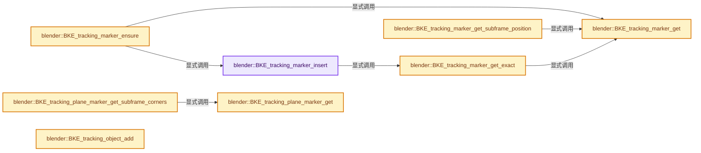
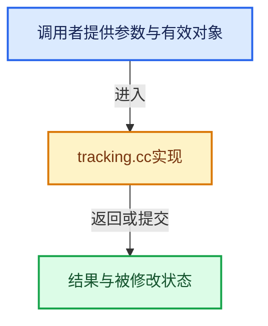

# 实现依赖专题：source/blender/blenkernel/intern/tracking.cc

[实现依赖导航](../../README.md) · [符号索引](../../../00-课程指南/02-源码与提交索引/符号依赖与实现索引.md)

本专题从正文实际调用进入，集中保存共享实现。函数有稳定锚点，可从调用处直接跳到对应完整函数；递归与互相调用通过回链组织。

## 本文件的实现关系






## 完整成员与函数实现

<a id="f-28d25cd2b9821628"></a>

### `blender::BKE_tracking_marker_insert`

实现位置：[source/blender/blenkernel/intern/tracking.cc](../../../../../../../source/blender/blenkernel/intern/tracking.cc) · L1240—L1284。

接口参数：

- `MovieTrackingTrack *track`
- `MovieTrackingMarker *marker`

**教学注释版**

<!-- annotated:cee8e5fc642374 -->

```cpp
MovieTrackingMarker *BKE_tracking_marker_insert(MovieTrackingTrack *track,
                                                MovieTrackingMarker *marker)
{
  MovieTrackingMarker *old_marker = nullptr;

  if (track->markersnr) {
    old_marker = BKE_tracking_marker_get_exact(track, marker->framenr);
  }

  if (old_marker) {
    /* simply replace settings for already allocated marker */
    *old_marker = *marker;

    return old_marker;
  }

  int a = track->markersnr;

  /* find position in array where to add new marker */
  while (a--) {
    if (track->markers[a].framenr < marker->framenr) {
      break;
    }
  }

  track->markersnr++;

  if (track->markers) {
    track->markers = static_cast<MovieTrackingMarker *>(
        MEM_realloc_uninitialized(track->markers, sizeof(MovieTrackingMarker) * track->markersnr));
  }
  else {
    track->markers = MEM_new<MovieTrackingMarker>("MovieTracking markers");
  }

  /* shift array to "free" space for new marker */
  // [讲解] memmove：复制可能重叠的字节区间；允许字节重叠不代表自动满足任意C++对象的移动构造契约。
  memmove(track->markers + a + 2,
          track->markers + a + 1,
          (track->markersnr - a - 2) * sizeof(MovieTrackingMarker));

  /* put new marker */
  track->markers[a + 1] = *marker;

  return &track->markers[a + 1];
}
```

<details>
<summary>核对原始源码：source/blender/blenkernel/intern/tracking.cc · L1240—L1284</summary>

<!-- original:cee8e5fc642374:source/blender/blenkernel/intern/tracking.cc:1240:1284 -->

```cpp
MovieTrackingMarker *BKE_tracking_marker_insert(MovieTrackingTrack *track,
                                                MovieTrackingMarker *marker)
{
  MovieTrackingMarker *old_marker = nullptr;

  if (track->markersnr) {
    old_marker = BKE_tracking_marker_get_exact(track, marker->framenr);
  }

  if (old_marker) {
    /* simply replace settings for already allocated marker */
    *old_marker = *marker;

    return old_marker;
  }

  int a = track->markersnr;

  /* find position in array where to add new marker */
  while (a--) {
    if (track->markers[a].framenr < marker->framenr) {
      break;
    }
  }

  track->markersnr++;

  if (track->markers) {
    track->markers = static_cast<MovieTrackingMarker *>(
        MEM_realloc_uninitialized(track->markers, sizeof(MovieTrackingMarker) * track->markersnr));
  }
  else {
    track->markers = MEM_new<MovieTrackingMarker>("MovieTracking markers");
  }

  /* shift array to "free" space for new marker */
  memmove(track->markers + a + 2,
          track->markers + a + 1,
          (track->markersnr - a - 2) * sizeof(MovieTrackingMarker));

  /* put new marker */
  track->markers[a + 1] = *marker;

  return &track->markers[a + 1];
}
```

</details>

**沿实际写入检查状态**

- `old_marker = BKE_tracking_marker_get_exact(track, marker->framenr);`
- `track->markers = static_cast<MovieTrackingMarker *>(`
- `track->markers = MEM_new<MovieTrackingMarker>("MovieTracking markers");`

**结果出口**

- `return old_marker;`
- `return &track->markers[a + 1];`

**继续追踪实现**

- `BKE_tracking_marker_get_exact` → [blender::BKE_tracking_marker_get_exact · L1396](tracking.cc.md#f-f86c3123d8611d7b)。
- `MEM_realloc_uninitialized` → [MEM_realloc_uninitialized · L118](../../07-Intern运行时与平台/guardedalloc/MEM_guardedalloc.h.md#m-813b7cd3fcff)。宏定义由构建条件选择。
- `MEM_new<MovieTrackingMarker>` → [MEM_new · L351](../../07-Intern运行时与平台/guardedalloc/MEM_guardedalloc.h.md#f-115f9b6784f89912)。
- `memmove` → [外部契约](https://eel.is/c++draft/cstring.syn)：复制可能重叠的字节区间；允许字节重叠不代表自动满足任意C++对象的移动构造契约。

<a id="f-0b6f52a92c77ca84"></a>

### `blender::BKE_tracking_marker_get`

实现位置：[source/blender/blenkernel/intern/tracking.cc](../../../../../../../source/blender/blenkernel/intern/tracking.cc) · L1363—L1394。

接口参数：

- `MovieTrackingTrack *track`
- `int framenr`

**教学注释版**

<!-- annotated:c3a050c1a3567f -->

```cpp
MovieTrackingMarker *BKE_tracking_marker_get(MovieTrackingTrack *track, int framenr)
{
  const int num_markers = track->markersnr;

  if (num_markers == 0) {
    BLI_assert_msg(0, "Detected degenerated track, should never happen.");
    return nullptr;
  }

  int left_boundary = 0;
  int right_boundary = num_markers;
  while (left_boundary < right_boundary) {
    const int median_index = (left_boundary + right_boundary) / 2;
    MovieTrackingMarker *marker = &track->markers[median_index];

    if (marker->framenr == framenr) {
      return marker;
    }

    if (marker->framenr < framenr) {
      left_boundary = median_index + 1;
    }
    else {
      BLI_assert(marker->framenr > framenr);
      right_boundary = median_index - 1;
    }
  }

  const int closest_index = clamp_i(right_boundary, 0, num_markers - 1);

  return &track->markers[closest_index];
}
```

<details>
<summary>核对原始源码：source/blender/blenkernel/intern/tracking.cc · L1363—L1394</summary>

<!-- original:c3a050c1a3567f:source/blender/blenkernel/intern/tracking.cc:1363:1394 -->

```cpp
MovieTrackingMarker *BKE_tracking_marker_get(MovieTrackingTrack *track, int framenr)
{
  const int num_markers = track->markersnr;

  if (num_markers == 0) {
    BLI_assert_msg(0, "Detected degenerated track, should never happen.");
    return nullptr;
  }

  int left_boundary = 0;
  int right_boundary = num_markers;
  while (left_boundary < right_boundary) {
    const int median_index = (left_boundary + right_boundary) / 2;
    MovieTrackingMarker *marker = &track->markers[median_index];

    if (marker->framenr == framenr) {
      return marker;
    }

    if (marker->framenr < framenr) {
      left_boundary = median_index + 1;
    }
    else {
      BLI_assert(marker->framenr > framenr);
      right_boundary = median_index - 1;
    }
  }

  const int closest_index = clamp_i(right_boundary, 0, num_markers - 1);

  return &track->markers[closest_index];
}
```

</details>

**沿实际写入检查状态**

- `left_boundary = median_index + 1;`
- `right_boundary = median_index - 1;`

**结果出口**

- `return nullptr;`
- `return marker;`
- `return &track->markers[closest_index];`

**继续追踪实现**

- `BLI_assert_msg` → [BLI_assert_msg · L55](../../01-BLI基础库/BLI_assert.hh.md#m-695eed20dceb)；[BLI_assert_msg · L64](../../01-BLI基础库/BLI_assert.hh.md#m-7de5563de4db)。宏定义由构建条件选择。
- `BLI_assert` → [BLI_assert · L48](../../01-BLI基础库/BLI_assert.hh.md#m-57a88495704d)；[BLI_assert · L63](../../01-BLI基础库/BLI_assert.hh.md#m-d07050020cb5)。宏定义由构建条件选择。
- `clamp_i` → [blender::clamp_i · L400](../../01-BLI基础库/intern/math_base_inline.cc.md#f-e9a0b16ec537d580)。

<a id="f-f86c3123d8611d7b"></a>

### `blender::BKE_tracking_marker_get_exact`

实现位置：[source/blender/blenkernel/intern/tracking.cc](../../../../../../../source/blender/blenkernel/intern/tracking.cc) · L1396—L1405。

接口参数：

- `MovieTrackingTrack *track`
- `int framenr`

**教学注释版**

<!-- annotated:1031ad9a9a5d09 -->

```cpp
MovieTrackingMarker *BKE_tracking_marker_get_exact(MovieTrackingTrack *track, int framenr)
{
  MovieTrackingMarker *marker = BKE_tracking_marker_get(track, framenr);

  if (marker->framenr != framenr) {
    return nullptr;
  }

  return marker;
}
```

<details>
<summary>核对原始源码：source/blender/blenkernel/intern/tracking.cc · L1396—L1405</summary>

<!-- original:1031ad9a9a5d09:source/blender/blenkernel/intern/tracking.cc:1396:1405 -->

```cpp
MovieTrackingMarker *BKE_tracking_marker_get_exact(MovieTrackingTrack *track, int framenr)
{
  MovieTrackingMarker *marker = BKE_tracking_marker_get(track, framenr);

  if (marker->framenr != framenr) {
    return nullptr;
  }

  return marker;
}
```

</details>

**结果出口**

- `return nullptr;`
- `return marker;`

**继续追踪实现**

- `BKE_tracking_marker_get` → [blender::BKE_tracking_marker_get · L1363](tracking.cc.md#f-0b6f52a92c77ca84)。

<a id="f-6d9d1b2dd5e45427"></a>

### `blender::BKE_tracking_marker_ensure`

实现位置：[source/blender/blenkernel/intern/tracking.cc](../../../../../../../source/blender/blenkernel/intern/tracking.cc) · L1407—L1422。

接口参数：

- `MovieTrackingTrack *track`
- `int framenr`

**教学注释版**

<!-- annotated:10c108a3815066 -->

```cpp
MovieTrackingMarker *BKE_tracking_marker_ensure(MovieTrackingTrack *track, int framenr)
{
  MovieTrackingMarker *marker = BKE_tracking_marker_get(track, framenr);

  if (marker->framenr != framenr) {
    MovieTrackingMarker marker_new;

    marker_new = *marker;
    marker_new.framenr = framenr;

    BKE_tracking_marker_insert(track, &marker_new);
    marker = BKE_tracking_marker_get(track, framenr);
  }

  return marker;
}
```

<details>
<summary>核对原始源码：source/blender/blenkernel/intern/tracking.cc · L1407—L1422</summary>

<!-- original:10c108a3815066:source/blender/blenkernel/intern/tracking.cc:1407:1422 -->

```cpp
MovieTrackingMarker *BKE_tracking_marker_ensure(MovieTrackingTrack *track, int framenr)
{
  MovieTrackingMarker *marker = BKE_tracking_marker_get(track, framenr);

  if (marker->framenr != framenr) {
    MovieTrackingMarker marker_new;

    marker_new = *marker;
    marker_new.framenr = framenr;

    BKE_tracking_marker_insert(track, &marker_new);
    marker = BKE_tracking_marker_get(track, framenr);
  }

  return marker;
}
```

</details>

**沿实际写入检查状态**

- `marker_new = *marker;`
- `marker_new.framenr = framenr;`
- `marker = BKE_tracking_marker_get(track, framenr);`

**结果出口**

- `return marker;`

**继续追踪实现**

- `BKE_tracking_marker_get` → [blender::BKE_tracking_marker_get · L1363](tracking.cc.md#f-0b6f52a92c77ca84)。
- `BKE_tracking_marker_insert` → [blender::BKE_tracking_marker_insert · L1240](tracking.cc.md#f-28d25cd2b9821628)。

<a id="f-5b78ef1e12d1ceb8"></a>

### `blender::BKE_tracking_marker_get_subframe_position`

实现位置：[source/blender/blenkernel/intern/tracking.cc](../../../../../../../source/blender/blenkernel/intern/tracking.cc) · L1512—L1541。

接口参数：

- `MovieTrackingTrack *track`
- `float framenr`
- `float pos[2]`

**教学注释版**

<!-- annotated:aff352c7f60d05 -->

```cpp
void BKE_tracking_marker_get_subframe_position(MovieTrackingTrack *track,
                                               float framenr,
                                               float pos[2])
{
  MovieTrackingMarker *marker = BKE_tracking_marker_get(track, int(framenr));
  MovieTrackingMarker *marker_last = track->markers + (track->markersnr - 1);

  if (marker != marker_last) {
    MovieTrackingMarker *marker_next = marker + 1;

    if (marker_next->framenr == marker->framenr + 1) {
      /* Currently only do sub-framing inside tracked ranges, do not extrapolate tracked segments
       * could be changed when / if mask parent would be interpolating position in-between
       * tracked segments. */

      float fac = (framenr - int(framenr)) / (marker_next->framenr - marker->framenr);

      interp_v2_v2v2(pos, marker->pos, marker_next->pos, fac);
    }
    else {
      copy_v2_v2(pos, marker->pos);
    }
  }
  else {
    copy_v2_v2(pos, marker->pos);
  }

  /* currently track offset is always wanted to be applied here, could be made an option later */
  add_v2_v2(pos, track->offset);
}
```

<details>
<summary>核对原始源码：source/blender/blenkernel/intern/tracking.cc · L1512—L1541</summary>

<!-- original:aff352c7f60d05:source/blender/blenkernel/intern/tracking.cc:1512:1541 -->

```cpp
void BKE_tracking_marker_get_subframe_position(MovieTrackingTrack *track,
                                               float framenr,
                                               float pos[2])
{
  MovieTrackingMarker *marker = BKE_tracking_marker_get(track, int(framenr));
  MovieTrackingMarker *marker_last = track->markers + (track->markersnr - 1);

  if (marker != marker_last) {
    MovieTrackingMarker *marker_next = marker + 1;

    if (marker_next->framenr == marker->framenr + 1) {
      /* Currently only do sub-framing inside tracked ranges, do not extrapolate tracked segments
       * could be changed when / if mask parent would be interpolating position in-between
       * tracked segments. */

      float fac = (framenr - int(framenr)) / (marker_next->framenr - marker->framenr);

      interp_v2_v2v2(pos, marker->pos, marker_next->pos, fac);
    }
    else {
      copy_v2_v2(pos, marker->pos);
    }
  }
  else {
    copy_v2_v2(pos, marker->pos);
  }

  /* currently track offset is always wanted to be applied here, could be made an option later */
  add_v2_v2(pos, track->offset);
}
```

</details>

**继续追踪实现**

- `BKE_tracking_marker_get` → [blender::BKE_tracking_marker_get · L1363](tracking.cc.md#f-0b6f52a92c77ca84)。
- `interp_v2_v2v2` → [blender::interp_v2_v2v2 · L26](../../01-BLI基础库/intern/math_vector.cc.md#f-20d77926433c82d6)。
- `copy_v2_v2` → [blender::copy_v2_v2 · L41](../../01-BLI基础库/intern/math_vector_inline.cc.md#f-e736ee2dd71cd821)。
- `add_v2_v2` → [blender::add_v2_v2 · L274](../../01-BLI基础库/intern/math_vector_inline.cc.md#f-1d5add4ac1b3a385)。

<a id="f-5159a0542110fef4"></a>

### `blender::BKE_tracking_plane_marker_get`

实现位置：[source/blender/blenkernel/intern/tracking.cc](../../../../../../../source/blender/blenkernel/intern/tracking.cc) · L1796—L1840。

接口参数：

- `MovieTrackingPlaneTrack *plane_track`
- `int framenr`

**教学注释版**

<!-- annotated:a71a0729306217 -->

```cpp
MovieTrackingPlaneMarker *BKE_tracking_plane_marker_get(MovieTrackingPlaneTrack *plane_track,
                                                        int framenr)
{
  int a = plane_track->markersnr - 1;

  if (!plane_track->markersnr) {
    return nullptr;
  }

  /* Approximate pre-first framenr marker with first marker. */
  if (framenr < plane_track->markers[0].framenr) {
    return &plane_track->markers[0];
  }

  if (plane_track->last_marker < plane_track->markersnr) {
    a = plane_track->last_marker;
  }

  if (plane_track->markers[a].framenr <= framenr) {
    while (a < plane_track->markersnr && plane_track->markers[a].framenr <= framenr) {
      if (plane_track->markers[a].framenr == framenr) {
        plane_track->last_marker = a;

        return &plane_track->markers[a];
      }
      a++;
    }

    /* If there's no marker for exact position, use nearest marker from left side. */
    return &plane_track->markers[a - 1];
  }

  while (a >= 0 && plane_track->markers[a].framenr >= framenr) {
    if (plane_track->markers[a].framenr == framenr) {
      plane_track->last_marker = a;

      return &plane_track->markers[a];
    }

    a--;
  }

  /* If there's no marker for exact position, use nearest marker from left side. */
  return &plane_track->markers[a];
}
```

<details>
<summary>核对原始源码：source/blender/blenkernel/intern/tracking.cc · L1796—L1840</summary>

<!-- original:a71a0729306217:source/blender/blenkernel/intern/tracking.cc:1796:1840 -->

```cpp
MovieTrackingPlaneMarker *BKE_tracking_plane_marker_get(MovieTrackingPlaneTrack *plane_track,
                                                        int framenr)
{
  int a = plane_track->markersnr - 1;

  if (!plane_track->markersnr) {
    return nullptr;
  }

  /* Approximate pre-first framenr marker with first marker. */
  if (framenr < plane_track->markers[0].framenr) {
    return &plane_track->markers[0];
  }

  if (plane_track->last_marker < plane_track->markersnr) {
    a = plane_track->last_marker;
  }

  if (plane_track->markers[a].framenr <= framenr) {
    while (a < plane_track->markersnr && plane_track->markers[a].framenr <= framenr) {
      if (plane_track->markers[a].framenr == framenr) {
        plane_track->last_marker = a;

        return &plane_track->markers[a];
      }
      a++;
    }

    /* If there's no marker for exact position, use nearest marker from left side. */
    return &plane_track->markers[a - 1];
  }

  while (a >= 0 && plane_track->markers[a].framenr >= framenr) {
    if (plane_track->markers[a].framenr == framenr) {
      plane_track->last_marker = a;

      return &plane_track->markers[a];
    }

    a--;
  }

  /* If there's no marker for exact position, use nearest marker from left side. */
  return &plane_track->markers[a];
}
```

</details>

**沿实际写入检查状态**

- `a = plane_track->last_marker;`
- `plane_track->last_marker = a;`

**结果出口**

- `return nullptr;`
- `return &plane_track->markers[0];`
- `return &plane_track->markers[a];`
- `return &plane_track->markers[a - 1];`

**继续追踪实现**

本实现没有需要继续展开的显式调用；检查返回表达式、对象转换和调用者前置条件。

<a id="f-d1ca206fdd55dd25"></a>

### `blender::BKE_tracking_plane_marker_get_subframe_corners`

实现位置：[source/blender/blenkernel/intern/tracking.cc](../../../../../../../source/blender/blenkernel/intern/tracking.cc) · L1871—L1896。

接口参数：

- `MovieTrackingPlaneTrack *plane_track`
- `float framenr`
- `float corners[4][2]`

**教学注释版**

<!-- annotated:def251d9081c12 -->

```cpp
void BKE_tracking_plane_marker_get_subframe_corners(MovieTrackingPlaneTrack *plane_track,
                                                    float framenr,
                                                    float corners[4][2])
{
  MovieTrackingPlaneMarker *marker = BKE_tracking_plane_marker_get(plane_track, int(framenr));
  MovieTrackingPlaneMarker *marker_last = plane_track->markers + (plane_track->markersnr - 1);
  if (marker != marker_last) {
    MovieTrackingPlaneMarker *marker_next = marker + 1;
    if (marker_next->framenr == marker->framenr + 1) {
      float fac = (framenr - int(framenr)) / (marker_next->framenr - marker->framenr);
      for (int i = 0; i < 4; i++) {
        interp_v2_v2v2(corners[i], marker->corners[i], marker_next->corners[i], fac);
      }
    }
    else {
      for (int i = 0; i < 4; i++) {
        copy_v2_v2(corners[i], marker->corners[i]);
      }
    }
  }
  else {
    for (int i = 0; i < 4; i++) {
      copy_v2_v2(corners[i], marker->corners[i]);
    }
  }
}
```

<details>
<summary>核对原始源码：source/blender/blenkernel/intern/tracking.cc · L1871—L1896</summary>

<!-- original:def251d9081c12:source/blender/blenkernel/intern/tracking.cc:1871:1896 -->

```cpp
void BKE_tracking_plane_marker_get_subframe_corners(MovieTrackingPlaneTrack *plane_track,
                                                    float framenr,
                                                    float corners[4][2])
{
  MovieTrackingPlaneMarker *marker = BKE_tracking_plane_marker_get(plane_track, int(framenr));
  MovieTrackingPlaneMarker *marker_last = plane_track->markers + (plane_track->markersnr - 1);
  if (marker != marker_last) {
    MovieTrackingPlaneMarker *marker_next = marker + 1;
    if (marker_next->framenr == marker->framenr + 1) {
      float fac = (framenr - int(framenr)) / (marker_next->framenr - marker->framenr);
      for (int i = 0; i < 4; i++) {
        interp_v2_v2v2(corners[i], marker->corners[i], marker_next->corners[i], fac);
      }
    }
    else {
      for (int i = 0; i < 4; i++) {
        copy_v2_v2(corners[i], marker->corners[i]);
      }
    }
  }
  else {
    for (int i = 0; i < 4; i++) {
      copy_v2_v2(corners[i], marker->corners[i]);
    }
  }
}
```

</details>

**继续追踪实现**

- `BKE_tracking_plane_marker_get` → [blender::BKE_tracking_plane_marker_get · L1796](tracking.cc.md#f-5159a0542110fef4)。
- `interp_v2_v2v2` → [blender::interp_v2_v2v2 · L26](../../01-BLI基础库/intern/math_vector.cc.md#f-20d77926433c82d6)。
- `copy_v2_v2` → [blender::copy_v2_v2 · L41](../../01-BLI基础库/intern/math_vector_inline.cc.md#f-e736ee2dd71cd821)。

<a id="f-22a265547c1e1740"></a>

### `blender::BKE_tracking_object_add`

实现位置：[source/blender/blenkernel/intern/tracking.cc](../../../../../../../source/blender/blenkernel/intern/tracking.cc) · L1902—L1929。

接口参数：

- `MovieTracking *tracking`
- `const char *name`

**教学注释版**

<!-- annotated:fdbc4e9626b74e -->

```cpp
MovieTrackingObject *BKE_tracking_object_add(MovieTracking *tracking, const char *name)
{
  MovieTrackingObject *tracking_object = MEM_new<MovieTrackingObject>("tracking object");

  if (tracking->tot_object == 0) {
    /* first object is always camera */
    STRNCPY_UTF8(tracking_object->name, "Camera");

    tracking_object->flag |= TRACKING_OBJECT_CAMERA;
  }
  else {
    STRNCPY_UTF8(tracking_object->name, name);
  }

  BLI_addtail(&tracking->objects, tracking_object);

  tracking->tot_object++;
  tracking->objectnr = tracking->objects.count() - 1;

  tracking_object->scale = 1.0f;
  tracking_object->keyframe1 = 1;
  tracking_object->keyframe2 = 30;

  BKE_tracking_object_unique_name(tracking, tracking_object);
  BKE_tracking_dopesheet_tag_update(tracking);

  return tracking_object;
}
```

<details>
<summary>核对原始源码：source/blender/blenkernel/intern/tracking.cc · L1902—L1929</summary>

<!-- original:fdbc4e9626b74e:source/blender/blenkernel/intern/tracking.cc:1902:1929 -->

```cpp
MovieTrackingObject *BKE_tracking_object_add(MovieTracking *tracking, const char *name)
{
  MovieTrackingObject *tracking_object = MEM_new<MovieTrackingObject>("tracking object");

  if (tracking->tot_object == 0) {
    /* first object is always camera */
    STRNCPY_UTF8(tracking_object->name, "Camera");

    tracking_object->flag |= TRACKING_OBJECT_CAMERA;
  }
  else {
    STRNCPY_UTF8(tracking_object->name, name);
  }

  BLI_addtail(&tracking->objects, tracking_object);

  tracking->tot_object++;
  tracking->objectnr = tracking->objects.count() - 1;

  tracking_object->scale = 1.0f;
  tracking_object->keyframe1 = 1;
  tracking_object->keyframe2 = 30;

  BKE_tracking_object_unique_name(tracking, tracking_object);
  BKE_tracking_dopesheet_tag_update(tracking);

  return tracking_object;
}
```

</details>

**沿实际写入检查状态**

- `tracking_object->flag |= TRACKING_OBJECT_CAMERA;`
- `tracking->objectnr = tracking->objects.count() - 1;`
- `tracking_object->scale = 1.0f;`
- `tracking_object->keyframe1 = 1;`
- `tracking_object->keyframe2 = 30;`

**结果出口**

- `return tracking_object;`

**继续追踪实现**

- `MEM_new<MovieTrackingObject>` → [MEM_new · L351](../../07-Intern运行时与平台/guardedalloc/MEM_guardedalloc.h.md#f-115f9b6784f89912)。
- `STRNCPY_UTF8` → [STRNCPY_UTF8 · L335](../../01-BLI基础库/BLI_string_utf8.hh.md#m-222967f0ab6a)。宏定义由构建条件选择。
- `BLI_addtail` → [blender::BLI_addtail · L118](../../01-BLI基础库/intern/listbase.cc.md#f-4fb027713fa3115b)。
- `tracking->objects.count` → [调用协议](../../../00-课程指南/01-路线与规范/模板宏与动态分派协议.md)：接收对象类型依赖auto、返回值或模板实例；不按同名猜测目标。调用位置L1919。
- `BKE_tracking_object_unique_name` → [blender::BKE_tracking_object_unique_name · L1961](tracking.cc.md#f-1215023cccc5bb4b)。
- `BKE_tracking_dopesheet_tag_update` → [blender::BKE_tracking_dopesheet_tag_update · L3355](tracking.cc.md#f-680a2bddfb8975d0)。

<a id="f-1215023cccc5bb4b"></a>

### `blender::BKE_tracking_object_unique_name`

实现位置：[source/blender/blenkernel/intern/tracking.cc](../../../../../../../source/blender/blenkernel/intern/tracking.cc) · L1961—L1969。

接口参数：

- `MovieTracking *tracking`
- `MovieTrackingObject *tracking_object`

**教学注释版**

<!-- annotated:bdad1dcd692015 -->

```cpp
void BKE_tracking_object_unique_name(MovieTracking *tracking, MovieTrackingObject *tracking_object)
{
  BLI_uniquename(&tracking->objects,
                 tracking_object,
                 DATA_("Object"),
                 '.',
                 offsetof(MovieTrackingObject, name),
                 sizeof(tracking_object->name));
}
```

<details>
<summary>核对原始源码：source/blender/blenkernel/intern/tracking.cc · L1961—L1969</summary>

<!-- original:bdad1dcd692015:source/blender/blenkernel/intern/tracking.cc:1961:1969 -->

```cpp
void BKE_tracking_object_unique_name(MovieTracking *tracking, MovieTrackingObject *tracking_object)
{
  BLI_uniquename(&tracking->objects,
                 tracking_object,
                 DATA_("Object"),
                 '.',
                 offsetof(MovieTrackingObject, name),
                 sizeof(tracking_object->name));
}
```

</details>

**继续追踪实现**

- `BLI_uniquename` → [blender::BLI_uniquename · L491](../../01-BLI基础库/intern/string_utils.cc.md#f-bcf1a000dbfb87d1)。
- `DATA_` → [DATA_ · L52](../../08-其他Blender模块/blentranslation/BLT_translation.hh.md#m-178736083f83)。宏定义由构建条件选择。

<a id="f-294118b68c0403d7"></a>

### `blender::BKE_tracking_object_get_named`

实现位置：[source/blender/blenkernel/intern/tracking.cc](../../../../../../../source/blender/blenkernel/intern/tracking.cc) · L1971—L1980。

接口参数：

- `MovieTracking *tracking`
- `const char *name`

**教学注释版**

<!-- annotated:3fb8e2572b0937 -->

```cpp
MovieTrackingObject *BKE_tracking_object_get_named(MovieTracking *tracking, const char *name)
{
  for (MovieTrackingObject &tracking_object : tracking->objects) {
    if (STREQ(tracking_object.name, name)) {
      return &tracking_object;
    }
  }

  return nullptr;
}
```

<details>
<summary>核对原始源码：source/blender/blenkernel/intern/tracking.cc · L1971—L1980</summary>

<!-- original:3fb8e2572b0937:source/blender/blenkernel/intern/tracking.cc:1971:1980 -->

```cpp
MovieTrackingObject *BKE_tracking_object_get_named(MovieTracking *tracking, const char *name)
{
  for (MovieTrackingObject &tracking_object : tracking->objects) {
    if (STREQ(tracking_object.name, name)) {
      return &tracking_object;
    }
  }

  return nullptr;
}
```

</details>

**结果出口**

- `return &tracking_object;`
- `return nullptr;`

**继续追踪实现**

- `STREQ` → [STREQ · L112](../../07-Intern运行时与平台/ghost/intern/GHOST_utildefines.hh.md#m-9549fb6aafd2)；[STREQ · L451](../../01-BLI基础库/BLI_utildefines.hh.md#m-c7b745bcfad2)；[STREQ · L55](../../07-Intern运行时与平台/clog/clog.cc.md#m-96e78f386894)。宏定义由构建条件选择。

<a id="f-82e9430e69d552bc"></a>

### `blender::BKE_tracking_object_get_active`

实现位置：[source/blender/blenkernel/intern/tracking.cc](../../../../../../../source/blender/blenkernel/intern/tracking.cc) · L1982—L1985。

接口参数：

- `const MovieTracking *tracking`

**教学注释版**

<!-- annotated:d2ad3a5faa067a -->

```cpp
MovieTrackingObject *BKE_tracking_object_get_active(const MovieTracking *tracking)
{
  return static_cast<MovieTrackingObject *>(BLI_findlink(&tracking->objects, tracking->objectnr));
}
```

<details>
<summary>核对原始源码：source/blender/blenkernel/intern/tracking.cc · L1982—L1985</summary>

<!-- original:d2ad3a5faa067a:source/blender/blenkernel/intern/tracking.cc:1982:1985 -->

```cpp
MovieTrackingObject *BKE_tracking_object_get_active(const MovieTracking *tracking)
{
  return static_cast<MovieTrackingObject *>(BLI_findlink(&tracking->objects, tracking->objectnr));
}
```

</details>

**结果出口**

- `return static_cast<MovieTrackingObject *>(BLI_findlink(&tracking->objects, tracking->objectnr));`

**继续追踪实现**

- `BLI_findlink` → [blender::BLI_findlink · L541](../../01-BLI基础库/intern/listbase.cc.md#f-6d3fd65974b4e808)。

<a id="f-79c3e6daf2465aa3"></a>

### `blender::BKE_tracking_object_get_camera`

实现位置：[source/blender/blenkernel/intern/tracking.cc](../../../../../../../source/blender/blenkernel/intern/tracking.cc) · L1987—L1996。

接口参数：

- `const MovieTracking *tracking`

**教学注释版**

<!-- annotated:616a71b42be4cd -->

```cpp
MovieTrackingObject *BKE_tracking_object_get_camera(const MovieTracking *tracking)
{
  for (MovieTrackingObject &tracking_object : tracking->objects) {
    if (tracking_object.flag & TRACKING_OBJECT_CAMERA) {
      return &tracking_object;
    }
  }

  return nullptr;
}
```

<details>
<summary>核对原始源码：source/blender/blenkernel/intern/tracking.cc · L1987—L1996</summary>

<!-- original:616a71b42be4cd:source/blender/blenkernel/intern/tracking.cc:1987:1996 -->

```cpp
MovieTrackingObject *BKE_tracking_object_get_camera(const MovieTracking *tracking)
{
  for (MovieTrackingObject &tracking_object : tracking->objects) {
    if (tracking_object.flag & TRACKING_OBJECT_CAMERA) {
      return &tracking_object;
    }
  }

  return nullptr;
}
```

</details>

**结果出口**

- `return &tracking_object;`
- `return nullptr;`

**继续追踪实现**

本实现没有需要继续展开的显式调用；检查返回表达式、对象转换和调用者前置条件。

<a id="f-6086caadf5853e5b"></a>

### `blender::BKE_tracking_object_find_track_with_name`

实现位置：[source/blender/blenkernel/intern/tracking.cc](../../../../../../../source/blender/blenkernel/intern/tracking.cc) · L1998—L2008。

接口参数：

- `MovieTrackingObject *tracking_object`
- `const char *name`

**教学注释版**

<!-- annotated:db9c818de5b59a -->

```cpp
MovieTrackingTrack *BKE_tracking_object_find_track_with_name(MovieTrackingObject *tracking_object,
                                                             const char *name)
{
  for (MovieTrackingTrack &track : tracking_object->tracks) {
    if (STREQ(track.name, name)) {
      return &track;
    }
  }

  return nullptr;
}
```

<details>
<summary>核对原始源码：source/blender/blenkernel/intern/tracking.cc · L1998—L2008</summary>

<!-- original:db9c818de5b59a:source/blender/blenkernel/intern/tracking.cc:1998:2008 -->

```cpp
MovieTrackingTrack *BKE_tracking_object_find_track_with_name(MovieTrackingObject *tracking_object,
                                                             const char *name)
{
  for (MovieTrackingTrack &track : tracking_object->tracks) {
    if (STREQ(track.name, name)) {
      return &track;
    }
  }

  return nullptr;
}
```

</details>

**结果出口**

- `return &track;`
- `return nullptr;`

**继续追踪实现**

- `STREQ` → [STREQ · L112](../../07-Intern运行时与平台/ghost/intern/GHOST_utildefines.hh.md#m-9549fb6aafd2)；[STREQ · L451](../../01-BLI基础库/BLI_utildefines.hh.md#m-c7b745bcfad2)；[STREQ · L55](../../07-Intern运行时与平台/clog/clog.cc.md#m-96e78f386894)。宏定义由构建条件选择。

<a id="f-f906bb93da984223"></a>

### `blender::BKE_tracking_object_find_plane_track_with_name`

实现位置：[source/blender/blenkernel/intern/tracking.cc](../../../../../../../source/blender/blenkernel/intern/tracking.cc) · L2010—L2020。

接口参数：

- `MovieTrackingObject *tracking_object`
- `const char *name`

**教学注释版**

<!-- annotated:1d45693a3d4792 -->

```cpp
MovieTrackingPlaneTrack *BKE_tracking_object_find_plane_track_with_name(
    MovieTrackingObject *tracking_object, const char *name)
{
  for (MovieTrackingPlaneTrack &plane_track : tracking_object->plane_tracks) {
    if (STREQ(plane_track.name, name)) {
      return &plane_track;
    }
  }

  return nullptr;
}
```

<details>
<summary>核对原始源码：source/blender/blenkernel/intern/tracking.cc · L2010—L2020</summary>

<!-- original:1d45693a3d4792:source/blender/blenkernel/intern/tracking.cc:2010:2020 -->

```cpp
MovieTrackingPlaneTrack *BKE_tracking_object_find_plane_track_with_name(
    MovieTrackingObject *tracking_object, const char *name)
{
  for (MovieTrackingPlaneTrack &plane_track : tracking_object->plane_tracks) {
    if (STREQ(plane_track.name, name)) {
      return &plane_track;
    }
  }

  return nullptr;
}
```

</details>

**结果出口**

- `return &plane_track;`
- `return nullptr;`

**继续追踪实现**

- `STREQ` → [STREQ · L112](../../07-Intern运行时与平台/ghost/intern/GHOST_utildefines.hh.md#m-9549fb6aafd2)；[STREQ · L451](../../01-BLI基础库/BLI_utildefines.hh.md#m-c7b745bcfad2)；[STREQ · L55](../../07-Intern运行时与平台/clog/clog.cc.md#m-96e78f386894)。宏定义由构建条件选择。

<a id="f-7a7d90a4fef1b403"></a>

### `blender::BKE_tracking_distortion_new`

实现位置：[source/blender/blenkernel/intern/tracking.cc](../../../../../../../source/blender/blenkernel/intern/tracking.cc) · L2268—L2290。

接口参数：

- `MovieTracking *tracking`
- `int calibration_width`
- `int calibration_height`

**教学注释版**

<!-- annotated:458daf87add4af -->

```cpp
MovieDistortion *BKE_tracking_distortion_new(MovieTracking *tracking,
                                             int calibration_width,
                                             int calibration_height)
{
  MovieDistortion *distortion;
  libmv_CameraIntrinsicsOptions camera_intrinsics_options;

  tracking_cameraIntrinscisOptionsFromTracking(
      tracking, calibration_width, calibration_height, &camera_intrinsics_options);

  distortion = MEM_new_zeroed<MovieDistortion>("BKE_tracking_distortion_create");
  distortion->intrinsics = libmv_cameraIntrinsicsNew(&camera_intrinsics_options);

  const MovieTrackingCamera *camera = &tracking->camera;
  tracking_principal_point_normalized_to_pixel(tracking->camera.principal_point,
                                               calibration_width,
                                               calibration_height,
                                               distortion->principal_px);
  distortion->pixel_aspect = camera->pixel_aspect;
  distortion->focal = camera->focal;

  return distortion;
}
```

<details>
<summary>核对原始源码：source/blender/blenkernel/intern/tracking.cc · L2268—L2290</summary>

<!-- original:458daf87add4af:source/blender/blenkernel/intern/tracking.cc:2268:2290 -->

```cpp
MovieDistortion *BKE_tracking_distortion_new(MovieTracking *tracking,
                                             int calibration_width,
                                             int calibration_height)
{
  MovieDistortion *distortion;
  libmv_CameraIntrinsicsOptions camera_intrinsics_options;

  tracking_cameraIntrinscisOptionsFromTracking(
      tracking, calibration_width, calibration_height, &camera_intrinsics_options);

  distortion = MEM_new_zeroed<MovieDistortion>("BKE_tracking_distortion_create");
  distortion->intrinsics = libmv_cameraIntrinsicsNew(&camera_intrinsics_options);

  const MovieTrackingCamera *camera = &tracking->camera;
  tracking_principal_point_normalized_to_pixel(tracking->camera.principal_point,
                                               calibration_width,
                                               calibration_height,
                                               distortion->principal_px);
  distortion->pixel_aspect = camera->pixel_aspect;
  distortion->focal = camera->focal;

  return distortion;
}
```

</details>

**沿实际写入检查状态**

- `distortion = MEM_new_zeroed<MovieDistortion>("BKE_tracking_distortion_create");`
- `distortion->intrinsics = libmv_cameraIntrinsicsNew(&camera_intrinsics_options);`
- `distortion->pixel_aspect = camera->pixel_aspect;`
- `distortion->focal = camera->focal;`

**结果出口**

- `return distortion;`

**继续追踪实现**

- `tracking_cameraIntrinscisOptionsFromTracking` → [blender::tracking_cameraIntrinscisOptionsFromTracking · L489](tracking_util.cc.md#f-6f29ef6084229451)。
- `MEM_new_zeroed<MovieDistortion>` → [MEM_new_zeroed · L550](../../07-Intern运行时与平台/guardedalloc/MEM_guardedalloc.h.md#f-eeb1e2a7f57dd231)；[MEM_new_zeroed · L114](../../07-Intern运行时与平台/guardedalloc/intern/mallocn.cc.md#f-e04cf01c64c8b180)。同名重载需按实参类型选择。
- `libmv_cameraIntrinsicsNew` → [libmv_cameraIntrinsicsNew · L202](../../07-Intern运行时与平台/libmv/intern/stub.cc.md#f-507f21cb8a36af17)；[libmv_cameraIntrinsicsNew · L15](../../07-Intern运行时与平台/libmv/intern/camera_intrinsics.cc.md#f-0a362709aea18b2f)。同名重载需按实参类型选择。
- `tracking_principal_point_normalized_to_pixel` → [blender::tracking_principal_point_normalized_to_pixel · L349](tracking_util.cc.md#f-cfea266b0a3f77d1)。

<a id="f-a4d685394f5730b1"></a>

### `blender::BKE_tracking_distortion_update`

实现位置：[source/blender/blenkernel/intern/tracking.cc](../../../../../../../source/blender/blenkernel/intern/tracking.cc) · L2292—L2311。

接口参数：

- `MovieDistortion *distortion`
- `MovieTracking *tracking`
- `int calibration_width`
- `int calibration_height`

**教学注释版**

<!-- annotated:9479dffb964092 -->

```cpp
void BKE_tracking_distortion_update(MovieDistortion *distortion,
                                    MovieTracking *tracking,
                                    int calibration_width,
                                    int calibration_height)
{
  libmv_CameraIntrinsicsOptions camera_intrinsics_options;

  tracking_cameraIntrinscisOptionsFromTracking(
      tracking, calibration_width, calibration_height, &camera_intrinsics_options);

  const MovieTrackingCamera *camera = &tracking->camera;
  tracking_principal_point_normalized_to_pixel(tracking->camera.principal_point,
                                               calibration_width,
                                               calibration_height,
                                               distortion->principal_px);
  distortion->pixel_aspect = camera->pixel_aspect;
  distortion->focal = camera->focal;

  libmv_cameraIntrinsicsUpdate(&camera_intrinsics_options, distortion->intrinsics);
}
```

<details>
<summary>核对原始源码：source/blender/blenkernel/intern/tracking.cc · L2292—L2311</summary>

<!-- original:9479dffb964092:source/blender/blenkernel/intern/tracking.cc:2292:2311 -->

```cpp
void BKE_tracking_distortion_update(MovieDistortion *distortion,
                                    MovieTracking *tracking,
                                    int calibration_width,
                                    int calibration_height)
{
  libmv_CameraIntrinsicsOptions camera_intrinsics_options;

  tracking_cameraIntrinscisOptionsFromTracking(
      tracking, calibration_width, calibration_height, &camera_intrinsics_options);

  const MovieTrackingCamera *camera = &tracking->camera;
  tracking_principal_point_normalized_to_pixel(tracking->camera.principal_point,
                                               calibration_width,
                                               calibration_height,
                                               distortion->principal_px);
  distortion->pixel_aspect = camera->pixel_aspect;
  distortion->focal = camera->focal;

  libmv_cameraIntrinsicsUpdate(&camera_intrinsics_options, distortion->intrinsics);
}
```

</details>

**沿实际写入检查状态**

- `distortion->pixel_aspect = camera->pixel_aspect;`
- `distortion->focal = camera->focal;`

**继续追踪实现**

- `tracking_cameraIntrinscisOptionsFromTracking` → [blender::tracking_cameraIntrinscisOptionsFromTracking · L489](tracking_util.cc.md#f-6f29ef6084229451)。
- `tracking_principal_point_normalized_to_pixel` → [blender::tracking_principal_point_normalized_to_pixel · L349](tracking_util.cc.md#f-cfea266b0a3f77d1)。
- `libmv_cameraIntrinsicsUpdate` → [libmv_cameraIntrinsicsUpdate · L216](../../07-Intern运行时与平台/libmv/intern/stub.cc.md#f-ab89f70344a926f2)；[libmv_cameraIntrinsicsUpdate · L65](../../07-Intern运行时与平台/libmv/intern/camera_intrinsics.cc.md#f-facccdfb33b55ea3)。同名重载需按实参类型选择。

<a id="f-e32e4e6d3d33eb42"></a>

### `blender::BKE_tracking_distortion_exec`

实现位置：[source/blender/blenkernel/intern/tracking.cc](../../../../../../../source/blender/blenkernel/intern/tracking.cc) · L2324—L2382。

接口参数：

- `MovieDistortion *distortion`
- `MovieTracking *tracking`
- `ImBuf *ibuf`
- `int calibration_width`
- `int calibration_height`
- `float overscan`
- `bool undistort`

**教学注释版**

<!-- annotated:98e935fefa76a1 -->

```cpp
ImBuf *BKE_tracking_distortion_exec(MovieDistortion *distortion,
                                    MovieTracking *tracking,
                                    ImBuf *ibuf,
                                    int calibration_width,
                                    int calibration_height,
                                    float overscan,
                                    bool undistort)
{
  ImBuf *resibuf;

  BKE_tracking_distortion_update(distortion, tracking, calibration_width, calibration_height);

  resibuf = IMB_dupImBuf(ibuf);

  if (ibuf->float_data()) {
    if (undistort) {
      libmv_cameraIntrinsicsUndistortFloat(distortion->intrinsics,
                                           ibuf->float_data(),
                                           ibuf->x,
                                           ibuf->y,
                                           overscan,
                                           ibuf->channels,
                                           resibuf->float_data_for_write());
    }
    else {
      libmv_cameraIntrinsicsDistortFloat(distortion->intrinsics,
                                         ibuf->float_data_for_write(),
                                         ibuf->x,
                                         ibuf->y,
                                         overscan,
                                         ibuf->channels,
                                         resibuf->float_data_for_write());
    }

    IMB_free_byte_pixels(ibuf);
  }
  else {
    if (undistort) {
      libmv_cameraIntrinsicsUndistortByte(distortion->intrinsics,
                                          ibuf->byte_data(),
                                          ibuf->x,
                                          ibuf->y,
                                          overscan,
                                          ibuf->channels,
                                          resibuf->byte_data_for_write());
    }
    else {
      libmv_cameraIntrinsicsDistortByte(distortion->intrinsics,
                                        ibuf->byte_data(),
                                        ibuf->x,
                                        ibuf->y,
                                        overscan,
                                        ibuf->channels,
                                        resibuf->byte_data_for_write());
    }
  }

  return resibuf;
}
```

<details>
<summary>核对原始源码：source/blender/blenkernel/intern/tracking.cc · L2324—L2382</summary>

<!-- original:98e935fefa76a1:source/blender/blenkernel/intern/tracking.cc:2324:2382 -->

```cpp
ImBuf *BKE_tracking_distortion_exec(MovieDistortion *distortion,
                                    MovieTracking *tracking,
                                    ImBuf *ibuf,
                                    int calibration_width,
                                    int calibration_height,
                                    float overscan,
                                    bool undistort)
{
  ImBuf *resibuf;

  BKE_tracking_distortion_update(distortion, tracking, calibration_width, calibration_height);

  resibuf = IMB_dupImBuf(ibuf);

  if (ibuf->float_data()) {
    if (undistort) {
      libmv_cameraIntrinsicsUndistortFloat(distortion->intrinsics,
                                           ibuf->float_data(),
                                           ibuf->x,
                                           ibuf->y,
                                           overscan,
                                           ibuf->channels,
                                           resibuf->float_data_for_write());
    }
    else {
      libmv_cameraIntrinsicsDistortFloat(distortion->intrinsics,
                                         ibuf->float_data_for_write(),
                                         ibuf->x,
                                         ibuf->y,
                                         overscan,
                                         ibuf->channels,
                                         resibuf->float_data_for_write());
    }

    IMB_free_byte_pixels(ibuf);
  }
  else {
    if (undistort) {
      libmv_cameraIntrinsicsUndistortByte(distortion->intrinsics,
                                          ibuf->byte_data(),
                                          ibuf->x,
                                          ibuf->y,
                                          overscan,
                                          ibuf->channels,
                                          resibuf->byte_data_for_write());
    }
    else {
      libmv_cameraIntrinsicsDistortByte(distortion->intrinsics,
                                        ibuf->byte_data(),
                                        ibuf->x,
                                        ibuf->y,
                                        overscan,
                                        ibuf->channels,
                                        resibuf->byte_data_for_write());
    }
  }

  return resibuf;
}
```

</details>

**沿实际写入检查状态**

- `resibuf = IMB_dupImBuf(ibuf);`

**结果出口**

- `return resibuf;`

**继续追踪实现**

- `BKE_tracking_distortion_update` → [blender::BKE_tracking_distortion_update · L2292](tracking.cc.md#f-a4d685394f5730b1)。
- `IMB_dupImBuf` → [blender::IMB_dupImBuf · L416](../../08-其他Blender模块/imbuf/intern/allocimbuf.cc.md#f-b0336462c0f07a9e)。
- `ibuf->float_data` → [blender::ImBuf::float_data · L358](../../08-其他Blender模块/imbuf/IMB_imbuf_types.hh.md#f-2e52aa77544ffaee)。
- `libmv_cameraIntrinsicsUndistortFloat` → [libmv_cameraIntrinsicsUndistortFloat · L241](../../07-Intern运行时与平台/libmv/intern/stub.cc.md#f-7ed9b6bb7168b837)；[libmv_cameraIntrinsicsUndistortFloat · L265](../../07-Intern运行时与平台/libmv/intern/camera_intrinsics.cc.md#f-711c6a7979a43a25)。同名重载需按实参类型选择。
- `resibuf->float_data_for_write` → [blender::ImBuf::float_data_for_write · L79](../../08-其他Blender模块/imbuf/intern/allocimbuf.cc.md#f-1956ac4db88ed3eb)。
- `libmv_cameraIntrinsicsDistortFloat` → [libmv_cameraIntrinsicsDistortFloat · L267](../../07-Intern运行时与平台/libmv/intern/stub.cc.md#f-6029285c1ff89944)；[libmv_cameraIntrinsicsDistortFloat · L291](../../07-Intern运行时与平台/libmv/intern/camera_intrinsics.cc.md#f-f5a09612d2744d83)。同名重载需按实参类型选择。
- `ibuf->float_data_for_write` → [blender::ImBuf::float_data_for_write · L79](../../08-其他Blender模块/imbuf/intern/allocimbuf.cc.md#f-1956ac4db88ed3eb)。
- `IMB_free_byte_pixels` → [blender::IMB_free_byte_pixels · L128](../../08-其他Blender模块/imbuf/intern/allocimbuf.cc.md#f-4b7a8f53593680ab)。
- `libmv_cameraIntrinsicsUndistortByte` → [libmv_cameraIntrinsicsUndistortByte · L228](../../07-Intern运行时与平台/libmv/intern/stub.cc.md#f-e3567ab7e6d74a61)；[libmv_cameraIntrinsicsUndistortByte · L252](../../07-Intern运行时与平台/libmv/intern/camera_intrinsics.cc.md#f-6bba520df4aba2e4)。同名重载需按实参类型选择。
- `ibuf->byte_data` → [blender::ImBuf::byte_data · L353](../../08-其他Blender模块/imbuf/IMB_imbuf_types.hh.md#f-2cdfc552156643fa)。
- `resibuf->byte_data_for_write` → [blender::ImBuf::byte_data_for_write · L60](../../08-其他Blender模块/imbuf/intern/allocimbuf.cc.md#f-9ae201bd1c52aa87)。
- `libmv_cameraIntrinsicsDistortByte` → [libmv_cameraIntrinsicsDistortByte · L254](../../07-Intern运行时与平台/libmv/intern/stub.cc.md#f-a9632642ad54bc04)；[libmv_cameraIntrinsicsDistortByte · L278](../../07-Intern运行时与平台/libmv/intern/camera_intrinsics.cc.md#f-d1f0a5158191d7b9)。同名重载需按实参类型选择。

<a id="f-04497fa514d55329"></a>

### `blender::BKE_tracking_distortion_free`

实现位置：[source/blender/blenkernel/intern/tracking.cc](../../../../../../../source/blender/blenkernel/intern/tracking.cc) · L2414—L2419。

接口参数：

- `MovieDistortion *distortion`

**教学注释版**

<!-- annotated:42695f8d66d5c7 -->

```cpp
void BKE_tracking_distortion_free(MovieDistortion *distortion)
{
  libmv_cameraIntrinsicsDestroy(distortion->intrinsics);

  MEM_delete(distortion);
}
```

<details>
<summary>核对原始源码：source/blender/blenkernel/intern/tracking.cc · L2414—L2419</summary>

<!-- original:42695f8d66d5c7:source/blender/blenkernel/intern/tracking.cc:2414:2419 -->

```cpp
void BKE_tracking_distortion_free(MovieDistortion *distortion)
{
  libmv_cameraIntrinsicsDestroy(distortion->intrinsics);

  MEM_delete(distortion);
}
```

</details>

**继续追踪实现**

- `libmv_cameraIntrinsicsDestroy` → [libmv_cameraIntrinsicsDestroy · L212](../../07-Intern运行时与平台/libmv/intern/stub.cc.md#f-944538c493ac510d)；[libmv_cameraIntrinsicsDestroy · L61](../../07-Intern运行时与平台/libmv/intern/camera_intrinsics.cc.md#f-74efd8aefde933a3)。同名重载需按实参类型选择。
- `MEM_delete` → [MEM_delete · L400](../../07-Intern运行时与平台/guardedalloc/MEM_guardedalloc.h.md#f-9049ffdd1682887c)。

<a id="f-99f7fc4f36c4b857"></a>

### `blender::BKE_tracking_undistort_frame`

实现位置：[source/blender/blenkernel/intern/tracking.cc](../../../../../../../source/blender/blenkernel/intern/tracking.cc) · L2471—L2491。

接口参数：

- `MovieTracking *tracking`
- `ImBuf *ibuf`
- `int calibration_width`
- `int calibration_height`
- `float overscan`

**教学注释版**

<!-- annotated:aefcc720bdf4fc -->

```cpp
ImBuf *BKE_tracking_undistort_frame(MovieTracking *tracking,
                                    ImBuf *ibuf,
                                    int calibration_width,
                                    int calibration_height,
                                    float overscan)
{
  MovieTrackingCamera *camera = &tracking->camera;

  if (camera->intrinsics == nullptr) {
    camera->intrinsics = BKE_tracking_distortion_new(
        tracking, calibration_width, calibration_height);
  }

  return BKE_tracking_distortion_exec(static_cast<MovieDistortion *>(camera->intrinsics),
                                      tracking,
                                      ibuf,
                                      calibration_width,
                                      calibration_height,
                                      overscan,
                                      true);
}
```

<details>
<summary>核对原始源码：source/blender/blenkernel/intern/tracking.cc · L2471—L2491</summary>

<!-- original:aefcc720bdf4fc:source/blender/blenkernel/intern/tracking.cc:2471:2491 -->

```cpp
ImBuf *BKE_tracking_undistort_frame(MovieTracking *tracking,
                                    ImBuf *ibuf,
                                    int calibration_width,
                                    int calibration_height,
                                    float overscan)
{
  MovieTrackingCamera *camera = &tracking->camera;

  if (camera->intrinsics == nullptr) {
    camera->intrinsics = BKE_tracking_distortion_new(
        tracking, calibration_width, calibration_height);
  }

  return BKE_tracking_distortion_exec(static_cast<MovieDistortion *>(camera->intrinsics),
                                      tracking,
                                      ibuf,
                                      calibration_width,
                                      calibration_height,
                                      overscan,
                                      true);
}
```

</details>

**沿实际写入检查状态**

- `camera->intrinsics = BKE_tracking_distortion_new(`

**结果出口**

- `return BKE_tracking_distortion_exec(static_cast<MovieDistortion *>(camera->intrinsics),`

**继续追踪实现**

- `BKE_tracking_distortion_new` → [blender::BKE_tracking_distortion_new · L2268](tracking.cc.md#f-7a7d90a4fef1b403)。
- `BKE_tracking_distortion_exec` → [blender::BKE_tracking_distortion_exec · L2324](tracking.cc.md#f-e32e4e6d3d33eb42)。

<a id="f-baab36fb07f07eaa"></a>

### `blender::BKE_tracking_disable_channels`

实现位置：[source/blender/blenkernel/intern/tracking.cc](../../../../../../../source/blender/blenkernel/intern/tracking.cc) · L2820—L2875。

接口参数：

- `ImBuf *ibuf`
- `bool disable_red`
- `bool disable_green`
- `bool disable_blue`
- `bool grayscale`

**教学注释版**

<!-- annotated:a2558135821e96 -->

```cpp
void BKE_tracking_disable_channels(
    ImBuf *ibuf, bool disable_red, bool disable_green, bool disable_blue, bool grayscale)
{
  if (!disable_red && !disable_green && !disable_blue && !grayscale) {
    return;
  }

  /* if only some components are selected, it's important to rescale the result
   * appropriately so that e.g. if only blue is selected, it's not zeroed out.
   */
  float scale = (disable_red ? 0.0f : 0.2126f) + (disable_green ? 0.0f : 0.7152f) +
                (disable_blue ? 0.0f : 0.0722f);

  float *float_data = ibuf->float_data_for_write();
  uchar *byte_data = ibuf->byte_data_for_write();
  for (int y = 0; y < ibuf->y; y++) {
    for (int x = 0; x < ibuf->x; x++) {
      int pixel = ibuf->x * y + x;

      if (float_data) {
        float *rrgbf = float_data + pixel * 4;
        float r = disable_red ? 0.0f : rrgbf[0];
        float g = disable_green ? 0.0f : rrgbf[1];
        float b = disable_blue ? 0.0f : rrgbf[2];

        if (grayscale) {
          float gray = (0.2126f * r + 0.7152f * g + 0.0722f * b) / scale;

          rrgbf[0] = rrgbf[1] = rrgbf[2] = gray;
        }
        else {
          rrgbf[0] = r;
          rrgbf[1] = g;
          rrgbf[2] = b;
        }
      }
      else {
        uchar *rrgb = byte_data + pixel * 4;
        uchar r = disable_red ? 0 : rrgb[0];
        uchar g = disable_green ? 0 : rrgb[1];
        uchar b = disable_blue ? 0 : rrgb[2];

        if (grayscale) {
          float gray = (0.2126f * r + 0.7152f * g + 0.0722f * b) / scale;

          rrgb[0] = rrgb[1] = rrgb[2] = gray;
        }
        else {
          rrgb[0] = r;
          rrgb[1] = g;
          rrgb[2] = b;
        }
      }
    }
  }
}
```

<details>
<summary>核对原始源码：source/blender/blenkernel/intern/tracking.cc · L2820—L2875</summary>

<!-- original:a2558135821e96:source/blender/blenkernel/intern/tracking.cc:2820:2875 -->

```cpp
void BKE_tracking_disable_channels(
    ImBuf *ibuf, bool disable_red, bool disable_green, bool disable_blue, bool grayscale)
{
  if (!disable_red && !disable_green && !disable_blue && !grayscale) {
    return;
  }

  /* if only some components are selected, it's important to rescale the result
   * appropriately so that e.g. if only blue is selected, it's not zeroed out.
   */
  float scale = (disable_red ? 0.0f : 0.2126f) + (disable_green ? 0.0f : 0.7152f) +
                (disable_blue ? 0.0f : 0.0722f);

  float *float_data = ibuf->float_data_for_write();
  uchar *byte_data = ibuf->byte_data_for_write();
  for (int y = 0; y < ibuf->y; y++) {
    for (int x = 0; x < ibuf->x; x++) {
      int pixel = ibuf->x * y + x;

      if (float_data) {
        float *rrgbf = float_data + pixel * 4;
        float r = disable_red ? 0.0f : rrgbf[0];
        float g = disable_green ? 0.0f : rrgbf[1];
        float b = disable_blue ? 0.0f : rrgbf[2];

        if (grayscale) {
          float gray = (0.2126f * r + 0.7152f * g + 0.0722f * b) / scale;

          rrgbf[0] = rrgbf[1] = rrgbf[2] = gray;
        }
        else {
          rrgbf[0] = r;
          rrgbf[1] = g;
          rrgbf[2] = b;
        }
      }
      else {
        uchar *rrgb = byte_data + pixel * 4;
        uchar r = disable_red ? 0 : rrgb[0];
        uchar g = disable_green ? 0 : rrgb[1];
        uchar b = disable_blue ? 0 : rrgb[2];

        if (grayscale) {
          float gray = (0.2126f * r + 0.7152f * g + 0.0722f * b) / scale;

          rrgb[0] = rrgb[1] = rrgb[2] = gray;
        }
        else {
          rrgb[0] = r;
          rrgb[1] = g;
          rrgb[2] = b;
        }
      }
    }
  }
}
```

</details>

**沿实际写入检查状态**

- `rrgbf[0] = rrgbf[1] = rrgbf[2] = gray;`
- `rrgbf[0] = r;`
- `rrgbf[1] = g;`
- `rrgbf[2] = b;`
- `rrgb[0] = rrgb[1] = rrgb[2] = gray;`
- `rrgb[0] = r;`
- `rrgb[1] = g;`
- `rrgb[2] = b;`

**继续追踪实现**

- `ibuf->float_data_for_write` → [blender::ImBuf::float_data_for_write · L79](../../08-其他Blender模块/imbuf/intern/allocimbuf.cc.md#f-1956ac4db88ed3eb)。
- `ibuf->byte_data_for_write` → [blender::ImBuf::byte_data_for_write · L60](../../08-其他Blender模块/imbuf/intern/allocimbuf.cc.md#f-9ae201bd1c52aa87)。

<a id="f-680a2bddfb8975d0"></a>

### `blender::BKE_tracking_dopesheet_tag_update`

实现位置：[source/blender/blenkernel/intern/tracking.cc](../../../../../../../source/blender/blenkernel/intern/tracking.cc) · L3355—L3360。

接口参数：

- `MovieTracking *tracking`

**教学注释版**

<!-- annotated:b4ff0ab5f530b7 -->

```cpp
void BKE_tracking_dopesheet_tag_update(MovieTracking *tracking)
{
  MovieTrackingDopesheet *dopesheet = &tracking->dopesheet;

  dopesheet->ok = false;
}
```

<details>
<summary>核对原始源码：source/blender/blenkernel/intern/tracking.cc · L3355—L3360</summary>

<!-- original:b4ff0ab5f530b7:source/blender/blenkernel/intern/tracking.cc:3355:3360 -->

```cpp
void BKE_tracking_dopesheet_tag_update(MovieTracking *tracking)
{
  MovieTrackingDopesheet *dopesheet = &tracking->dopesheet;

  dopesheet->ok = false;
}
```

</details>

**沿实际写入检查状态**

- `dopesheet->ok = false;`

**继续追踪实现**

本实现没有需要继续展开的显式调用；检查返回表达式、对象转换和调用者前置条件。
