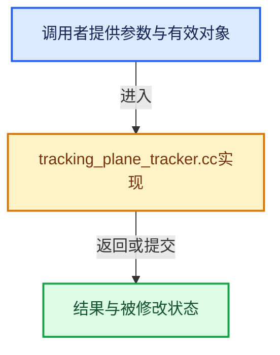

# 实现依赖专题：source/blender/blenkernel/intern/tracking_plane_tracker.cc

[实现依赖导航](../../README.md) · [符号索引](../../../00-课程指南/02-源码与提交索引/符号依赖与实现索引.md)

本专题从正文实际调用进入，集中保存共享实现。函数有稳定锚点，可从调用处直接跳到对应完整函数；递归与互相调用通过回链组织。

## 本文件的实现关系





## 完整成员与函数实现

<a id="f-7e95db5c0c1bf539"></a>

### `blender::float_corners_to_double`

实现位置：[source/blender/blenkernel/intern/tracking_plane_tracker.cc](../../../../../../../source/blender/blenkernel/intern/tracking_plane_tracker.cc) · L206—L212。

接口参数：

- `float corners[4][2]`
- `double double_corners[4][2]`

**教学注释版**

<!-- annotated:f41fa06591dd5b -->

```cpp
BLI_INLINE void float_corners_to_double(/*const*/ float corners[4][2], double double_corners[4][2])
{
  copy_v2db_v2fl(double_corners[0], corners[0]);
  copy_v2db_v2fl(double_corners[1], corners[1]);
  copy_v2db_v2fl(double_corners[2], corners[2]);
  copy_v2db_v2fl(double_corners[3], corners[3]);
}
```

<details>
<summary>核对原始源码：source/blender/blenkernel/intern/tracking_plane_tracker.cc · L206—L212</summary>

<!-- original:f41fa06591dd5b:source/blender/blenkernel/intern/tracking_plane_tracker.cc:206:212 -->

```cpp
BLI_INLINE void float_corners_to_double(/*const*/ float corners[4][2], double double_corners[4][2])
{
  copy_v2db_v2fl(double_corners[0], corners[0]);
  copy_v2db_v2fl(double_corners[1], corners[1]);
  copy_v2db_v2fl(double_corners[2], corners[2]);
  copy_v2db_v2fl(double_corners[3], corners[3]);
}
```

</details>

**继续追踪实现**

- `copy_v2db_v2fl` → [blender::copy_v2db_v2fl · L198](../../01-BLI基础库/intern/math_vector_inline.cc.md#f-e5118add6d0c3d37)。

<a id="f-932a0b47143b8963"></a>

### `blender::BKE_tracking_homography_between_two_quads`

实现位置：[source/blender/blenkernel/intern/tracking_plane_tracker.cc](../../../../../../../source/blender/blenkernel/intern/tracking_plane_tracker.cc) · L214—L227。

接口参数：

- `float reference_corners[4][2]`
- `float corners[4][2]`
- `float H[3][3]`

**教学注释版**

<!-- annotated:2a51cc8e0a941c -->

```cpp
void BKE_tracking_homography_between_two_quads(/*const*/ float reference_corners[4][2],
                                               /*const*/ float corners[4][2],
                                               float H[3][3])
{
  Vec2 x1[4], x2[4];
  double H_double[3][3];

  float_corners_to_double(reference_corners, x1);
  float_corners_to_double(corners, x2);

  libmv_homography2DFromCorrespondencesEuc(x1, x2, 4, H_double);

  copy_m3_m3d(H, H_double);
}
```

<details>
<summary>核对原始源码：source/blender/blenkernel/intern/tracking_plane_tracker.cc · L214—L227</summary>

<!-- original:2a51cc8e0a941c:source/blender/blenkernel/intern/tracking_plane_tracker.cc:214:227 -->

```cpp
void BKE_tracking_homography_between_two_quads(/*const*/ float reference_corners[4][2],
                                               /*const*/ float corners[4][2],
                                               float H[3][3])
{
  Vec2 x1[4], x2[4];
  double H_double[3][3];

  float_corners_to_double(reference_corners, x1);
  float_corners_to_double(corners, x2);

  libmv_homography2DFromCorrespondencesEuc(x1, x2, 4, H_double);

  copy_m3_m3d(H, H_double);
}
```

</details>

**继续追踪实现**

- `float_corners_to_double` → [blender::float_corners_to_double · L206](tracking_plane_tracker.cc.md#f-7e95db5c0c1bf539)。
- `libmv_homography2DFromCorrespondencesEuc` → [libmv_homography2DFromCorrespondencesEuc · L302](../../07-Intern运行时与平台/libmv/intern/stub.cc.md#f-78f4dc7dd4881e4b)；[libmv_homography2DFromCorrespondencesEuc · L10](../../07-Intern运行时与平台/libmv/intern/homography.cc.md#f-40b13e0b9aa6f182)。同名重载需按实参类型选择。
- `copy_m3_m3d` → [blender::copy_m3_m3d · L171](../../01-BLI基础库/intern/math_matrix_c.cc.md#f-0ec534cfbc8f5dee)。
