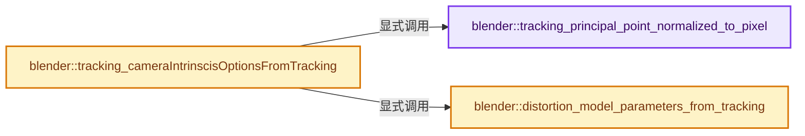
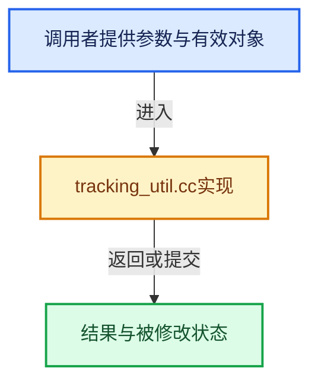

# 实现依赖专题：source/blender/blenkernel/intern/tracking_util.cc

[实现依赖导航](../../README.md) · [符号索引](../../../00-课程指南/02-源码与提交索引/符号依赖与实现索引.md)

本专题从正文实际调用进入，集中保存共享实现。函数有稳定锚点，可从调用处直接跳到对应完整函数；递归与互相调用通过回链组织。

## 本文件的实现关系






## 完整成员与函数实现

<a id="f-cfea266b0a3f77d1"></a>

### `blender::tracking_principal_point_normalized_to_pixel`

实现位置：[source/blender/blenkernel/intern/tracking_util.cc](../../../../../../../source/blender/blenkernel/intern/tracking_util.cc) · L349—L359。

接口参数：

- `const float principal_point_normalized[2]`
- `const int frame_width`
- `const int frame_height`
- `float r_principal_point_pixel[2]`

**教学注释版**

<!-- annotated:ae073f314b3ac5 -->

```cpp
void tracking_principal_point_normalized_to_pixel(const float principal_point_normalized[2],
                                                  const int frame_width,
                                                  const int frame_height,
                                                  float r_principal_point_pixel[2])
{
  const float frame_center_x = float(frame_width) / 2;
  const float frame_center_y = float(frame_height) / 2;

  r_principal_point_pixel[0] = frame_center_x + principal_point_normalized[0] * frame_center_x;
  r_principal_point_pixel[1] = frame_center_y + principal_point_normalized[1] * frame_center_y;
}
```

<details>
<summary>核对原始源码：source/blender/blenkernel/intern/tracking_util.cc · L349—L359</summary>

<!-- original:ae073f314b3ac5:source/blender/blenkernel/intern/tracking_util.cc:349:359 -->

```cpp
void tracking_principal_point_normalized_to_pixel(const float principal_point_normalized[2],
                                                  const int frame_width,
                                                  const int frame_height,
                                                  float r_principal_point_pixel[2])
{
  const float frame_center_x = float(frame_width) / 2;
  const float frame_center_y = float(frame_height) / 2;

  r_principal_point_pixel[0] = frame_center_x + principal_point_normalized[0] * frame_center_x;
  r_principal_point_pixel[1] = frame_center_y + principal_point_normalized[1] * frame_center_y;
}
```

</details>

**沿实际写入检查状态**

- `r_principal_point_pixel[0] = frame_center_x + principal_point_normalized[0] * frame_center_x;`
- `r_principal_point_pixel[1] = frame_center_y + principal_point_normalized[1] * frame_center_y;`

**继续追踪实现**

本实现没有需要继续展开的显式调用；检查返回表达式、对象转换和调用者前置条件。

<a id="f-98efc21d0a7868f3"></a>

### `blender::distortion_model_parameters_from_tracking`

实现位置：[source/blender/blenkernel/intern/tracking_util.cc](../../../../../../../source/blender/blenkernel/intern/tracking_util.cc) · L402—L447。

接口参数：

- `const MovieTrackingCamera *camera`
- `libmv_CameraIntrinsicsOptions *camera_intrinsics_options`

**教学注释版**

<!-- annotated:580a5e90b5bdb0 -->

```cpp
static void distortion_model_parameters_from_tracking(
    const MovieTrackingCamera *camera, libmv_CameraIntrinsicsOptions *camera_intrinsics_options)
{
  switch (camera->distortion_model) {
    case TRACKING_DISTORTION_MODEL_POLYNOMIAL:
      camera_intrinsics_options->distortion_model = LIBMV_DISTORTION_MODEL_POLYNOMIAL;
      camera_intrinsics_options->polynomial_k1 = camera->k1;
      camera_intrinsics_options->polynomial_k2 = camera->k2;
      camera_intrinsics_options->polynomial_k3 = camera->k3;
      camera_intrinsics_options->polynomial_p1 = 0.0;
      camera_intrinsics_options->polynomial_p2 = 0.0;
      return;

    case TRACKING_DISTORTION_MODEL_DIVISION:
      camera_intrinsics_options->distortion_model = LIBMV_DISTORTION_MODEL_DIVISION;
      camera_intrinsics_options->division_k1 = camera->division_k1;
      camera_intrinsics_options->division_k2 = camera->division_k2;
      return;

    case TRACKING_DISTORTION_MODEL_NUKE:
      camera_intrinsics_options->distortion_model = LIBMV_DISTORTION_MODEL_NUKE;
      camera_intrinsics_options->nuke_k1 = camera->nuke_k1;
      camera_intrinsics_options->nuke_k2 = camera->nuke_k2;
      camera_intrinsics_options->nuke_p1 = camera->nuke_p1;
      camera_intrinsics_options->nuke_p2 = camera->nuke_p2;
      return;
    case TRACKING_DISTORTION_MODEL_BROWN:
      camera_intrinsics_options->distortion_model = LIBMV_DISTORTION_MODEL_BROWN;
      camera_intrinsics_options->brown_k1 = camera->brown_k1;
      camera_intrinsics_options->brown_k2 = camera->brown_k2;
      camera_intrinsics_options->brown_k3 = camera->brown_k3;
      camera_intrinsics_options->brown_k4 = camera->brown_k4;
      camera_intrinsics_options->brown_p1 = camera->brown_p1;
      camera_intrinsics_options->brown_p2 = camera->brown_p2;
      return;
  }

  /* Unknown distortion model, which might be due to opening newer file in older Blender.
   * Fall back to a known and supported model with 0 distortion. */
  camera_intrinsics_options->distortion_model = LIBMV_DISTORTION_MODEL_POLYNOMIAL;
  camera_intrinsics_options->polynomial_k1 = 0.0;
  camera_intrinsics_options->polynomial_k2 = 0.0;
  camera_intrinsics_options->polynomial_k3 = 0.0;
  camera_intrinsics_options->polynomial_p1 = 0.0;
  camera_intrinsics_options->polynomial_p2 = 0.0;
}
```

<details>
<summary>核对原始源码：source/blender/blenkernel/intern/tracking_util.cc · L402—L447</summary>

<!-- original:580a5e90b5bdb0:source/blender/blenkernel/intern/tracking_util.cc:402:447 -->

```cpp
static void distortion_model_parameters_from_tracking(
    const MovieTrackingCamera *camera, libmv_CameraIntrinsicsOptions *camera_intrinsics_options)
{
  switch (camera->distortion_model) {
    case TRACKING_DISTORTION_MODEL_POLYNOMIAL:
      camera_intrinsics_options->distortion_model = LIBMV_DISTORTION_MODEL_POLYNOMIAL;
      camera_intrinsics_options->polynomial_k1 = camera->k1;
      camera_intrinsics_options->polynomial_k2 = camera->k2;
      camera_intrinsics_options->polynomial_k3 = camera->k3;
      camera_intrinsics_options->polynomial_p1 = 0.0;
      camera_intrinsics_options->polynomial_p2 = 0.0;
      return;

    case TRACKING_DISTORTION_MODEL_DIVISION:
      camera_intrinsics_options->distortion_model = LIBMV_DISTORTION_MODEL_DIVISION;
      camera_intrinsics_options->division_k1 = camera->division_k1;
      camera_intrinsics_options->division_k2 = camera->division_k2;
      return;

    case TRACKING_DISTORTION_MODEL_NUKE:
      camera_intrinsics_options->distortion_model = LIBMV_DISTORTION_MODEL_NUKE;
      camera_intrinsics_options->nuke_k1 = camera->nuke_k1;
      camera_intrinsics_options->nuke_k2 = camera->nuke_k2;
      camera_intrinsics_options->nuke_p1 = camera->nuke_p1;
      camera_intrinsics_options->nuke_p2 = camera->nuke_p2;
      return;
    case TRACKING_DISTORTION_MODEL_BROWN:
      camera_intrinsics_options->distortion_model = LIBMV_DISTORTION_MODEL_BROWN;
      camera_intrinsics_options->brown_k1 = camera->brown_k1;
      camera_intrinsics_options->brown_k2 = camera->brown_k2;
      camera_intrinsics_options->brown_k3 = camera->brown_k3;
      camera_intrinsics_options->brown_k4 = camera->brown_k4;
      camera_intrinsics_options->brown_p1 = camera->brown_p1;
      camera_intrinsics_options->brown_p2 = camera->brown_p2;
      return;
  }

  /* Unknown distortion model, which might be due to opening newer file in older Blender.
   * Fall back to a known and supported model with 0 distortion. */
  camera_intrinsics_options->distortion_model = LIBMV_DISTORTION_MODEL_POLYNOMIAL;
  camera_intrinsics_options->polynomial_k1 = 0.0;
  camera_intrinsics_options->polynomial_k2 = 0.0;
  camera_intrinsics_options->polynomial_k3 = 0.0;
  camera_intrinsics_options->polynomial_p1 = 0.0;
  camera_intrinsics_options->polynomial_p2 = 0.0;
}
```

</details>

**沿实际写入检查状态**

- `camera_intrinsics_options->distortion_model = LIBMV_DISTORTION_MODEL_POLYNOMIAL;`
- `camera_intrinsics_options->polynomial_k1 = camera->k1;`
- `camera_intrinsics_options->polynomial_k2 = camera->k2;`
- `camera_intrinsics_options->polynomial_k3 = camera->k3;`
- `camera_intrinsics_options->polynomial_p1 = 0.0;`
- `camera_intrinsics_options->polynomial_p2 = 0.0;`
- `camera_intrinsics_options->distortion_model = LIBMV_DISTORTION_MODEL_DIVISION;`
- `camera_intrinsics_options->division_k1 = camera->division_k1;`
- `camera_intrinsics_options->division_k2 = camera->division_k2;`
- `camera_intrinsics_options->distortion_model = LIBMV_DISTORTION_MODEL_NUKE;`
- `camera_intrinsics_options->nuke_k1 = camera->nuke_k1;`
- `camera_intrinsics_options->nuke_k2 = camera->nuke_k2;`
- `camera_intrinsics_options->nuke_p1 = camera->nuke_p1;`
- `camera_intrinsics_options->nuke_p2 = camera->nuke_p2;`
- `camera_intrinsics_options->distortion_model = LIBMV_DISTORTION_MODEL_BROWN;`
- `camera_intrinsics_options->brown_k1 = camera->brown_k1;`
- `camera_intrinsics_options->brown_k2 = camera->brown_k2;`
- `camera_intrinsics_options->brown_k3 = camera->brown_k3;`
- `camera_intrinsics_options->brown_k4 = camera->brown_k4;`
- `camera_intrinsics_options->brown_p1 = camera->brown_p1;`
- `camera_intrinsics_options->brown_p2 = camera->brown_p2;`
- `camera_intrinsics_options->polynomial_k1 = 0.0;`
- `camera_intrinsics_options->polynomial_k2 = 0.0;`
- `camera_intrinsics_options->polynomial_k3 = 0.0;`

**继续追踪实现**

本实现没有需要继续展开的显式调用；检查返回表达式、对象转换和调用者前置条件。

<a id="f-6f29ef6084229451"></a>

### `blender::tracking_cameraIntrinscisOptionsFromTracking`

实现位置：[source/blender/blenkernel/intern/tracking_util.cc](../../../../../../../source/blender/blenkernel/intern/tracking_util.cc) · L489—L511。

接口参数：

- `MovieTracking *tracking`
- `const int calibration_width`
- `const int calibration_height`
- `libmv_CameraIntrinsicsOptions *camera_intrinsics_options`

**教学注释版**

<!-- annotated:cbe7be856f5453 -->

```cpp
void tracking_cameraIntrinscisOptionsFromTracking(
    MovieTracking *tracking,
    const int calibration_width,
    const int calibration_height,
    libmv_CameraIntrinsicsOptions *camera_intrinsics_options)
{
  MovieTrackingCamera *camera = &tracking->camera;
  const float aspy = 1.0f / tracking->camera.pixel_aspect;

  float principal_px[2];
  tracking_principal_point_normalized_to_pixel(
      camera->principal_point, calibration_width, calibration_height, principal_px);

  camera_intrinsics_options->focal_length = camera->focal;

  camera_intrinsics_options->principal_point_x = principal_px[0];
  camera_intrinsics_options->principal_point_y = principal_px[1] * aspy;

  distortion_model_parameters_from_tracking(camera, camera_intrinsics_options);

  camera_intrinsics_options->image_width = calibration_width;
  camera_intrinsics_options->image_height = int(calibration_height * aspy);
}
```

<details>
<summary>核对原始源码：source/blender/blenkernel/intern/tracking_util.cc · L489—L511</summary>

<!-- original:cbe7be856f5453:source/blender/blenkernel/intern/tracking_util.cc:489:511 -->

```cpp
void tracking_cameraIntrinscisOptionsFromTracking(
    MovieTracking *tracking,
    const int calibration_width,
    const int calibration_height,
    libmv_CameraIntrinsicsOptions *camera_intrinsics_options)
{
  MovieTrackingCamera *camera = &tracking->camera;
  const float aspy = 1.0f / tracking->camera.pixel_aspect;

  float principal_px[2];
  tracking_principal_point_normalized_to_pixel(
      camera->principal_point, calibration_width, calibration_height, principal_px);

  camera_intrinsics_options->focal_length = camera->focal;

  camera_intrinsics_options->principal_point_x = principal_px[0];
  camera_intrinsics_options->principal_point_y = principal_px[1] * aspy;

  distortion_model_parameters_from_tracking(camera, camera_intrinsics_options);

  camera_intrinsics_options->image_width = calibration_width;
  camera_intrinsics_options->image_height = int(calibration_height * aspy);
}
```

</details>

**沿实际写入检查状态**

- `camera_intrinsics_options->focal_length = camera->focal;`
- `camera_intrinsics_options->principal_point_x = principal_px[0];`
- `camera_intrinsics_options->principal_point_y = principal_px[1] * aspy;`
- `camera_intrinsics_options->image_width = calibration_width;`
- `camera_intrinsics_options->image_height = int(calibration_height * aspy);`

**继续追踪实现**

- `tracking_principal_point_normalized_to_pixel` → [blender::tracking_principal_point_normalized_to_pixel · L349](tracking_util.cc.md#f-cfea266b0a3f77d1)。
- `distortion_model_parameters_from_tracking` → [blender::distortion_model_parameters_from_tracking · L402](tracking_util.cc.md#f-98efc21d0a7868f3)。
