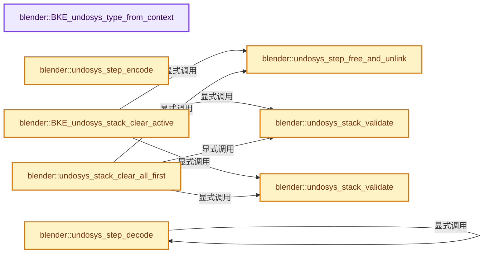
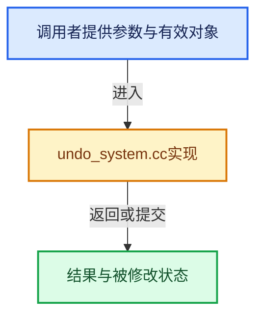

# 实现依赖专题：source/blender/blenkernel/intern/undo_system.cc

[实现依赖导航](../../README.md) · [符号索引](../../../00-课程指南/02-源码与提交索引/符号依赖与实现索引.md)

本专题从正文实际调用进入，集中保存共享实现。函数有稳定锚点，可从调用处直接跳到对应完整函数；递归与互相调用通过回链组织。

## 本文件的实现关系






<a id="m-d76d8eb6b008"></a>

## 宏 `UNDO_NESTED_ASSERT`

<!-- annotated:1ad9c4419b8644 -->

```cpp
#  define UNDO_NESTED_ASSERT(state) BLI_assert(g_undo_callback_running == state)
#  define UNDO_NESTED_CHECK_BEGIN \
```

<details>
<summary>核对原始源码：source/blender/blenkernel/intern/undo_system.cc · L107—L108</summary>

<!-- original:1ad9c4419b8644:source/blender/blenkernel/intern/undo_system.cc:107:108 -->

```cpp
#  define UNDO_NESTED_ASSERT(state) BLI_assert(g_undo_callback_running == state)
#  define UNDO_NESTED_CHECK_BEGIN \
```

</details>

宏在预处理阶段展开，参数替换、重复求值和条件编译应直接从该定义检查。与普通函数不同，宏不会自动提供参数类型检查；构建配置选择哪个定义需结合外围条件。

<a id="m-5c4a903e72bc"></a>

## 宏 `UNDO_NESTED_ASSERT`

<!-- annotated:27a076b047ac86 -->

```cpp
#  define UNDO_NESTED_ASSERT(state) ((void)0)
#  define UNDO_NESTED_CHECK_BEGIN ((void)0)
```

<details>
<summary>核对原始源码：source/blender/blenkernel/intern/undo_system.cc · L121—L122</summary>

<!-- original:27a076b047ac86:source/blender/blenkernel/intern/undo_system.cc:121:122 -->

```cpp
#  define UNDO_NESTED_ASSERT(state) ((void)0)
#  define UNDO_NESTED_CHECK_BEGIN ((void)0)
```

</details>

宏在预处理阶段展开，参数替换、重复求值和条件编译应直接从该定义检查。与普通函数不同，宏不会自动提供参数类型检查；构建配置选择哪个定义需结合外围条件。

## 完整成员与函数实现

<a id="f-04d010c517b6a941"></a>

### `blender::BKE_undosys_type_from_context`

实现位置：[source/blender/blenkernel/intern/undo_system.cc](../../../../../../../source/blender/blenkernel/intern/undo_system.cc) · L82—L91。

接口参数：

- `bContext *C`

**教学注释版**

<!-- annotated:5e432da6a6e1c5 -->

```cpp
const UndoType *BKE_undosys_type_from_context(bContext *C)
{
  for (const UndoType &ut : g_undo_types) {
    /* No poll means we don't check context. */
    if (ut.poll && ut.poll(C)) {
      return &ut;
    }
  }
  return nullptr;
}
```

<details>
<summary>核对原始源码：source/blender/blenkernel/intern/undo_system.cc · L82—L91</summary>

<!-- original:5e432da6a6e1c5:source/blender/blenkernel/intern/undo_system.cc:82:91 -->

```cpp
const UndoType *BKE_undosys_type_from_context(bContext *C)
{
  for (const UndoType &ut : g_undo_types) {
    /* No poll means we don't check context. */
    if (ut.poll && ut.poll(C)) {
      return &ut;
    }
  }
  return nullptr;
}
```

</details>

**结果出口**

- `return &ut;`
- `return nullptr;`

**继续追踪实现**

- `ut.poll` → [调用协议](../../../00-课程指南/01-路线与规范/模板宏与动态分派协议.md)：接收对象类型依赖auto、返回值或模板实例；不按同名猜测目标。调用位置L86。

<a id="f-0ef2ea0e705cfeb5"></a>

### `blender::undosys_step_encode`

实现位置：[source/blender/blenkernel/intern/undo_system.cc](../../../../../../../source/blender/blenkernel/intern/undo_system.cc) · L164—L187。

接口参数：

- `bContext *C`
- `Main *bmain`
- `UndoStack *ustack`
- `UndoStep *us`

**教学注释版**

<!-- annotated:4d0e594a30f020 -->

```cpp
static bool undosys_step_encode(bContext *C, Main *bmain, UndoStack *ustack, UndoStep *us)
{
  CLOG_DEBUG(&LOG, "addr=%p, name='%s', type='%s'", us, us->name, us->type->identifier);
  UNDO_NESTED_CHECK_BEGIN;
  bool ok = us->type->step_encode(C, bmain, us);
  UNDO_NESTED_CHECK_END;
  if (ok) {
    if (us->type->step_foreach_ID_ref != nullptr) {
      /* Don't use from context yet because sometimes context is fake and
       * not all members are filled in. */
      us->type->step_foreach_ID_ref(us, undosys_id_ref_store, bmain);
    }

#ifdef WITH_GLOBAL_UNDO_CORRECT_ORDER
    if (us->type == BKE_UNDOSYS_TYPE_MEMFILE) {
      ustack->step_active_memfile = us;
    }
#endif
  }
  if (ok == false) {
    CLOG_DEBUG(&LOG, "encode callback didn't create undo step");
  }
  return ok;
}
```

<details>
<summary>核对原始源码：source/blender/blenkernel/intern/undo_system.cc · L164—L187</summary>

<!-- original:4d0e594a30f020:source/blender/blenkernel/intern/undo_system.cc:164:187 -->

```cpp
static bool undosys_step_encode(bContext *C, Main *bmain, UndoStack *ustack, UndoStep *us)
{
  CLOG_DEBUG(&LOG, "addr=%p, name='%s', type='%s'", us, us->name, us->type->identifier);
  UNDO_NESTED_CHECK_BEGIN;
  bool ok = us->type->step_encode(C, bmain, us);
  UNDO_NESTED_CHECK_END;
  if (ok) {
    if (us->type->step_foreach_ID_ref != nullptr) {
      /* Don't use from context yet because sometimes context is fake and
       * not all members are filled in. */
      us->type->step_foreach_ID_ref(us, undosys_id_ref_store, bmain);
    }

#ifdef WITH_GLOBAL_UNDO_CORRECT_ORDER
    if (us->type == BKE_UNDOSYS_TYPE_MEMFILE) {
      ustack->step_active_memfile = us;
    }
#endif
  }
  if (ok == false) {
    CLOG_DEBUG(&LOG, "encode callback didn't create undo step");
  }
  return ok;
}
```

</details>

**沿实际写入检查状态**

- `ustack->step_active_memfile = us;`

**结果出口**

- `return ok;`

**继续追踪实现**

- `CLOG_DEBUG` → [CLOG_DEBUG · L191](../../07-Intern运行时与平台/clog/CLG_log.h.md#m-e062f5f17675)。宏定义由构建条件选择。
- `us->type->step_encode` → [调用协议](../../../00-课程指南/01-路线与规范/模板宏与动态分派协议.md)：接收对象类型依赖auto、返回值或模板实例；不按同名猜测目标。调用位置L168。
- `us->type->step_foreach_ID_ref` → [调用协议](../../../00-课程指南/01-路线与规范/模板宏与动态分派协议.md)：接收对象类型依赖auto、返回值或模板实例；不按同名猜测目标。调用位置L174。

<a id="f-4bdbf9cdac3166ba"></a>

### `blender::undosys_step_decode`

实现位置：[source/blender/blenkernel/intern/undo_system.cc](../../../../../../../source/blender/blenkernel/intern/undo_system.cc) · L189—L232。

接口参数：

- `bContext *C`
- `Main *bmain`
- `UndoStack *ustack`
- `UndoStep *us`
- `const eUndoStepDir dir`
- `bool is_final`

**教学注释版**

<!-- annotated:070d4f0531bc62 -->

```cpp
static void undosys_step_decode(bContext *C,
                                Main *bmain,
                                UndoStack *ustack,
                                UndoStep *us,
                                const eUndoStepDir dir,
                                bool is_final)
{
  CLOG_DEBUG(&LOG, "addr=%p, name='%s', type='%s'", us, us->name, us->type->identifier);

  if (us->type->step_foreach_ID_ref) {
#ifdef WITH_GLOBAL_UNDO_CORRECT_ORDER
    if (us->type != BKE_UNDOSYS_TYPE_MEMFILE) {
      for (UndoStep *us_iter = us->prev; us_iter; us_iter = us_iter->prev) {
        if (us_iter->type == BKE_UNDOSYS_TYPE_MEMFILE) {
          if (us_iter == ustack->step_active_memfile) {
            /* Common case, we're already using the last memfile state. */
          }
          else {
            /* Load the previous memfile state so any ID's referenced in this
             * undo step will be correctly resolved, see: #56163. */
            undosys_step_decode(C, bmain, ustack, us_iter, dir, false);
            /* May have been freed on memfile read. */
            bmain = G_MAIN;
          }
          break;
        }
      }
    }
#endif
    /* Don't use from context yet because sometimes context is fake and
     * not all members are filled in. */
    us->type->step_foreach_ID_ref(us, undosys_id_ref_resolve, bmain);
  }

  UNDO_NESTED_CHECK_BEGIN;
  us->type->step_decode(C, bmain, us, dir, is_final);
  UNDO_NESTED_CHECK_END;

#ifdef WITH_GLOBAL_UNDO_CORRECT_ORDER
  if (us->type == BKE_UNDOSYS_TYPE_MEMFILE) {
    ustack->step_active_memfile = us;
  }
#endif
}
```

<details>
<summary>核对原始源码：source/blender/blenkernel/intern/undo_system.cc · L189—L232</summary>

<!-- original:070d4f0531bc62:source/blender/blenkernel/intern/undo_system.cc:189:232 -->

```cpp
static void undosys_step_decode(bContext *C,
                                Main *bmain,
                                UndoStack *ustack,
                                UndoStep *us,
                                const eUndoStepDir dir,
                                bool is_final)
{
  CLOG_DEBUG(&LOG, "addr=%p, name='%s', type='%s'", us, us->name, us->type->identifier);

  if (us->type->step_foreach_ID_ref) {
#ifdef WITH_GLOBAL_UNDO_CORRECT_ORDER
    if (us->type != BKE_UNDOSYS_TYPE_MEMFILE) {
      for (UndoStep *us_iter = us->prev; us_iter; us_iter = us_iter->prev) {
        if (us_iter->type == BKE_UNDOSYS_TYPE_MEMFILE) {
          if (us_iter == ustack->step_active_memfile) {
            /* Common case, we're already using the last memfile state. */
          }
          else {
            /* Load the previous memfile state so any ID's referenced in this
             * undo step will be correctly resolved, see: #56163. */
            undosys_step_decode(C, bmain, ustack, us_iter, dir, false);
            /* May have been freed on memfile read. */
            bmain = G_MAIN;
          }
          break;
        }
      }
    }
#endif
    /* Don't use from context yet because sometimes context is fake and
     * not all members are filled in. */
    us->type->step_foreach_ID_ref(us, undosys_id_ref_resolve, bmain);
  }

  UNDO_NESTED_CHECK_BEGIN;
  us->type->step_decode(C, bmain, us, dir, is_final);
  UNDO_NESTED_CHECK_END;

#ifdef WITH_GLOBAL_UNDO_CORRECT_ORDER
  if (us->type == BKE_UNDOSYS_TYPE_MEMFILE) {
    ustack->step_active_memfile = us;
  }
#endif
}
```

</details>

**沿实际写入检查状态**

- `bmain = G_MAIN;`
- `ustack->step_active_memfile = us;`

**继续追踪实现**

- `CLOG_DEBUG` → [CLOG_DEBUG · L191](../../07-Intern运行时与平台/clog/CLG_log.h.md#m-e062f5f17675)。宏定义由构建条件选择。
- `undosys_step_decode` → [blender::undosys_step_decode · L189](undo_system.cc.md#f-4bdbf9cdac3166ba)。
- `us->type->step_foreach_ID_ref` → [调用协议](../../../00-课程指南/01-路线与规范/模板宏与动态分派协议.md)：接收对象类型依赖auto、返回值或模板实例；不按同名猜测目标。调用位置L220。
- `us->type->step_decode` → [调用协议](../../../00-课程指南/01-路线与规范/模板宏与动态分派协议.md)：接收对象类型依赖auto、返回值或模板实例；不按同名猜测目标。调用位置L224。

<a id="f-690077fbf8a05a38"></a>

### `blender::undosys_step_free_and_unlink`

实现位置：[source/blender/blenkernel/intern/undo_system.cc](../../../../../../../source/blender/blenkernel/intern/undo_system.cc) · L234—L249。

接口参数：

- `UndoStack *ustack`
- `UndoStep *us`

**教学注释版**

<!-- annotated:19e8ab1d7704a6 -->

```cpp
static void undosys_step_free_and_unlink(UndoStack *ustack, UndoStep *us)
{
  CLOG_DEBUG(&LOG, "addr=%p, name='%s', type='%s'", us, us->name, us->type->identifier);
  UNDO_NESTED_CHECK_BEGIN;
  us->type->step_free(us);
  UNDO_NESTED_CHECK_END;

  BLI_remlink(&ustack->steps, us);
  MEM_delete(us);

#ifdef WITH_GLOBAL_UNDO_CORRECT_ORDER
  if (ustack->step_active_memfile == us) {
    ustack->step_active_memfile = nullptr;
  }
#endif
}
```

<details>
<summary>核对原始源码：source/blender/blenkernel/intern/undo_system.cc · L234—L249</summary>

<!-- original:19e8ab1d7704a6:source/blender/blenkernel/intern/undo_system.cc:234:249 -->

```cpp
static void undosys_step_free_and_unlink(UndoStack *ustack, UndoStep *us)
{
  CLOG_DEBUG(&LOG, "addr=%p, name='%s', type='%s'", us, us->name, us->type->identifier);
  UNDO_NESTED_CHECK_BEGIN;
  us->type->step_free(us);
  UNDO_NESTED_CHECK_END;

  BLI_remlink(&ustack->steps, us);
  MEM_delete(us);

#ifdef WITH_GLOBAL_UNDO_CORRECT_ORDER
  if (ustack->step_active_memfile == us) {
    ustack->step_active_memfile = nullptr;
  }
#endif
}
```

</details>

**沿实际写入检查状态**

- `ustack->step_active_memfile = nullptr;`

**继续追踪实现**

- `CLOG_DEBUG` → [CLOG_DEBUG · L191](../../07-Intern运行时与平台/clog/CLG_log.h.md#m-e062f5f17675)。宏定义由构建条件选择。
- `us->type->step_free` → [调用协议](../../../00-课程指南/01-路线与规范/模板宏与动态分派协议.md)：接收对象类型依赖auto、返回值或模板实例；不按同名猜测目标。调用位置L238。
- `BLI_remlink` → [blender::BLI_remlink · L138](../../01-BLI基础库/intern/listbase.cc.md#f-120d80f281ca4cb7)。
- `MEM_delete` → [MEM_delete · L400](../../07-Intern运行时与平台/guardedalloc/MEM_guardedalloc.h.md#f-9049ffdd1682887c)。

<a id="f-b7c5686b20264669"></a>

### `blender::undosys_stack_validate`

实现位置：[source/blender/blenkernel/intern/undo_system.cc](../../../../../../../source/blender/blenkernel/intern/undo_system.cc) · L258—L267。

接口参数：

- `UndoStack *ustack`
- `bool expect_non_empty`

**教学注释版**

<!-- annotated:81f47021c7834e -->

```cpp
static void undosys_stack_validate(UndoStack *ustack, bool expect_non_empty)
{
  if (ustack->step_active != nullptr) {
    BLI_assert(!ustack->steps.is_empty());
    BLI_assert(BLI_findindex(&ustack->steps, ustack->step_active) != -1);
  }
  if (expect_non_empty) {
    BLI_assert(!ustack->steps.is_empty());
  }
}
```

<details>
<summary>核对原始源码：source/blender/blenkernel/intern/undo_system.cc · L258—L267</summary>

<!-- original:81f47021c7834e:source/blender/blenkernel/intern/undo_system.cc:258:267 -->

```cpp
static void undosys_stack_validate(UndoStack *ustack, bool expect_non_empty)
{
  if (ustack->step_active != nullptr) {
    BLI_assert(!ustack->steps.is_empty());
    BLI_assert(BLI_findindex(&ustack->steps, ustack->step_active) != -1);
  }
  if (expect_non_empty) {
    BLI_assert(!ustack->steps.is_empty());
  }
}
```

</details>

**继续追踪实现**

- `BLI_assert` → [BLI_assert · L48](../../01-BLI基础库/BLI_assert.hh.md#m-57a88495704d)；[BLI_assert · L63](../../01-BLI基础库/BLI_assert.hh.md#m-d07050020cb5)。宏定义由构建条件选择。
- `ustack->steps.is_empty` → [调用协议](../../../00-课程指南/01-路线与规范/模板宏与动态分派协议.md)：接收对象类型依赖auto、返回值或模板实例；不按同名猜测目标。调用位置L261。
- `BLI_findindex` → [blender::BLI_findindex · L593](../../01-BLI基础库/intern/listbase.cc.md#f-cb9036f12bd486b7)。

<a id="f-88ea7712d8ca9f51"></a>

### `blender::undosys_stack_validate`

实现位置：[source/blender/blenkernel/intern/undo_system.cc](../../../../../../../source/blender/blenkernel/intern/undo_system.cc) · L269—L269。

接口参数：

- `UndoStack *`
- `bool`

**教学注释版**

<!-- annotated:0bdaca94197567 -->

```cpp
static void undosys_stack_validate(UndoStack * /*ustack*/, bool /*expect_non_empty*/) {}
```

<details>
<summary>核对原始源码：source/blender/blenkernel/intern/undo_system.cc · L269—L269</summary>

<!-- original:0bdaca94197567:source/blender/blenkernel/intern/undo_system.cc:269:269 -->

```cpp
static void undosys_stack_validate(UndoStack * /*ustack*/, bool /*expect_non_empty*/) {}
```

</details>

**继续追踪实现**

本实现没有需要继续展开的显式调用；检查返回表达式、对象转换和调用者前置条件。

<a id="f-a2ad512fac03bfe4"></a>

### `blender::BKE_undosys_stack_clear_active`

实现位置：[source/blender/blenkernel/intern/undo_system.cc](../../../../../../../source/blender/blenkernel/intern/undo_system.cc) · L300—L319。

接口参数：

- `UndoStack *ustack`

**教学注释版**

<!-- annotated:de69c82acbf40f -->

```cpp
void BKE_undosys_stack_clear_active(UndoStack *ustack)
{
  /* Remove active and all following undo-steps.
   * Rewind over any "skip" steps leading up to the active as these must never be made active. */
  if (ustack->step_active) {
    UndoStep *us = ustack->step_active->prev;
    while (us && us->skip) {
      us = us->prev;
    }
    ustack->step_active = us;

    bool is_not_empty = ustack->step_active != nullptr;

    while (ustack->steps.last() != ustack->step_active) {
      UndoStep *us_iter = ustack->steps.last();
      undosys_step_free_and_unlink(ustack, us_iter);
      undosys_stack_validate(ustack, is_not_empty);
    }
  }
}
```

<details>
<summary>核对原始源码：source/blender/blenkernel/intern/undo_system.cc · L300—L319</summary>

<!-- original:de69c82acbf40f:source/blender/blenkernel/intern/undo_system.cc:300:319 -->

```cpp
void BKE_undosys_stack_clear_active(UndoStack *ustack)
{
  /* Remove active and all following undo-steps.
   * Rewind over any "skip" steps leading up to the active as these must never be made active. */
  if (ustack->step_active) {
    UndoStep *us = ustack->step_active->prev;
    while (us && us->skip) {
      us = us->prev;
    }
    ustack->step_active = us;

    bool is_not_empty = ustack->step_active != nullptr;

    while (ustack->steps.last() != ustack->step_active) {
      UndoStep *us_iter = ustack->steps.last();
      undosys_step_free_and_unlink(ustack, us_iter);
      undosys_stack_validate(ustack, is_not_empty);
    }
  }
}
```

</details>

**沿实际写入检查状态**

- `us = us->prev;`
- `ustack->step_active = us;`

**继续追踪实现**

- `ustack->steps.last` → [调用协议](../../../00-课程指南/01-路线与规范/模板宏与动态分派协议.md)：接收对象类型依赖auto、返回值或模板实例；不按同名猜测目标。调用位置L313。
- `undosys_step_free_and_unlink` → [blender::undosys_step_free_and_unlink · L234](undo_system.cc.md#f-690077fbf8a05a38)。
- `undosys_stack_validate` → [blender::undosys_stack_validate · L258](undo_system.cc.md#f-b7c5686b20264669)；[blender::undosys_stack_validate · L269](undo_system.cc.md#f-88ea7712d8ca9f51)。同名重载需按实参类型选择。

<a id="f-639cddda59d31577"></a>

### `blender::undosys_stack_clear_all_first`

实现位置：[source/blender/blenkernel/intern/undo_system.cc](../../../../../../../source/blender/blenkernel/intern/undo_system.cc) · L336—L355。

接口参数：

- `UndoStack *ustack`
- `UndoStep *us`
- `UndoStep *us_exclude`

**教学注释版**

<!-- annotated:28c2b7fa066d9c -->

```cpp
static void undosys_stack_clear_all_first(UndoStack *ustack, UndoStep *us, UndoStep *us_exclude)
{
  if (us && us == us_exclude) {
    us = us->prev;
  }

  if (us) {
    bool is_not_empty = true;
    UndoStep *us_iter;
    do {
      us_iter = ustack->steps.first();
      if (us_iter == us_exclude) {
        us_iter = us_iter->next;
      }
      BLI_assert(us_iter != ustack->step_active);
      undosys_step_free_and_unlink(ustack, us_iter);
      undosys_stack_validate(ustack, is_not_empty);
    } while (us != us_iter);
  }
}
```

<details>
<summary>核对原始源码：source/blender/blenkernel/intern/undo_system.cc · L336—L355</summary>

<!-- original:28c2b7fa066d9c:source/blender/blenkernel/intern/undo_system.cc:336:355 -->

```cpp
static void undosys_stack_clear_all_first(UndoStack *ustack, UndoStep *us, UndoStep *us_exclude)
{
  if (us && us == us_exclude) {
    us = us->prev;
  }

  if (us) {
    bool is_not_empty = true;
    UndoStep *us_iter;
    do {
      us_iter = ustack->steps.first();
      if (us_iter == us_exclude) {
        us_iter = us_iter->next;
      }
      BLI_assert(us_iter != ustack->step_active);
      undosys_step_free_and_unlink(ustack, us_iter);
      undosys_stack_validate(ustack, is_not_empty);
    } while (us != us_iter);
  }
}
```

</details>

**沿实际写入检查状态**

- `us = us->prev;`
- `us_iter = ustack->steps.first();`
- `us_iter = us_iter->next;`

**继续追踪实现**

- `ustack->steps.first` → [调用协议](../../../00-课程指南/01-路线与规范/模板宏与动态分派协议.md)：接收对象类型依赖auto、返回值或模板实例；不按同名猜测目标。调用位置L346。
- `BLI_assert` → [BLI_assert · L48](../../01-BLI基础库/BLI_assert.hh.md#m-57a88495704d)；[BLI_assert · L63](../../01-BLI基础库/BLI_assert.hh.md#m-d07050020cb5)。宏定义由构建条件选择。
- `undosys_step_free_and_unlink` → [blender::undosys_step_free_and_unlink · L234](undo_system.cc.md#f-690077fbf8a05a38)。
- `undosys_stack_validate` → [blender::undosys_stack_validate · L258](undo_system.cc.md#f-b7c5686b20264669)；[blender::undosys_stack_validate · L269](undo_system.cc.md#f-88ea7712d8ca9f51)。同名重载需按实参类型选择。

<a id="f-b52bdae9343934da"></a>

### `blender::undosys_stack_push_main`

实现位置：[source/blender/blenkernel/intern/undo_system.cc](../../../../../../../source/blender/blenkernel/intern/undo_system.cc) · L357—L368。

接口参数：

- `UndoStack *ustack`
- `const char *name`
- `Main *bmain`

**教学注释版**

<!-- annotated:de0a9c78dd85c8 -->

```cpp
static bool undosys_stack_push_main(UndoStack *ustack, const char *name, Main *bmain)
{
  UNDO_NESTED_ASSERT(false);
  BLI_assert(ustack->step_init == nullptr);
  CLOG_DEBUG(&LOG, "Push main '%s'", name);
  bContext *C_temp = CTX_create();
  CTX_data_main_set(C_temp, bmain);
  eUndoPushReturn ret = BKE_undosys_step_push_with_type(
      ustack, C_temp, name, UndoEncodeHints::None, BKE_UNDOSYS_TYPE_MEMFILE);
  CTX_free(C_temp);
  return (ret & UNDO_PUSH_RET_SUCCESS);
}
```

<details>
<summary>核对原始源码：source/blender/blenkernel/intern/undo_system.cc · L357—L368</summary>

<!-- original:de0a9c78dd85c8:source/blender/blenkernel/intern/undo_system.cc:357:368 -->

```cpp
static bool undosys_stack_push_main(UndoStack *ustack, const char *name, Main *bmain)
{
  UNDO_NESTED_ASSERT(false);
  BLI_assert(ustack->step_init == nullptr);
  CLOG_DEBUG(&LOG, "Push main '%s'", name);
  bContext *C_temp = CTX_create();
  CTX_data_main_set(C_temp, bmain);
  eUndoPushReturn ret = BKE_undosys_step_push_with_type(
      ustack, C_temp, name, UndoEncodeHints::None, BKE_UNDOSYS_TYPE_MEMFILE);
  CTX_free(C_temp);
  return (ret & UNDO_PUSH_RET_SUCCESS);
}
```

</details>

**结果出口**

- `return (ret & UNDO_PUSH_RET_SUCCESS);`

**继续追踪实现**

- `UNDO_NESTED_ASSERT` → [UNDO_NESTED_ASSERT · L107](undo_system.cc.md#m-d76d8eb6b008)；[UNDO_NESTED_ASSERT · L121](undo_system.cc.md#m-5c4a903e72bc)。宏定义由构建条件选择。
- `BLI_assert` → [BLI_assert · L48](../../01-BLI基础库/BLI_assert.hh.md#m-57a88495704d)；[BLI_assert · L63](../../01-BLI基础库/BLI_assert.hh.md#m-d07050020cb5)。宏定义由构建条件选择。
- `CLOG_DEBUG` → [CLOG_DEBUG · L191](../../07-Intern运行时与平台/clog/CLG_log.h.md#m-e062f5f17675)。宏定义由构建条件选择。
- `CTX_create` → [blender::CTX_create · L119](context.cc.md#f-6bb599996ad92494)。
- `CTX_data_main_set` → [blender::CTX_data_main_set · L1323](context.cc.md#f-d2f9d7ddde2abf8e)。
- `BKE_undosys_step_push_with_type` → [blender::BKE_undosys_step_push_with_type · L529](undo_system.cc.md#f-fdc80a4b302787d0)。
- `CTX_free` → [blender::CTX_free · L133](context.cc.md#f-9d1d4ac3a33ed0a8)。

<a id="f-b74c4c257a62f126"></a>

### `blender::BKE_undosys_stack_limit_steps_and_memory`

实现位置：[source/blender/blenkernel/intern/undo_system.cc](../../../../../../../source/blender/blenkernel/intern/undo_system.cc) · L421—L478。

接口参数：

- `UndoStack *ustack`
- `int steps`
- `size_t memory_limit`

**教学注释版**

<!-- annotated:b61d8664b4cfef -->

```cpp
void BKE_undosys_stack_limit_steps_and_memory(UndoStack *ustack, int steps, size_t memory_limit)
{
  UNDO_NESTED_ASSERT(false);
  if ((steps == -1) && (memory_limit == 0)) {
    return;
  }

  CLOG_DEBUG(&LOG, "Limit steps=%d, memory_limit=%zu", steps, memory_limit);
  UndoStep *us;
  UndoStep *us_exclude = nullptr;
  /* keep at least two (original + other) */
  size_t data_size_all = 0;
  size_t us_count = 0;
  for (us = ustack->steps.last(); us && us->prev; us = us->prev) {
    if (memory_limit) {
      data_size_all += us->data_size;
      if (data_size_all > memory_limit) {
        CLOG_DEBUG(&LOG,
                   "At step %zu: data_size_all=%zu >= memory_limit=%zu",
                   us_count,
                   data_size_all,
                   memory_limit);
        break;
      }
    }
    if (steps != -1) {
      if (us_count == steps) {
        break;
      }
      if (us->skip == false) {
        us_count += 1;
      }
    }
  }

  CLOG_DEBUG(&LOG, "Total steps %zu: data_size_all=%zu", us_count, data_size_all);

  if (us) {
#ifdef WITH_GLOBAL_UNDO_KEEP_ONE
    /* Hack, we need to keep at least one BKE_UNDOSYS_TYPE_MEMFILE. */
    if (us->type != BKE_UNDOSYS_TYPE_MEMFILE) {
      us_exclude = us->prev;
      while (us_exclude && us_exclude->type != BKE_UNDOSYS_TYPE_MEMFILE) {
        us_exclude = us_exclude->prev;
      }
      /* Once this is outside the given number of 'steps', undoing onto this state
       * may skip past many undo steps which is confusing, instead,
       * disallow stepping onto this state entirely. */
      if (us_exclude) {
        us_exclude->skip = true;
      }
    }
#endif
    /* Free from first to last, free functions may update de-duplication info
     * (see #MemFileUndoStep). */
    undosys_stack_clear_all_first(ustack, us->prev, us_exclude);
  }
}
```

<details>
<summary>核对原始源码：source/blender/blenkernel/intern/undo_system.cc · L421—L478</summary>

<!-- original:b61d8664b4cfef:source/blender/blenkernel/intern/undo_system.cc:421:478 -->

```cpp
void BKE_undosys_stack_limit_steps_and_memory(UndoStack *ustack, int steps, size_t memory_limit)
{
  UNDO_NESTED_ASSERT(false);
  if ((steps == -1) && (memory_limit == 0)) {
    return;
  }

  CLOG_DEBUG(&LOG, "Limit steps=%d, memory_limit=%zu", steps, memory_limit);
  UndoStep *us;
  UndoStep *us_exclude = nullptr;
  /* keep at least two (original + other) */
  size_t data_size_all = 0;
  size_t us_count = 0;
  for (us = ustack->steps.last(); us && us->prev; us = us->prev) {
    if (memory_limit) {
      data_size_all += us->data_size;
      if (data_size_all > memory_limit) {
        CLOG_DEBUG(&LOG,
                   "At step %zu: data_size_all=%zu >= memory_limit=%zu",
                   us_count,
                   data_size_all,
                   memory_limit);
        break;
      }
    }
    if (steps != -1) {
      if (us_count == steps) {
        break;
      }
      if (us->skip == false) {
        us_count += 1;
      }
    }
  }

  CLOG_DEBUG(&LOG, "Total steps %zu: data_size_all=%zu", us_count, data_size_all);

  if (us) {
#ifdef WITH_GLOBAL_UNDO_KEEP_ONE
    /* Hack, we need to keep at least one BKE_UNDOSYS_TYPE_MEMFILE. */
    if (us->type != BKE_UNDOSYS_TYPE_MEMFILE) {
      us_exclude = us->prev;
      while (us_exclude && us_exclude->type != BKE_UNDOSYS_TYPE_MEMFILE) {
        us_exclude = us_exclude->prev;
      }
      /* Once this is outside the given number of 'steps', undoing onto this state
       * may skip past many undo steps which is confusing, instead,
       * disallow stepping onto this state entirely. */
      if (us_exclude) {
        us_exclude->skip = true;
      }
    }
#endif
    /* Free from first to last, free functions may update de-duplication info
     * (see #MemFileUndoStep). */
    undosys_stack_clear_all_first(ustack, us->prev, us_exclude);
  }
}
```

</details>

**沿实际写入检查状态**

- `data_size_all += us->data_size;`
- `us_count += 1;`
- `us_exclude = us->prev;`
- `us_exclude = us_exclude->prev;`
- `us_exclude->skip = true;`

**继续追踪实现**

- `UNDO_NESTED_ASSERT` → [UNDO_NESTED_ASSERT · L107](undo_system.cc.md#m-d76d8eb6b008)；[UNDO_NESTED_ASSERT · L121](undo_system.cc.md#m-5c4a903e72bc)。宏定义由构建条件选择。
- `CLOG_DEBUG` → [CLOG_DEBUG · L191](../../07-Intern运行时与平台/clog/CLG_log.h.md#m-e062f5f17675)。宏定义由构建条件选择。
- `ustack->steps.last` → [调用协议](../../../00-课程指南/01-路线与规范/模板宏与动态分派协议.md)：接收对象类型依赖auto、返回值或模板实例；不按同名猜测目标。调用位置L434。
- `undosys_stack_clear_all_first` → [blender::undosys_stack_clear_all_first · L336](undo_system.cc.md#f-639cddda59d31577)。

<a id="f-fdc80a4b302787d0"></a>

### `blender::BKE_undosys_step_push_with_type`

实现位置：[source/blender/blenkernel/intern/undo_system.cc](../../../../../../../source/blender/blenkernel/intern/undo_system.cc) · L529—L653。

接口参数：

- `UndoStack *ustack`
- `bContext *C`
- `const char *name`
- `const UndoEncodeHints hints`
- `const UndoType *ut`

**教学注释版**

<!-- annotated:17891a6b75a93d -->

```cpp
eUndoPushReturn BKE_undosys_step_push_with_type(UndoStack *ustack,
                                                bContext *C,
                                                const char *name,
                                                const UndoEncodeHints hints,
                                                const UndoType *ut)
{
  BLI_assert((ut->flags & UNDOTYPE_FLAG_NEED_CONTEXT_FOR_ENCODE) == 0 || C != nullptr);

  UNDO_NESTED_ASSERT(false);
  undosys_stack_validate(ustack, false);
  bool is_not_empty = ustack->step_active != nullptr;
  eUndoPushReturn retval = UNDO_PUSH_RET_FAILURE;

  /* Might not be final place for this to be called - probably only want to call it from some
   * undo handlers, not all of them? */
  eRNAOverrideMatchResult report_flags = RNA_OVERRIDE_MATCH_RESULT_INIT;
  BKE_lib_override_library_main_operations_create(
      G_MAIN, false, reinterpret_cast<int *>(&report_flags));
  if (report_flags & RNA_OVERRIDE_MATCH_RESULT_CREATED) {
    retval |= UNDO_PUSH_RET_OVERRIDE_CHANGED;
  }

  /* Remove all undo-steps after (also when 'ustack->step_active == nullptr'). */
  while (ustack->steps.last() != ustack->step_active) {
    UndoStep *us_iter = ustack->steps.last();
    undosys_step_free_and_unlink(ustack, us_iter);
    undosys_stack_validate(ustack, is_not_empty);
  }

  if (ustack->step_active) {
    BLI_assert(BLI_findindex(&ustack->steps, ustack->step_active) != -1);
  }

  const bool force_memfile_step = bool(hints & UndoEncodeHints::PreMemFileChanges);

  /* The hint must only be used with undo types that opted into `memfile` co-existence.
   * Otherwise setting it indicates a bug in the caller. */
  BLI_assert(!force_memfile_step || (ut->flags & UNDOTYPE_FLAG_ENCODE_PRE_MEMFILE_SUPPORTED));

#ifdef WITH_GLOBAL_UNDO_ENSURE_UPDATED
  if (ut->step_foreach_ID_ref != nullptr || force_memfile_step) {
    if (G_MAIN->is_memfile_undo_written == false || force_memfile_step) {
      const char *name_internal = "MemFile Internal (pre)";
      /* Don't let 'step_init' cause issues when adding memfile undo step. */
      void *step_init = ustack->step_init;
      ustack->step_init = nullptr;
      const bool ok = undosys_stack_push_main(ustack, name_internal, G_MAIN);
      /* Restore 'step_init'. */
      ustack->step_init = static_cast<UndoStep *>(step_init);
      if (ok) {
        UndoStep *us = ustack->steps.last();
        BLI_assert(STREQ(us->name, name_internal));
        us->skip = true;
#  ifdef WITH_GLOBAL_UNDO_CORRECT_ORDER
        ustack->step_active_memfile = us;
#  endif
      }
    }
  }
#endif

  bool use_memfile_step = false;
  {
    UndoStep *us = ustack->step_init ?
                       ustack->step_init :
                       static_cast<UndoStep *>(MEM_new_zeroed(ut->step_size, __func__));
    ustack->step_init = nullptr;
    if (us->name[0] == '\0') {
      STRNCPY(us->name, name);
    }
    us->type = ut;
    /* True by default, code needs to explicitly set it to false if necessary. */
    us->use_old_bmain_data = true;
    /* Initialized, not added yet. */

    CLOG_DEBUG(&LOG, "addr=%p, name='%s', type='%s'", us, us->name, us->type->identifier);

    /* The step is considered changed unless the hint states all changes are in the
     * memfile step, in that case the local data of the step is unchanged. */

    /* TODO(@ideasman42): Use #UndoEncodeHints::HasMemFileChangesOnly from `hints` to detect
     * if we actually need to store a new undo step.
     * To implement this we will likely need to pass `hints` to #undosys_step_encode.
     * This can save significant overhead by avoiding storage of a new undo step,
     * using the undo step more as a place-holder
     * (needed to ensure mode-switching in the case of edit-mode).
     * This needs to be done carefully for each mode,
     * so for now keep this as a TODO. See: !161566. */

    if (!undosys_step_encode(C, G_MAIN, ustack, us)) {
      MEM_delete(us);
      undosys_stack_validate(ustack, true);
      return retval;
    }
    ustack->step_active = us;
    BLI_addtail(&ustack->steps, us);
    use_memfile_step = us->use_memfile_step;
  }

  if (use_memfile_step) {
    /* Make this the user visible undo state, so redo always applies
     * on top of the mem-file undo instead of skipping it. see: #67256. */
    UndoStep *us_prev = ustack->step_active;
    const char *name_internal = us_prev->name;
    const bool ok = undosys_stack_push_main(ustack, name_internal, G_MAIN);
    if (ok) {
      UndoStep *us = ustack->steps.last();
      BLI_assert(STREQ(us->name, name_internal));
      us_prev->skip = true;
#ifdef WITH_GLOBAL_UNDO_CORRECT_ORDER
      ustack->step_active_memfile = us;
#endif
      ustack->step_active = us;
    }
  }

  if (ustack->group_level > 0) {
    /* Temporarily set skip for the active step.
     * This is an invalid state which must be corrected once the last group ends. */
    ustack->step_active->skip = true;
  }

  undosys_stack_validate(ustack, true);
  return (retval | UNDO_PUSH_RET_SUCCESS);
}
```

<details>
<summary>核对原始源码：source/blender/blenkernel/intern/undo_system.cc · L529—L653</summary>

<!-- original:17891a6b75a93d:source/blender/blenkernel/intern/undo_system.cc:529:653 -->

```cpp
eUndoPushReturn BKE_undosys_step_push_with_type(UndoStack *ustack,
                                                bContext *C,
                                                const char *name,
                                                const UndoEncodeHints hints,
                                                const UndoType *ut)
{
  BLI_assert((ut->flags & UNDOTYPE_FLAG_NEED_CONTEXT_FOR_ENCODE) == 0 || C != nullptr);

  UNDO_NESTED_ASSERT(false);
  undosys_stack_validate(ustack, false);
  bool is_not_empty = ustack->step_active != nullptr;
  eUndoPushReturn retval = UNDO_PUSH_RET_FAILURE;

  /* Might not be final place for this to be called - probably only want to call it from some
   * undo handlers, not all of them? */
  eRNAOverrideMatchResult report_flags = RNA_OVERRIDE_MATCH_RESULT_INIT;
  BKE_lib_override_library_main_operations_create(
      G_MAIN, false, reinterpret_cast<int *>(&report_flags));
  if (report_flags & RNA_OVERRIDE_MATCH_RESULT_CREATED) {
    retval |= UNDO_PUSH_RET_OVERRIDE_CHANGED;
  }

  /* Remove all undo-steps after (also when 'ustack->step_active == nullptr'). */
  while (ustack->steps.last() != ustack->step_active) {
    UndoStep *us_iter = ustack->steps.last();
    undosys_step_free_and_unlink(ustack, us_iter);
    undosys_stack_validate(ustack, is_not_empty);
  }

  if (ustack->step_active) {
    BLI_assert(BLI_findindex(&ustack->steps, ustack->step_active) != -1);
  }

  const bool force_memfile_step = bool(hints & UndoEncodeHints::PreMemFileChanges);

  /* The hint must only be used with undo types that opted into `memfile` co-existence.
   * Otherwise setting it indicates a bug in the caller. */
  BLI_assert(!force_memfile_step || (ut->flags & UNDOTYPE_FLAG_ENCODE_PRE_MEMFILE_SUPPORTED));

#ifdef WITH_GLOBAL_UNDO_ENSURE_UPDATED
  if (ut->step_foreach_ID_ref != nullptr || force_memfile_step) {
    if (G_MAIN->is_memfile_undo_written == false || force_memfile_step) {
      const char *name_internal = "MemFile Internal (pre)";
      /* Don't let 'step_init' cause issues when adding memfile undo step. */
      void *step_init = ustack->step_init;
      ustack->step_init = nullptr;
      const bool ok = undosys_stack_push_main(ustack, name_internal, G_MAIN);
      /* Restore 'step_init'. */
      ustack->step_init = static_cast<UndoStep *>(step_init);
      if (ok) {
        UndoStep *us = ustack->steps.last();
        BLI_assert(STREQ(us->name, name_internal));
        us->skip = true;
#  ifdef WITH_GLOBAL_UNDO_CORRECT_ORDER
        ustack->step_active_memfile = us;
#  endif
      }
    }
  }
#endif

  bool use_memfile_step = false;
  {
    UndoStep *us = ustack->step_init ?
                       ustack->step_init :
                       static_cast<UndoStep *>(MEM_new_zeroed(ut->step_size, __func__));
    ustack->step_init = nullptr;
    if (us->name[0] == '\0') {
      STRNCPY(us->name, name);
    }
    us->type = ut;
    /* True by default, code needs to explicitly set it to false if necessary. */
    us->use_old_bmain_data = true;
    /* Initialized, not added yet. */

    CLOG_DEBUG(&LOG, "addr=%p, name='%s', type='%s'", us, us->name, us->type->identifier);

    /* The step is considered changed unless the hint states all changes are in the
     * memfile step, in that case the local data of the step is unchanged. */

    /* TODO(@ideasman42): Use #UndoEncodeHints::HasMemFileChangesOnly from `hints` to detect
     * if we actually need to store a new undo step.
     * To implement this we will likely need to pass `hints` to #undosys_step_encode.
     * This can save significant overhead by avoiding storage of a new undo step,
     * using the undo step more as a place-holder
     * (needed to ensure mode-switching in the case of edit-mode).
     * This needs to be done carefully for each mode,
     * so for now keep this as a TODO. See: !161566. */

    if (!undosys_step_encode(C, G_MAIN, ustack, us)) {
      MEM_delete(us);
      undosys_stack_validate(ustack, true);
      return retval;
    }
    ustack->step_active = us;
    BLI_addtail(&ustack->steps, us);
    use_memfile_step = us->use_memfile_step;
  }

  if (use_memfile_step) {
    /* Make this the user visible undo state, so redo always applies
     * on top of the mem-file undo instead of skipping it. see: #67256. */
    UndoStep *us_prev = ustack->step_active;
    const char *name_internal = us_prev->name;
    const bool ok = undosys_stack_push_main(ustack, name_internal, G_MAIN);
    if (ok) {
      UndoStep *us = ustack->steps.last();
      BLI_assert(STREQ(us->name, name_internal));
      us_prev->skip = true;
#ifdef WITH_GLOBAL_UNDO_CORRECT_ORDER
      ustack->step_active_memfile = us;
#endif
      ustack->step_active = us;
    }
  }

  if (ustack->group_level > 0) {
    /* Temporarily set skip for the active step.
     * This is an invalid state which must be corrected once the last group ends. */
    ustack->step_active->skip = true;
  }

  undosys_stack_validate(ustack, true);
  return (retval | UNDO_PUSH_RET_SUCCESS);
}
```

</details>

**沿实际写入检查状态**

- `retval |= UNDO_PUSH_RET_OVERRIDE_CHANGED;`
- `ustack->step_init = nullptr;`
- `ustack->step_init = static_cast<UndoStep *>(step_init);`
- `us->skip = true;`
- `ustack->step_active_memfile = us;`
- `us->type = ut;`
- `us->use_old_bmain_data = true;`
- `ustack->step_active = us;`
- `use_memfile_step = us->use_memfile_step;`
- `us_prev->skip = true;`
- `ustack->step_active->skip = true;`

**结果出口**

- `return retval;`
- `return (retval | UNDO_PUSH_RET_SUCCESS);`

**继续追踪实现**

- `BLI_assert` → [BLI_assert · L48](../../01-BLI基础库/BLI_assert.hh.md#m-57a88495704d)；[BLI_assert · L63](../../01-BLI基础库/BLI_assert.hh.md#m-d07050020cb5)。宏定义由构建条件选择。
- `UNDO_NESTED_ASSERT` → [UNDO_NESTED_ASSERT · L107](undo_system.cc.md#m-d76d8eb6b008)；[UNDO_NESTED_ASSERT · L121](undo_system.cc.md#m-5c4a903e72bc)。宏定义由构建条件选择。
- `undosys_stack_validate` → [blender::undosys_stack_validate · L258](undo_system.cc.md#f-b7c5686b20264669)；[blender::undosys_stack_validate · L269](undo_system.cc.md#f-88ea7712d8ca9f51)。同名重载需按实参类型选择。
- `BKE_lib_override_library_main_operations_create` → [blender::BKE_lib_override_library_main_operations_create · L5072](lib_override.cc.md#f-9d734c5616e9a0bf)。
- `ustack->steps.last` → [调用协议](../../../00-课程指南/01-路线与规范/模板宏与动态分派协议.md)：接收对象类型依赖auto、返回值或模板实例；不按同名猜测目标。调用位置L552。
- `undosys_step_free_and_unlink` → [blender::undosys_step_free_and_unlink · L234](undo_system.cc.md#f-690077fbf8a05a38)。
- `BLI_findindex` → [blender::BLI_findindex · L593](../../01-BLI基础库/intern/listbase.cc.md#f-cb9036f12bd486b7)。
- `undosys_stack_push_main` → [blender::undosys_stack_push_main · L357](undo_system.cc.md#f-b52bdae9343934da)。
- `STREQ` → [STREQ · L112](../../07-Intern运行时与平台/ghost/intern/GHOST_utildefines.hh.md#m-9549fb6aafd2)；[STREQ · L451](../../01-BLI基础库/BLI_utildefines.hh.md#m-c7b745bcfad2)；[STREQ · L55](../../07-Intern运行时与平台/clog/clog.cc.md#m-96e78f386894)。宏定义由构建条件选择。
- `MEM_new_zeroed` → [MEM_new_zeroed · L550](../../07-Intern运行时与平台/guardedalloc/MEM_guardedalloc.h.md#f-eeb1e2a7f57dd231)；[MEM_new_zeroed · L114](../../07-Intern运行时与平台/guardedalloc/intern/mallocn.cc.md#f-e04cf01c64c8b180)。同名重载需按实参类型选择。
- `STRNCPY` → [blender::STRNCPY · L690](../../01-BLI基础库/BLI_string.hh.md#f-6b2d861724026be6)。
- `CLOG_DEBUG` → [CLOG_DEBUG · L191](../../07-Intern运行时与平台/clog/CLG_log.h.md#m-e062f5f17675)。宏定义由构建条件选择。
- `undosys_step_encode` → [blender::undosys_step_encode · L164](undo_system.cc.md#f-0ef2ea0e705cfeb5)。
- `MEM_delete` → [MEM_delete · L400](../../07-Intern运行时与平台/guardedalloc/MEM_guardedalloc.h.md#f-9049ffdd1682887c)。
- `BLI_addtail` → [blender::BLI_addtail · L118](../../01-BLI基础库/intern/listbase.cc.md#f-4fb027713fa3115b)。

<a id="f-13f66c4b3ce34bf7"></a>

### `blender::BKE_undosys_step_push`

实现位置：[source/blender/blenkernel/intern/undo_system.cc](../../../../../../../source/blender/blenkernel/intern/undo_system.cc) · L655—L667。

接口参数：

- `UndoStack *ustack`
- `bContext *C`
- `const char *name`
- `const UndoEncodeHints hints`

**教学注释版**

<!-- annotated:469bed9a5d2aea -->

```cpp
eUndoPushReturn BKE_undosys_step_push(UndoStack *ustack,
                                      bContext *C,
                                      const char *name,
                                      const UndoEncodeHints hints)
{
  UNDO_NESTED_ASSERT(false);
  const UndoType *ut = ustack->step_init ? ustack->step_init->type :
                                           BKE_undosys_type_from_context(C);
  if (ut == nullptr) {
    return UNDO_PUSH_RET_FAILURE;
  }
  return BKE_undosys_step_push_with_type(ustack, C, name, hints, ut);
}
```

<details>
<summary>核对原始源码：source/blender/blenkernel/intern/undo_system.cc · L655—L667</summary>

<!-- original:469bed9a5d2aea:source/blender/blenkernel/intern/undo_system.cc:655:667 -->

```cpp
eUndoPushReturn BKE_undosys_step_push(UndoStack *ustack,
                                      bContext *C,
                                      const char *name,
                                      const UndoEncodeHints hints)
{
  UNDO_NESTED_ASSERT(false);
  const UndoType *ut = ustack->step_init ? ustack->step_init->type :
                                           BKE_undosys_type_from_context(C);
  if (ut == nullptr) {
    return UNDO_PUSH_RET_FAILURE;
  }
  return BKE_undosys_step_push_with_type(ustack, C, name, hints, ut);
}
```

</details>

**结果出口**

- `return UNDO_PUSH_RET_FAILURE;`
- `return BKE_undosys_step_push_with_type(ustack, C, name, hints, ut);`

**继续追踪实现**

- `UNDO_NESTED_ASSERT` → [UNDO_NESTED_ASSERT · L107](undo_system.cc.md#m-d76d8eb6b008)；[UNDO_NESTED_ASSERT · L121](undo_system.cc.md#m-5c4a903e72bc)。宏定义由构建条件选择。
- `BKE_undosys_type_from_context` → [blender::BKE_undosys_type_from_context · L82](undo_system.cc.md#f-04d010c517b6a941)。
- `BKE_undosys_step_push_with_type` → [blender::BKE_undosys_step_push_with_type · L529](undo_system.cc.md#f-fdc80a4b302787d0)。

<a id="f-6db28d2f4e2d511b"></a>

### `blender::BKE_undosys_step_find_by_name`

实现位置：[source/blender/blenkernel/intern/undo_system.cc](../../../../../../../source/blender/blenkernel/intern/undo_system.cc) · L709—L712。

接口参数：

- `UndoStack *ustack`
- `const char *name`

**教学注释版**

<!-- annotated:ae6dac2ab49f46 -->

```cpp
UndoStep *BKE_undosys_step_find_by_name(UndoStack *ustack, const char *name)
{
  return static_cast<UndoStep *>(BLI_rfindstring(&ustack->steps, name, offsetof(UndoStep, name)));
}
```

<details>
<summary>核对原始源码：source/blender/blenkernel/intern/undo_system.cc · L709—L712</summary>

<!-- original:ae6dac2ab49f46:source/blender/blenkernel/intern/undo_system.cc:709:712 -->

```cpp
UndoStep *BKE_undosys_step_find_by_name(UndoStack *ustack, const char *name)
{
  return static_cast<UndoStep *>(BLI_rfindstring(&ustack->steps, name, offsetof(UndoStep, name)));
}
```

</details>

**结果出口**

- `return static_cast<UndoStep *>(BLI_rfindstring(&ustack->steps, name, offsetof(UndoStep, name)));`

**继续追踪实现**

- `BLI_rfindstring` → [blender::BLI_rfindstring · L633](../../01-BLI基础库/intern/listbase.cc.md#f-ed1c80fab7778e7f)。

<a id="f-fe01e980ec11330b"></a>

### `blender::BKE_undosys_step_calc_direction`

实现位置：[source/blender/blenkernel/intern/undo_system.cc](../../../../../../../source/blender/blenkernel/intern/undo_system.cc) · L724—L763。

接口参数：

- `const UndoStack *ustack`
- `const UndoStep *us_target`
- `const UndoStep *us_reference`

**教学注释版**

<!-- annotated:bc37467902450e -->

```cpp
eUndoStepDir BKE_undosys_step_calc_direction(const UndoStack *ustack,
                                             const UndoStep *us_target,
                                             const UndoStep *us_reference)
{
  if (us_reference == nullptr) {
    us_reference = ustack->step_active;
  }

  BLI_assert(us_reference != nullptr);

  /* Note that we use heuristics to make this lookup as fast as possible in most common cases,
   * assuming that:
   *  - Most cases are just undo or redo of one step from active one.
   *  - Otherwise, it is typically faster to check future steps since active one is usually close
   *    to the end of the list, rather than its start. */
  /* NOTE: in case target step is the active one, we assume we are in an undo case... */
  if (ELEM(us_target, us_reference, us_reference->prev)) {
    return STEP_UNDO;
  }
  if (us_target == us_reference->next) {
    return STEP_REDO;
  }

  /* Search forward, and then backward. */
  for (UndoStep *us_iter = us_reference->next; us_iter != nullptr; us_iter = us_iter->next) {
    if (us_iter == us_target) {
      return STEP_REDO;
    }
  }
  for (UndoStep *us_iter = us_reference->prev; us_iter != nullptr; us_iter = us_iter->prev) {
    if (us_iter == us_target) {
      return STEP_UNDO;
    }
  }

  BLI_assert_msg(0,
                 "Target undo step not found, this should not happen and may indicate an undo "
                 "stack corruption");
  return STEP_INVALID;
}
```

<details>
<summary>核对原始源码：source/blender/blenkernel/intern/undo_system.cc · L724—L763</summary>

<!-- original:bc37467902450e:source/blender/blenkernel/intern/undo_system.cc:724:763 -->

```cpp
eUndoStepDir BKE_undosys_step_calc_direction(const UndoStack *ustack,
                                             const UndoStep *us_target,
                                             const UndoStep *us_reference)
{
  if (us_reference == nullptr) {
    us_reference = ustack->step_active;
  }

  BLI_assert(us_reference != nullptr);

  /* Note that we use heuristics to make this lookup as fast as possible in most common cases,
   * assuming that:
   *  - Most cases are just undo or redo of one step from active one.
   *  - Otherwise, it is typically faster to check future steps since active one is usually close
   *    to the end of the list, rather than its start. */
  /* NOTE: in case target step is the active one, we assume we are in an undo case... */
  if (ELEM(us_target, us_reference, us_reference->prev)) {
    return STEP_UNDO;
  }
  if (us_target == us_reference->next) {
    return STEP_REDO;
  }

  /* Search forward, and then backward. */
  for (UndoStep *us_iter = us_reference->next; us_iter != nullptr; us_iter = us_iter->next) {
    if (us_iter == us_target) {
      return STEP_REDO;
    }
  }
  for (UndoStep *us_iter = us_reference->prev; us_iter != nullptr; us_iter = us_iter->prev) {
    if (us_iter == us_target) {
      return STEP_UNDO;
    }
  }

  BLI_assert_msg(0,
                 "Target undo step not found, this should not happen and may indicate an undo "
                 "stack corruption");
  return STEP_INVALID;
}
```

</details>

**沿实际写入检查状态**

- `us_reference = ustack->step_active;`

**结果出口**

- `return STEP_UNDO;`
- `return STEP_REDO;`
- `return STEP_INVALID;`

**继续追踪实现**

- `BLI_assert` → [BLI_assert · L48](../../01-BLI基础库/BLI_assert.hh.md#m-57a88495704d)；[BLI_assert · L63](../../01-BLI基础库/BLI_assert.hh.md#m-d07050020cb5)。宏定义由构建条件选择。
- `ELEM` → [ELEM · L88](../../07-Intern运行时与平台/ghost/intern/GHOST_utildefines.hh.md#m-d28724a15928)；[ELEM · L135](../../01-BLI基础库/BLI_utildefines.hh.md#m-d6572de7cae0)。宏定义由构建条件选择。
- `BLI_assert_msg` → [BLI_assert_msg · L55](../../01-BLI基础库/BLI_assert.hh.md#m-695eed20dceb)；[BLI_assert_msg · L64](../../01-BLI基础库/BLI_assert.hh.md#m-7de5563de4db)。宏定义由构建条件选择。

<a id="f-23b1fceb3c3e31e9"></a>

### `blender::undosys_step_iter_first`

实现位置：[source/blender/blenkernel/intern/undo_system.cc](../../../../../../../source/blender/blenkernel/intern/undo_system.cc) · L769—L781。

接口参数：

- `UndoStep *us_reference`
- `const eUndoStepDir undo_dir`

**教学注释版**

<!-- annotated:651bf76147fcb7 -->

```cpp
static UndoStep *undosys_step_iter_first(UndoStep *us_reference, const eUndoStepDir undo_dir)
{
  if (us_reference->type->flags & UNDOTYPE_FLAG_DECODE_ACTIVE_STEP) {
    /* Reading this step means an undo action reads undo twice.
     * This should be avoided where possible, however some undo systems require it.
     *
     * Redo skips the current state as this represents the currently loaded state. */
    return (undo_dir == -1) ? us_reference : us_reference->next;
  }

  /* Typical case, skip reading the current undo step. */
  return (undo_dir == -1) ? us_reference->prev : us_reference->next;
}
```

<details>
<summary>核对原始源码：source/blender/blenkernel/intern/undo_system.cc · L769—L781</summary>

<!-- original:651bf76147fcb7:source/blender/blenkernel/intern/undo_system.cc:769:781 -->

```cpp
static UndoStep *undosys_step_iter_first(UndoStep *us_reference, const eUndoStepDir undo_dir)
{
  if (us_reference->type->flags & UNDOTYPE_FLAG_DECODE_ACTIVE_STEP) {
    /* Reading this step means an undo action reads undo twice.
     * This should be avoided where possible, however some undo systems require it.
     *
     * Redo skips the current state as this represents the currently loaded state. */
    return (undo_dir == -1) ? us_reference : us_reference->next;
  }

  /* Typical case, skip reading the current undo step. */
  return (undo_dir == -1) ? us_reference->prev : us_reference->next;
}
```

</details>

**结果出口**

- `return (undo_dir == -1) ? us_reference : us_reference->next;`
- `return (undo_dir == -1) ? us_reference->prev : us_reference->next;`

**继续追踪实现**

本实现没有需要继续展开的显式调用；检查返回表达式、对象转换和调用者前置条件。

<a id="f-10d77ccb5b829473"></a>

### `blender::BKE_undosys_step_load_data_ex`

实现位置：[source/blender/blenkernel/intern/undo_system.cc](../../../../../../../source/blender/blenkernel/intern/undo_system.cc) · L783—L868。

接口参数：

- `UndoStack *ustack`
- `bContext *C`
- `UndoStep *us_target`
- `UndoStep *us_reference`
- `const bool use_skip`

**教学注释版**

<!-- annotated:5bab832d39c87d -->

```cpp
bool BKE_undosys_step_load_data_ex(UndoStack *ustack,
                                   bContext *C,
                                   UndoStep *us_target,
                                   UndoStep *us_reference,
                                   const bool use_skip)
{
  UNDO_NESTED_ASSERT(false);
  if (us_target == nullptr) {
    CLOG_ERROR(&LOG, "called with a nullptr target step");
    return false;
  }
  undosys_stack_validate(ustack, true);

  if (us_reference == nullptr) {
    us_reference = ustack->step_active;
  }
  if (us_reference == nullptr) {
    CLOG_ERROR(&LOG, "could not find a valid initial active target step as reference");
    return false;
  }

  /* This considers we are in undo case if both `us_target` and `us_reference` are the same. */
  const eUndoStepDir undo_dir = BKE_undosys_step_calc_direction(ustack, us_target, us_reference);
  BLI_assert(undo_dir != STEP_INVALID);

  /* This will be the active step once the undo process is complete.
   *
   * In case we do skip 'skipped' steps, the final active step may be several steps backward from
   * the one passed as parameter. */
  UndoStep *us_target_active = us_target;
  if (use_skip) {
    while (us_target_active != nullptr && us_target_active->skip) {
      us_target_active = (undo_dir == -1) ? us_target_active->prev : us_target_active->next;
    }
    if (us_target_active == nullptr) {
      CLOG_DEBUG(&LOG,
                 "undo/redo did not find a step after stepping over skip-steps "
                 "(undo limit exceeded)");
      return false;
    }
  }

  CLOG_DEBUG(&LOG,
             "addr=%p, name='%s', type='%s', undo_dir=%d",
             us_target,
             us_target->name,
             us_target->type->identifier,
             undo_dir);

  /* Undo/Redo steps until we reach given target step (or beyond if it has to be skipped),
   * from given reference step. */
  bool is_processing_extra_skipped_steps = false;
  for (UndoStep *us_iter = undosys_step_iter_first(us_reference, undo_dir); us_iter != nullptr;
       us_iter = (undo_dir == -1) ? us_iter->prev : us_iter->next)
  {
    BLI_assert(us_iter != nullptr);

    const bool is_final = (us_iter == us_target_active);

    if (!is_final && is_processing_extra_skipped_steps) {
      BLI_assert(us_iter->skip == true);
      CLOG_DEBUG(&LOG,
                 "undo/redo continue with skip addr=%p, name='%s', type='%s'",
                 us_iter,
                 us_iter->name,
                 us_iter->type->identifier);
    }

    undosys_step_decode(C, G_MAIN, ustack, us_iter, undo_dir, is_final);
    ustack->step_active = us_iter;

    if (us_iter == us_target) {
      is_processing_extra_skipped_steps = true;
    }

    if (is_final) {
      /* Undo/Redo process is finished and successful. */
      return true;
    }
  }

  BLI_assert_msg(
      false,
      "This should never be reached, either undo stack is corrupted, or code above is buggy");
  return false;
}
```

<details>
<summary>核对原始源码：source/blender/blenkernel/intern/undo_system.cc · L783—L868</summary>

<!-- original:5bab832d39c87d:source/blender/blenkernel/intern/undo_system.cc:783:868 -->

```cpp
bool BKE_undosys_step_load_data_ex(UndoStack *ustack,
                                   bContext *C,
                                   UndoStep *us_target,
                                   UndoStep *us_reference,
                                   const bool use_skip)
{
  UNDO_NESTED_ASSERT(false);
  if (us_target == nullptr) {
    CLOG_ERROR(&LOG, "called with a nullptr target step");
    return false;
  }
  undosys_stack_validate(ustack, true);

  if (us_reference == nullptr) {
    us_reference = ustack->step_active;
  }
  if (us_reference == nullptr) {
    CLOG_ERROR(&LOG, "could not find a valid initial active target step as reference");
    return false;
  }

  /* This considers we are in undo case if both `us_target` and `us_reference` are the same. */
  const eUndoStepDir undo_dir = BKE_undosys_step_calc_direction(ustack, us_target, us_reference);
  BLI_assert(undo_dir != STEP_INVALID);

  /* This will be the active step once the undo process is complete.
   *
   * In case we do skip 'skipped' steps, the final active step may be several steps backward from
   * the one passed as parameter. */
  UndoStep *us_target_active = us_target;
  if (use_skip) {
    while (us_target_active != nullptr && us_target_active->skip) {
      us_target_active = (undo_dir == -1) ? us_target_active->prev : us_target_active->next;
    }
    if (us_target_active == nullptr) {
      CLOG_DEBUG(&LOG,
                 "undo/redo did not find a step after stepping over skip-steps "
                 "(undo limit exceeded)");
      return false;
    }
  }

  CLOG_DEBUG(&LOG,
             "addr=%p, name='%s', type='%s', undo_dir=%d",
             us_target,
             us_target->name,
             us_target->type->identifier,
             undo_dir);

  /* Undo/Redo steps until we reach given target step (or beyond if it has to be skipped),
   * from given reference step. */
  bool is_processing_extra_skipped_steps = false;
  for (UndoStep *us_iter = undosys_step_iter_first(us_reference, undo_dir); us_iter != nullptr;
       us_iter = (undo_dir == -1) ? us_iter->prev : us_iter->next)
  {
    BLI_assert(us_iter != nullptr);

    const bool is_final = (us_iter == us_target_active);

    if (!is_final && is_processing_extra_skipped_steps) {
      BLI_assert(us_iter->skip == true);
      CLOG_DEBUG(&LOG,
                 "undo/redo continue with skip addr=%p, name='%s', type='%s'",
                 us_iter,
                 us_iter->name,
                 us_iter->type->identifier);
    }

    undosys_step_decode(C, G_MAIN, ustack, us_iter, undo_dir, is_final);
    ustack->step_active = us_iter;

    if (us_iter == us_target) {
      is_processing_extra_skipped_steps = true;
    }

    if (is_final) {
      /* Undo/Redo process is finished and successful. */
      return true;
    }
  }

  BLI_assert_msg(
      false,
      "This should never be reached, either undo stack is corrupted, or code above is buggy");
  return false;
}
```

</details>

**沿实际写入检查状态**

- `us_reference = ustack->step_active;`
- `us_target_active = (undo_dir == -1) ? us_target_active->prev : us_target_active->next;`
- `us_iter = (undo_dir == -1) ? us_iter->prev : us_iter->next)`
- `ustack->step_active = us_iter;`
- `is_processing_extra_skipped_steps = true;`

**结果出口**

- `return false;`
- `return true;`

**继续追踪实现**

- `UNDO_NESTED_ASSERT` → [UNDO_NESTED_ASSERT · L107](undo_system.cc.md#m-d76d8eb6b008)；[UNDO_NESTED_ASSERT · L121](undo_system.cc.md#m-5c4a903e72bc)。宏定义由构建条件选择。
- `CLOG_ERROR` → [CLOG_ERROR · L188](../../07-Intern运行时与平台/clog/CLG_log.h.md#m-081575cdc8d0)。宏定义由构建条件选择。
- `undosys_stack_validate` → [blender::undosys_stack_validate · L258](undo_system.cc.md#f-b7c5686b20264669)；[blender::undosys_stack_validate · L269](undo_system.cc.md#f-88ea7712d8ca9f51)。同名重载需按实参类型选择。
- `BKE_undosys_step_calc_direction` → [blender::BKE_undosys_step_calc_direction · L724](undo_system.cc.md#f-fe01e980ec11330b)。
- `BLI_assert` → [BLI_assert · L48](../../01-BLI基础库/BLI_assert.hh.md#m-57a88495704d)；[BLI_assert · L63](../../01-BLI基础库/BLI_assert.hh.md#m-d07050020cb5)。宏定义由构建条件选择。
- `CLOG_DEBUG` → [CLOG_DEBUG · L191](../../07-Intern运行时与平台/clog/CLG_log.h.md#m-e062f5f17675)。宏定义由构建条件选择。
- `undosys_step_iter_first` → [blender::undosys_step_iter_first · L769](undo_system.cc.md#f-23b1fceb3c3e31e9)。
- `undosys_step_decode` → [blender::undosys_step_decode · L189](undo_system.cc.md#f-4bdbf9cdac3166ba)。
- `BLI_assert_msg` → [BLI_assert_msg · L55](../../01-BLI基础库/BLI_assert.hh.md#m-695eed20dceb)；[BLI_assert_msg · L64](../../01-BLI基础库/BLI_assert.hh.md#m-7de5563de4db)。宏定义由构建条件选择。

<a id="f-fcffa599b600bddd"></a>

### `blender::BKE_undosys_step_undo_with_data_ex`

实现位置：[source/blender/blenkernel/intern/undo_system.cc](../../../../../../../source/blender/blenkernel/intern/undo_system.cc) · L886—L899。

接口参数：

- `UndoStack *ustack`
- `bContext *C`
- `UndoStep *us_target`
- `bool use_skip`

**教学注释版**

<!-- annotated:1a3043fc84f1c0 -->

```cpp
bool BKE_undosys_step_undo_with_data_ex(UndoStack *ustack,
                                        bContext *C,
                                        UndoStep *us_target,
                                        bool use_skip)
{
  /* In case there is no active step, we consider we just load given step, so reference must be
   * itself (due to weird 'load current active step in undo case' thing, see comments in
   * #BKE_undosys_step_load_data_ex). */
  UndoStep *us_reference = ustack->step_active != nullptr ? ustack->step_active : us_target;

  BLI_assert(BKE_undosys_step_calc_direction(ustack, us_target, us_reference) == -1);

  return BKE_undosys_step_load_data_ex(ustack, C, us_target, us_reference, use_skip);
}
```

<details>
<summary>核对原始源码：source/blender/blenkernel/intern/undo_system.cc · L886—L899</summary>

<!-- original:1a3043fc84f1c0:source/blender/blenkernel/intern/undo_system.cc:886:899 -->

```cpp
bool BKE_undosys_step_undo_with_data_ex(UndoStack *ustack,
                                        bContext *C,
                                        UndoStep *us_target,
                                        bool use_skip)
{
  /* In case there is no active step, we consider we just load given step, so reference must be
   * itself (due to weird 'load current active step in undo case' thing, see comments in
   * #BKE_undosys_step_load_data_ex). */
  UndoStep *us_reference = ustack->step_active != nullptr ? ustack->step_active : us_target;

  BLI_assert(BKE_undosys_step_calc_direction(ustack, us_target, us_reference) == -1);

  return BKE_undosys_step_load_data_ex(ustack, C, us_target, us_reference, use_skip);
}
```

</details>

**结果出口**

- `return BKE_undosys_step_load_data_ex(ustack, C, us_target, us_reference, use_skip);`

**继续追踪实现**

- `BLI_assert` → [BLI_assert · L48](../../01-BLI基础库/BLI_assert.hh.md#m-57a88495704d)；[BLI_assert · L63](../../01-BLI基础库/BLI_assert.hh.md#m-d07050020cb5)。宏定义由构建条件选择。
- `BKE_undosys_step_calc_direction` → [blender::BKE_undosys_step_calc_direction · L724](undo_system.cc.md#f-fe01e980ec11330b)。
- `BKE_undosys_step_load_data_ex` → [blender::BKE_undosys_step_load_data_ex · L783](undo_system.cc.md#f-10d77ccb5b829473)。

<a id="f-ac2fcdfb4d968bb3"></a>

### `blender::BKE_undosys_step_undo_with_data`

实现位置：[source/blender/blenkernel/intern/undo_system.cc](../../../../../../../source/blender/blenkernel/intern/undo_system.cc) · L901—L904。

接口参数：

- `UndoStack *ustack`
- `bContext *C`
- `UndoStep *us_target`

**教学注释版**

<!-- annotated:08ca0024a64b68 -->

```cpp
bool BKE_undosys_step_undo_with_data(UndoStack *ustack, bContext *C, UndoStep *us_target)
{
  return BKE_undosys_step_undo_with_data_ex(ustack, C, us_target, true);
}
```

<details>
<summary>核对原始源码：source/blender/blenkernel/intern/undo_system.cc · L901—L904</summary>

<!-- original:08ca0024a64b68:source/blender/blenkernel/intern/undo_system.cc:901:904 -->

```cpp
bool BKE_undosys_step_undo_with_data(UndoStack *ustack, bContext *C, UndoStep *us_target)
{
  return BKE_undosys_step_undo_with_data_ex(ustack, C, us_target, true);
}
```

</details>

**结果出口**

- `return BKE_undosys_step_undo_with_data_ex(ustack, C, us_target, true);`

**继续追踪实现**

- `BKE_undosys_step_undo_with_data_ex` → [blender::BKE_undosys_step_undo_with_data_ex · L886](undo_system.cc.md#f-fcffa599b600bddd)。

<a id="f-5fecf5d94ec22ee9"></a>

### `blender::BKE_undosys_step_undo`

实现位置：[source/blender/blenkernel/intern/undo_system.cc](../../../../../../../source/blender/blenkernel/intern/undo_system.cc) · L906—L912。

接口参数：

- `UndoStack *ustack`
- `bContext *C`

**教学注释版**

<!-- annotated:062dfd171406ab -->

```cpp
bool BKE_undosys_step_undo(UndoStack *ustack, bContext *C)
{
  if (ustack->step_active != nullptr) {
    return BKE_undosys_step_undo_with_data(ustack, C, ustack->step_active->prev);
  }
  return false;
}
```

<details>
<summary>核对原始源码：source/blender/blenkernel/intern/undo_system.cc · L906—L912</summary>

<!-- original:062dfd171406ab:source/blender/blenkernel/intern/undo_system.cc:906:912 -->

```cpp
bool BKE_undosys_step_undo(UndoStack *ustack, bContext *C)
{
  if (ustack->step_active != nullptr) {
    return BKE_undosys_step_undo_with_data(ustack, C, ustack->step_active->prev);
  }
  return false;
}
```

</details>

**结果出口**

- `return BKE_undosys_step_undo_with_data(ustack, C, ustack->step_active->prev);`
- `return false;`

**继续追踪实现**

- `BKE_undosys_step_undo_with_data` → [blender::BKE_undosys_step_undo_with_data · L901](undo_system.cc.md#f-ac2fcdfb4d968bb3)。

<a id="f-944f9e510a004525"></a>

### `blender::BKE_undosys_step_redo_with_data_ex`

实现位置：[source/blender/blenkernel/intern/undo_system.cc](../../../../../../../source/blender/blenkernel/intern/undo_system.cc) · L914—L926。

接口参数：

- `UndoStack *ustack`
- `bContext *C`
- `UndoStep *us_target`
- `bool use_skip`

**教学注释版**

<!-- annotated:006febc01e3250 -->

```cpp
bool BKE_undosys_step_redo_with_data_ex(UndoStack *ustack,
                                        bContext *C,
                                        UndoStep *us_target,
                                        bool use_skip)
{
  /* In case there is no active step, we consider we just load given step, so reference must be
   * the previous one. */
  UndoStep *us_reference = ustack->step_active != nullptr ? ustack->step_active : us_target->prev;

  BLI_assert(BKE_undosys_step_calc_direction(ustack, us_target, us_reference) == 1);

  return BKE_undosys_step_load_data_ex(ustack, C, us_target, us_reference, use_skip);
}
```

<details>
<summary>核对原始源码：source/blender/blenkernel/intern/undo_system.cc · L914—L926</summary>

<!-- original:006febc01e3250:source/blender/blenkernel/intern/undo_system.cc:914:926 -->

```cpp
bool BKE_undosys_step_redo_with_data_ex(UndoStack *ustack,
                                        bContext *C,
                                        UndoStep *us_target,
                                        bool use_skip)
{
  /* In case there is no active step, we consider we just load given step, so reference must be
   * the previous one. */
  UndoStep *us_reference = ustack->step_active != nullptr ? ustack->step_active : us_target->prev;

  BLI_assert(BKE_undosys_step_calc_direction(ustack, us_target, us_reference) == 1);

  return BKE_undosys_step_load_data_ex(ustack, C, us_target, us_reference, use_skip);
}
```

</details>

**结果出口**

- `return BKE_undosys_step_load_data_ex(ustack, C, us_target, us_reference, use_skip);`

**继续追踪实现**

- `BLI_assert` → [BLI_assert · L48](../../01-BLI基础库/BLI_assert.hh.md#m-57a88495704d)；[BLI_assert · L63](../../01-BLI基础库/BLI_assert.hh.md#m-d07050020cb5)。宏定义由构建条件选择。
- `BKE_undosys_step_calc_direction` → [blender::BKE_undosys_step_calc_direction · L724](undo_system.cc.md#f-fe01e980ec11330b)。
- `BKE_undosys_step_load_data_ex` → [blender::BKE_undosys_step_load_data_ex · L783](undo_system.cc.md#f-10d77ccb5b829473)。

<a id="f-a462e3a915b6e0c0"></a>

### `blender::BKE_undosys_step_redo_with_data`

实现位置：[source/blender/blenkernel/intern/undo_system.cc](../../../../../../../source/blender/blenkernel/intern/undo_system.cc) · L928—L931。

接口参数：

- `UndoStack *ustack`
- `bContext *C`
- `UndoStep *us_target`

**教学注释版**

<!-- annotated:99d082d7d64df6 -->

```cpp
bool BKE_undosys_step_redo_with_data(UndoStack *ustack, bContext *C, UndoStep *us_target)
{
  return BKE_undosys_step_redo_with_data_ex(ustack, C, us_target, true);
}
```

<details>
<summary>核对原始源码：source/blender/blenkernel/intern/undo_system.cc · L928—L931</summary>

<!-- original:99d082d7d64df6:source/blender/blenkernel/intern/undo_system.cc:928:931 -->

```cpp
bool BKE_undosys_step_redo_with_data(UndoStack *ustack, bContext *C, UndoStep *us_target)
{
  return BKE_undosys_step_redo_with_data_ex(ustack, C, us_target, true);
}
```

</details>

**结果出口**

- `return BKE_undosys_step_redo_with_data_ex(ustack, C, us_target, true);`

**继续追踪实现**

- `BKE_undosys_step_redo_with_data_ex` → [blender::BKE_undosys_step_redo_with_data_ex · L914](undo_system.cc.md#f-944f9e510a004525)。

<a id="f-c9a8aa78f4527779"></a>

### `blender::BKE_undosys_step_redo`

实现位置：[source/blender/blenkernel/intern/undo_system.cc](../../../../../../../source/blender/blenkernel/intern/undo_system.cc) · L933—L939。

接口参数：

- `UndoStack *ustack`
- `bContext *C`

**教学注释版**

<!-- annotated:3fa56ccef822cb -->

```cpp
bool BKE_undosys_step_redo(UndoStack *ustack, bContext *C)
{
  if (ustack->step_active != nullptr) {
    return BKE_undosys_step_redo_with_data(ustack, C, ustack->step_active->next);
  }
  return false;
}
```

<details>
<summary>核对原始源码：source/blender/blenkernel/intern/undo_system.cc · L933—L939</summary>

<!-- original:3fa56ccef822cb:source/blender/blenkernel/intern/undo_system.cc:933:939 -->

```cpp
bool BKE_undosys_step_redo(UndoStack *ustack, bContext *C)
{
  if (ustack->step_active != nullptr) {
    return BKE_undosys_step_redo_with_data(ustack, C, ustack->step_active->next);
  }
  return false;
}
```

</details>

**结果出口**

- `return BKE_undosys_step_redo_with_data(ustack, C, ustack->step_active->next);`
- `return false;`

**继续追踪实现**

- `BKE_undosys_step_redo_with_data` → [blender::BKE_undosys_step_redo_with_data · L928](undo_system.cc.md#f-a462e3a915b6e0c0)。

<a id="f-7348445065a9b19a"></a>

### `blender::BKE_undosys_print`

实现位置：[source/blender/blenkernel/intern/undo_system.cc](../../../../../../../source/blender/blenkernel/intern/undo_system.cc) · L1034—L1055。

接口参数：

- `UndoStack *ustack`

**教学注释版**

<!-- annotated:43abe065981fb4 -->

```cpp
void BKE_undosys_print(UndoStack *ustack)
{
  if (!ustack) {
    printf("No undo steps recorded yet.\n");
    return;
  }
  printf("Undo %d Steps (*: active, #=applied, M=memfile-active, S=skip)\n",
         ustack->steps.count());
  int index = 0;
  for (UndoStep &us : ustack->steps) {
    printf("[%c%c%c%c] %3d {%p} type='%s', name='%s'\n",
           (&us == ustack->step_active) ? '*' : ' ',
           us.is_applied ? '#' : ' ',
           (&us == ustack->step_active_memfile) ? 'M' : ' ',
           us.skip ? 'S' : ' ',
           index,
           static_cast<void *>(&us),
           us.type->identifier,
           us.name);
    index++;
  }
}
```

<details>
<summary>核对原始源码：source/blender/blenkernel/intern/undo_system.cc · L1034—L1055</summary>

<!-- original:43abe065981fb4:source/blender/blenkernel/intern/undo_system.cc:1034:1055 -->

```cpp
void BKE_undosys_print(UndoStack *ustack)
{
  if (!ustack) {
    printf("No undo steps recorded yet.\n");
    return;
  }
  printf("Undo %d Steps (*: active, #=applied, M=memfile-active, S=skip)\n",
         ustack->steps.count());
  int index = 0;
  for (UndoStep &us : ustack->steps) {
    printf("[%c%c%c%c] %3d {%p} type='%s', name='%s'\n",
           (&us == ustack->step_active) ? '*' : ' ',
           us.is_applied ? '#' : ' ',
           (&us == ustack->step_active_memfile) ? 'M' : ' ',
           us.skip ? 'S' : ' ',
           index,
           static_cast<void *>(&us),
           us.type->identifier,
           us.name);
    index++;
  }
}
```

</details>

**继续追踪实现**

- `printf` → [外部契约](https://eel.is/c++draft/)：这个边界按实际表达式及所属类型核对参数、返回值、寿命与失败行为。这里提供接口入口，不声称已解释该第三方版本的内部实现。
- `ustack->steps.count` → [调用协议](../../../00-课程指南/01-路线与规范/模板宏与动态分派协议.md)：接收对象类型依赖auto、返回值或模板实例；不按同名猜测目标。调用位置L1041。
