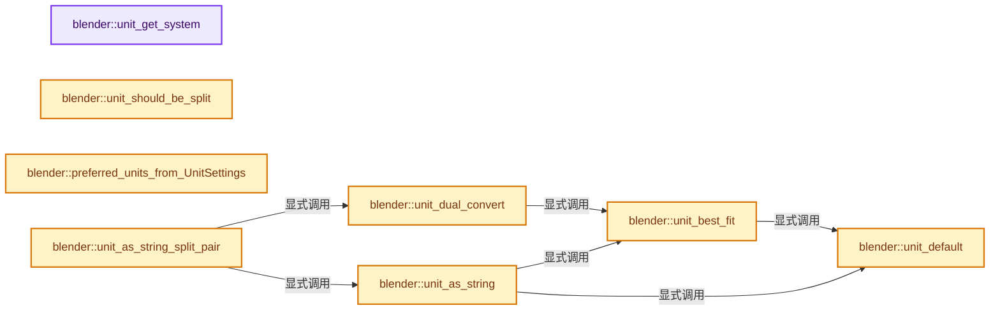
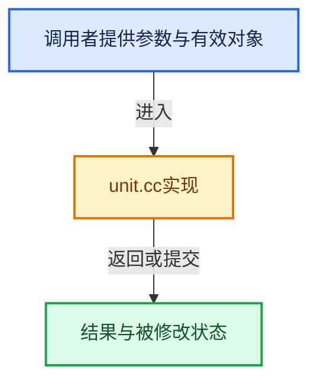

# 实现依赖专题：source/blender/blenkernel/intern/unit.cc

[实现依赖导航](../../README.md) · [符号索引](../../../00-课程指南/02-源码与提交索引/符号依赖与实现索引.md)

本专题从正文实际调用进入，集中保存共享实现。函数有稳定锚点，可从调用处直接跳到对应完整函数；递归与互相调用通过回链组织。

## 本文件的实现关系






## 完整成员与函数实现

<a id="f-610f1139cb31c28a"></a>

### `blender::unit_get_system`

实现位置：[source/blender/blenkernel/intern/unit.cc](../../../../../../../source/blender/blenkernel/intern/unit.cc) · L1583—L1588。

接口参数：

- `int system`
- `int type`

**教学注释版**

<!-- annotated:226c6bcde62d5c -->

```cpp
static const bUnitCollection *unit_get_system(int system, int type)
{
  BLI_assert((system > -1) && (system < UNIT_SYSTEM_TOT) && (type > -1) &&
             (type < B_UNIT_TYPE_TOT));
  return bUnitSystems[system][type]; /* Select system to use: metric/imperial/other? */
}
```

<details>
<summary>核对原始源码：source/blender/blenkernel/intern/unit.cc · L1583—L1588</summary>

<!-- original:226c6bcde62d5c:source/blender/blenkernel/intern/unit.cc:1583:1588 -->

```cpp
static const bUnitCollection *unit_get_system(int system, int type)
{
  BLI_assert((system > -1) && (system < UNIT_SYSTEM_TOT) && (type > -1) &&
             (type < B_UNIT_TYPE_TOT));
  return bUnitSystems[system][type]; /* Select system to use: metric/imperial/other? */
}
```

</details>

**结果出口**

- `return bUnitSystems[system][type]; /* Select system to use: metric/imperial/other? */`

**继续追踪实现**

- `BLI_assert` → [BLI_assert · L48](../../01-BLI基础库/BLI_assert.hh.md#m-57a88495704d)；[BLI_assert · L63](../../01-BLI基础库/BLI_assert.hh.md#m-d07050020cb5)。宏定义由构建条件选择。

<a id="f-c8f7a0f3d542d4a7"></a>

### `blender::unit_default`

实现位置：[source/blender/blenkernel/intern/unit.cc](../../../../../../../source/blender/blenkernel/intern/unit.cc) · L1590—L1593。

接口参数：

- `const bUnitCollection *usys`

**教学注释版**

<!-- annotated:9303a15216aa32 -->

```cpp
static const bUnitDef *unit_default(const bUnitCollection *usys)
{
  return &usys->units[usys->base_unit];
}
```

<details>
<summary>核对原始源码：source/blender/blenkernel/intern/unit.cc · L1590—L1593</summary>

<!-- original:9303a15216aa32:source/blender/blenkernel/intern/unit.cc:1590:1593 -->

```cpp
static const bUnitDef *unit_default(const bUnitCollection *usys)
{
  return &usys->units[usys->base_unit];
}
```

</details>

**结果出口**

- `return &usys->units[usys->base_unit];`

**继续追踪实现**

本实现没有需要继续展开的显式调用；检查返回表达式、对象转换和调用者前置条件。

<a id="f-1f6a09e9471a9dbf"></a>

### `blender::unit_best_fit`

实现位置：[source/blender/blenkernel/intern/unit.cc](../../../../../../../source/blender/blenkernel/intern/unit.cc) · L1595—L1622。

接口参数：

- `double value`
- `const bUnitCollection *usys`
- `const bUnitDef *unit_start`
- `int suppress`

**教学注释版**

<!-- annotated:974b5e1da3d0e8 -->

```cpp
static const bUnitDef *unit_best_fit(double value,
                                     const bUnitCollection *usys,
                                     const bUnitDef *unit_start,
                                     int suppress)
{
  double value_abs = value > 0.0 ? value : -value;

  for (const bUnitDef *unit = unit_start ? unit_start : usys->units; unit->name; unit++) {

    if (suppress && (unit->flag & B_UNIT_DEF_SUPPRESS)) {
      continue;
    }

    /* Scale down scalar so 1cm doesn't convert to 10mm because of float error. */
    if (unit->flag & B_UNIT_DEF_TENTH) [[unlikely]] {
      if (value_abs >= unit->scalar * (0.1 - EPS)) {
        return unit;
      }
    }
    else {
      if (value_abs >= unit->scalar * (1.0 - EPS)) {
        return unit;
      }
    }
  }

  return unit_default(usys);
}
```

<details>
<summary>核对原始源码：source/blender/blenkernel/intern/unit.cc · L1595—L1622</summary>

<!-- original:974b5e1da3d0e8:source/blender/blenkernel/intern/unit.cc:1595:1622 -->

```cpp
static const bUnitDef *unit_best_fit(double value,
                                     const bUnitCollection *usys,
                                     const bUnitDef *unit_start,
                                     int suppress)
{
  double value_abs = value > 0.0 ? value : -value;

  for (const bUnitDef *unit = unit_start ? unit_start : usys->units; unit->name; unit++) {

    if (suppress && (unit->flag & B_UNIT_DEF_SUPPRESS)) {
      continue;
    }

    /* Scale down scalar so 1cm doesn't convert to 10mm because of float error. */
    if (unit->flag & B_UNIT_DEF_TENTH) [[unlikely]] {
      if (value_abs >= unit->scalar * (0.1 - EPS)) {
        return unit;
      }
    }
    else {
      if (value_abs >= unit->scalar * (1.0 - EPS)) {
        return unit;
      }
    }
  }

  return unit_default(usys);
}
```

</details>

**结果出口**

- `return unit;`
- `return unit_default(usys);`

**继续追踪实现**

- `unit_default` → [blender::unit_default · L1590](unit.cc.md#f-c8f7a0f3d542d4a7)。

<a id="f-2e0a8395977c4294"></a>

### `blender::unit_dual_convert`

实现位置：[source/blender/blenkernel/intern/unit.cc](../../../../../../../source/blender/blenkernel/intern/unit.cc) · L1625—L1641。

接口参数：

- `double value`
- `const bUnitCollection *usys`
- `bUnitDef const **r_unit_a`
- `bUnitDef const **r_unit_b`
- `double *r_value_a`
- `double *r_value_b`
- `const bUnitDef *main_unit`

**教学注释版**

<!-- annotated:47b3932862af8b -->

```cpp
static void unit_dual_convert(double value,
                              const bUnitCollection *usys,
                              bUnitDef const **r_unit_a,
                              bUnitDef const **r_unit_b,
                              double *r_value_a,
                              double *r_value_b,
                              const bUnitDef *main_unit)
{
  const bUnitDef *unit = (main_unit) ? main_unit : unit_best_fit(value, usys, nullptr, 1);

  const double scaled_value = value / unit->scalar;
  *r_value_a = std::trunc(scaled_value) * unit->scalar;
  *r_value_b = value - (*r_value_a);

  *r_unit_a = unit;
  *r_unit_b = unit_best_fit(*r_value_b, usys, *r_unit_a, 1);
}
```

<details>
<summary>核对原始源码：source/blender/blenkernel/intern/unit.cc · L1625—L1641</summary>

<!-- original:47b3932862af8b:source/blender/blenkernel/intern/unit.cc:1625:1641 -->

```cpp
static void unit_dual_convert(double value,
                              const bUnitCollection *usys,
                              bUnitDef const **r_unit_a,
                              bUnitDef const **r_unit_b,
                              double *r_value_a,
                              double *r_value_b,
                              const bUnitDef *main_unit)
{
  const bUnitDef *unit = (main_unit) ? main_unit : unit_best_fit(value, usys, nullptr, 1);

  const double scaled_value = value / unit->scalar;
  *r_value_a = std::trunc(scaled_value) * unit->scalar;
  *r_value_b = value - (*r_value_a);

  *r_unit_a = unit;
  *r_unit_b = unit_best_fit(*r_value_b, usys, *r_unit_a, 1);
}
```

</details>

**继续追踪实现**

- `unit_best_fit` → [blender::unit_best_fit · L1595](unit.cc.md#f-1f6a09e9471a9dbf)。
- `std::trunc` → [外部契约](https://eel.is/c++draft/)：这个边界按实际表达式及所属类型核对参数、返回值、寿命与失败行为。这里提供接口入口，不声称已解释该第三方版本的内部实现。

<a id="f-9f4a44ba4943edab"></a>

### `blender::unit_as_string`

实现位置：[source/blender/blenkernel/intern/unit.cc](../../../../../../../source/blender/blenkernel/intern/unit.cc) · L1643—L1722。

接口参数：

- `char *str`
- `int str_maxncpy`
- `double value`
- `int prec`
- `const bool variable_width`
- `const bUnitCollection *usys`
- `const bUnitDef *unit`
- `char pad`
- `bool do_unit_suffix`

**教学注释版**

<!-- annotated:adb4f6fe9003be -->

```cpp
static size_t unit_as_string(char *str,
                             int str_maxncpy,
                             double value,
                             int prec,
                             const bool variable_width,
                             const bUnitCollection *usys,
                             /* Non exposed options. */
                             const bUnitDef *unit,
                             char pad,
                             bool do_unit_suffix)
{
  BLI_assert(prec >= 0);
  if (unit == nullptr) {
    if (value == 0.0) {
      /* Use the default units since there is no way to convert. */
      unit = unit_default(usys);
    }
    else {
      unit = unit_best_fit(value, usys, nullptr, 1);
    }
  }

  double value_conv = (value / unit->scalar) - unit->bias;

  /* Adjust precision to expected number of significant digits.
   * Note that here, we shall not have to worry about very big/small numbers, units are expected
   * to replace 'scientific notation' in those cases.
   * Fixed width mode skips this to preserve the exact decimal place count. */
  if (variable_width) {
    prec -= integer_digits_d(value_conv);
  }

  CLAMP(prec, 0, 6);

  /* Convert to a string. */
  size_t len = BLI_snprintf_rlen(str, str_maxncpy, "%.*f", prec, value_conv);

  /* Add unit prefix and strip zeros. */

  /* Replace trailing zero's with spaces so the number
   * is less complicated but alignment in a button won't
   * jump about while dragging. */
  size_t i = len - 1;

  if (prec > 0) {
    if (variable_width) {
      while (i > 0 && str[i] == '0') { /* 4.300 -> 4.3 */
        str[i--] = pad;
      }

      if (i > 0 && str[i] == '.') { /* 10. -> 10 */
        str[i--] = pad;
      }
    }
  }

  /* Now add a space for all units except foot, inch, degree, arcminute, arcsecond. */
  if (!(unit->flag & B_UNIT_DEF_NO_SPACE) && do_unit_suffix) {
    str[++i] = ' ';
  }

  if (i < str_maxncpy) {
    i++;
    if (do_unit_suffix) {
      /* Now add the suffix. */
      int j = 0;
      while (unit->name_short[j] && (i < str_maxncpy)) {
        str[i++] = unit->name_short[j++];
      }
    }
  }

  /* Terminate no matter what's done with padding above. */
  if (i >= str_maxncpy) {
    i = str_maxncpy - 1;
  }

  str[i] = '\0';
  return i;
}
```

<details>
<summary>核对原始源码：source/blender/blenkernel/intern/unit.cc · L1643—L1722</summary>

<!-- original:adb4f6fe9003be:source/blender/blenkernel/intern/unit.cc:1643:1722 -->

```cpp
static size_t unit_as_string(char *str,
                             int str_maxncpy,
                             double value,
                             int prec,
                             const bool variable_width,
                             const bUnitCollection *usys,
                             /* Non exposed options. */
                             const bUnitDef *unit,
                             char pad,
                             bool do_unit_suffix)
{
  BLI_assert(prec >= 0);
  if (unit == nullptr) {
    if (value == 0.0) {
      /* Use the default units since there is no way to convert. */
      unit = unit_default(usys);
    }
    else {
      unit = unit_best_fit(value, usys, nullptr, 1);
    }
  }

  double value_conv = (value / unit->scalar) - unit->bias;

  /* Adjust precision to expected number of significant digits.
   * Note that here, we shall not have to worry about very big/small numbers, units are expected
   * to replace 'scientific notation' in those cases.
   * Fixed width mode skips this to preserve the exact decimal place count. */
  if (variable_width) {
    prec -= integer_digits_d(value_conv);
  }

  CLAMP(prec, 0, 6);

  /* Convert to a string. */
  size_t len = BLI_snprintf_rlen(str, str_maxncpy, "%.*f", prec, value_conv);

  /* Add unit prefix and strip zeros. */

  /* Replace trailing zero's with spaces so the number
   * is less complicated but alignment in a button won't
   * jump about while dragging. */
  size_t i = len - 1;

  if (prec > 0) {
    if (variable_width) {
      while (i > 0 && str[i] == '0') { /* 4.300 -> 4.3 */
        str[i--] = pad;
      }

      if (i > 0 && str[i] == '.') { /* 10. -> 10 */
        str[i--] = pad;
      }
    }
  }

  /* Now add a space for all units except foot, inch, degree, arcminute, arcsecond. */
  if (!(unit->flag & B_UNIT_DEF_NO_SPACE) && do_unit_suffix) {
    str[++i] = ' ';
  }

  if (i < str_maxncpy) {
    i++;
    if (do_unit_suffix) {
      /* Now add the suffix. */
      int j = 0;
      while (unit->name_short[j] && (i < str_maxncpy)) {
        str[i++] = unit->name_short[j++];
      }
    }
  }

  /* Terminate no matter what's done with padding above. */
  if (i >= str_maxncpy) {
    i = str_maxncpy - 1;
  }

  str[i] = '\0';
  return i;
}
```

</details>

**沿实际写入检查状态**

- `unit = unit_default(usys);`
- `unit = unit_best_fit(value, usys, nullptr, 1);`
- `prec -= integer_digits_d(value_conv);`
- `str[i--] = pad;`
- `i = str_maxncpy - 1;`
- `str[i] = '\0';`

**结果出口**

- `return i;`

**继续追踪实现**

- `BLI_assert` → [BLI_assert · L48](../../01-BLI基础库/BLI_assert.hh.md#m-57a88495704d)；[BLI_assert · L63](../../01-BLI基础库/BLI_assert.hh.md#m-d07050020cb5)。宏定义由构建条件选择。
- `unit_default` → [blender::unit_default · L1590](unit.cc.md#f-c8f7a0f3d542d4a7)。
- `unit_best_fit` → [blender::unit_best_fit · L1595](unit.cc.md#f-1f6a09e9471a9dbf)。
- `integer_digits_d` → [blender::integer_digits_d · L568](../../01-BLI基础库/intern/math_base_inline.cc.md#f-2aa49eca91217145)。
- `CLAMP` → [CLAMP · L200](../../01-BLI基础库/BLI_utildefines.hh.md#m-69703e497120)。宏定义由构建条件选择。
- `BLI_snprintf_rlen` → [blender::BLI_snprintf_rlen · L213](../../01-BLI基础库/intern/string.cc.md#f-935c2eb6daad7a3a)。

<a id="f-e79feb24d6149683"></a>

### `blender::unit_should_be_split`

实现位置：[source/blender/blenkernel/intern/unit.cc](../../../../../../../source/blender/blenkernel/intern/unit.cc) · L1724—L1727。

接口参数：

- `int type`

**教学注释版**

<!-- annotated:0e0cc984ccf70d -->

```cpp
static bool unit_should_be_split(int type)
{
  return ELEM(type, B_UNIT_LENGTH, B_UNIT_MASS, B_UNIT_TIME, B_UNIT_CAMERA, B_UNIT_WAVELENGTH);
}
```

<details>
<summary>核对原始源码：source/blender/blenkernel/intern/unit.cc · L1724—L1727</summary>

<!-- original:0e0cc984ccf70d:source/blender/blenkernel/intern/unit.cc:1724:1727 -->

```cpp
static bool unit_should_be_split(int type)
{
  return ELEM(type, B_UNIT_LENGTH, B_UNIT_MASS, B_UNIT_TIME, B_UNIT_CAMERA, B_UNIT_WAVELENGTH);
}
```

</details>

**结果出口**

- `return ELEM(type, B_UNIT_LENGTH, B_UNIT_MASS, B_UNIT_TIME, B_UNIT_CAMERA, B_UNIT_WAVELENGTH);`

**继续追踪实现**

- `ELEM` → [ELEM · L88](../../07-Intern运行时与平台/ghost/intern/GHOST_utildefines.hh.md#m-d28724a15928)；[ELEM · L135](../../01-BLI基础库/BLI_utildefines.hh.md#m-d6572de7cae0)。宏定义由构建条件选择。

<a id="f-f3ab0c996a8d9121"></a>

### `blender::preferred_units_from_UnitSettings`

实现位置：[source/blender/blenkernel/intern/unit.cc](../../../../../../../source/blender/blenkernel/intern/unit.cc) · L1739—L1749。

接口参数：

- `const UnitSettings &settings`

**教学注释版**

<!-- annotated:0005ee8a8b1716 -->

```cpp
static PreferredUnits preferred_units_from_UnitSettings(const UnitSettings &settings)
{
  PreferredUnits units = {0};
  units.system = settings.system;
  units.rotation = settings.system_rotation;
  units.length = settings.length_unit;
  units.mass = settings.mass_unit;
  units.time = settings.time_unit;
  units.temperature = settings.temperature_unit;
  return units;
}
```

<details>
<summary>核对原始源码：source/blender/blenkernel/intern/unit.cc · L1739—L1749</summary>

<!-- original:0005ee8a8b1716:source/blender/blenkernel/intern/unit.cc:1739:1749 -->

```cpp
static PreferredUnits preferred_units_from_UnitSettings(const UnitSettings &settings)
{
  PreferredUnits units = {0};
  units.system = settings.system;
  units.rotation = settings.system_rotation;
  units.length = settings.length_unit;
  units.mass = settings.mass_unit;
  units.time = settings.time_unit;
  units.temperature = settings.temperature_unit;
  return units;
}
```

</details>

**沿实际写入检查状态**

- `units.system = settings.system;`
- `units.rotation = settings.system_rotation;`
- `units.length = settings.length_unit;`
- `units.mass = settings.mass_unit;`
- `units.time = settings.time_unit;`
- `units.temperature = settings.temperature_unit;`

**结果出口**

- `return units;`

**继续追踪实现**

本实现没有需要继续展开的显式调用；检查返回表达式、对象转换和调用者前置条件。

<a id="f-7df9bd6fac44d6e4"></a>

### `blender::unit_as_string_split_pair`

实现位置：[source/blender/blenkernel/intern/unit.cc](../../../../../../../source/blender/blenkernel/intern/unit.cc) · L1751—L1788。

接口参数：

- `char *str`
- `int str_maxncpy`
- `double value`
- `int prec`
- `const bool variable_width`
- `const bUnitCollection *usys`
- `const bUnitDef *main_unit`

**教学注释版**

<!-- annotated:9b12792fd348d2 -->

```cpp
static size_t unit_as_string_split_pair(char *str,
                                        int str_maxncpy,
                                        double value,
                                        int prec,
                                        const bool variable_width,
                                        const bUnitCollection *usys,
                                        const bUnitDef *main_unit)
{
  BLI_assert(prec >= 0);
  const bUnitDef *unit_a, *unit_b;
  double value_a, value_b;
  unit_dual_convert(value, usys, &unit_a, &unit_b, &value_a, &value_b, main_unit);

  /* Check the 2 is a smaller unit. */
  if (unit_b > unit_a) {
    /* Always strip zeros for the larger unit, since it is truncated and won't ever "jitter". */
    size_t i = unit_as_string(str, str_maxncpy, value_a, prec, true, usys, unit_a, '\0', true);

    /* Fixed width mode skips this to preserve the exact decimal place count. */
    if (variable_width) {
      prec -= integer_digits_d(value_a / unit_b->scalar) -
              integer_digits_d(value_b / unit_b->scalar);
      prec = max_ii(prec, 0);
    }

    /* Is there enough space for at least 1 char of the next unit? */
    if (i + 2 < str_maxncpy) {
      str[i++] = ' ';

      /* Use low precision since this is a smaller unit. */
      i += unit_as_string(
          str + i, str_maxncpy - i, value_b, prec, variable_width, usys, unit_b, '\0', true);
    }
    return i;
  }

  return -1;
}
```

<details>
<summary>核对原始源码：source/blender/blenkernel/intern/unit.cc · L1751—L1788</summary>

<!-- original:9b12792fd348d2:source/blender/blenkernel/intern/unit.cc:1751:1788 -->

```cpp
static size_t unit_as_string_split_pair(char *str,
                                        int str_maxncpy,
                                        double value,
                                        int prec,
                                        const bool variable_width,
                                        const bUnitCollection *usys,
                                        const bUnitDef *main_unit)
{
  BLI_assert(prec >= 0);
  const bUnitDef *unit_a, *unit_b;
  double value_a, value_b;
  unit_dual_convert(value, usys, &unit_a, &unit_b, &value_a, &value_b, main_unit);

  /* Check the 2 is a smaller unit. */
  if (unit_b > unit_a) {
    /* Always strip zeros for the larger unit, since it is truncated and won't ever "jitter". */
    size_t i = unit_as_string(str, str_maxncpy, value_a, prec, true, usys, unit_a, '\0', true);

    /* Fixed width mode skips this to preserve the exact decimal place count. */
    if (variable_width) {
      prec -= integer_digits_d(value_a / unit_b->scalar) -
              integer_digits_d(value_b / unit_b->scalar);
      prec = max_ii(prec, 0);
    }

    /* Is there enough space for at least 1 char of the next unit? */
    if (i + 2 < str_maxncpy) {
      str[i++] = ' ';

      /* Use low precision since this is a smaller unit. */
      i += unit_as_string(
          str + i, str_maxncpy - i, value_b, prec, variable_width, usys, unit_b, '\0', true);
    }
    return i;
  }

  return -1;
}
```

</details>

**沿实际写入检查状态**

- `prec -= integer_digits_d(value_a / unit_b->scalar) -`
- `prec = max_ii(prec, 0);`
- `i += unit_as_string(`

**结果出口**

- `return i;`
- `return -1;`

**继续追踪实现**

- `BLI_assert` → [BLI_assert · L48](../../01-BLI基础库/BLI_assert.hh.md#m-57a88495704d)；[BLI_assert · L63](../../01-BLI基础库/BLI_assert.hh.md#m-d07050020cb5)。宏定义由构建条件选择。
- `unit_dual_convert` → [blender::unit_dual_convert · L1625](unit.cc.md#f-2e0a8395977c4294)。
- `unit_as_string` → [blender::unit_as_string · L1643](unit.cc.md#f-9f4a44ba4943edab)。
- `integer_digits_d` → [blender::integer_digits_d · L568](../../01-BLI基础库/intern/math_base_inline.cc.md#f-2aa49eca91217145)。
- `max_ii` → [blender::max_ii · L368](../../01-BLI基础库/intern/math_base_inline.cc.md#f-c45aa7b373adb94c)。

<a id="f-0c29d55ae53f9b19"></a>

### `blender::is_valid_unit_collection`

实现位置：[source/blender/blenkernel/intern/unit.cc](../../../../../../../source/blender/blenkernel/intern/unit.cc) · L1790—L1793。

接口参数：

- `const bUnitCollection *usys`

**教学注释版**

<!-- annotated:1b46f3605a6745 -->

```cpp
static bool is_valid_unit_collection(const bUnitCollection *usys)
{
  return usys != nullptr && usys->units[0].name != nullptr;
}
```

<details>
<summary>核对原始源码：source/blender/blenkernel/intern/unit.cc · L1790—L1793</summary>

<!-- original:1b46f3605a6745:source/blender/blenkernel/intern/unit.cc:1790:1793 -->

```cpp
static bool is_valid_unit_collection(const bUnitCollection *usys)
{
  return usys != nullptr && usys->units[0].name != nullptr;
}
```

</details>

**结果出口**

- `return usys != nullptr && usys->units[0].name != nullptr;`

**继续追踪实现**

本实现没有需要继续展开的显式调用；检查返回表达式、对象转换和调用者前置条件。

<a id="f-5840065c757943ae"></a>

### `blender::is_unit_adaptive`

实现位置：[source/blender/blenkernel/intern/unit.cc](../../../../../../../source/blender/blenkernel/intern/unit.cc) · L1795—L1812。

接口参数：

- `const int type`
- `const PreferredUnits &units`

**教学注释版**

<!-- annotated:95dfc7f856bc30 -->

```cpp
static bool is_unit_adaptive(const int type, const PreferredUnits &units)
{
  switch (type) {
    case B_UNIT_LENGTH:
    case B_UNIT_AREA:
    case B_UNIT_VOLUME:
      return units.length == USER_UNIT_ADAPTIVE;
    case B_UNIT_MASS:
      return units.mass == USER_UNIT_ADAPTIVE;
    case B_UNIT_TIME:
      return units.time == USER_UNIT_ADAPTIVE;
    case B_UNIT_TEMPERATURE:
      return units.temperature == USER_UNIT_ADAPTIVE;
    default:
      break;
  }
  return false;
}
```

<details>
<summary>核对原始源码：source/blender/blenkernel/intern/unit.cc · L1795—L1812</summary>

<!-- original:95dfc7f856bc30:source/blender/blenkernel/intern/unit.cc:1795:1812 -->

```cpp
static bool is_unit_adaptive(const int type, const PreferredUnits &units)
{
  switch (type) {
    case B_UNIT_LENGTH:
    case B_UNIT_AREA:
    case B_UNIT_VOLUME:
      return units.length == USER_UNIT_ADAPTIVE;
    case B_UNIT_MASS:
      return units.mass == USER_UNIT_ADAPTIVE;
    case B_UNIT_TIME:
      return units.time == USER_UNIT_ADAPTIVE;
    case B_UNIT_TEMPERATURE:
      return units.temperature == USER_UNIT_ADAPTIVE;
    default:
      break;
  }
  return false;
}
```

</details>

**结果出口**

- `return units.length == USER_UNIT_ADAPTIVE;`
- `return units.mass == USER_UNIT_ADAPTIVE;`
- `return units.time == USER_UNIT_ADAPTIVE;`
- `return units.temperature == USER_UNIT_ADAPTIVE;`
- `return false;`

**继续追踪实现**

本实现没有需要继续展开的显式调用；检查返回表达式、对象转换和调用者前置条件。

<a id="f-0320f125c0b980a6"></a>

### `blender::get_preferred_display_unit_index_if_used`

实现位置：[source/blender/blenkernel/intern/unit.cc](../../../../../../../source/blender/blenkernel/intern/unit.cc) · L1814—L1849。

接口参数：

- `int type`
- `const PreferredUnits &units`

**教学注释版**

<!-- annotated:76f36b9f6e2e8b -->

```cpp
static int get_preferred_display_unit_index_if_used(int type, const PreferredUnits &units)
{
  const bUnitCollection *usys = unit_get_system(units.system, type);
  if (!is_valid_unit_collection(usys)) {
    return -1;
  }
  if (is_unit_adaptive(type, units)) {
    return -1;
  }

  int max_offset = usys->length - 1;

  switch (type) {
    case B_UNIT_LENGTH:
    case B_UNIT_AREA:
    case B_UNIT_VOLUME:
      // [讲解] std::min：按比较关系选取较小值；截断范围时还需先满足非负和可表示范围，min本身不会证明边界安全。
      return std::min(units.length, max_offset);
    case B_UNIT_MASS:
      return std::min(units.mass, max_offset);
    case B_UNIT_TIME:
      return std::min(units.time, max_offset);
    case B_UNIT_ROTATION:
      if (units.rotation == 0) {
        return 0;
      }
      else if (units.rotation == USER_UNIT_ROT_RADIANS) {
        return 3;
      }
      break;
    case B_UNIT_TEMPERATURE:
      return std::min(units.temperature, max_offset);
    default:
      break;
  }
  return -1;
}
```

<details>
<summary>核对原始源码：source/blender/blenkernel/intern/unit.cc · L1814—L1849</summary>

<!-- original:76f36b9f6e2e8b:source/blender/blenkernel/intern/unit.cc:1814:1849 -->

```cpp
static int get_preferred_display_unit_index_if_used(int type, const PreferredUnits &units)
{
  const bUnitCollection *usys = unit_get_system(units.system, type);
  if (!is_valid_unit_collection(usys)) {
    return -1;
  }
  if (is_unit_adaptive(type, units)) {
    return -1;
  }

  int max_offset = usys->length - 1;

  switch (type) {
    case B_UNIT_LENGTH:
    case B_UNIT_AREA:
    case B_UNIT_VOLUME:
      return std::min(units.length, max_offset);
    case B_UNIT_MASS:
      return std::min(units.mass, max_offset);
    case B_UNIT_TIME:
      return std::min(units.time, max_offset);
    case B_UNIT_ROTATION:
      if (units.rotation == 0) {
        return 0;
      }
      else if (units.rotation == USER_UNIT_ROT_RADIANS) {
        return 3;
      }
      break;
    case B_UNIT_TEMPERATURE:
      return std::min(units.temperature, max_offset);
    default:
      break;
  }
  return -1;
}
```

</details>

**结果出口**

- `return -1;`
- `return std::min(units.length, max_offset);`
- `return std::min(units.mass, max_offset);`
- `return std::min(units.time, max_offset);`
- `return 0;`
- `return 3;`
- `return std::min(units.temperature, max_offset);`

**继续追踪实现**

- `unit_get_system` → [blender::unit_get_system · L1583](unit.cc.md#f-610f1139cb31c28a)。
- `is_valid_unit_collection` → [blender::is_valid_unit_collection · L1790](unit.cc.md#f-0c29d55ae53f9b19)。
- `is_unit_adaptive` → [blender::is_unit_adaptive · L1795](unit.cc.md#f-5840065c757943ae)。
- `std::min` → [外部契约](https://eel.is/c++draft/alg.min.max)：按比较关系选取较小值；截断范围时还需先满足非负和可表示范围，min本身不会证明边界安全。

<a id="f-a9e41e55e098b7bc"></a>

### `blender::get_preferred_display_unit_if_used`

实现位置：[source/blender/blenkernel/intern/unit.cc](../../../../../../../source/blender/blenkernel/intern/unit.cc) · L1851—L1859。

接口参数：

- `int type`
- `const PreferredUnits &units`

**教学注释版**

<!-- annotated:7b8ad41968f590 -->

```cpp
static const bUnitDef *get_preferred_display_unit_if_used(int type, const PreferredUnits &units)
{
  const bUnitCollection *usys = unit_get_system(units.system, type);
  const int index = get_preferred_display_unit_index_if_used(type, units);
  if (index == -1) {
    return nullptr;
  }
  return &usys->units[index];
}
```

<details>
<summary>核对原始源码：source/blender/blenkernel/intern/unit.cc · L1851—L1859</summary>

<!-- original:7b8ad41968f590:source/blender/blenkernel/intern/unit.cc:1851:1859 -->

```cpp
static const bUnitDef *get_preferred_display_unit_if_used(int type, const PreferredUnits &units)
{
  const bUnitCollection *usys = unit_get_system(units.system, type);
  const int index = get_preferred_display_unit_index_if_used(type, units);
  if (index == -1) {
    return nullptr;
  }
  return &usys->units[index];
}
```

</details>

**结果出口**

- `return nullptr;`
- `return &usys->units[index];`

**继续追踪实现**

- `unit_get_system` → [blender::unit_get_system · L1583](unit.cc.md#f-610f1139cb31c28a)。
- `get_preferred_display_unit_index_if_used` → [blender::get_preferred_display_unit_index_if_used · L1814](unit.cc.md#f-0320f125c0b980a6)。

<a id="f-8b65b49de695f1c6"></a>

### `blender::unit_as_string_main`

实现位置：[source/blender/blenkernel/intern/unit.cc](../../../../../../../source/blender/blenkernel/intern/unit.cc) · L1862—L1906。

接口参数：

- `char *str`
- `int str_maxncpy`
- `double value`
- `int prec`
- `int type`
- `bool split`
- `bool pad`
- `bool do_unit_suffix`
- `const PreferredUnits &units`

**教学注释版**

<!-- annotated:86c23735116659 -->

```cpp
static size_t unit_as_string_main(char *str,
                                  int str_maxncpy,
                                  double value,
                                  int prec,
                                  int type,
                                  bool split,
                                  bool pad,
                                  bool do_unit_suffix,
                                  const PreferredUnits &units)
{
  const bUnitCollection *usys = unit_get_system(units.system, type);
  const bUnitDef *main_unit = nullptr;

  if (!is_valid_unit_collection(usys)) {
    usys = &buDummyCollection;
  }
  else {
    main_unit = get_preferred_display_unit_if_used(type, units);
  }

  bool variable_width = true;
  if (prec < 0) {
    prec = -prec;
    variable_width = false;
  }

  if (split && unit_should_be_split(type)) {
    int length = unit_as_string_split_pair(
        str, str_maxncpy, value, prec, variable_width, usys, main_unit);
    /* Split failed when length is negative, fall back to no split. */
    if (length >= 0) {
      return length;
    }
  }

  return unit_as_string(str,
                        str_maxncpy,
                        value,
                        prec,
                        variable_width,
                        usys,
                        main_unit,
                        pad ? ' ' : '\0',
                        do_unit_suffix);
}
```

<details>
<summary>核对原始源码：source/blender/blenkernel/intern/unit.cc · L1862—L1906</summary>

<!-- original:86c23735116659:source/blender/blenkernel/intern/unit.cc:1862:1906 -->

```cpp
static size_t unit_as_string_main(char *str,
                                  int str_maxncpy,
                                  double value,
                                  int prec,
                                  int type,
                                  bool split,
                                  bool pad,
                                  bool do_unit_suffix,
                                  const PreferredUnits &units)
{
  const bUnitCollection *usys = unit_get_system(units.system, type);
  const bUnitDef *main_unit = nullptr;

  if (!is_valid_unit_collection(usys)) {
    usys = &buDummyCollection;
  }
  else {
    main_unit = get_preferred_display_unit_if_used(type, units);
  }

  bool variable_width = true;
  if (prec < 0) {
    prec = -prec;
    variable_width = false;
  }

  if (split && unit_should_be_split(type)) {
    int length = unit_as_string_split_pair(
        str, str_maxncpy, value, prec, variable_width, usys, main_unit);
    /* Split failed when length is negative, fall back to no split. */
    if (length >= 0) {
      return length;
    }
  }

  return unit_as_string(str,
                        str_maxncpy,
                        value,
                        prec,
                        variable_width,
                        usys,
                        main_unit,
                        pad ? ' ' : '\0',
                        do_unit_suffix);
}
```

</details>

**沿实际写入检查状态**

- `usys = &buDummyCollection;`
- `main_unit = get_preferred_display_unit_if_used(type, units);`
- `prec = -prec;`
- `variable_width = false;`

**结果出口**

- `return length;`
- `return unit_as_string(str,`

**继续追踪实现**

- `unit_get_system` → [blender::unit_get_system · L1583](unit.cc.md#f-610f1139cb31c28a)。
- `is_valid_unit_collection` → [blender::is_valid_unit_collection · L1790](unit.cc.md#f-0c29d55ae53f9b19)。
- `get_preferred_display_unit_if_used` → [blender::get_preferred_display_unit_if_used · L1851](unit.cc.md#f-a9e41e55e098b7bc)。
- `unit_should_be_split` → [blender::unit_should_be_split · L1724](unit.cc.md#f-e79feb24d6149683)。
- `unit_as_string_split_pair` → [blender::unit_as_string_split_pair · L1751](unit.cc.md#f-7df9bd6fac44d6e4)。
- `unit_as_string` → [blender::unit_as_string · L1643](unit.cc.md#f-9f4a44ba4943edab)。

<a id="f-49f95088d0b90bf3"></a>

### `blender::BKE_unit_value_as_string`

实现位置：[source/blender/blenkernel/intern/unit.cc](../../../../../../../source/blender/blenkernel/intern/unit.cc) · L1929—L1942。

接口参数：

- `char *str`
- `int str_maxncpy`
- `double value`
- `int prec`
- `int type`
- `const UnitSettings &settings`
- `bool pad`
- `bool do_unit_suffix`

**教学注释版**

<!-- annotated:90b093d13a3b3e -->

```cpp
size_t BKE_unit_value_as_string(char *str,
                                int str_maxncpy,
                                double value,
                                int prec,
                                int type,
                                const UnitSettings &settings,
                                bool pad,
                                bool do_unit_suffix)
{
  bool do_split = (settings.flag & USER_UNIT_OPT_SPLIT) != 0;
  PreferredUnits units = preferred_units_from_UnitSettings(settings);
  return unit_as_string_main(
      str, str_maxncpy, value, prec, type, do_split, pad, do_unit_suffix, units);
}
```

<details>
<summary>核对原始源码：source/blender/blenkernel/intern/unit.cc · L1929—L1942</summary>

<!-- original:90b093d13a3b3e:source/blender/blenkernel/intern/unit.cc:1929:1942 -->

```cpp
size_t BKE_unit_value_as_string(char *str,
                                int str_maxncpy,
                                double value,
                                int prec,
                                int type,
                                const UnitSettings &settings,
                                bool pad,
                                bool do_unit_suffix)
{
  bool do_split = (settings.flag & USER_UNIT_OPT_SPLIT) != 0;
  PreferredUnits units = preferred_units_from_UnitSettings(settings);
  return unit_as_string_main(
      str, str_maxncpy, value, prec, type, do_split, pad, do_unit_suffix, units);
}
```

</details>

**结果出口**

- `return unit_as_string_main(`

**继续追踪实现**

- `preferred_units_from_UnitSettings` → [blender::preferred_units_from_UnitSettings · L1739](unit.cc.md#f-f3ab0c996a8d9121)。
- `unit_as_string_main` → [blender::unit_as_string_main · L1862](unit.cc.md#f-8b65b49de695f1c6)。

<a id="f-34b02f8fa2a9867e"></a>

### `blender::BKE_unit_value_scale`

实现位置：[source/blender/blenkernel/intern/unit.cc](../../../../../../../source/blender/blenkernel/intern/unit.cc) · L1963—L1987。

接口参数：

- `const UnitSettings &settings`
- `const int unit_type`
- `double value`

**教学注释版**

<!-- annotated:8532a8e9093e5a -->

```cpp
double BKE_unit_value_scale(const UnitSettings &settings, const int unit_type, double value)
{
  if (settings.system == USER_UNIT_NONE) {
    /* Never apply scale_length when not using a unit setting! */
    return value;
  }

  switch (unit_type) {
    case B_UNIT_LENGTH:
    case B_UNIT_VELOCITY:
    case B_UNIT_ACCELERATION:
      return value * double(settings.scale_length);
    case B_UNIT_AREA:
    case B_UNIT_POWER:
      return value * pow(settings.scale_length, 2);
    case B_UNIT_VOLUME:
      return value * pow(settings.scale_length, 3);
    case B_UNIT_MASS:
      return value * pow(settings.scale_length, 3);
    case B_UNIT_CAMERA: /* *Do not* use scene's unit scale for camera focal lens! See #42026. */
    case B_UNIT_WAVELENGTH: /* Wavelength values are independent of the scene scale. */
    default:
      return value;
  }
}
```

<details>
<summary>核对原始源码：source/blender/blenkernel/intern/unit.cc · L1963—L1987</summary>

<!-- original:8532a8e9093e5a:source/blender/blenkernel/intern/unit.cc:1963:1987 -->

```cpp
double BKE_unit_value_scale(const UnitSettings &settings, const int unit_type, double value)
{
  if (settings.system == USER_UNIT_NONE) {
    /* Never apply scale_length when not using a unit setting! */
    return value;
  }

  switch (unit_type) {
    case B_UNIT_LENGTH:
    case B_UNIT_VELOCITY:
    case B_UNIT_ACCELERATION:
      return value * double(settings.scale_length);
    case B_UNIT_AREA:
    case B_UNIT_POWER:
      return value * pow(settings.scale_length, 2);
    case B_UNIT_VOLUME:
      return value * pow(settings.scale_length, 3);
    case B_UNIT_MASS:
      return value * pow(settings.scale_length, 3);
    case B_UNIT_CAMERA: /* *Do not* use scene's unit scale for camera focal lens! See #42026. */
    case B_UNIT_WAVELENGTH: /* Wavelength values are independent of the scene scale. */
    default:
      return value;
  }
}
```

</details>

**结果出口**

- `return value;`
- `return value * double(settings.scale_length);`
- `return value * pow(settings.scale_length, 2);`
- `return value * pow(settings.scale_length, 3);`

**继续追踪实现**

- `pow` → [外部契约](https://eel.is/c++draft/)：这个边界按实际表达式及所属类型核对参数、返回值、寿命与失败行为。这里提供接口入口，不声称已解释该第三方版本的内部实现。

<a id="f-77d59bea923f18b5"></a>

### `blender::isalpha_or_utf8`

实现位置：[source/blender/blenkernel/intern/unit.cc](../../../../../../../source/blender/blenkernel/intern/unit.cc) · L1989—L1992。

接口参数：

- `const int ch`

**教学注释版**

<!-- annotated:116f70c2f183f5 -->

```cpp
BLI_INLINE bool isalpha_or_utf8(const int ch)
{
  return (ch >= 128 || isalpha(ch));
}
```

<details>
<summary>核对原始源码：source/blender/blenkernel/intern/unit.cc · L1989—L1992</summary>

<!-- original:116f70c2f183f5:source/blender/blenkernel/intern/unit.cc:1989:1992 -->

```cpp
BLI_INLINE bool isalpha_or_utf8(const int ch)
{
  return (ch >= 128 || isalpha(ch));
}
```

</details>

**结果出口**

- `return (ch >= 128 || isalpha(ch));`

**继续追踪实现**

- `isalpha` → [调用协议](../../../00-课程指南/01-路线与规范/模板宏与动态分派协议.md)：函数指针、局部可调用对象或未展开的宏；必须结合调用者环境。调用位置L1991。

<a id="f-94cf081683d4d355"></a>

### `blender::unit_find_str`

实现位置：[source/blender/blenkernel/intern/unit.cc](../../../../../../../source/blender/blenkernel/intern/unit.cc) · L1994—L2036。

接口参数：

- `const char *str`
- `const char *substr`
- `bool case_sensitive`

**教学注释版**

<!-- annotated:8b8bb3b6b19ae2 -->

```cpp
static const char *unit_find_str(const char *str, const char *substr, bool case_sensitive)
{
  if (substr == nullptr || substr[0] == '\0') {
    return nullptr;
  }

  while (true) {
    /* Unit detection is case insensitive. */
    const char *str_found;
    if (case_sensitive) {
      str_found = strstr(str, substr);
    }
    else {
      str_found = BLI_strcasestr(str, substr);
    }

    if (str_found) {
      /* Previous char cannot be a letter. */
      if (str_found == str ||
          /* Weak unicode support!, so "µm" won't match up be replaced by "m"
           * since non ASCII UTF8 values will NEVER return true. */
          isalpha_or_utf8(*BLI_str_find_prev_char_utf8(str_found, str)) == 0)
      {
        /* Next char cannot be alphanumeric. */
        int len_name = strlen(substr);

        if (!isalpha_or_utf8(*(str_found + len_name))) {
          return str_found;
        }
      }
      /* If str_found is not a valid unit, we have to check further in the string... */
      for (str_found++; isalpha_or_utf8(*str_found); str_found++) {
        /* Pass. */
      }
      str = str_found;
    }
    else {
      break;
    }
  }

  return nullptr;
}
```

<details>
<summary>核对原始源码：source/blender/blenkernel/intern/unit.cc · L1994—L2036</summary>

<!-- original:8b8bb3b6b19ae2:source/blender/blenkernel/intern/unit.cc:1994:2036 -->

```cpp
static const char *unit_find_str(const char *str, const char *substr, bool case_sensitive)
{
  if (substr == nullptr || substr[0] == '\0') {
    return nullptr;
  }

  while (true) {
    /* Unit detection is case insensitive. */
    const char *str_found;
    if (case_sensitive) {
      str_found = strstr(str, substr);
    }
    else {
      str_found = BLI_strcasestr(str, substr);
    }

    if (str_found) {
      /* Previous char cannot be a letter. */
      if (str_found == str ||
          /* Weak unicode support!, so "µm" won't match up be replaced by "m"
           * since non ASCII UTF8 values will NEVER return true. */
          isalpha_or_utf8(*BLI_str_find_prev_char_utf8(str_found, str)) == 0)
      {
        /* Next char cannot be alphanumeric. */
        int len_name = strlen(substr);

        if (!isalpha_or_utf8(*(str_found + len_name))) {
          return str_found;
        }
      }
      /* If str_found is not a valid unit, we have to check further in the string... */
      for (str_found++; isalpha_or_utf8(*str_found); str_found++) {
        /* Pass. */
      }
      str = str_found;
    }
    else {
      break;
    }
  }

  return nullptr;
}
```

</details>

**沿实际写入检查状态**

- `str_found = strstr(str, substr);`
- `str_found = BLI_strcasestr(str, substr);`
- `str = str_found;`

**结果出口**

- `return nullptr;`
- `return str_found;`

**继续追踪实现**

- `strstr` → [调用协议](../../../00-课程指南/01-路线与规范/模板宏与动态分派协议.md)：函数指针、局部可调用对象或未展开的宏；必须结合调用者环境。调用位置L2004。
- `BLI_strcasestr` → [blender::BLI_strcasestr · L558](../../01-BLI基础库/intern/string.cc.md#f-4da372dc496a9c1f)。
- `isalpha_or_utf8` → [blender::isalpha_or_utf8 · L1989](unit.cc.md#f-77d59bea923f18b5)。
- `BLI_str_find_prev_char_utf8` → [blender::BLI_str_find_prev_char_utf8 · L1292](../../01-BLI基础库/intern/string_utf8.cc.md#f-d91f9e45917dd05c)。
- `strlen` → [外部契约](https://eel.is/c++draft/)：这个边界按实际表达式及所属类型核对参数、返回值、寿命与失败行为。这里提供接口入口，不声称已解释该第三方版本的内部实现。

<a id="f-0bf3f0ff7f6c900f"></a>

### `blender::ch_is_op`

实现位置：[source/blender/blenkernel/intern/unit.cc](../../../../../../../source/blender/blenkernel/intern/unit.cc) · L2047—L2067。

接口参数：

- `char op`

**教学注释版**

<!-- annotated:80804ed1df70aa -->

```cpp
static bool ch_is_op(char op)
{
  switch (op) {
    case '+':
    case '-':
    case '*':
    case '/':
    case '|':
    case '&':
    case '~':
    case '<':
    case '>':
    case '^':
    case '!':
    case '=':
    case '%':
      return true;
    default:
      return false;
  }
}
```

<details>
<summary>核对原始源码：source/blender/blenkernel/intern/unit.cc · L2047—L2067</summary>

<!-- original:80804ed1df70aa:source/blender/blenkernel/intern/unit.cc:2047:2067 -->

```cpp
static bool ch_is_op(char op)
{
  switch (op) {
    case '+':
    case '-':
    case '*':
    case '/':
    case '|':
    case '&':
    case '~':
    case '<':
    case '>':
    case '^':
    case '!':
    case '=':
    case '%':
      return true;
    default:
      return false;
  }
}
```

</details>

**结果出口**

- `return true;`
- `return false;`

**继续追踪实现**

本实现没有需要继续展开的显式调用；检查返回表达式、对象转换和调用者前置条件。

<a id="f-963c96028dd13363"></a>

### `blender::ch_is_op_unary`

实现位置：[source/blender/blenkernel/intern/unit.cc](../../../../../../../source/blender/blenkernel/intern/unit.cc) · L2069—L2079。

接口参数：

- `char op`

**教学注释版**

<!-- annotated:cf5227ff98b36b -->

```cpp
static bool ch_is_op_unary(char op)
{
  switch (op) {
    case '+':
    case '-':
    case '~':
      return true;
    default:
      return false;
  }
}
```

<details>
<summary>核对原始源码：source/blender/blenkernel/intern/unit.cc · L2069—L2079</summary>

<!-- original:cf5227ff98b36b:source/blender/blenkernel/intern/unit.cc:2069:2079 -->

```cpp
static bool ch_is_op_unary(char op)
{
  switch (op) {
    case '+':
    case '-':
    case '~':
      return true;
    default:
      return false;
  }
}
```

</details>

**结果出口**

- `return true;`
- `return false;`

**继续追踪实现**

本实现没有需要继续展开的显式调用；检查返回表达式、对象转换和调用者前置条件。

<a id="f-236b9d1e6fd54850"></a>

### `blender::find_next_negative`

实现位置：[source/blender/blenkernel/intern/unit.cc](../../../../../../../source/blender/blenkernel/intern/unit.cc) · L2087—L2105。

接口参数：

- `const char *str`
- `const char *remaining_str`

**教学注释版**

<!-- annotated:276cc776a74f51 -->

```cpp
static const char *find_next_negative(const char *str, const char *remaining_str)
{
  const char *str_found = strstr(remaining_str, "-");

  if (str_found == nullptr) {
    return nullptr;
  }

  /* Don't use the "-" from scientific notation, but make sure we can look backwards first. */
  if ((str_found != str) && ELEM(*(str_found - 1), 'e', 'E')) {
    return find_next_negative(str, str_found + 1);
  }

  if (*(str_found + 1) == ' ') {
    str_found++;
  }

  return str_found + 1;
}
```

<details>
<summary>核对原始源码：source/blender/blenkernel/intern/unit.cc · L2087—L2105</summary>

<!-- original:276cc776a74f51:source/blender/blenkernel/intern/unit.cc:2087:2105 -->

```cpp
static const char *find_next_negative(const char *str, const char *remaining_str)
{
  const char *str_found = strstr(remaining_str, "-");

  if (str_found == nullptr) {
    return nullptr;
  }

  /* Don't use the "-" from scientific notation, but make sure we can look backwards first. */
  if ((str_found != str) && ELEM(*(str_found - 1), 'e', 'E')) {
    return find_next_negative(str, str_found + 1);
  }

  if (*(str_found + 1) == ' ') {
    str_found++;
  }

  return str_found + 1;
}
```

</details>

**结果出口**

- `return nullptr;`
- `return find_next_negative(str, str_found + 1);`
- `return str_found + 1;`

**继续追踪实现**

- `strstr` → [调用协议](../../../00-课程指南/01-路线与规范/模板宏与动态分派协议.md)：函数指针、局部可调用对象或未展开的宏；必须结合调用者环境。调用位置L2089。
- `ELEM` → [ELEM · L88](../../07-Intern运行时与平台/ghost/intern/GHOST_utildefines.hh.md#m-d28724a15928)；[ELEM · L135](../../01-BLI基础库/BLI_utildefines.hh.md#m-d6572de7cae0)。宏定义由构建条件选择。
- `find_next_negative` → [blender::find_next_negative · L2087](unit.cc.md#f-236b9d1e6fd54850)。

<a id="f-388e186464e21ab0"></a>

### `blender::find_next_op`

实现位置：[source/blender/blenkernel/intern/unit.cc](../../../../../../../source/blender/blenkernel/intern/unit.cc) · L2113—L2147。

接口参数：

- `const char *str`
- `char *remaining_str`
- `int remaining_str_maxncpy`

**教学注释版**

<!-- annotated:dc2a1d4f2e7508 -->

```cpp
static char *find_next_op(const char *str, char *remaining_str, int remaining_str_maxncpy)
{
  int i;
  for (i = 0; i < remaining_str_maxncpy; i++) {
    if (remaining_str[i] == '\0') {
      return remaining_str + i;
    }

    if (ch_is_op(remaining_str[i])) {
      /* Make sure we don't look backwards before the start of the string. */
      if (remaining_str != str && i != 0) {
        /* Check for velocity or acceleration (e.g. '/' in 'ft/s' is not an op). */
        if ((remaining_str[i] == '/') && ELEM(remaining_str[i - 1], 't', 'T', 'm', 'M') &&
            ELEM(remaining_str[i + 1], 's', 'S'))
        {
          continue;
        }

        /* Check for scientific notation. */
        if (ELEM(remaining_str[i - 1], 'e', 'E')) {
          continue;
        }

        /* Return position before a space character. */
        if (remaining_str[i - 1] == ' ') {
          i--;
        }
      }

      return remaining_str + i;
    }
  }
  BLI_assert_msg(0, "String should be null terminated");
  return remaining_str + i;
}
```

<details>
<summary>核对原始源码：source/blender/blenkernel/intern/unit.cc · L2113—L2147</summary>

<!-- original:dc2a1d4f2e7508:source/blender/blenkernel/intern/unit.cc:2113:2147 -->

```cpp
static char *find_next_op(const char *str, char *remaining_str, int remaining_str_maxncpy)
{
  int i;
  for (i = 0; i < remaining_str_maxncpy; i++) {
    if (remaining_str[i] == '\0') {
      return remaining_str + i;
    }

    if (ch_is_op(remaining_str[i])) {
      /* Make sure we don't look backwards before the start of the string. */
      if (remaining_str != str && i != 0) {
        /* Check for velocity or acceleration (e.g. '/' in 'ft/s' is not an op). */
        if ((remaining_str[i] == '/') && ELEM(remaining_str[i - 1], 't', 'T', 'm', 'M') &&
            ELEM(remaining_str[i + 1], 's', 'S'))
        {
          continue;
        }

        /* Check for scientific notation. */
        if (ELEM(remaining_str[i - 1], 'e', 'E')) {
          continue;
        }

        /* Return position before a space character. */
        if (remaining_str[i - 1] == ' ') {
          i--;
        }
      }

      return remaining_str + i;
    }
  }
  BLI_assert_msg(0, "String should be null terminated");
  return remaining_str + i;
}
```

</details>

**结果出口**

- `return remaining_str + i;`

**继续追踪实现**

- `ch_is_op` → [blender::ch_is_op · L2047](unit.cc.md#f-0bf3f0ff7f6c900f)。
- `ELEM` → [ELEM · L88](../../07-Intern运行时与平台/ghost/intern/GHOST_utildefines.hh.md#m-d28724a15928)；[ELEM · L135](../../01-BLI基础库/BLI_utildefines.hh.md#m-d6572de7cae0)。宏定义由构建条件选择。
- `BLI_assert_msg` → [BLI_assert_msg · L55](../../01-BLI基础库/BLI_assert.hh.md#m-695eed20dceb)；[BLI_assert_msg · L64](../../01-BLI基础库/BLI_assert.hh.md#m-7de5563de4db)。宏定义由构建条件选择。

<a id="f-846dd992d5119472"></a>

### `blender::skip_unary_op`

实现位置：[source/blender/blenkernel/intern/unit.cc](../../../../../../../source/blender/blenkernel/intern/unit.cc) · L2153—L2159。

接口参数：

- `char *str`

**教学注释版**

<!-- annotated:d87a78b59c88d1 -->

```cpp
static char *skip_unary_op(char *str)
{
  while (*str == ' ' || ch_is_op_unary(*str)) {
    str++;
  }
  return str;
}
```

<details>
<summary>核对原始源码：source/blender/blenkernel/intern/unit.cc · L2153—L2159</summary>

<!-- original:d87a78b59c88d1:source/blender/blenkernel/intern/unit.cc:2153:2159 -->

```cpp
static char *skip_unary_op(char *str)
{
  while (*str == ' ' || ch_is_op_unary(*str)) {
    str++;
  }
  return str;
}
```

</details>

**结果出口**

- `return str;`

**继续追踪实现**

- `ch_is_op_unary` → [blender::ch_is_op_unary · L2069](unit.cc.md#f-963c96028dd13363)。

<a id="f-046dcc0579dfca0e"></a>

### `blender::unit_distribute_negatives`

实现位置：[source/blender/blenkernel/intern/unit.cc](../../../../../../../source/blender/blenkernel/intern/unit.cc) · L2167—L2199。

接口参数：

- `char *str`
- `const int str_maxncpy`

**教学注释版**

<!-- annotated:a9e3e5ac7f69d5 -->

```cpp
static bool unit_distribute_negatives(char *str, const int str_maxncpy)
{
  bool changed = false;

  char *remaining_str = str;
  while ((remaining_str = const_cast<char *>(find_next_negative(str, remaining_str))) != nullptr) {
    int remaining_str_maxncpy;
    /* Exit early in the unlikely situation that we've run out of length to add the parentheses. */
    remaining_str_maxncpy = str_maxncpy - int(remaining_str - str);
    if (remaining_str_maxncpy <= 2) {
      return changed;
    }

    changed = true;

    /* Add `(`, shift the following characters to the right to make space. */
    // [讲解] memmove：复制可能重叠的字节区间；允许字节重叠不代表自动满足任意C++对象的移动构造契约。
    memmove(remaining_str + 1, remaining_str, remaining_str_maxncpy - 2);
    *remaining_str = '(';

    /* Add the `)` before the next operation or at the end.
     * Unary operators are skipped to allow `--` to be a supported prefix. */
    remaining_str = find_next_op(str, skip_unary_op(remaining_str + 1), remaining_str_maxncpy);
    remaining_str_maxncpy = str_maxncpy - int(remaining_str - str);
    memmove(remaining_str + 1, remaining_str, remaining_str_maxncpy - 2);
    *remaining_str = ')';

    /* Only move forward by 1 even though we added two characters. Minus signs need to be able to
     * apply to the next block of values too. */
    remaining_str += 1;
  }

  return changed;
}
```

<details>
<summary>核对原始源码：source/blender/blenkernel/intern/unit.cc · L2167—L2199</summary>

<!-- original:a9e3e5ac7f69d5:source/blender/blenkernel/intern/unit.cc:2167:2199 -->

```cpp
static bool unit_distribute_negatives(char *str, const int str_maxncpy)
{
  bool changed = false;

  char *remaining_str = str;
  while ((remaining_str = const_cast<char *>(find_next_negative(str, remaining_str))) != nullptr) {
    int remaining_str_maxncpy;
    /* Exit early in the unlikely situation that we've run out of length to add the parentheses. */
    remaining_str_maxncpy = str_maxncpy - int(remaining_str - str);
    if (remaining_str_maxncpy <= 2) {
      return changed;
    }

    changed = true;

    /* Add `(`, shift the following characters to the right to make space. */
    memmove(remaining_str + 1, remaining_str, remaining_str_maxncpy - 2);
    *remaining_str = '(';

    /* Add the `)` before the next operation or at the end.
     * Unary operators are skipped to allow `--` to be a supported prefix. */
    remaining_str = find_next_op(str, skip_unary_op(remaining_str + 1), remaining_str_maxncpy);
    remaining_str_maxncpy = str_maxncpy - int(remaining_str - str);
    memmove(remaining_str + 1, remaining_str, remaining_str_maxncpy - 2);
    *remaining_str = ')';

    /* Only move forward by 1 even though we added two characters. Minus signs need to be able to
     * apply to the next block of values too. */
    remaining_str += 1;
  }

  return changed;
}
```

</details>

**沿实际写入检查状态**

- `remaining_str_maxncpy = str_maxncpy - int(remaining_str - str);`
- `changed = true;`
- `remaining_str = find_next_op(str, skip_unary_op(remaining_str + 1), remaining_str_maxncpy);`
- `remaining_str += 1;`

**结果出口**

- `return changed;`

**继续追踪实现**

- `find_next_negative` → [blender::find_next_negative · L2087](unit.cc.md#f-236b9d1e6fd54850)。
- `memmove` → [外部契约](https://eel.is/c++draft/cstring.syn)：复制可能重叠的字节区间；允许字节重叠不代表自动满足任意C++对象的移动构造契约。
- `find_next_op` → [blender::find_next_op · L2113](unit.cc.md#f-388e186464e21ab0)。
- `skip_unary_op` → [blender::skip_unary_op · L2153](unit.cc.md#f-846dd992d5119472)。

<a id="f-900beacfd54948f9"></a>

### `blender::find_previous_non_value_char`

实现位置：[source/blender/blenkernel/intern/unit.cc](../../../../../../../source/blender/blenkernel/intern/unit.cc) · L2205—L2213。

接口参数：

- `const char *str`
- `const int start_ofs`

**教学注释版**

<!-- annotated:1e0d1b78e2843a -->

```cpp
static int find_previous_non_value_char(const char *str, const int start_ofs)
{
  for (int i = start_ofs; i > 0; i--) {
    if (ch_is_op(str[i - 1]) || strchr("( )", str[i - 1])) {
      return i;
    }
  }
  return 0;
}
```

<details>
<summary>核对原始源码：source/blender/blenkernel/intern/unit.cc · L2205—L2213</summary>

<!-- original:1e0d1b78e2843a:source/blender/blenkernel/intern/unit.cc:2205:2213 -->

```cpp
static int find_previous_non_value_char(const char *str, const int start_ofs)
{
  for (int i = start_ofs; i > 0; i--) {
    if (ch_is_op(str[i - 1]) || strchr("( )", str[i - 1])) {
      return i;
    }
  }
  return 0;
}
```

</details>

**结果出口**

- `return i;`
- `return 0;`

**继续追踪实现**

- `ch_is_op` → [blender::ch_is_op · L2047](unit.cc.md#f-0bf3f0ff7f6c900f)。
- `strchr` → [调用协议](../../../00-课程指南/01-路线与规范/模板宏与动态分派协议.md)：函数指针、局部可调用对象或未展开的宏；必须结合调用者环境。调用位置L2208。

<a id="f-319be5c5fcb4728c"></a>

### `blender::find_end_of_value_chars`

实现位置：[source/blender/blenkernel/intern/unit.cc](../../../../../../../source/blender/blenkernel/intern/unit.cc) · L2219—L2228。

接口参数：

- `const char *str`
- `const int str_maxncpy`
- `const int start_ofs`

**教学注释版**

<!-- annotated:24455d60b5374a -->

```cpp
static int find_end_of_value_chars(const char *str, const int str_maxncpy, const int start_ofs)
{
  int i;
  for (i = start_ofs; i < str_maxncpy; i++) {
    if (!strchr("0123456789eE.", str[i])) {
      return i;
    }
  }
  return i;
}
```

<details>
<summary>核对原始源码：source/blender/blenkernel/intern/unit.cc · L2219—L2228</summary>

<!-- original:24455d60b5374a:source/blender/blenkernel/intern/unit.cc:2219:2228 -->

```cpp
static int find_end_of_value_chars(const char *str, const int str_maxncpy, const int start_ofs)
{
  int i;
  for (i = start_ofs; i < str_maxncpy; i++) {
    if (!strchr("0123456789eE.", str[i])) {
      return i;
    }
  }
  return i;
}
```

</details>

**结果出口**

- `return i;`

**继续追踪实现**

- `strchr` → [调用协议](../../../00-课程指南/01-路线与规范/模板宏与动态分派协议.md)：函数指针、局部可调用对象或未展开的宏；必须结合调用者环境。调用位置L2223。

<a id="f-2d3067fc431a0c59"></a>

### `blender::unit_scale_str`

实现位置：[source/blender/blenkernel/intern/unit.cc](../../../../../../../source/blender/blenkernel/intern/unit.cc) · L2230—L2316。

接口参数：

- `char *str`
- `int str_maxncpy`
- `char *str_tmp`
- `double scale_pref`
- `const bUnitDef *unit`
- `const char *replace_str`
- `bool case_sensitive`

**教学注释版**

<!-- annotated:5267e5d738de29 -->

```cpp
static int unit_scale_str(char *str,
                          int str_maxncpy,
                          char *str_tmp,
                          double scale_pref,
                          const bUnitDef *unit,
                          const char *replace_str,
                          bool case_sensitive)
{
  if (str_maxncpy < 0) {
    return 0;
  }

  /* XXX: investigate, does not respect str_maxncpy properly. */
  char *str_found = const_cast<char *>(unit_find_str(str, replace_str, case_sensitive));

  if (str_found == nullptr) {
    return 0;
  }

  int found_ofs = int(str_found - str);

  int len = strlen(str);

  /* Deal with unit bias for temperature units. Order of operations is important, so we
   * have to add parentheses, add the bias, then multiply by the scalar like usual.
   *
   * NOTE: If these changes don't fit in the buffer properly unit evaluation has failed,
   * just try not to destroy anything while failing. */
  if (unit->bias != 0.0) {
    /* Add the open parenthesis. */
    int prev_op_ofs = find_previous_non_value_char(str, found_ofs);
    if (len + 1 < str_maxncpy) {
      // [讲解] memmove：复制可能重叠的字节区间；允许字节重叠不代表自动满足任意C++对象的移动构造契约。
      memmove(str + prev_op_ofs + 1, str + prev_op_ofs, len - prev_op_ofs + 1);
      str[prev_op_ofs] = '(';
      len++;
      found_ofs++;
      str_found++;
    } /* If this doesn't fit, we have failed. */

    /* Add the addition sign, the bias, and the close parenthesis after the value. */
    int value_end_ofs = find_end_of_value_chars(str, str_maxncpy, prev_op_ofs + 2);
    // [讲解] std::min：按比较关系选取较小值；截断范围时还需先满足非负和可表示范围，min本身不会证明边界安全。
    value_end_ofs = std::min(value_end_ofs, found_ofs);
    int len_bias_num = BLI_snprintf_rlen(str_tmp, TEMP_STR_SIZE, "+%.9g)", unit->bias);
    if (value_end_ofs + len_bias_num < str_maxncpy) {
      memmove(str + value_end_ofs + len_bias_num, str + value_end_ofs, len - value_end_ofs + 1);
      // [讲解] memcpy：复制字节，源与目标不应重叠。类型生命周期、对齐和可复制表示须由调用者证明，不是任意对象的复制构造。
      memcpy(str + value_end_ofs, str_tmp, len_bias_num);
      len += len_bias_num;
      found_ofs += len_bias_num;
      str_found += len_bias_num;
    } /* If this doesn't fit, we have failed. */
  }

  int len_name = strlen(replace_str);
  int len_move = (len - (found_ofs + len_name)) + 1; /* 1+ to copy the string terminator. */

  /* "#" Removed later */
  int len_num = BLI_snprintf_rlen(
      str_tmp, TEMP_STR_SIZE, "*%.9g" SEP_STR, unit->scalar / scale_pref);

  len_num = std::min(len_num, str_maxncpy);

  if (found_ofs + len_num + len_move > str_maxncpy) {
    /* Can't move the whole string, move just as much as will fit. */
    len_move -= (found_ofs + len_num + len_move) - str_maxncpy;
  }

  if (len_move > 0) {
    /* Resize the last part of the string.
     * May grow or shrink the string. */
    memmove(str_found + len_num, str_found + len_name, len_move);
  }

  if (found_ofs + len_num > str_maxncpy) {
    /* Not even the number will fit into the string, only copy part of it. */
    len_num -= (found_ofs + len_num) - str_maxncpy;
  }

  if (len_num > 0) {
    /* It's possible none of the number could be copied in. */
    memcpy(str_found, str_tmp, len_num); /* Without the string terminator. */
  }

  /* Since the null terminator won't be moved if the stringlen_max
   * was not long enough to fit everything in it. */
  str[str_maxncpy - 1] = '\0';
  return found_ofs + len_num;
}
```

<details>
<summary>核对原始源码：source/blender/blenkernel/intern/unit.cc · L2230—L2316</summary>

<!-- original:5267e5d738de29:source/blender/blenkernel/intern/unit.cc:2230:2316 -->

```cpp
static int unit_scale_str(char *str,
                          int str_maxncpy,
                          char *str_tmp,
                          double scale_pref,
                          const bUnitDef *unit,
                          const char *replace_str,
                          bool case_sensitive)
{
  if (str_maxncpy < 0) {
    return 0;
  }

  /* XXX: investigate, does not respect str_maxncpy properly. */
  char *str_found = const_cast<char *>(unit_find_str(str, replace_str, case_sensitive));

  if (str_found == nullptr) {
    return 0;
  }

  int found_ofs = int(str_found - str);

  int len = strlen(str);

  /* Deal with unit bias for temperature units. Order of operations is important, so we
   * have to add parentheses, add the bias, then multiply by the scalar like usual.
   *
   * NOTE: If these changes don't fit in the buffer properly unit evaluation has failed,
   * just try not to destroy anything while failing. */
  if (unit->bias != 0.0) {
    /* Add the open parenthesis. */
    int prev_op_ofs = find_previous_non_value_char(str, found_ofs);
    if (len + 1 < str_maxncpy) {
      memmove(str + prev_op_ofs + 1, str + prev_op_ofs, len - prev_op_ofs + 1);
      str[prev_op_ofs] = '(';
      len++;
      found_ofs++;
      str_found++;
    } /* If this doesn't fit, we have failed. */

    /* Add the addition sign, the bias, and the close parenthesis after the value. */
    int value_end_ofs = find_end_of_value_chars(str, str_maxncpy, prev_op_ofs + 2);
    value_end_ofs = std::min(value_end_ofs, found_ofs);
    int len_bias_num = BLI_snprintf_rlen(str_tmp, TEMP_STR_SIZE, "+%.9g)", unit->bias);
    if (value_end_ofs + len_bias_num < str_maxncpy) {
      memmove(str + value_end_ofs + len_bias_num, str + value_end_ofs, len - value_end_ofs + 1);
      memcpy(str + value_end_ofs, str_tmp, len_bias_num);
      len += len_bias_num;
      found_ofs += len_bias_num;
      str_found += len_bias_num;
    } /* If this doesn't fit, we have failed. */
  }

  int len_name = strlen(replace_str);
  int len_move = (len - (found_ofs + len_name)) + 1; /* 1+ to copy the string terminator. */

  /* "#" Removed later */
  int len_num = BLI_snprintf_rlen(
      str_tmp, TEMP_STR_SIZE, "*%.9g" SEP_STR, unit->scalar / scale_pref);

  len_num = std::min(len_num, str_maxncpy);

  if (found_ofs + len_num + len_move > str_maxncpy) {
    /* Can't move the whole string, move just as much as will fit. */
    len_move -= (found_ofs + len_num + len_move) - str_maxncpy;
  }

  if (len_move > 0) {
    /* Resize the last part of the string.
     * May grow or shrink the string. */
    memmove(str_found + len_num, str_found + len_name, len_move);
  }

  if (found_ofs + len_num > str_maxncpy) {
    /* Not even the number will fit into the string, only copy part of it. */
    len_num -= (found_ofs + len_num) - str_maxncpy;
  }

  if (len_num > 0) {
    /* It's possible none of the number could be copied in. */
    memcpy(str_found, str_tmp, len_num); /* Without the string terminator. */
  }

  /* Since the null terminator won't be moved if the stringlen_max
   * was not long enough to fit everything in it. */
  str[str_maxncpy - 1] = '\0';
  return found_ofs + len_num;
}
```

</details>

**沿实际写入检查状态**

- `str[prev_op_ofs] = '(';`
- `value_end_ofs = std::min(value_end_ofs, found_ofs);`
- `len += len_bias_num;`
- `found_ofs += len_bias_num;`
- `str_found += len_bias_num;`
- `len_num = std::min(len_num, str_maxncpy);`
- `len_move -= (found_ofs + len_num + len_move) - str_maxncpy;`
- `len_num -= (found_ofs + len_num) - str_maxncpy;`

**结果出口**

- `return 0;`
- `return found_ofs + len_num;`

**继续追踪实现**

- `unit_find_str` → [blender::unit_find_str · L1994](unit.cc.md#f-94cf081683d4d355)。
- `strlen` → [外部契约](https://eel.is/c++draft/)：这个边界按实际表达式及所属类型核对参数、返回值、寿命与失败行为。这里提供接口入口，不声称已解释该第三方版本的内部实现。
- `find_previous_non_value_char` → [blender::find_previous_non_value_char · L2205](unit.cc.md#f-900beacfd54948f9)。
- `memmove` → [外部契约](https://eel.is/c++draft/cstring.syn)：复制可能重叠的字节区间；允许字节重叠不代表自动满足任意C++对象的移动构造契约。
- `find_end_of_value_chars` → [blender::find_end_of_value_chars · L2219](unit.cc.md#f-319be5c5fcb4728c)。
- `std::min` → [外部契约](https://eel.is/c++draft/alg.min.max)：按比较关系选取较小值；截断范围时还需先满足非负和可表示范围，min本身不会证明边界安全。
- `BLI_snprintf_rlen` → [blender::BLI_snprintf_rlen · L213](../../01-BLI基础库/intern/string.cc.md#f-935c2eb6daad7a3a)。
- `memcpy` → [外部契约](https://eel.is/c++draft/cstring.syn)：复制字节，源与目标不应重叠。类型生命周期、对齐和可复制表示须由调用者证明，不是任意对象的复制构造。

<a id="f-ed1c3af30184c9ba"></a>

### `blender::unit_replace`

实现位置：[source/blender/blenkernel/intern/unit.cc](../../../../../../../source/blender/blenkernel/intern/unit.cc) · L2318—L2332。

接口参数：

- `char *str`
- `int str_maxncpy`
- `char *str_tmp`
- `double scale_pref`
- `const bUnitDef *unit`

**教学注释版**

<!-- annotated:14c4a9213e830c -->

```cpp
static int unit_replace(
    char *str, int str_maxncpy, char *str_tmp, double scale_pref, const bUnitDef *unit)
{
  const bool case_sensitive = (unit->flag & B_UNIT_DEF_CASE_SENSITIVE) != 0;
  int ofs = 0;
  ofs += unit_scale_str(
      str + ofs, str_maxncpy - ofs, str_tmp, scale_pref, unit, unit->name_short, case_sensitive);
  ofs += unit_scale_str(
      str + ofs, str_maxncpy - ofs, str_tmp, scale_pref, unit, unit->name_plural, false);
  ofs += unit_scale_str(
      str + ofs, str_maxncpy - ofs, str_tmp, scale_pref, unit, unit->name_alt, case_sensitive);
  ofs += unit_scale_str(
      str + ofs, str_maxncpy - ofs, str_tmp, scale_pref, unit, unit->name, false);
  return ofs;
}
```

<details>
<summary>核对原始源码：source/blender/blenkernel/intern/unit.cc · L2318—L2332</summary>

<!-- original:14c4a9213e830c:source/blender/blenkernel/intern/unit.cc:2318:2332 -->

```cpp
static int unit_replace(
    char *str, int str_maxncpy, char *str_tmp, double scale_pref, const bUnitDef *unit)
{
  const bool case_sensitive = (unit->flag & B_UNIT_DEF_CASE_SENSITIVE) != 0;
  int ofs = 0;
  ofs += unit_scale_str(
      str + ofs, str_maxncpy - ofs, str_tmp, scale_pref, unit, unit->name_short, case_sensitive);
  ofs += unit_scale_str(
      str + ofs, str_maxncpy - ofs, str_tmp, scale_pref, unit, unit->name_plural, false);
  ofs += unit_scale_str(
      str + ofs, str_maxncpy - ofs, str_tmp, scale_pref, unit, unit->name_alt, case_sensitive);
  ofs += unit_scale_str(
      str + ofs, str_maxncpy - ofs, str_tmp, scale_pref, unit, unit->name, false);
  return ofs;
}
```

</details>

**沿实际写入检查状态**

- `ofs += unit_scale_str(`

**结果出口**

- `return ofs;`

**继续追踪实现**

- `unit_scale_str` → [blender::unit_scale_str · L2230](unit.cc.md#f-2d3067fc431a0c59)。

<a id="f-11b8122b16307f61"></a>

### `blender::unit_find`

实现位置：[source/blender/blenkernel/intern/unit.cc](../../../../../../../source/blender/blenkernel/intern/unit.cc) · L2334—L2351。

接口参数：

- `const char *str`
- `const bUnitDef *unit`

**教学注释版**

<!-- annotated:b5eaa87af707bc -->

```cpp
static bool unit_find(const char *str, const bUnitDef *unit)
{
  const bool case_sensitive = (unit->flag & B_UNIT_DEF_CASE_SENSITIVE) != 0;
  if (unit_find_str(str, unit->name_short, case_sensitive)) {
    return true;
  }
  if (unit_find_str(str, unit->name_plural, false)) {
    return true;
  }
  if (unit_find_str(str, unit->name_alt, case_sensitive)) {
    return true;
  }
  if (unit_find_str(str, unit->name, false)) {
    return true;
  }

  return false;
}
```

<details>
<summary>核对原始源码：source/blender/blenkernel/intern/unit.cc · L2334—L2351</summary>

<!-- original:b5eaa87af707bc:source/blender/blenkernel/intern/unit.cc:2334:2351 -->

```cpp
static bool unit_find(const char *str, const bUnitDef *unit)
{
  const bool case_sensitive = (unit->flag & B_UNIT_DEF_CASE_SENSITIVE) != 0;
  if (unit_find_str(str, unit->name_short, case_sensitive)) {
    return true;
  }
  if (unit_find_str(str, unit->name_plural, false)) {
    return true;
  }
  if (unit_find_str(str, unit->name_alt, case_sensitive)) {
    return true;
  }
  if (unit_find_str(str, unit->name, false)) {
    return true;
  }

  return false;
}
```

</details>

**结果出口**

- `return true;`
- `return false;`

**继续追踪实现**

- `unit_find_str` → [blender::unit_find_str · L1994](unit.cc.md#f-94cf081683d4d355)。

<a id="f-28d46e32bd9fa958"></a>

### `blender::unit_find_in_collection`

实现位置：[source/blender/blenkernel/intern/unit.cc](../../../../../../../source/blender/blenkernel/intern/unit.cc) · L2353—L2361。

接口参数：

- `const bUnitCollection *usys`
- `const char *str`

**教学注释版**

<!-- annotated:1e2501a6232ee3 -->

```cpp
static const bUnitDef *unit_find_in_collection(const bUnitCollection *usys, const char *str)
{
  for (const bUnitDef *unit = usys->units; unit->name; unit++) {
    if (unit_find(str, unit)) {
      return unit;
    }
  }
  return nullptr;
}
```

<details>
<summary>核对原始源码：source/blender/blenkernel/intern/unit.cc · L2353—L2361</summary>

<!-- original:1e2501a6232ee3:source/blender/blenkernel/intern/unit.cc:2353:2361 -->

```cpp
static const bUnitDef *unit_find_in_collection(const bUnitCollection *usys, const char *str)
{
  for (const bUnitDef *unit = usys->units; unit->name; unit++) {
    if (unit_find(str, unit)) {
      return unit;
    }
  }
  return nullptr;
}
```

</details>

**结果出口**

- `return unit;`
- `return nullptr;`

**继续追踪实现**

- `unit_find` → [blender::unit_find · L2334](unit.cc.md#f-11b8122b16307f61)。

<a id="f-a5061969331b4f78"></a>

### `blender::unit_detect_from_str`

实现位置：[source/blender/blenkernel/intern/unit.cc](../../../../../../../source/blender/blenkernel/intern/unit.cc) · L2369—L2386。

接口参数：

- `const bUnitCollection *usys`
- `const char *str`
- `const char *str_prev`

**教学注释版**

<!-- annotated:f8bb2f750d99b1 -->

```cpp
static const bUnitDef *unit_detect_from_str(const bUnitCollection *usys,
                                            const char *str,
                                            const char *str_prev)
{
  /* See which units the new value has. */
  const bUnitDef *unit = unit_find_in_collection(usys, str);
  /* Else, try to infer the default unit from the previous string. */
  if (str_prev && (unit == nullptr)) {
    /* See which units the original value had. */
    unit = unit_find_in_collection(usys, str_prev);
  }
  /* Else, fall back to default unit. */
  if (unit == nullptr) {
    unit = unit_default(usys);
  }

  return unit;
}
```

<details>
<summary>核对原始源码：source/blender/blenkernel/intern/unit.cc · L2369—L2386</summary>

<!-- original:f8bb2f750d99b1:source/blender/blenkernel/intern/unit.cc:2369:2386 -->

```cpp
static const bUnitDef *unit_detect_from_str(const bUnitCollection *usys,
                                            const char *str,
                                            const char *str_prev)
{
  /* See which units the new value has. */
  const bUnitDef *unit = unit_find_in_collection(usys, str);
  /* Else, try to infer the default unit from the previous string. */
  if (str_prev && (unit == nullptr)) {
    /* See which units the original value had. */
    unit = unit_find_in_collection(usys, str_prev);
  }
  /* Else, fall back to default unit. */
  if (unit == nullptr) {
    unit = unit_default(usys);
  }

  return unit;
}
```

</details>

**沿实际写入检查状态**

- `unit = unit_find_in_collection(usys, str_prev);`
- `unit = unit_default(usys);`

**结果出口**

- `return unit;`

**继续追踪实现**

- `unit_find_in_collection` → [blender::unit_find_in_collection · L2353](unit.cc.md#f-28d46e32bd9fa958)。
- `unit_default` → [blender::unit_default · L1590](unit.cc.md#f-c8f7a0f3d542d4a7)。

<a id="f-26b6903a5e86de4e"></a>

### `blender::BKE_unit_string_contains_unit`

实现位置：[source/blender/blenkernel/intern/unit.cc](../../../../../../../source/blender/blenkernel/intern/unit.cc) · L2388—L2400。

接口参数：

- `const char *str`
- `int type`

**教学注释版**

<!-- annotated:f2e2536b513976 -->

```cpp
bool BKE_unit_string_contains_unit(const char *str, int type)
{
  for (int system = 0; system < UNIT_SYSTEM_TOT; system++) {
    const bUnitCollection *usys = unit_get_system(system, type);
    if (!is_valid_unit_collection(usys)) {
      continue;
    }
    if (unit_find_in_collection(usys, str)) {
      return true;
    }
  }
  return false;
}
```

<details>
<summary>核对原始源码：source/blender/blenkernel/intern/unit.cc · L2388—L2400</summary>

<!-- original:f2e2536b513976:source/blender/blenkernel/intern/unit.cc:2388:2400 -->

```cpp
bool BKE_unit_string_contains_unit(const char *str, int type)
{
  for (int system = 0; system < UNIT_SYSTEM_TOT; system++) {
    const bUnitCollection *usys = unit_get_system(system, type);
    if (!is_valid_unit_collection(usys)) {
      continue;
    }
    if (unit_find_in_collection(usys, str)) {
      return true;
    }
  }
  return false;
}
```

</details>

**结果出口**

- `return true;`
- `return false;`

**继续追踪实现**

- `unit_get_system` → [blender::unit_get_system · L1583](unit.cc.md#f-610f1139cb31c28a)。
- `is_valid_unit_collection` → [blender::is_valid_unit_collection · L1790](unit.cc.md#f-0c29d55ae53f9b19)。
- `unit_find_in_collection` → [blender::unit_find_in_collection · L2353](unit.cc.md#f-28d46e32bd9fa958)。

<a id="f-c1fc329f91f0e3a5"></a>

### `blender::BKE_unit_apply_preferred_unit`

实现位置：[source/blender/blenkernel/intern/unit.cc](../../../../../../../source/blender/blenkernel/intern/unit.cc) · L2402—L2412。

接口参数：

- `const UnitSettings &settings`
- `int type`
- `double value`

**教学注释版**

<!-- annotated:084bfa789d94d6 -->

```cpp
double BKE_unit_apply_preferred_unit(const UnitSettings &settings, int type, double value)
{
  PreferredUnits units = preferred_units_from_UnitSettings(settings);
  const bUnitDef *unit = get_preferred_display_unit_if_used(type, units);

  const double scalar = (unit == nullptr) ? BKE_unit_base_scalar(units.system, type) :
                                            unit->scalar;
  const double bias = (unit == nullptr) ? 0.0 : unit->bias; /* Base unit shouldn't have a bias. */

  return value * scalar + bias;
}
```

<details>
<summary>核对原始源码：source/blender/blenkernel/intern/unit.cc · L2402—L2412</summary>

<!-- original:084bfa789d94d6:source/blender/blenkernel/intern/unit.cc:2402:2412 -->

```cpp
double BKE_unit_apply_preferred_unit(const UnitSettings &settings, int type, double value)
{
  PreferredUnits units = preferred_units_from_UnitSettings(settings);
  const bUnitDef *unit = get_preferred_display_unit_if_used(type, units);

  const double scalar = (unit == nullptr) ? BKE_unit_base_scalar(units.system, type) :
                                            unit->scalar;
  const double bias = (unit == nullptr) ? 0.0 : unit->bias; /* Base unit shouldn't have a bias. */

  return value * scalar + bias;
}
```

</details>

**结果出口**

- `return value * scalar + bias;`

**继续追踪实现**

- `preferred_units_from_UnitSettings` → [blender::preferred_units_from_UnitSettings · L1739](unit.cc.md#f-f3ab0c996a8d9121)。
- `get_preferred_display_unit_if_used` → [blender::get_preferred_display_unit_if_used · L1851](unit.cc.md#f-a9e41e55e098b7bc)。
- `BKE_unit_base_scalar` → [blender::BKE_unit_base_scalar · L2561](unit.cc.md#f-22fd4d55a4347bb3)。

<a id="f-411a022183e36a7a"></a>

### `blender::BKE_unit_replace_string`

实现位置：[source/blender/blenkernel/intern/unit.cc](../../../../../../../source/blender/blenkernel/intern/unit.cc) · L2414—L2502。

接口参数：

- `char *str`
- `int str_maxncpy`
- `const char *str_prev`
- `double scale_pref`
- `int system`
- `int type`

**教学注释版**

<!-- annotated:54335fd40313b9 -->

```cpp
bool BKE_unit_replace_string(
    char *str, int str_maxncpy, const char *str_prev, double scale_pref, int system, int type)
{
  const bUnitCollection *usys = unit_get_system(system, type);
  if (!is_valid_unit_collection(usys)) {
    return false;
  }

  double scale_pref_base = scale_pref;
  char str_tmp[TEMP_STR_SIZE];
  bool changed = false;

  /* Fix cases like "-1m50cm" which would evaluate to -0.5m without this. */
  changed |= unit_distribute_negatives(str, str_maxncpy);

  /* Try to find a default unit from current or previous string. */
  const bUnitDef *default_unit = unit_detect_from_str(usys, str, str_prev);

  /* We apply the default unit to the whole expression (default unit is now the reference
   * '1.0' one). */
  scale_pref_base *= default_unit->scalar;

  /* Apply the default unit on the whole expression, this allows to handle nasty cases like
   * '2+2in'. */
  if (SNPRINTF(str_tmp, "(%s)*%.9g", str, default_unit->scalar) < sizeof(str_tmp)) {
    BLI_strncpy(str, str_tmp, str_maxncpy);
  }
  else {
    /* BLI_snprintf would not fit into str_tmp, can't do much in this case.
     * Check for this because otherwise BKE_unit_replace_string could call itself forever. */
    return changed;
  }

  for (const bUnitDef *unit = usys->units; unit->name; unit++) {
    /* In case there are multiple instances. */
    while (unit_replace(str, str_maxncpy, str_tmp, scale_pref_base, unit)) {
      changed = true;
    }
  }

  /* Try other unit systems now, so we can evaluate imperial when metric is set for eg. */
  /* Note that checking other systems at that point means we do not support their units as
   * 'default' one. In other words, when in metrics, typing '2+2in' will give 2 meters 2 inches,
   * not 4 inches. I do think this is the desired behavior!
   */
  for (int system_iter = 0; system_iter < UNIT_SYSTEM_TOT; system_iter++) {
    if (system_iter == system) {
      continue;
    }
    const bUnitCollection *usys_iter = unit_get_system(system_iter, type);
    if (usys_iter == nullptr) {
      continue;
    }

    for (const bUnitDef *unit = usys_iter->units; unit->name; unit++) {
      int ofs = 0;
      /* In case there are multiple instances. */
      while ((ofs = unit_replace(str + ofs, str_maxncpy - ofs, str_tmp, scale_pref_base, unit))) {
        changed = true;
      }
    }
  }

  /* Replace # with add sign when there is no operator between it and the next number.
   *
   * "1*1# 3*100# * 3"  ->  "1*1+ 3*100  * 3"
   */
  {
    char *str_found = str;

    while ((str_found = strchr(str_found, SEP_CHR))) {
      bool op_found = false;

      /* Any operators after this? */
      for (const char *ch = str_found + 1; *ch != '\0'; ch++) {
        if (ELEM(*ch, ' ', '\t')) {
          continue;
        }
        op_found = (ch_is_op(*ch) || ELEM(*ch, ',', ')'));
        break;
      }

      /* If found an op, comma or closing parenthesis, no need to insert a '+', else we need it. */
      *str_found++ = op_found ? ' ' : '+';
    }
  }

  return changed;
}
```

<details>
<summary>核对原始源码：source/blender/blenkernel/intern/unit.cc · L2414—L2502</summary>

<!-- original:54335fd40313b9:source/blender/blenkernel/intern/unit.cc:2414:2502 -->

```cpp
bool BKE_unit_replace_string(
    char *str, int str_maxncpy, const char *str_prev, double scale_pref, int system, int type)
{
  const bUnitCollection *usys = unit_get_system(system, type);
  if (!is_valid_unit_collection(usys)) {
    return false;
  }

  double scale_pref_base = scale_pref;
  char str_tmp[TEMP_STR_SIZE];
  bool changed = false;

  /* Fix cases like "-1m50cm" which would evaluate to -0.5m without this. */
  changed |= unit_distribute_negatives(str, str_maxncpy);

  /* Try to find a default unit from current or previous string. */
  const bUnitDef *default_unit = unit_detect_from_str(usys, str, str_prev);

  /* We apply the default unit to the whole expression (default unit is now the reference
   * '1.0' one). */
  scale_pref_base *= default_unit->scalar;

  /* Apply the default unit on the whole expression, this allows to handle nasty cases like
   * '2+2in'. */
  if (SNPRINTF(str_tmp, "(%s)*%.9g", str, default_unit->scalar) < sizeof(str_tmp)) {
    BLI_strncpy(str, str_tmp, str_maxncpy);
  }
  else {
    /* BLI_snprintf would not fit into str_tmp, can't do much in this case.
     * Check for this because otherwise BKE_unit_replace_string could call itself forever. */
    return changed;
  }

  for (const bUnitDef *unit = usys->units; unit->name; unit++) {
    /* In case there are multiple instances. */
    while (unit_replace(str, str_maxncpy, str_tmp, scale_pref_base, unit)) {
      changed = true;
    }
  }

  /* Try other unit systems now, so we can evaluate imperial when metric is set for eg. */
  /* Note that checking other systems at that point means we do not support their units as
   * 'default' one. In other words, when in metrics, typing '2+2in' will give 2 meters 2 inches,
   * not 4 inches. I do think this is the desired behavior!
   */
  for (int system_iter = 0; system_iter < UNIT_SYSTEM_TOT; system_iter++) {
    if (system_iter == system) {
      continue;
    }
    const bUnitCollection *usys_iter = unit_get_system(system_iter, type);
    if (usys_iter == nullptr) {
      continue;
    }

    for (const bUnitDef *unit = usys_iter->units; unit->name; unit++) {
      int ofs = 0;
      /* In case there are multiple instances. */
      while ((ofs = unit_replace(str + ofs, str_maxncpy - ofs, str_tmp, scale_pref_base, unit))) {
        changed = true;
      }
    }
  }

  /* Replace # with add sign when there is no operator between it and the next number.
   *
   * "1*1# 3*100# * 3"  ->  "1*1+ 3*100  * 3"
   */
  {
    char *str_found = str;

    while ((str_found = strchr(str_found, SEP_CHR))) {
      bool op_found = false;

      /* Any operators after this? */
      for (const char *ch = str_found + 1; *ch != '\0'; ch++) {
        if (ELEM(*ch, ' ', '\t')) {
          continue;
        }
        op_found = (ch_is_op(*ch) || ELEM(*ch, ',', ')'));
        break;
      }

      /* If found an op, comma or closing parenthesis, no need to insert a '+', else we need it. */
      *str_found++ = op_found ? ' ' : '+';
    }
  }

  return changed;
}
```

</details>

**沿实际写入检查状态**

- `changed |= unit_distribute_negatives(str, str_maxncpy);`
- `scale_pref_base *= default_unit->scalar;`
- `changed = true;`
- `op_found = (ch_is_op(*ch) || ELEM(*ch, ',', ')'));`

**结果出口**

- `return false;`
- `return changed;`

**继续追踪实现**

- `unit_get_system` → [blender::unit_get_system · L1583](unit.cc.md#f-610f1139cb31c28a)。
- `is_valid_unit_collection` → [blender::is_valid_unit_collection · L1790](unit.cc.md#f-0c29d55ae53f9b19)。
- `unit_distribute_negatives` → [blender::unit_distribute_negatives · L2167](unit.cc.md#f-046dcc0579dfca0e)。
- `unit_detect_from_str` → [blender::unit_detect_from_str · L2369](unit.cc.md#f-a5061969331b4f78)。
- `SNPRINTF` → [SNPRINTF · L601](../../01-BLI基础库/BLI_string.hh.md#m-6193d55b5ab8)。宏定义由构建条件选择。
- `BLI_strncpy` → [blender::BLI_strncpy · L70](../../01-BLI基础库/intern/string.cc.md#f-6324147b0d116da1)。
- `unit_replace` → [blender::unit_replace · L2318](unit.cc.md#f-ed1c3af30184c9ba)。
- `strchr` → [调用协议](../../../00-课程指南/01-路线与规范/模板宏与动态分派协议.md)：函数指针、局部可调用对象或未展开的宏；必须结合调用者环境。调用位置L2484。
- `ELEM` → [ELEM · L88](../../07-Intern运行时与平台/ghost/intern/GHOST_utildefines.hh.md#m-d28724a15928)；[ELEM · L135](../../01-BLI基础库/BLI_utildefines.hh.md#m-d6572de7cae0)。宏定义由构建条件选择。
- `ch_is_op` → [blender::ch_is_op · L2047](unit.cc.md#f-0bf3f0ff7f6c900f)。

<a id="f-ce06c0a447a900fc"></a>

### `blender::BKE_unit_name_to_alt`

实现位置：[source/blender/blenkernel/intern/unit.cc](../../../../../../../source/blender/blenkernel/intern/unit.cc) · L2504—L2543。

接口参数：

- `char *str`
- `int str_maxncpy`
- `const char *orig_str`
- `int system`
- `int type`

**教学注释版**

<!-- annotated:5c244f6eeec828 -->

```cpp
void BKE_unit_name_to_alt(char *str, int str_maxncpy, const char *orig_str, int system, int type)
{
  const bUnitCollection *usys = unit_get_system(system, type);

  /* Find and substitute all units. */
  for (const bUnitDef *unit = usys->units; unit->name && (str_maxncpy > 0); unit++) {
    if (unit->name_alt == nullptr) {
      continue;
    }
    const bool case_sensitive = (unit->flag & B_UNIT_DEF_CASE_SENSITIVE) != 0;
    const char *found = unit_find_str(orig_str, unit->name_short, case_sensitive);
    if (found == nullptr) {
      continue;
    }

    int offset = int(found - orig_str);

    /* Copy everything before the unit. */
    if (offset < str_maxncpy) {
      // [讲解] memcpy：复制字节，源与目标不应重叠。类型生命周期、对齐和可复制表示须由调用者证明，不是任意对象的复制构造。
      memcpy(str, orig_str, offset);
    }
    else {
      BLI_strncpy(str, orig_str, str_maxncpy);
      offset = str_maxncpy;
    }

    str += offset;
    orig_str += offset + strlen(unit->name_short);
    str_maxncpy -= offset;

    /* Print the alt_name. */
    const int len_name = BLI_strncpy_rlen(str, unit->name_alt, str_maxncpy);
    BLI_assert(len_name < str_maxncpy);
    str += len_name;
    str_maxncpy -= len_name;
  }

  /* Finally copy the rest of the string. */
  BLI_strncpy(str, orig_str, str_maxncpy);
}
```

<details>
<summary>核对原始源码：source/blender/blenkernel/intern/unit.cc · L2504—L2543</summary>

<!-- original:5c244f6eeec828:source/blender/blenkernel/intern/unit.cc:2504:2543 -->

```cpp
void BKE_unit_name_to_alt(char *str, int str_maxncpy, const char *orig_str, int system, int type)
{
  const bUnitCollection *usys = unit_get_system(system, type);

  /* Find and substitute all units. */
  for (const bUnitDef *unit = usys->units; unit->name && (str_maxncpy > 0); unit++) {
    if (unit->name_alt == nullptr) {
      continue;
    }
    const bool case_sensitive = (unit->flag & B_UNIT_DEF_CASE_SENSITIVE) != 0;
    const char *found = unit_find_str(orig_str, unit->name_short, case_sensitive);
    if (found == nullptr) {
      continue;
    }

    int offset = int(found - orig_str);

    /* Copy everything before the unit. */
    if (offset < str_maxncpy) {
      memcpy(str, orig_str, offset);
    }
    else {
      BLI_strncpy(str, orig_str, str_maxncpy);
      offset = str_maxncpy;
    }

    str += offset;
    orig_str += offset + strlen(unit->name_short);
    str_maxncpy -= offset;

    /* Print the alt_name. */
    const int len_name = BLI_strncpy_rlen(str, unit->name_alt, str_maxncpy);
    BLI_assert(len_name < str_maxncpy);
    str += len_name;
    str_maxncpy -= len_name;
  }

  /* Finally copy the rest of the string. */
  BLI_strncpy(str, orig_str, str_maxncpy);
}
```

</details>

**沿实际写入检查状态**

- `offset = str_maxncpy;`
- `str += offset;`
- `orig_str += offset + strlen(unit->name_short);`
- `str_maxncpy -= offset;`
- `str += len_name;`
- `str_maxncpy -= len_name;`

**继续追踪实现**

- `unit_get_system` → [blender::unit_get_system · L1583](unit.cc.md#f-610f1139cb31c28a)。
- `unit_find_str` → [blender::unit_find_str · L1994](unit.cc.md#f-94cf081683d4d355)。
- `memcpy` → [外部契约](https://eel.is/c++draft/cstring.syn)：复制字节，源与目标不应重叠。类型生命周期、对齐和可复制表示须由调用者证明，不是任意对象的复制构造。
- `BLI_strncpy` → [blender::BLI_strncpy · L70](../../01-BLI基础库/intern/string.cc.md#f-6324147b0d116da1)。
- `strlen` → [外部契约](https://eel.is/c++draft/)：这个边界按实际表达式及所属类型核对参数、返回值、寿命与失败行为。这里提供接口入口，不声称已解释该第三方版本的内部实现。
- `BLI_strncpy_rlen` → [blender::BLI_strncpy_rlen · L121](../../01-BLI基础库/intern/string.cc.md#f-41d02d7e241b0968)。
- `BLI_assert` → [BLI_assert · L48](../../01-BLI基础库/BLI_assert.hh.md#m-57a88495704d)；[BLI_assert · L63](../../01-BLI基础库/BLI_assert.hh.md#m-d07050020cb5)。宏定义由构建条件选择。

<a id="f-c1e57701df265485"></a>

### `blender::BKE_unit_closest_scalar`

实现位置：[source/blender/blenkernel/intern/unit.cc](../../../../../../../source/blender/blenkernel/intern/unit.cc) · L2545—L2559。

接口参数：

- `double value`
- `int system`
- `int type`

**教学注释版**

<!-- annotated:fc8e67bb74d9a3 -->

```cpp
double BKE_unit_closest_scalar(double value, int system, int type)
{
  const bUnitCollection *usys = unit_get_system(system, type);

  if (usys == nullptr) {
    return -1;
  }

  const bUnitDef *unit = unit_best_fit(value, usys, nullptr, 1);
  if (unit == nullptr) {
    return -1;
  }

  return unit->scalar;
}
```

<details>
<summary>核对原始源码：source/blender/blenkernel/intern/unit.cc · L2545—L2559</summary>

<!-- original:fc8e67bb74d9a3:source/blender/blenkernel/intern/unit.cc:2545:2559 -->

```cpp
double BKE_unit_closest_scalar(double value, int system, int type)
{
  const bUnitCollection *usys = unit_get_system(system, type);

  if (usys == nullptr) {
    return -1;
  }

  const bUnitDef *unit = unit_best_fit(value, usys, nullptr, 1);
  if (unit == nullptr) {
    return -1;
  }

  return unit->scalar;
}
```

</details>

**结果出口**

- `return -1;`
- `return unit->scalar;`

**继续追踪实现**

- `unit_get_system` → [blender::unit_get_system · L1583](unit.cc.md#f-610f1139cb31c28a)。
- `unit_best_fit` → [blender::unit_best_fit · L1595](unit.cc.md#f-1f6a09e9471a9dbf)。

<a id="f-22fd4d55a4347bb3"></a>

### `blender::BKE_unit_base_scalar`

实现位置：[source/blender/blenkernel/intern/unit.cc](../../../../../../../source/blender/blenkernel/intern/unit.cc) · L2561—L2569。

接口参数：

- `int system`
- `int type`

**教学注释版**

<!-- annotated:259aa4dcaa89ff -->

```cpp
double BKE_unit_base_scalar(int system, int type)
{
  const bUnitCollection *usys = unit_get_system(system, type);
  if (usys) {
    return unit_default(usys)->scalar;
  }

  return 1.0;
}
```

<details>
<summary>核对原始源码：source/blender/blenkernel/intern/unit.cc · L2561—L2569</summary>

<!-- original:259aa4dcaa89ff:source/blender/blenkernel/intern/unit.cc:2561:2569 -->

```cpp
double BKE_unit_base_scalar(int system, int type)
{
  const bUnitCollection *usys = unit_get_system(system, type);
  if (usys) {
    return unit_default(usys)->scalar;
  }

  return 1.0;
}
```

</details>

**结果出口**

- `return unit_default(usys)->scalar;`
- `return 1.0;`

**继续追踪实现**

- `unit_get_system` → [blender::unit_get_system · L1583](unit.cc.md#f-610f1139cb31c28a)。
- `unit_default` → [blender::unit_default · L1590](unit.cc.md#f-c8f7a0f3d542d4a7)。

<a id="f-9586c9ab1e704364"></a>

### `blender::BKE_unit_is_valid`

实现位置：[source/blender/blenkernel/intern/unit.cc](../../../../../../../source/blender/blenkernel/intern/unit.cc) · L2571—L2574。

接口参数：

- `int system`
- `int type`

**教学注释版**

<!-- annotated:1c4bac17428a04 -->

```cpp
bool BKE_unit_is_valid(int system, int type)
{
  return !(system < 0 || system > UNIT_SYSTEM_TOT || type < 0 || type > B_UNIT_TYPE_TOT);
}
```

<details>
<summary>核对原始源码：source/blender/blenkernel/intern/unit.cc · L2571—L2574</summary>

<!-- original:1c4bac17428a04:source/blender/blenkernel/intern/unit.cc:2571:2574 -->

```cpp
bool BKE_unit_is_valid(int system, int type)
{
  return !(system < 0 || system > UNIT_SYSTEM_TOT || type < 0 || type > B_UNIT_TYPE_TOT);
}
```

</details>

**结果出口**

- `return !(system < 0 || system > UNIT_SYSTEM_TOT || type < 0 || type > B_UNIT_TYPE_TOT);`

**继续追踪实现**

本实现没有需要继续展开的显式调用；检查返回表达式、对象转换和调用者前置条件。

<a id="f-feae7f9968affc2a"></a>

### `blender::BKE_unit_system_get`

实现位置：[source/blender/blenkernel/intern/unit.cc](../../../../../../../source/blender/blenkernel/intern/unit.cc) · L2576—L2587。

接口参数：

- `int system`
- `int type`
- `void const **r_usys_pt`
- `int *r_len`

**教学注释版**

<!-- annotated:4335401a2146f7 -->

```cpp
void BKE_unit_system_get(int system, int type, void const **r_usys_pt, int *r_len)
{
  const bUnitCollection *usys = unit_get_system(system, type);
  *r_usys_pt = usys;

  if (usys == nullptr) {
    *r_len = 0;
    return;
  }

  *r_len = usys->length;
}
```

<details>
<summary>核对原始源码：source/blender/blenkernel/intern/unit.cc · L2576—L2587</summary>

<!-- original:4335401a2146f7:source/blender/blenkernel/intern/unit.cc:2576:2587 -->

```cpp
void BKE_unit_system_get(int system, int type, void const **r_usys_pt, int *r_len)
{
  const bUnitCollection *usys = unit_get_system(system, type);
  *r_usys_pt = usys;

  if (usys == nullptr) {
    *r_len = 0;
    return;
  }

  *r_len = usys->length;
}
```

</details>

**继续追踪实现**

- `unit_get_system` → [blender::unit_get_system · L1583](unit.cc.md#f-610f1139cb31c28a)。

<a id="f-d81d67d44998a57f"></a>

### `blender::BKE_unit_base_get`

实现位置：[source/blender/blenkernel/intern/unit.cc](../../../../../../../source/blender/blenkernel/intern/unit.cc) · L2589—L2592。

接口参数：

- `const void *usys_pt`

**教学注释版**

<!-- annotated:a38cc2d0c7ad37 -->

```cpp
int BKE_unit_base_get(const void *usys_pt)
{
  return (static_cast<bUnitCollection *>(const_cast<void *>(usys_pt)))->base_unit;
}
```

<details>
<summary>核对原始源码：source/blender/blenkernel/intern/unit.cc · L2589—L2592</summary>

<!-- original:a38cc2d0c7ad37:source/blender/blenkernel/intern/unit.cc:2589:2592 -->

```cpp
int BKE_unit_base_get(const void *usys_pt)
{
  return (static_cast<bUnitCollection *>(const_cast<void *>(usys_pt)))->base_unit;
}
```

</details>

**结果出口**

- `return (static_cast<bUnitCollection *>(const_cast<void *>(usys_pt)))->base_unit;`

**继续追踪实现**

本实现没有需要继续展开的显式调用；检查返回表达式、对象转换和调用者前置条件。

<a id="f-37d2fe8f89f5d204"></a>

### `blender::BKE_unit_base_of_type_get`

实现位置：[source/blender/blenkernel/intern/unit.cc](../../../../../../../source/blender/blenkernel/intern/unit.cc) · L2594—L2597。

接口参数：

- `int system`
- `int type`

**教学注释版**

<!-- annotated:0b0ead9fc983b6 -->

```cpp
int BKE_unit_base_of_type_get(int system, int type)
{
  return unit_get_system(system, type)->base_unit;
}
```

<details>
<summary>核对原始源码：source/blender/blenkernel/intern/unit.cc · L2594—L2597</summary>

<!-- original:0b0ead9fc983b6:source/blender/blenkernel/intern/unit.cc:2594:2597 -->

```cpp
int BKE_unit_base_of_type_get(int system, int type)
{
  return unit_get_system(system, type)->base_unit;
}
```

</details>

**结果出口**

- `return unit_get_system(system, type)->base_unit;`

**继续追踪实现**

- `unit_get_system` → [blender::unit_get_system · L1583](unit.cc.md#f-610f1139cb31c28a)。

<a id="f-4d63e01427ed201b"></a>

### `blender::BKE_preffered_unit_of_type_or_base_get`

实现位置：[source/blender/blenkernel/intern/unit.cc](../../../../../../../source/blender/blenkernel/intern/unit.cc) · L2599—L2607。

接口参数：

- `const UnitSettings &settings`
- `int type`

**教学注释版**

<!-- annotated:fae5744cdc29ad -->

```cpp
int BKE_preffered_unit_of_type_or_base_get(const UnitSettings &settings, int type)
{
  PreferredUnits units = preferred_units_from_UnitSettings(settings);
  const int unit_index = get_preferred_display_unit_index_if_used(type, units);
  if (unit_index == -1) {
    return BKE_unit_base_of_type_get(units.system, type);
  }
  return unit_index;
}
```

<details>
<summary>核对原始源码：source/blender/blenkernel/intern/unit.cc · L2599—L2607</summary>

<!-- original:fae5744cdc29ad:source/blender/blenkernel/intern/unit.cc:2599:2607 -->

```cpp
int BKE_preffered_unit_of_type_or_base_get(const UnitSettings &settings, int type)
{
  PreferredUnits units = preferred_units_from_UnitSettings(settings);
  const int unit_index = get_preferred_display_unit_index_if_used(type, units);
  if (unit_index == -1) {
    return BKE_unit_base_of_type_get(units.system, type);
  }
  return unit_index;
}
```

</details>

**结果出口**

- `return BKE_unit_base_of_type_get(units.system, type);`
- `return unit_index;`

**继续追踪实现**

- `preferred_units_from_UnitSettings` → [blender::preferred_units_from_UnitSettings · L1739](unit.cc.md#f-f3ab0c996a8d9121)。
- `get_preferred_display_unit_index_if_used` → [blender::get_preferred_display_unit_index_if_used · L1814](unit.cc.md#f-0320f125c0b980a6)。
- `BKE_unit_base_of_type_get` → [blender::BKE_unit_base_of_type_get · L2594](unit.cc.md#f-37d2fe8f89f5d204)。

<a id="f-19f671db178bd594"></a>

### `blender::BKE_unit_display_name_get`

实现位置：[source/blender/blenkernel/intern/unit.cc](../../../../../../../source/blender/blenkernel/intern/unit.cc) · L2615—L2620。

接口参数：

- `const void *usys_pt`
- `int index`

**教学注释版**

<!-- annotated:301baf8a0e969c -->

```cpp
const char *BKE_unit_display_name_get(const void *usys_pt, int index)
{
  const bUnitCollection *usys = static_cast<const bUnitCollection *>(usys_pt);
  BLI_assert(uint(index) < uint(usys->length));
  return usys->units[index].name_display;
}
```

<details>
<summary>核对原始源码：source/blender/blenkernel/intern/unit.cc · L2615—L2620</summary>

<!-- original:301baf8a0e969c:source/blender/blenkernel/intern/unit.cc:2615:2620 -->

```cpp
const char *BKE_unit_display_name_get(const void *usys_pt, int index)
{
  const bUnitCollection *usys = static_cast<const bUnitCollection *>(usys_pt);
  BLI_assert(uint(index) < uint(usys->length));
  return usys->units[index].name_display;
}
```

</details>

**结果出口**

- `return usys->units[index].name_display;`

**继续追踪实现**

- `BLI_assert` → [BLI_assert · L48](../../01-BLI基础库/BLI_assert.hh.md#m-57a88495704d)；[BLI_assert · L63](../../01-BLI基础库/BLI_assert.hh.md#m-d07050020cb5)。宏定义由构建条件选择。

<a id="f-288ec07adbf16068"></a>

### `blender::BKE_unit_display_name_short_get`

实现位置：[source/blender/blenkernel/intern/unit.cc](../../../../../../../source/blender/blenkernel/intern/unit.cc) · L2621—L2626。

接口参数：

- `const void *usys_pt`
- `int index`

**教学注释版**

<!-- annotated:b5284f97227435 -->

```cpp
const char *BKE_unit_display_name_short_get(const void *usys_pt, int index)
{
  const bUnitCollection *usys = static_cast<const bUnitCollection *>(usys_pt);
  BLI_assert(uint(index) < uint(usys->length));
  return usys->units[index].name_short;
}
```

<details>
<summary>核对原始源码：source/blender/blenkernel/intern/unit.cc · L2621—L2626</summary>

<!-- original:b5284f97227435:source/blender/blenkernel/intern/unit.cc:2621:2626 -->

```cpp
const char *BKE_unit_display_name_short_get(const void *usys_pt, int index)
{
  const bUnitCollection *usys = static_cast<const bUnitCollection *>(usys_pt);
  BLI_assert(uint(index) < uint(usys->length));
  return usys->units[index].name_short;
}
```

</details>

**结果出口**

- `return usys->units[index].name_short;`

**继续追踪实现**

- `BLI_assert` → [BLI_assert · L48](../../01-BLI基础库/BLI_assert.hh.md#m-57a88495704d)；[BLI_assert · L63](../../01-BLI基础库/BLI_assert.hh.md#m-d07050020cb5)。宏定义由构建条件选择。

<a id="f-f4186f9591eb4230"></a>

### `blender::BKE_unit_scalar_get`

实现位置：[source/blender/blenkernel/intern/unit.cc](../../../../../../../source/blender/blenkernel/intern/unit.cc) · L2638—L2643。

接口参数：

- `const void *usys_pt`
- `int index`

**教学注释版**

<!-- annotated:e2b6a5ea3a9c65 -->

```cpp
double BKE_unit_scalar_get(const void *usys_pt, int index)
{
  const bUnitCollection *usys = static_cast<const bUnitCollection *>(usys_pt);
  BLI_assert(uint(index) < uint(usys->length));
  return usys->units[index].scalar;
}
```

<details>
<summary>核对原始源码：source/blender/blenkernel/intern/unit.cc · L2638—L2643</summary>

<!-- original:e2b6a5ea3a9c65:source/blender/blenkernel/intern/unit.cc:2638:2643 -->

```cpp
double BKE_unit_scalar_get(const void *usys_pt, int index)
{
  const bUnitCollection *usys = static_cast<const bUnitCollection *>(usys_pt);
  BLI_assert(uint(index) < uint(usys->length));
  return usys->units[index].scalar;
}
```

</details>

**结果出口**

- `return usys->units[index].scalar;`

**继续追踪实现**

- `BLI_assert` → [BLI_assert · L48](../../01-BLI基础库/BLI_assert.hh.md#m-57a88495704d)；[BLI_assert · L63](../../01-BLI基础库/BLI_assert.hh.md#m-d07050020cb5)。宏定义由构建条件选择。

<a id="f-9d431656d731c02a"></a>

### `blender::BKE_unit_is_adaptive`

实现位置：[source/blender/blenkernel/intern/unit.cc](../../../../../../../source/blender/blenkernel/intern/unit.cc) · L2652—L2656。

接口参数：

- `const UnitSettings &settings`
- `int type`

**教学注释版**

<!-- annotated:e42a97a48c1cef -->

```cpp
bool BKE_unit_is_adaptive(const UnitSettings &settings, int type)
{
  PreferredUnits units = preferred_units_from_UnitSettings(settings);
  return is_unit_adaptive(type, units);
}
```

<details>
<summary>核对原始源码：source/blender/blenkernel/intern/unit.cc · L2652—L2656</summary>

<!-- original:e42a97a48c1cef:source/blender/blenkernel/intern/unit.cc:2652:2656 -->

```cpp
bool BKE_unit_is_adaptive(const UnitSettings &settings, int type)
{
  PreferredUnits units = preferred_units_from_UnitSettings(settings);
  return is_unit_adaptive(type, units);
}
```

</details>

**结果出口**

- `return is_unit_adaptive(type, units);`

**继续追踪实现**

- `preferred_units_from_UnitSettings` → [blender::preferred_units_from_UnitSettings · L1739](unit.cc.md#f-f3ab0c996a8d9121)。
- `is_unit_adaptive` → [blender::is_unit_adaptive · L1795](unit.cc.md#f-5840065c757943ae)。
