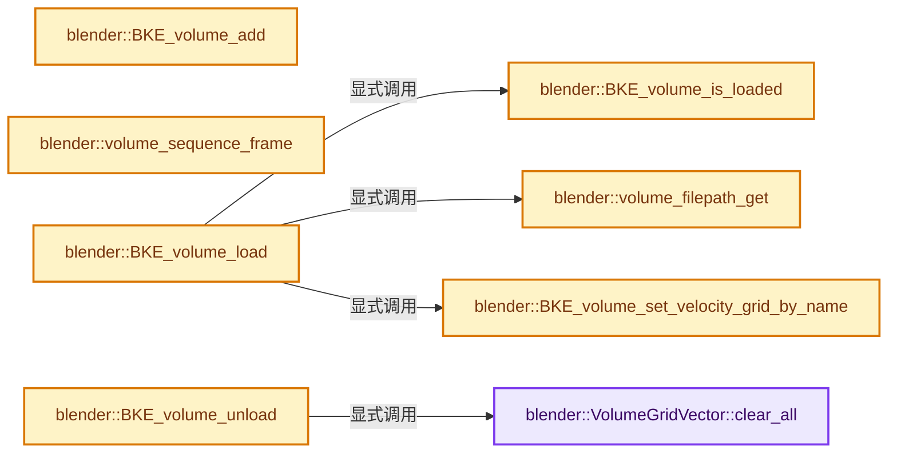
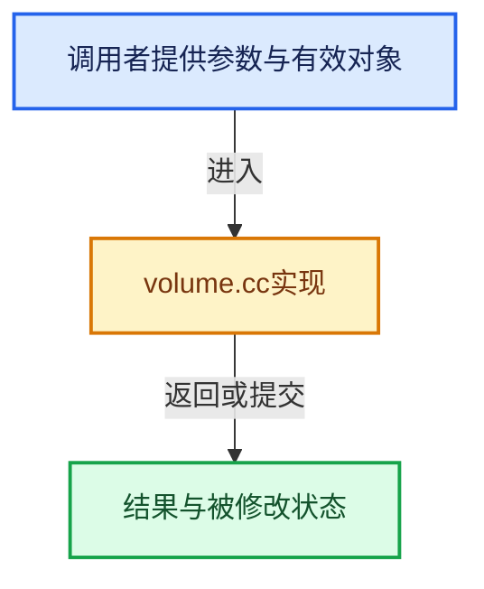

# 实现依赖专题：source/blender/blenkernel/intern/volume.cc

[实现依赖导航](../../README.md) · [符号索引](../../../00-课程指南/02-源码与提交索引/符号依赖与实现索引.md)

本专题从正文实际调用进入，集中保存共享实现。函数有稳定锚点，可从调用处直接跳到对应完整函数；递归与互相调用通过回链组织。

## 本文件的实现关系






## 完整成员与函数实现

<a id="f-e45c0c5f2eafcb74"></a>

### `blender::VolumeGridVector::clear_all`

实现位置：[source/blender/blenkernel/intern/volume.cc](../../../../../../../source/blender/blenkernel/intern/volume.cc) · L98—L104。

**教学注释版**

<!-- annotated:34f7d64b45a0a9 -->

```cpp
  void clear_all()
  {
    std::list<GVolumeGrid>::clear();
    filepath[0] = '\0';
    error_msg.clear();
    metadata.reset();
  }
```

<details>
<summary>核对原始源码：source/blender/blenkernel/intern/volume.cc · L98—L104</summary>

<!-- original:34f7d64b45a0a9:source/blender/blenkernel/intern/volume.cc:98:104 -->

```cpp
  void clear_all()
  {
    std::list<GVolumeGrid>::clear();
    filepath[0] = '\0';
    error_msg.clear();
    metadata.reset();
  }
```

</details>

**沿实际写入检查状态**

- `filepath[0] = '\0';`

**继续追踪实现**

- `std::list<GVolumeGrid>::clear` → [外部契约](https://eel.is/c++draft/)：这个边界按实际表达式及所属类型核对参数、返回值、寿命与失败行为。这里提供接口入口，不声称已解释该第三方版本的内部实现。
- `error_msg.clear` → [外部契约](https://eel.is/c++draft/)：这个边界按实际表达式及所属类型核对参数、返回值、寿命与失败行为。这里提供接口入口，不声称已解释该第三方版本的内部实现。
- `metadata.reset` → [调用协议](../../../00-课程指南/01-路线与规范/模板宏与动态分派协议.md)：由接收对象具体类型或运行时策略提供实现。调用位置L103。

<a id="f-48114f7687b31d56"></a>

### `blender::BKE_volume_add`

实现位置：[source/blender/blenkernel/intern/volume.cc](../../../../../../../source/blender/blenkernel/intern/volume.cc) · L337—L342。

接口参数：

- `Main *bmain`
- `const char *name`

**教学注释版**

<!-- annotated:cdf3c77e288e69 -->

```cpp
Volume *BKE_volume_add(Main *bmain, const char *name)
{
  Volume *volume = BKE_id_new<Volume>(bmain, name);

  return volume;
}
```

<details>
<summary>核对原始源码：source/blender/blenkernel/intern/volume.cc · L337—L342</summary>

<!-- original:cdf3c77e288e69:source/blender/blenkernel/intern/volume.cc:337:342 -->

```cpp
Volume *BKE_volume_add(Main *bmain, const char *name)
{
  Volume *volume = BKE_id_new<Volume>(bmain, name);

  return volume;
}
```

</details>

**结果出口**

- `return volume;`

**继续追踪实现**

- `BKE_id_new<Volume>` → [blender::BKE_id_new · L1612](lib_id.cc.md#f-5335c97ce0a8fbc8)。

<a id="f-6fe67a267d38a8c1"></a>

### `blender::volume_sequence_frame`

实现位置：[source/blender/blenkernel/intern/volume.cc](../../../../../../../source/blender/blenkernel/intern/volume.cc) · L346—L410。

接口参数：

- `const Depsgraph *depsgraph`
- `const Volume *volume`

**教学注释版**

<!-- annotated:c9c9601b4057a1 -->

```cpp
static int volume_sequence_frame(const Depsgraph *depsgraph, const Volume *volume)
{
  if (!volume->is_sequence) {
    return 0;
  }

  int path_frame, path_digits;
  if (!(volume->is_sequence && BLI_path_frame_get(volume->filepath, &path_frame, &path_digits))) {
    return 0;
  }

  const int scene_frame = DEG_get_ctime(depsgraph);
  const VolumeSequenceMode mode = VolumeSequenceMode(volume->sequence_mode);
  const int frame_duration = volume->frame_duration;
  const int frame_start = volume->frame_start;
  const int frame_offset = volume->frame_offset;

  if (frame_duration == 0) {
    return VOLUME_FRAME_NONE;
  }

  int frame = scene_frame - frame_start + 1;

  switch (mode) {
    case VOLUME_SEQUENCE_CLIP: {
      if (frame < 1 || frame > frame_duration) {
        return VOLUME_FRAME_NONE;
      }
      break;
    }
    case VOLUME_SEQUENCE_EXTEND: {
      frame = clamp_i(frame, 1, frame_duration);
      break;
    }
    case VOLUME_SEQUENCE_REPEAT: {
      frame = frame % frame_duration;
      if (frame < 0) {
        frame += frame_duration;
      }
      if (frame == 0) {
        frame = frame_duration;
      }
      break;
    }
    case VOLUME_SEQUENCE_PING_PONG: {
      const int pingpong_duration = frame_duration * 2 - 2;
      frame = frame % pingpong_duration;
      if (frame < 0) {
        frame += pingpong_duration;
      }
      if (frame == 0) {
        frame = pingpong_duration;
      }
      if (frame > frame_duration) {
        frame = frame_duration * 2 - frame;
      }
      break;
    }
  }

  /* Important to apply after, else we can't loop on e.g. frames 100 - 110. */
  frame += frame_offset;

  return frame;
}
```

<details>
<summary>核对原始源码：source/blender/blenkernel/intern/volume.cc · L346—L410</summary>

<!-- original:c9c9601b4057a1:source/blender/blenkernel/intern/volume.cc:346:410 -->

```cpp
static int volume_sequence_frame(const Depsgraph *depsgraph, const Volume *volume)
{
  if (!volume->is_sequence) {
    return 0;
  }

  int path_frame, path_digits;
  if (!(volume->is_sequence && BLI_path_frame_get(volume->filepath, &path_frame, &path_digits))) {
    return 0;
  }

  const int scene_frame = DEG_get_ctime(depsgraph);
  const VolumeSequenceMode mode = VolumeSequenceMode(volume->sequence_mode);
  const int frame_duration = volume->frame_duration;
  const int frame_start = volume->frame_start;
  const int frame_offset = volume->frame_offset;

  if (frame_duration == 0) {
    return VOLUME_FRAME_NONE;
  }

  int frame = scene_frame - frame_start + 1;

  switch (mode) {
    case VOLUME_SEQUENCE_CLIP: {
      if (frame < 1 || frame > frame_duration) {
        return VOLUME_FRAME_NONE;
      }
      break;
    }
    case VOLUME_SEQUENCE_EXTEND: {
      frame = clamp_i(frame, 1, frame_duration);
      break;
    }
    case VOLUME_SEQUENCE_REPEAT: {
      frame = frame % frame_duration;
      if (frame < 0) {
        frame += frame_duration;
      }
      if (frame == 0) {
        frame = frame_duration;
      }
      break;
    }
    case VOLUME_SEQUENCE_PING_PONG: {
      const int pingpong_duration = frame_duration * 2 - 2;
      frame = frame % pingpong_duration;
      if (frame < 0) {
        frame += pingpong_duration;
      }
      if (frame == 0) {
        frame = pingpong_duration;
      }
      if (frame > frame_duration) {
        frame = frame_duration * 2 - frame;
      }
      break;
    }
  }

  /* Important to apply after, else we can't loop on e.g. frames 100 - 110. */
  frame += frame_offset;

  return frame;
}
```

</details>

**沿实际写入检查状态**

- `frame = clamp_i(frame, 1, frame_duration);`
- `frame = frame % frame_duration;`
- `frame += frame_duration;`
- `frame = frame_duration;`
- `frame = frame % pingpong_duration;`
- `frame += pingpong_duration;`
- `frame = pingpong_duration;`
- `frame = frame_duration * 2 - frame;`
- `frame += frame_offset;`

**结果出口**

- `return 0;`
- `return VOLUME_FRAME_NONE;`
- `return frame;`

**继续追踪实现**

- `BLI_path_frame_get` → [BLI_path_frame_get · L1039](../../01-BLI基础库/intern/path_utils.cc.md#f-37c0762bcf95f919)。
- `DEG_get_ctime` → [blender::DEG_get_ctime · L105](../../06-Depsgraph依赖图/intern/depsgraph_query.cc.md#f-156dee0918a22f2f)。
- `VolumeSequenceMode` → [blender::VolumeSequenceMode](../../08-其他Blender模块/makesdna/DNA_volume_types.h.md#t-2de8c2893b56)。
- `clamp_i` → [blender::clamp_i · L400](../../01-BLI基础库/intern/math_base_inline.cc.md#f-e9a0b16ec537d580)。

<a id="f-6120875b3dd7c08c"></a>

### `blender::volume_filepath_get`

实现位置：[source/blender/blenkernel/intern/volume.cc](../../../../../../../source/blender/blenkernel/intern/volume.cc) · L413—L425。

接口参数：

- `const Main *bmain`
- `const Volume *volume`
- `char r_filepath[FILE_MAX]`

**教学注释版**

<!-- annotated:b9e3a57be6e27e -->

```cpp
static void volume_filepath_get(const Main *bmain, const Volume *volume, char r_filepath[FILE_MAX])
{
  BLI_strncpy(r_filepath, volume->filepath, FILE_MAX);
  BLI_path_abs(r_filepath, ID_BLEND_PATH(bmain, &volume->id));

  int path_frame, path_digits;
  if (volume->is_sequence && BLI_path_frame_get(r_filepath, &path_frame, &path_digits)) {
    char ext[32];
    BLI_path_frame_strip(r_filepath, ext, sizeof(ext));
    BLI_path_frame(r_filepath, FILE_MAX, volume->runtime->frame, path_digits);
    BLI_path_extension_ensure(r_filepath, FILE_MAX, ext);
  }
}
```

<details>
<summary>核对原始源码：source/blender/blenkernel/intern/volume.cc · L413—L425</summary>

<!-- original:b9e3a57be6e27e:source/blender/blenkernel/intern/volume.cc:413:425 -->

```cpp
static void volume_filepath_get(const Main *bmain, const Volume *volume, char r_filepath[FILE_MAX])
{
  BLI_strncpy(r_filepath, volume->filepath, FILE_MAX);
  BLI_path_abs(r_filepath, ID_BLEND_PATH(bmain, &volume->id));

  int path_frame, path_digits;
  if (volume->is_sequence && BLI_path_frame_get(r_filepath, &path_frame, &path_digits)) {
    char ext[32];
    BLI_path_frame_strip(r_filepath, ext, sizeof(ext));
    BLI_path_frame(r_filepath, FILE_MAX, volume->runtime->frame, path_digits);
    BLI_path_extension_ensure(r_filepath, FILE_MAX, ext);
  }
}
```

</details>

**继续追踪实现**

- `BLI_strncpy` → [blender::BLI_strncpy · L70](../../01-BLI基础库/intern/string.cc.md#f-6324147b0d116da1)。
- `BLI_path_abs` → [BLI_path_abs · L1164](../../01-BLI基础库/intern/path_utils.cc.md#f-002380948c1caeb6)。
- `ID_BLEND_PATH` → [ID_BLEND_PATH · L688](../../08-其他Blender模块/makesdna/DNA_ID.h.md#m-c69d4e48d3fd)。宏定义由构建条件选择。
- `BLI_path_frame_get` → [BLI_path_frame_get · L1039](../../01-BLI基础库/intern/path_utils.cc.md#f-37c0762bcf95f919)。
- `BLI_path_frame_strip` → [BLI_path_frame_strip · L1075](../../01-BLI基础库/intern/path_utils.cc.md#f-7bf09c39891f1b39)。
- `BLI_path_frame` → [BLI_path_frame · L999](../../01-BLI基础库/intern/path_utils.cc.md#f-86ecc33491f04e49)。
- `BLI_path_extension_ensure` → [BLI_path_extension_ensure · L1596](../../01-BLI基础库/intern/path_utils.cc.md#f-8253818a36b0a79e)。

<a id="f-20896961569408da"></a>

### `blender::BKE_volume_is_loaded`

实现位置：[source/blender/blenkernel/intern/volume.cc](../../../../../../../source/blender/blenkernel/intern/volume.cc) · L430—L439。

接口参数：

- `const Volume *volume`

**教学注释版**

<!-- annotated:36d0bbd1166c8a -->

```cpp
bool BKE_volume_is_loaded(const Volume *volume)
{
#ifdef WITH_OPENVDB
  /* Test if there is a file to load, or if already loaded. */
  return (volume->filepath[0] == '\0' || volume->runtime->grids->is_loaded());
#else
  UNUSED_VARS(volume);
  return true;
#endif
}
```

<details>
<summary>核对原始源码：source/blender/blenkernel/intern/volume.cc · L430—L439</summary>

<!-- original:36d0bbd1166c8a:source/blender/blenkernel/intern/volume.cc:430:439 -->

```cpp
bool BKE_volume_is_loaded(const Volume *volume)
{
#ifdef WITH_OPENVDB
  /* Test if there is a file to load, or if already loaded. */
  return (volume->filepath[0] == '\0' || volume->runtime->grids->is_loaded());
#else
  UNUSED_VARS(volume);
  return true;
#endif
}
```

</details>

**结果出口**

- `return (volume->filepath[0] == '\0' || volume->runtime->grids->is_loaded());`
- `return true;`

**继续追踪实现**

- `volume->runtime->grids->is_loaded` → [调用协议](../../../00-课程指南/01-路线与规范/模板宏与动态分派协议.md)：接收对象类型依赖auto、返回值或模板实例；不按同名猜测目标。调用位置L434。
- `UNUSED_VARS` → [UNUSED_VARS · L522](../../01-BLI基础库/BLI_utildefines.hh.md#m-013582537634)；[UNUSED_VARS · L41](../../08-其他Blender模块/gpu/GPU_shader_shared_utils.hh.md#m-05d9d7a33da0)；[UNUSED_VARS · L62](../../08-其他Blender模块/gpu/GPU_shader_shared_utils.hh.md#m-e12c683a4aca)。宏定义由构建条件选择。

<a id="f-209b0d82490d5e63"></a>

### `blender::BKE_volume_set_velocity_grid_by_name`

实现位置：[source/blender/blenkernel/intern/volume.cc](../../../../../../../source/blender/blenkernel/intern/volume.cc) · L441—L484。

接口参数：

- `Volume *volume`
- `const StringRef ref_base_name`

**教学注释版**

<!-- annotated:b6c86f534f60ba -->

```cpp
bool BKE_volume_set_velocity_grid_by_name(Volume *volume, const StringRef ref_base_name)
{
  const std::string base_name = ref_base_name;

  if (BKE_volume_grid_find(volume, base_name)) {
    STRNCPY(volume->velocity_grid, base_name.c_str());
    volume->runtime->velocity_x_grid[0] = '\0';
    volume->runtime->velocity_y_grid[0] = '\0';
    volume->runtime->velocity_z_grid[0] = '\0';
    return true;
  }

  /* It could be that the velocity grid is split in multiple grids, try with known postfixes. */
  const StringRefNull postfixes[][3] = {{"x", "y", "z"}, {".x", ".y", ".z"}, {"_x", "_y", "_z"}};

  for (const StringRefNull *postfix : postfixes) {
    bool found = true;
    for (int i = 0; i < 3; i++) {
      std::string post_fixed_name = ref_base_name + postfix[i];
      if (!BKE_volume_grid_find(volume, post_fixed_name)) {
        found = false;
        break;
      }
    }

    if (!found) {
      continue;
    }

    /* Save the base name as well. */
    STRNCPY(volume->velocity_grid, base_name.c_str());
    STRNCPY(volume->runtime->velocity_x_grid, (ref_base_name + postfix[0]).c_str());
    STRNCPY(volume->runtime->velocity_y_grid, (ref_base_name + postfix[1]).c_str());
    STRNCPY(volume->runtime->velocity_z_grid, (ref_base_name + postfix[2]).c_str());
    return true;
  }

  /* Reset to avoid potential issues. */
  volume->velocity_grid[0] = '\0';
  volume->runtime->velocity_x_grid[0] = '\0';
  volume->runtime->velocity_y_grid[0] = '\0';
  volume->runtime->velocity_z_grid[0] = '\0';
  return false;
}
```

<details>
<summary>核对原始源码：source/blender/blenkernel/intern/volume.cc · L441—L484</summary>

<!-- original:b6c86f534f60ba:source/blender/blenkernel/intern/volume.cc:441:484 -->

```cpp
bool BKE_volume_set_velocity_grid_by_name(Volume *volume, const StringRef ref_base_name)
{
  const std::string base_name = ref_base_name;

  if (BKE_volume_grid_find(volume, base_name)) {
    STRNCPY(volume->velocity_grid, base_name.c_str());
    volume->runtime->velocity_x_grid[0] = '\0';
    volume->runtime->velocity_y_grid[0] = '\0';
    volume->runtime->velocity_z_grid[0] = '\0';
    return true;
  }

  /* It could be that the velocity grid is split in multiple grids, try with known postfixes. */
  const StringRefNull postfixes[][3] = {{"x", "y", "z"}, {".x", ".y", ".z"}, {"_x", "_y", "_z"}};

  for (const StringRefNull *postfix : postfixes) {
    bool found = true;
    for (int i = 0; i < 3; i++) {
      std::string post_fixed_name = ref_base_name + postfix[i];
      if (!BKE_volume_grid_find(volume, post_fixed_name)) {
        found = false;
        break;
      }
    }

    if (!found) {
      continue;
    }

    /* Save the base name as well. */
    STRNCPY(volume->velocity_grid, base_name.c_str());
    STRNCPY(volume->runtime->velocity_x_grid, (ref_base_name + postfix[0]).c_str());
    STRNCPY(volume->runtime->velocity_y_grid, (ref_base_name + postfix[1]).c_str());
    STRNCPY(volume->runtime->velocity_z_grid, (ref_base_name + postfix[2]).c_str());
    return true;
  }

  /* Reset to avoid potential issues. */
  volume->velocity_grid[0] = '\0';
  volume->runtime->velocity_x_grid[0] = '\0';
  volume->runtime->velocity_y_grid[0] = '\0';
  volume->runtime->velocity_z_grid[0] = '\0';
  return false;
}
```

</details>

**沿实际写入检查状态**

- `volume->runtime->velocity_x_grid[0] = '\0';`
- `volume->runtime->velocity_y_grid[0] = '\0';`
- `volume->runtime->velocity_z_grid[0] = '\0';`
- `found = false;`
- `volume->velocity_grid[0] = '\0';`

**结果出口**

- `return true;`
- `return false;`

**继续追踪实现**

- `BKE_volume_grid_find` → [blender::BKE_volume_grid_find · L929](volume.cc.md#f-608bcd50b8731ea5)。
- `STRNCPY` → [blender::STRNCPY · L690](../../01-BLI基础库/BLI_string.hh.md#f-6b2d861724026be6)。
- `base_name.c_str` → [外部契约](https://eel.is/c++draft/)：这个边界按实际表达式及所属类型核对参数、返回值、寿命与失败行为。这里提供接口入口，不声称已解释该第三方版本的内部实现。
- `(ref_base_name + postfix[0]).c_str` → [调用协议](../../../00-课程指南/01-路线与规范/模板宏与动态分派协议.md)：接收对象类型依赖auto、返回值或模板实例；不按同名猜测目标。调用位置L472。
- `(ref_base_name + postfix[1]).c_str` → [调用协议](../../../00-课程指南/01-路线与规范/模板宏与动态分派协议.md)：接收对象类型依赖auto、返回值或模板实例；不按同名猜测目标。调用位置L473。
- `(ref_base_name + postfix[2]).c_str` → [调用协议](../../../00-课程指南/01-路线与规范/模板宏与动态分派协议.md)：接收对象类型依赖auto、返回值或模板实例；不按同名猜测目标。调用位置L474。

<a id="f-8e25dd9f84cc04f9"></a>

### `blender::BKE_volume_load`

实现位置：[source/blender/blenkernel/intern/volume.cc](../../../../../../../source/blender/blenkernel/intern/volume.cc) · L486—L553。

接口参数：

- `const Volume *volume`
- `const Main *bmain`

**教学注释版**

<!-- annotated:2415c5321618ab -->

```cpp
bool BKE_volume_load(const Volume *volume, const Main *bmain)
{
#ifdef WITH_OPENVDB
  const VolumeGridVector &const_grids = *volume->runtime->grids;

  if (volume->runtime->frame == VOLUME_FRAME_NONE) {
    /* Skip loading this frame, outside of sequence range. */
    return true;
  }

  if (BKE_volume_is_loaded(volume)) {
    return const_grids.error_msg.empty();
  }

  /* Double-checked lock. */
  std::lock_guard lock(const_grids.mutex);
  if (BKE_volume_is_loaded(volume)) {
    return const_grids.error_msg.empty();
  }

  /* Guarded by the lock, we can continue to access the grid vector,
   * adding error messages or a new grid, etc. */
  VolumeGridVector &grids = const_cast<VolumeGridVector &>(const_grids);

  /* Get absolute file path at current frame. */
  const char *volume_name = volume->id.name + 2;
  char filepath[FILE_MAX];
  volume_filepath_get(bmain, volume, filepath);

  CLOG_INFO(&LOG, "Volume %s: load %s", volume_name, filepath);

  /* Test if file exists. */
  if (!BLI_exists(filepath)) {
    grids.error_msg = BLI_path_basename(filepath) + std::string(" not found");
    CLOG_INFO(&LOG, "Volume %s: %s", volume_name, grids.error_msg.c_str());
    return false;
  }

  bke::volume_grid::file_cache::GridsFromFile grids_from_file =
      bke::volume_grid::file_cache::get_all_grids_from_file(filepath, 0);

  if (!grids_from_file.error_message.empty()) {
    grids.error_msg = grids_from_file.error_message;
    CLOG_INFO(&LOG, "Volume %s: %s", volume_name, grids.error_msg.c_str());
    return false;
  }

  // [讲解] std::move：把表达式转换成可供移动重载选择的值类别；不保证真的移动，不结束源对象寿命，对const值可能选择复制。
  grids.metadata = std::move(grids_from_file.file_meta_data);
  for (GVolumeGrid &volume_grid : grids_from_file.grids) {
    grids.emplace_back(std::move(volume_grid));
  }

  /* Try to detect the velocity grid. */
  const char *common_velocity_names[] = {"velocity", "vel", "v"};
  for (const char *common_velocity_name : common_velocity_names) {
    if (BKE_volume_set_velocity_grid_by_name(const_cast<Volume *>(volume), common_velocity_name)) {
      break;
    }
  }

  STRNCPY(grids.filepath, filepath);

  return grids.error_msg.empty();
#else
  UNUSED_VARS(bmain, volume);
  return true;
#endif
}
```

<details>
<summary>核对原始源码：source/blender/blenkernel/intern/volume.cc · L486—L553</summary>

<!-- original:2415c5321618ab:source/blender/blenkernel/intern/volume.cc:486:553 -->

```cpp
bool BKE_volume_load(const Volume *volume, const Main *bmain)
{
#ifdef WITH_OPENVDB
  const VolumeGridVector &const_grids = *volume->runtime->grids;

  if (volume->runtime->frame == VOLUME_FRAME_NONE) {
    /* Skip loading this frame, outside of sequence range. */
    return true;
  }

  if (BKE_volume_is_loaded(volume)) {
    return const_grids.error_msg.empty();
  }

  /* Double-checked lock. */
  std::lock_guard lock(const_grids.mutex);
  if (BKE_volume_is_loaded(volume)) {
    return const_grids.error_msg.empty();
  }

  /* Guarded by the lock, we can continue to access the grid vector,
   * adding error messages or a new grid, etc. */
  VolumeGridVector &grids = const_cast<VolumeGridVector &>(const_grids);

  /* Get absolute file path at current frame. */
  const char *volume_name = volume->id.name + 2;
  char filepath[FILE_MAX];
  volume_filepath_get(bmain, volume, filepath);

  CLOG_INFO(&LOG, "Volume %s: load %s", volume_name, filepath);

  /* Test if file exists. */
  if (!BLI_exists(filepath)) {
    grids.error_msg = BLI_path_basename(filepath) + std::string(" not found");
    CLOG_INFO(&LOG, "Volume %s: %s", volume_name, grids.error_msg.c_str());
    return false;
  }

  bke::volume_grid::file_cache::GridsFromFile grids_from_file =
      bke::volume_grid::file_cache::get_all_grids_from_file(filepath, 0);

  if (!grids_from_file.error_message.empty()) {
    grids.error_msg = grids_from_file.error_message;
    CLOG_INFO(&LOG, "Volume %s: %s", volume_name, grids.error_msg.c_str());
    return false;
  }

  grids.metadata = std::move(grids_from_file.file_meta_data);
  for (GVolumeGrid &volume_grid : grids_from_file.grids) {
    grids.emplace_back(std::move(volume_grid));
  }

  /* Try to detect the velocity grid. */
  const char *common_velocity_names[] = {"velocity", "vel", "v"};
  for (const char *common_velocity_name : common_velocity_names) {
    if (BKE_volume_set_velocity_grid_by_name(const_cast<Volume *>(volume), common_velocity_name)) {
      break;
    }
  }

  STRNCPY(grids.filepath, filepath);

  return grids.error_msg.empty();
#else
  UNUSED_VARS(bmain, volume);
  return true;
#endif
}
```

</details>

**沿实际写入检查状态**

- `grids.error_msg = BLI_path_basename(filepath) + std::string(" not found");`
- `grids.error_msg = grids_from_file.error_message;`
- `grids.metadata = std::move(grids_from_file.file_meta_data);`

**结果出口**

- `return true;`
- `return const_grids.error_msg.empty();`
- `return false;`
- `return grids.error_msg.empty();`

**继续追踪实现**

- `BKE_volume_is_loaded` → [blender::BKE_volume_is_loaded · L430](volume.cc.md#f-20896961569408da)。
- `const_grids.error_msg.empty` → [调用协议](../../../00-课程指南/01-路线与规范/模板宏与动态分派协议.md)：接收对象类型依赖auto、返回值或模板实例；不按同名猜测目标。调用位置L497。
- `volume_filepath_get` → [blender::volume_filepath_get · L413](volume.cc.md#f-6120875b3dd7c08c)。
- `CLOG_INFO` → [CLOG_INFO · L190](../../07-Intern运行时与平台/clog/CLG_log.h.md#m-f8b5efdfcc0f)。宏定义由构建条件选择。
- `BLI_exists` → [blender::BLI_exists · L404](../../01-BLI基础库/intern/storage.cc.md#f-a84afb14d0277334)。
- `BLI_path_basename` → [BLI_path_basename · L1847](../../01-BLI基础库/intern/path_utils.cc.md#f-1b9bc48bebf9dfcd)。
- `std::string` → [外部契约](https://eel.is/c++draft/)：这个边界按实际表达式及所属类型核对参数、返回值、寿命与失败行为。这里提供接口入口，不声称已解释该第三方版本的内部实现。
- `grids.error_msg.c_str` → [调用协议](../../../00-课程指南/01-路线与规范/模板宏与动态分派协议.md)：接收对象类型依赖auto、返回值或模板实例；不按同名猜测目标。调用位置L520。
- `bke::volume_grid::file_cache::get_all_grids_from_file` → [blender::bke::volume_grid::file_cache::get_all_grids_from_file · L289](volume_grid_file_cache.cc.md#f-4e9ea5bd2089509c)。
- `grids_from_file.error_message.empty` → [调用协议](../../../00-课程指南/01-路线与规范/模板宏与动态分派协议.md)：接收对象类型依赖auto、返回值或模板实例；不按同名猜测目标。调用位置L527。
- `std::move` → [外部契约](https://eel.is/c++draft/utility.forward)：把表达式转换成可供移动重载选择的值类别；不保证真的移动，不结束源对象寿命，对const值可能选择复制。
- `grids.emplace_back` → [调用协议](../../../00-课程指南/01-路线与规范/模板宏与动态分派协议.md)：由接收对象具体类型或运行时策略提供实现。调用位置L535。
- `BKE_volume_set_velocity_grid_by_name` → [blender::BKE_volume_set_velocity_grid_by_name · L441](volume.cc.md#f-209b0d82490d5e63)。
- `STRNCPY` → [blender::STRNCPY · L690](../../01-BLI基础库/BLI_string.hh.md#f-6b2d861724026be6)。
- `grids.error_msg.empty` → [调用协议](../../../00-课程指南/01-路线与规范/模板宏与动态分派协议.md)：接收对象类型依赖auto、返回值或模板实例；不按同名猜测目标。调用位置L548。
- `UNUSED_VARS` → [UNUSED_VARS · L522](../../01-BLI基础库/BLI_utildefines.hh.md#m-013582537634)；[UNUSED_VARS · L41](../../08-其他Blender模块/gpu/GPU_shader_shared_utils.hh.md#m-05d9d7a33da0)；[UNUSED_VARS · L62](../../08-其他Blender模块/gpu/GPU_shader_shared_utils.hh.md#m-e12c683a4aca)。宏定义由构建条件选择。

<a id="f-c82ca11f7c3595d8"></a>

### `blender::BKE_volume_unload`

实现位置：[source/blender/blenkernel/intern/volume.cc](../../../../../../../source/blender/blenkernel/intern/volume.cc) · L555—L567。

接口参数：

- `Volume *volume`

**教学注释版**

<!-- annotated:88e1d91fa4e315 -->

```cpp
void BKE_volume_unload(Volume *volume)
{
#ifdef WITH_OPENVDB
  VolumeGridVector &grids = *volume->runtime->grids;
  if (grids.filepath[0] != '\0') {
    const char *volume_name = volume->id.name + 2;
    CLOG_INFO(&LOG, "Volume %s: unload", volume_name);
    grids.clear_all();
  }
#else
  UNUSED_VARS(volume);
#endif
}
```

<details>
<summary>核对原始源码：source/blender/blenkernel/intern/volume.cc · L555—L567</summary>

<!-- original:88e1d91fa4e315:source/blender/blenkernel/intern/volume.cc:555:567 -->

```cpp
void BKE_volume_unload(Volume *volume)
{
#ifdef WITH_OPENVDB
  VolumeGridVector &grids = *volume->runtime->grids;
  if (grids.filepath[0] != '\0') {
    const char *volume_name = volume->id.name + 2;
    CLOG_INFO(&LOG, "Volume %s: unload", volume_name);
    grids.clear_all();
  }
#else
  UNUSED_VARS(volume);
#endif
}
```

</details>

**继续追踪实现**

- `CLOG_INFO` → [CLOG_INFO · L190](../../07-Intern运行时与平台/clog/CLG_log.h.md#m-f8b5efdfcc0f)。宏定义由构建条件选择。
- `grids.clear_all` → [blender::VolumeGridVector::clear_all · L98](volume.cc.md#f-e45c0c5f2eafcb74)。
- `UNUSED_VARS` → [UNUSED_VARS · L522](../../01-BLI基础库/BLI_utildefines.hh.md#m-013582537634)；[UNUSED_VARS · L41](../../08-其他Blender模块/gpu/GPU_shader_shared_utils.hh.md#m-05d9d7a33da0)；[UNUSED_VARS · L62](../../08-其他Blender模块/gpu/GPU_shader_shared_utils.hh.md#m-e12c683a4aca)。宏定义由构建条件选择。

<a id="f-0fcf2afc72eedde9"></a>

### `blender::BKE_volume_min_max`

实现位置：[source/blender/blenkernel/intern/volume.cc](../../../../../../../source/blender/blenkernel/intern/volume.cc) · L627—L646。

接口参数：

- `const Volume *volume`

**教学注释版**

<!-- annotated:42e03bbbbcaaa0 -->

```cpp
std::optional<Bounds<float3>> BKE_volume_min_max(const Volume *volume)
{
#ifdef WITH_OPENVDB
  /* TODO: if we know the volume is going to be displayed, it may be good to
   * load it as part of dependency graph evaluation for better threading. We
   * could also share the bounding box computation in the global volume cache. */
  if (BKE_volume_load(const_cast<Volume *>(volume), G.main)) {
    std::optional<Bounds<float3>> result;
    for (const int i : IndexRange(BKE_volume_num_grids(volume))) {
      const bke::VolumeGridData *volume_grid = BKE_volume_grid_get(volume, i);
      bke::VolumeTreeAccessToken tree_token;
      result = bounds::merge(result, BKE_volume_grid_bounds(volume_grid->grid_ptr(tree_token)));
    }
    return result;
  }
#else
  UNUSED_VARS(volume);
#endif
  return std::nullopt;
}
```

<details>
<summary>核对原始源码：source/blender/blenkernel/intern/volume.cc · L627—L646</summary>

<!-- original:42e03bbbbcaaa0:source/blender/blenkernel/intern/volume.cc:627:646 -->

```cpp
std::optional<Bounds<float3>> BKE_volume_min_max(const Volume *volume)
{
#ifdef WITH_OPENVDB
  /* TODO: if we know the volume is going to be displayed, it may be good to
   * load it as part of dependency graph evaluation for better threading. We
   * could also share the bounding box computation in the global volume cache. */
  if (BKE_volume_load(const_cast<Volume *>(volume), G.main)) {
    std::optional<Bounds<float3>> result;
    for (const int i : IndexRange(BKE_volume_num_grids(volume))) {
      const bke::VolumeGridData *volume_grid = BKE_volume_grid_get(volume, i);
      bke::VolumeTreeAccessToken tree_token;
      result = bounds::merge(result, BKE_volume_grid_bounds(volume_grid->grid_ptr(tree_token)));
    }
    return result;
  }
#else
  UNUSED_VARS(volume);
#endif
  return std::nullopt;
}
```

</details>

**沿实际写入检查状态**

- `result = bounds::merge(result, BKE_volume_grid_bounds(volume_grid->grid_ptr(tree_token)));`

**结果出口**

- `return result;`
- `return std::nullopt;`

**继续追踪实现**

- `BKE_volume_load` → [blender::BKE_volume_load · L486](volume.cc.md#f-8e25dd9f84cc04f9)。
- `IndexRange` → [blender::IndexRange](../../01-BLI基础库/BLI_index_range.hh.md#t-caa3466d6776)；[blender::gpu::shader::parser::IndexRange](../../08-其他Blender模块/gpu/shader_tool/utils.hh.md#t-82d2bd4ea71c)；[blender::IndexRange](../../08-其他Blender模块/makesdna/DNA_node_types.h.md#t-0448cc889d39)。
- `BKE_volume_num_grids` → [blender::BKE_volume_num_grids · L856](volume.cc.md#f-bba3632a80fe4c9d)。
- `BKE_volume_grid_get` → [blender::BKE_volume_grid_get · L886](volume.cc.md#f-b611470fb70eeaba)。
- `bounds::merge` → [blender::bounds::merge · L27](../../../12-空间数据结构与几何算法/07-Bounds与BVH对比.md#f-26dade32771df176)；[blender::bounds::merge · L32](../../../12-空间数据结构与几何算法/07-Bounds与BVH对比.md#f-f539fea5d229191a)；[blender::bounds::merge · L48](../../../12-空间数据结构与几何算法/07-Bounds与BVH对比.md#f-34b53687690dd2a5)。同名重载需按实参类型选择。
- `BKE_volume_grid_bounds` → [blender::BKE_volume_grid_bounds · L1089](volume.cc.md#f-af168fa0efa39bdf)。
- `volume_grid->grid_ptr` → [blender::bke::volume_grid::VolumeGridData::grid_ptr · L95](volume_grid.cc.md#f-b7ec9a3e99e6695c)。
- `UNUSED_VARS` → [UNUSED_VARS · L522](../../01-BLI基础库/BLI_utildefines.hh.md#m-013582537634)；[UNUSED_VARS · L41](../../08-其他Blender模块/gpu/GPU_shader_shared_utils.hh.md#m-05d9d7a33da0)；[UNUSED_VARS · L62](../../08-其他Blender模块/gpu/GPU_shader_shared_utils.hh.md#m-e12c683a4aca)。宏定义由构建条件选择。

<a id="f-2a58ed1031c9ea47"></a>

### `blender::volume_update_simplify_level`

实现位置：[source/blender/blenkernel/intern/volume.cc](../../../../../../../source/blender/blenkernel/intern/volume.cc) · L687—L707。

接口参数：

- `Main *bmain`
- `Volume *volume`
- `const Depsgraph *depsgraph`

**教学注释版**

<!-- annotated:f2859d604a92bb -->

```cpp
static void volume_update_simplify_level(Main *bmain, Volume *volume, const Depsgraph *depsgraph)
{
#ifdef WITH_OPENVDB
  const int simplify_level = BKE_volume_simplify_level(depsgraph);

  /* Replace grids with the new simplify level variants from the cache. */
  if (BKE_volume_load(volume, bmain)) {
    VolumeGridVector &grids = *volume->runtime->grids;
    std::list<GVolumeGrid> new_grids;
    for (const GVolumeGrid &old_grid : grids) {
      GVolumeGrid simple_grid = bke::volume_grid::file_cache::get_grid_from_file(
          grids.filepath, old_grid->name(), simplify_level);
      BLI_assert(simple_grid);
      // [讲解] std::move：把表达式转换成可供移动重载选择的值类别；不保证真的移动，不结束源对象寿命，对const值可能选择复制。
      new_grids.push_back(std::move(simple_grid));
    }
    grids.swap(new_grids);
  }
#else
  UNUSED_VARS(bmain, volume, depsgraph);
#endif
}
```

<details>
<summary>核对原始源码：source/blender/blenkernel/intern/volume.cc · L687—L707</summary>

<!-- original:f2859d604a92bb:source/blender/blenkernel/intern/volume.cc:687:707 -->

```cpp
static void volume_update_simplify_level(Main *bmain, Volume *volume, const Depsgraph *depsgraph)
{
#ifdef WITH_OPENVDB
  const int simplify_level = BKE_volume_simplify_level(depsgraph);

  /* Replace grids with the new simplify level variants from the cache. */
  if (BKE_volume_load(volume, bmain)) {
    VolumeGridVector &grids = *volume->runtime->grids;
    std::list<GVolumeGrid> new_grids;
    for (const GVolumeGrid &old_grid : grids) {
      GVolumeGrid simple_grid = bke::volume_grid::file_cache::get_grid_from_file(
          grids.filepath, old_grid->name(), simplify_level);
      BLI_assert(simple_grid);
      new_grids.push_back(std::move(simple_grid));
    }
    grids.swap(new_grids);
  }
#else
  UNUSED_VARS(bmain, volume, depsgraph);
#endif
}
```

</details>

**继续追踪实现**

- `BKE_volume_simplify_level` → [blender::BKE_volume_simplify_level · L1058](volume.cc.md#f-fa578c63066d63b5)。
- `BKE_volume_load` → [blender::BKE_volume_load · L486](volume.cc.md#f-8e25dd9f84cc04f9)。
- `bke::volume_grid::file_cache::get_grid_from_file` → [blender::bke::volume_grid::file_cache::get_grid_from_file · L276](volume_grid_file_cache.cc.md#f-5a5a0153c1661f12)。
- `old_grid->name` → [调用协议](../../../00-课程指南/01-路线与规范/模板宏与动态分派协议.md)：接收对象类型依赖auto、返回值或模板实例；不按同名猜测目标。调用位置L698。
- `BLI_assert` → [BLI_assert · L48](../../01-BLI基础库/BLI_assert.hh.md#m-57a88495704d)；[BLI_assert · L63](../../01-BLI基础库/BLI_assert.hh.md#m-d07050020cb5)。宏定义由构建条件选择。
- `new_grids.push_back` → [外部契约](https://eel.is/c++draft/)：这个边界按实际表达式及所属类型核对参数、返回值、寿命与失败行为。这里提供接口入口，不声称已解释该第三方版本的内部实现。
- `std::move` → [外部契约](https://eel.is/c++draft/utility.forward)：把表达式转换成可供移动重载选择的值类别；不保证真的移动，不结束源对象寿命，对const值可能选择复制。
- `grids.swap` → [swap · L61](../../01-BLI基础库/intern/sort.cc.md#m-43784d4732ac)。宏定义由构建条件选择。
- `UNUSED_VARS` → [UNUSED_VARS · L522](../../01-BLI基础库/BLI_utildefines.hh.md#m-013582537634)；[UNUSED_VARS · L41](../../08-其他Blender模块/gpu/GPU_shader_shared_utils.hh.md#m-05d9d7a33da0)；[UNUSED_VARS · L62](../../08-其他Blender模块/gpu/GPU_shader_shared_utils.hh.md#m-e12c683a4aca)。宏定义由构建条件选择。

<a id="f-0f72aa3b8348013b"></a>

### `blender::volume_evaluate_modifiers`

实现位置：[source/blender/blenkernel/intern/volume.cc](../../../../../../../source/blender/blenkernel/intern/volume.cc) · L709—L741。

接口参数：

- `Depsgraph *depsgraph`
- `Scene *scene`
- `Object *object`
- `bke::GeometrySet &geometry_set`

**教学注释版**

<!-- annotated:ce685553ac30c4 -->

```cpp
static void volume_evaluate_modifiers(Depsgraph *depsgraph,
                                      Scene *scene,
                                      Object *object,
                                      bke::GeometrySet &geometry_set)
{
  /* Modifier evaluation modes. */
  const bool use_render = (DEG_get_mode(depsgraph) == DAG_EVAL_RENDER);
  const int required_mode = use_render ? eModifierMode_Render : eModifierMode_Realtime;
  ModifierApplyFlag apply_flag = use_render ? MOD_APPLY_RENDER : MOD_APPLY_USECACHE;
  const ModifierEvalContext mectx = {depsgraph, object, apply_flag};

  BKE_modifiers_clear_errors(object);

  /* Get effective list of modifiers to execute. Some effects like shape keys
   * are added as virtual modifiers before the user created modifiers. */
  VirtualModifierData virtual_modifier_data;
  ModifierData *md = BKE_modifiers_get_virtual_modifierlist(object, &virtual_modifier_data);

  /* Evaluate modifiers. */
  for (; md; md = md->next) {
    const ModifierTypeInfo *mti = BKE_modifier_get_info(md->type);

    if (!BKE_modifier_is_enabled(scene, md, required_mode)) {
      continue;
    }

    bke::ScopedModifierTimer modifier_timer{*md};

    if (mti->modify_geometry_set) {
      mti->modify_geometry_set(md, &mectx, &geometry_set);
    }
  }
}
```

<details>
<summary>核对原始源码：source/blender/blenkernel/intern/volume.cc · L709—L741</summary>

<!-- original:ce685553ac30c4:source/blender/blenkernel/intern/volume.cc:709:741 -->

```cpp
static void volume_evaluate_modifiers(Depsgraph *depsgraph,
                                      Scene *scene,
                                      Object *object,
                                      bke::GeometrySet &geometry_set)
{
  /* Modifier evaluation modes. */
  const bool use_render = (DEG_get_mode(depsgraph) == DAG_EVAL_RENDER);
  const int required_mode = use_render ? eModifierMode_Render : eModifierMode_Realtime;
  ModifierApplyFlag apply_flag = use_render ? MOD_APPLY_RENDER : MOD_APPLY_USECACHE;
  const ModifierEvalContext mectx = {depsgraph, object, apply_flag};

  BKE_modifiers_clear_errors(object);

  /* Get effective list of modifiers to execute. Some effects like shape keys
   * are added as virtual modifiers before the user created modifiers. */
  VirtualModifierData virtual_modifier_data;
  ModifierData *md = BKE_modifiers_get_virtual_modifierlist(object, &virtual_modifier_data);

  /* Evaluate modifiers. */
  for (; md; md = md->next) {
    const ModifierTypeInfo *mti = BKE_modifier_get_info(md->type);

    if (!BKE_modifier_is_enabled(scene, md, required_mode)) {
      continue;
    }

    bke::ScopedModifierTimer modifier_timer{*md};

    if (mti->modify_geometry_set) {
      mti->modify_geometry_set(md, &mectx, &geometry_set);
    }
  }
}
```

</details>

**继续追踪实现**

- `DEG_get_mode` → [blender::DEG_get_mode · L99](../../06-Depsgraph依赖图/intern/depsgraph_query.cc.md#f-fa117f51322cd95c)。
- `BKE_modifiers_clear_errors` → [blender::BKE_modifiers_clear_errors · L282](modifier.cc.md#f-aeccb28cb209861b)。
- `BKE_modifiers_get_virtual_modifierlist` → [blender::BKE_modifiers_get_virtual_modifierlist · L620](modifier.cc.md#f-47967058788364c5)。
- `BKE_modifier_get_info` → [blender::BKE_modifier_get_info · L120](modifier.cc.md#f-88218d6d450f0291)。
- `BKE_modifier_is_enabled` → [blender::BKE_modifier_is_enabled · L529](modifier.cc.md#f-1debd86d0fcbcc8e)。
- `mti->modify_geometry_set` → [blender::modify_geometry_set · L243](../../08-其他Blender模块/modifiers/intern/MOD_grease_pencil_noise.cc.md#f-230f261ee5b301b9)；[blender::modify_geometry_set · L218](../../08-其他Blender模块/modifiers/intern/MOD_grease_pencil_multiply.cc.md#f-20b39fa517056ba3)；[blender::modify_geometry_set · L184](../../08-其他Blender模块/modifiers/intern/MOD_grease_pencil_mirror.cc.md#f-3dc669ce25b45890)；[blender::modify_geometry_set · L303](../../08-其他Blender模块/modifiers/intern/MOD_volume_displace.cc.md#f-ebaffe948c472b25)；[blender::modify_geometry_set · L245](../../08-其他Blender模块/modifiers/intern/MOD_grease_pencil_length.cc.md#f-115999e601704e66)；[blender::modify_geometry_set · L127](../../08-其他Blender模块/modifiers/intern/MOD_grease_pencil_lattice.cc.md#f-08d3356602673303)；[blender::modify_geometry_set · L237](../../08-其他Blender模块/modifiers/intern/MOD_grease_pencil_hook.cc.md#f-7d8cba698be3f21f)；[blender::modify_geometry_set · L648](../../08-其他Blender模块/modifiers/intern/MOD_grease_pencil_envelope.cc.md#f-89a88be68c707af7)；[blender::modify_geometry_set · L383](../../08-其他Blender模块/modifiers/intern/MOD_grease_pencil_dash.cc.md#f-77a5c0cf948381ba)；[blender::modify_geometry_set · L186](../../08-其他Blender模块/modifiers/intern/MOD_grease_pencil_color.cc.md#f-b7d9cea51cff81d7)；[blender::modify_geometry_set · L708](../../08-其他Blender模块/modifiers/intern/MOD_grease_pencil_build.cc.md#f-5dd5fbb27a45198a)；[blender::modify_geometry_set · L256](../../08-其他Blender模块/modifiers/intern/MOD_grease_pencil_array.cc.md#f-5bbc1bf941a9346b)；[blender::modify_geometry_set · L228](../../08-其他Blender模块/modifiers/intern/MOD_grease_pencil_armature.cc.md#f-aa0222d18ac7bd5e)；[blender::modify_geometry_set · L1862](../../08-其他Blender模块/modifiers/intern/MOD_nodes.cc.md#f-2a30b7b16d4a8c31)；[blender::modify_geometry_set · L176](../../08-其他Blender模块/modifiers/intern/MOD_mesh_to_volume.cc.md#f-d3eb652ca6ad569c)；[blender::modify_geometry_set · L146](../../08-其他Blender模块/modifiers/intern/MOD_meshsequencecache.cc.md#f-293a594730db07db)；[blender::modify_geometry_set · L873](../../08-其他Blender模块/modifiers/intern/MOD_lineart.cc.md#f-5f731799aa2bb8f9)；[blender::modify_geometry_set · L212](../../08-其他Blender模块/modifiers/intern/MOD_grease_pencil_weight_proximity.cc.md#f-ea5a620d5c23e64e)；[blender::modify_geometry_set · L192](../../08-其他Blender模块/modifiers/intern/MOD_grease_pencil_weight_angle.cc.md#f-782ecf61845b0827)；[blender::modify_geometry_set · L409](../../08-其他Blender模块/modifiers/intern/MOD_grease_pencil_tint.cc.md#f-54a72eb9cf6cff28)；[blender::modify_geometry_set · L480](../../08-其他Blender模块/modifiers/intern/MOD_grease_pencil_time.cc.md#f-9ab3d6f606c2eab8)；[blender::modify_geometry_set · L150](../../08-其他Blender模块/modifiers/intern/MOD_grease_pencil_thickness.cc.md#f-4e7b0f538b12bed5)；[blender::modify_geometry_set · L276](../../08-其他Blender模块/modifiers/intern/MOD_grease_pencil_texture.cc.md#f-1ff4ec887af41ab7)；[blender::modify_geometry_set · L130](../../08-其他Blender模块/modifiers/intern/MOD_grease_pencil_subdiv.cc.md#f-931890f60d4fecdf)；[blender::modify_geometry_set · L202](../../08-其他Blender模块/modifiers/intern/MOD_grease_pencil_smooth.cc.md#f-b3cfc63152b3b8cf)；[blender::modify_geometry_set · L161](../../08-其他Blender模块/modifiers/intern/MOD_grease_pencil_simplify.cc.md#f-43ffd26310c793e0)；[blender::modify_geometry_set · L204](../../08-其他Blender模块/modifiers/intern/MOD_grease_pencil_shrinkwrap.cc.md#f-46686f6c416f5e15)；[blender::modify_geometry_set · L231](../../08-其他Blender模块/modifiers/intern/MOD_grease_pencil_outline.cc.md#f-fa4d9a8d843e52d6)；[blender::modify_geometry_set · L206](../../08-其他Blender模块/modifiers/intern/MOD_grease_pencil_opacity.cc.md#f-e612ca2075a8aa0f)；[blender::modify_geometry_set · L359](../../08-其他Blender模块/modifiers/intern/MOD_grease_pencil_offset.cc.md#f-efbe77084a15801e)。同名重载需按实参类型选择。

<a id="f-dd9ab19842c56730"></a>

### `blender::BKE_volume_eval_geometry`

实现位置：[source/blender/blenkernel/intern/volume.cc](../../../../../../../source/blender/blenkernel/intern/volume.cc) · L743—L764。

接口参数：

- `Depsgraph *depsgraph`
- `Volume *volume`

**教学注释版**

<!-- annotated:8f85d47fba5293 -->

```cpp
void BKE_volume_eval_geometry(Depsgraph *depsgraph, Volume *volume)
{
  Main *bmain = DEG_get_bmain(depsgraph);

  /* TODO: can we avoid modifier re-evaluation when frame did not change? */
  int frame = volume_sequence_frame(depsgraph, volume);
  if (frame != volume->runtime->frame) {
    BKE_volume_unload(volume);
    volume->runtime->frame = frame;
  }

  volume_update_simplify_level(bmain, volume, depsgraph);

  /* Flush back to original. */
  if (DEG_is_active(depsgraph)) {
    Volume *volume_orig = DEG_get_original(volume);
    if (volume_orig->runtime->frame != volume->runtime->frame) {
      BKE_volume_unload(volume_orig);
      volume_orig->runtime->frame = volume->runtime->frame;
    }
  }
}
```

<details>
<summary>核对原始源码：source/blender/blenkernel/intern/volume.cc · L743—L764</summary>

<!-- original:8f85d47fba5293:source/blender/blenkernel/intern/volume.cc:743:764 -->

```cpp
void BKE_volume_eval_geometry(Depsgraph *depsgraph, Volume *volume)
{
  Main *bmain = DEG_get_bmain(depsgraph);

  /* TODO: can we avoid modifier re-evaluation when frame did not change? */
  int frame = volume_sequence_frame(depsgraph, volume);
  if (frame != volume->runtime->frame) {
    BKE_volume_unload(volume);
    volume->runtime->frame = frame;
  }

  volume_update_simplify_level(bmain, volume, depsgraph);

  /* Flush back to original. */
  if (DEG_is_active(depsgraph)) {
    Volume *volume_orig = DEG_get_original(volume);
    if (volume_orig->runtime->frame != volume->runtime->frame) {
      BKE_volume_unload(volume_orig);
      volume_orig->runtime->frame = volume->runtime->frame;
    }
  }
}
```

</details>

**沿实际写入检查状态**

- `volume->runtime->frame = frame;`
- `volume_orig->runtime->frame = volume->runtime->frame;`

**继续追踪实现**

- `DEG_get_bmain` → [blender::DEG_get_bmain · L93](../../06-Depsgraph依赖图/intern/depsgraph_query.cc.md#f-9dfed3e433db8080)。
- `volume_sequence_frame` → [blender::volume_sequence_frame · L346](volume.cc.md#f-6fe67a267d38a8c1)。
- `BKE_volume_unload` → [blender::BKE_volume_unload · L555](volume.cc.md#f-c82ca11f7c3595d8)。
- `volume_update_simplify_level` → [blender::volume_update_simplify_level · L687](volume.cc.md#f-2a58ed1031c9ea47)。
- `DEG_is_active` → [blender::DEG_is_active · L324](../../06-Depsgraph依赖图/intern/depsgraph.cc.md#f-d561ff15ce03c64a)。
- `DEG_get_original` → [blender::DEG_get_original · L128](../../06-Depsgraph依赖图/DEG_depsgraph_query.hh.md#f-79782eab82a92d86)；[blender::DEG_get_original · L134](../../06-Depsgraph依赖图/DEG_depsgraph_query.hh.md#f-c032f06e9ef8f0cb)。同名重载需按实参类型选择。

<a id="f-f50a18f050c79d41"></a>

### `blender::take_volume_ownership_from_geometry_set`

实现位置：[source/blender/blenkernel/intern/volume.cc](../../../../../../../source/blender/blenkernel/intern/volume.cc) · L766—L782。

接口参数：

- `bke::GeometrySet &geometry_set`

**教学注释版**

<!-- annotated:aa1db8102d5a4a -->

```cpp
static Volume *take_volume_ownership_from_geometry_set(bke::GeometrySet &geometry_set)
{
  if (!geometry_set.has<bke::VolumeComponent>()) {
    return nullptr;
  }
  auto &volume_component = geometry_set.get_component_for_write<bke::VolumeComponent>();
  Volume *volume = volume_component.release();
  if (volume != nullptr) {
    /* Add back, but only as read-only non-owning component. */
    volume_component.replace(volume, bke::GeometryOwnershipType::ReadOnly);
  }
  else {
    /* The component was empty, we can remove it. */
    geometry_set.remove<bke::VolumeComponent>();
  }
  return volume;
}
```

<details>
<summary>核对原始源码：source/blender/blenkernel/intern/volume.cc · L766—L782</summary>

<!-- original:aa1db8102d5a4a:source/blender/blenkernel/intern/volume.cc:766:782 -->

```cpp
static Volume *take_volume_ownership_from_geometry_set(bke::GeometrySet &geometry_set)
{
  if (!geometry_set.has<bke::VolumeComponent>()) {
    return nullptr;
  }
  auto &volume_component = geometry_set.get_component_for_write<bke::VolumeComponent>();
  Volume *volume = volume_component.release();
  if (volume != nullptr) {
    /* Add back, but only as read-only non-owning component. */
    volume_component.replace(volume, bke::GeometryOwnershipType::ReadOnly);
  }
  else {
    /* The component was empty, we can remove it. */
    geometry_set.remove<bke::VolumeComponent>();
  }
  return volume;
}
```

</details>

**结果出口**

- `return nullptr;`
- `return volume;`

**继续追踪实现**

- `geometry_set.has<bke::VolumeComponent>` → [blender::bke::GeometrySet::has · L142](../../../06-隐式共享与缓存系统/05-GeometrySet读写与复制.md#f-5777be605a5451b6)。
- `geometry_set.get_component_for_write<bke::VolumeComponent>` → [blender::bke::GeometrySet::get_component_for_write · L119](../../../06-隐式共享与缓存系统/05-GeometrySet读写与复制.md#f-21eccb196f5b9a78)。
- `volume_component.release` → [调用协议](../../../00-课程指南/01-路线与规范/模板宏与动态分派协议.md)：接收对象类型依赖auto、返回值或模板实例；不按同名猜测目标。调用位置L772。
- `volume_component.replace` → [调用协议](../../../00-课程指南/01-路线与规范/模板宏与动态分派协议.md)：接收对象类型依赖auto、返回值或模板实例；不按同名猜测目标。调用位置L775。
- `geometry_set.remove<bke::VolumeComponent>` → [blender::bke::GeometrySet::remove · L148](../../../06-隐式共享与缓存系统/05-GeometrySet读写与复制.md#f-32c960ae92da98ca)。

<a id="f-23cb6d4fe5fcf627"></a>

### `blender::BKE_volume_data_update`

实现位置：[source/blender/blenkernel/intern/volume.cc](../../../../../../../source/blender/blenkernel/intern/volume.cc) · L784—L806。

接口参数：

- `Depsgraph *depsgraph`
- `Scene *scene`
- `Object *object`

**教学注释版**

<!-- annotated:649d04e7b5345e -->

```cpp
void BKE_volume_data_update(Depsgraph *depsgraph, Scene *scene, Object *object)
{
  /* Free any evaluated data and restore original data. */
  BKE_object_free_derived_caches(object);

  /* Evaluate modifiers. */
  Volume *volume = id_cast<Volume *>(object->data);
  bke::GeometrySet geometry_set;
  geometry_set.replace_volume(volume, bke::GeometryOwnershipType::ReadOnly);
  volume_evaluate_modifiers(depsgraph, scene, object, geometry_set);

  Volume *volume_eval = take_volume_ownership_from_geometry_set(geometry_set);

  /* If the geometry set did not contain a volume, we still create an empty one. */
  if (volume_eval == nullptr) {
    volume_eval = BKE_volume_new_for_eval(volume);
  }

  /* Assign evaluated object. */
  const bool eval_is_owned = (volume != volume_eval);
  BKE_object_eval_assign_data(object, &volume_eval->id, eval_is_owned);
  // [讲解] std::move：把表达式转换成可供移动重载选择的值类别；不保证真的移动，不结束源对象寿命，对const值可能选择复制。
  object->runtime->geometry_set_eval = new bke::GeometrySet(std::move(geometry_set));
}
```

<details>
<summary>核对原始源码：source/blender/blenkernel/intern/volume.cc · L784—L806</summary>

<!-- original:649d04e7b5345e:source/blender/blenkernel/intern/volume.cc:784:806 -->

```cpp
void BKE_volume_data_update(Depsgraph *depsgraph, Scene *scene, Object *object)
{
  /* Free any evaluated data and restore original data. */
  BKE_object_free_derived_caches(object);

  /* Evaluate modifiers. */
  Volume *volume = id_cast<Volume *>(object->data);
  bke::GeometrySet geometry_set;
  geometry_set.replace_volume(volume, bke::GeometryOwnershipType::ReadOnly);
  volume_evaluate_modifiers(depsgraph, scene, object, geometry_set);

  Volume *volume_eval = take_volume_ownership_from_geometry_set(geometry_set);

  /* If the geometry set did not contain a volume, we still create an empty one. */
  if (volume_eval == nullptr) {
    volume_eval = BKE_volume_new_for_eval(volume);
  }

  /* Assign evaluated object. */
  const bool eval_is_owned = (volume != volume_eval);
  BKE_object_eval_assign_data(object, &volume_eval->id, eval_is_owned);
  object->runtime->geometry_set_eval = new bke::GeometrySet(std::move(geometry_set));
}
```

</details>

**沿实际写入检查状态**

- `volume_eval = BKE_volume_new_for_eval(volume);`
- `object->runtime->geometry_set_eval = new bke::GeometrySet(std::move(geometry_set));`

**继续追踪实现**

- `BKE_object_free_derived_caches` → [blender::BKE_object_free_derived_caches · L1810](object.cc.md#f-74071902e41326eb)。
- `id_cast<Volume *>` → [blender::id_cast · L1417](../../08-其他Blender模块/makesdna/DNA_ID.h.md#f-6c8ac6412850ac5a)。
- `geometry_set.replace_volume` → [blender::bke::GeometrySet::replace_volume · L533](../../../06-隐式共享与缓存系统/05-GeometrySet读写与复制.md#f-9abc34c3f65e4d7c)。
- `volume_evaluate_modifiers` → [blender::volume_evaluate_modifiers · L709](volume.cc.md#f-0f72aa3b8348013b)。
- `take_volume_ownership_from_geometry_set` → [blender::take_volume_ownership_from_geometry_set · L766](volume.cc.md#f-f50a18f050c79d41)。
- `BKE_volume_new_for_eval` → [blender::BKE_volume_new_for_eval · L959](volume.cc.md#f-e2a0f7910cca0892)。
- `BKE_object_eval_assign_data` → [blender::BKE_object_eval_assign_data · L1786](object.cc.md#f-8f43c337a2db2299)。
- `std::move` → [外部契约](https://eel.is/c++draft/utility.forward)：把表达式转换成可供移动重载选择的值类别；不保证真的移动，不结束源对象寿命，对const值可能选择复制。

<a id="f-e746d3a970349ad4"></a>

### `blender::BKE_volume_batch_cache_dirty_tag`

实现位置：[source/blender/blenkernel/intern/volume.cc](../../../../../../../source/blender/blenkernel/intern/volume.cc) · L840—L845。

接口参数：

- `Volume *volume`
- `int mode`

**教学注释版**

<!-- annotated:6f6497aeadbe50 -->

```cpp
void BKE_volume_batch_cache_dirty_tag(Volume *volume, int mode)
{
  if (volume->batch_cache) {
    BKE_volume_batch_cache_dirty_tag_cb(volume, mode);
  }
}
```

<details>
<summary>核对原始源码：source/blender/blenkernel/intern/volume.cc · L840—L845</summary>

<!-- original:6f6497aeadbe50:source/blender/blenkernel/intern/volume.cc:840:845 -->

```cpp
void BKE_volume_batch_cache_dirty_tag(Volume *volume, int mode)
{
  if (volume->batch_cache) {
    BKE_volume_batch_cache_dirty_tag_cb(volume, mode);
  }
}
```

</details>

**继续追踪实现**

- `BKE_volume_batch_cache_dirty_tag_cb` → [调用协议](../../../00-课程指南/01-路线与规范/模板宏与动态分派协议.md)：函数指针、局部可调用对象或未展开的宏；必须结合调用者环境。调用位置L843。

<a id="f-bba3632a80fe4c9d"></a>

### `blender::BKE_volume_num_grids`

实现位置：[source/blender/blenkernel/intern/volume.cc](../../../../../../../source/blender/blenkernel/intern/volume.cc) · L856—L864。

接口参数：

- `const Volume *volume`

**教学注释版**

<!-- annotated:c62a169b043838 -->

```cpp
int BKE_volume_num_grids(const Volume *volume)
{
#ifdef WITH_OPENVDB
  return volume->runtime->grids->size();
#else
  UNUSED_VARS(volume);
  return 0;
#endif
}
```

<details>
<summary>核对原始源码：source/blender/blenkernel/intern/volume.cc · L856—L864</summary>

<!-- original:c62a169b043838:source/blender/blenkernel/intern/volume.cc:856:864 -->

```cpp
int BKE_volume_num_grids(const Volume *volume)
{
#ifdef WITH_OPENVDB
  return volume->runtime->grids->size();
#else
  UNUSED_VARS(volume);
  return 0;
#endif
}
```

</details>

**结果出口**

- `return volume->runtime->grids->size();`
- `return 0;`

**继续追踪实现**

- `volume->runtime->grids->size` → [调用协议](../../../00-课程指南/01-路线与规范/模板宏与动态分派协议.md)：接收对象类型依赖auto、返回值或模板实例；不按同名猜测目标。调用位置L859。
- `UNUSED_VARS` → [UNUSED_VARS · L522](../../01-BLI基础库/BLI_utildefines.hh.md#m-013582537634)；[UNUSED_VARS · L41](../../08-其他Blender模块/gpu/GPU_shader_shared_utils.hh.md#m-05d9d7a33da0)；[UNUSED_VARS · L62](../../08-其他Blender模块/gpu/GPU_shader_shared_utils.hh.md#m-e12c683a4aca)。宏定义由构建条件选择。

<a id="f-b611470fb70eeaba"></a>

### `blender::BKE_volume_grid_get`

实现位置：[source/blender/blenkernel/intern/volume.cc](../../../../../../../source/blender/blenkernel/intern/volume.cc) · L886—L900。

接口参数：

- `const Volume *volume`
- `int grid_index`

**教学注释版**

<!-- annotated:fe0d212538baf7 -->

```cpp
const bke::VolumeGridData *BKE_volume_grid_get(const Volume *volume, int grid_index)
{
#ifdef WITH_OPENVDB
  const VolumeGridVector &grids = *volume->runtime->grids;
  for (const GVolumeGrid &grid : grids) {
    if (grid_index-- == 0) {
      return &grid.get();
    }
  }
  return nullptr;
#else
  UNUSED_VARS(volume, grid_index);
  return nullptr;
#endif
}
```

<details>
<summary>核对原始源码：source/blender/blenkernel/intern/volume.cc · L886—L900</summary>

<!-- original:fe0d212538baf7:source/blender/blenkernel/intern/volume.cc:886:900 -->

```cpp
const bke::VolumeGridData *BKE_volume_grid_get(const Volume *volume, int grid_index)
{
#ifdef WITH_OPENVDB
  const VolumeGridVector &grids = *volume->runtime->grids;
  for (const GVolumeGrid &grid : grids) {
    if (grid_index-- == 0) {
      return &grid.get();
    }
  }
  return nullptr;
#else
  UNUSED_VARS(volume, grid_index);
  return nullptr;
#endif
}
```

</details>

**结果出口**

- `return &grid.get();`
- `return nullptr;`

**继续追踪实现**

- `grid.get` → [调用协议](../../../00-课程指南/01-路线与规范/模板宏与动态分派协议.md)：接收对象类型依赖auto、返回值或模板实例；不按同名猜测目标。调用位置L892。
- `UNUSED_VARS` → [UNUSED_VARS · L522](../../01-BLI基础库/BLI_utildefines.hh.md#m-013582537634)；[UNUSED_VARS · L41](../../08-其他Blender模块/gpu/GPU_shader_shared_utils.hh.md#m-05d9d7a33da0)；[UNUSED_VARS · L62](../../08-其他Blender模块/gpu/GPU_shader_shared_utils.hh.md#m-e12c683a4aca)。宏定义由构建条件选择。

<a id="f-dd3d3b6de227d387"></a>

### `blender::BKE_volume_grid_get_for_write`

实现位置：[source/blender/blenkernel/intern/volume.cc](../../../../../../../source/blender/blenkernel/intern/volume.cc) · L902—L916。

接口参数：

- `Volume *volume`
- `int grid_index`

**教学注释版**

<!-- annotated:f2aeb3abb3af1a -->

```cpp
bke::VolumeGridData *BKE_volume_grid_get_for_write(Volume *volume, int grid_index)
{
#ifdef WITH_OPENVDB
  VolumeGridVector &grids = *volume->runtime->grids;
  for (GVolumeGrid &grid_ptr : grids) {
    if (grid_index-- == 0) {
      return &grid_ptr.get_for_write();
    }
  }
  return nullptr;
#else
  UNUSED_VARS(volume, grid_index);
  return nullptr;
#endif
}
```

<details>
<summary>核对原始源码：source/blender/blenkernel/intern/volume.cc · L902—L916</summary>

<!-- original:f2aeb3abb3af1a:source/blender/blenkernel/intern/volume.cc:902:916 -->

```cpp
bke::VolumeGridData *BKE_volume_grid_get_for_write(Volume *volume, int grid_index)
{
#ifdef WITH_OPENVDB
  VolumeGridVector &grids = *volume->runtime->grids;
  for (GVolumeGrid &grid_ptr : grids) {
    if (grid_index-- == 0) {
      return &grid_ptr.get_for_write();
    }
  }
  return nullptr;
#else
  UNUSED_VARS(volume, grid_index);
  return nullptr;
#endif
}
```

</details>

**结果出口**

- `return &grid_ptr.get_for_write();`
- `return nullptr;`

**继续追踪实现**

- `grid_ptr.get_for_write` → [调用协议](../../../00-课程指南/01-路线与规范/模板宏与动态分派协议.md)：接收对象类型依赖auto、返回值或模板实例；不按同名猜测目标。调用位置L908。
- `UNUSED_VARS` → [UNUSED_VARS · L522](../../01-BLI基础库/BLI_utildefines.hh.md#m-013582537634)；[UNUSED_VARS · L41](../../08-其他Blender模块/gpu/GPU_shader_shared_utils.hh.md#m-05d9d7a33da0)；[UNUSED_VARS · L62](../../08-其他Blender模块/gpu/GPU_shader_shared_utils.hh.md#m-e12c683a4aca)。宏定义由构建条件选择。

<a id="f-608bcd50b8731ea5"></a>

### `blender::BKE_volume_grid_find`

实现位置：[source/blender/blenkernel/intern/volume.cc](../../../../../../../source/blender/blenkernel/intern/volume.cc) · L929—L940。

接口参数：

- `const Volume *volume`
- `const StringRef name`

**教学注释版**

<!-- annotated:e05c115e1571a2 -->

```cpp
const bke::VolumeGridData *BKE_volume_grid_find(const Volume *volume, const StringRef name)
{
  int num_grids = BKE_volume_num_grids(volume);
  for (int i = 0; i < num_grids; i++) {
    const bke::VolumeGridData *grid = BKE_volume_grid_get(volume, i);
    if (bke::volume_grid::get_name(*grid) == name) {
      return grid;
    }
  }

  return nullptr;
}
```

<details>
<summary>核对原始源码：source/blender/blenkernel/intern/volume.cc · L929—L940</summary>

<!-- original:e05c115e1571a2:source/blender/blenkernel/intern/volume.cc:929:940 -->

```cpp
const bke::VolumeGridData *BKE_volume_grid_find(const Volume *volume, const StringRef name)
{
  int num_grids = BKE_volume_num_grids(volume);
  for (int i = 0; i < num_grids; i++) {
    const bke::VolumeGridData *grid = BKE_volume_grid_get(volume, i);
    if (bke::volume_grid::get_name(*grid) == name) {
      return grid;
    }
  }

  return nullptr;
}
```

</details>

**结果出口**

- `return grid;`
- `return nullptr;`

**继续追踪实现**

- `BKE_volume_num_grids` → [blender::BKE_volume_num_grids · L856](volume.cc.md#f-bba3632a80fe4c9d)。
- `BKE_volume_grid_get` → [blender::BKE_volume_grid_get · L886](volume.cc.md#f-b611470fb70eeaba)。
- `bke::volume_grid::get_name` → [blender::bke::volume_grid::get_name · L489](volume_grid.cc.md#f-167da07e394b6f15)。

<a id="f-e2a0f7910cca0892"></a>

### `blender::BKE_volume_new_for_eval`

实现位置：[source/blender/blenkernel/intern/volume.cc](../../../../../../../source/blender/blenkernel/intern/volume.cc) · L959—L970。

接口参数：

- `const Volume *volume_src`

**教学注释版**

<!-- annotated:1ae3209986b2c3 -->

```cpp
Volume *BKE_volume_new_for_eval(const Volume *volume_src)
{
  Volume *volume_dst = BKE_id_new_nomain<Volume>(nullptr);

  STRNCPY(volume_dst->id.name, volume_src->id.name);
  volume_dst->mat = MEM_dupalloc(volume_src->mat);
  volume_dst->totcol = volume_src->totcol;
  volume_dst->render = volume_src->render;
  volume_dst->display = volume_src->display;

  return volume_dst;
}
```

<details>
<summary>核对原始源码：source/blender/blenkernel/intern/volume.cc · L959—L970</summary>

<!-- original:1ae3209986b2c3:source/blender/blenkernel/intern/volume.cc:959:970 -->

```cpp
Volume *BKE_volume_new_for_eval(const Volume *volume_src)
{
  Volume *volume_dst = BKE_id_new_nomain<Volume>(nullptr);

  STRNCPY(volume_dst->id.name, volume_src->id.name);
  volume_dst->mat = MEM_dupalloc(volume_src->mat);
  volume_dst->totcol = volume_src->totcol;
  volume_dst->render = volume_src->render;
  volume_dst->display = volume_src->display;

  return volume_dst;
}
```

</details>

**沿实际写入检查状态**

- `volume_dst->mat = MEM_dupalloc(volume_src->mat);`
- `volume_dst->totcol = volume_src->totcol;`
- `volume_dst->render = volume_src->render;`
- `volume_dst->display = volume_src->display;`

**结果出口**

- `return volume_dst;`

**继续追踪实现**

- `BKE_id_new_nomain<Volume>` → [blender::BKE_id_new_nomain · L1617](lib_id.cc.md#f-b72d7abbfd8aeae3)。
- `STRNCPY` → [blender::STRNCPY · L690](../../01-BLI基础库/BLI_string.hh.md#f-6b2d861724026be6)。
- `MEM_dupalloc` → [MEM_dupalloc · L627](../../07-Intern运行时与平台/guardedalloc/MEM_guardedalloc.h.md#f-78a72b71e3c57010)。

<a id="f-d819b708f745471a"></a>

### `blender::BKE_volume_copy_for_eval`

实现位置：[source/blender/blenkernel/intern/volume.cc](../../../../../../../source/blender/blenkernel/intern/volume.cc) · L972—L976。

接口参数：

- `const Volume *volume_src`

**教学注释版**

<!-- annotated:dfd703d6ff919f -->

```cpp
Volume *BKE_volume_copy_for_eval(const Volume *volume_src)
{
  return reinterpret_cast<Volume *>(
      BKE_id_copy_ex(nullptr, &volume_src->id, nullptr, LIB_ID_COPY_LOCALIZE));
}
```

<details>
<summary>核对原始源码：source/blender/blenkernel/intern/volume.cc · L972—L976</summary>

<!-- original:dfd703d6ff919f:source/blender/blenkernel/intern/volume.cc:972:976 -->

```cpp
Volume *BKE_volume_copy_for_eval(const Volume *volume_src)
{
  return reinterpret_cast<Volume *>(
      BKE_id_copy_ex(nullptr, &volume_src->id, nullptr, LIB_ID_COPY_LOCALIZE));
}
```

</details>

**结果出口**

- `return reinterpret_cast<Volume *>(`

**继续追踪实现**

- `BKE_id_copy_ex` → [blender::BKE_id_copy_ex · L851](lib_id.cc.md#f-24272170c95f49fb)。

<a id="f-52c3561e345d38db"></a>

### `blender::BKE_volume_grid_add_vdb`

实现位置：[source/blender/blenkernel/intern/volume.cc](../../../../../../../source/blender/blenkernel/intern/volume.cc) · L993—L1004。

接口参数：

- `Volume &volume`
- `const StringRef name`
- `openvdb::GridBase::Ptr vdb_grid`

**教学注释版**

<!-- annotated:3ead39a4318497 -->

```cpp
bke::VolumeGridData *BKE_volume_grid_add_vdb(Volume &volume,
                                             const StringRef name,
                                             openvdb::GridBase::Ptr vdb_grid)
{
  VolumeGridVector &grids = *volume.runtime->grids;
  BLI_assert(BKE_volume_grid_find(&volume, name) == nullptr);
  BLI_assert(bke::volume_grid::get_type(*vdb_grid) != VOLUME_GRID_UNKNOWN);

  vdb_grid->setName(name);
  // [讲解] std::move：把表达式转换成可供移动重载选择的值类别；不保证真的移动，不结束源对象寿命，对const值可能选择复制。
  grids.emplace_back(GVolumeGrid(std::move(vdb_grid)));
  return &grids.back().get_for_write();
}
```

<details>
<summary>核对原始源码：source/blender/blenkernel/intern/volume.cc · L993—L1004</summary>

<!-- original:3ead39a4318497:source/blender/blenkernel/intern/volume.cc:993:1004 -->

```cpp
bke::VolumeGridData *BKE_volume_grid_add_vdb(Volume &volume,
                                             const StringRef name,
                                             openvdb::GridBase::Ptr vdb_grid)
{
  VolumeGridVector &grids = *volume.runtime->grids;
  BLI_assert(BKE_volume_grid_find(&volume, name) == nullptr);
  BLI_assert(bke::volume_grid::get_type(*vdb_grid) != VOLUME_GRID_UNKNOWN);

  vdb_grid->setName(name);
  grids.emplace_back(GVolumeGrid(std::move(vdb_grid)));
  return &grids.back().get_for_write();
}
```

</details>

**结果出口**

- `return &grids.back().get_for_write();`

**继续追踪实现**

- `BLI_assert` → [BLI_assert · L48](../../01-BLI基础库/BLI_assert.hh.md#m-57a88495704d)；[BLI_assert · L63](../../01-BLI基础库/BLI_assert.hh.md#m-d07050020cb5)。宏定义由构建条件选择。
- `BKE_volume_grid_find` → [blender::BKE_volume_grid_find · L929](volume.cc.md#f-608bcd50b8731ea5)。
- `bke::volume_grid::get_type` → [blender::bke::volume_grid::get_type · L416](volume_grid.cc.md#f-6ec0031de7935520)；[blender::bke::volume_grid::get_type · L451](volume_grid.cc.md#f-e58020f175d3e983)；[blender::bke::volume_grid::get_type · L499](volume_grid.cc.md#f-522a600410e01abc)。同名重载需按实参类型选择。
- `vdb_grid->setName` → [调用协议](../../../00-课程指南/01-路线与规范/模板宏与动态分派协议.md)：由接收对象具体类型或运行时策略提供实现。调用位置L1001。
- `grids.emplace_back` → [调用协议](../../../00-课程指南/01-路线与规范/模板宏与动态分派协议.md)：由接收对象具体类型或运行时策略提供实现。调用位置L1002。
- `GVolumeGrid` → [blender::bke::volume_grid::GVolumeGrid::GVolumeGrid · L394](volume_grid.cc.md#f-c6814ec651f2d5ea)；[blender::bke::volume_grid::GVolumeGrid::GVolumeGrid · L399](volume_grid.cc.md#f-9584c1218cce92a3)。同名重载需按实参类型选择。
- `std::move` → [外部契约](https://eel.is/c++draft/utility.forward)：把表达式转换成可供移动重载选择的值类别；不保证真的移动，不结束源对象寿命，对const值可能选择复制。
- `grids.back().get_for_write` → [调用协议](../../../00-课程指南/01-路线与规范/模板宏与动态分派协议.md)：接收对象类型依赖auto、返回值或模板实例；不按同名猜测目标。调用位置L1003。
- `grids.back` → [blender::StringRefBase::back · L324](../../../01-基础容器与现代CPP/15-StringRef字符串视图.md#f-8d65a3cf7e6db022)。

<a id="f-7d1707ba964b9d11"></a>

### `blender::BKE_volume_grid_determinant_valid`

实现位置：[source/blender/blenkernel/intern/volume.cc](../../../../../../../source/blender/blenkernel/intern/volume.cc) · L1037—L1046。

接口参数：

- `const double determinant`

**教学注释版**

<!-- annotated:f180b26c298e2b -->

```cpp
bool BKE_volume_grid_determinant_valid(const double determinant)
{
#ifdef WITH_OPENVDB
  /* Limit taken from openvdb/math/Maps.h. */
  return std::abs(determinant) >= 3.0 * openvdb::math::Tolerance<double>::value();
#else
  UNUSED_VARS(determinant);
  return true;
#endif
}
```

<details>
<summary>核对原始源码：source/blender/blenkernel/intern/volume.cc · L1037—L1046</summary>

<!-- original:f180b26c298e2b:source/blender/blenkernel/intern/volume.cc:1037:1046 -->

```cpp
bool BKE_volume_grid_determinant_valid(const double determinant)
{
#ifdef WITH_OPENVDB
  /* Limit taken from openvdb/math/Maps.h. */
  return std::abs(determinant) >= 3.0 * openvdb::math::Tolerance<double>::value();
#else
  UNUSED_VARS(determinant);
  return true;
#endif
}
```

</details>

**结果出口**

- `return std::abs(determinant) >= 3.0 * openvdb::math::Tolerance<double>::value();`
- `return true;`

**继续追踪实现**

- `std::abs` → [外部契约](https://eel.is/c++draft/)：这个边界按实际表达式及所属类型核对参数、返回值、寿命与失败行为。这里提供接口入口，不声称已解释该第三方版本的内部实现。
- `openvdb::math::Tolerance<double>::value` → [外部契约](https://eel.is/c++draft/)：这个边界按实际表达式及所属类型核对参数、返回值、寿命与失败行为。这里提供接口入口，不声称已解释该第三方版本的内部实现。
- `UNUSED_VARS` → [UNUSED_VARS · L522](../../01-BLI基础库/BLI_utildefines.hh.md#m-013582537634)；[UNUSED_VARS · L41](../../08-其他Blender模块/gpu/GPU_shader_shared_utils.hh.md#m-05d9d7a33da0)；[UNUSED_VARS · L62](../../08-其他Blender模块/gpu/GPU_shader_shared_utils.hh.md#m-e12c683a4aca)。宏定义由构建条件选择。

<a id="f-33e4a1c47a3ec098"></a>

### `blender::BKE_volume_voxel_size_valid`

实现位置：[source/blender/blenkernel/intern/volume.cc](../../../../../../../source/blender/blenkernel/intern/volume.cc) · L1048—L1051。

接口参数：

- `const float3 &voxel_size`

**教学注释版**

<!-- annotated:ad9623d66f6b02 -->

```cpp
bool BKE_volume_voxel_size_valid(const float3 &voxel_size)
{
  return BKE_volume_grid_determinant_valid(voxel_size[0] * voxel_size[1] * voxel_size[2]);
}
```

<details>
<summary>核对原始源码：source/blender/blenkernel/intern/volume.cc · L1048—L1051</summary>

<!-- original:ad9623d66f6b02:source/blender/blenkernel/intern/volume.cc:1048:1051 -->

```cpp
bool BKE_volume_voxel_size_valid(const float3 &voxel_size)
{
  return BKE_volume_grid_determinant_valid(voxel_size[0] * voxel_size[1] * voxel_size[2]);
}
```

</details>

**结果出口**

- `return BKE_volume_grid_determinant_valid(voxel_size[0] * voxel_size[1] * voxel_size[2]);`

**继续追踪实现**

- `BKE_volume_grid_determinant_valid` → [blender::BKE_volume_grid_determinant_valid · L1037](volume.cc.md#f-7d1707ba964b9d11)。

<a id="f-fa578c63066d63b5"></a>

### `blender::BKE_volume_simplify_level`

实现位置：[source/blender/blenkernel/intern/volume.cc](../../../../../../../source/blender/blenkernel/intern/volume.cc) · L1058—L1072。

接口参数：

- `const Depsgraph *depsgraph`

**教学注释版**

<!-- annotated:457087e487775b -->

```cpp
int BKE_volume_simplify_level(const Depsgraph *depsgraph)
{
  if (DEG_get_mode(depsgraph) != DAG_EVAL_RENDER) {
    const Scene *scene = DEG_get_input_scene(depsgraph);
    if (scene->r.mode & R_SIMPLIFY) {
      const float simplify = scene->r.simplify_volumes;
      if (simplify == 0.0f) {
        /* log2 is not defined at 0.0f, so just use some high simplify level. */
        return 16;
      }
      return ceilf(-log2(simplify));
    }
  }
  return 0;
}
```

<details>
<summary>核对原始源码：source/blender/blenkernel/intern/volume.cc · L1058—L1072</summary>

<!-- original:457087e487775b:source/blender/blenkernel/intern/volume.cc:1058:1072 -->

```cpp
int BKE_volume_simplify_level(const Depsgraph *depsgraph)
{
  if (DEG_get_mode(depsgraph) != DAG_EVAL_RENDER) {
    const Scene *scene = DEG_get_input_scene(depsgraph);
    if (scene->r.mode & R_SIMPLIFY) {
      const float simplify = scene->r.simplify_volumes;
      if (simplify == 0.0f) {
        /* log2 is not defined at 0.0f, so just use some high simplify level. */
        return 16;
      }
      return ceilf(-log2(simplify));
    }
  }
  return 0;
}
```

</details>

**结果出口**

- `return 16;`
- `return ceilf(-log2(simplify));`
- `return 0;`

**继续追踪实现**

- `DEG_get_mode` → [blender::DEG_get_mode · L99](../../06-Depsgraph依赖图/intern/depsgraph_query.cc.md#f-fa117f51322cd95c)。
- `DEG_get_input_scene` → [blender::DEG_get_input_scene · L81](../../06-Depsgraph依赖图/intern/depsgraph_query.cc.md#f-674b6004195dc1ed)。
- `ceilf` → [ceilf · L19](../../07-Intern运行时与平台/cycles/kernel/svm/radial_tiling_shared.h.md#m-30f54371dd32)；[ceilf · L41](../../07-Intern运行时与平台/cycles/kernel/svm/radial_tiling_shared.h.md#m-227f233ea8b8)；[ceilf · L72](../../07-Intern运行时与平台/cycles/kernel/svm/radial_tiling_shared.h.md#m-093dc1c96d76)；[ceilf · L23](../../01-BLI基础库/intern/radial_tiling_shared.hh.md#m-d2cb70ab3380)；[ceilf · L45](../../01-BLI基础库/intern/radial_tiling_shared.hh.md#m-e7bc3f4e92a8)；[ceilf · L76](../../01-BLI基础库/intern/radial_tiling_shared.hh.md#m-3815d2ca4ed1)；[ceilf · L19](../../07-Intern运行时与平台/cycles/kernel/osl/shaders/node_radial_tiling_shared.h.md#m-392d4a61825d)；[ceilf · L41](../../07-Intern运行时与平台/cycles/kernel/osl/shaders/node_radial_tiling_shared.h.md#m-6bc83db21146)；[ceilf · L72](../../07-Intern运行时与平台/cycles/kernel/osl/shaders/node_radial_tiling_shared.h.md#m-3cb77b1f59b4)；[ceilf · L173](../../07-Intern运行时与平台/cycles/kernel/device/oneapi/compat.h.md#m-8b19a4af8ed1)；[ceilf · L271](../../07-Intern运行时与平台/cycles/kernel/device/metal/compat.h.md#m-95cb074a923c)；[ceilf · L50](../../08-其他Blender模块/gpu/GPU_shader_shared_utils.hh.md#m-9a3148f04496)；[ceilf · L71](../../08-其他Blender模块/gpu/GPU_shader_shared_utils.hh.md#m-a5269177f54f)。宏定义由构建条件选择。
- `log2` → [log2 · L114](../../08-其他Blender模块/gpu/shaders/compat/gpu_shader_cxx_builtin.hh.md#m-608db5336d75)。宏定义由构建条件选择。

<a id="f-ec77f5d89525e448"></a>

### `blender::BKE_volume_simplify_factor`

实现位置：[source/blender/blenkernel/intern/volume.cc](../../../../../../../source/blender/blenkernel/intern/volume.cc) · L1074—L1083。

接口参数：

- `const Depsgraph *depsgraph`

**教学注释版**

<!-- annotated:d775b46369e391 -->

```cpp
float BKE_volume_simplify_factor(const Depsgraph *depsgraph)
{
  if (DEG_get_mode(depsgraph) != DAG_EVAL_RENDER) {
    const Scene *scene = DEG_get_input_scene(depsgraph);
    if (scene->r.mode & R_SIMPLIFY) {
      return scene->r.simplify_volumes;
    }
  }
  return 1.0f;
}
```

<details>
<summary>核对原始源码：source/blender/blenkernel/intern/volume.cc · L1074—L1083</summary>

<!-- original:d775b46369e391:source/blender/blenkernel/intern/volume.cc:1074:1083 -->

```cpp
float BKE_volume_simplify_factor(const Depsgraph *depsgraph)
{
  if (DEG_get_mode(depsgraph) != DAG_EVAL_RENDER) {
    const Scene *scene = DEG_get_input_scene(depsgraph);
    if (scene->r.mode & R_SIMPLIFY) {
      return scene->r.simplify_volumes;
    }
  }
  return 1.0f;
}
```

</details>

**结果出口**

- `return scene->r.simplify_volumes;`
- `return 1.0f;`

**继续追踪实现**

- `DEG_get_mode` → [blender::DEG_get_mode · L99](../../06-Depsgraph依赖图/intern/depsgraph_query.cc.md#f-fa117f51322cd95c)。
- `DEG_get_input_scene` → [blender::DEG_get_input_scene · L81](../../06-Depsgraph依赖图/intern/depsgraph_query.cc.md#f-674b6004195dc1ed)。

<a id="f-af168fa0efa39bdf"></a>

### `blender::BKE_volume_grid_bounds`

实现位置：[source/blender/blenkernel/intern/volume.cc](../../../../../../../source/blender/blenkernel/intern/volume.cc) · L1089—L1104。

接口参数：

- `openvdb::GridBase::ConstPtr grid`

**教学注释版**

<!-- annotated:e4cde629ff63a0 -->

```cpp
std::optional<Bounds<float3>> BKE_volume_grid_bounds(openvdb::GridBase::ConstPtr grid)
{
  /* TODO: we can get this from grid metadata in some cases? */
  openvdb::CoordBBox coordbbox;
  if (!grid->baseTree().evalLeafBoundingBox(coordbbox)) {
    return std::nullopt;
  }

  openvdb::BBoxd index_bbox = {
      openvdb::BBoxd(coordbbox.min().asVec3d(), coordbbox.max().asVec3d())};
  /* Add half voxel padding that is expected by volume rendering code. */
  index_bbox.expand(0.5);

  const openvdb::BBoxd bbox = grid->transform().indexToWorld(index_bbox);
  return Bounds<float3>{float3(bbox.min().asPointer()), float3(bbox.max().asPointer())};
}
```

<details>
<summary>核对原始源码：source/blender/blenkernel/intern/volume.cc · L1089—L1104</summary>

<!-- original:e4cde629ff63a0:source/blender/blenkernel/intern/volume.cc:1089:1104 -->

```cpp
std::optional<Bounds<float3>> BKE_volume_grid_bounds(openvdb::GridBase::ConstPtr grid)
{
  /* TODO: we can get this from grid metadata in some cases? */
  openvdb::CoordBBox coordbbox;
  if (!grid->baseTree().evalLeafBoundingBox(coordbbox)) {
    return std::nullopt;
  }

  openvdb::BBoxd index_bbox = {
      openvdb::BBoxd(coordbbox.min().asVec3d(), coordbbox.max().asVec3d())};
  /* Add half voxel padding that is expected by volume rendering code. */
  index_bbox.expand(0.5);

  const openvdb::BBoxd bbox = grid->transform().indexToWorld(index_bbox);
  return Bounds<float3>{float3(bbox.min().asPointer()), float3(bbox.max().asPointer())};
}
```

</details>

**结果出口**

- `return std::nullopt;`
- `return Bounds<float3>{float3(bbox.min().asPointer()), float3(bbox.max().asPointer())};`

**继续追踪实现**

- `grid->baseTree().evalLeafBoundingBox` → [调用协议](../../../00-课程指南/01-路线与规范/模板宏与动态分派协议.md)：接收对象类型依赖auto、返回值或模板实例；不按同名猜测目标。调用位置L1093。
- `grid->baseTree` → [调用协议](../../../00-课程指南/01-路线与规范/模板宏与动态分派协议.md)：由接收对象具体类型或运行时策略提供实现。调用位置L1093。
- `openvdb::BBoxd` → [外部契约](https://eel.is/c++draft/)：这个边界按实际表达式及所属类型核对参数、返回值、寿命与失败行为。这里提供接口入口，不声称已解释该第三方版本的内部实现。
- `coordbbox.min().asVec3d` → [调用协议](../../../00-课程指南/01-路线与规范/模板宏与动态分派协议.md)：接收对象类型依赖auto、返回值或模板实例；不按同名猜测目标。调用位置L1098。
- `coordbbox.min` → [min · L38](../../01-BLI基础库/intern/sort.cc.md#m-d8ff5d6169c0)。宏定义由构建条件选择。
- `coordbbox.max().asVec3d` → [调用协议](../../../00-课程指南/01-路线与规范/模板宏与动态分派协议.md)：接收对象类型依赖auto、返回值或模板实例；不按同名猜测目标。调用位置L1098。
- `coordbbox.max` → [调用协议](../../../00-课程指南/01-路线与规范/模板宏与动态分派协议.md)：由接收对象具体类型或运行时策略提供实现。调用位置L1098。
- `index_bbox.expand` → [调用协议](../../../00-课程指南/01-路线与规范/模板宏与动态分派协议.md)：由接收对象具体类型或运行时策略提供实现。调用位置L1100。
- `grid->transform().indexToWorld` → [调用协议](../../../00-课程指南/01-路线与规范/模板宏与动态分派协议.md)：接收对象类型依赖auto、返回值或模板实例；不按同名猜测目标。调用位置L1102。
- `grid->transform` → [调用协议](../../../00-课程指南/01-路线与规范/模板宏与动态分派协议.md)：由接收对象具体类型或运行时策略提供实现。调用位置L1102。
- `float3` → [float3 · L641](../../08-其他Blender模块/compositor/algorithms/intern/smaa.cc.md#m-0ea8254cfdb4)。宏定义由构建条件选择。
- `bbox.min().asPointer` → [调用协议](../../../00-课程指南/01-路线与规范/模板宏与动态分派协议.md)：接收对象类型依赖auto、返回值或模板实例；不按同名猜测目标。调用位置L1103。
- `bbox.min` → [min · L38](../../01-BLI基础库/intern/sort.cc.md#m-d8ff5d6169c0)。宏定义由构建条件选择。
- `bbox.max().asPointer` → [调用协议](../../../00-课程指南/01-路线与规范/模板宏与动态分派协议.md)：接收对象类型依赖auto、返回值或模板实例；不按同名猜测目标。调用位置L1103。
- `bbox.max` → [调用协议](../../../00-课程指南/01-路线与规范/模板宏与动态分派协议.md)：由接收对象具体类型或运行时策略提供实现。调用位置L1103。

<a id="f-1b084b7bfa1b43aa"></a>

### `blender::BKE_volume_grid_create_with_changed_resolution`

实现位置：[source/blender/blenkernel/intern/volume.cc](../../../../../../../source/blender/blenkernel/intern/volume.cc) · L1178—L1185。

接口参数：

- `const VolumeGridType grid_type`
- `const openvdb::GridBase &old_grid`
- `const float resolution_factor`

**教学注释版**

<!-- annotated:820c588d087f77 -->

```cpp
openvdb::GridBase::Ptr BKE_volume_grid_create_with_changed_resolution(
    const VolumeGridType grid_type,
    const openvdb::GridBase &old_grid,
    const float resolution_factor)
{
  CreateGridWithChangedResolutionOp op{old_grid, resolution_factor};
  return BKE_volume_grid_type_operation(grid_type, op);
}
```

<details>
<summary>核对原始源码：source/blender/blenkernel/intern/volume.cc · L1178—L1185</summary>

<!-- original:820c588d087f77:source/blender/blenkernel/intern/volume.cc:1178:1185 -->

```cpp
openvdb::GridBase::Ptr BKE_volume_grid_create_with_changed_resolution(
    const VolumeGridType grid_type,
    const openvdb::GridBase &old_grid,
    const float resolution_factor)
{
  CreateGridWithChangedResolutionOp op{old_grid, resolution_factor};
  return BKE_volume_grid_type_operation(grid_type, op);
}
```

</details>

**结果出口**

- `return BKE_volume_grid_type_operation(grid_type, op);`

**继续追踪实现**

- `BKE_volume_grid_type_operation` → [blender::BKE_volume_grid_type_operation · L51](../BKE_volume_openvdb.hh.md#f-1d1852185d7a47bd)。
