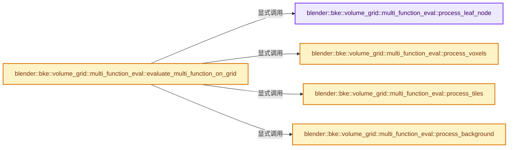
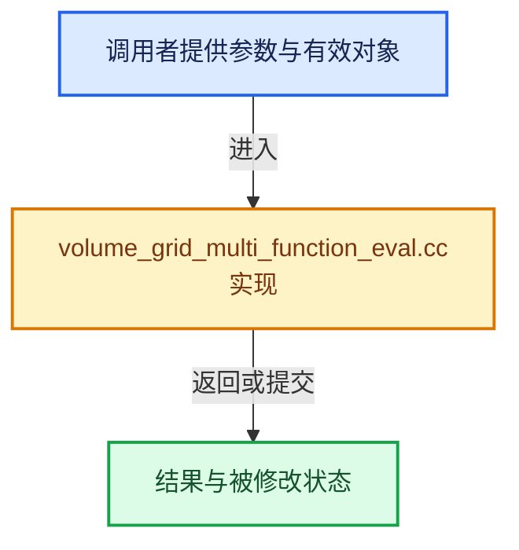

# 实现依赖专题：source/blender/blenkernel/intern/volume_grid_multi_function_eval.cc

[实现依赖导航](../../README.md) · [符号索引](../../../00-课程指南/02-源码与提交索引/符号依赖与实现索引.md)

本专题从正文实际调用进入，集中保存共享实现。函数有稳定锚点，可从调用处直接跳到对应完整函数；递归与互相调用通过回链组织。

## 本文件的实现关系






## 完整成员与函数实现

<a id="f-02062e86774065e8"></a>

### `blender::bke::volume_grid::multi_function_eval::process_leaf_node`

实现位置：[source/blender/blenkernel/intern/volume_grid_multi_function_eval.cc](../../../../../../../source/blender/blenkernel/intern/volume_grid_multi_function_eval.cc) · L39—L202。

接口参数：

- `const mf::MultiFunction &fn`
- `const Span<InputVariant> input_values`
- `MutableSpan<openvdb::GridBase::Ptr> output_grids`
- `const openvdb::math::Transform &transform`
- `const LeafNodeMask &leaf_node_mask`
- `const openvdb::CoordBBox &leaf_bbox`
- `const GetVoxelsFn get_voxels_fn`

**教学注释版**

<!-- annotated:dcc0ab4cb5a13e -->

```cpp
BLI_NOINLINE static void process_leaf_node(const mf::MultiFunction &fn,
                                           const Span<InputVariant> input_values,
                                           MutableSpan<openvdb::GridBase::Ptr> output_grids,
                                           const openvdb::math::Transform &transform,
                                           const LeafNodeMask &leaf_node_mask,
                                           const openvdb::CoordBBox &leaf_bbox,
                                           const GetVoxelsFn get_voxels_fn)
{
  AlignedBuffer<8192, 8> allocation_buffer;
  ResourceScope scope(allocation_buffer);

  /* Create an index mask for all the active voxels in the leaf. */
  const IndexMask index_mask = IndexMask::from_predicate(
      IndexRange(LeafNodeMask::SIZE),
      scope.allocator(),
      [&](const int64_t i) { return leaf_node_mask.isOn(i); },
      exec_mode::serial);

  mf::ParamsBuilder params{fn, &index_mask};
  mf::ContextBuilder context;

  /* We need to find the corresponding leaf nodes in all the input and output grids. That's done by
   * finding the leaf that contains this voxel. */
  const openvdb::Coord any_voxel_in_leaf = leaf_bbox.min();

  std::optional<MutableSpan<openvdb::Coord>> voxel_coords_opt;
  auto ensure_voxel_coords = [&]() {
    if (!voxel_coords_opt.has_value()) {
      voxel_coords_opt = scope.allocator().allocate_array<openvdb::Coord>(
          index_mask.min_array_size());
      get_voxels_fn(voxel_coords_opt.value());
    }
    return *voxel_coords_opt;
  };

  // [讲解] input_values.index_range：查询视图长度或生成对应有效索引区间。
  for (const int input_i : input_values.index_range()) {
    const InputVariant &value_variant = input_values[input_i];
    const mf::ParamType param_type = fn.param_type(params.next_param_index());
    const CPPType &param_cpp_type = param_type.data_type().single_type();

    if (const openvdb::GridBase *const *grid_base = std::get_if<const openvdb::GridBase *>(
            &value_variant))
    {
      /* The input is a grid, so we can attempt to reference the grid values directly. */
      to_typed_grid(**grid_base, [&](const auto &grid) {
        using GridT = typename std::decay_t<decltype(grid)>;
        using ValueT = typename GridT::ValueType;
        BLI_assert(param_cpp_type.size == sizeof(ValueT));
        const auto &tree = grid.tree();

        if (const auto *leaf_node = tree.probeLeaf(any_voxel_in_leaf)) {
          /* Boolean grids are special because they encode the values as bitmask. So create a
           * temporary buffer for the inputs. */
          if constexpr (std::is_same_v<ValueT, bool>) {
            const Span<openvdb::Coord> voxels = ensure_voxel_coords();
            MutableSpan<bool> values = scope.allocator().allocate_array<bool>(
                index_mask.min_array_size());
            index_mask.foreach_index_optimized<int64_t>([&](const int64_t i) {
              const openvdb::Coord &coord = voxels[i];
              values[i] = tree.getValue(coord);
            });
            params.add_readonly_single_input(values);
          }
          else {
            const Span<ValueT> values(leaf_node->buffer().data(), LeafNodeMask::SIZE);
            const LeafNodeMask &input_leaf_mask = leaf_node->valueMask();
            const LeafNodeMask missing_mask = leaf_node_mask & !input_leaf_mask;
            if (missing_mask.isOff()) {
              /* All values available, so reference the data directly. */
              params.add_readonly_single_input(
                  GSpan(param_cpp_type, values.data(), values.size()));
            }
            else {
              /* Fill in the missing values with the background value. */
              MutableSpan copied_values = scope.allocator().construct_array_copy(values);
              const auto &background = tree.background();
              for (auto missing_it = missing_mask.beginOn(); missing_it.test(); ++missing_it) {
                const int index = missing_it.pos();
                copied_values[index] = background;
              }
              params.add_readonly_single_input(
                  // [讲解] copied_values.data：返回借用范围的地址。
                  GSpan(param_cpp_type, copied_values.data(), copied_values.size()));
            }
          }
        }
        else {
          /* The input does not have this leaf node, so just get the value that's used for the
           * entire leaf. The leaf may be in a tile or is inactive in which case the background
           * value is used. */
          const auto &single_value = tree.getValue(any_voxel_in_leaf);
          params.add_readonly_single_input(GPointer(param_cpp_type, &single_value));
        }
      });
    }
    else if (const fn::GField *const *field = std::get_if<const fn::GField *>(&value_variant)) {
      /* Compute the field on all active voxels in the leaf and pass the result to the
       * multi-function. */
      const CPPType &type = (*field)->cpp_type();
      const Span<openvdb::Coord> voxels = ensure_voxel_coords();
      bke::VoxelFieldContext field_context{transform, voxels};
      fn::FieldEvaluator evaluator{field_context, &index_mask};
      GMutableSpan values{
          // [讲解] voxels.size：查询视图长度或生成对应有效索引区间。
          type, scope.allocator().allocate_array(type, voxels.size()), voxels.size()};
      // [讲解] evaluator.add_with_destination：登记表达式和可选的结果目标。
      evaluator.add_with_destination(**field, values);
      // [讲解] evaluator.evaluate：先确定selection，再求所有输出并回填调用者位置。
      evaluator.evaluate();
      params.add_readonly_single_input(values);
    }
    else {
      /* Pass the single value directly to the multi-function. */
      params.add_readonly_single_input(std::get<GPointer>(value_variant));
    }
  }

  for (const int output_i : output_grids.index_range()) {
    const mf::ParamType param_type = fn.param_type(params.next_param_index());
    const CPPType &param_cpp_type = param_type.data_type().single_type();
    if (!output_grids[output_i]) {
      params.add_ignored_single_output();
      continue;
    }

    openvdb::GridBase &grid_base = *output_grids[output_i];
    to_typed_grid(grid_base, [&](auto &grid) {
      using GridT = typename std::decay_t<decltype(grid)>;
      using ValueT = typename GridT::ValueType;

      auto &tree = grid.tree();
      auto *leaf_node = tree.probeLeaf(any_voxel_in_leaf);
      /* Should have been added before. */
      BLI_assert(leaf_node);

      /* Boolean grids are special because they encode the values as bitmask. */
      if constexpr (std::is_same_v<ValueT, bool>) {
        MutableSpan<bool> values = scope.allocator().allocate_array<bool>(
            index_mask.min_array_size());
        params.add_uninitialized_single_output(values);
      }
      else {
        /* Write directly into the buffer of the output leaf node. */
        ValueT *values = leaf_node->buffer().data();
        params.add_uninitialized_single_output(
            GMutableSpan(param_cpp_type, values, LeafNodeMask::SIZE));
      }
    });
  }

  /* Actually call the multi-function which will write the results into the output grids (except
   * for boolean grids). */
  fn.prepare_for_execution();
  fn.call_auto(index_mask, params, context);

  for (const int output_i : output_grids.index_range()) {
    const int param_index = input_values.size() + output_i;
    const mf::ParamType param_type = fn.param_type(param_index);
    const CPPType &param_cpp_type = param_type.data_type().single_type();
    if (!param_cpp_type.is<bool>()) {
      continue;
    }
    set_mask_leaf_buffer_from_bools(static_cast<openvdb::BoolGrid &>(*output_grids[output_i]),
                                    params.computed_array(param_index).typed<bool>(),
                                    index_mask,
                                    ensure_voxel_coords());
  }
}
```

<details>
<summary>核对原始源码：source/blender/blenkernel/intern/volume_grid_multi_function_eval.cc · L39—L202</summary>

<!-- original:dcc0ab4cb5a13e:source/blender/blenkernel/intern/volume_grid_multi_function_eval.cc:39:202 -->

```cpp
BLI_NOINLINE static void process_leaf_node(const mf::MultiFunction &fn,
                                           const Span<InputVariant> input_values,
                                           MutableSpan<openvdb::GridBase::Ptr> output_grids,
                                           const openvdb::math::Transform &transform,
                                           const LeafNodeMask &leaf_node_mask,
                                           const openvdb::CoordBBox &leaf_bbox,
                                           const GetVoxelsFn get_voxels_fn)
{
  AlignedBuffer<8192, 8> allocation_buffer;
  ResourceScope scope(allocation_buffer);

  /* Create an index mask for all the active voxels in the leaf. */
  const IndexMask index_mask = IndexMask::from_predicate(
      IndexRange(LeafNodeMask::SIZE),
      scope.allocator(),
      [&](const int64_t i) { return leaf_node_mask.isOn(i); },
      exec_mode::serial);

  mf::ParamsBuilder params{fn, &index_mask};
  mf::ContextBuilder context;

  /* We need to find the corresponding leaf nodes in all the input and output grids. That's done by
   * finding the leaf that contains this voxel. */
  const openvdb::Coord any_voxel_in_leaf = leaf_bbox.min();

  std::optional<MutableSpan<openvdb::Coord>> voxel_coords_opt;
  auto ensure_voxel_coords = [&]() {
    if (!voxel_coords_opt.has_value()) {
      voxel_coords_opt = scope.allocator().allocate_array<openvdb::Coord>(
          index_mask.min_array_size());
      get_voxels_fn(voxel_coords_opt.value());
    }
    return *voxel_coords_opt;
  };

  for (const int input_i : input_values.index_range()) {
    const InputVariant &value_variant = input_values[input_i];
    const mf::ParamType param_type = fn.param_type(params.next_param_index());
    const CPPType &param_cpp_type = param_type.data_type().single_type();

    if (const openvdb::GridBase *const *grid_base = std::get_if<const openvdb::GridBase *>(
            &value_variant))
    {
      /* The input is a grid, so we can attempt to reference the grid values directly. */
      to_typed_grid(**grid_base, [&](const auto &grid) {
        using GridT = typename std::decay_t<decltype(grid)>;
        using ValueT = typename GridT::ValueType;
        BLI_assert(param_cpp_type.size == sizeof(ValueT));
        const auto &tree = grid.tree();

        if (const auto *leaf_node = tree.probeLeaf(any_voxel_in_leaf)) {
          /* Boolean grids are special because they encode the values as bitmask. So create a
           * temporary buffer for the inputs. */
          if constexpr (std::is_same_v<ValueT, bool>) {
            const Span<openvdb::Coord> voxels = ensure_voxel_coords();
            MutableSpan<bool> values = scope.allocator().allocate_array<bool>(
                index_mask.min_array_size());
            index_mask.foreach_index_optimized<int64_t>([&](const int64_t i) {
              const openvdb::Coord &coord = voxels[i];
              values[i] = tree.getValue(coord);
            });
            params.add_readonly_single_input(values);
          }
          else {
            const Span<ValueT> values(leaf_node->buffer().data(), LeafNodeMask::SIZE);
            const LeafNodeMask &input_leaf_mask = leaf_node->valueMask();
            const LeafNodeMask missing_mask = leaf_node_mask & !input_leaf_mask;
            if (missing_mask.isOff()) {
              /* All values available, so reference the data directly. */
              params.add_readonly_single_input(
                  GSpan(param_cpp_type, values.data(), values.size()));
            }
            else {
              /* Fill in the missing values with the background value. */
              MutableSpan copied_values = scope.allocator().construct_array_copy(values);
              const auto &background = tree.background();
              for (auto missing_it = missing_mask.beginOn(); missing_it.test(); ++missing_it) {
                const int index = missing_it.pos();
                copied_values[index] = background;
              }
              params.add_readonly_single_input(
                  GSpan(param_cpp_type, copied_values.data(), copied_values.size()));
            }
          }
        }
        else {
          /* The input does not have this leaf node, so just get the value that's used for the
           * entire leaf. The leaf may be in a tile or is inactive in which case the background
           * value is used. */
          const auto &single_value = tree.getValue(any_voxel_in_leaf);
          params.add_readonly_single_input(GPointer(param_cpp_type, &single_value));
        }
      });
    }
    else if (const fn::GField *const *field = std::get_if<const fn::GField *>(&value_variant)) {
      /* Compute the field on all active voxels in the leaf and pass the result to the
       * multi-function. */
      const CPPType &type = (*field)->cpp_type();
      const Span<openvdb::Coord> voxels = ensure_voxel_coords();
      bke::VoxelFieldContext field_context{transform, voxels};
      fn::FieldEvaluator evaluator{field_context, &index_mask};
      GMutableSpan values{
          type, scope.allocator().allocate_array(type, voxels.size()), voxels.size()};
      evaluator.add_with_destination(**field, values);
      evaluator.evaluate();
      params.add_readonly_single_input(values);
    }
    else {
      /* Pass the single value directly to the multi-function. */
      params.add_readonly_single_input(std::get<GPointer>(value_variant));
    }
  }

  for (const int output_i : output_grids.index_range()) {
    const mf::ParamType param_type = fn.param_type(params.next_param_index());
    const CPPType &param_cpp_type = param_type.data_type().single_type();
    if (!output_grids[output_i]) {
      params.add_ignored_single_output();
      continue;
    }

    openvdb::GridBase &grid_base = *output_grids[output_i];
    to_typed_grid(grid_base, [&](auto &grid) {
      using GridT = typename std::decay_t<decltype(grid)>;
      using ValueT = typename GridT::ValueType;

      auto &tree = grid.tree();
      auto *leaf_node = tree.probeLeaf(any_voxel_in_leaf);
      /* Should have been added before. */
      BLI_assert(leaf_node);

      /* Boolean grids are special because they encode the values as bitmask. */
      if constexpr (std::is_same_v<ValueT, bool>) {
        MutableSpan<bool> values = scope.allocator().allocate_array<bool>(
            index_mask.min_array_size());
        params.add_uninitialized_single_output(values);
      }
      else {
        /* Write directly into the buffer of the output leaf node. */
        ValueT *values = leaf_node->buffer().data();
        params.add_uninitialized_single_output(
            GMutableSpan(param_cpp_type, values, LeafNodeMask::SIZE));
      }
    });
  }

  /* Actually call the multi-function which will write the results into the output grids (except
   * for boolean grids). */
  fn.prepare_for_execution();
  fn.call_auto(index_mask, params, context);

  for (const int output_i : output_grids.index_range()) {
    const int param_index = input_values.size() + output_i;
    const mf::ParamType param_type = fn.param_type(param_index);
    const CPPType &param_cpp_type = param_type.data_type().single_type();
    if (!param_cpp_type.is<bool>()) {
      continue;
    }
    set_mask_leaf_buffer_from_bools(static_cast<openvdb::BoolGrid &>(*output_grids[output_i]),
                                    params.computed_array(param_index).typed<bool>(),
                                    index_mask,
                                    ensure_voxel_coords());
  }
}
```

</details>

**沿实际写入检查状态**

- `voxel_coords_opt = scope.allocator().allocate_array<openvdb::Coord>(`
- `values[i] = tree.getValue(coord);`
- `copied_values[index] = background;`

**结果出口**

- `return *voxel_coords_opt;`

**继续追踪实现**

- `IndexMask::from_predicate` → [blender::index_mask::IndexMask::from_predicate · L1073](../../../04-虚拟数组与索引选择/12-重构历史与基准练习.md#f-3864daa059098df8)。
- `IndexRange` → [blender::IndexRange](../../01-BLI基础库/BLI_index_range.hh.md#t-caa3466d6776)；[blender::gpu::shader::parser::IndexRange](../../08-其他Blender模块/gpu/shader_tool/utils.hh.md#t-82d2bd4ea71c)；[blender::IndexRange](../../08-其他Blender模块/makesdna/DNA_node_types.h.md#t-0448cc889d39)。
- `scope.allocator` → [blender::ResourceScope::allocator · L236](../../../03-内存分配与运行时类型/05-ResourceScope销毁责任.md#f-7ccba69e393aa150)。
- `leaf_node_mask.isOn` → [Freestyle::NodeLight::isOn · L53](../../08-其他Blender模块/freestyle/intern/scene_graph/NodeLight.h.md#f-1a47d8d7085f1c4a)。
- `leaf_bbox.min` → [min · L38](../../01-BLI基础库/intern/sort.cc.md#m-d8ff5d6169c0)。宏定义由构建条件选择。
- `voxel_coords_opt.has_value` → [外部契约](https://eel.is/c++draft/)：这个边界按实际表达式及所属类型核对参数、返回值、寿命与失败行为。这里提供接口入口，不声称已解释该第三方版本的内部实现。
- `scope.allocator().allocate_array<openvdb::Coord>` → [调用协议](../../../00-课程指南/01-路线与规范/模板宏与动态分派协议.md)：接收对象类型依赖auto、返回值或模板实例；不按同名猜测目标。调用位置L67。
- `index_mask.min_array_size` → [blender::index_mask::IndexMask::min_array_size · L782](../../../04-虚拟数组与索引选择/09-分段存储与遍历.md#f-f3a460d74b4fc7d6)。
- `get_voxels_fn` → [调用协议](../../../00-课程指南/01-路线与规范/模板宏与动态分派协议.md)：局部可调用对象，须结合其初始化与捕获环境。调用位置L69。
- `voxel_coords_opt.value` → [外部契约](https://eel.is/c++draft/)：这个边界按实际表达式及所属类型核对参数、返回值、寿命与失败行为。这里提供接口入口，不声称已解释该第三方版本的内部实现。
- `input_values.index_range` → [blender::Span::index_range · L405](../../../01-基础容器与现代CPP/05-Span只读连续视图.md#f-caaa9b06e13e53e0)。
- `fn.param_type` → [blender::fn::multi_function::MultiFunction::param_type · L72](../../../07-MultiFunction与批量执行/01-批量计算模型.md#f-b713a5aeabff53fa)。
- `params.next_param_index` → [blender::fn::multi_function::ParamsBuilder::next_param_index · L269](../../../07-MultiFunction与批量执行/04-参数访问与输出构造.md#f-0dab30db67991fa9)。
- `param_type.data_type().single_type` → [调用协议](../../../00-课程指南/01-路线与规范/模板宏与动态分派协议.md)：接收对象类型依赖auto、返回值或模板实例；不按同名猜测目标。调用位置L77。
- `param_type.data_type` → [blender::fn::multi_function::ParamType::data_type · L113](../../../07-MultiFunction与批量执行/03-参数类型与角色.md#f-b29743877463338d)。
- `std::get_if<const openvdb::GridBase *>` → [外部契约](https://eel.is/c++draft/)：这个边界按实际表达式及所属类型核对参数、返回值、寿命与失败行为。这里提供接口入口，不声称已解释该第三方版本的内部实现。
- `to_typed_grid` → [blender::bke::volume_grid::to_typed_grid · L64](../BKE_volume_grid_process.hh.md#f-356e1d0ee290f573)；[blender::bke::volume_grid::to_typed_grid · L78](../BKE_volume_grid_process.hh.md#f-3f4ee1f29941cc08)。同名重载需按实参类型选择。
- `BLI_assert` → [BLI_assert · L48](../../01-BLI基础库/BLI_assert.hh.md#m-57a88495704d)；[BLI_assert · L63](../../01-BLI基础库/BLI_assert.hh.md#m-d07050020cb5)。宏定义由构建条件选择。
- `grid.tree` → [调用协议](../../../00-课程指南/01-路线与规范/模板宏与动态分派协议.md)：接收对象类型依赖auto、返回值或模板实例；不按同名猜测目标。调用位置L87。
- `tree.probeLeaf` → [调用协议](../../../00-课程指南/01-路线与规范/模板宏与动态分派协议.md)：接收对象类型依赖auto、返回值或模板实例；不按同名猜测目标。调用位置L89。
- `ensure_voxel_coords` → [调用协议](../../../00-课程指南/01-路线与规范/模板宏与动态分派协议.md)：局部可调用对象，须结合其初始化与捕获环境。调用位置L93。
- `scope.allocator().allocate_array<bool>` → [调用协议](../../../00-课程指南/01-路线与规范/模板宏与动态分派协议.md)：接收对象类型依赖auto、返回值或模板实例；不按同名猜测目标。调用位置L94。
- `index_mask.foreach_index_optimized<int64_t>` → [blender::index_mask::IndexMask::foreach_index_optimized · L937](../../../04-虚拟数组与索引选择/12-重构历史与基准练习.md#f-a2c3e7876407eaaf)。
- `tree.getValue` → [调用协议](../../../00-课程指南/01-路线与规范/模板宏与动态分派协议.md)：接收对象类型依赖auto、返回值或模板实例；不按同名猜测目标。调用位置L98。
- `params.add_readonly_single_input` → [blender::fn::multi_function::ParamsBuilder::add_readonly_single_input · L156](../../../07-MultiFunction与批量执行/04-参数访问与输出构造.md#f-5ef65d99e991c3f8)；[blender::fn::multi_function::ParamsBuilder::add_readonly_single_input · L167](../../../07-MultiFunction与批量执行/04-参数访问与输出构造.md#f-39d85bcf8f1eb606)；[blender::fn::multi_function::ParamsBuilder::add_readonly_single_input · L174](../../../07-MultiFunction与批量执行/04-参数访问与输出构造.md#f-b4224f26d95311ed)；[blender::fn::multi_function::ParamsBuilder::add_readonly_single_input · L184](../../../07-MultiFunction与批量执行/04-参数访问与输出构造.md#f-c9ee081fd1fae167)。同名重载需按实参类型选择。
- `leaf_node->buffer().data` → [调用协议](../../../00-课程指南/01-路线与规范/模板宏与动态分派协议.md)：接收对象类型依赖auto、返回值或模板实例；不按同名猜测目标。调用位置L103。
- `leaf_node->buffer` → [调用协议](../../../00-课程指南/01-路线与规范/模板宏与动态分派协议.md)：接收对象类型依赖auto、返回值或模板实例；不按同名猜测目标。调用位置L103。
- `leaf_node->valueMask` → [调用协议](../../../00-课程指南/01-路线与规范/模板宏与动态分派协议.md)：接收对象类型依赖auto、返回值或模板实例；不按同名猜测目标。调用位置L104。
- `missing_mask.isOff` → [调用协议](../../../00-课程指南/01-路线与规范/模板宏与动态分派协议.md)：由接收对象具体类型或运行时策略提供实现。调用位置L106。
- `GSpan` → [blender::GSpan::GSpan · L26](../../../03-内存分配与运行时类型/11-GSpan与GArray.md#f-9d0c95702007eea6)；[blender::GSpan::GSpan · L28](../../../03-内存分配与运行时类型/11-GSpan与GArray.md#f-6650bd08c7eecc66)；[blender::GSpan::GSpan · L37](../../../03-内存分配与运行时类型/11-GSpan与GArray.md#f-bf180950832673fb)；[blender::GSpan::GSpan · L39](../../../03-内存分配与运行时类型/11-GSpan与GArray.md#f-cf949d5590ea9ab6)；[blender::GSpan::GSpan · L41](../../../03-内存分配与运行时类型/11-GSpan与GArray.md#f-a66ab52ee0842aee)；[blender::GSpan::GSpan · L43](../../../03-内存分配与运行时类型/11-GSpan与GArray.md#f-d9084fa10964390f)；[blender::GSpan::GSpan · L49](../../../03-内存分配与运行时类型/11-GSpan与GArray.md#f-76e3de3cc3d65761)。同名重载需按实参类型选择。
- `values.data` → [调用协议](../../../00-课程指南/01-路线与规范/模板宏与动态分派协议.md)：由接收对象具体类型或运行时策略提供实现。调用位置L109。
- `values.size` → [调用协议](../../../00-课程指南/01-路线与规范/模板宏与动态分派协议.md)：由接收对象具体类型或运行时策略提供实现。调用位置L109。
- `scope.allocator().construct_array_copy` → [调用协议](../../../00-课程指南/01-路线与规范/模板宏与动态分派协议.md)：接收对象类型依赖auto、返回值或模板实例；不按同名猜测目标。调用位置L113。
- `tree.background` → [调用协议](../../../00-课程指南/01-路线与规范/模板宏与动态分派协议.md)：接收对象类型依赖auto、返回值或模板实例；不按同名猜测目标。调用位置L114。
- `missing_mask.beginOn` → [调用协议](../../../00-课程指南/01-路线与规范/模板宏与动态分派协议.md)：由接收对象具体类型或运行时策略提供实现。调用位置L115。
- `missing_it.test` → [调用协议](../../../00-课程指南/01-路线与规范/模板宏与动态分派协议.md)：接收对象类型依赖auto、返回值或模板实例；不按同名猜测目标。调用位置L115。
- `missing_it.pos` → [调用协议](../../../00-课程指南/01-路线与规范/模板宏与动态分派协议.md)：接收对象类型依赖auto、返回值或模板实例；不按同名猜测目标。调用位置L116。
- `copied_values.data` → [blender::MutableSpan::data · L545](../../../01-基础容器与现代CPP/06-MutableSpan可写视图.md#f-eb45a6e4d8211efd)；[blender::gpu::shader::parser::MutableSpan::data · L82](../../08-其他Blender模块/gpu/shader_tool/utils.hh.md#f-ad0a09cec9741c65)。同名重载需按实参类型选择。
- `copied_values.size` → [blender::MutableSpan::size · L499](../../../01-基础容器与现代CPP/06-MutableSpan可写视图.md#f-1de6a66839c304a8)；[blender::gpu::shader::parser::MutableSpan::size · L87](../../08-其他Blender模块/gpu/shader_tool/utils.hh.md#f-5e684af6ee7990e9)。同名重载需按实参类型选择。
- `GPointer` → [blender::GPointer::GPointer · L93](../../../03-内存分配与运行时类型/12-异构值存储实战.md#f-40f7a024c1e541df)；[blender::GPointer::GPointer · L95](../../../03-内存分配与运行时类型/12-异构值存储实战.md#f-e981128b9c36f9ef)；[blender::GPointer::GPointer · L97](../../../03-内存分配与运行时类型/12-异构值存储实战.md#f-5d3066175455aed0)；[blender::GPointer::GPointer · L103](../../../03-内存分配与运行时类型/12-异构值存储实战.md#f-9194d11793ea4a06)；[blender::GPointer::GPointer · L105](../../../03-内存分配与运行时类型/12-异构值存储实战.md#f-1a9887b65d37a9ca)。同名重载需按实参类型选择。
- `std::get_if<const fn::GField *>` → [外部契约](https://eel.is/c++draft/)：这个边界按实际表达式及所属类型核对参数、返回值、寿命与失败行为。这里提供接口入口，不声称已解释该第三方版本的内部实现。
- `(*field)->cpp_type` → [调用协议](../../../00-课程指南/01-路线与规范/模板宏与动态分派协议.md)：接收对象类型依赖auto、返回值或模板实例；不按同名猜测目标。调用位置L136。
- `scope.allocator().allocate_array` → [调用协议](../../../00-课程指南/01-路线与规范/模板宏与动态分派协议.md)：接收对象类型依赖auto、返回值或模板实例；不按同名猜测目标。调用位置L141。
- `voxels.size` → [blender::Span::size · L256](../../../01-基础容器与现代CPP/05-Span只读连续视图.md#f-5f80fa006089c998)。
- `evaluator.add_with_destination` → [blender::fn::FieldEvaluator::add_with_destination · L548](../../../08-Field表达式与求值/09-生成Procedure与执行.md#f-165e23b00ea43ee4)；[blender::fn::FieldEvaluator::add_with_destination · L556](../../../08-Field表达式与求值/09-生成Procedure与执行.md#f-79ade07d74d08d73)；[blender::fn::FieldEvaluator::add_with_destination · L80](../../../08-Field表达式与求值/07-FieldEvaluator接口与使用.md#f-3edfceb249cb5cad)；[blender::fn::FieldEvaluator::add_with_destination · L99](../../../08-Field表达式与求值/07-FieldEvaluator接口与使用.md#f-03289f589afbd469)。同名重载需按实参类型选择。
- `evaluator.evaluate` → [blender::fn::FieldEvaluator::evaluate · L590](../../../08-Field表达式与求值/09-生成Procedure与执行.md#f-d2c4933d17ec204c)。
- `std::get<GPointer>` → [外部契约](https://eel.is/c++draft/)：这个边界按实际表达式及所属类型核对参数、返回值、寿命与失败行为。这里提供接口入口，不声称已解释该第三方版本的内部实现。
- `output_grids.index_range` → [blender::MutableSpan::index_range · L676](../../../01-基础容器与现代CPP/06-MutableSpan可写视图.md#f-f9a9d59a69ca64b5)。
- `params.add_ignored_single_output` → [blender::fn::multi_function::ParamsBuilder::add_ignored_single_output · L229](../../../07-MultiFunction与批量执行/04-参数访问与输出构造.md#f-1c7fc6f769a09e79)。
- `params.add_uninitialized_single_output` → [blender::fn::multi_function::ParamsBuilder::add_uninitialized_single_output · L215](../../../07-MultiFunction与批量执行/04-参数访问与输出构造.md#f-1faa1a496d7da36b)；[blender::fn::multi_function::ParamsBuilder::add_uninitialized_single_output · L221](../../../07-MultiFunction与批量执行/04-参数访问与输出构造.md#f-1466d69a4fff0159)。同名重载需按实参类型选择。
- `GMutableSpan` → [blender::GMutableSpan::GMutableSpan · L152](../../../03-内存分配与运行时类型/11-GSpan与GArray.md#f-b4ef5399177eeedd)；[blender::GMutableSpan::GMutableSpan · L154](../../../03-内存分配与运行时类型/11-GSpan与GArray.md#f-6439a40f33c7a2e5)；[blender::GMutableSpan::GMutableSpan · L163](../../../03-内存分配与运行时类型/11-GSpan与GArray.md#f-6054339faadc1405)；[blender::GMutableSpan::GMutableSpan · L167](../../../03-内存分配与运行时类型/11-GSpan与GArray.md#f-d1333b42c7982310)；[blender::GMutableSpan::GMutableSpan · L169](../../../03-内存分配与运行时类型/11-GSpan与GArray.md#f-3584f997d0fe9a96)；[blender::GMutableSpan::GMutableSpan · L171](../../../03-内存分配与运行时类型/11-GSpan与GArray.md#f-3074afdbe5232417)。同名重载需按实参类型选择。
- `fn.prepare_for_execution` → [blender::fn::multi_function::MultiFunction::prepare_for_execution · L126](../../../07-MultiFunction与批量执行/01-批量计算模型.md#f-d9cb2a6f3a06d34b)。
- `fn.call_auto` → [blender::fn::multi_function::MultiFunction::call_auto · L130](../../../07-MultiFunction与批量执行/01-批量计算模型.md#f-003a5b189ca0aabc)。
- `input_values.size` → [blender::Span::size · L256](../../../01-基础容器与现代CPP/05-Span只读连续视图.md#f-5f80fa006089c998)。
- `param_cpp_type.is<bool>` → [blender::CPPType::is · L758](../../../03-内存分配与运行时类型/09-CPPType复制移动重定位.md#f-2e2c3ee7602530a4)。
- `set_mask_leaf_buffer_from_bools` → [blender::bke::volume_grid::set_mask_leaf_buffer_from_bools · L877](volume_grid.cc.md#f-88964eb1e18f833b)。
- `params.computed_array(param_index).typed<bool>` → [调用协议](../../../00-课程指南/01-路线与规范/模板宏与动态分派协议.md)：接收对象类型依赖auto、返回值或模板实例；不按同名猜测目标。调用位置L198。
- `params.computed_array` → [blender::fn::multi_function::ParamsBuilder::computed_array · L274](../../../07-MultiFunction与批量执行/04-参数访问与输出构造.md#f-72a94628a3edd16e)。

<a id="f-a4460923bc5560fa"></a>

### `blender::bke::volume_grid::multi_function_eval::process_voxels`

实现位置：[source/blender/blenkernel/intern/volume_grid_multi_function_eval.cc](../../../../../../../source/blender/blenkernel/intern/volume_grid_multi_function_eval.cc) · L214—L291。

接口参数：

- `const mf::MultiFunction &fn`
- `const Span<InputVariant> input_values`
- `MutableSpan<openvdb::GridBase::Ptr> output_grids`
- `const openvdb::math::Transform &transform`
- `const Span<openvdb::Coord> voxels`

**教学注释版**

<!-- annotated:b821bdb2be26b3 -->

```cpp
BLI_NOINLINE static void process_voxels(const mf::MultiFunction &fn,
                                        const Span<InputVariant> input_values,
                                        MutableSpan<openvdb::GridBase::Ptr> output_grids,
                                        const openvdb::math::Transform &transform,
                                        const Span<openvdb::Coord> voxels)
{
  // [讲解] voxels.size：查询视图长度或生成对应有效索引区间。
  const int64_t voxels_num = voxels.size();
  const IndexMask index_mask{voxels_num};
  AlignedBuffer<8192, 8> allocation_buffer;
  ResourceScope scope(allocation_buffer);
  mf::ParamsBuilder params{fn, &index_mask};
  mf::ContextBuilder context;

  // [讲解] input_values.index_range：查询视图长度或生成对应有效索引区间。
  for (const int input_i : input_values.index_range()) {
    const InputVariant &value_variant = input_values[input_i];
    const mf::ParamType param_type = fn.param_type(params.next_param_index());
    const CPPType &param_cpp_type = param_type.data_type().single_type();

    if (const openvdb::GridBase *const *grid_base = std::get_if<const openvdb::GridBase *>(
            &value_variant))
    {
      /* Retrieve all voxel values from the input grid. */
      to_typed_grid(**grid_base, [&](const auto &grid) {
        using ValueType = typename std::decay_t<decltype(grid)>::ValueType;
        const auto &tree = grid.tree();
        /* Could try to cache the accessor across batches, but it's not straight forward since its
         * type depends on the grid type and thread-safety has to be maintained. It's likely not
         * worth it because the cost is already negligible since we are processing a full batch. */
        auto accessor = grid.getConstUnsafeAccessor();

        MutableSpan<ValueType> values = scope.allocator().allocate_array<ValueType>(voxels_num);
        for (const int64_t i : IndexRange(voxels_num)) {
          const openvdb::Coord &coord = voxels[i];
          values[i] = tree.getValue(coord, accessor);
        }
        BLI_assert(param_cpp_type.size == sizeof(ValueType));
        params.add_readonly_single_input(GSpan(param_cpp_type, values.data(), voxels_num));
      });
    }
    else if (const fn::GField *const *field = std::get_if<const fn::GField *>(&value_variant)) {
      /* Evaluate the field on all voxels.
       * TODO: Collect fields from all inputs to evaluate together. */
      const CPPType &type = (*field)->cpp_type();
      bke::VoxelFieldContext field_context{transform, voxels};
      fn::FieldEvaluator evaluator{field_context, voxels_num};
      GMutableSpan values{type, scope.allocator().allocate_array(type, voxels_num), voxels_num};
      // [讲解] evaluator.add_with_destination：登记表达式和可选的结果目标。
      evaluator.add_with_destination(**field, values);
      // [讲解] evaluator.evaluate：先确定selection，再求所有输出并回填调用者位置。
      evaluator.evaluate();
      params.add_readonly_single_input(values);
    }
    else {
      /* Pass the single value directly to the multi-function. */
      params.add_readonly_single_input(std::get<GPointer>(value_variant));
    }
  }

  /* Prepare temporary output buffers for the field evaluation. Those will later be copied into the
   * output grids. */
  for ([[maybe_unused]] const int output_i : output_grids.index_range()) {
    const int param_index = input_values.size() + output_i;
    const mf::ParamType param_type = fn.param_type(param_index);
    const CPPType &type = param_type.data_type().single_type();
    void *buffer = scope.allocator().allocate_array(type, voxels_num);
    params.add_uninitialized_single_output(GMutableSpan{type, buffer, voxels_num});
  }

  /* Actually call the multi-function which will fill the temporary output buffers. */
  fn.call_auto(index_mask, params, context);

  /* Copy the values from the temporary buffers into the output grids. */
  for (const int output_i : output_grids.index_range()) {
    if (!output_grids[output_i]) {
      continue;
    }
    const int param_index = input_values.size() + output_i;
    set_grid_values(*output_grids[output_i], params.computed_array(param_index), voxels);
  }
}
```

<details>
<summary>核对原始源码：source/blender/blenkernel/intern/volume_grid_multi_function_eval.cc · L214—L291</summary>

<!-- original:b821bdb2be26b3:source/blender/blenkernel/intern/volume_grid_multi_function_eval.cc:214:291 -->

```cpp
BLI_NOINLINE static void process_voxels(const mf::MultiFunction &fn,
                                        const Span<InputVariant> input_values,
                                        MutableSpan<openvdb::GridBase::Ptr> output_grids,
                                        const openvdb::math::Transform &transform,
                                        const Span<openvdb::Coord> voxels)
{
  const int64_t voxels_num = voxels.size();
  const IndexMask index_mask{voxels_num};
  AlignedBuffer<8192, 8> allocation_buffer;
  ResourceScope scope(allocation_buffer);
  mf::ParamsBuilder params{fn, &index_mask};
  mf::ContextBuilder context;

  for (const int input_i : input_values.index_range()) {
    const InputVariant &value_variant = input_values[input_i];
    const mf::ParamType param_type = fn.param_type(params.next_param_index());
    const CPPType &param_cpp_type = param_type.data_type().single_type();

    if (const openvdb::GridBase *const *grid_base = std::get_if<const openvdb::GridBase *>(
            &value_variant))
    {
      /* Retrieve all voxel values from the input grid. */
      to_typed_grid(**grid_base, [&](const auto &grid) {
        using ValueType = typename std::decay_t<decltype(grid)>::ValueType;
        const auto &tree = grid.tree();
        /* Could try to cache the accessor across batches, but it's not straight forward since its
         * type depends on the grid type and thread-safety has to be maintained. It's likely not
         * worth it because the cost is already negligible since we are processing a full batch. */
        auto accessor = grid.getConstUnsafeAccessor();

        MutableSpan<ValueType> values = scope.allocator().allocate_array<ValueType>(voxels_num);
        for (const int64_t i : IndexRange(voxels_num)) {
          const openvdb::Coord &coord = voxels[i];
          values[i] = tree.getValue(coord, accessor);
        }
        BLI_assert(param_cpp_type.size == sizeof(ValueType));
        params.add_readonly_single_input(GSpan(param_cpp_type, values.data(), voxels_num));
      });
    }
    else if (const fn::GField *const *field = std::get_if<const fn::GField *>(&value_variant)) {
      /* Evaluate the field on all voxels.
       * TODO: Collect fields from all inputs to evaluate together. */
      const CPPType &type = (*field)->cpp_type();
      bke::VoxelFieldContext field_context{transform, voxels};
      fn::FieldEvaluator evaluator{field_context, voxels_num};
      GMutableSpan values{type, scope.allocator().allocate_array(type, voxels_num), voxels_num};
      evaluator.add_with_destination(**field, values);
      evaluator.evaluate();
      params.add_readonly_single_input(values);
    }
    else {
      /* Pass the single value directly to the multi-function. */
      params.add_readonly_single_input(std::get<GPointer>(value_variant));
    }
  }

  /* Prepare temporary output buffers for the field evaluation. Those will later be copied into the
   * output grids. */
  for ([[maybe_unused]] const int output_i : output_grids.index_range()) {
    const int param_index = input_values.size() + output_i;
    const mf::ParamType param_type = fn.param_type(param_index);
    const CPPType &type = param_type.data_type().single_type();
    void *buffer = scope.allocator().allocate_array(type, voxels_num);
    params.add_uninitialized_single_output(GMutableSpan{type, buffer, voxels_num});
  }

  /* Actually call the multi-function which will fill the temporary output buffers. */
  fn.call_auto(index_mask, params, context);

  /* Copy the values from the temporary buffers into the output grids. */
  for (const int output_i : output_grids.index_range()) {
    if (!output_grids[output_i]) {
      continue;
    }
    const int param_index = input_values.size() + output_i;
    set_grid_values(*output_grids[output_i], params.computed_array(param_index), voxels);
  }
}
```

</details>

**沿实际写入检查状态**

- `values[i] = tree.getValue(coord, accessor);`

**继续追踪实现**

- `voxels.size` → [blender::Span::size · L256](../../../01-基础容器与现代CPP/05-Span只读连续视图.md#f-5f80fa006089c998)。
- `input_values.index_range` → [blender::Span::index_range · L405](../../../01-基础容器与现代CPP/05-Span只读连续视图.md#f-caaa9b06e13e53e0)。
- `fn.param_type` → [blender::fn::multi_function::MultiFunction::param_type · L72](../../../07-MultiFunction与批量执行/01-批量计算模型.md#f-b713a5aeabff53fa)。
- `params.next_param_index` → [blender::fn::multi_function::ParamsBuilder::next_param_index · L269](../../../07-MultiFunction与批量执行/04-参数访问与输出构造.md#f-0dab30db67991fa9)。
- `param_type.data_type().single_type` → [调用协议](../../../00-课程指南/01-路线与规范/模板宏与动态分派协议.md)：接收对象类型依赖auto、返回值或模板实例；不按同名猜测目标。调用位置L230。
- `param_type.data_type` → [blender::fn::multi_function::ParamType::data_type · L113](../../../07-MultiFunction与批量执行/03-参数类型与角色.md#f-b29743877463338d)。
- `std::get_if<const openvdb::GridBase *>` → [外部契约](https://eel.is/c++draft/)：这个边界按实际表达式及所属类型核对参数、返回值、寿命与失败行为。这里提供接口入口，不声称已解释该第三方版本的内部实现。
- `to_typed_grid` → [blender::bke::volume_grid::to_typed_grid · L64](../BKE_volume_grid_process.hh.md#f-356e1d0ee290f573)；[blender::bke::volume_grid::to_typed_grid · L78](../BKE_volume_grid_process.hh.md#f-3f4ee1f29941cc08)。同名重载需按实参类型选择。
- `grid.tree` → [调用协议](../../../00-课程指南/01-路线与规范/模板宏与动态分派协议.md)：接收对象类型依赖auto、返回值或模板实例；不按同名猜测目标。调用位置L238。
- `grid.getConstUnsafeAccessor` → [调用协议](../../../00-课程指南/01-路线与规范/模板宏与动态分派协议.md)：接收对象类型依赖auto、返回值或模板实例；不按同名猜测目标。调用位置L242。
- `scope.allocator().allocate_array<ValueType>` → [调用协议](../../../00-课程指南/01-路线与规范/模板宏与动态分派协议.md)：接收对象类型依赖auto、返回值或模板实例；不按同名猜测目标。调用位置L244。
- `scope.allocator` → [blender::ResourceScope::allocator · L236](../../../03-内存分配与运行时类型/05-ResourceScope销毁责任.md#f-7ccba69e393aa150)。
- `IndexRange` → [blender::IndexRange](../../01-BLI基础库/BLI_index_range.hh.md#t-caa3466d6776)；[blender::gpu::shader::parser::IndexRange](../../08-其他Blender模块/gpu/shader_tool/utils.hh.md#t-82d2bd4ea71c)；[blender::IndexRange](../../08-其他Blender模块/makesdna/DNA_node_types.h.md#t-0448cc889d39)。
- `tree.getValue` → [调用协议](../../../00-课程指南/01-路线与规范/模板宏与动态分派协议.md)：接收对象类型依赖auto、返回值或模板实例；不按同名猜测目标。调用位置L247。
- `BLI_assert` → [BLI_assert · L48](../../01-BLI基础库/BLI_assert.hh.md#m-57a88495704d)；[BLI_assert · L63](../../01-BLI基础库/BLI_assert.hh.md#m-d07050020cb5)。宏定义由构建条件选择。
- `params.add_readonly_single_input` → [blender::fn::multi_function::ParamsBuilder::add_readonly_single_input · L156](../../../07-MultiFunction与批量执行/04-参数访问与输出构造.md#f-5ef65d99e991c3f8)；[blender::fn::multi_function::ParamsBuilder::add_readonly_single_input · L167](../../../07-MultiFunction与批量执行/04-参数访问与输出构造.md#f-39d85bcf8f1eb606)；[blender::fn::multi_function::ParamsBuilder::add_readonly_single_input · L174](../../../07-MultiFunction与批量执行/04-参数访问与输出构造.md#f-b4224f26d95311ed)；[blender::fn::multi_function::ParamsBuilder::add_readonly_single_input · L184](../../../07-MultiFunction与批量执行/04-参数访问与输出构造.md#f-c9ee081fd1fae167)。同名重载需按实参类型选择。
- `GSpan` → [blender::GSpan::GSpan · L26](../../../03-内存分配与运行时类型/11-GSpan与GArray.md#f-9d0c95702007eea6)；[blender::GSpan::GSpan · L28](../../../03-内存分配与运行时类型/11-GSpan与GArray.md#f-6650bd08c7eecc66)；[blender::GSpan::GSpan · L37](../../../03-内存分配与运行时类型/11-GSpan与GArray.md#f-bf180950832673fb)；[blender::GSpan::GSpan · L39](../../../03-内存分配与运行时类型/11-GSpan与GArray.md#f-cf949d5590ea9ab6)；[blender::GSpan::GSpan · L41](../../../03-内存分配与运行时类型/11-GSpan与GArray.md#f-a66ab52ee0842aee)；[blender::GSpan::GSpan · L43](../../../03-内存分配与运行时类型/11-GSpan与GArray.md#f-d9084fa10964390f)；[blender::GSpan::GSpan · L49](../../../03-内存分配与运行时类型/11-GSpan与GArray.md#f-76e3de3cc3d65761)。同名重载需按实参类型选择。
- `values.data` → [blender::GMutableSpan::data · L208](../../../03-内存分配与运行时类型/11-GSpan与GArray.md#f-f951536a0bdbb159)。
- `std::get_if<const fn::GField *>` → [外部契约](https://eel.is/c++draft/)：这个边界按实际表达式及所属类型核对参数、返回值、寿命与失败行为。这里提供接口入口，不声称已解释该第三方版本的内部实现。
- `(*field)->cpp_type` → [调用协议](../../../00-课程指南/01-路线与规范/模板宏与动态分派协议.md)：接收对象类型依赖auto、返回值或模板实例；不按同名猜测目标。调用位置L256。
- `scope.allocator().allocate_array` → [调用协议](../../../00-课程指南/01-路线与规范/模板宏与动态分派协议.md)：接收对象类型依赖auto、返回值或模板实例；不按同名猜测目标。调用位置L259。
- `evaluator.add_with_destination` → [blender::fn::FieldEvaluator::add_with_destination · L548](../../../08-Field表达式与求值/09-生成Procedure与执行.md#f-165e23b00ea43ee4)；[blender::fn::FieldEvaluator::add_with_destination · L556](../../../08-Field表达式与求值/09-生成Procedure与执行.md#f-79ade07d74d08d73)；[blender::fn::FieldEvaluator::add_with_destination · L80](../../../08-Field表达式与求值/07-FieldEvaluator接口与使用.md#f-3edfceb249cb5cad)；[blender::fn::FieldEvaluator::add_with_destination · L99](../../../08-Field表达式与求值/07-FieldEvaluator接口与使用.md#f-03289f589afbd469)。同名重载需按实参类型选择。
- `evaluator.evaluate` → [blender::fn::FieldEvaluator::evaluate · L590](../../../08-Field表达式与求值/09-生成Procedure与执行.md#f-d2c4933d17ec204c)。
- `std::get<GPointer>` → [外部契约](https://eel.is/c++draft/)：这个边界按实际表达式及所属类型核对参数、返回值、寿命与失败行为。这里提供接口入口，不声称已解释该第三方版本的内部实现。
- `output_grids.index_range` → [blender::MutableSpan::index_range · L676](../../../01-基础容器与现代CPP/06-MutableSpan可写视图.md#f-f9a9d59a69ca64b5)。
- `input_values.size` → [blender::Span::size · L256](../../../01-基础容器与现代CPP/05-Span只读连续视图.md#f-5f80fa006089c998)。
- `params.add_uninitialized_single_output` → [blender::fn::multi_function::ParamsBuilder::add_uninitialized_single_output · L215](../../../07-MultiFunction与批量执行/04-参数访问与输出构造.md#f-1faa1a496d7da36b)；[blender::fn::multi_function::ParamsBuilder::add_uninitialized_single_output · L221](../../../07-MultiFunction与批量执行/04-参数访问与输出构造.md#f-1466d69a4fff0159)。同名重载需按实参类型选择。
- `fn.call_auto` → [blender::fn::multi_function::MultiFunction::call_auto · L130](../../../07-MultiFunction与批量执行/01-批量计算模型.md#f-003a5b189ca0aabc)。
- `set_grid_values` → [blender::bke::volume_grid::set_grid_values · L739](volume_grid.cc.md#f-1f1d00af59829b7b)。
- `params.computed_array` → [blender::fn::multi_function::ParamsBuilder::computed_array · L274](../../../07-MultiFunction与批量执行/04-参数访问与输出构造.md#f-72a94628a3edd16e)。

<a id="f-9377aa938260489f"></a>

### `blender::bke::volume_grid::multi_function_eval::process_tiles`

实现位置：[source/blender/blenkernel/intern/volume_grid_multi_function_eval.cc](../../../../../../../source/blender/blenkernel/intern/volume_grid_multi_function_eval.cc) · L304—L387。

接口参数：

- `const mf::MultiFunction &fn`
- `const Span<InputVariant> input_values`
- `MutableSpan<openvdb::GridBase::Ptr> output_grids`
- `const openvdb::math::Transform &transform`
- `const Span<openvdb::CoordBBox> tiles`

**教学注释版**

<!-- annotated:36f15bf6e6d0eb -->

```cpp
BLI_NOINLINE static void process_tiles(const mf::MultiFunction &fn,
                                       const Span<InputVariant> input_values,
                                       MutableSpan<openvdb::GridBase::Ptr> output_grids,
                                       const openvdb::math::Transform &transform,
                                       const Span<openvdb::CoordBBox> tiles)
{
  // [讲解] tiles.size：查询视图长度或生成对应有效索引区间。
  const int64_t tiles_num = tiles.size();
  const IndexMask index_mask{tiles_num};

  AlignedBuffer<8192, 8> allocation_buffer;
  ResourceScope scope(allocation_buffer);
  mf::ParamsBuilder params{fn, &index_mask};
  mf::ContextBuilder context;

  // [讲解] input_values.index_range：查询视图长度或生成对应有效索引区间。
  for (const int input_i : input_values.index_range()) {
    const InputVariant &value_variant = input_values[input_i];
    const mf::ParamType param_type = fn.param_type(params.next_param_index());
    const CPPType &param_cpp_type = param_type.data_type().single_type();

    if (const openvdb::GridBase *const *grid_base = std::get_if<const openvdb::GridBase *>(
            &value_variant))
    {
      /* Sample the tile values from the input grid. */
      to_typed_grid(**grid_base, [&](const auto &grid) {
        using GridT = std::decay_t<decltype(grid)>;
        using ValueType = typename GridT::ValueType;
        const auto &tree = grid.tree();
        auto accessor = grid.getConstUnsafeAccessor();

        MutableSpan<ValueType> values = scope.allocator().allocate_array<ValueType>(tiles_num);
        for (const int64_t i : IndexRange(tiles_num)) {
          const openvdb::CoordBBox &tile = tiles[i];
          /* The tile is assumed to have a single constant value. Therefore, we can get the value
           * from any voxel in that tile as representative. */
          const openvdb::Coord any_coord_in_tile = tile.min();
          values[i] = tree.getValue(any_coord_in_tile, accessor);
        }
        BLI_assert(param_cpp_type.size == sizeof(ValueType));
        params.add_readonly_single_input(GSpan(param_cpp_type, values.data(), tiles_num));
      });
    }
    else if (const fn::GField *const *field = std::get_if<const fn::GField *>(&value_variant)) {
      /* Evaluate the field on all tiles.
       * TODO: Gather fields from all inputs to evaluate together. */
      const CPPType &type = (*field)->cpp_type();
      bke::TilesFieldContext field_context{transform, tiles};
      fn::FieldEvaluator evaluator{field_context, tiles_num};
      GMutableSpan values{type, scope.allocator().allocate_array(type, tiles_num), tiles_num};
      // [讲解] evaluator.add_with_destination：登记表达式和可选的结果目标。
      evaluator.add_with_destination(**field, values);
      // [讲解] evaluator.evaluate：先确定selection，再求所有输出并回填调用者位置。
      evaluator.evaluate();
      params.add_readonly_single_input(values);
    }
    else {
      /* Pass the single value directly to the multi-function. */
      params.add_readonly_single_input(std::get<GPointer>(value_variant));
    }
  }

  /* Prepare temporary output buffers for the field evaluation. Those will later be copied into the
   * output grids. */
  for ([[maybe_unused]] const int output_i : output_grids.index_range()) {
    if (!output_grids[output_i]) {
      params.add_ignored_single_output();
      continue;
    }
    const int param_index = input_values.size() + output_i;
    const mf::ParamType param_type = fn.param_type(param_index);
    const CPPType &type = param_type.data_type().single_type();
    void *buffer = scope.allocator().allocate_array(type, tiles_num);
    params.add_uninitialized_single_output(GMutableSpan{type, buffer, tiles_num});
  }

  /* Actually call the multi-function which will fill the temporary output buffers. */
  fn.call_auto(index_mask, params, context);

  /* Copy the values from the temporary buffers into the output grids. */
  for (const int output_i : output_grids.index_range()) {
    if (!output_grids[output_i]) {
      continue;
    }
    const int param_index = input_values.size() + output_i;
    set_tile_values(*output_grids[output_i], params.computed_array(param_index), tiles);
  }
}
```

<details>
<summary>核对原始源码：source/blender/blenkernel/intern/volume_grid_multi_function_eval.cc · L304—L387</summary>

<!-- original:36f15bf6e6d0eb:source/blender/blenkernel/intern/volume_grid_multi_function_eval.cc:304:387 -->

```cpp
BLI_NOINLINE static void process_tiles(const mf::MultiFunction &fn,
                                       const Span<InputVariant> input_values,
                                       MutableSpan<openvdb::GridBase::Ptr> output_grids,
                                       const openvdb::math::Transform &transform,
                                       const Span<openvdb::CoordBBox> tiles)
{
  const int64_t tiles_num = tiles.size();
  const IndexMask index_mask{tiles_num};

  AlignedBuffer<8192, 8> allocation_buffer;
  ResourceScope scope(allocation_buffer);
  mf::ParamsBuilder params{fn, &index_mask};
  mf::ContextBuilder context;

  for (const int input_i : input_values.index_range()) {
    const InputVariant &value_variant = input_values[input_i];
    const mf::ParamType param_type = fn.param_type(params.next_param_index());
    const CPPType &param_cpp_type = param_type.data_type().single_type();

    if (const openvdb::GridBase *const *grid_base = std::get_if<const openvdb::GridBase *>(
            &value_variant))
    {
      /* Sample the tile values from the input grid. */
      to_typed_grid(**grid_base, [&](const auto &grid) {
        using GridT = std::decay_t<decltype(grid)>;
        using ValueType = typename GridT::ValueType;
        const auto &tree = grid.tree();
        auto accessor = grid.getConstUnsafeAccessor();

        MutableSpan<ValueType> values = scope.allocator().allocate_array<ValueType>(tiles_num);
        for (const int64_t i : IndexRange(tiles_num)) {
          const openvdb::CoordBBox &tile = tiles[i];
          /* The tile is assumed to have a single constant value. Therefore, we can get the value
           * from any voxel in that tile as representative. */
          const openvdb::Coord any_coord_in_tile = tile.min();
          values[i] = tree.getValue(any_coord_in_tile, accessor);
        }
        BLI_assert(param_cpp_type.size == sizeof(ValueType));
        params.add_readonly_single_input(GSpan(param_cpp_type, values.data(), tiles_num));
      });
    }
    else if (const fn::GField *const *field = std::get_if<const fn::GField *>(&value_variant)) {
      /* Evaluate the field on all tiles.
       * TODO: Gather fields from all inputs to evaluate together. */
      const CPPType &type = (*field)->cpp_type();
      bke::TilesFieldContext field_context{transform, tiles};
      fn::FieldEvaluator evaluator{field_context, tiles_num};
      GMutableSpan values{type, scope.allocator().allocate_array(type, tiles_num), tiles_num};
      evaluator.add_with_destination(**field, values);
      evaluator.evaluate();
      params.add_readonly_single_input(values);
    }
    else {
      /* Pass the single value directly to the multi-function. */
      params.add_readonly_single_input(std::get<GPointer>(value_variant));
    }
  }

  /* Prepare temporary output buffers for the field evaluation. Those will later be copied into the
   * output grids. */
  for ([[maybe_unused]] const int output_i : output_grids.index_range()) {
    if (!output_grids[output_i]) {
      params.add_ignored_single_output();
      continue;
    }
    const int param_index = input_values.size() + output_i;
    const mf::ParamType param_type = fn.param_type(param_index);
    const CPPType &type = param_type.data_type().single_type();
    void *buffer = scope.allocator().allocate_array(type, tiles_num);
    params.add_uninitialized_single_output(GMutableSpan{type, buffer, tiles_num});
  }

  /* Actually call the multi-function which will fill the temporary output buffers. */
  fn.call_auto(index_mask, params, context);

  /* Copy the values from the temporary buffers into the output grids. */
  for (const int output_i : output_grids.index_range()) {
    if (!output_grids[output_i]) {
      continue;
    }
    const int param_index = input_values.size() + output_i;
    set_tile_values(*output_grids[output_i], params.computed_array(param_index), tiles);
  }
}
```

</details>

**沿实际写入检查状态**

- `values[i] = tree.getValue(any_coord_in_tile, accessor);`

**继续追踪实现**

- `tiles.size` → [blender::Span::size · L256](../../../01-基础容器与现代CPP/05-Span只读连续视图.md#f-5f80fa006089c998)。
- `input_values.index_range` → [blender::Span::index_range · L405](../../../01-基础容器与现代CPP/05-Span只读连续视图.md#f-caaa9b06e13e53e0)。
- `fn.param_type` → [blender::fn::multi_function::MultiFunction::param_type · L72](../../../07-MultiFunction与批量执行/01-批量计算模型.md#f-b713a5aeabff53fa)。
- `params.next_param_index` → [blender::fn::multi_function::ParamsBuilder::next_param_index · L269](../../../07-MultiFunction与批量执行/04-参数访问与输出构造.md#f-0dab30db67991fa9)。
- `param_type.data_type().single_type` → [调用协议](../../../00-课程指南/01-路线与规范/模板宏与动态分派协议.md)：接收对象类型依赖auto、返回值或模板实例；不按同名猜测目标。调用位置L321。
- `param_type.data_type` → [blender::fn::multi_function::ParamType::data_type · L113](../../../07-MultiFunction与批量执行/03-参数类型与角色.md#f-b29743877463338d)。
- `std::get_if<const openvdb::GridBase *>` → [外部契约](https://eel.is/c++draft/)：这个边界按实际表达式及所属类型核对参数、返回值、寿命与失败行为。这里提供接口入口，不声称已解释该第三方版本的内部实现。
- `to_typed_grid` → [blender::bke::volume_grid::to_typed_grid · L64](../BKE_volume_grid_process.hh.md#f-356e1d0ee290f573)；[blender::bke::volume_grid::to_typed_grid · L78](../BKE_volume_grid_process.hh.md#f-3f4ee1f29941cc08)。同名重载需按实参类型选择。
- `grid.tree` → [调用协议](../../../00-课程指南/01-路线与规范/模板宏与动态分派协议.md)：接收对象类型依赖auto、返回值或模板实例；不按同名猜测目标。调用位置L330。
- `grid.getConstUnsafeAccessor` → [调用协议](../../../00-课程指南/01-路线与规范/模板宏与动态分派协议.md)：接收对象类型依赖auto、返回值或模板实例；不按同名猜测目标。调用位置L331。
- `scope.allocator().allocate_array<ValueType>` → [调用协议](../../../00-课程指南/01-路线与规范/模板宏与动态分派协议.md)：接收对象类型依赖auto、返回值或模板实例；不按同名猜测目标。调用位置L333。
- `scope.allocator` → [blender::ResourceScope::allocator · L236](../../../03-内存分配与运行时类型/05-ResourceScope销毁责任.md#f-7ccba69e393aa150)。
- `IndexRange` → [blender::IndexRange](../../01-BLI基础库/BLI_index_range.hh.md#t-caa3466d6776)；[blender::gpu::shader::parser::IndexRange](../../08-其他Blender模块/gpu/shader_tool/utils.hh.md#t-82d2bd4ea71c)；[blender::IndexRange](../../08-其他Blender模块/makesdna/DNA_node_types.h.md#t-0448cc889d39)。
- `tile.min` → [min · L38](../../01-BLI基础库/intern/sort.cc.md#m-d8ff5d6169c0)。宏定义由构建条件选择。
- `tree.getValue` → [调用协议](../../../00-课程指南/01-路线与规范/模板宏与动态分派协议.md)：接收对象类型依赖auto、返回值或模板实例；不按同名猜测目标。调用位置L339。
- `BLI_assert` → [BLI_assert · L48](../../01-BLI基础库/BLI_assert.hh.md#m-57a88495704d)；[BLI_assert · L63](../../01-BLI基础库/BLI_assert.hh.md#m-d07050020cb5)。宏定义由构建条件选择。
- `params.add_readonly_single_input` → [blender::fn::multi_function::ParamsBuilder::add_readonly_single_input · L156](../../../07-MultiFunction与批量执行/04-参数访问与输出构造.md#f-5ef65d99e991c3f8)；[blender::fn::multi_function::ParamsBuilder::add_readonly_single_input · L167](../../../07-MultiFunction与批量执行/04-参数访问与输出构造.md#f-39d85bcf8f1eb606)；[blender::fn::multi_function::ParamsBuilder::add_readonly_single_input · L174](../../../07-MultiFunction与批量执行/04-参数访问与输出构造.md#f-b4224f26d95311ed)；[blender::fn::multi_function::ParamsBuilder::add_readonly_single_input · L184](../../../07-MultiFunction与批量执行/04-参数访问与输出构造.md#f-c9ee081fd1fae167)。同名重载需按实参类型选择。
- `GSpan` → [blender::GSpan::GSpan · L26](../../../03-内存分配与运行时类型/11-GSpan与GArray.md#f-9d0c95702007eea6)；[blender::GSpan::GSpan · L28](../../../03-内存分配与运行时类型/11-GSpan与GArray.md#f-6650bd08c7eecc66)；[blender::GSpan::GSpan · L37](../../../03-内存分配与运行时类型/11-GSpan与GArray.md#f-bf180950832673fb)；[blender::GSpan::GSpan · L39](../../../03-内存分配与运行时类型/11-GSpan与GArray.md#f-cf949d5590ea9ab6)；[blender::GSpan::GSpan · L41](../../../03-内存分配与运行时类型/11-GSpan与GArray.md#f-a66ab52ee0842aee)；[blender::GSpan::GSpan · L43](../../../03-内存分配与运行时类型/11-GSpan与GArray.md#f-d9084fa10964390f)；[blender::GSpan::GSpan · L49](../../../03-内存分配与运行时类型/11-GSpan与GArray.md#f-76e3de3cc3d65761)。同名重载需按实参类型选择。
- `values.data` → [blender::GMutableSpan::data · L208](../../../03-内存分配与运行时类型/11-GSpan与GArray.md#f-f951536a0bdbb159)。
- `std::get_if<const fn::GField *>` → [外部契约](https://eel.is/c++draft/)：这个边界按实际表达式及所属类型核对参数、返回值、寿命与失败行为。这里提供接口入口，不声称已解释该第三方版本的内部实现。
- `(*field)->cpp_type` → [调用协议](../../../00-课程指南/01-路线与规范/模板宏与动态分派协议.md)：接收对象类型依赖auto、返回值或模板实例；不按同名猜测目标。调用位置L348。
- `scope.allocator().allocate_array` → [调用协议](../../../00-课程指南/01-路线与规范/模板宏与动态分派协议.md)：接收对象类型依赖auto、返回值或模板实例；不按同名猜测目标。调用位置L351。
- `evaluator.add_with_destination` → [blender::fn::FieldEvaluator::add_with_destination · L548](../../../08-Field表达式与求值/09-生成Procedure与执行.md#f-165e23b00ea43ee4)；[blender::fn::FieldEvaluator::add_with_destination · L556](../../../08-Field表达式与求值/09-生成Procedure与执行.md#f-79ade07d74d08d73)；[blender::fn::FieldEvaluator::add_with_destination · L80](../../../08-Field表达式与求值/07-FieldEvaluator接口与使用.md#f-3edfceb249cb5cad)；[blender::fn::FieldEvaluator::add_with_destination · L99](../../../08-Field表达式与求值/07-FieldEvaluator接口与使用.md#f-03289f589afbd469)。同名重载需按实参类型选择。
- `evaluator.evaluate` → [blender::fn::FieldEvaluator::evaluate · L590](../../../08-Field表达式与求值/09-生成Procedure与执行.md#f-d2c4933d17ec204c)。
- `std::get<GPointer>` → [外部契约](https://eel.is/c++draft/)：这个边界按实际表达式及所属类型核对参数、返回值、寿命与失败行为。这里提供接口入口，不声称已解释该第三方版本的内部实现。
- `output_grids.index_range` → [blender::MutableSpan::index_range · L676](../../../01-基础容器与现代CPP/06-MutableSpan可写视图.md#f-f9a9d59a69ca64b5)。
- `params.add_ignored_single_output` → [blender::fn::multi_function::ParamsBuilder::add_ignored_single_output · L229](../../../07-MultiFunction与批量执行/04-参数访问与输出构造.md#f-1c7fc6f769a09e79)。
- `input_values.size` → [blender::Span::size · L256](../../../01-基础容器与现代CPP/05-Span只读连续视图.md#f-5f80fa006089c998)。
- `params.add_uninitialized_single_output` → [blender::fn::multi_function::ParamsBuilder::add_uninitialized_single_output · L215](../../../07-MultiFunction与批量执行/04-参数访问与输出构造.md#f-1faa1a496d7da36b)；[blender::fn::multi_function::ParamsBuilder::add_uninitialized_single_output · L221](../../../07-MultiFunction与批量执行/04-参数访问与输出构造.md#f-1466d69a4fff0159)。同名重载需按实参类型选择。
- `fn.call_auto` → [blender::fn::multi_function::MultiFunction::call_auto · L130](../../../07-MultiFunction与批量执行/01-批量计算模型.md#f-003a5b189ca0aabc)。
- `set_tile_values` → [blender::bke::volume_grid::set_tile_values · L756](volume_grid.cc.md#f-2518481f99160057)。
- `params.computed_array` → [blender::fn::multi_function::ParamsBuilder::computed_array · L274](../../../07-MultiFunction与批量执行/04-参数访问与输出构造.md#f-72a94628a3edd16e)。

<a id="f-644517500d1c7681"></a>

### `blender::bke::volume_grid::multi_function_eval::process_background`

实现位置：[source/blender/blenkernel/intern/volume_grid_multi_function_eval.cc](../../../../../../../source/blender/blenkernel/intern/volume_grid_multi_function_eval.cc) · L389—L460。

接口参数：

- `const mf::MultiFunction &fn`
- `const Span<InputVariant> input_values`
- `const openvdb::math::Transform &transform`
- `MutableSpan<openvdb::GridBase::Ptr> output_grids`

**教学注释版**

<!-- annotated:a36d400060f118 -->

```cpp
BLI_NOINLINE static void process_background(const mf::MultiFunction &fn,
                                            const Span<InputVariant> input_values,
                                            const openvdb::math::Transform &transform,
                                            MutableSpan<openvdb::GridBase::Ptr> output_grids)
{
  AlignedBuffer<160, 8> allocation_buffer;
  ResourceScope scope(allocation_buffer);

  const IndexMask mask(1);
  mf::ParamsBuilder params(fn, &mask);
  mf::ContextBuilder context;

  // [讲解] input_values.index_range：查询视图长度或生成对应有效索引区间。
  for (const int input_i : input_values.index_range()) {
    const InputVariant &value_variant = input_values[input_i];
    const mf::ParamType param_type = fn.param_type(params.next_param_index());
    const CPPType &param_cpp_type = param_type.data_type().single_type();

    if (const openvdb::GridBase *const *grid_base = std::get_if<const openvdb::GridBase *>(
            &value_variant))
    {
      to_typed_grid(**grid_base, [&](const auto &grid) {
#  ifndef NDEBUG
        using GridT = std::decay_t<decltype(grid)>;
        using ValueType = typename GridT::ValueType;
        BLI_assert(param_cpp_type.size == sizeof(ValueType));
#  endif
        const auto &tree = grid.tree();
        params.add_readonly_single_input(GPointer(param_cpp_type, &tree.background()));
      });
      continue;
    }

    if (const fn::GField *const *field = std::get_if<const fn::GField *>(&value_variant)) {
      const CPPType &type = (*field)->cpp_type();
      static const openvdb::CoordBBox background_space = openvdb::CoordBBox::inf();
      bke::TilesFieldContext field_context(transform,
                                           Span<openvdb::CoordBBox>(&background_space, 1));
      fn::FieldEvaluator evaluator(field_context, 1);
      GMutableSpan value(type, scope.allocator().allocate(type), 1);
      // [讲解] evaluator.add_with_destination：登记表达式和可选的结果目标。
      evaluator.add_with_destination(**field, value);
      // [讲解] evaluator.evaluate：先确定selection，再求所有输出并回填调用者位置。
      evaluator.evaluate();
      params.add_readonly_single_input(GPointer(type, value.data()));
      continue;
    }

    params.add_readonly_single_input(std::get<GPointer>(value_variant));
  }

  for ([[maybe_unused]] const int output_i : output_grids.index_range()) {
    if (!output_grids[output_i]) {
      params.add_ignored_single_output();
      continue;
    }
    // [讲解] input_values.size：查询视图长度或生成对应有效索引区间。
    const int param_index = input_values.size() + output_i;
    const mf::ParamType param_type = fn.param_type(param_index);
    const CPPType &type = param_type.data_type().single_type();

    GMutableSpan value_buffer(type, scope.allocator().allocate(type), 1);
    params.add_uninitialized_single_output(value_buffer);
  }

  fn.call_auto(mask, params, context);

  for ([[maybe_unused]] const int output_i : output_grids.index_range()) {
    if (!output_grids[output_i]) {
      continue;
    }
    const int param_index = input_values.size() + output_i;
    const GSpan value = params.computed_array(param_index);
    set_grid_background(*output_grids[output_i], GPointer(value.type(), value.data()));
  }
}
```

<details>
<summary>核对原始源码：source/blender/blenkernel/intern/volume_grid_multi_function_eval.cc · L389—L460</summary>

<!-- original:a36d400060f118:source/blender/blenkernel/intern/volume_grid_multi_function_eval.cc:389:460 -->

```cpp
BLI_NOINLINE static void process_background(const mf::MultiFunction &fn,
                                            const Span<InputVariant> input_values,
                                            const openvdb::math::Transform &transform,
                                            MutableSpan<openvdb::GridBase::Ptr> output_grids)
{
  AlignedBuffer<160, 8> allocation_buffer;
  ResourceScope scope(allocation_buffer);

  const IndexMask mask(1);
  mf::ParamsBuilder params(fn, &mask);
  mf::ContextBuilder context;

  for (const int input_i : input_values.index_range()) {
    const InputVariant &value_variant = input_values[input_i];
    const mf::ParamType param_type = fn.param_type(params.next_param_index());
    const CPPType &param_cpp_type = param_type.data_type().single_type();

    if (const openvdb::GridBase *const *grid_base = std::get_if<const openvdb::GridBase *>(
            &value_variant))
    {
      to_typed_grid(**grid_base, [&](const auto &grid) {
#  ifndef NDEBUG
        using GridT = std::decay_t<decltype(grid)>;
        using ValueType = typename GridT::ValueType;
        BLI_assert(param_cpp_type.size == sizeof(ValueType));
#  endif
        const auto &tree = grid.tree();
        params.add_readonly_single_input(GPointer(param_cpp_type, &tree.background()));
      });
      continue;
    }

    if (const fn::GField *const *field = std::get_if<const fn::GField *>(&value_variant)) {
      const CPPType &type = (*field)->cpp_type();
      static const openvdb::CoordBBox background_space = openvdb::CoordBBox::inf();
      bke::TilesFieldContext field_context(transform,
                                           Span<openvdb::CoordBBox>(&background_space, 1));
      fn::FieldEvaluator evaluator(field_context, 1);
      GMutableSpan value(type, scope.allocator().allocate(type), 1);
      evaluator.add_with_destination(**field, value);
      evaluator.evaluate();
      params.add_readonly_single_input(GPointer(type, value.data()));
      continue;
    }

    params.add_readonly_single_input(std::get<GPointer>(value_variant));
  }

  for ([[maybe_unused]] const int output_i : output_grids.index_range()) {
    if (!output_grids[output_i]) {
      params.add_ignored_single_output();
      continue;
    }
    const int param_index = input_values.size() + output_i;
    const mf::ParamType param_type = fn.param_type(param_index);
    const CPPType &type = param_type.data_type().single_type();

    GMutableSpan value_buffer(type, scope.allocator().allocate(type), 1);
    params.add_uninitialized_single_output(value_buffer);
  }

  fn.call_auto(mask, params, context);

  for ([[maybe_unused]] const int output_i : output_grids.index_range()) {
    if (!output_grids[output_i]) {
      continue;
    }
    const int param_index = input_values.size() + output_i;
    const GSpan value = params.computed_array(param_index);
    set_grid_background(*output_grids[output_i], GPointer(value.type(), value.data()));
  }
}
```

</details>

**继续追踪实现**

- `input_values.index_range` → [blender::Span::index_range · L405](../../../01-基础容器与现代CPP/05-Span只读连续视图.md#f-caaa9b06e13e53e0)。
- `fn.param_type` → [blender::fn::multi_function::MultiFunction::param_type · L72](../../../07-MultiFunction与批量执行/01-批量计算模型.md#f-b713a5aeabff53fa)。
- `params.next_param_index` → [blender::fn::multi_function::ParamsBuilder::next_param_index · L269](../../../07-MultiFunction与批量执行/04-参数访问与输出构造.md#f-0dab30db67991fa9)。
- `param_type.data_type().single_type` → [调用协议](../../../00-课程指南/01-路线与规范/模板宏与动态分派协议.md)：接收对象类型依赖auto、返回值或模板实例；不按同名猜测目标。调用位置L404。
- `param_type.data_type` → [blender::fn::multi_function::ParamType::data_type · L113](../../../07-MultiFunction与批量执行/03-参数类型与角色.md#f-b29743877463338d)。
- `std::get_if<const openvdb::GridBase *>` → [外部契约](https://eel.is/c++draft/)：这个边界按实际表达式及所属类型核对参数、返回值、寿命与失败行为。这里提供接口入口，不声称已解释该第三方版本的内部实现。
- `to_typed_grid` → [blender::bke::volume_grid::to_typed_grid · L64](../BKE_volume_grid_process.hh.md#f-356e1d0ee290f573)；[blender::bke::volume_grid::to_typed_grid · L78](../BKE_volume_grid_process.hh.md#f-3f4ee1f29941cc08)。同名重载需按实参类型选择。
- `BLI_assert` → [BLI_assert · L48](../../01-BLI基础库/BLI_assert.hh.md#m-57a88495704d)；[BLI_assert · L63](../../01-BLI基础库/BLI_assert.hh.md#m-d07050020cb5)。宏定义由构建条件选择。
- `grid.tree` → [调用协议](../../../00-课程指南/01-路线与规范/模板宏与动态分派协议.md)：接收对象类型依赖auto、返回值或模板实例；不按同名猜测目标。调用位置L415。
- `params.add_readonly_single_input` → [blender::fn::multi_function::ParamsBuilder::add_readonly_single_input · L156](../../../07-MultiFunction与批量执行/04-参数访问与输出构造.md#f-5ef65d99e991c3f8)；[blender::fn::multi_function::ParamsBuilder::add_readonly_single_input · L167](../../../07-MultiFunction与批量执行/04-参数访问与输出构造.md#f-39d85bcf8f1eb606)；[blender::fn::multi_function::ParamsBuilder::add_readonly_single_input · L174](../../../07-MultiFunction与批量执行/04-参数访问与输出构造.md#f-b4224f26d95311ed)；[blender::fn::multi_function::ParamsBuilder::add_readonly_single_input · L184](../../../07-MultiFunction与批量执行/04-参数访问与输出构造.md#f-c9ee081fd1fae167)。同名重载需按实参类型选择。
- `GPointer` → [blender::GPointer::GPointer · L93](../../../03-内存分配与运行时类型/12-异构值存储实战.md#f-40f7a024c1e541df)；[blender::GPointer::GPointer · L95](../../../03-内存分配与运行时类型/12-异构值存储实战.md#f-e981128b9c36f9ef)；[blender::GPointer::GPointer · L97](../../../03-内存分配与运行时类型/12-异构值存储实战.md#f-5d3066175455aed0)；[blender::GPointer::GPointer · L103](../../../03-内存分配与运行时类型/12-异构值存储实战.md#f-9194d11793ea4a06)；[blender::GPointer::GPointer · L105](../../../03-内存分配与运行时类型/12-异构值存储实战.md#f-1a9887b65d37a9ca)。同名重载需按实参类型选择。
- `tree.background` → [调用协议](../../../00-课程指南/01-路线与规范/模板宏与动态分派协议.md)：接收对象类型依赖auto、返回值或模板实例；不按同名猜测目标。调用位置L416。
- `std::get_if<const fn::GField *>` → [外部契约](https://eel.is/c++draft/)：这个边界按实际表达式及所属类型核对参数、返回值、寿命与失败行为。这里提供接口入口，不声称已解释该第三方版本的内部实现。
- `(*field)->cpp_type` → [调用协议](../../../00-课程指南/01-路线与规范/模板宏与动态分派协议.md)：接收对象类型依赖auto、返回值或模板实例；不按同名猜测目标。调用位置L422。
- `openvdb::CoordBBox::inf` → [外部契约](https://eel.is/c++draft/)：这个边界按实际表达式及所属类型核对参数、返回值、寿命与失败行为。这里提供接口入口，不声称已解释该第三方版本的内部实现。
- `Span<openvdb::CoordBBox>` → [blender::Span](../../01-BLI基础库/BLI_span.hh.md#t-8765a8e0c1d5)；[blender::Span](../../01-BLI基础库/BLI_index_range.hh.md#t-86091874a1c0)；[blender::Span](../../08-其他Blender模块/makesdna/DNA_pointcloud_types.h.md#t-112aa6ed842c)；[blender::Span](../../08-其他Blender模块/makesdna/DNA_node_types.h.md#t-49ec6fbb9b69)；[blender::Span](../../08-其他Blender模块/makesdna/DNA_mesh_types.h.md#t-184fd48fb638)；[blender::Span](../../08-其他Blender模块/makesdna/DNA_anim_types.h.md#t-d841071994c2)；[blender::Span](../../08-其他Blender模块/makesrna/RNA_path_fwd.hh.md#t-4dbb08969e41)。
- `scope.allocator().allocate` → [调用协议](../../../00-课程指南/01-路线与规范/模板宏与动态分派协议.md)：接收对象类型依赖auto、返回值或模板实例；不按同名猜测目标。调用位置L427。
- `scope.allocator` → [blender::ResourceScope::allocator · L236](../../../03-内存分配与运行时类型/05-ResourceScope销毁责任.md#f-7ccba69e393aa150)。
- `evaluator.add_with_destination` → [blender::fn::FieldEvaluator::add_with_destination · L548](../../../08-Field表达式与求值/09-生成Procedure与执行.md#f-165e23b00ea43ee4)；[blender::fn::FieldEvaluator::add_with_destination · L556](../../../08-Field表达式与求值/09-生成Procedure与执行.md#f-79ade07d74d08d73)；[blender::fn::FieldEvaluator::add_with_destination · L80](../../../08-Field表达式与求值/07-FieldEvaluator接口与使用.md#f-3edfceb249cb5cad)；[blender::fn::FieldEvaluator::add_with_destination · L99](../../../08-Field表达式与求值/07-FieldEvaluator接口与使用.md#f-03289f589afbd469)。同名重载需按实参类型选择。
- `evaluator.evaluate` → [blender::fn::FieldEvaluator::evaluate · L590](../../../08-Field表达式与求值/09-生成Procedure与执行.md#f-d2c4933d17ec204c)。
- `value.data` → [blender::GSpan::data · L81](../../../03-内存分配与运行时类型/11-GSpan与GArray.md#f-25f2f0038c437d19)。
- `std::get<GPointer>` → [外部契约](https://eel.is/c++draft/)：这个边界按实际表达式及所属类型核对参数、返回值、寿命与失败行为。这里提供接口入口，不声称已解释该第三方版本的内部实现。
- `output_grids.index_range` → [blender::MutableSpan::index_range · L676](../../../01-基础容器与现代CPP/06-MutableSpan可写视图.md#f-f9a9d59a69ca64b5)。
- `params.add_ignored_single_output` → [blender::fn::multi_function::ParamsBuilder::add_ignored_single_output · L229](../../../07-MultiFunction与批量执行/04-参数访问与输出构造.md#f-1c7fc6f769a09e79)。
- `input_values.size` → [blender::Span::size · L256](../../../01-基础容器与现代CPP/05-Span只读连续视图.md#f-5f80fa006089c998)。
- `params.add_uninitialized_single_output` → [blender::fn::multi_function::ParamsBuilder::add_uninitialized_single_output · L215](../../../07-MultiFunction与批量执行/04-参数访问与输出构造.md#f-1faa1a496d7da36b)；[blender::fn::multi_function::ParamsBuilder::add_uninitialized_single_output · L221](../../../07-MultiFunction与批量执行/04-参数访问与输出构造.md#f-1466d69a4fff0159)。同名重载需按实参类型选择。
- `fn.call_auto` → [blender::fn::multi_function::MultiFunction::call_auto · L130](../../../07-MultiFunction与批量执行/01-批量计算模型.md#f-003a5b189ca0aabc)。
- `params.computed_array` → [blender::fn::multi_function::ParamsBuilder::computed_array · L274](../../../07-MultiFunction与批量执行/04-参数访问与输出构造.md#f-72a94628a3edd16e)。
- `set_grid_background` → [blender::bke::volume_grid::set_grid_background · L890](volume_grid.cc.md#f-d61ec643cc10e413)。
- `value.type` → [blender::GSpan::type · L55](../../../03-内存分配与运行时类型/11-GSpan与GArray.md#f-4c44cc0364dcf191)。

<a id="f-a5db9b0b27897af5"></a>

### `blender::bke::volume_grid::multi_function_eval::evaluate_multi_function_on_grid`

实现位置：[source/blender/blenkernel/intern/volume_grid_multi_function_eval.cc](../../../../../../../source/blender/blenkernel/intern/volume_grid_multi_function_eval.cc) · L462—L550。

接口参数：

- `const mf::MultiFunction &fn`
- `const Span<InputVariant> input_values`
- `const Span<bool> output_usages`

**教学注释版**

<!-- annotated:fa3e1f4a678f5b -->

```cpp
EvalResult evaluate_multi_function_on_grid(const mf::MultiFunction &fn,
                                           const Span<InputVariant> input_values,
                                           const Span<bool> output_usages)
{
  int inputs_num = 0;
  int outputs_num = 0;
  for (const int param_i : fn.param_indices()) {
    const mf::ParamType param_type = fn.param_type(param_i);
    if (param_type.interface_type() == mf::ParamType::Input) {
      inputs_num++;
    }
    else if (param_type.interface_type() == mf::ParamType::Output) {
      outputs_num++;
    }
    else {
      BLI_assert_unreachable();
    }
  }

  // [讲解] input_values.size：查询视图长度或生成对应有效索引区间。
  BLI_assert(input_values.size() == inputs_num);
  BLI_assert(output_usages.size() == outputs_num);
  Array<bke::VolumeTreeAccessToken> input_volume_tokens(inputs_num);

  Vector<const openvdb::GridBase *> input_grids;
  for (const int input_i : IndexRange(inputs_num)) {
    const InputVariant &value_variant = input_values[input_i];
    if (const openvdb::GridBase *const *grid = std::get_if<const openvdb::GridBase *>(
            &value_variant))
    {
      // [讲解] input_grids.append：在尾部建立新元素，必要时先扩大存储。
      input_grids.append(*grid);
    }
  }

  const openvdb::math::Transform *transform = nullptr;
  for (const openvdb::GridBase *grid : input_grids) {
    const openvdb::math::Transform &other_transform = grid->transform();
    if (!transform) {
      transform = &other_transform;
      continue;
    }
    if (*transform != other_transform) {
      return {EvalResult::Failure{TIP_("Input grids have incompatible transforms")}};
    }
  }
  if (transform == nullptr) {
    return {EvalResult::Failure{TIP_("No input grid found that can determine the topology")}};
  }

  openvdb::MaskTree mask_tree;
  for (const openvdb::GridBase *grid : input_grids) {
    to_typed_grid(*grid, [&](const auto &grid) { mask_tree.topologyUnion(grid.tree()); });
  }

  Array<openvdb::GridBase::Ptr> output_grids(outputs_num);
  for (const int i : IndexRange(outputs_num)) {
    if (!output_usages[i]) {
      continue;
    }
    const int param_index = input_values.size() + i;
    const mf::ParamType param_type = fn.param_type(param_index);
    const CPPType &cpp_type = param_type.data_type().single_type();
    const std::optional<VolumeGridType> grid_type = cpp_type_to_grid_type(cpp_type);
    if (!grid_type) {
      return {EvalResult::Failure{TIP_("Grid type not supported")}};
    }
    output_grids[i] = create_grid_with_topology(mask_tree, *transform, *grid_type);
  }

  fn.prepare_for_execution();

  parallel_grid_topology_tasks(
      mask_tree,
      [&](const LeafNodeMask &leaf_node_mask,
          const openvdb::CoordBBox &leaf_bbox,
          const GetVoxelsFn get_voxels_fn) {
        process_leaf_node(
            fn, input_values, output_grids, *transform, leaf_node_mask, leaf_bbox, get_voxels_fn);
      },
      [&](const Span<openvdb::Coord> voxels) {
        process_voxels(fn, input_values, output_grids, *transform, voxels);
      },
      [&](const Span<openvdb::CoordBBox> tiles) {
        process_tiles(fn, input_values, output_grids, *transform, tiles);
      });

  process_background(fn, input_values, *transform, output_grids);

  // [讲解] std::move：把表达式转换成可供移动重载选择的值类别；不保证真的移动，不结束源对象寿命，对const值可能选择复制。
  return {EvalResult::Success{std::move(output_grids)}};
}
```

<details>
<summary>核对原始源码：source/blender/blenkernel/intern/volume_grid_multi_function_eval.cc · L462—L550</summary>

<!-- original:fa3e1f4a678f5b:source/blender/blenkernel/intern/volume_grid_multi_function_eval.cc:462:550 -->

```cpp
EvalResult evaluate_multi_function_on_grid(const mf::MultiFunction &fn,
                                           const Span<InputVariant> input_values,
                                           const Span<bool> output_usages)
{
  int inputs_num = 0;
  int outputs_num = 0;
  for (const int param_i : fn.param_indices()) {
    const mf::ParamType param_type = fn.param_type(param_i);
    if (param_type.interface_type() == mf::ParamType::Input) {
      inputs_num++;
    }
    else if (param_type.interface_type() == mf::ParamType::Output) {
      outputs_num++;
    }
    else {
      BLI_assert_unreachable();
    }
  }

  BLI_assert(input_values.size() == inputs_num);
  BLI_assert(output_usages.size() == outputs_num);
  Array<bke::VolumeTreeAccessToken> input_volume_tokens(inputs_num);

  Vector<const openvdb::GridBase *> input_grids;
  for (const int input_i : IndexRange(inputs_num)) {
    const InputVariant &value_variant = input_values[input_i];
    if (const openvdb::GridBase *const *grid = std::get_if<const openvdb::GridBase *>(
            &value_variant))
    {
      input_grids.append(*grid);
    }
  }

  const openvdb::math::Transform *transform = nullptr;
  for (const openvdb::GridBase *grid : input_grids) {
    const openvdb::math::Transform &other_transform = grid->transform();
    if (!transform) {
      transform = &other_transform;
      continue;
    }
    if (*transform != other_transform) {
      return {EvalResult::Failure{TIP_("Input grids have incompatible transforms")}};
    }
  }
  if (transform == nullptr) {
    return {EvalResult::Failure{TIP_("No input grid found that can determine the topology")}};
  }

  openvdb::MaskTree mask_tree;
  for (const openvdb::GridBase *grid : input_grids) {
    to_typed_grid(*grid, [&](const auto &grid) { mask_tree.topologyUnion(grid.tree()); });
  }

  Array<openvdb::GridBase::Ptr> output_grids(outputs_num);
  for (const int i : IndexRange(outputs_num)) {
    if (!output_usages[i]) {
      continue;
    }
    const int param_index = input_values.size() + i;
    const mf::ParamType param_type = fn.param_type(param_index);
    const CPPType &cpp_type = param_type.data_type().single_type();
    const std::optional<VolumeGridType> grid_type = cpp_type_to_grid_type(cpp_type);
    if (!grid_type) {
      return {EvalResult::Failure{TIP_("Grid type not supported")}};
    }
    output_grids[i] = create_grid_with_topology(mask_tree, *transform, *grid_type);
  }

  fn.prepare_for_execution();

  parallel_grid_topology_tasks(
      mask_tree,
      [&](const LeafNodeMask &leaf_node_mask,
          const openvdb::CoordBBox &leaf_bbox,
          const GetVoxelsFn get_voxels_fn) {
        process_leaf_node(
            fn, input_values, output_grids, *transform, leaf_node_mask, leaf_bbox, get_voxels_fn);
      },
      [&](const Span<openvdb::Coord> voxels) {
        process_voxels(fn, input_values, output_grids, *transform, voxels);
      },
      [&](const Span<openvdb::CoordBBox> tiles) {
        process_tiles(fn, input_values, output_grids, *transform, tiles);
      });

  process_background(fn, input_values, *transform, output_grids);

  return {EvalResult::Success{std::move(output_grids)}};
}
```

</details>

**沿实际写入检查状态**

- `transform = &other_transform;`
- `output_grids[i] = create_grid_with_topology(mask_tree, *transform, *grid_type);`

**结果出口**

- `return {EvalResult::Failure{TIP_("Input grids have incompatible transforms")}};`
- `return {EvalResult::Failure{TIP_("No input grid found that can determine the topology")}};`
- `return {EvalResult::Failure{TIP_("Grid type not supported")}};`
- `return {EvalResult::Success{std::move(output_grids)}};`

**继续追踪实现**

- `fn.param_indices` → [blender::fn::multi_function::MultiFunction::param_indices · L67](../../../07-MultiFunction与批量执行/01-批量计算模型.md#f-e06e9cd4be7e3ea1)。
- `fn.param_type` → [blender::fn::multi_function::MultiFunction::param_type · L72](../../../07-MultiFunction与批量执行/01-批量计算模型.md#f-b713a5aeabff53fa)。
- `param_type.interface_type` → [blender::fn::multi_function::ParamType::interface_type · L118](../../../07-MultiFunction与批量执行/03-参数类型与角色.md#f-a506dc82cef792f5)。
- `BLI_assert_unreachable` → [BLI_assert_unreachable · L77](../../01-BLI基础库/BLI_assert.hh.md#m-7a2d91a67d8e)。宏定义由构建条件选择。
- `BLI_assert` → [BLI_assert · L48](../../01-BLI基础库/BLI_assert.hh.md#m-57a88495704d)；[BLI_assert · L63](../../01-BLI基础库/BLI_assert.hh.md#m-d07050020cb5)。宏定义由构建条件选择。
- `input_values.size` → [blender::Span::size · L256](../../../01-基础容器与现代CPP/05-Span只读连续视图.md#f-5f80fa006089c998)。
- `output_usages.size` → [blender::Span::size · L256](../../../01-基础容器与现代CPP/05-Span只读连续视图.md#f-5f80fa006089c998)。
- `IndexRange` → [blender::IndexRange](../../01-BLI基础库/BLI_index_range.hh.md#t-caa3466d6776)；[blender::gpu::shader::parser::IndexRange](../../08-其他Blender模块/gpu/shader_tool/utils.hh.md#t-82d2bd4ea71c)；[blender::IndexRange](../../08-其他Blender模块/makesdna/DNA_node_types.h.md#t-0448cc889d39)。
- `std::get_if<const openvdb::GridBase *>` → [外部契约](https://eel.is/c++draft/)：这个边界按实际表达式及所属类型核对参数、返回值、寿命与失败行为。这里提供接口入口，不声称已解释该第三方版本的内部实现。
- `input_grids.append` → [blender::Vector::append · L498](../../../01-基础容器与现代CPP/11-Vector插入删除与重排.md#f-5bde268a69e443ec)；[blender::Vector::append · L502](../../../01-基础容器与现代CPP/11-Vector插入删除与重排.md#f-591e0b15e6308532)。同名重载需按实参类型选择。
- `grid->transform` → [调用协议](../../../00-课程指南/01-路线与规范/模板宏与动态分派协议.md)：接收对象类型依赖auto、返回值或模板实例；不按同名猜测目标。调用位置L497。
- `TIP_` → [TIP_ · L50](../../08-其他Blender模块/blentranslation/BLT_translation.hh.md#m-42b98cfb3af1)。宏定义由构建条件选择。
- `to_typed_grid` → [blender::bke::volume_grid::to_typed_grid · L64](../BKE_volume_grid_process.hh.md#f-356e1d0ee290f573)；[blender::bke::volume_grid::to_typed_grid · L78](../BKE_volume_grid_process.hh.md#f-3f4ee1f29941cc08)。同名重载需按实参类型选择。
- `mask_tree.topologyUnion` → [调用协议](../../../00-课程指南/01-路线与规范/模板宏与动态分派协议.md)：由接收对象具体类型或运行时策略提供实现。调用位置L512。
- `grid.tree` → [调用协议](../../../00-课程指南/01-路线与规范/模板宏与动态分派协议.md)：接收对象类型依赖auto、返回值或模板实例；不按同名猜测目标。调用位置L512。
- `param_type.data_type().single_type` → [调用协议](../../../00-课程指南/01-路线与规范/模板宏与动态分派协议.md)：接收对象类型依赖auto、返回值或模板实例；不按同名猜测目标。调用位置L522。
- `param_type.data_type` → [blender::fn::multi_function::ParamType::data_type · L113](../../../07-MultiFunction与批量执行/03-参数类型与角色.md#f-b29743877463338d)。
- `cpp_type_to_grid_type` → [blender::bke::volume_grid::cpp_type_to_grid_type · L966](volume_grid.cc.md#f-9f92900a01d9be58)。
- `create_grid_with_topology` → [blender::bke::volume_grid::create_grid_with_topology · L722](volume_grid.cc.md#f-bd2a49faa0651bc6)。
- `fn.prepare_for_execution` → [blender::fn::multi_function::MultiFunction::prepare_for_execution · L126](../../../07-MultiFunction与批量执行/01-批量计算模型.md#f-d9cb2a6f3a06d34b)。
- `parallel_grid_topology_tasks` → [blender::bke::volume_grid::parallel_grid_topology_tasks · L707](volume_grid.cc.md#f-6a69966e5a1b1d1a)。
- `process_leaf_node` → [blender::bke::volume_grid::multi_function_eval::process_leaf_node · L39](volume_grid_multi_function_eval.cc.md#f-02062e86774065e8)。
- `process_voxels` → [blender::bke::volume_grid::multi_function_eval::process_voxels · L214](volume_grid_multi_function_eval.cc.md#f-a4460923bc5560fa)。
- `process_tiles` → [blender::bke::volume_grid::multi_function_eval::process_tiles · L304](volume_grid_multi_function_eval.cc.md#f-9377aa938260489f)。
- `process_background` → [blender::bke::volume_grid::multi_function_eval::process_background · L389](volume_grid_multi_function_eval.cc.md#f-644517500d1c7681)。
- `std::move` → [外部契约](https://eel.is/c++draft/utility.forward)：把表达式转换成可供移动重载选择的值类别；不保证真的移动，不结束源对象寿命，对const值可能选择复制。
