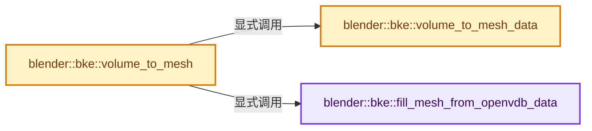
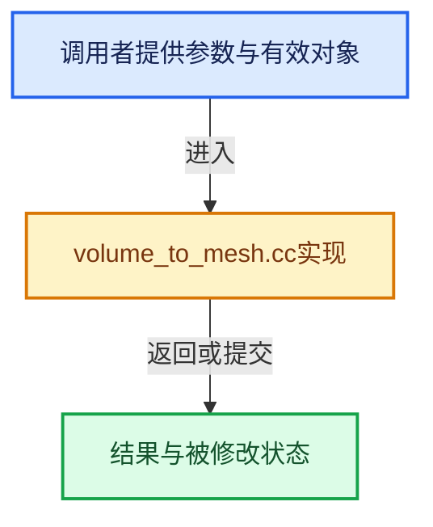

# 实现依赖专题：source/blender/blenkernel/intern/volume_to_mesh.cc

[实现依赖导航](../../README.md) · [符号索引](../../../00-课程指南/02-源码与提交索引/符号依赖与实现索引.md)

本专题从正文实际调用进入，集中保存共享实现。函数有稳定锚点，可从调用处直接跳到对应完整函数；递归与互相调用通过回链组织。

## 本文件的实现关系






## 完整成员与函数实现

<a id="f-863123750560cba0"></a>

### `blender::bke::fill_mesh_from_openvdb_data`

实现位置：[source/blender/blenkernel/intern/volume_to_mesh.cc](../../../../../../../source/blender/blenkernel/intern/volume_to_mesh.cc) · L126—L158。

接口参数：

- `const Span<openvdb::Vec3s> vdb_verts`
- `const Span<openvdb::Vec3I> vdb_tris`
- `const Span<openvdb::Vec4I> vdb_quads`
- `const int vert_offset`
- `const int face_offset`
- `const int loop_offset`
- `MutableSpan<float3> vert_positions`
- `MutableSpan<int> face_offsets`
- `MutableSpan<int> corner_verts`

**教学注释版**

<!-- annotated:57a3cc27f655f3 -->

```cpp
void fill_mesh_from_openvdb_data(const Span<openvdb::Vec3s> vdb_verts,
                                 const Span<openvdb::Vec3I> vdb_tris,
                                 const Span<openvdb::Vec4I> vdb_quads,
                                 const int vert_offset,
                                 const int face_offset,
                                 const int loop_offset,
                                 MutableSpan<float3> vert_positions,
                                 MutableSpan<int> face_offsets,
                                 MutableSpan<int> corner_verts)
{
  /* Write vertices. */
  // [讲解] vert_positions.slice：建立原连续范围的子视图。
  vert_positions.slice(vert_offset, vdb_verts.size()).copy_from(vdb_verts.cast<float3>());

  /* Write triangles. */
  // [讲解] vdb_tris.index_range：查询视图长度或生成对应有效索引区间。
  for (const int i : vdb_tris.index_range()) {
    face_offsets[face_offset + i] = loop_offset + 3 * i;
    for (int j = 0; j < 3; j++) {
      /* Reverse vertex order to get correct normals. */
      corner_verts[loop_offset + 3 * i + j] = vert_offset + vdb_tris[i][2 - j];
    }
  }

  /* Write quads. */
  // [讲解] vdb_tris.size：查询视图长度或生成对应有效索引区间。
  const int quad_offset = face_offset + vdb_tris.size();
  const int quad_loop_offset = loop_offset + vdb_tris.size() * 3;
  for (const int i : vdb_quads.index_range()) {
    face_offsets[quad_offset + i] = quad_loop_offset + 4 * i;
    for (int j = 0; j < 4; j++) {
      /* Reverse vertex order to get correct normals. */
      corner_verts[quad_loop_offset + 4 * i + j] = vert_offset + vdb_quads[i][3 - j];
    }
  }
}
```

<details>
<summary>核对原始源码：source/blender/blenkernel/intern/volume_to_mesh.cc · L126—L158</summary>

<!-- original:57a3cc27f655f3:source/blender/blenkernel/intern/volume_to_mesh.cc:126:158 -->

```cpp
void fill_mesh_from_openvdb_data(const Span<openvdb::Vec3s> vdb_verts,
                                 const Span<openvdb::Vec3I> vdb_tris,
                                 const Span<openvdb::Vec4I> vdb_quads,
                                 const int vert_offset,
                                 const int face_offset,
                                 const int loop_offset,
                                 MutableSpan<float3> vert_positions,
                                 MutableSpan<int> face_offsets,
                                 MutableSpan<int> corner_verts)
{
  /* Write vertices. */
  vert_positions.slice(vert_offset, vdb_verts.size()).copy_from(vdb_verts.cast<float3>());

  /* Write triangles. */
  for (const int i : vdb_tris.index_range()) {
    face_offsets[face_offset + i] = loop_offset + 3 * i;
    for (int j = 0; j < 3; j++) {
      /* Reverse vertex order to get correct normals. */
      corner_verts[loop_offset + 3 * i + j] = vert_offset + vdb_tris[i][2 - j];
    }
  }

  /* Write quads. */
  const int quad_offset = face_offset + vdb_tris.size();
  const int quad_loop_offset = loop_offset + vdb_tris.size() * 3;
  for (const int i : vdb_quads.index_range()) {
    face_offsets[quad_offset + i] = quad_loop_offset + 4 * i;
    for (int j = 0; j < 4; j++) {
      /* Reverse vertex order to get correct normals. */
      corner_verts[quad_loop_offset + 4 * i + j] = vert_offset + vdb_quads[i][3 - j];
    }
  }
}
```

</details>

**继续追踪实现**

- `vert_positions.slice(vert_offset, vdb_verts.size()).copy_from` → [调用协议](../../../00-课程指南/01-路线与规范/模板宏与动态分派协议.md)：接收对象类型依赖auto、返回值或模板实例；不按同名猜测目标。调用位置L137。
- `vert_positions.slice` → [blender::MutableSpan::slice · L579](../../../01-基础容器与现代CPP/06-MutableSpan可写视图.md#f-6808b4aefbf58808)；[blender::MutableSpan::slice · L587](../../../01-基础容器与现代CPP/06-MutableSpan可写视图.md#f-c05b010821861e4f)。同名重载需按实参类型选择。
- `vdb_verts.size` → [blender::Span::size · L256](../../../01-基础容器与现代CPP/05-Span只读连续视图.md#f-5f80fa006089c998)。
- `vdb_verts.cast<float3>` → [blender::Span::cast · L422](../../../01-基础容器与现代CPP/05-Span只读连续视图.md#f-e082d823028af8f6)。
- `vdb_tris.index_range` → [blender::Span::index_range · L405](../../../01-基础容器与现代CPP/05-Span只读连续视图.md#f-caaa9b06e13e53e0)。
- `vdb_tris.size` → [blender::Span::size · L256](../../../01-基础容器与现代CPP/05-Span只读连续视图.md#f-5f80fa006089c998)。
- `vdb_quads.index_range` → [blender::Span::index_range · L405](../../../01-基础容器与现代CPP/05-Span只读连续视图.md#f-caaa9b06e13e53e0)。

<a id="f-554f3397a140af22"></a>

### `blender::bke::volume_to_mesh_data`

实现位置：[source/blender/blenkernel/intern/volume_to_mesh.cc](../../../../../../../source/blender/blenkernel/intern/volume_to_mesh.cc) · L160—L173。

接口参数：

- `const openvdb::GridBase &grid`
- `const VolumeToMeshResolution &resolution`
- `const float threshold`
- `const float adaptivity`

**教学注释版**

<!-- annotated:1de463f32f7abb -->

```cpp
bke::VolumeToMeshDataResult volume_to_mesh_data(const openvdb::GridBase &grid,
                                                const VolumeToMeshResolution &resolution,
                                                const float threshold,
                                                const float adaptivity)
{
  const VolumeGridType grid_type = bke::volume_grid::get_type(grid);

  VolumeToMeshOp to_mesh_op{grid, resolution, threshold, adaptivity};
  if (!BKE_volume_grid_type_operation(grid_type, to_mesh_op)) {
    return {};
  }
  // [讲解] std::move：把表达式转换成可供移动重载选择的值类别；不保证真的移动，不结束源对象寿命，对const值可能选择复制。
  return {{std::move(to_mesh_op.verts), std::move(to_mesh_op.tris), std::move(to_mesh_op.quads)},
          to_mesh_op.error};
}
```

<details>
<summary>核对原始源码：source/blender/blenkernel/intern/volume_to_mesh.cc · L160—L173</summary>

<!-- original:1de463f32f7abb:source/blender/blenkernel/intern/volume_to_mesh.cc:160:173 -->

```cpp
bke::VolumeToMeshDataResult volume_to_mesh_data(const openvdb::GridBase &grid,
                                                const VolumeToMeshResolution &resolution,
                                                const float threshold,
                                                const float adaptivity)
{
  const VolumeGridType grid_type = bke::volume_grid::get_type(grid);

  VolumeToMeshOp to_mesh_op{grid, resolution, threshold, adaptivity};
  if (!BKE_volume_grid_type_operation(grid_type, to_mesh_op)) {
    return {};
  }
  return {{std::move(to_mesh_op.verts), std::move(to_mesh_op.tris), std::move(to_mesh_op.quads)},
          to_mesh_op.error};
}
```

</details>

**结果出口**

- `return {};`
- `return {{std::move(to_mesh_op.verts), std::move(to_mesh_op.tris), std::move(to_mesh_op.quads)},`

**继续追踪实现**

- `bke::volume_grid::get_type` → [blender::bke::volume_grid::get_type · L416](volume_grid.cc.md#f-6ec0031de7935520)；[blender::bke::volume_grid::get_type · L451](volume_grid.cc.md#f-e58020f175d3e983)；[blender::bke::volume_grid::get_type · L499](volume_grid.cc.md#f-522a600410e01abc)。同名重载需按实参类型选择。
- `BKE_volume_grid_type_operation` → [blender::BKE_volume_grid_type_operation · L51](../BKE_volume_openvdb.hh.md#f-1d1852185d7a47bd)。
- `std::move` → [外部契约](https://eel.is/c++draft/utility.forward)：把表达式转换成可供移动重载选择的值类别；不保证真的移动，不结束源对象寿命，对const值可能选择复制。

<a id="f-2c90e976a0e44237"></a>

### `blender::bke::volume_to_mesh`

实现位置：[source/blender/blenkernel/intern/volume_to_mesh.cc](../../../../../../../source/blender/blenkernel/intern/volume_to_mesh.cc) · L175—L204。

接口参数：

- `const openvdb::GridBase &grid`
- `const VolumeToMeshResolution &resolution`
- `const float threshold`
- `const float adaptivity`

**教学注释版**

<!-- annotated:1427e94775c595 -->

```cpp
Mesh *volume_to_mesh(const openvdb::GridBase &grid,
                     const VolumeToMeshResolution &resolution,
                     const float threshold,
                     const float adaptivity)
{
  using namespace blender::bke;
  const OpenVDBMeshData mesh_data =
      volume_to_mesh_data(grid, resolution, threshold, adaptivity).data;

  const int tot_loops = 3 * mesh_data.tris.size() + 4 * mesh_data.quads.size();
  const int tot_faces = mesh_data.tris.size() + mesh_data.quads.size();
  Mesh *mesh = BKE_mesh_new_nomain(mesh_data.verts.size(), 0, tot_faces, tot_loops);

  fill_mesh_from_openvdb_data(mesh_data.verts,
                              mesh_data.tris,
                              mesh_data.quads,
                              0,
                              0,
                              0,
                              mesh->vert_positions_for_write(),
                              mesh->face_offsets_for_write(),
                              mesh->corner_verts_for_write());

  mesh_calc_edges(*mesh, false, false);
  mesh_smooth_set(*mesh, false);

  mesh->tag_overlapping_none();

  return mesh;
}
```

<details>
<summary>核对原始源码：source/blender/blenkernel/intern/volume_to_mesh.cc · L175—L204</summary>

<!-- original:1427e94775c595:source/blender/blenkernel/intern/volume_to_mesh.cc:175:204 -->

```cpp
Mesh *volume_to_mesh(const openvdb::GridBase &grid,
                     const VolumeToMeshResolution &resolution,
                     const float threshold,
                     const float adaptivity)
{
  using namespace blender::bke;
  const OpenVDBMeshData mesh_data =
      volume_to_mesh_data(grid, resolution, threshold, adaptivity).data;

  const int tot_loops = 3 * mesh_data.tris.size() + 4 * mesh_data.quads.size();
  const int tot_faces = mesh_data.tris.size() + mesh_data.quads.size();
  Mesh *mesh = BKE_mesh_new_nomain(mesh_data.verts.size(), 0, tot_faces, tot_loops);

  fill_mesh_from_openvdb_data(mesh_data.verts,
                              mesh_data.tris,
                              mesh_data.quads,
                              0,
                              0,
                              0,
                              mesh->vert_positions_for_write(),
                              mesh->face_offsets_for_write(),
                              mesh->corner_verts_for_write());

  mesh_calc_edges(*mesh, false, false);
  mesh_smooth_set(*mesh, false);

  mesh->tag_overlapping_none();

  return mesh;
}
```

</details>

**结果出口**

- `return mesh;`

**继续追踪实现**

- `volume_to_mesh_data` → [blender::bke::volume_to_mesh_data · L160](volume_to_mesh.cc.md#f-554f3397a140af22)。
- `mesh_data.tris.size` → [调用协议](../../../00-课程指南/01-路线与规范/模板宏与动态分派协议.md)：接收对象类型依赖auto、返回值或模板实例；不按同名猜测目标。调用位置L184。
- `mesh_data.quads.size` → [调用协议](../../../00-课程指南/01-路线与规范/模板宏与动态分派协议.md)：接收对象类型依赖auto、返回值或模板实例；不按同名猜测目标。调用位置L184。
- `BKE_mesh_new_nomain` → [BKE_mesh_new_nomain · L1376](../../../05-几何存储与拓扑映射/03-MPoly迁移与兼容.md#f-d63806a6e34190f2)。
- `mesh_data.verts.size` → [调用协议](../../../00-课程指南/01-路线与规范/模板宏与动态分派协议.md)：接收对象类型依赖auto、返回值或模板实例；不按同名猜测目标。调用位置L186。
- `fill_mesh_from_openvdb_data` → [blender::bke::fill_mesh_from_openvdb_data · L126](volume_to_mesh.cc.md#f-863123750560cba0)。
- `mesh->vert_positions_for_write` → [Mesh::vert_positions_for_write · L1199](../../../05-几何存储与拓扑映射/03-MPoly迁移与兼容.md#f-ae8d77205112d843)。
- `mesh->face_offsets_for_write` → [Mesh::face_offsets_for_write · L1228](../../../05-几何存储与拓扑映射/03-MPoly迁移与兼容.md#f-483f42747ab436a2)。
- `mesh->corner_verts_for_write` → [Mesh::corner_verts_for_write · L1246](../../../05-几何存储与拓扑映射/03-MPoly迁移与兼容.md#f-6dfaf316a81ba215)。
- `mesh_calc_edges` → [blender::bke::mesh_calc_edges · L234](mesh_calc_edges.cc.md#f-8dc1463382ec6743)；[blender::bke::mesh_calc_edges · L578](mesh_calc_edges.cc.md#f-1312012cc732ca47)。同名重载需按实参类型选择。
- `mesh_smooth_set` → [bke::mesh_smooth_set · L1900](../../../05-几何存储与拓扑映射/03-MPoly迁移与兼容.md#f-61497df030106e04)。
- `mesh->tag_overlapping_none` → [blender::Mesh::tag_overlapping_none · L229](../../../06-隐式共享与缓存系统/10-局部更新与失效修复.md#f-23199a5a728fd0dc)。
