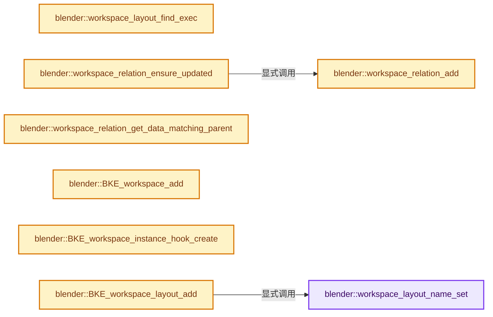
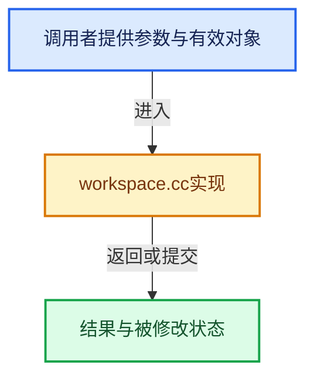

# 实现依赖专题：source/blender/blenkernel/intern/workspace.cc

[实现依赖导航](../../README.md) · [符号索引](../../../00-课程指南/02-源码与提交索引/符号依赖与实现索引.md)

本专题从正文实际调用进入，集中保存共享实现。函数有稳定锚点，可从调用处直接跳到对应完整函数；递归与互相调用通过回链组织。

## 本文件的实现关系






## 完整成员与函数实现

<a id="f-bad35ac1a66278be"></a>

### `blender::workspace_layout_name_set`

实现位置：[source/blender/blenkernel/intern/workspace.cc](../../../../../../../source/blender/blenkernel/intern/workspace.cc) · L263—L274。

接口参数：

- `WorkSpace *workspace`
- `WorkSpaceLayout *layout`
- `const char *new_name`

**教学注释版**

<!-- annotated:62be246d9b40b1 -->

```cpp
static void workspace_layout_name_set(WorkSpace *workspace,
                                      WorkSpaceLayout *layout,
                                      const char *new_name)
{
  STRNCPY(layout->name, new_name);
  BLI_uniquename(&workspace->layouts,
                 layout,
                 "Layout",
                 '.',
                 offsetof(WorkSpaceLayout, name),
                 sizeof(layout->name));
}
```

<details>
<summary>核对原始源码：source/blender/blenkernel/intern/workspace.cc · L263—L274</summary>

<!-- original:62be246d9b40b1:source/blender/blenkernel/intern/workspace.cc:263:274 -->

```cpp
static void workspace_layout_name_set(WorkSpace *workspace,
                                      WorkSpaceLayout *layout,
                                      const char *new_name)
{
  STRNCPY(layout->name, new_name);
  BLI_uniquename(&workspace->layouts,
                 layout,
                 "Layout",
                 '.',
                 offsetof(WorkSpaceLayout, name),
                 sizeof(layout->name));
}
```

</details>

**继续追踪实现**

- `STRNCPY` → [blender::STRNCPY · L690](../../01-BLI基础库/BLI_string.hh.md#f-6b2d861724026be6)。
- `BLI_uniquename` → [blender::BLI_uniquename · L491](../../01-BLI基础库/intern/string_utils.cc.md#f-bcf1a000dbfb87d1)。

<a id="f-c338bcc57b6fba75"></a>

### `blender::workspace_layout_find_exec`

实现位置：[source/blender/blenkernel/intern/workspace.cc](../../../../../../../source/blender/blenkernel/intern/workspace.cc) · L281—L286。

接口参数：

- `const WorkSpace *workspace`
- `const bScreen *screen`

**教学注释版**

<!-- annotated:a1a188e5c08564 -->

```cpp
static WorkSpaceLayout *workspace_layout_find_exec(const WorkSpace *workspace,
                                                   const bScreen *screen)
{
  return static_cast<WorkSpaceLayout *>(
      BLI_findptr(&workspace->layouts, screen, offsetof(WorkSpaceLayout, screen)));
}
```

<details>
<summary>核对原始源码：source/blender/blenkernel/intern/workspace.cc · L281—L286</summary>

<!-- original:a1a188e5c08564:source/blender/blenkernel/intern/workspace.cc:281:286 -->

```cpp
static WorkSpaceLayout *workspace_layout_find_exec(const WorkSpace *workspace,
                                                   const bScreen *screen)
{
  return static_cast<WorkSpaceLayout *>(
      BLI_findptr(&workspace->layouts, screen, offsetof(WorkSpaceLayout, screen)));
}
```

</details>

**结果出口**

- `return static_cast<WorkSpaceLayout *>(`

**继续追踪实现**

- `BLI_findptr` → [blender::BLI_findptr · L710](../../01-BLI基础库/intern/listbase.cc.md#f-3093e95bd403c099)。

<a id="f-01bc183a3111982e"></a>

### `blender::workspace_relation_add`

实现位置：[source/blender/blenkernel/intern/workspace.cc](../../../../../../../source/blender/blenkernel/intern/workspace.cc) · L288—L299。

接口参数：

- `ListBaseT<WorkSpaceDataRelation> *relation_list`
- `void *parent`
- `const int parentid`
- `void *data`

**教学注释版**

<!-- annotated:94b6abe399c29a -->

```cpp
static void workspace_relation_add(ListBaseT<WorkSpaceDataRelation> *relation_list,
                                   void *parent,
                                   const int parentid,
                                   void *data)
{
  WorkSpaceDataRelation *relation = MEM_new<WorkSpaceDataRelation>(__func__);
  relation->parent = parent;
  relation->parentid = parentid;
  relation->value = data;
  /* add to head, if we switch back to it soon we find it faster. */
  BLI_addhead(relation_list, relation);
}
```

<details>
<summary>核对原始源码：source/blender/blenkernel/intern/workspace.cc · L288—L299</summary>

<!-- original:94b6abe399c29a:source/blender/blenkernel/intern/workspace.cc:288:299 -->

```cpp
static void workspace_relation_add(ListBaseT<WorkSpaceDataRelation> *relation_list,
                                   void *parent,
                                   const int parentid,
                                   void *data)
{
  WorkSpaceDataRelation *relation = MEM_new<WorkSpaceDataRelation>(__func__);
  relation->parent = parent;
  relation->parentid = parentid;
  relation->value = data;
  /* add to head, if we switch back to it soon we find it faster. */
  BLI_addhead(relation_list, relation);
}
```

</details>

**沿实际写入检查状态**

- `relation->parent = parent;`
- `relation->parentid = parentid;`
- `relation->value = data;`

**继续追踪实现**

- `MEM_new<WorkSpaceDataRelation>` → [MEM_new · L351](../../07-Intern运行时与平台/guardedalloc/MEM_guardedalloc.h.md#f-115f9b6784f89912)。
- `BLI_addhead` → [blender::BLI_addhead · L98](../../01-BLI基础库/intern/listbase.cc.md#f-fed3ad483fcdfeb9)。

<a id="f-4105cb054b85b2ef"></a>

### `blender::workspace_relation_ensure_updated`

实现位置：[source/blender/blenkernel/intern/workspace.cc](../../../../../../../source/blender/blenkernel/intern/workspace.cc) · L307—L325。

接口参数：

- `ListBaseT<WorkSpaceDataRelation> *relation_list`
- `void *parent`
- `const int parentid`
- `void *data`

**教学注释版**

<!-- annotated:36afa64499194d -->

```cpp
static void workspace_relation_ensure_updated(ListBaseT<WorkSpaceDataRelation> *relation_list,
                                              void *parent,
                                              const int parentid,
                                              void *data)
{
  WorkSpaceDataRelation *relation = static_cast<WorkSpaceDataRelation *>(BLI_listbase_bytes_find(
      relation_list, &parentid, sizeof(parentid), offsetof(WorkSpaceDataRelation, parentid)));
  if (relation != nullptr) {
    relation->parent = parent;
    relation->value = data;
    /* reinsert at the head of the list, so that more commonly used relations are found faster. */
    BLI_remlink(relation_list, relation);
    BLI_addhead(relation_list, relation);
  }
  else {
    /* no matching relation found, add new one */
    workspace_relation_add(relation_list, parent, parentid, data);
  }
}
```

<details>
<summary>核对原始源码：source/blender/blenkernel/intern/workspace.cc · L307—L325</summary>

<!-- original:36afa64499194d:source/blender/blenkernel/intern/workspace.cc:307:325 -->

```cpp
static void workspace_relation_ensure_updated(ListBaseT<WorkSpaceDataRelation> *relation_list,
                                              void *parent,
                                              const int parentid,
                                              void *data)
{
  WorkSpaceDataRelation *relation = static_cast<WorkSpaceDataRelation *>(BLI_listbase_bytes_find(
      relation_list, &parentid, sizeof(parentid), offsetof(WorkSpaceDataRelation, parentid)));
  if (relation != nullptr) {
    relation->parent = parent;
    relation->value = data;
    /* reinsert at the head of the list, so that more commonly used relations are found faster. */
    BLI_remlink(relation_list, relation);
    BLI_addhead(relation_list, relation);
  }
  else {
    /* no matching relation found, add new one */
    workspace_relation_add(relation_list, parent, parentid, data);
  }
}
```

</details>

**沿实际写入检查状态**

- `relation->parent = parent;`
- `relation->value = data;`

**继续追踪实现**

- `BLI_listbase_bytes_find` → [blender::BLI_listbase_bytes_find · L737](../../01-BLI基础库/intern/listbase.cc.md#f-c6ffcf13ea08751b)。
- `BLI_remlink` → [blender::BLI_remlink · L138](../../01-BLI基础库/intern/listbase.cc.md#f-120d80f281ca4cb7)。
- `BLI_addhead` → [blender::BLI_addhead · L98](../../01-BLI基础库/intern/listbase.cc.md#f-fed3ad483fcdfeb9)。
- `workspace_relation_add` → [blender::workspace_relation_add · L288](workspace.cc.md#f-01bc183a3111982e)。

<a id="f-39aa0735d8b473f3"></a>

### `blender::workspace_relation_get_data_matching_parent`

实现位置：[source/blender/blenkernel/intern/workspace.cc](../../../../../../../source/blender/blenkernel/intern/workspace.cc) · L327—L337。

接口参数：

- `const ListBaseT<WorkSpaceDataRelation> *relation_list`
- `const void *parent`

**教学注释版**

<!-- annotated:234678fe12695a -->

```cpp
static void *workspace_relation_get_data_matching_parent(
    const ListBaseT<WorkSpaceDataRelation> *relation_list, const void *parent)
{
  WorkSpaceDataRelation *relation = static_cast<WorkSpaceDataRelation *>(
      BLI_findptr(relation_list, parent, offsetof(WorkSpaceDataRelation, parent)));
  if (relation != nullptr) {
    return relation->value;
  }

  return nullptr;
}
```

<details>
<summary>核对原始源码：source/blender/blenkernel/intern/workspace.cc · L327—L337</summary>

<!-- original:234678fe12695a:source/blender/blenkernel/intern/workspace.cc:327:337 -->

```cpp
static void *workspace_relation_get_data_matching_parent(
    const ListBaseT<WorkSpaceDataRelation> *relation_list, const void *parent)
{
  WorkSpaceDataRelation *relation = static_cast<WorkSpaceDataRelation *>(
      BLI_findptr(relation_list, parent, offsetof(WorkSpaceDataRelation, parent)));
  if (relation != nullptr) {
    return relation->value;
  }

  return nullptr;
}
```

</details>

**结果出口**

- `return relation->value;`
- `return nullptr;`

**继续追踪实现**

- `BLI_findptr` → [blender::BLI_findptr · L710](../../01-BLI基础库/intern/listbase.cc.md#f-3093e95bd403c099)。

<a id="f-08c7f908aaa3d225"></a>

### `blender::BKE_workspace_add`

实现位置：[source/blender/blenkernel/intern/workspace.cc](../../../../../../../source/blender/blenkernel/intern/workspace.cc) · L369—L374。

接口参数：

- `Main *bmain`
- `const char *name`

**教学注释版**

<!-- annotated:9365cadda862a1 -->

```cpp
WorkSpace *BKE_workspace_add(Main *bmain, const char *name)
{
  WorkSpace *new_workspace = BKE_id_new<WorkSpace>(bmain, name);
  id_us_ensure_real(&new_workspace->id);
  return new_workspace;
}
```

<details>
<summary>核对原始源码：source/blender/blenkernel/intern/workspace.cc · L369—L374</summary>

<!-- original:9365cadda862a1:source/blender/blenkernel/intern/workspace.cc:369:374 -->

```cpp
WorkSpace *BKE_workspace_add(Main *bmain, const char *name)
{
  WorkSpace *new_workspace = BKE_id_new<WorkSpace>(bmain, name);
  id_us_ensure_real(&new_workspace->id);
  return new_workspace;
}
```

</details>

**结果出口**

- `return new_workspace;`

**继续追踪实现**

- `BKE_id_new<WorkSpace>` → [blender::BKE_id_new · L1612](lib_id.cc.md#f-5335c97ce0a8fbc8)。
- `id_us_ensure_real` → [blender::id_us_ensure_real · L388](lib_id.cc.md#f-6faedd694354706a)。

<a id="f-87e0911e5379b009"></a>

### `blender::BKE_workspace_instance_hook_create`

实现位置：[source/blender/blenkernel/intern/workspace.cc](../../../../../../../source/blender/blenkernel/intern/workspace.cc) · L387—L399。

接口参数：

- `const Main *bmain`
- `const int winid`

**教学注释版**

<!-- annotated:d2de20031bc3a4 -->

```cpp
WorkSpaceInstanceHook *BKE_workspace_instance_hook_create(const Main *bmain, const int winid)
{
  WorkSpaceInstanceHook *hook = MEM_new<WorkSpaceInstanceHook>(__func__);

  /* set an active screen-layout for each possible window/workspace combination */
  for (WorkSpace *workspace = bmain->workspaces.first(); workspace;
       workspace = static_cast<WorkSpace *>(workspace->id.next))
  {
    BKE_workspace_active_layout_set(hook, winid, workspace, workspace->layouts.first());
  }

  return hook;
}
```

<details>
<summary>核对原始源码：source/blender/blenkernel/intern/workspace.cc · L387—L399</summary>

<!-- original:d2de20031bc3a4:source/blender/blenkernel/intern/workspace.cc:387:399 -->

```cpp
WorkSpaceInstanceHook *BKE_workspace_instance_hook_create(const Main *bmain, const int winid)
{
  WorkSpaceInstanceHook *hook = MEM_new<WorkSpaceInstanceHook>(__func__);

  /* set an active screen-layout for each possible window/workspace combination */
  for (WorkSpace *workspace = bmain->workspaces.first(); workspace;
       workspace = static_cast<WorkSpace *>(workspace->id.next))
  {
    BKE_workspace_active_layout_set(hook, winid, workspace, workspace->layouts.first());
  }

  return hook;
}
```

</details>

**沿实际写入检查状态**

- `workspace = static_cast<WorkSpace *>(workspace->id.next))`

**结果出口**

- `return hook;`

**继续追踪实现**

- `MEM_new<WorkSpaceInstanceHook>` → [MEM_new · L351](../../07-Intern运行时与平台/guardedalloc/MEM_guardedalloc.h.md#f-115f9b6784f89912)。
- `bmain->workspaces.first` → [调用协议](../../../00-课程指南/01-路线与规范/模板宏与动态分派协议.md)：接收对象类型依赖auto、返回值或模板实例；不按同名猜测目标。调用位置L392。
- `BKE_workspace_active_layout_set` → [blender::BKE_workspace_active_layout_set · L675](workspace.cc.md#f-cea62492417d42f5)。
- `workspace->layouts.first` → [调用协议](../../../00-课程指南/01-路线与规范/模板宏与动态分派协议.md)：接收对象类型依赖auto、返回值或模板实例；不按同名猜测目标。调用位置L395。

<a id="f-bbbee09d42bcc35a"></a>

### `blender::BKE_workspace_layout_add`

实现位置：[source/blender/blenkernel/intern/workspace.cc](../../../../../../../source/blender/blenkernel/intern/workspace.cc) · L426—L443。

接口参数：

- `Main *bmain`
- `WorkSpace &workspace`
- `bScreen &screen`
- `const char *name`

**教学注释版**

<!-- annotated:9bb1f401e0778d -->

```cpp
WorkSpaceLayout *BKE_workspace_layout_add(Main *bmain,
                                          WorkSpace &workspace,
                                          bScreen &screen,
                                          const char *name)
{
  WorkSpaceLayout *layout = MEM_new<WorkSpaceLayout>(__func__);

  BLI_assert(!bmain || !workspaces_is_screen_used(bmain, &screen));
#ifdef NDEBUG
  UNUSED_VARS(bmain);
#endif
  layout->screen = &screen;
  id_us_plus(&layout->screen->id);
  workspace_layout_name_set(&workspace, layout, name);
  BLI_addtail(&workspace.layouts, layout);

  return layout;
}
```

<details>
<summary>核对原始源码：source/blender/blenkernel/intern/workspace.cc · L426—L443</summary>

<!-- original:9bb1f401e0778d:source/blender/blenkernel/intern/workspace.cc:426:443 -->

```cpp
WorkSpaceLayout *BKE_workspace_layout_add(Main *bmain,
                                          WorkSpace &workspace,
                                          bScreen &screen,
                                          const char *name)
{
  WorkSpaceLayout *layout = MEM_new<WorkSpaceLayout>(__func__);

  BLI_assert(!bmain || !workspaces_is_screen_used(bmain, &screen));
#ifdef NDEBUG
  UNUSED_VARS(bmain);
#endif
  layout->screen = &screen;
  id_us_plus(&layout->screen->id);
  workspace_layout_name_set(&workspace, layout, name);
  BLI_addtail(&workspace.layouts, layout);

  return layout;
}
```

</details>

**沿实际写入检查状态**

- `layout->screen = &screen;`

**结果出口**

- `return layout;`

**继续追踪实现**

- `MEM_new<WorkSpaceLayout>` → [MEM_new · L351](../../07-Intern运行时与平台/guardedalloc/MEM_guardedalloc.h.md#f-115f9b6784f89912)。
- `BLI_assert` → [BLI_assert · L48](../../01-BLI基础库/BLI_assert.hh.md#m-57a88495704d)；[BLI_assert · L63](../../01-BLI基础库/BLI_assert.hh.md#m-d07050020cb5)。宏定义由构建条件选择。
- `workspaces_is_screen_used` → [调用协议](../../../00-课程指南/01-路线与规范/模板宏与动态分派协议.md)：函数指针、局部可调用对象或未展开的宏；必须结合调用者环境。调用位置L433。
- `UNUSED_VARS` → [UNUSED_VARS · L522](../../01-BLI基础库/BLI_utildefines.hh.md#m-013582537634)；[UNUSED_VARS · L41](../../08-其他Blender模块/gpu/GPU_shader_shared_utils.hh.md#m-05d9d7a33da0)；[UNUSED_VARS · L62](../../08-其他Blender模块/gpu/GPU_shader_shared_utils.hh.md#m-e12c683a4aca)。宏定义由构建条件选择。
- `id_us_plus` → [blender::id_us_plus · L433](lib_id.cc.md#f-1b90ef7608c4f32e)。
- `workspace_layout_name_set` → [blender::workspace_layout_name_set · L263](workspace.cc.md#f-bad35ac1a66278be)。
- `BLI_addtail` → [blender::BLI_addtail · L118](../../01-BLI基础库/intern/listbase.cc.md#f-4fb027713fa3115b)。

<a id="f-52ee28244a769012"></a>

### `blender::BKE_workspace_layout_find`

实现位置：[source/blender/blenkernel/intern/workspace.cc](../../../../../../../source/blender/blenkernel/intern/workspace.cc) · L499—L514。

接口参数：

- `const WorkSpace *workspace`
- `const bScreen *screen`

**教学注释版**

<!-- annotated:7b293f06b162b7 -->

```cpp
WorkSpaceLayout *BKE_workspace_layout_find(const WorkSpace *workspace, const bScreen *screen)
{
  WorkSpaceLayout *layout = workspace_layout_find_exec(workspace, screen);
  if (layout) {
    return layout;
  }

  printf(
      "%s: Couldn't find layout in this workspace: '%s' screen: '%s'. "
      "This should not happen!\n",
      __func__,
      workspace->id.name + 2,
      screen->id.name + 2);

  return nullptr;
}
```

<details>
<summary>核对原始源码：source/blender/blenkernel/intern/workspace.cc · L499—L514</summary>

<!-- original:7b293f06b162b7:source/blender/blenkernel/intern/workspace.cc:499:514 -->

```cpp
WorkSpaceLayout *BKE_workspace_layout_find(const WorkSpace *workspace, const bScreen *screen)
{
  WorkSpaceLayout *layout = workspace_layout_find_exec(workspace, screen);
  if (layout) {
    return layout;
  }

  printf(
      "%s: Couldn't find layout in this workspace: '%s' screen: '%s'. "
      "This should not happen!\n",
      __func__,
      workspace->id.name + 2,
      screen->id.name + 2);

  return nullptr;
}
```

</details>

**结果出口**

- `return layout;`
- `return nullptr;`

**继续追踪实现**

- `workspace_layout_find_exec` → [blender::workspace_layout_find_exec · L281](workspace.cc.md#f-c338bcc57b6fba75)。
- `printf` → [外部契约](https://eel.is/c++draft/)：这个边界按实际表达式及所属类型核对参数、返回值、寿命与失败行为。这里提供接口入口，不声称已解释该第三方版本的内部实现。

<a id="f-a34272faf21a82c1"></a>

### `blender::BKE_workspace_tool_remove`

实现位置：[source/blender/blenkernel/intern/workspace.cc](../../../../../../../source/blender/blenkernel/intern/workspace.cc) · L569—L579。

接口参数：

- `WorkSpace *workspace`
- `bToolRef *tref`

**教学注释版**

<!-- annotated:6e913bb4d69322 -->

```cpp
void BKE_workspace_tool_remove(WorkSpace *workspace, bToolRef *tref)
{
  if (tref->runtime) {
    MEM_delete(tref->runtime);
  }
  if (tref->properties) {
    IDP_FreeProperty(tref->properties);
  }
  BLI_remlink(&workspace->tools, tref);
  MEM_delete(tref);
}
```

<details>
<summary>核对原始源码：source/blender/blenkernel/intern/workspace.cc · L569—L579</summary>

<!-- original:6e913bb4d69322:source/blender/blenkernel/intern/workspace.cc:569:579 -->

```cpp
void BKE_workspace_tool_remove(WorkSpace *workspace, bToolRef *tref)
{
  if (tref->runtime) {
    MEM_delete(tref->runtime);
  }
  if (tref->properties) {
    IDP_FreeProperty(tref->properties);
  }
  BLI_remlink(&workspace->tools, tref);
  MEM_delete(tref);
}
```

</details>

**继续追踪实现**

- `MEM_delete` → [MEM_delete · L400](../../07-Intern运行时与平台/guardedalloc/MEM_guardedalloc.h.md#f-9049ffdd1682887c)。
- `IDP_FreeProperty` → [blender::IDP_FreeProperty · L1403](idprop.cc.md#f-389134a630df1bed)。
- `BLI_remlink` → [blender::BLI_remlink · L138](../../01-BLI基础库/intern/listbase.cc.md#f-120d80f281ca4cb7)。

<a id="f-7f52f1bc23484b22"></a>

### `blender::BKE_workspace_tool_id_replace_table`

实现位置：[source/blender/blenkernel/intern/workspace.cc](../../../../../../../source/blender/blenkernel/intern/workspace.cc) · L581—L605。

接口参数：

- `WorkSpace *workspace`
- `const int space_type`
- `const int mode`
- `const char *idname_prefix_skip`
- `const char *replace_table[][2]`
- `int replace_table_num`

**教学注释版**

<!-- annotated:3665e376ef554f -->

```cpp
void BKE_workspace_tool_id_replace_table(WorkSpace *workspace,
                                         const int space_type,
                                         const int mode,
                                         const char *idname_prefix_skip,
                                         const char *replace_table[][2],
                                         int replace_table_num)
{
  const size_t idname_prefix_len = idname_prefix_skip ? strlen(idname_prefix_skip) : 0;
  const size_t idname_suffix_maxncpy = sizeof(bToolRef::idname) - idname_prefix_len;

  for (bToolRef &tref : workspace->tools) {
    if (!(tref.space_type == space_type && tref.mode == mode)) {
      continue;
    }
    char *idname_suffix = tref.idname;
    if (idname_prefix_skip) {
      if (!STRPREFIX(idname_suffix, idname_prefix_skip)) {
        continue;
      }
      idname_suffix += idname_prefix_len;
    }
    BLI_string_replace_table_exact(
        idname_suffix, idname_suffix_maxncpy, replace_table, replace_table_num);
  }
}
```

<details>
<summary>核对原始源码：source/blender/blenkernel/intern/workspace.cc · L581—L605</summary>

<!-- original:3665e376ef554f:source/blender/blenkernel/intern/workspace.cc:581:605 -->

```cpp
void BKE_workspace_tool_id_replace_table(WorkSpace *workspace,
                                         const int space_type,
                                         const int mode,
                                         const char *idname_prefix_skip,
                                         const char *replace_table[][2],
                                         int replace_table_num)
{
  const size_t idname_prefix_len = idname_prefix_skip ? strlen(idname_prefix_skip) : 0;
  const size_t idname_suffix_maxncpy = sizeof(bToolRef::idname) - idname_prefix_len;

  for (bToolRef &tref : workspace->tools) {
    if (!(tref.space_type == space_type && tref.mode == mode)) {
      continue;
    }
    char *idname_suffix = tref.idname;
    if (idname_prefix_skip) {
      if (!STRPREFIX(idname_suffix, idname_prefix_skip)) {
        continue;
      }
      idname_suffix += idname_prefix_len;
    }
    BLI_string_replace_table_exact(
        idname_suffix, idname_suffix_maxncpy, replace_table, replace_table_num);
  }
}
```

</details>

**沿实际写入检查状态**

- `idname_suffix += idname_prefix_len;`

**继续追踪实现**

- `strlen` → [外部契约](https://eel.is/c++draft/)：这个边界按实际表达式及所属类型核对参数、返回值、寿命与失败行为。这里提供接口入口，不声称已解释该第三方版本的内部实现。
- `STRPREFIX` → [STRPREFIX · L117](../../07-Intern运行时与平台/ghost/intern/GHOST_utildefines.hh.md#m-f15302dd736a)；[STRPREFIX · L456](../../01-BLI基础库/BLI_utildefines.hh.md#m-afbbeb066fe7)；[STRPREFIX · L18](../../08-其他Blender模块/datatoc/datatoc.cc.md#m-cc9a805e5520)。宏定义由构建条件选择。
- `BLI_string_replace_table_exact` → [blender::BLI_string_replace_table_exact · L123](../../01-BLI基础库/intern/string_utils.cc.md#f-e66794301af00968)。

<a id="f-c029513fe561a031"></a>

### `blender::BKE_workspace_owner_id_check`

实现位置：[source/blender/blenkernel/intern/workspace.cc](../../../../../../../source/blender/blenkernel/intern/workspace.cc) · L607—L615。

接口参数：

- `const WorkSpace *workspace`
- `const char *owner_id`

**教学注释版**

<!-- annotated:de081a1e539212 -->

```cpp
bool BKE_workspace_owner_id_check(const WorkSpace *workspace, const char *owner_id)
{
  if ((*owner_id == '\0') || ((workspace->flags & WORKSPACE_USE_FILTER_BY_ORIGIN) == 0)) {
    return true;
  }

  /* We could use hash lookup, for now this list is highly likely under < ~16 items. */
  return BLI_findstring(&workspace->owner_ids, owner_id, offsetof(wmOwnerID, name)) != nullptr;
}
```

<details>
<summary>核对原始源码：source/blender/blenkernel/intern/workspace.cc · L607—L615</summary>

<!-- original:de081a1e539212:source/blender/blenkernel/intern/workspace.cc:607:615 -->

```cpp
bool BKE_workspace_owner_id_check(const WorkSpace *workspace, const char *owner_id)
{
  if ((*owner_id == '\0') || ((workspace->flags & WORKSPACE_USE_FILTER_BY_ORIGIN) == 0)) {
    return true;
  }

  /* We could use hash lookup, for now this list is highly likely under < ~16 items. */
  return BLI_findstring(&workspace->owner_ids, owner_id, offsetof(wmOwnerID, name)) != nullptr;
}
```

</details>

**结果出口**

- `return true;`
- `return BLI_findstring(&workspace->owner_ids, owner_id, offsetof(wmOwnerID, name)) != nullptr;`

**继续追踪实现**

- `BLI_findstring` → [blender::BLI_findstring · L615](../../01-BLI基础库/intern/listbase.cc.md#f-d913b13b2651348e)。

<a id="f-f6a071aeb96f2e78"></a>

### `blender::BKE_workspace_id_tag_all_visible`

实现位置：[source/blender/blenkernel/intern/workspace.cc](../../../../../../../source/blender/blenkernel/intern/workspace.cc) · L617—L625。

接口参数：

- `Main *bmain`
- `int tag`

**教学注释版**

<!-- annotated:84ba49957665e4 -->

```cpp
void BKE_workspace_id_tag_all_visible(Main *bmain, int tag)
{
  BKE_main_id_tag_listbase(&bmain->workspaces.cast<ID>(), tag, false);
  wmWindowManager *wm = bmain->wm.first();
  for (wmWindow &win : wm->windows) {
    WorkSpace *workspace = BKE_workspace_active_get(win.workspace_hook);
    workspace->id.tag |= tag;
  }
}
```

<details>
<summary>核对原始源码：source/blender/blenkernel/intern/workspace.cc · L617—L625</summary>

<!-- original:84ba49957665e4:source/blender/blenkernel/intern/workspace.cc:617:625 -->

```cpp
void BKE_workspace_id_tag_all_visible(Main *bmain, int tag)
{
  BKE_main_id_tag_listbase(&bmain->workspaces.cast<ID>(), tag, false);
  wmWindowManager *wm = bmain->wm.first();
  for (wmWindow &win : wm->windows) {
    WorkSpace *workspace = BKE_workspace_active_get(win.workspace_hook);
    workspace->id.tag |= tag;
  }
}
```

</details>

**沿实际写入检查状态**

- `workspace->id.tag |= tag;`

**继续追踪实现**

- `BKE_main_id_tag_listbase` → [blender::BKE_main_id_tag_listbase · L1291](lib_id.cc.md#f-dc1f19761bb957cc)。
- `bmain->workspaces.cast<ID>` → [调用协议](../../../00-课程指南/01-路线与规范/模板宏与动态分派协议.md)：接收对象类型依赖auto、返回值或模板实例；不按同名猜测目标。调用位置L619。
- `bmain->wm.first` → [调用协议](../../../00-课程指南/01-路线与规范/模板宏与动态分派协议.md)：接收对象类型依赖auto、返回值或模板实例；不按同名猜测目标。调用位置L620。
- `BKE_workspace_active_get` → [blender::BKE_workspace_active_get · L633](workspace.cc.md#f-ce6f20307c1fc1a9)。

<a id="f-ce6f20307c1fc1a9"></a>

### `blender::BKE_workspace_active_get`

实现位置：[source/blender/blenkernel/intern/workspace.cc](../../../../../../../source/blender/blenkernel/intern/workspace.cc) · L633—L636。

接口参数：

- `WorkSpaceInstanceHook *hook`

**教学注释版**

<!-- annotated:cd299411ca04b4 -->

```cpp
WorkSpace *BKE_workspace_active_get(WorkSpaceInstanceHook *hook)
{
  return hook->active;
}
```

<details>
<summary>核对原始源码：source/blender/blenkernel/intern/workspace.cc · L633—L636</summary>

<!-- original:cd299411ca04b4:source/blender/blenkernel/intern/workspace.cc:633:636 -->

```cpp
WorkSpace *BKE_workspace_active_get(WorkSpaceInstanceHook *hook)
{
  return hook->active;
}
```

</details>

**结果出口**

- `return hook->active;`

**继续追踪实现**

本实现没有需要继续展开的显式调用；检查返回表达式、对象转换和调用者前置条件。

<a id="f-641ce63cacc32381"></a>

### `blender::BKE_workspace_active_set`

实现位置：[source/blender/blenkernel/intern/workspace.cc](../../../../../../../source/blender/blenkernel/intern/workspace.cc) · L637—L655。

接口参数：

- `WorkSpaceInstanceHook *hook`
- `WorkSpace *workspace`

**教学注释版**

<!-- annotated:1969c163a252a0 -->

```cpp
void BKE_workspace_active_set(WorkSpaceInstanceHook *hook, WorkSpace *workspace)
{
  /* DO NOT check for `hook->active == workspace` here. Caller code is supposed to do it if
   * that optimization is possible and needed.
   * This code can be called from places where we might have this equality, but still want to
   * ensure/update the active layout below.
   * Known case where this is buggy and will crash later due to nullptr active layout: reading
   * a blend file, when the new read workspace ID happens to have the exact same memory address
   * as when it was saved in the blend file (extremely unlikely, but possible). */

  hook->active = workspace;
  if (workspace) {
    WorkSpaceLayout *layout = static_cast<WorkSpaceLayout *>(
        workspace_relation_get_data_matching_parent(&workspace->hook_layout_relations, hook));
    if (layout) {
      hook->act_layout = layout;
    }
  }
}
```

<details>
<summary>核对原始源码：source/blender/blenkernel/intern/workspace.cc · L637—L655</summary>

<!-- original:1969c163a252a0:source/blender/blenkernel/intern/workspace.cc:637:655 -->

```cpp
void BKE_workspace_active_set(WorkSpaceInstanceHook *hook, WorkSpace *workspace)
{
  /* DO NOT check for `hook->active == workspace` here. Caller code is supposed to do it if
   * that optimization is possible and needed.
   * This code can be called from places where we might have this equality, but still want to
   * ensure/update the active layout below.
   * Known case where this is buggy and will crash later due to nullptr active layout: reading
   * a blend file, when the new read workspace ID happens to have the exact same memory address
   * as when it was saved in the blend file (extremely unlikely, but possible). */

  hook->active = workspace;
  if (workspace) {
    WorkSpaceLayout *layout = static_cast<WorkSpaceLayout *>(
        workspace_relation_get_data_matching_parent(&workspace->hook_layout_relations, hook));
    if (layout) {
      hook->act_layout = layout;
    }
  }
}
```

</details>

**沿实际写入检查状态**

- `hook->active = workspace;`
- `hook->act_layout = layout;`

**继续追踪实现**

- `workspace_relation_get_data_matching_parent` → [blender::workspace_relation_get_data_matching_parent · L327](workspace.cc.md#f-39aa0735d8b473f3)。

<a id="f-cea62492417d42f5"></a>

### `blender::BKE_workspace_active_layout_set`

实现位置：[source/blender/blenkernel/intern/workspace.cc](../../../../../../../source/blender/blenkernel/intern/workspace.cc) · L675—L682。

接口参数：

- `WorkSpaceInstanceHook *hook`
- `const int winid`
- `WorkSpace *workspace`
- `WorkSpaceLayout *layout`

**教学注释版**

<!-- annotated:66ef95329e7a62 -->

```cpp
void BKE_workspace_active_layout_set(WorkSpaceInstanceHook *hook,
                                     const int winid,
                                     WorkSpace *workspace,
                                     WorkSpaceLayout *layout)
{
  hook->act_layout = layout;
  workspace_relation_ensure_updated(&workspace->hook_layout_relations, hook, winid, layout);
}
```

<details>
<summary>核对原始源码：source/blender/blenkernel/intern/workspace.cc · L675—L682</summary>

<!-- original:66ef95329e7a62:source/blender/blenkernel/intern/workspace.cc:675:682 -->

```cpp
void BKE_workspace_active_layout_set(WorkSpaceInstanceHook *hook,
                                     const int winid,
                                     WorkSpace *workspace,
                                     WorkSpaceLayout *layout)
{
  hook->act_layout = layout;
  workspace_relation_ensure_updated(&workspace->hook_layout_relations, hook, winid, layout);
}
```

</details>

**沿实际写入检查状态**

- `hook->act_layout = layout;`

**继续追踪实现**

- `workspace_relation_ensure_updated` → [blender::workspace_relation_ensure_updated · L307](workspace.cc.md#f-4105cb054b85b2ef)。

<a id="f-514f5bcbd6245e5d"></a>

### `blender::BKE_workspace_active_screen_get`

实现位置：[source/blender/blenkernel/intern/workspace.cc](../../../../../../../source/blender/blenkernel/intern/workspace.cc) · L684—L687。

接口参数：

- `const WorkSpaceInstanceHook *hook`

**教学注释版**

<!-- annotated:c1876baf006721 -->

```cpp
bScreen *BKE_workspace_active_screen_get(const WorkSpaceInstanceHook *hook)
{
  return hook->act_layout->screen;
}
```

<details>
<summary>核对原始源码：source/blender/blenkernel/intern/workspace.cc · L684—L687</summary>

<!-- original:c1876baf006721:source/blender/blenkernel/intern/workspace.cc:684:687 -->

```cpp
bScreen *BKE_workspace_active_screen_get(const WorkSpaceInstanceHook *hook)
{
  return hook->act_layout->screen;
}
```

</details>

**结果出口**

- `return hook->act_layout->screen;`

**继续追踪实现**

本实现没有需要继续展开的显式调用；检查返回表达式、对象转换和调用者前置条件。
