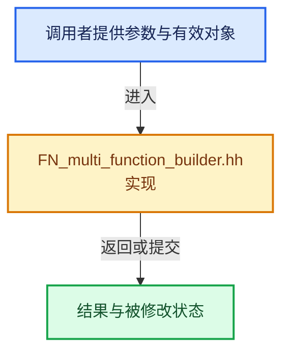

# 实现依赖专题：source/blender/functions/FN_multi_function_builder.hh

[实现依赖导航](../README.md) · [符号索引](../../00-课程指南/02-源码与提交索引/符号依赖与实现索引.md)

本专题从正文实际调用进入，集中保存共享实现。函数有稳定锚点，可从调用处直接跳到对应完整函数；递归与互相调用通过回链组织。

## 本文件的实现关系





## 相关类型布局与成员入口

<a id="t-270ed26a4400"></a>

### `blender::fn::multi_function::build::exec_presets::AllSpanOrSingle`

原始声明：[source/blender/functions/FN_multi_function_builder.hh](../../../../../../source/blender/functions/FN_multi_function_builder.hh) · L60—L85。

成员布局：

- `bool use_devirtualization`
- `FallbackMode fallback_mode`

以下保留类的数据声明与编译条件，成员函数实现通过后面的精确链接阅读。

<!-- annotated:3fe44a233b5c4f -->

```cpp
struct AllSpanOrSingle {
  static constexpr bool use_devirtualization = true;
  static constexpr FallbackMode fallback_mode = FallbackMode::Materialized;

```

<details>
<summary>核对原始源码：source/blender/functions/FN_multi_function_builder.hh · L60—L63</summary>

<!-- original:3fe44a233b5c4f:source/blender/functions/FN_multi_function_builder.hh:60:63 -->

```cpp
struct AllSpanOrSingle {
  static constexpr bool use_devirtualization = true;
  static constexpr FallbackMode fallback_mode = FallbackMode::Materialized;

```

</details>

<!-- annotated:e7cd26eaa9c59e -->

```cpp
};
```

<details>
<summary>核对原始源码：source/blender/functions/FN_multi_function_builder.hh · L85—L85</summary>

<!-- original:e7cd26eaa9c59e:source/blender/functions/FN_multi_function_builder.hh:85:85 -->

```cpp
};
```

</details>

- [create_devirtualizers](../../07-MultiFunction与批量执行/06-函数构建器.md#f-d0b73d395db68545)

<a id="t-5cf91a4b814c"></a>

### `blender::fn::multi_function::build::exec_presets::SomeSpanOrSingle`

原始声明：[source/blender/functions/FN_multi_function_builder.hh](../../../../../../source/blender/functions/FN_multi_function_builder.hh) · L92—L119。

成员布局：

- `bool use_devirtualization`
- `FallbackMode fallback_mode`

以下保留类的数据声明与编译条件，成员函数实现通过后面的精确链接阅读。

<!-- annotated:2813a13c91d758 -->

```cpp
template<size_t... Indices> struct SomeSpanOrSingle {
  static constexpr bool use_devirtualization = true;
  static constexpr FallbackMode fallback_mode = FallbackMode::Materialized;

```

<details>
<summary>核对原始源码：source/blender/functions/FN_multi_function_builder.hh · L92—L95</summary>

<!-- original:2813a13c91d758:source/blender/functions/FN_multi_function_builder.hh:92:95 -->

```cpp
template<size_t... Indices> struct SomeSpanOrSingle {
  static constexpr bool use_devirtualization = true;
  static constexpr FallbackMode fallback_mode = FallbackMode::Materialized;

```

</details>

<!-- annotated:c063105e178d83 -->

```cpp
};
```

<details>
<summary>核对原始源码：source/blender/functions/FN_multi_function_builder.hh · L119—L119</summary>

<!-- original:c063105e178d83:source/blender/functions/FN_multi_function_builder.hh:119:119 -->

```cpp
};
```

</details>

- [create_devirtualizers](../../07-MultiFunction与批量执行/06-函数构建器.md#f-44389c732e9cb04c)

## 完整成员与函数实现
