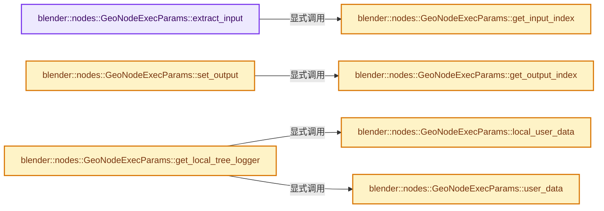
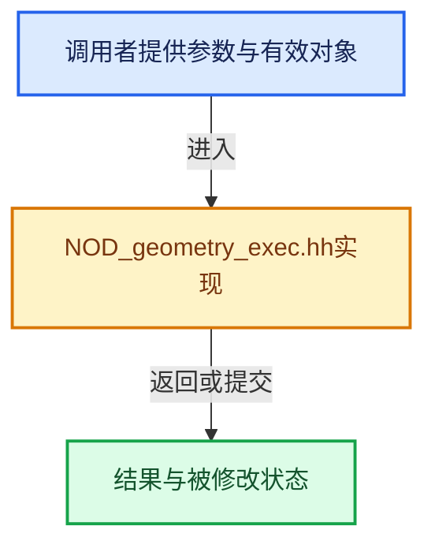

# 实现依赖专题：source/blender/nodes/NOD_geometry_exec.hh

[实现依赖导航](../README.md) · [符号索引](../../00-课程指南/02-源码与提交索引/符号依赖与实现索引.md)

本专题从正文实际调用进入，集中保存共享实现。函数有稳定锚点，可从调用处直接跳到对应完整函数；递归与互相调用通过回链组织。

## 本文件的实现关系






## 完整成员与函数实现

<a id="f-0ff98bdbba2e2ab6"></a>

### `blender::nodes::GeoNodeExecParams::extract_input`

实现位置：[source/blender/nodes/NOD_geometry_exec.hh](../../../../../../source/blender/nodes/NOD_geometry_exec.hh) · L111—L150。

接口参数：

- `const UString identifier`

**教学注释版**

<!-- annotated:8e8141cb466e31 -->

```cpp
  template<typename T> T extract_input(const UString identifier)
  {
#ifndef NDEBUG
    this->check_input_access(identifier);
#endif
    const int index = this->get_input_index(identifier);
    if constexpr (is_GeoNodesMultiInput_v<T>) {
      using ValueT = typename T::value_type;
      BLI_assert(node_.input_by_identifier(identifier)->is_multi_input());
      if constexpr (std::is_same_v<ValueT, SocketValueVariant>) {
        return params_.extract_input<T>(index);
      }
      else {
        auto values_variants = params_.extract_input<GeoNodesMultiInput<SocketValueVariant>>(
            index);
        GeoNodesMultiInput<ValueT> values;
        values.values.reserve(values_variants.values.size());
        for (const int i : values_variants.values.index_range()) {
          // [讲解] std::move：把表达式转换成可供移动重载选择的值类别；不保证真的移动，不结束源对象寿命，对const值可能选择复制。
          values.values.append(std::move(values_variants.values[i].ensure_type<ValueT>()));
        }
        return values;
      }
    }
    else {
      SocketValueVariant value_variant = params_.extract_input<SocketValueVariant>(index);
      if constexpr (std::is_same_v<T, SocketValueVariant>) {
        return value_variant;
      }
      else if constexpr (std::is_enum_v<T>) {
        return T(value_variant.ensure_type<MenuValue>().value);
      }
      else {
        T value = std::move(value_variant.ensure_type<T>());
        if constexpr (std::is_same_v<T, GeometrySet>) {
          this->check_input_geometry_set(identifier, value);
        }
        return value;
      }
    }
  }
```

<details>
<summary>核对原始源码：source/blender/nodes/NOD_geometry_exec.hh · L111—L150</summary>

<!-- original:8e8141cb466e31:source/blender/nodes/NOD_geometry_exec.hh:111:150 -->

```cpp
  template<typename T> T extract_input(const UString identifier)
  {
#ifndef NDEBUG
    this->check_input_access(identifier);
#endif
    const int index = this->get_input_index(identifier);
    if constexpr (is_GeoNodesMultiInput_v<T>) {
      using ValueT = typename T::value_type;
      BLI_assert(node_.input_by_identifier(identifier)->is_multi_input());
      if constexpr (std::is_same_v<ValueT, SocketValueVariant>) {
        return params_.extract_input<T>(index);
      }
      else {
        auto values_variants = params_.extract_input<GeoNodesMultiInput<SocketValueVariant>>(
            index);
        GeoNodesMultiInput<ValueT> values;
        values.values.reserve(values_variants.values.size());
        for (const int i : values_variants.values.index_range()) {
          values.values.append(std::move(values_variants.values[i].ensure_type<ValueT>()));
        }
        return values;
      }
    }
    else {
      SocketValueVariant value_variant = params_.extract_input<SocketValueVariant>(index);
      if constexpr (std::is_same_v<T, SocketValueVariant>) {
        return value_variant;
      }
      else if constexpr (std::is_enum_v<T>) {
        return T(value_variant.ensure_type<MenuValue>().value);
      }
      else {
        T value = std::move(value_variant.ensure_type<T>());
        if constexpr (std::is_same_v<T, GeometrySet>) {
          this->check_input_geometry_set(identifier, value);
        }
        return value;
      }
    }
  }
```

</details>

**结果出口**

- `return params_.extract_input<T>(index);`
- `return values;`
- `return value_variant;`
- `return T(value_variant.ensure_type<MenuValue>().value);`
- `return value;`

**继续追踪实现**

- `this->check_input_access` → [blender::nodes::GeoNodeExecParams::check_input_access · L168](intern/node_geometry_exec.cc.md#f-f7fbf25862b785db)。
- `this->get_input_index` → [blender::nodes::GeoNodeExecParams::get_input_index · L349](NOD_geometry_exec.hh.md#f-b8cb36f086801bdf)。
- `BLI_assert` → [BLI_assert · L48](../01-BLI基础库/BLI_assert.hh.md#m-57a88495704d)；[BLI_assert · L63](../01-BLI基础库/BLI_assert.hh.md#m-d07050020cb5)。宏定义由构建条件选择。
- `node_.input_by_identifier(identifier)->is_multi_input` → [调用协议](../../00-课程指南/01-路线与规范/模板宏与动态分派协议.md)：接收对象类型依赖auto、返回值或模板实例；不按同名猜测目标。调用位置L119。
- `node_.input_by_identifier` → [blender::bNode::input_by_identifier · L842](../02-BKE几何与数据/BKE_node_runtime.hh.md#f-d7bd2e97ab2dd5f4)；[blender::bNode::input_by_identifier · L854](../02-BKE几何与数据/BKE_node_runtime.hh.md#f-37095a407a90a740)。同名重载需按实参类型选择。
- `params_.extract_input<T>` → [blender::fn::lazy_function::Params::extract_input · L412](../../09-LazyFunction与节点执行架构/02-LazyFunction接口.md#f-037bdbe54ffc8fdd)。
- `params_.extract_input<GeoNodesMultiInput<SocketValueVariant>>` → [blender::fn::lazy_function::Params::extract_input · L412](../../09-LazyFunction与节点执行架构/02-LazyFunction接口.md#f-037bdbe54ffc8fdd)。
- `values.values.reserve` → [调用协议](../../00-课程指南/01-路线与规范/模板宏与动态分派协议.md)：接收对象类型依赖auto、返回值或模板实例；不按同名猜测目标。调用位置L127。
- `values_variants.values.size` → [调用协议](../../00-课程指南/01-路线与规范/模板宏与动态分派协议.md)：接收对象类型依赖auto、返回值或模板实例；不按同名猜测目标。调用位置L127。
- `values_variants.values.index_range` → [调用协议](../../00-课程指南/01-路线与规范/模板宏与动态分派协议.md)：接收对象类型依赖auto、返回值或模板实例；不按同名猜测目标。调用位置L128。
- `values.values.append` → [调用协议](../../00-课程指南/01-路线与规范/模板宏与动态分派协议.md)：接收对象类型依赖auto、返回值或模板实例；不按同名猜测目标。调用位置L129。
- `std::move` → [外部契约](https://eel.is/c++draft/utility.forward)：把表达式转换成可供移动重载选择的值类别；不保证真的移动，不结束源对象寿命，对const值可能选择复制。
- `values_variants.values[i].ensure_type<ValueT>` → [调用协议](../../00-课程指南/01-路线与规范/模板宏与动态分派协议.md)：接收对象类型依赖auto、返回值或模板实例；不按同名猜测目标。调用位置L129。
- `params_.extract_input<SocketValueVariant>` → [blender::fn::lazy_function::Params::extract_input · L412](../../09-LazyFunction与节点执行架构/02-LazyFunction接口.md#f-037bdbe54ffc8fdd)。
- `T` → [DiagSplit::T · L96](../07-Intern运行时与平台/cycles/subd/split.cpp.md#f-d5d0885c790cc4e4)。
- `value_variant.ensure_type<MenuValue>` → [blender::bke::SocketValueVariant::ensure_type · L271](../02-BKE几何与数据/BKE_node_socket_value.hh.md#f-36be485d1fc40c00)；[blender::bke::SocketValueVariant::ensure_type · L279](../02-BKE几何与数据/BKE_node_socket_value.hh.md#f-417f182997393297)。同名重载需按实参类型选择。
- `value_variant.ensure_type<T>` → [blender::bke::SocketValueVariant::ensure_type · L271](../02-BKE几何与数据/BKE_node_socket_value.hh.md#f-36be485d1fc40c00)；[blender::bke::SocketValueVariant::ensure_type · L279](../02-BKE几何与数据/BKE_node_socket_value.hh.md#f-417f182997393297)。同名重载需按实参类型选择。
- `this->check_input_geometry_set` → [blender::nodes::GeoNodeExecParams::check_input_geometry_set · L59](intern/node_geometry_exec.cc.md#f-3a305c5390bc6662)。

<a id="f-8e835b27ade93c45"></a>

### `blender::nodes::GeoNodeExecParams::set_output`

实现位置：[source/blender/nodes/NOD_geometry_exec.hh](../../../../../../source/blender/nodes/NOD_geometry_exec.hh) · L210—L226。

接口参数：

- `const UString identifier`
- `T &&value`

**教学注释版**

<!-- annotated:98047a37dcc4f4 -->

```cpp
  template<typename T> void set_output(const UString identifier, T &&value)
  {
    using StoredT = std::decay_t<T>;
#ifndef NDEBUG
    this->check_output_access(identifier);
#endif
    if constexpr (std::is_same_v<StoredT, GeometrySet>) {
      this->check_output_geometry_set(value);
    }
    const int index = this->get_output_index(identifier);
    if constexpr (std::is_same_v<StoredT, SocketValueVariant>) {
      // [讲解] std::forward<T>：在转发引用中恢复调用者传入的值类别；依赖推导类型，不能与无条件move互换。
      params_.set_output(index, std::forward<T>(value));
    }
    else {
      params_.set_output(index, SocketValueVariant::from(std::forward<T>(value)));
    }
  }
```

<details>
<summary>核对原始源码：source/blender/nodes/NOD_geometry_exec.hh · L210—L226</summary>

<!-- original:98047a37dcc4f4:source/blender/nodes/NOD_geometry_exec.hh:210:226 -->

```cpp
  template<typename T> void set_output(const UString identifier, T &&value)
  {
    using StoredT = std::decay_t<T>;
#ifndef NDEBUG
    this->check_output_access(identifier);
#endif
    if constexpr (std::is_same_v<StoredT, GeometrySet>) {
      this->check_output_geometry_set(value);
    }
    const int index = this->get_output_index(identifier);
    if constexpr (std::is_same_v<StoredT, SocketValueVariant>) {
      params_.set_output(index, std::forward<T>(value));
    }
    else {
      params_.set_output(index, SocketValueVariant::from(std::forward<T>(value)));
    }
  }
```

</details>

**继续追踪实现**

- `this->check_output_access` → [blender::nodes::GeoNodeExecParams::check_output_access · L197](intern/node_geometry_exec.cc.md#f-758f61efaf9bd08c)。
- `this->check_output_geometry_set` → [blender::nodes::GeoNodeExecParams::check_output_geometry_set · L151](intern/node_geometry_exec.cc.md#f-fcdedcc227a09a05)。
- `this->get_output_index` → [blender::nodes::GeoNodeExecParams::get_output_index · L365](NOD_geometry_exec.hh.md#f-fc0a954571e75dbf)。
- `params_.set_output` → [blender::fn::lazy_function::Params::set_output · L440](../../09-LazyFunction与节点执行架构/02-LazyFunction接口.md#f-993589d688de575d)。
- `std::forward<T>` → [外部契约](https://eel.is/c++draft/utility.forward)：在转发引用中恢复调用者传入的值类别；依赖推导类型，不能与无条件move互换。
- `SocketValueVariant::from` → [blender::bke::SocketValueVariant::from · L220](../02-BKE几何与数据/BKE_node_socket_value.hh.md#f-fa3c16e83ef6de45)。

<a id="f-d4151dabae1da5a2"></a>

### `blender::nodes::GeoNodeExecParams::get_local_tree_logger`

实现位置：[source/blender/nodes/NOD_geometry_exec.hh](../../../../../../source/blender/nodes/NOD_geometry_exec.hh) · L228—L231。

**教学注释版**

<!-- annotated:51f5a50918f213 -->

```cpp
  eval_log::NodeTreeLogger *get_local_tree_logger() const
  {
    return this->local_user_data()->try_get_tree_logger(*this->user_data());
  }
```

<details>
<summary>核对原始源码：source/blender/nodes/NOD_geometry_exec.hh · L228—L231</summary>

<!-- original:51f5a50918f213:source/blender/nodes/NOD_geometry_exec.hh:228:231 -->

```cpp
  eval_log::NodeTreeLogger *get_local_tree_logger() const
  {
    return this->local_user_data()->try_get_tree_logger(*this->user_data());
  }
```

</details>

**结果出口**

- `return this->local_user_data()->try_get_tree_logger(*this->user_data());`

**继续追踪实现**

- `this->local_user_data()->try_get_tree_logger` → [调用协议](../../00-课程指南/01-路线与规范/模板宏与动态分派协议.md)：接收对象类型依赖auto、返回值或模板实例；不按同名猜测目标。调用位置L230。
- `this->local_user_data` → [blender::nodes::GeoNodeExecParams::local_user_data · L287](NOD_geometry_exec.hh.md#f-9331f113ffbbf50c)。
- `this->user_data` → [blender::nodes::GeoNodeExecParams::user_data · L282](NOD_geometry_exec.hh.md#f-12526b09c240ebe7)。

<a id="f-12526b09c240ebe7"></a>

### `blender::nodes::GeoNodeExecParams::user_data`

实现位置：[source/blender/nodes/NOD_geometry_exec.hh](../../../../../../source/blender/nodes/NOD_geometry_exec.hh) · L282—L285。

**教学注释版**

<!-- annotated:d398f78a0e8e58 -->

```cpp
  GeoNodesUserData *user_data() const
  {
    return static_cast<GeoNodesUserData *>(lf_context_.user_data);
  }
```

<details>
<summary>核对原始源码：source/blender/nodes/NOD_geometry_exec.hh · L282—L285</summary>

<!-- original:d398f78a0e8e58:source/blender/nodes/NOD_geometry_exec.hh:282:285 -->

```cpp
  GeoNodesUserData *user_data() const
  {
    return static_cast<GeoNodesUserData *>(lf_context_.user_data);
  }
```

</details>

**结果出口**

- `return static_cast<GeoNodesUserData *>(lf_context_.user_data);`

**继续追踪实现**

本实现没有需要继续展开的显式调用；检查返回表达式、对象转换和调用者前置条件。

<a id="f-9331f113ffbbf50c"></a>

### `blender::nodes::GeoNodeExecParams::local_user_data`

实现位置：[source/blender/nodes/NOD_geometry_exec.hh](../../../../../../source/blender/nodes/NOD_geometry_exec.hh) · L287—L290。

**教学注释版**

<!-- annotated:bd1ff090d45158 -->

```cpp
  GeoNodesLocalUserData *local_user_data() const
  {
    return static_cast<GeoNodesLocalUserData *>(lf_context_.local_user_data);
  }
```

<details>
<summary>核对原始源码：source/blender/nodes/NOD_geometry_exec.hh · L287—L290</summary>

<!-- original:bd1ff090d45158:source/blender/nodes/NOD_geometry_exec.hh:287:290 -->

```cpp
  GeoNodesLocalUserData *local_user_data() const
  {
    return static_cast<GeoNodesLocalUserData *>(lf_context_.local_user_data);
  }
```

</details>

**结果出口**

- `return static_cast<GeoNodesLocalUserData *>(lf_context_.local_user_data);`

**继续追踪实现**

本实现没有需要继续展开的显式调用；检查返回表达式、对象转换和调用者前置条件。

<a id="f-b8cb36f086801bdf"></a>

### `blender::nodes::GeoNodeExecParams::get_input_index`

实现位置：[source/blender/nodes/NOD_geometry_exec.hh](../../../../../../source/blender/nodes/NOD_geometry_exec.hh) · L349—L363。

接口参数：

- `const UString identifier`

**教学注释版**

<!-- annotated:420992b0e16fab -->

```cpp
  int get_input_index(const UString identifier) const
  {
    int counter = 0;
    for (const bNodeSocket *socket : node_.input_sockets()) {
      if (!socket->is_available()) {
        continue;
      }
      if (socket->identifier_ustr() == identifier) {
        return counter;
      }
      counter++;
    }
    BLI_assert_unreachable();
    return -1;
  }
```

<details>
<summary>核对原始源码：source/blender/nodes/NOD_geometry_exec.hh · L349—L363</summary>

<!-- original:420992b0e16fab:source/blender/nodes/NOD_geometry_exec.hh:349:363 -->

```cpp
  int get_input_index(const UString identifier) const
  {
    int counter = 0;
    for (const bNodeSocket *socket : node_.input_sockets()) {
      if (!socket->is_available()) {
        continue;
      }
      if (socket->identifier_ustr() == identifier) {
        return counter;
      }
      counter++;
    }
    BLI_assert_unreachable();
    return -1;
  }
```

</details>

**结果出口**

- `return counter;`
- `return -1;`

**继续追踪实现**

- `node_.input_sockets` → [blender::bNode::input_sockets · L754](../02-BKE几何与数据/BKE_node_runtime.hh.md#f-82cd385c5c18b40d)；[blender::bNode::input_sockets · L766](../02-BKE几何与数据/BKE_node_runtime.hh.md#f-65ad84a029887502)。同名重载需按实参类型选择。
- `socket->is_available` → [调用协议](../../00-课程指南/01-路线与规范/模板宏与动态分派协议.md)：接收对象类型依赖auto、返回值或模板实例；不按同名猜测目标。调用位置L353。
- `socket->identifier_ustr` → [调用协议](../../00-课程指南/01-路线与规范/模板宏与动态分派协议.md)：接收对象类型依赖auto、返回值或模板实例；不按同名猜测目标。调用位置L356。
- `BLI_assert_unreachable` → [BLI_assert_unreachable · L77](../01-BLI基础库/BLI_assert.hh.md#m-7a2d91a67d8e)。宏定义由构建条件选择。

<a id="f-fc0a954571e75dbf"></a>

### `blender::nodes::GeoNodeExecParams::get_output_index`

实现位置：[source/blender/nodes/NOD_geometry_exec.hh](../../../../../../source/blender/nodes/NOD_geometry_exec.hh) · L365—L379。

接口参数：

- `const UString identifier`

**教学注释版**

<!-- annotated:ac038313843a09 -->

```cpp
  int get_output_index(const UString identifier) const
  {
    int counter = 0;
    for (const bNodeSocket *socket : node_.output_sockets()) {
      if (!socket->is_available()) {
        continue;
      }
      if (socket->identifier == identifier) {
        return counter;
      }
      counter++;
    }
    BLI_assert_unreachable();
    return -1;
  }
```

<details>
<summary>核对原始源码：source/blender/nodes/NOD_geometry_exec.hh · L365—L379</summary>

<!-- original:ac038313843a09:source/blender/nodes/NOD_geometry_exec.hh:365:379 -->

```cpp
  int get_output_index(const UString identifier) const
  {
    int counter = 0;
    for (const bNodeSocket *socket : node_.output_sockets()) {
      if (!socket->is_available()) {
        continue;
      }
      if (socket->identifier == identifier) {
        return counter;
      }
      counter++;
    }
    BLI_assert_unreachable();
    return -1;
  }
```

</details>

**结果出口**

- `return counter;`
- `return -1;`

**继续追踪实现**

- `node_.output_sockets` → [blender::bNode::output_sockets · L760](../02-BKE几何与数据/BKE_node_runtime.hh.md#f-40ec6d6aed2ab6fb)；[blender::bNode::output_sockets · L772](../02-BKE几何与数据/BKE_node_runtime.hh.md#f-ddbd8f42409bdcd1)。同名重载需按实参类型选择。
- `socket->is_available` → [调用协议](../../00-课程指南/01-路线与规范/模板宏与动态分派协议.md)：接收对象类型依赖auto、返回值或模板实例；不按同名猜测目标。调用位置L369。
- `BLI_assert_unreachable` → [BLI_assert_unreachable · L77](../01-BLI基础库/BLI_assert.hh.md#m-7a2d91a67d8e)。宏定义由构建条件选择。
