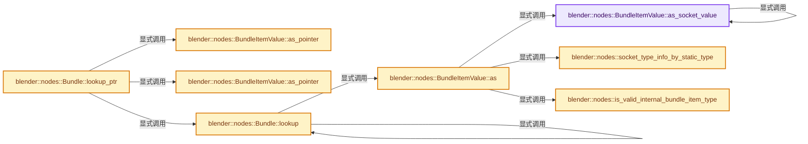
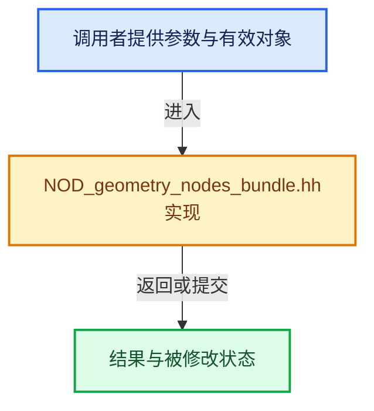

# 实现依赖专题：source/blender/nodes/NOD_geometry_nodes_bundle.hh

[实现依赖导航](../README.md) · [符号索引](../../00-课程指南/02-源码与提交索引/符号依赖与实现索引.md)

本专题从正文实际调用进入，集中保存共享实现。函数有稳定锚点，可从调用处直接跳到对应完整函数；递归与互相调用通过回链组织。

## 本文件的实现关系






## 完整成员与函数实现

<a id="f-dece24dded4d0ba9"></a>

### `blender::nodes::BundleItemValue::as_socket_value`

实现位置：[source/blender/nodes/NOD_geometry_nodes_bundle.hh](../../../../../../source/blender/nodes/NOD_geometry_nodes_bundle.hh) · L203—L212。

接口参数：

- `const bke::bNodeSocketType &dst_socket_type`

**教学注释版**

<!-- annotated:1a4b74cfdffd6b -->

```cpp
template<typename T>
inline std::optional<T> BundleItemValue::as_socket_value(
    const bke::bNodeSocketType &dst_socket_type) const
{
  if (const std::optional<bke::SocketValueVariant> value = this->as_socket_value(dst_socket_type))
  {
    return *value->get_if<T>();
  }
  return std::nullopt;
}
```

<details>
<summary>核对原始源码：source/blender/nodes/NOD_geometry_nodes_bundle.hh · L203—L212</summary>

<!-- original:1a4b74cfdffd6b:source/blender/nodes/NOD_geometry_nodes_bundle.hh:203:212 -->

```cpp
template<typename T>
inline std::optional<T> BundleItemValue::as_socket_value(
    const bke::bNodeSocketType &dst_socket_type) const
{
  if (const std::optional<bke::SocketValueVariant> value = this->as_socket_value(dst_socket_type))
  {
    return *value->get_if<T>();
  }
  return std::nullopt;
}
```

</details>

**结果出口**

- `return *value->get_if<T>();`
- `return std::nullopt;`

**继续追踪实现**

- `this->as_socket_value` → [blender::nodes::BundleItemValue::as_socket_value · L203](NOD_geometry_nodes_bundle.hh.md#f-dece24dded4d0ba9)。
- `value->get_if<T>` → [外部契约](https://eel.is/c++draft/)：这个边界按实际表达式及所属类型核对参数、返回值、寿命与失败行为。这里提供接口入口，不声称已解释该第三方版本的内部实现。

<a id="f-f165f4b9fea6638b"></a>

### `blender::nodes::BundleItemValue::as_pointer`

实现位置：[source/blender/nodes/NOD_geometry_nodes_bundle.hh](../../../../../../source/blender/nodes/NOD_geometry_nodes_bundle.hh) · L214—L217。

**教学注释版**

<!-- annotated:c435ac7c5bf1c8 -->

```cpp
template<typename T> inline T *BundleItemValue::as_pointer()
{
  return const_cast<T *>(std::as_const(*this).as_pointer<T>());
}
```

<details>
<summary>核对原始源码：source/blender/nodes/NOD_geometry_nodes_bundle.hh · L214—L217</summary>

<!-- original:c435ac7c5bf1c8:source/blender/nodes/NOD_geometry_nodes_bundle.hh:214:217 -->

```cpp
template<typename T> inline T *BundleItemValue::as_pointer()
{
  return const_cast<T *>(std::as_const(*this).as_pointer<T>());
}
```

</details>

**结果出口**

- `return const_cast<T *>(std::as_const(*this).as_pointer<T>());`

**继续追踪实现**

- `std::as_const(*this).as_pointer<T>` → [外部契约](https://eel.is/c++draft/)：这个边界按实际表达式及所属类型核对参数、返回值、寿命与失败行为。这里提供接口入口，不声称已解释该第三方版本的内部实现。
- `std::as_const` → [外部契约](https://eel.is/c++draft/)：这个边界按实际表达式及所属类型核对参数、返回值、寿命与失败行为。这里提供接口入口，不声称已解释该第三方版本的内部实现。

<a id="f-879002168837b5f6"></a>

### `blender::nodes::BundleItemValue::as_pointer`

实现位置：[source/blender/nodes/NOD_geometry_nodes_bundle.hh](../../../../../../source/blender/nodes/NOD_geometry_nodes_bundle.hh) · L218—L229。

**教学注释版**

<!-- annotated:274d0771ae63d9 -->

```cpp
template<typename T> inline const T *BundleItemValue::as_pointer() const
{
  const BundleItemSocketValue *socket_value = std::get_if<BundleItemSocketValue>(&this->value);
  if (!socket_value) {
    return nullptr;
  }
  const GPointer ptr = socket_value->value.get();
  if (!ptr.is_type<T>()) {
    return nullptr;
  }
  return ptr.get<T>();
}
```

<details>
<summary>核对原始源码：source/blender/nodes/NOD_geometry_nodes_bundle.hh · L218—L229</summary>

<!-- original:274d0771ae63d9:source/blender/nodes/NOD_geometry_nodes_bundle.hh:218:229 -->

```cpp
template<typename T> inline const T *BundleItemValue::as_pointer() const
{
  const BundleItemSocketValue *socket_value = std::get_if<BundleItemSocketValue>(&this->value);
  if (!socket_value) {
    return nullptr;
  }
  const GPointer ptr = socket_value->value.get();
  if (!ptr.is_type<T>()) {
    return nullptr;
  }
  return ptr.get<T>();
}
```

</details>

**结果出口**

- `return nullptr;`
- `return ptr.get<T>();`

**继续追踪实现**

- `std::get_if<BundleItemSocketValue>` → [外部契约](https://eel.is/c++draft/)：这个边界按实际表达式及所属类型核对参数、返回值、寿命与失败行为。这里提供接口入口，不声称已解释该第三方版本的内部实现。
- `socket_value->value.get` → [调用协议](../../00-课程指南/01-路线与规范/模板宏与动态分派协议.md)：接收对象类型依赖auto、返回值或模板实例；不按同名猜测目标。调用位置L224。
- `ptr.is_type<T>` → [blender::GPointer::is_type · L133](../../03-内存分配与运行时类型/12-异构值存储实战.md#f-4925d683e0c01d86)。
- `ptr.get<T>` → [blender::GPointer::get · L117](../../03-内存分配与运行时类型/12-异构值存储实战.md#f-d98a4f1af4104afe)；[blender::GPointer::get · L127](../../03-内存分配与运行时类型/12-异构值存储实战.md#f-5cf9e563400cde6b)。同名重载需按实参类型选择。

<a id="f-12def57de6d09a6c"></a>

### `blender::nodes::socket_type_info_by_static_type`

实现位置：[source/blender/nodes/NOD_geometry_nodes_bundle.hh](../../../../../../source/blender/nodes/NOD_geometry_nodes_bundle.hh) · L231—L249。

**教学注释版**

<!-- annotated:251266401e4924 -->

```cpp
template<typename T> inline const bke::bNodeSocketType *socket_type_info_by_static_type()
{
  if constexpr (fn::is_field_v<T>) {
    const std::optional<eNodeSocketDatatype> socket_type =
        bke::geo_nodes_base_cpp_type_to_socket_type(CPPType::get<typename T::base_type>());
    BLI_assert(socket_type);
    const bke::bNodeSocketType *socket_type_info = bke::node_socket_type_find_static(*socket_type);
    BLI_assert(socket_type_info);
    return socket_type_info;
  }
  else {
    const std::optional<eNodeSocketDatatype> socket_type =
        bke::geo_nodes_base_cpp_type_to_socket_type(CPPType::get<T>());
    if (!socket_type) {
      return nullptr;
    }
    return bke::node_socket_type_find_static(*socket_type);
  }
}
```

<details>
<summary>核对原始源码：source/blender/nodes/NOD_geometry_nodes_bundle.hh · L231—L249</summary>

<!-- original:251266401e4924:source/blender/nodes/NOD_geometry_nodes_bundle.hh:231:249 -->

```cpp
template<typename T> inline const bke::bNodeSocketType *socket_type_info_by_static_type()
{
  if constexpr (fn::is_field_v<T>) {
    const std::optional<eNodeSocketDatatype> socket_type =
        bke::geo_nodes_base_cpp_type_to_socket_type(CPPType::get<typename T::base_type>());
    BLI_assert(socket_type);
    const bke::bNodeSocketType *socket_type_info = bke::node_socket_type_find_static(*socket_type);
    BLI_assert(socket_type_info);
    return socket_type_info;
  }
  else {
    const std::optional<eNodeSocketDatatype> socket_type =
        bke::geo_nodes_base_cpp_type_to_socket_type(CPPType::get<T>());
    if (!socket_type) {
      return nullptr;
    }
    return bke::node_socket_type_find_static(*socket_type);
  }
}
```

</details>

**结果出口**

- `return socket_type_info;`
- `return nullptr;`
- `return bke::node_socket_type_find_static(*socket_type);`

**继续追踪实现**

- `bke::geo_nodes_base_cpp_type_to_socket_type` → [blender::bke::geo_nodes_base_cpp_type_to_socket_type · L6008](../02-BKE几何与数据/intern/node.cc.md#f-7050fd7412bd48b3)。
- `CPPType::get<typename T::base_type>` → [blender::CPPType::get · L481](../../03-内存分配与运行时类型/08-CPPType构造与析构.md#f-0cc10a3783d6abdb)。
- `BLI_assert` → [BLI_assert · L48](../01-BLI基础库/BLI_assert.hh.md#m-57a88495704d)；[BLI_assert · L63](../01-BLI基础库/BLI_assert.hh.md#m-d07050020cb5)。宏定义由构建条件选择。
- `bke::node_socket_type_find_static` → [blender::bke::node_socket_type_find_static · L2975](../02-BKE几何与数据/intern/node.cc.md#f-8082ced6587b7cd9)。
- `CPPType::get<T>` → [blender::CPPType::get · L481](../../03-内存分配与运行时类型/08-CPPType构造与析构.md#f-0cc10a3783d6abdb)。

<a id="f-927218e6f9fe73ec"></a>

### `blender::nodes::is_valid_internal_bundle_item_type`

实现位置：[source/blender/nodes/NOD_geometry_nodes_bundle.hh](../../../../../../source/blender/nodes/NOD_geometry_nodes_bundle.hh) · L251—L259。

**教学注释版**

<!-- annotated:861f13b836c79d -->

```cpp
template<typename T> constexpr bool is_valid_internal_bundle_item_type()
{
  if constexpr (is_ImplicitSharingPtr_strong_v<T>) {
    if constexpr (std::is_base_of_v<BundleItemInternalValueMixin, typename T::element_type>) {
      return true;
    }
  }
  return false;
}
```

<details>
<summary>核对原始源码：source/blender/nodes/NOD_geometry_nodes_bundle.hh · L251—L259</summary>

<!-- original:861f13b836c79d:source/blender/nodes/NOD_geometry_nodes_bundle.hh:251:259 -->

```cpp
template<typename T> constexpr bool is_valid_internal_bundle_item_type()
{
  if constexpr (is_ImplicitSharingPtr_strong_v<T>) {
    if constexpr (std::is_base_of_v<BundleItemInternalValueMixin, typename T::element_type>) {
      return true;
    }
  }
  return false;
}
```

</details>

**结果出口**

- `return true;`
- `return false;`

**继续追踪实现**

本实现没有需要继续展开的显式调用；检查返回表达式、对象转换和调用者前置条件。

<a id="f-250bf8b6a94ed2b1"></a>

### `blender::nodes::BundleItemValue::as`

实现位置：[source/blender/nodes/NOD_geometry_nodes_bundle.hh](../../../../../../source/blender/nodes/NOD_geometry_nodes_bundle.hh) · L261—L301。

**教学注释版**

<!-- annotated:be44751059551d -->

```cpp
template<typename T> inline std::optional<T> BundleItemValue::as() const
{
  if constexpr (is_valid_internal_bundle_item_type<T>()) {
    using SharingInfoT = typename T::element_type;
    const auto *internal_value = std::get_if<BundleItemInternalValue>(&this->value);
    if (!internal_value) {
      return std::nullopt;
    }
    const BundleItemInternalValueMixin *sharing_info = internal_value->value.get();
    const SharingInfoT *converted_value = dynamic_cast<const SharingInfoT *>(sharing_info);
    if (!converted_value) {
      return std::nullopt;
    }
    sharing_info->add_user();
    return ImplicitSharingPtr<SharingInfoT>{converted_value};
  }
  else if constexpr (std::is_same_v<T, bke::SocketValueVariant>) {
    if (const BundleItemSocketValue *socket_value = std::get_if<BundleItemSocketValue>(
            &this->value))
    {
      return socket_value->value;
    }
    return std::nullopt;
  }
  else if constexpr (std::is_same_v<T, GListPtr>) {
    const BundleItemSocketValue *socket_value = std::get_if<BundleItemSocketValue>(&this->value);
    if (!socket_value) {
      return std::nullopt;
    }
    if (socket_value->value.get().is_type<GListPtr>()) {
      return *socket_value->value.get().get<GListPtr>();
    }
    return std::nullopt;
  }
  else if (const bke::bNodeSocketType *dst_socket_type = socket_type_info_by_static_type<T>()) {
    return this->as_socket_value<T>(*dst_socket_type);
  }
  /* Can't lookup this type directly currently. */
  BLI_assert_unreachable();
  return std::nullopt;
}
```

<details>
<summary>核对原始源码：source/blender/nodes/NOD_geometry_nodes_bundle.hh · L261—L301</summary>

<!-- original:be44751059551d:source/blender/nodes/NOD_geometry_nodes_bundle.hh:261:301 -->

```cpp
template<typename T> inline std::optional<T> BundleItemValue::as() const
{
  if constexpr (is_valid_internal_bundle_item_type<T>()) {
    using SharingInfoT = typename T::element_type;
    const auto *internal_value = std::get_if<BundleItemInternalValue>(&this->value);
    if (!internal_value) {
      return std::nullopt;
    }
    const BundleItemInternalValueMixin *sharing_info = internal_value->value.get();
    const SharingInfoT *converted_value = dynamic_cast<const SharingInfoT *>(sharing_info);
    if (!converted_value) {
      return std::nullopt;
    }
    sharing_info->add_user();
    return ImplicitSharingPtr<SharingInfoT>{converted_value};
  }
  else if constexpr (std::is_same_v<T, bke::SocketValueVariant>) {
    if (const BundleItemSocketValue *socket_value = std::get_if<BundleItemSocketValue>(
            &this->value))
    {
      return socket_value->value;
    }
    return std::nullopt;
  }
  else if constexpr (std::is_same_v<T, GListPtr>) {
    const BundleItemSocketValue *socket_value = std::get_if<BundleItemSocketValue>(&this->value);
    if (!socket_value) {
      return std::nullopt;
    }
    if (socket_value->value.get().is_type<GListPtr>()) {
      return *socket_value->value.get().get<GListPtr>();
    }
    return std::nullopt;
  }
  else if (const bke::bNodeSocketType *dst_socket_type = socket_type_info_by_static_type<T>()) {
    return this->as_socket_value<T>(*dst_socket_type);
  }
  /* Can't lookup this type directly currently. */
  BLI_assert_unreachable();
  return std::nullopt;
}
```

</details>

**结果出口**

- `return std::nullopt;`
- `return ImplicitSharingPtr<SharingInfoT>{converted_value};`
- `return socket_value->value;`
- `return *socket_value->value.get().get<GListPtr>();`
- `return this->as_socket_value<T>(*dst_socket_type);`

**继续追踪实现**

- `is_valid_internal_bundle_item_type<T>` → [blender::nodes::is_valid_internal_bundle_item_type · L251](NOD_geometry_nodes_bundle.hh.md#f-927218e6f9fe73ec)。
- `std::get_if<BundleItemInternalValue>` → [外部契约](https://eel.is/c++draft/)：这个边界按实际表达式及所属类型核对参数、返回值、寿命与失败行为。这里提供接口入口，不声称已解释该第三方版本的内部实现。
- `internal_value->value.get` → [调用协议](../../00-课程指南/01-路线与规范/模板宏与动态分派协议.md)：接收对象类型依赖auto、返回值或模板实例；不按同名猜测目标。调用位置L269。
- `sharing_info->add_user` → [调用协议](../../00-课程指南/01-路线与规范/模板宏与动态分派协议.md)：由接收对象具体类型或运行时策略提供实现。调用位置L274。
- `std::get_if<BundleItemSocketValue>` → [外部契约](https://eel.is/c++draft/)：这个边界按实际表达式及所属类型核对参数、返回值、寿命与失败行为。这里提供接口入口，不声称已解释该第三方版本的内部实现。
- `socket_value->value.get().is_type<GListPtr>` → [调用协议](../../00-课程指南/01-路线与规范/模板宏与动态分派协议.md)：接收对象类型依赖auto、返回值或模板实例；不按同名猜测目标。调用位置L290。
- `socket_value->value.get` → [调用协议](../../00-课程指南/01-路线与规范/模板宏与动态分派协议.md)：接收对象类型依赖auto、返回值或模板实例；不按同名猜测目标。调用位置L290。
- `socket_value->value.get().get<GListPtr>` → [调用协议](../../00-课程指南/01-路线与规范/模板宏与动态分派协议.md)：接收对象类型依赖auto、返回值或模板实例；不按同名猜测目标。调用位置L291。
- `socket_type_info_by_static_type<T>` → [blender::nodes::socket_type_info_by_static_type · L231](NOD_geometry_nodes_bundle.hh.md#f-12def57de6d09a6c)。
- `this->as_socket_value<T>` → [blender::nodes::BundleItemValue::as_socket_value · L203](NOD_geometry_nodes_bundle.hh.md#f-dece24dded4d0ba9)。
- `BLI_assert_unreachable` → [BLI_assert_unreachable · L77](../01-BLI基础库/BLI_assert.hh.md#m-7a2d91a67d8e)。宏定义由构建条件选择。

<a id="f-490ec991f4350ed0"></a>

### `blender::nodes::Bundle::lookup`

实现位置：[source/blender/nodes/NOD_geometry_nodes_bundle.hh](../../../../../../source/blender/nodes/NOD_geometry_nodes_bundle.hh) · L303—L310。

接口参数：

- `const BundleKey key`

**教学注释版**

<!-- annotated:06926cdd1dbbc8 -->

```cpp
template<typename T> inline std::optional<T> Bundle::lookup(const BundleKey key) const
{
  const BundleItemValue *item = this->lookup(key);
  if (!item) {
    return std::nullopt;
  }
  return item->as<T>();
}
```

<details>
<summary>核对原始源码：source/blender/nodes/NOD_geometry_nodes_bundle.hh · L303—L310</summary>

<!-- original:06926cdd1dbbc8:source/blender/nodes/NOD_geometry_nodes_bundle.hh:303:310 -->

```cpp
template<typename T> inline std::optional<T> Bundle::lookup(const BundleKey key) const
{
  const BundleItemValue *item = this->lookup(key);
  if (!item) {
    return std::nullopt;
  }
  return item->as<T>();
}
```

</details>

**结果出口**

- `return std::nullopt;`
- `return item->as<T>();`

**继续追踪实现**

- `this->lookup` → [blender::nodes::Bundle::lookup · L303](NOD_geometry_nodes_bundle.hh.md#f-490ec991f4350ed0)。
- `item->as<T>` → [blender::nodes::BundleItemValue::as · L261](NOD_geometry_nodes_bundle.hh.md#f-250bf8b6a94ed2b1)。

<a id="f-c72529922ed8c8e2"></a>

### `blender::nodes::Bundle::lookup_ptr`

实现位置：[source/blender/nodes/NOD_geometry_nodes_bundle.hh](../../../../../../source/blender/nodes/NOD_geometry_nodes_bundle.hh) · L312—L316。

接口参数：

- `const BundleKey key`

**教学注释版**

<!-- annotated:886323a8be4e2a -->

```cpp
template<typename T> inline T *Bundle::lookup_ptr(const BundleKey key)
{
  BundleItemValue *item = this->lookup(key);
  return item ? item->as_pointer<T>() : nullptr;
}
```

<details>
<summary>核对原始源码：source/blender/nodes/NOD_geometry_nodes_bundle.hh · L312—L316</summary>

<!-- original:886323a8be4e2a:source/blender/nodes/NOD_geometry_nodes_bundle.hh:312:316 -->

```cpp
template<typename T> inline T *Bundle::lookup_ptr(const BundleKey key)
{
  BundleItemValue *item = this->lookup(key);
  return item ? item->as_pointer<T>() : nullptr;
}
```

</details>

**结果出口**

- `return item ? item->as_pointer<T>() : nullptr;`

**继续追踪实现**

- `this->lookup` → [blender::nodes::Bundle::lookup · L303](NOD_geometry_nodes_bundle.hh.md#f-490ec991f4350ed0)。
- `item->as_pointer<T>` → [blender::nodes::BundleItemValue::as_pointer · L214](NOD_geometry_nodes_bundle.hh.md#f-f165f4b9fea6638b)；[blender::nodes::BundleItemValue::as_pointer · L218](NOD_geometry_nodes_bundle.hh.md#f-879002168837b5f6)。同名重载需按实参类型选择。

<a id="f-22e3c8af335ad24c"></a>

### `blender::nodes::Bundle::lookup_ptr`

实现位置：[source/blender/nodes/NOD_geometry_nodes_bundle.hh](../../../../../../source/blender/nodes/NOD_geometry_nodes_bundle.hh) · L330—L334。

接口参数：

- `const BundleKey key`

**教学注释版**

<!-- annotated:e73af7116a3d9e -->

```cpp
template<typename T> inline const T *Bundle::lookup_ptr(const BundleKey key) const
{
  const BundleItemValue *item = this->lookup(key);
  return item ? item->as_pointer<T>() : nullptr;
}
```

<details>
<summary>核对原始源码：source/blender/nodes/NOD_geometry_nodes_bundle.hh · L330—L334</summary>

<!-- original:e73af7116a3d9e:source/blender/nodes/NOD_geometry_nodes_bundle.hh:330:334 -->

```cpp
template<typename T> inline const T *Bundle::lookup_ptr(const BundleKey key) const
{
  const BundleItemValue *item = this->lookup(key);
  return item ? item->as_pointer<T>() : nullptr;
}
```

</details>

**结果出口**

- `return item ? item->as_pointer<T>() : nullptr;`

**继续追踪实现**

- `this->lookup` → [blender::nodes::Bundle::lookup · L303](NOD_geometry_nodes_bundle.hh.md#f-490ec991f4350ed0)。
- `item->as_pointer<T>` → [blender::nodes::BundleItemValue::as_pointer · L214](NOD_geometry_nodes_bundle.hh.md#f-f165f4b9fea6638b)；[blender::nodes::BundleItemValue::as_pointer · L218](NOD_geometry_nodes_bundle.hh.md#f-879002168837b5f6)。同名重载需按实参类型选择。

<a id="f-73fd72c9c08ea640"></a>

### `blender::nodes::Bundle::lookup_path_for_write_ptr`

实现位置：[source/blender/nodes/NOD_geometry_nodes_bundle.hh](../../../../../../source/blender/nodes/NOD_geometry_nodes_bundle.hh) · L336—L340。

接口参数：

- `const Span<BundleKey> path`

**教学注释版**

<!-- annotated:b5e8857736c904 -->

```cpp
template<typename T> inline T *Bundle::lookup_path_for_write_ptr(const Span<BundleKey> path)
{
  BundleItemValue *item = this->lookup_path_for_write(path);
  return item ? item->as_pointer<T>() : nullptr;
}
```

<details>
<summary>核对原始源码：source/blender/nodes/NOD_geometry_nodes_bundle.hh · L336—L340</summary>

<!-- original:b5e8857736c904:source/blender/nodes/NOD_geometry_nodes_bundle.hh:336:340 -->

```cpp
template<typename T> inline T *Bundle::lookup_path_for_write_ptr(const Span<BundleKey> path)
{
  BundleItemValue *item = this->lookup_path_for_write(path);
  return item ? item->as_pointer<T>() : nullptr;
}
```

</details>

**结果出口**

- `return item ? item->as_pointer<T>() : nullptr;`

**继续追踪实现**

- `this->lookup_path_for_write` → [blender::nodes::Bundle::lookup_path_for_write · L221](../../10-引用生命周期与Closure/05-Bundle值组合.md#f-bbf4231d04b83f66)；[blender::nodes::Bundle::lookup_path_for_write · L243](../../10-引用生命周期与Closure/05-Bundle值组合.md#f-ddd6cfd6bbacec2f)。同名重载需按实参类型选择。
- `item->as_pointer<T>` → [blender::nodes::BundleItemValue::as_pointer · L214](NOD_geometry_nodes_bundle.hh.md#f-f165f4b9fea6638b)；[blender::nodes::BundleItemValue::as_pointer · L218](NOD_geometry_nodes_bundle.hh.md#f-879002168837b5f6)。同名重载需按实参类型选择。

<a id="f-76ebbff8af4308d9"></a>

### `blender::nodes::Bundle::lookup_path_for_write_ptr`

实现位置：[source/blender/nodes/NOD_geometry_nodes_bundle.hh](../../../../../../source/blender/nodes/NOD_geometry_nodes_bundle.hh) · L342—L346。

接口参数：

- `const StringRef path`

**教学注释版**

<!-- annotated:7adb154d9554b3 -->

```cpp
template<typename T> inline T *Bundle::lookup_path_for_write_ptr(const StringRef path)
{
  BundleItemValue *item = this->lookup_path_for_write(path);
  return item ? item->as_pointer<T>() : nullptr;
}
```

<details>
<summary>核对原始源码：source/blender/nodes/NOD_geometry_nodes_bundle.hh · L342—L346</summary>

<!-- original:7adb154d9554b3:source/blender/nodes/NOD_geometry_nodes_bundle.hh:342:346 -->

```cpp
template<typename T> inline T *Bundle::lookup_path_for_write_ptr(const StringRef path)
{
  BundleItemValue *item = this->lookup_path_for_write(path);
  return item ? item->as_pointer<T>() : nullptr;
}
```

</details>

**结果出口**

- `return item ? item->as_pointer<T>() : nullptr;`

**继续追踪实现**

- `this->lookup_path_for_write` → [blender::nodes::Bundle::lookup_path_for_write · L221](../../10-引用生命周期与Closure/05-Bundle值组合.md#f-bbf4231d04b83f66)；[blender::nodes::Bundle::lookup_path_for_write · L243](../../10-引用生命周期与Closure/05-Bundle值组合.md#f-ddd6cfd6bbacec2f)。同名重载需按实参类型选择。
- `item->as_pointer<T>` → [blender::nodes::BundleItemValue::as_pointer · L214](NOD_geometry_nodes_bundle.hh.md#f-f165f4b9fea6638b)；[blender::nodes::BundleItemValue::as_pointer · L218](NOD_geometry_nodes_bundle.hh.md#f-879002168837b5f6)。同名重载需按实参类型选择。

<a id="f-40380695d4eb5fa6"></a>

### `blender::nodes::socket_type_for_value_variant`

实现位置：[source/blender/nodes/NOD_geometry_nodes_bundle.hh](../../../../../../source/blender/nodes/NOD_geometry_nodes_bundle.hh) · L366—L384。

接口参数：

- `const bke::SocketValueVariant &value`

**教学注释版**

<!-- annotated:75b0b7384de66a -->

```cpp
inline eNodeSocketDatatype socket_type_for_value_variant(const bke::SocketValueVariant &value)
{
  const CPPType *base_type;
  if (value.is_field()) {
    base_type = &value.get_if<fn::GField>()->cpp_type();
  }
  else if (value.is_list()) {
    const GListPtr &list = *value.get_if<GListPtr>();
    BLI_assert(list);
    base_type = &list->cpp_type();
  }
  else {
    base_type = value.get().type();
  }
  const std::optional<eNodeSocketDatatype> socket_type =
      bke::geo_nodes_base_cpp_type_to_socket_type(*base_type);
  BLI_assert(socket_type);
  return *socket_type;
}
```

<details>
<summary>核对原始源码：source/blender/nodes/NOD_geometry_nodes_bundle.hh · L366—L384</summary>

<!-- original:75b0b7384de66a:source/blender/nodes/NOD_geometry_nodes_bundle.hh:366:384 -->

```cpp
inline eNodeSocketDatatype socket_type_for_value_variant(const bke::SocketValueVariant &value)
{
  const CPPType *base_type;
  if (value.is_field()) {
    base_type = &value.get_if<fn::GField>()->cpp_type();
  }
  else if (value.is_list()) {
    const GListPtr &list = *value.get_if<GListPtr>();
    BLI_assert(list);
    base_type = &list->cpp_type();
  }
  else {
    base_type = value.get().type();
  }
  const std::optional<eNodeSocketDatatype> socket_type =
      bke::geo_nodes_base_cpp_type_to_socket_type(*base_type);
  BLI_assert(socket_type);
  return *socket_type;
}
```

</details>

**沿实际写入检查状态**

- `base_type = &value.get_if<fn::GField>()->cpp_type();`
- `base_type = &list->cpp_type();`
- `base_type = value.get().type();`

**结果出口**

- `return *socket_type;`

**继续追踪实现**

- `value.is_field` → [SocketValueVariant::is_field · L516](../02-BKE几何与数据/intern/node_socket_value.cc.md#f-a047c02c1d9894fc)。
- `value.get_if<fn::GField>()->cpp_type` → [调用协议](../../00-课程指南/01-路线与规范/模板宏与动态分派协议.md)：接收对象类型依赖auto、返回值或模板实例；不按同名猜测目标。调用位置L370。
- `value.get_if<fn::GField>` → [blender::bke::SocketValueVariant::get_if · L293](../02-BKE几何与数据/BKE_node_socket_value.hh.md#f-5744f0088e078efb)；[blender::bke::SocketValueVariant::get_if · L315](../02-BKE几何与数据/BKE_node_socket_value.hh.md#f-0ee4db24be0746a2)；[blender::bke::SocketValueVariant::get_if · L320](../02-BKE几何与数据/BKE_node_socket_value.hh.md#f-1e9674022bd220af)；[blender::bke::SocketValueVariant::get_if · L335](../02-BKE几何与数据/BKE_node_socket_value.hh.md#f-95510bddaf248ec5)。同名重载需按实参类型选择。
- `value.is_list` → [SocketValueVariant::is_list · L521](../02-BKE几何与数据/intern/node_socket_value.cc.md#f-8ca466804cfc0dfe)。
- `value.get_if<GListPtr>` → [blender::bke::SocketValueVariant::get_if · L293](../02-BKE几何与数据/BKE_node_socket_value.hh.md#f-5744f0088e078efb)；[blender::bke::SocketValueVariant::get_if · L315](../02-BKE几何与数据/BKE_node_socket_value.hh.md#f-0ee4db24be0746a2)；[blender::bke::SocketValueVariant::get_if · L320](../02-BKE几何与数据/BKE_node_socket_value.hh.md#f-1e9674022bd220af)；[blender::bke::SocketValueVariant::get_if · L335](../02-BKE几何与数据/BKE_node_socket_value.hh.md#f-95510bddaf248ec5)。同名重载需按实参类型选择。
- `BLI_assert` → [BLI_assert · L48](../01-BLI基础库/BLI_assert.hh.md#m-57a88495704d)；[BLI_assert · L63](../01-BLI基础库/BLI_assert.hh.md#m-d07050020cb5)。宏定义由构建条件选择。
- `list->cpp_type` → [blender::nodes::GList::cpp_type · L218](NOD_geometry_nodes_list.hh.md#f-c8f69b2e40d6c43b)。
- `value.get().type` → [调用协议](../../00-课程指南/01-路线与规范/模板宏与动态分派协议.md)：接收对象类型依赖auto、返回值或模板实例；不按同名猜测目标。调用位置L378。
- `value.get` → [blender::bke::SocketValueVariant::get · L340](../02-BKE几何与数据/BKE_node_socket_value.hh.md#f-44fd803c51c13447)；[blender::bke::SocketValueVariant::get · L349](../02-BKE几何与数据/BKE_node_socket_value.hh.md#f-c63e6331bfae49c4)。同名重载需按实参类型选择。
- `bke::geo_nodes_base_cpp_type_to_socket_type` → [blender::bke::geo_nodes_base_cpp_type_to_socket_type · L6008](../02-BKE几何与数据/intern/node.cc.md#f-7050fd7412bd48b3)。

<a id="f-fc73bc170cf8add0"></a>

### `blender::nodes::to_stored_type`

实现位置：[source/blender/nodes/NOD_geometry_nodes_bundle.hh](../../../../../../source/blender/nodes/NOD_geometry_nodes_bundle.hh) · L386—L418。

接口参数：

- `T &&value`
- `Fn &&fn`

**教学注释版**

<!-- annotated:328555e4614c1f -->

```cpp
template<typename T, typename Fn> inline void to_stored_type(T &&value, Fn &&fn)
{
  using DecayT = std::decay_t<T>;
  if constexpr (std::is_same_v<DecayT, BundleItemValue>) {
    // [讲解] std::forward<T>：在转发引用中恢复调用者传入的值类别；依赖推导类型，不能与无条件move互换。
    fn(std::forward<T>(value));
  }
  else if constexpr (std::is_same_v<DecayT, BundleItemSocketValue>) {
    fn(BundleItemValue{std::forward<T>(value)});
  }
  else if constexpr (std::is_same_v<DecayT, BundleItemInternalValue>) {
    fn(BundleItemValue{std::forward<T>(value)});
  }
  else if constexpr (std::is_same_v<DecayT, bke::SocketValueVariant>) {
    const eNodeSocketDatatype socket_type = socket_type_for_value_variant(value);
    const bke::bNodeSocketType *socket_type_info = bke::node_socket_type_find_static(socket_type);
    fn(BundleItemValue{BundleItemSocketValue{socket_type_info, std::forward<T>(value)}});
  }
  else if constexpr (is_valid_internal_bundle_item_type<DecayT>()) {
    const BundleItemInternalValueMixin *sharing_info = value.get();
    if (sharing_info) {
      sharing_info->add_user();
    }
    fn(BundleItemValue{BundleItemInternalValue{ImplicitSharingPtr{sharing_info}}});
  }
  else if (const bke::bNodeSocketType *socket_type = socket_type_info_by_static_type<DecayT>()) {
    auto value_variant = bke::SocketValueVariant::from(std::forward<T>(value));
    fn(BundleItemValue{BundleItemSocketValue{socket_type, value_variant}});
  }
  else {
    /* All allowed types should be handled above already. */
    BLI_assert_unreachable();
  }
}
```

<details>
<summary>核对原始源码：source/blender/nodes/NOD_geometry_nodes_bundle.hh · L386—L418</summary>

<!-- original:328555e4614c1f:source/blender/nodes/NOD_geometry_nodes_bundle.hh:386:418 -->

```cpp
template<typename T, typename Fn> inline void to_stored_type(T &&value, Fn &&fn)
{
  using DecayT = std::decay_t<T>;
  if constexpr (std::is_same_v<DecayT, BundleItemValue>) {
    fn(std::forward<T>(value));
  }
  else if constexpr (std::is_same_v<DecayT, BundleItemSocketValue>) {
    fn(BundleItemValue{std::forward<T>(value)});
  }
  else if constexpr (std::is_same_v<DecayT, BundleItemInternalValue>) {
    fn(BundleItemValue{std::forward<T>(value)});
  }
  else if constexpr (std::is_same_v<DecayT, bke::SocketValueVariant>) {
    const eNodeSocketDatatype socket_type = socket_type_for_value_variant(value);
    const bke::bNodeSocketType *socket_type_info = bke::node_socket_type_find_static(socket_type);
    fn(BundleItemValue{BundleItemSocketValue{socket_type_info, std::forward<T>(value)}});
  }
  else if constexpr (is_valid_internal_bundle_item_type<DecayT>()) {
    const BundleItemInternalValueMixin *sharing_info = value.get();
    if (sharing_info) {
      sharing_info->add_user();
    }
    fn(BundleItemValue{BundleItemInternalValue{ImplicitSharingPtr{sharing_info}}});
  }
  else if (const bke::bNodeSocketType *socket_type = socket_type_info_by_static_type<DecayT>()) {
    auto value_variant = bke::SocketValueVariant::from(std::forward<T>(value));
    fn(BundleItemValue{BundleItemSocketValue{socket_type, value_variant}});
  }
  else {
    /* All allowed types should be handled above already. */
    BLI_assert_unreachable();
  }
}
```

</details>

**继续追踪实现**

- `fn` → [调用协议](../../00-课程指南/01-路线与规范/模板宏与动态分派协议.md)：局部可调用对象，须结合其初始化与捕获环境。调用位置L390。
- `std::forward<T>` → [外部契约](https://eel.is/c++draft/utility.forward)：在转发引用中恢复调用者传入的值类别；依赖推导类型，不能与无条件move互换。
- `socket_type_for_value_variant` → [blender::nodes::socket_type_for_value_variant · L366](NOD_geometry_nodes_bundle.hh.md#f-40380695d4eb5fa6)。
- `bke::node_socket_type_find_static` → [blender::bke::node_socket_type_find_static · L2975](../02-BKE几何与数据/intern/node.cc.md#f-8082ced6587b7cd9)。
- `is_valid_internal_bundle_item_type<DecayT>` → [blender::nodes::is_valid_internal_bundle_item_type · L251](NOD_geometry_nodes_bundle.hh.md#f-927218e6f9fe73ec)。
- `value.get` → [调用协议](../../00-课程指南/01-路线与规范/模板宏与动态分派协议.md)：T模板参数提供的操作协议。调用位置L404。
- `sharing_info->add_user` → [调用协议](../../00-课程指南/01-路线与规范/模板宏与动态分派协议.md)：由接收对象具体类型或运行时策略提供实现。调用位置L406。
- `socket_type_info_by_static_type<DecayT>` → [blender::nodes::socket_type_info_by_static_type · L231](NOD_geometry_nodes_bundle.hh.md#f-12def57de6d09a6c)。
- `bke::SocketValueVariant::from` → [blender::bke::SocketValueVariant::from · L220](../02-BKE几何与数据/BKE_node_socket_value.hh.md#f-fa3c16e83ef6de45)。
- `BLI_assert_unreachable` → [BLI_assert_unreachable · L77](../01-BLI基础库/BLI_assert.hh.md#m-7a2d91a67d8e)。宏定义由构建条件选择。

<a id="f-a403253ff0c9963a"></a>

### `blender::nodes::Bundle::add`

实现位置：[source/blender/nodes/NOD_geometry_nodes_bundle.hh](../../../../../../source/blender/nodes/NOD_geometry_nodes_bundle.hh) · L420—L426。

接口参数：

- `const BundleKey key`
- `T &&value`

**教学注释版**

<!-- annotated:7c9bde22a24585 -->

```cpp
template<typename T>
  requires(!std::is_same_v<std::decay_t<T>, BundleItemValue>)
inline void Bundle::add(const BundleKey key, T &&value)
{
  // [讲解] std::forward<T>：在转发引用中恢复调用者传入的值类别；依赖推导类型，不能与无条件move互换。
  to_stored_type(std::forward<T>(value),
                 [&]<typename U>(U &&item_value) { this->add(key, std::forward<U>(item_value)); });
}
```

<details>
<summary>核对原始源码：source/blender/nodes/NOD_geometry_nodes_bundle.hh · L420—L426</summary>

<!-- original:7c9bde22a24585:source/blender/nodes/NOD_geometry_nodes_bundle.hh:420:426 -->

```cpp
template<typename T>
  requires(!std::is_same_v<std::decay_t<T>, BundleItemValue>)
inline void Bundle::add(const BundleKey key, T &&value)
{
  to_stored_type(std::forward<T>(value),
                 [&]<typename U>(U &&item_value) { this->add(key, std::forward<U>(item_value)); });
}
```

</details>

**继续追踪实现**

- `to_stored_type` → [blender::nodes::to_stored_type · L386](NOD_geometry_nodes_bundle.hh.md#f-fc73bc170cf8add0)。
- `std::forward<T>` → [外部契约](https://eel.is/c++draft/utility.forward)：在转发引用中恢复调用者传入的值类别；依赖推导类型，不能与无条件move互换。
- `this->add` → [blender::nodes::Bundle::add · L420](NOD_geometry_nodes_bundle.hh.md#f-a403253ff0c9963a)。
- `std::forward<U>` → [外部契约](https://eel.is/c++draft/utility.forward)：在转发引用中恢复调用者传入的值类别；依赖推导类型，不能与无条件move互换。

<a id="f-616ba9c6736bfe47"></a>

### `blender::nodes::Bundle::items`

实现位置：[source/blender/nodes/NOD_geometry_nodes_bundle.hh](../../../../../../source/blender/nodes/NOD_geometry_nodes_bundle.hh) · L473—L476。

**教学注释版**

<!-- annotated:24fd598d697932 -->

```cpp
inline Bundle::BundleItemMap::ItemIterator Bundle::items() const
{
  return items_.items();
}
```

<details>
<summary>核对原始源码：source/blender/nodes/NOD_geometry_nodes_bundle.hh · L473—L476</summary>

<!-- original:24fd598d697932:source/blender/nodes/NOD_geometry_nodes_bundle.hh:473:476 -->

```cpp
inline Bundle::BundleItemMap::ItemIterator Bundle::items() const
{
  return items_.items();
}
```

</details>

**结果出口**

- `return items_.items();`

**继续追踪实现**

- `items_.items` → [blender::nodes::Bundle::items · L473](NOD_geometry_nodes_bundle.hh.md#f-616ba9c6736bfe47)；[blender::nodes::Bundle::items · L478](NOD_geometry_nodes_bundle.hh.md#f-3d168e026e1c4226)。同名重载需按实参类型选择。

<a id="f-3d168e026e1c4226"></a>

### `blender::nodes::Bundle::items`

实现位置：[source/blender/nodes/NOD_geometry_nodes_bundle.hh](../../../../../../source/blender/nodes/NOD_geometry_nodes_bundle.hh) · L478—L481。

**教学注释版**

<!-- annotated:cdef89b8047340 -->

```cpp
inline Bundle::BundleItemMap::MutableItemIterator Bundle::items()
{
  return items_.items();
}
```

<details>
<summary>核对原始源码：source/blender/nodes/NOD_geometry_nodes_bundle.hh · L478—L481</summary>

<!-- original:cdef89b8047340:source/blender/nodes/NOD_geometry_nodes_bundle.hh:478:481 -->

```cpp
inline Bundle::BundleItemMap::MutableItemIterator Bundle::items()
{
  return items_.items();
}
```

</details>

**结果出口**

- `return items_.items();`

**继续追踪实现**

- `items_.items` → [blender::nodes::Bundle::items · L473](NOD_geometry_nodes_bundle.hh.md#f-616ba9c6736bfe47)；[blender::nodes::Bundle::items · L478](NOD_geometry_nodes_bundle.hh.md#f-3d168e026e1c4226)。同名重载需按实参类型选择。

<a id="f-a112ec28493ab618"></a>

### `blender::nodes::Bundle::is_empty`

实现位置：[source/blender/nodes/NOD_geometry_nodes_bundle.hh](../../../../../../source/blender/nodes/NOD_geometry_nodes_bundle.hh) · L483—L486。

**教学注释版**

<!-- annotated:abbd0a7ce92c75 -->

```cpp
inline bool Bundle::is_empty() const
{
  return items_.is_empty();
}
```

<details>
<summary>核对原始源码：source/blender/nodes/NOD_geometry_nodes_bundle.hh · L483—L486</summary>

<!-- original:abbd0a7ce92c75:source/blender/nodes/NOD_geometry_nodes_bundle.hh:483:486 -->

```cpp
inline bool Bundle::is_empty() const
{
  return items_.is_empty();
}
```

</details>

**结果出口**

- `return items_.is_empty();`

**继续追踪实现**

- `items_.is_empty` → [blender::nodes::Bundle::is_empty · L483](NOD_geometry_nodes_bundle.hh.md#f-a112ec28493ab618)。

<a id="f-d8f85104493fc814"></a>

### `blender::nodes::Bundle::size`

实现位置：[source/blender/nodes/NOD_geometry_nodes_bundle.hh](../../../../../../source/blender/nodes/NOD_geometry_nodes_bundle.hh) · L488—L491。

**教学注释版**

<!-- annotated:51e6cc254705eb -->

```cpp
inline int64_t Bundle::size() const
{
  return items_.size();
}
```

<details>
<summary>核对原始源码：source/blender/nodes/NOD_geometry_nodes_bundle.hh · L488—L491</summary>

<!-- original:51e6cc254705eb:source/blender/nodes/NOD_geometry_nodes_bundle.hh:488:491 -->

```cpp
inline int64_t Bundle::size() const
{
  return items_.size();
}
```

</details>

**结果出口**

- `return items_.size();`

**继续追踪实现**

- `items_.size` → [blender::nodes::Bundle::size · L488](NOD_geometry_nodes_bundle.hh.md#f-d8f85104493fc814)。

<a id="f-9ad281fa6a5489b7"></a>

### `blender::nodes::BundleKey::BundleKey`

实现位置：[source/blender/nodes/NOD_geometry_nodes_bundle.hh](../../../../../../source/blender/nodes/NOD_geometry_nodes_bundle.hh) · L493—L493。

接口参数：

- `const UString key`

**教学注释版**

<!-- annotated:60bcc340eba2c1 -->

```cpp
inline BundleKey::BundleKey(const UString key) : key_(key) {}
```

<details>
<summary>核对原始源码：source/blender/nodes/NOD_geometry_nodes_bundle.hh · L493—L493</summary>

<!-- original:60bcc340eba2c1:source/blender/nodes/NOD_geometry_nodes_bundle.hh:493:493 -->

```cpp
inline BundleKey::BundleKey(const UString key) : key_(key) {}
```

</details>

**继续追踪实现**

本实现没有需要继续展开的显式调用；检查返回表达式、对象转换和调用者前置条件。

<a id="f-6d85359b9187bc0f"></a>

### `blender::nodes::BundleKey::hash`

实现位置：[source/blender/nodes/NOD_geometry_nodes_bundle.hh](../../../../../../source/blender/nodes/NOD_geometry_nodes_bundle.hh) · L495—L498。

**教学注释版**

<!-- annotated:298305da0981ef -->

```cpp
inline uint64_t BundleKey::hash() const
{
  return get_default_hash(key_);
}
```

<details>
<summary>核对原始源码：source/blender/nodes/NOD_geometry_nodes_bundle.hh · L495—L498</summary>

<!-- original:298305da0981ef:source/blender/nodes/NOD_geometry_nodes_bundle.hh:495:498 -->

```cpp
inline uint64_t BundleKey::hash() const
{
  return get_default_hash(key_);
}
```

</details>

**结果出口**

- `return get_default_hash(key_);`

**继续追踪实现**

- `get_default_hash` → [blender::get_default_hash · L251](../../02-哈希表与关联数据结构/01-哈希与相等契约.md#f-5f2c246aedf3dc0a)。

<a id="f-2a8009ece94131fa"></a>

### `blender::nodes::BundleKey::from_ustr`

实现位置：[source/blender/nodes/NOD_geometry_nodes_bundle.hh](../../../../../../source/blender/nodes/NOD_geometry_nodes_bundle.hh) · L500—L506。

接口参数：

- `const UString key`

**教学注释版**

<!-- annotated:4dd149403f7ccb -->

```cpp
std::optional<BundleKey> inline BundleKey::from_ustr(const UString key)
{
  if (is_valid_key(key.ref())) {
    return BundleKey(key);
  }
  return std::nullopt;
}
```

<details>
<summary>核对原始源码：source/blender/nodes/NOD_geometry_nodes_bundle.hh · L500—L506</summary>

<!-- original:4dd149403f7ccb:source/blender/nodes/NOD_geometry_nodes_bundle.hh:500:506 -->

```cpp
std::optional<BundleKey> inline BundleKey::from_ustr(const UString key)
{
  if (is_valid_key(key.ref())) {
    return BundleKey(key);
  }
  return std::nullopt;
}
```

</details>

**结果出口**

- `return BundleKey(key);`
- `return std::nullopt;`

**继续追踪实现**

- `is_valid_key` → [blender::nodes::BundleKey::is_valid_key · L39](../../10-引用生命周期与Closure/05-Bundle值组合.md#f-1727e83d6c1766e1)。
- `key.ref` → [blender::UString::ref · L78](../01-BLI基础库/BLI_ustring.hh.md#f-737f25fd4ae3f840)。
- `BundleKey` → [blender::nodes::BundleKey::BundleKey · L493](NOD_geometry_nodes_bundle.hh.md#f-9ad281fa6a5489b7)。

<a id="f-db6a813acf972c45"></a>

### `blender::nodes::BundleKey::from_str`

实现位置：[source/blender/nodes/NOD_geometry_nodes_bundle.hh](../../../../../../source/blender/nodes/NOD_geometry_nodes_bundle.hh) · L508—L515。

接口参数：

- `const StringRef key`

**教学注释版**

<!-- annotated:1656c6f6702cca -->

```cpp
std::optional<BundleKey> inline BundleKey::from_str(const StringRef key)
{
  /* Check validity before converting to UString. */
  if (is_valid_key(key)) {
    return BundleKey(UString(key));
  }
  return std::nullopt;
}
```

<details>
<summary>核对原始源码：source/blender/nodes/NOD_geometry_nodes_bundle.hh · L508—L515</summary>

<!-- original:1656c6f6702cca:source/blender/nodes/NOD_geometry_nodes_bundle.hh:508:515 -->

```cpp
std::optional<BundleKey> inline BundleKey::from_str(const StringRef key)
{
  /* Check validity before converting to UString. */
  if (is_valid_key(key)) {
    return BundleKey(UString(key));
  }
  return std::nullopt;
}
```

</details>

**结果出口**

- `return BundleKey(UString(key));`
- `return std::nullopt;`

**继续追踪实现**

- `is_valid_key` → [blender::nodes::BundleKey::is_valid_key · L39](../../10-引用生命周期与Closure/05-Bundle值组合.md#f-1727e83d6c1766e1)。
- `BundleKey` → [blender::nodes::BundleKey::BundleKey · L493](NOD_geometry_nodes_bundle.hh.md#f-9ad281fa6a5489b7)。
- `UString` → [blender::UString::UString · L65](../01-BLI基础库/BLI_ustring.hh.md#f-af044c001f6ab696)；[blender::UString::UString · L68](../01-BLI基础库/BLI_ustring.hh.md#f-acdd59bd65bf3333)；[blender::UString::UString · L69](../01-BLI基础库/BLI_ustring.hh.md#f-bc4cac73ffd771a5)。同名重载需按实参类型选择。
