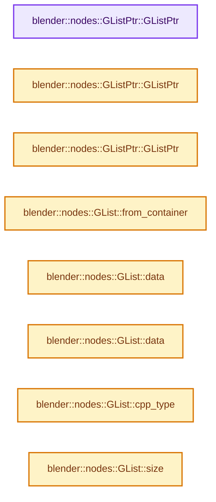
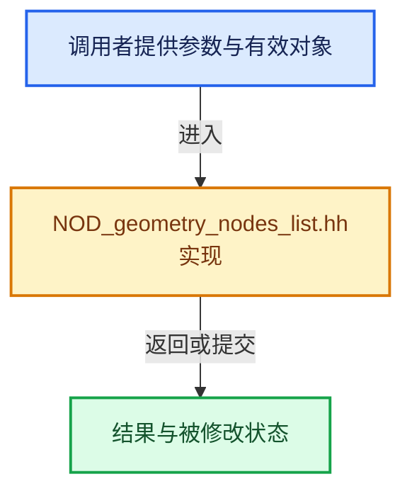

# 实现依赖专题：source/blender/nodes/NOD_geometry_nodes_list.hh

[实现依赖导航](../README.md) · [符号索引](../../00-课程指南/02-源码与提交索引/符号依赖与实现索引.md)

本专题从正文实际调用进入，集中保存共享实现。函数有稳定锚点，可从调用处直接跳到对应完整函数；递归与互相调用通过回链组织。

## 本文件的实现关系






## 完整成员与函数实现

<a id="f-15788b095b6a3bf7"></a>

### `blender::nodes::GListPtr::GListPtr`

实现位置：[source/blender/nodes/NOD_geometry_nodes_list.hh](../../../../../../source/blender/nodes/NOD_geometry_nodes_list.hh) · L152—L152。

**教学注释版**

<!-- annotated:0dda09cc56c750 -->

```cpp
  GListPtr() = default;
```

<details>
<summary>核对原始源码：source/blender/nodes/NOD_geometry_nodes_list.hh · L152—L152</summary>

<!-- original:0dda09cc56c750:source/blender/nodes/NOD_geometry_nodes_list.hh:152:152 -->

```cpp
  GListPtr() = default;
```

</details>

**继续追踪实现**

本实现没有需要继续展开的显式调用；检查返回表达式、对象转换和调用者前置条件。

<a id="f-5bf0d6a7a8c28ef4"></a>

### `blender::nodes::GListPtr::GListPtr`

实现位置：[source/blender/nodes/NOD_geometry_nodes_list.hh](../../../../../../source/blender/nodes/NOD_geometry_nodes_list.hh) · L153—L153。

接口参数：

- `const GList *data`

**教学注释版**

<!-- annotated:8f2ee60e3a5637 -->

```cpp
  explicit GListPtr(const GList *data) : data_(data) {}
```

<details>
<summary>核对原始源码：source/blender/nodes/NOD_geometry_nodes_list.hh · L153—L153</summary>

<!-- original:8f2ee60e3a5637:source/blender/nodes/NOD_geometry_nodes_list.hh:153:153 -->

```cpp
  explicit GListPtr(const GList *data) : data_(data) {}
```

</details>

**继续追踪实现**

本实现没有需要继续展开的显式调用；检查返回表达式、对象转换和调用者前置条件。

<a id="f-aba6a4f613490f6a"></a>

### `blender::nodes::GListPtr::GListPtr`

实现位置：[source/blender/nodes/NOD_geometry_nodes_list.hh](../../../../../../source/blender/nodes/NOD_geometry_nodes_list.hh) · L154—L154。

接口参数：

- `const CPPType &type`

**教学注释版**

<!-- annotated:15df8ecaebea2a -->

```cpp
  explicit GListPtr(const CPPType &type) : GListPtr(MEM_new<GList>(__func__, type)) {}
```

<details>
<summary>核对原始源码：source/blender/nodes/NOD_geometry_nodes_list.hh · L154—L154</summary>

<!-- original:15df8ecaebea2a:source/blender/nodes/NOD_geometry_nodes_list.hh:154:154 -->

```cpp
  explicit GListPtr(const CPPType &type) : GListPtr(MEM_new<GList>(__func__, type)) {}
```

</details>

**继续追踪实现**

本实现没有需要继续展开的显式调用；检查返回表达式、对象转换和调用者前置条件。

<a id="f-4feea7b3af1d4512"></a>

### `blender::nodes::GList::from_container`

实现位置：[source/blender/nodes/NOD_geometry_nodes_list.hh](../../../../../../source/blender/nodes/NOD_geometry_nodes_list.hh) · L188—L198。

接口参数：

- `ContainerT &&container`

**教学注释版**

<!-- annotated:4f9e97deb5844d -->

```cpp
template<typename ContainerT> inline GListPtr GList::from_container(ContainerT &&container)
{
  using T = typename std::decay_t<ContainerT>::value_type;
  static_assert(std::is_convertible_v<ContainerT, MutableSpan<T>>);
  auto *sharable_data = new ImplicitSharedValue<std::decay_t<ContainerT>>(
      // [讲解] std::forward<ContainerT>：在转发引用中恢复调用者传入的值类别；依赖推导类型，不能与无条件move互换。
      std::forward<ContainerT>(container));
  ArrayData array_data;
  array_data.data = sharable_data->data.data();
  array_data.sharing_info = ImplicitSharingPtr<>(sharable_data);
  // [讲解] std::move：把表达式转换成可供移动重载选择的值类别；不保证真的移动，不结束源对象寿命，对const值可能选择复制。
  return GList::create(CPPType::get<T>(), std::move(array_data), sharable_data->data.size());
}
```

<details>
<summary>核对原始源码：source/blender/nodes/NOD_geometry_nodes_list.hh · L188—L198</summary>

<!-- original:4f9e97deb5844d:source/blender/nodes/NOD_geometry_nodes_list.hh:188:198 -->

```cpp
template<typename ContainerT> inline GListPtr GList::from_container(ContainerT &&container)
{
  using T = typename std::decay_t<ContainerT>::value_type;
  static_assert(std::is_convertible_v<ContainerT, MutableSpan<T>>);
  auto *sharable_data = new ImplicitSharedValue<std::decay_t<ContainerT>>(
      std::forward<ContainerT>(container));
  ArrayData array_data;
  array_data.data = sharable_data->data.data();
  array_data.sharing_info = ImplicitSharingPtr<>(sharable_data);
  return GList::create(CPPType::get<T>(), std::move(array_data), sharable_data->data.size());
}
```

</details>

**沿实际写入检查状态**

- `array_data.data = sharable_data->data.data();`
- `array_data.sharing_info = ImplicitSharingPtr<>(sharable_data);`

**结果出口**

- `return GList::create(CPPType::get<T>(), std::move(array_data), sharable_data->data.size());`

**继续追踪实现**

- `std::forward<ContainerT>` → [外部契约](https://eel.is/c++draft/utility.forward)：在转发引用中恢复调用者传入的值类别；依赖推导类型，不能与无条件move互换。
- `sharable_data->data.data` → [调用协议](../../00-课程指南/01-路线与规范/模板宏与动态分派协议.md)：接收对象类型依赖auto、返回值或模板实例；不按同名猜测目标。调用位置L195。
- `ImplicitSharingPtr<>` → [blender::ImplicitSharingPtr::ImplicitSharingPtr · L32](../../06-隐式共享与缓存系统/03-Mixin与共享指针封装.md#f-d28a43dbb5ed8c05)；[blender::ImplicitSharingPtr::ImplicitSharingPtr · L34](../../06-隐式共享与缓存系统/03-Mixin与共享指针封装.md#f-d27d5ebf676e244a)；[blender::ImplicitSharingPtr::ImplicitSharingPtr · L37](../../06-隐式共享与缓存系统/03-Mixin与共享指针封装.md#f-17d0c5fe2b03a664)；[blender::ImplicitSharingPtr::ImplicitSharingPtr · L39](../../06-隐式共享与缓存系统/03-Mixin与共享指针封装.md#f-1c8729ae57532370)；[blender::ImplicitSharingPtr::ImplicitSharingPtr · L44](../../06-隐式共享与缓存系统/03-Mixin与共享指针封装.md#f-0b6be0142b98009e)；[blender::ImplicitSharingPtr::ImplicitSharingPtr · L49](../../06-隐式共享与缓存系统/03-Mixin与共享指针封装.md#f-90c601ed9ed99045)；[blender::ImplicitSharingPtr::ImplicitSharingPtr · L57](../../06-隐式共享与缓存系统/03-Mixin与共享指针封装.md#f-1625179ceae7a66d)。同名重载需按实参类型选择。
- `GList::create` → [blender::nodes::GList::create · L263](intern/geometry_nodes_list.cc.md#f-d98f24446264b506)。
- `CPPType::get<T>` → [blender::nodes::GListPtr::get · L342](NOD_geometry_nodes_list.hh.md#f-8a6c0143f9bab586)；[blender::nodes::List<T> &ListPtr<T>::get · L395](NOD_geometry_nodes_list.hh.md#f-c5594b84b334a369)。同名重载需按实参类型选择。
- `std::move` → [外部契约](https://eel.is/c++draft/utility.forward)：把表达式转换成可供移动重载选择的值类别；不保证真的移动，不结束源对象寿命，对const值可能选择复制。
- `sharable_data->data.size` → [调用协议](../../00-课程指南/01-路线与规范/模板宏与动态分派协议.md)：接收对象类型依赖auto、返回值或模板实例；不按同名猜测目标。调用位置L197。

<a id="f-79596d2a726abf7a"></a>

### `blender::nodes::GList::data`

实现位置：[source/blender/nodes/NOD_geometry_nodes_list.hh](../../../../../../source/blender/nodes/NOD_geometry_nodes_list.hh) · L208—L211。

**教学注释版**

<!-- annotated:9ddfbd5f10a838 -->

```cpp
inline GList::DataVariant &GList::data()
{
  return data_;
}
```

<details>
<summary>核对原始源码：source/blender/nodes/NOD_geometry_nodes_list.hh · L208—L211</summary>

<!-- original:9ddfbd5f10a838:source/blender/nodes/NOD_geometry_nodes_list.hh:208:211 -->

```cpp
inline GList::DataVariant &GList::data()
{
  return data_;
}
```

</details>

**结果出口**

- `return data_;`

**继续追踪实现**

本实现没有需要继续展开的显式调用；检查返回表达式、对象转换和调用者前置条件。

<a id="f-a1564e477ed8318a"></a>

### `blender::nodes::GList::data`

实现位置：[source/blender/nodes/NOD_geometry_nodes_list.hh](../../../../../../source/blender/nodes/NOD_geometry_nodes_list.hh) · L213—L216。

**教学注释版**

<!-- annotated:084068a827ae0c -->

```cpp
inline const GList::DataVariant &GList::data() const
{
  return data_;
}
```

<details>
<summary>核对原始源码：source/blender/nodes/NOD_geometry_nodes_list.hh · L213—L216</summary>

<!-- original:084068a827ae0c:source/blender/nodes/NOD_geometry_nodes_list.hh:213:216 -->

```cpp
inline const GList::DataVariant &GList::data() const
{
  return data_;
}
```

</details>

**结果出口**

- `return data_;`

**继续追踪实现**

本实现没有需要继续展开的显式调用；检查返回表达式、对象转换和调用者前置条件。

<a id="f-c8f69b2e40d6c43b"></a>

### `blender::nodes::GList::cpp_type`

实现位置：[source/blender/nodes/NOD_geometry_nodes_list.hh](../../../../../../source/blender/nodes/NOD_geometry_nodes_list.hh) · L218—L221。

**教学注释版**

<!-- annotated:333803560aed53 -->

```cpp
inline const CPPType &GList::cpp_type() const
{
  return cpp_type_;
}
```

<details>
<summary>核对原始源码：source/blender/nodes/NOD_geometry_nodes_list.hh · L218—L221</summary>

<!-- original:333803560aed53:source/blender/nodes/NOD_geometry_nodes_list.hh:218:221 -->

```cpp
inline const CPPType &GList::cpp_type() const
{
  return cpp_type_;
}
```

</details>

**结果出口**

- `return cpp_type_;`

**继续追踪实现**

本实现没有需要继续展开的显式调用；检查返回表达式、对象转换和调用者前置条件。

<a id="f-e73c9da1d1adc0c8"></a>

### `blender::nodes::GList::size`

实现位置：[source/blender/nodes/NOD_geometry_nodes_list.hh](../../../../../../source/blender/nodes/NOD_geometry_nodes_list.hh) · L223—L226。

**教学注释版**

<!-- annotated:c269fe788f4644 -->

```cpp
inline int64_t GList::size() const
{
  return size_;
}
```

<details>
<summary>核对原始源码：source/blender/nodes/NOD_geometry_nodes_list.hh · L223—L226</summary>

<!-- original:c269fe788f4644:source/blender/nodes/NOD_geometry_nodes_list.hh:223:226 -->

```cpp
inline int64_t GList::size() const
{
  return size_;
}
```

</details>

**结果出口**

- `return size_;`

**继续追踪实现**

本实现没有需要继续展开的显式调用；检查返回表达式、对象转换和调用者前置条件。

<a id="f-d0e9511d99b92d14"></a>

### `blender::nodes::GList::typed`

实现位置：[source/blender/nodes/NOD_geometry_nodes_list.hh](../../../../../../source/blender/nodes/NOD_geometry_nodes_list.hh) · L228—L233。

**教学注释版**

<!-- annotated:0d14313b46608f -->

```cpp
template<typename T> inline const List<T> &GList::typed() const
{
  static_assert(sizeof(GList) == sizeof(List<T>));
  BLI_assert(this->cpp_type().is<T>());
  return reinterpret_cast<const List<T> &>(*this);
}
```

<details>
<summary>核对原始源码：source/blender/nodes/NOD_geometry_nodes_list.hh · L228—L233</summary>

<!-- original:0d14313b46608f:source/blender/nodes/NOD_geometry_nodes_list.hh:228:233 -->

```cpp
template<typename T> inline const List<T> &GList::typed() const
{
  static_assert(sizeof(GList) == sizeof(List<T>));
  BLI_assert(this->cpp_type().is<T>());
  return reinterpret_cast<const List<T> &>(*this);
}
```

</details>

**结果出口**

- `return reinterpret_cast<const List<T> &>(*this);`

**继续追踪实现**

- `BLI_assert` → [BLI_assert · L48](../01-BLI基础库/BLI_assert.hh.md#m-57a88495704d)；[BLI_assert · L63](../01-BLI基础库/BLI_assert.hh.md#m-d07050020cb5)。宏定义由构建条件选择。
- `this->cpp_type().is<T>` → [调用协议](../../00-课程指南/01-路线与规范/模板宏与动态分派协议.md)：接收对象类型依赖auto、返回值或模板实例；不按同名猜测目标。调用位置L231。
- `this->cpp_type` → [blender::nodes::GList::cpp_type · L218](NOD_geometry_nodes_list.hh.md#f-c8f69b2e40d6c43b)。

<a id="f-be106fdf4e8e4749"></a>

### `blender::nodes::GList::typed`

实现位置：[source/blender/nodes/NOD_geometry_nodes_list.hh](../../../../../../source/blender/nodes/NOD_geometry_nodes_list.hh) · L235—L240。

**教学注释版**

<!-- annotated:c07414c93669c3 -->

```cpp
template<typename T> inline List<T> &GList::typed()
{
  static_assert(sizeof(GList) == sizeof(List<T>));
  BLI_assert(this->cpp_type().is<T>());
  return reinterpret_cast<List<T> &>(*this);
}
```

<details>
<summary>核对原始源码：source/blender/nodes/NOD_geometry_nodes_list.hh · L235—L240</summary>

<!-- original:c07414c93669c3:source/blender/nodes/NOD_geometry_nodes_list.hh:235:240 -->

```cpp
template<typename T> inline List<T> &GList::typed()
{
  static_assert(sizeof(GList) == sizeof(List<T>));
  BLI_assert(this->cpp_type().is<T>());
  return reinterpret_cast<List<T> &>(*this);
}
```

</details>

**结果出口**

- `return reinterpret_cast<List<T> &>(*this);`

**继续追踪实现**

- `BLI_assert` → [BLI_assert · L48](../01-BLI基础库/BLI_assert.hh.md#m-57a88495704d)；[BLI_assert · L63](../01-BLI基础库/BLI_assert.hh.md#m-d07050020cb5)。宏定义由构建条件选择。
- `this->cpp_type().is<T>` → [调用协议](../../00-课程指南/01-路线与规范/模板宏与动态分派协议.md)：接收对象类型依赖auto、返回值或模板实例；不按同名猜测目标。调用位置L238。
- `this->cpp_type` → [blender::nodes::GList::cpp_type · L218](NOD_geometry_nodes_list.hh.md#f-c8f69b2e40d6c43b)。

<a id="f-f05d4d7a5007c920"></a>

### `blender::nodes::List<T>::data`

实现位置：[source/blender/nodes/NOD_geometry_nodes_list.hh](../../../../../../source/blender/nodes/NOD_geometry_nodes_list.hh) · L249—L252。

**教学注释版**

<!-- annotated:2f2c4d4e51dc5c -->

```cpp
template<typename T> inline GList::DataVariant &List<T>::data()
{
  return list_.data();
}
```

<details>
<summary>核对原始源码：source/blender/nodes/NOD_geometry_nodes_list.hh · L249—L252</summary>

<!-- original:2f2c4d4e51dc5c:source/blender/nodes/NOD_geometry_nodes_list.hh:249:252 -->

```cpp
template<typename T> inline GList::DataVariant &List<T>::data()
{
  return list_.data();
}
```

</details>

**结果出口**

- `return list_.data();`

**继续追踪实现**

- `list_.data` → [blender::nodes::GList::data · L208](NOD_geometry_nodes_list.hh.md#f-79596d2a726abf7a)；[blender::nodes::GList::data · L213](NOD_geometry_nodes_list.hh.md#f-a1564e477ed8318a)。同名重载需按实参类型选择。

<a id="f-9685f4b6239433b9"></a>

### `blender::nodes::List<T>::data`

实现位置：[source/blender/nodes/NOD_geometry_nodes_list.hh](../../../../../../source/blender/nodes/NOD_geometry_nodes_list.hh) · L254—L257。

**教学注释版**

<!-- annotated:74bec21a0887bf -->

```cpp
template<typename T> inline const GList::DataVariant &List<T>::data() const
{
  return list_.data();
}
```

<details>
<summary>核对原始源码：source/blender/nodes/NOD_geometry_nodes_list.hh · L254—L257</summary>

<!-- original:74bec21a0887bf:source/blender/nodes/NOD_geometry_nodes_list.hh:254:257 -->

```cpp
template<typename T> inline const GList::DataVariant &List<T>::data() const
{
  return list_.data();
}
```

</details>

**结果出口**

- `return list_.data();`

**继续追踪实现**

- `list_.data` → [blender::nodes::GList::data · L208](NOD_geometry_nodes_list.hh.md#f-79596d2a726abf7a)；[blender::nodes::GList::data · L213](NOD_geometry_nodes_list.hh.md#f-a1564e477ed8318a)。同名重载需按实参类型选择。

<a id="f-57458be18579d279"></a>

### `blender::nodes::List<T>::size`

实现位置：[source/blender/nodes/NOD_geometry_nodes_list.hh](../../../../../../source/blender/nodes/NOD_geometry_nodes_list.hh) · L259—L262。

**教学注释版**

<!-- annotated:80226d2c351a93 -->

```cpp
template<typename T> inline int64_t List<T>::size() const
{
  return list_.size();
}
```

<details>
<summary>核对原始源码：source/blender/nodes/NOD_geometry_nodes_list.hh · L259—L262</summary>

<!-- original:80226d2c351a93:source/blender/nodes/NOD_geometry_nodes_list.hh:259:262 -->

```cpp
template<typename T> inline int64_t List<T>::size() const
{
  return list_.size();
}
```

</details>

**结果出口**

- `return list_.size();`

**继续追踪实现**

- `list_.size` → [blender::nodes::GList::size · L223](NOD_geometry_nodes_list.hh.md#f-e73c9da1d1adc0c8)。

<a id="f-8a6c0143f9bab586"></a>

### `blender::nodes::GListPtr::get`

实现位置：[source/blender/nodes/NOD_geometry_nodes_list.hh](../../../../../../source/blender/nodes/NOD_geometry_nodes_list.hh) · L342—L345。

**教学注释版**

<!-- annotated:7ba54c31543aa6 -->

```cpp
inline const GList *GListPtr::get() const
{
  return data_.get();
}
```

<details>
<summary>核对原始源码：source/blender/nodes/NOD_geometry_nodes_list.hh · L342—L345</summary>

<!-- original:7ba54c31543aa6:source/blender/nodes/NOD_geometry_nodes_list.hh:342:345 -->

```cpp
inline const GList *GListPtr::get() const
{
  return data_.get();
}
```

</details>

**结果出口**

- `return data_.get();`

**继续追踪实现**

- `data_.get` → [blender::ImplicitSharingPtr::get · L111](../../06-隐式共享与缓存系统/03-Mixin与共享指针封装.md#f-71f0b315cfcf8f62)。

<a id="f-5ea994c546b4d8cd"></a>

### `blender::nodes::GListPtr::get_for_write`

实现位置：[source/blender/nodes/NOD_geometry_nodes_list.hh](../../../../../../source/blender/nodes/NOD_geometry_nodes_list.hh) · L347—L356。

**教学注释版**

<!-- annotated:d5b81d2e865d69 -->

```cpp
inline GList &GListPtr::get_for_write()
{
  BLI_assert(data_);
  // [讲解] data_->is_mutable：检查相应共享状态是否允许独占修改。
  if (!data_->is_mutable()) {
    *this = data_->copy();
  }
  BLI_assert(data_->is_mutable());
  data_->tag_ensured_mutable();
  return const_cast<GList &>(*data_);
}
```

<details>
<summary>核对原始源码：source/blender/nodes/NOD_geometry_nodes_list.hh · L347—L356</summary>

<!-- original:d5b81d2e865d69:source/blender/nodes/NOD_geometry_nodes_list.hh:347:356 -->

```cpp
inline GList &GListPtr::get_for_write()
{
  BLI_assert(data_);
  if (!data_->is_mutable()) {
    *this = data_->copy();
  }
  BLI_assert(data_->is_mutable());
  data_->tag_ensured_mutable();
  return const_cast<GList &>(*data_);
}
```

</details>

**结果出口**

- `return const_cast<GList &>(*data_);`

**继续追踪实现**

- `BLI_assert` → [BLI_assert · L48](../01-BLI基础库/BLI_assert.hh.md#m-57a88495704d)；[BLI_assert · L63](../01-BLI基础库/BLI_assert.hh.md#m-d07050020cb5)。宏定义由构建条件选择。
- `data_->is_mutable` → [blender::ImplicitSharingInfo::is_mutable · L76](../../06-隐式共享与缓存系统/01-所有权与写时复制.md#f-b4d31aba499caecb)。
- `data_->copy` → [blender::nodes::GList::copy · L80](intern/geometry_nodes_list.cc.md#f-c576bfad57bf8958)；[blender::nodes::Bundle::copy · L285](../../10-引用生命周期与Closure/05-Bundle值组合.md#f-355b4f3662c11be5)。同名重载需按实参类型选择。
- `data_->tag_ensured_mutable` → [blender::ImplicitSharingInfo::tag_ensured_mutable · L115](../../06-隐式共享与缓存系统/01-所有权与写时复制.md#f-b7d71fa0b9bc809d)。

<a id="f-ab9701a956c5f1a3"></a>

### `blender::nodes::GListPtr::typed`

实现位置：[source/blender/nodes/NOD_geometry_nodes_list.hh](../../../../../../source/blender/nodes/NOD_geometry_nodes_list.hh) · L358—L363。

**教学注释版**

<!-- annotated:25fb7b6f3232fd -->

```cpp
template<typename T> inline const ListPtr<T> &GListPtr::typed() const
{
  static_assert(sizeof(GList) == sizeof(List<T>));
  BLI_assert(!data_ || data_->cpp_type().is<T>());
  return reinterpret_cast<const ListPtr<T> &>(*this);
}
```

<details>
<summary>核对原始源码：source/blender/nodes/NOD_geometry_nodes_list.hh · L358—L363</summary>

<!-- original:25fb7b6f3232fd:source/blender/nodes/NOD_geometry_nodes_list.hh:358:363 -->

```cpp
template<typename T> inline const ListPtr<T> &GListPtr::typed() const
{
  static_assert(sizeof(GList) == sizeof(List<T>));
  BLI_assert(!data_ || data_->cpp_type().is<T>());
  return reinterpret_cast<const ListPtr<T> &>(*this);
}
```

</details>

**结果出口**

- `return reinterpret_cast<const ListPtr<T> &>(*this);`

**继续追踪实现**

- `BLI_assert` → [BLI_assert · L48](../01-BLI基础库/BLI_assert.hh.md#m-57a88495704d)；[BLI_assert · L63](../01-BLI基础库/BLI_assert.hh.md#m-d07050020cb5)。宏定义由构建条件选择。
- `data_->cpp_type().is<T>` → [调用协议](../../00-课程指南/01-路线与规范/模板宏与动态分派协议.md)：接收对象类型依赖auto、返回值或模板实例；不按同名猜测目标。调用位置L361。
- `data_->cpp_type` → [blender::nodes::GList::cpp_type · L218](NOD_geometry_nodes_list.hh.md#f-c8f69b2e40d6c43b)。

<a id="f-405c02d1f7283305"></a>

### `blender::nodes::GListPtr::typed`

实现位置：[source/blender/nodes/NOD_geometry_nodes_list.hh](../../../../../../source/blender/nodes/NOD_geometry_nodes_list.hh) · L365—L370。

**教学注释版**

<!-- annotated:a48b142f73b3cf -->

```cpp
template<typename T> inline ListPtr<T> &GListPtr::typed()
{
  static_assert(sizeof(GList) == sizeof(List<T>));
  BLI_assert(!data_ || data_->cpp_type().is<T>());
  return reinterpret_cast<ListPtr<T> &>(*this);
}
```

<details>
<summary>核对原始源码：source/blender/nodes/NOD_geometry_nodes_list.hh · L365—L370</summary>

<!-- original:a48b142f73b3cf:source/blender/nodes/NOD_geometry_nodes_list.hh:365:370 -->

```cpp
template<typename T> inline ListPtr<T> &GListPtr::typed()
{
  static_assert(sizeof(GList) == sizeof(List<T>));
  BLI_assert(!data_ || data_->cpp_type().is<T>());
  return reinterpret_cast<ListPtr<T> &>(*this);
}
```

</details>

**结果出口**

- `return reinterpret_cast<ListPtr<T> &>(*this);`

**继续追踪实现**

- `BLI_assert` → [BLI_assert · L48](../01-BLI基础库/BLI_assert.hh.md#m-57a88495704d)；[BLI_assert · L63](../01-BLI基础库/BLI_assert.hh.md#m-d07050020cb5)。宏定义由构建条件选择。
- `data_->cpp_type().is<T>` → [调用协议](../../00-课程指南/01-路线与规范/模板宏与动态分派协议.md)：接收对象类型依赖auto、返回值或模板实例；不按同名猜测目标。调用位置L368。
- `data_->cpp_type` → [blender::nodes::GList::cpp_type · L218](NOD_geometry_nodes_list.hh.md#f-c8f69b2e40d6c43b)。

<a id="f-c5594b84b334a369"></a>

### `blender::nodes::List<T> &ListPtr<T>::get`

实现位置：[source/blender/nodes/NOD_geometry_nodes_list.hh](../../../../../../source/blender/nodes/NOD_geometry_nodes_list.hh) · L395—L398。

**教学注释版**

<!-- annotated:c93c51b7f3258f -->

```cpp
template<typename T> inline const List<T> &ListPtr<T>::get() const
{
  return data_->typed<T>();
}
```

<details>
<summary>核对原始源码：source/blender/nodes/NOD_geometry_nodes_list.hh · L395—L398</summary>

<!-- original:c93c51b7f3258f:source/blender/nodes/NOD_geometry_nodes_list.hh:395:398 -->

```cpp
template<typename T> inline const List<T> &ListPtr<T>::get() const
{
  return data_->typed<T>();
}
```

</details>

**结果出口**

- `return data_->typed<T>();`

**继续追踪实现**

- `data_->typed<T>` → [调用协议](../../00-课程指南/01-路线与规范/模板宏与动态分派协议.md)：接收对象类型依赖auto、返回值或模板实例；不按同名猜测目标。调用位置L397。
