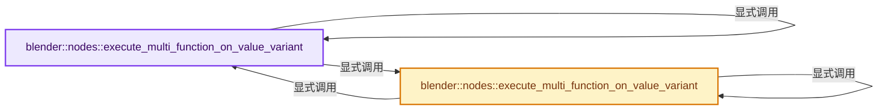
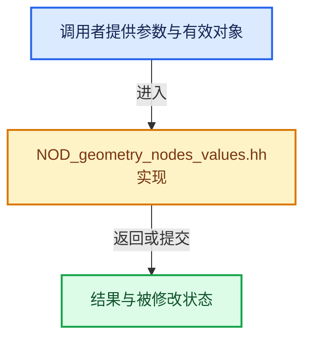

# 实现依赖专题：source/blender/nodes/NOD_geometry_nodes_values.hh

[实现依赖导航](../README.md) · [符号索引](../../00-课程指南/02-源码与提交索引/符号依赖与实现索引.md)

本专题从正文实际调用进入，集中保存共享实现。函数有稳定锚点，可从调用处直接跳到对应完整函数；递归与互相调用通过回链组织。

## 本文件的实现关系






## 完整成员与函数实现

<a id="f-4dbb5da04e0ebedc"></a>

### `blender::nodes::execute_multi_function_on_value_variant`

实现位置：[source/blender/nodes/NOD_geometry_nodes_values.hh](../../../../../../source/blender/nodes/NOD_geometry_nodes_values.hh) · L59—L69。

接口参数：

- `const std::shared_ptr<mf::MultiFunction> &owned_fn`
- `const Span<bke::SocketValueVariant *> input_values`
- `const Span<bke::SocketValueVariant *> output_values`
- `GeoNodesUserData *user_data`
- `std::string &r_error_message`

**教学注释版**

<!-- annotated:8be6197a86945d -->

```cpp
[[nodiscard]] inline bool execute_multi_function_on_value_variant(
    const std::shared_ptr<mf::MultiFunction> &owned_fn,
    const Span<bke::SocketValueVariant *> input_values,
    const Span<bke::SocketValueVariant *> output_values,
    GeoNodesUserData *user_data,
    std::string &r_error_message)
{
  const mf::MultiFunction &fn = *owned_fn;
  return execute_multi_function_on_value_variant(
      // [讲解] std::move：把表达式转换成可供移动重载选择的值类别；不保证真的移动，不结束源对象寿命，对const值可能选择复制。
      fn, std::move(owned_fn), input_values, output_values, user_data, r_error_message);
}
```

<details>
<summary>核对原始源码：source/blender/nodes/NOD_geometry_nodes_values.hh · L59—L69</summary>

<!-- original:8be6197a86945d:source/blender/nodes/NOD_geometry_nodes_values.hh:59:69 -->

```cpp
[[nodiscard]] inline bool execute_multi_function_on_value_variant(
    const std::shared_ptr<mf::MultiFunction> &owned_fn,
    const Span<bke::SocketValueVariant *> input_values,
    const Span<bke::SocketValueVariant *> output_values,
    GeoNodesUserData *user_data,
    std::string &r_error_message)
{
  const mf::MultiFunction &fn = *owned_fn;
  return execute_multi_function_on_value_variant(
      fn, std::move(owned_fn), input_values, output_values, user_data, r_error_message);
}
```

</details>

**结果出口**

- `return execute_multi_function_on_value_variant(`

**继续追踪实现**

- `execute_multi_function_on_value_variant` → [blender::nodes::execute_multi_function_on_value_variant · L59](NOD_geometry_nodes_values.hh.md#f-4dbb5da04e0ebedc)；[blender::nodes::execute_multi_function_on_value_variant · L71](NOD_geometry_nodes_values.hh.md#f-d306258bd44dcdbf)。同名重载需按实参类型选择。
- `std::move` → [外部契约](https://eel.is/c++draft/utility.forward)：把表达式转换成可供移动重载选择的值类别；不保证真的移动，不结束源对象寿命，对const值可能选择复制。

<a id="f-d306258bd44dcdbf"></a>

### `blender::nodes::execute_multi_function_on_value_variant`

实现位置：[source/blender/nodes/NOD_geometry_nodes_values.hh](../../../../../../source/blender/nodes/NOD_geometry_nodes_values.hh) · L71—L80。

接口参数：

- `const mf::MultiFunction &fn`
- `const Span<bke::SocketValueVariant *> input_values`
- `const Span<bke::SocketValueVariant *> output_values`
- `GeoNodesUserData *user_data`
- `std::string &r_error_message`

**教学注释版**

<!-- annotated:f69dbe57515de7 -->

```cpp
[[nodiscard]] inline bool execute_multi_function_on_value_variant(
    const mf::MultiFunction &fn,
    const Span<bke::SocketValueVariant *> input_values,
    const Span<bke::SocketValueVariant *> output_values,
    GeoNodesUserData *user_data,
    std::string &r_error_message)
{
  return execute_multi_function_on_value_variant(
      fn, {}, input_values, output_values, user_data, r_error_message);
}
```

<details>
<summary>核对原始源码：source/blender/nodes/NOD_geometry_nodes_values.hh · L71—L80</summary>

<!-- original:f69dbe57515de7:source/blender/nodes/NOD_geometry_nodes_values.hh:71:80 -->

```cpp
[[nodiscard]] inline bool execute_multi_function_on_value_variant(
    const mf::MultiFunction &fn,
    const Span<bke::SocketValueVariant *> input_values,
    const Span<bke::SocketValueVariant *> output_values,
    GeoNodesUserData *user_data,
    std::string &r_error_message)
{
  return execute_multi_function_on_value_variant(
      fn, {}, input_values, output_values, user_data, r_error_message);
}
```

</details>

**结果出口**

- `return execute_multi_function_on_value_variant(`

**继续追踪实现**

- `execute_multi_function_on_value_variant` → [blender::nodes::execute_multi_function_on_value_variant · L59](NOD_geometry_nodes_values.hh.md#f-4dbb5da04e0ebedc)；[blender::nodes::execute_multi_function_on_value_variant · L71](NOD_geometry_nodes_values.hh.md#f-d306258bd44dcdbf)。同名重载需按实参类型选择。
