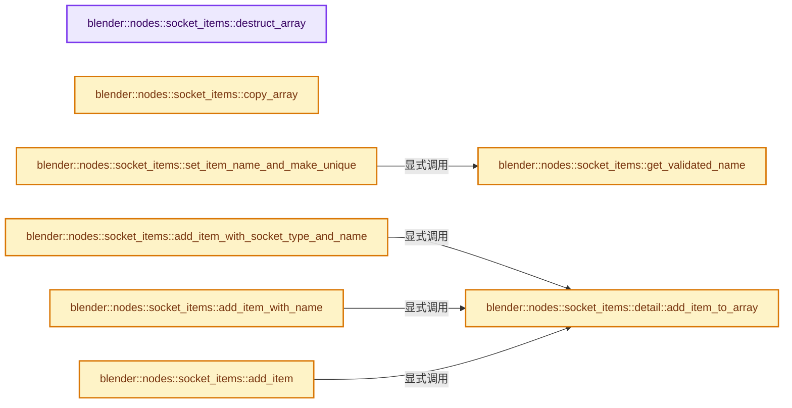
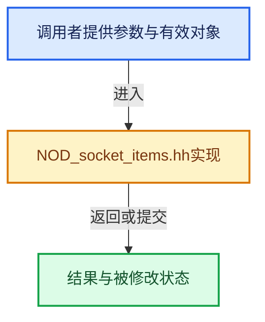

# 实现依赖专题：source/blender/nodes/NOD_socket_items.hh

[实现依赖导航](../README.md) · [符号索引](../../00-课程指南/02-源码与提交索引/符号依赖与实现索引.md)

本专题从正文实际调用进入，集中保存共享实现。函数有稳定锚点，可从调用处直接跳到对应完整函数；递归与互相调用通过回链组织。

## 本文件的实现关系






## 完整成员与函数实现

<a id="f-61cc3426af55b8af"></a>

### `blender::nodes::socket_items::destruct_array`

实现位置：[source/blender/nodes/NOD_socket_items.hh](../../../../../../source/blender/nodes/NOD_socket_items.hh) · L92—L101。

接口参数：

- `bNode &node`

**教学注释版**

<!-- annotated:bc0f27acd17323 -->

```cpp
template<typename Accessor> inline void destruct_array(bNode &node)
{
  using ItemT = typename Accessor::ItemT;
  SocketItemsRef ref = Accessor::get_items_from_node(node);
  for (const int i : IndexRange(*ref.items_num)) {
    ItemT &item = (*ref.items)[i];
    Accessor::destruct_item(&item);
  }
  MEM_SAFE_DELETE(*ref.items);
}
```

<details>
<summary>核对原始源码：source/blender/nodes/NOD_socket_items.hh · L92—L101</summary>

<!-- original:bc0f27acd17323:source/blender/nodes/NOD_socket_items.hh:92:101 -->

```cpp
template<typename Accessor> inline void destruct_array(bNode &node)
{
  using ItemT = typename Accessor::ItemT;
  SocketItemsRef ref = Accessor::get_items_from_node(node);
  for (const int i : IndexRange(*ref.items_num)) {
    ItemT &item = (*ref.items)[i];
    Accessor::destruct_item(&item);
  }
  MEM_SAFE_DELETE(*ref.items);
}
```

</details>

**继续追踪实现**

- `Accessor::get_items_from_node` → [blender::nodes::RaycastSampleAttributeItemsAccessor::get_items_from_node · L38](shader/include/NOD_shader_raycast.hh.md#f-3a8b562628078095)；[blender::nodes::GeoViewerItemsAccessor::get_items_from_node · L38](geometry/include/NOD_geo_viewer.hh.md#f-5ab2cbca96314de9)；[blender::nodes::SimulationItemsAccessor::get_items_from_node · L37](geometry/include/NOD_geo_simulation.hh.md#f-898ff47dc220feed)；[blender::nodes::RepeatItemsAccessor::get_items_from_node · L37](geometry/include/NOD_geo_repeat.hh.md#f-bc70898d619a07bc)；[blender::nodes::RasterizePointsItemsAccessor::get_items_from_node · L37](geometry/include/NOD_geo_rasterize_points.hh.md#f-f07b0adeb48df2b5)；[blender::nodes::MenuSwitchItemsAccessor::get_items_from_node · L38](geometry/include/NOD_geo_menu_switch.hh.md#f-ad24d3b15c5b59c3)；[blender::nodes::IndexSwitchItemsAccessor::get_items_from_node · L30](geometry/include/NOD_geo_index_switch.hh.md#f-fe5dfa66cec1ecf2)；[blender::nodes::ForeachGeometryElementInputItemsAccessor::get_items_from_node · L37](geometry/include/NOD_geo_foreach_geometry_element.hh.md#f-614cb876c8c0ad08)；[blender::nodes::ForeachGeometryElementMainItemsAccessor::get_items_from_node · L123](geometry/include/NOD_geo_foreach_geometry_element.hh.md#f-c3463dfe9d86d1c6)；[blender::nodes::ForeachGeometryElementGenerationItemsAccessor::get_items_from_node · L209](geometry/include/NOD_geo_foreach_geometry_element.hh.md#f-9b2b97a4c6e2e2bf)；[blender::nodes::FieldToListItemsAccessor::get_items_from_node · L38](geometry/include/NOD_geo_field_to_list.hh.md#f-b9622adfbf3850be)；[blender::nodes::FieldToGridItemsAccessor::get_items_from_node · L38](geometry/include/NOD_geo_field_to_grid.hh.md#f-869efc4bfe6a0034)；[blender::nodes::CombineListItemsAccessor::get_items_from_node · L30](geometry/include/NOD_geo_combine_list.hh.md#f-4d73951dcbf992a5)；[blender::nodes::ClosureToListItemsAccessor::get_items_from_node · L38](geometry/include/NOD_geo_closure_to_list.hh.md#f-e3c98034ea103873)；[blender::nodes::ClosureInputItemsAccessor::get_items_from_node · L41](geometry/include/NOD_geo_closure.hh.md#f-81cfe82f985d2413)；[blender::nodes::ClosureOutputItemsAccessor::get_items_from_node · L115](geometry/include/NOD_geo_closure.hh.md#f-741633ed0fe86dcc)；[blender::nodes::EvaluateClosureInputItemsAccessor::get_items_from_node · L189](geometry/include/NOD_geo_closure.hh.md#f-63859ce4e73466e4)；[blender::nodes::EvaluateClosureOutputItemsAccessor::get_items_from_node · L264](geometry/include/NOD_geo_closure.hh.md#f-df9ac7fb721bd6cf)；[blender::nodes::CaptureAttributeItemsAccessor::get_items_from_node · L36](geometry/include/NOD_geo_capture_attribute.hh.md#f-7c4ae7b1065e727d)；[blender::nodes::CombineBundleItemsAccessor::get_items_from_node · L41](geometry/include/NOD_geo_bundle.hh.md#f-726d871c58c4a98e)；[blender::nodes::SeparateBundleItemsAccessor::get_items_from_node · L117](geometry/include/NOD_geo_bundle.hh.md#f-361121e6a62ec201)；[blender::nodes::BakeItemsAccessor::get_items_from_node · L52](geometry/include/NOD_geo_bake.hh.md#f-8a32f2915f15b452)；[blender::nodes::FormatStringItemsAccessor::get_items_from_node · L40](function/include/NOD_fn_format_string.hh.md#f-01e4b1bbb0e9a7b0)；[blender::nodes::FileOutputItemsAccessor::get_items_from_node · L45](composite/include/NOD_compositor_file_output.hh.md#f-bdac32a93a61751d)。同名重载需按实参类型选择。
- `IndexRange` → [blender::IndexRange](../01-BLI基础库/BLI_index_range.hh.md#t-caa3466d6776)；[blender::gpu::shader::parser::IndexRange](../08-其他Blender模块/gpu/shader_tool/utils.hh.md#t-82d2bd4ea71c)；[blender::IndexRange](../08-其他Blender模块/makesdna/DNA_node_types.h.md#t-0448cc889d39)。
- `Accessor::destruct_item` → [blender::nodes::RaycastSampleAttributeItemsAccessor::destruct_item · L54](shader/include/NOD_shader_raycast.hh.md#f-6ddb12a3ea421d2e)；[blender::nodes::GeoViewerItemsAccessor::destruct_item · L50](geometry/include/NOD_geo_viewer.hh.md#f-81441270d108b4c6)；[blender::nodes::SimulationItemsAccessor::destruct_item · L49](geometry/include/NOD_geo_simulation.hh.md#f-1c8b87046a11df38)；[blender::nodes::RepeatItemsAccessor::destruct_item · L49](geometry/include/NOD_geo_repeat.hh.md#f-79c20a94a8f053f7)；[blender::nodes::RasterizePointsItemsAccessor::destruct_item · L51](geometry/include/NOD_geo_rasterize_points.hh.md#f-54b52e8da0656da2)；[blender::nodes::MenuSwitchItemsAccessor::destruct_item · L53](geometry/include/NOD_geo_menu_switch.hh.md#f-d030667d2624ff88)；[blender::nodes::IndexSwitchItemsAccessor::destruct_item · L41](geometry/include/NOD_geo_index_switch.hh.md#f-758c0731dc86d348)；[blender::nodes::ForeachGeometryElementInputItemsAccessor::destruct_item · L51](geometry/include/NOD_geo_foreach_geometry_element.hh.md#f-36545536b9c9f03e)；[blender::nodes::ForeachGeometryElementMainItemsAccessor::destruct_item · L137](geometry/include/NOD_geo_foreach_geometry_element.hh.md#f-db8272b1b7959a2a)；[blender::nodes::ForeachGeometryElementGenerationItemsAccessor::destruct_item · L223](geometry/include/NOD_geo_foreach_geometry_element.hh.md#f-5910e58c6f27cb07)；[blender::nodes::FieldToListItemsAccessor::destruct_item · L50](geometry/include/NOD_geo_field_to_list.hh.md#f-ba09dbf68c5a8443)；[blender::nodes::FieldToGridItemsAccessor::destruct_item · L50](geometry/include/NOD_geo_field_to_grid.hh.md#f-d0f7c4d48b5c1df9)；[blender::nodes::CombineListItemsAccessor::destruct_item · L41](geometry/include/NOD_geo_combine_list.hh.md#f-4e5bf9d6ceacb004)；[blender::nodes::ClosureToListItemsAccessor::destruct_item · L52](geometry/include/NOD_geo_closure_to_list.hh.md#f-2bc97e4755ff84b3)；[blender::nodes::ClosureInputItemsAccessor::destruct_item · L55](geometry/include/NOD_geo_closure.hh.md#f-7885a02415e196e5)；[blender::nodes::ClosureOutputItemsAccessor::destruct_item · L129](geometry/include/NOD_geo_closure.hh.md#f-6b711cec9e07bb08)；[blender::nodes::EvaluateClosureInputItemsAccessor::destruct_item · L203](geometry/include/NOD_geo_closure.hh.md#f-a9cd2629cd58eb36)；[blender::nodes::EvaluateClosureOutputItemsAccessor::destruct_item · L278](geometry/include/NOD_geo_closure.hh.md#f-c3afa14041070855)；[blender::nodes::CaptureAttributeItemsAccessor::destruct_item · L50](geometry/include/NOD_geo_capture_attribute.hh.md#f-f4931ae929886fce)；[blender::nodes::CombineBundleItemsAccessor::destruct_item · L53](geometry/include/NOD_geo_bundle.hh.md#f-2f5b5453f6c53086)；[blender::nodes::SeparateBundleItemsAccessor::destruct_item · L129](geometry/include/NOD_geo_bundle.hh.md#f-e19de5b44819877e)；[blender::nodes::BakeItemsAccessor::destruct_item · L64](geometry/include/NOD_geo_bake.hh.md#f-19b9fd4c272674e5)；[blender::nodes::FormatStringItemsAccessor::destruct_item · L53](function/include/NOD_fn_format_string.hh.md#f-30f07b7377a42424)；[blender::nodes::FileOutputItemsAccessor::destruct_item · L60](composite/include/NOD_compositor_file_output.hh.md#f-973efb2754cc1f50)。同名重载需按实参类型选择。
- `MEM_SAFE_DELETE` → [MEM_SAFE_DELETE · L436](../07-Intern运行时与平台/guardedalloc/MEM_guardedalloc.h.md#m-eadb3bc5b902)。宏定义由构建条件选择。

<a id="f-1f49897843aa192c"></a>

### `blender::nodes::socket_items::copy_array`

实现位置：[source/blender/nodes/NOD_socket_items.hh](../../../../../../source/blender/nodes/NOD_socket_items.hh) · L119—L129。

接口参数：

- `const bNode &src_node`
- `bNode &dst_node`

**教学注释版**

<!-- annotated:308be795049e14 -->

```cpp
template<typename Accessor> inline void copy_array(const bNode &src_node, bNode &dst_node)
{
  using ItemT = typename Accessor::ItemT;
  SocketItemsRef src_ref = Accessor::get_items_from_node(const_cast<bNode &>(src_node));
  SocketItemsRef dst_ref = Accessor::get_items_from_node(dst_node);
  const int items_num = *src_ref.items_num;
  *dst_ref.items = MEM_new_array<ItemT>(items_num, __func__);
  for (const int i : IndexRange(items_num)) {
    Accessor::copy_item((*src_ref.items)[i], (*dst_ref.items)[i]);
  }
}
```

<details>
<summary>核对原始源码：source/blender/nodes/NOD_socket_items.hh · L119—L129</summary>

<!-- original:308be795049e14:source/blender/nodes/NOD_socket_items.hh:119:129 -->

```cpp
template<typename Accessor> inline void copy_array(const bNode &src_node, bNode &dst_node)
{
  using ItemT = typename Accessor::ItemT;
  SocketItemsRef src_ref = Accessor::get_items_from_node(const_cast<bNode &>(src_node));
  SocketItemsRef dst_ref = Accessor::get_items_from_node(dst_node);
  const int items_num = *src_ref.items_num;
  *dst_ref.items = MEM_new_array<ItemT>(items_num, __func__);
  for (const int i : IndexRange(items_num)) {
    Accessor::copy_item((*src_ref.items)[i], (*dst_ref.items)[i]);
  }
}
```

</details>

**继续追踪实现**

- `Accessor::get_items_from_node` → [blender::nodes::RaycastSampleAttributeItemsAccessor::get_items_from_node · L38](shader/include/NOD_shader_raycast.hh.md#f-3a8b562628078095)；[blender::nodes::GeoViewerItemsAccessor::get_items_from_node · L38](geometry/include/NOD_geo_viewer.hh.md#f-5ab2cbca96314de9)；[blender::nodes::SimulationItemsAccessor::get_items_from_node · L37](geometry/include/NOD_geo_simulation.hh.md#f-898ff47dc220feed)；[blender::nodes::RepeatItemsAccessor::get_items_from_node · L37](geometry/include/NOD_geo_repeat.hh.md#f-bc70898d619a07bc)；[blender::nodes::RasterizePointsItemsAccessor::get_items_from_node · L37](geometry/include/NOD_geo_rasterize_points.hh.md#f-f07b0adeb48df2b5)；[blender::nodes::MenuSwitchItemsAccessor::get_items_from_node · L38](geometry/include/NOD_geo_menu_switch.hh.md#f-ad24d3b15c5b59c3)；[blender::nodes::IndexSwitchItemsAccessor::get_items_from_node · L30](geometry/include/NOD_geo_index_switch.hh.md#f-fe5dfa66cec1ecf2)；[blender::nodes::ForeachGeometryElementInputItemsAccessor::get_items_from_node · L37](geometry/include/NOD_geo_foreach_geometry_element.hh.md#f-614cb876c8c0ad08)；[blender::nodes::ForeachGeometryElementMainItemsAccessor::get_items_from_node · L123](geometry/include/NOD_geo_foreach_geometry_element.hh.md#f-c3463dfe9d86d1c6)；[blender::nodes::ForeachGeometryElementGenerationItemsAccessor::get_items_from_node · L209](geometry/include/NOD_geo_foreach_geometry_element.hh.md#f-9b2b97a4c6e2e2bf)；[blender::nodes::FieldToListItemsAccessor::get_items_from_node · L38](geometry/include/NOD_geo_field_to_list.hh.md#f-b9622adfbf3850be)；[blender::nodes::FieldToGridItemsAccessor::get_items_from_node · L38](geometry/include/NOD_geo_field_to_grid.hh.md#f-869efc4bfe6a0034)；[blender::nodes::CombineListItemsAccessor::get_items_from_node · L30](geometry/include/NOD_geo_combine_list.hh.md#f-4d73951dcbf992a5)；[blender::nodes::ClosureToListItemsAccessor::get_items_from_node · L38](geometry/include/NOD_geo_closure_to_list.hh.md#f-e3c98034ea103873)；[blender::nodes::ClosureInputItemsAccessor::get_items_from_node · L41](geometry/include/NOD_geo_closure.hh.md#f-81cfe82f985d2413)；[blender::nodes::ClosureOutputItemsAccessor::get_items_from_node · L115](geometry/include/NOD_geo_closure.hh.md#f-741633ed0fe86dcc)；[blender::nodes::EvaluateClosureInputItemsAccessor::get_items_from_node · L189](geometry/include/NOD_geo_closure.hh.md#f-63859ce4e73466e4)；[blender::nodes::EvaluateClosureOutputItemsAccessor::get_items_from_node · L264](geometry/include/NOD_geo_closure.hh.md#f-df9ac7fb721bd6cf)；[blender::nodes::CaptureAttributeItemsAccessor::get_items_from_node · L36](geometry/include/NOD_geo_capture_attribute.hh.md#f-7c4ae7b1065e727d)；[blender::nodes::CombineBundleItemsAccessor::get_items_from_node · L41](geometry/include/NOD_geo_bundle.hh.md#f-726d871c58c4a98e)；[blender::nodes::SeparateBundleItemsAccessor::get_items_from_node · L117](geometry/include/NOD_geo_bundle.hh.md#f-361121e6a62ec201)；[blender::nodes::BakeItemsAccessor::get_items_from_node · L52](geometry/include/NOD_geo_bake.hh.md#f-8a32f2915f15b452)；[blender::nodes::FormatStringItemsAccessor::get_items_from_node · L40](function/include/NOD_fn_format_string.hh.md#f-01e4b1bbb0e9a7b0)；[blender::nodes::FileOutputItemsAccessor::get_items_from_node · L45](composite/include/NOD_compositor_file_output.hh.md#f-bdac32a93a61751d)。同名重载需按实参类型选择。
- `MEM_new_array<ItemT>` → [MEM_new_array · L372](../07-Intern运行时与平台/guardedalloc/MEM_guardedalloc.h.md#f-56b8fe3d391af460)。
- `IndexRange` → [blender::IndexRange](../01-BLI基础库/BLI_index_range.hh.md#t-caa3466d6776)；[blender::gpu::shader::parser::IndexRange](../08-其他Blender模块/gpu/shader_tool/utils.hh.md#t-82d2bd4ea71c)；[blender::IndexRange](../08-其他Blender模块/makesdna/DNA_node_types.h.md#t-0448cc889d39)。
- `Accessor::copy_item` → [blender::nodes::RaycastSampleAttributeItemsAccessor::copy_item · L47](shader/include/NOD_shader_raycast.hh.md#f-92dc87e46285c3e8)；[blender::nodes::GeoViewerItemsAccessor::copy_item · L44](geometry/include/NOD_geo_viewer.hh.md#f-5e3b889c78887213)；[blender::nodes::SimulationItemsAccessor::copy_item · L43](geometry/include/NOD_geo_simulation.hh.md#f-e0b3b055550bff29)；[blender::nodes::RepeatItemsAccessor::copy_item · L43](geometry/include/NOD_geo_repeat.hh.md#f-6376397949080401)；[blender::nodes::RasterizePointsItemsAccessor::copy_item · L44](geometry/include/NOD_geo_rasterize_points.hh.md#f-433b50b0c4b76539)；[blender::nodes::MenuSwitchItemsAccessor::copy_item · L46](geometry/include/NOD_geo_menu_switch.hh.md#f-6b05bf97465c76c8)；[blender::nodes::IndexSwitchItemsAccessor::copy_item · L36](geometry/include/NOD_geo_index_switch.hh.md#f-1d1414124c95fe8d)；[blender::nodes::ForeachGeometryElementInputItemsAccessor::copy_item · L45](geometry/include/NOD_geo_foreach_geometry_element.hh.md#f-d6201aa81bc38eff)；[blender::nodes::ForeachGeometryElementMainItemsAccessor::copy_item · L131](geometry/include/NOD_geo_foreach_geometry_element.hh.md#f-3abbc66da358ac4c)；[blender::nodes::ForeachGeometryElementGenerationItemsAccessor::copy_item · L217](geometry/include/NOD_geo_foreach_geometry_element.hh.md#f-3059e8c4093d78fa)；[blender::nodes::FieldToListItemsAccessor::copy_item · L44](geometry/include/NOD_geo_field_to_list.hh.md#f-70e33a707e501b23)；[blender::nodes::FieldToGridItemsAccessor::copy_item · L44](geometry/include/NOD_geo_field_to_grid.hh.md#f-cd24edcc0c3a2504)；[blender::nodes::CombineListItemsAccessor::copy_item · L36](geometry/include/NOD_geo_combine_list.hh.md#f-e38cc090aaae6afa)；[blender::nodes::ClosureToListItemsAccessor::copy_item · L45](geometry/include/NOD_geo_closure_to_list.hh.md#f-db1c6345be4124ee)；[blender::nodes::ClosureInputItemsAccessor::copy_item · L49](geometry/include/NOD_geo_closure.hh.md#f-9de86c42a23749b1)；[blender::nodes::ClosureOutputItemsAccessor::copy_item · L123](geometry/include/NOD_geo_closure.hh.md#f-932ddc7e31701bf4)；[blender::nodes::EvaluateClosureInputItemsAccessor::copy_item · L197](geometry/include/NOD_geo_closure.hh.md#f-b830b7214d4eb609)；[blender::nodes::EvaluateClosureOutputItemsAccessor::copy_item · L272](geometry/include/NOD_geo_closure.hh.md#f-45bf4f42d524529f)；[blender::nodes::CaptureAttributeItemsAccessor::copy_item · L43](geometry/include/NOD_geo_capture_attribute.hh.md#f-1719962ca67b9d9d)；[blender::nodes::CombineBundleItemsAccessor::copy_item · L47](geometry/include/NOD_geo_bundle.hh.md#f-0c4ebb38bd3e8691)；[blender::nodes::SeparateBundleItemsAccessor::copy_item · L123](geometry/include/NOD_geo_bundle.hh.md#f-4a461ddef9818ca0)；[blender::nodes::BakeItemsAccessor::copy_item · L58](geometry/include/NOD_geo_bake.hh.md#f-31be6ad4acc5847c)；[blender::nodes::FormatStringItemsAccessor::copy_item · L47](function/include/NOD_fn_format_string.hh.md#f-d1f5a17114a07041)；[blender::nodes::FileOutputItemsAccessor::copy_item · L52](composite/include/NOD_compositor_file_output.hh.md#f-8b53465afa516a5d)。同名重载需按实参类型选择。

<a id="f-949009e2b1c01cf8"></a>

### `blender::nodes::socket_items::get_validated_name`

实现位置：[source/blender/nodes/NOD_socket_items.hh](../../../../../../source/blender/nodes/NOD_socket_items.hh) · L134—L142。

接口参数：

- `const StringRef name`

**教学注释版**

<!-- annotated:e64e65beb702f3 -->

```cpp
template<typename Accessor> inline std::string get_validated_name(const StringRef name)
{
  if constexpr (Accessor::has_name_validation) {
    return Accessor::validate_name(name);
  }
  else {
    return name;
  }
}
```

<details>
<summary>核对原始源码：source/blender/nodes/NOD_socket_items.hh · L134—L142</summary>

<!-- original:e64e65beb702f3:source/blender/nodes/NOD_socket_items.hh:134:142 -->

```cpp
template<typename Accessor> inline std::string get_validated_name(const StringRef name)
{
  if constexpr (Accessor::has_name_validation) {
    return Accessor::validate_name(name);
  }
  else {
    return name;
  }
}
```

</details>

**结果出口**

- `return Accessor::validate_name(name);`
- `return name;`

**继续追踪实现**

- `Accessor::validate_name` → [blender::nodes::CombineBundleItemsAccessor::validate_name · L287](geometry/nodes/node_geo_combine_bundle.cc.md#f-63e86fc1caca5c92)；[blender::nodes::SeparateBundleItemsAccessor::validate_name · L168](geometry/include/NOD_geo_bundle.hh.md#f-8ac9da4f856400e5)；[blender::nodes::FormatStringItemsAccessor::validate_name · L92](function/include/NOD_fn_format_string.hh.md#f-ea3904e7b5889821)；[blender::nodes::FileOutputItemsAccessor::validate_name · L877](composite/nodes/node_composite_file_output.cc.md#f-4cc77c4b091b517a)。同名重载需按实参类型选择。

<a id="f-7e7af1c01522f9dc"></a>

### `blender::nodes::socket_items::set_item_name_and_make_unique`

实现位置：[source/blender/nodes/NOD_socket_items.hh](../../../../../../source/blender/nodes/NOD_socket_items.hh) · L148—L190。

接口参数：

- `bNode &node`
- `typename Accessor::ItemT &item`
- `const char *value`

**教学注释版**

<!-- annotated:33f3db0e8ea7af -->

```cpp
template<typename Accessor>
inline void set_item_name_and_make_unique(bNode &node,
                                          typename Accessor::ItemT &item,
                                          const char *value)
{
  using ItemT = typename Accessor::ItemT;
  SocketItemsRef array = Accessor::get_items_from_node(node);

  std::string name = value;
  if constexpr (!Accessor::can_have_empty_name) {
    if (name.empty()) {
      if constexpr (Accessor::has_type) {
        name = *bke::node_static_socket_label(Accessor::get_socket_type(item), 0);
      }
      else {
        name = "Item";
      }
    }
  }

  const std::string validated_name = get_validated_name<Accessor>(name);

  const std::string unique_name = BLI_uniquename_cb(
      [&](const StringRef name) {
        for (ItemT &item_iter : MutableSpan(*array.items, *array.items_num)) {
          if (&item_iter != &item) {
            if (*Accessor::get_name(item_iter) == name) {
              return true;
            }
          }
        }
        return false;
      },
      Accessor::unique_name_separator,
      validated_name);

  /* The unique name should still be valid. */
  BLI_assert(unique_name == get_validated_name<Accessor>(unique_name));

  char **item_name = Accessor::get_name(item);
  MEM_SAFE_DELETE(*item_name);
  *item_name = BLI_strdup(unique_name.c_str());
}
```

<details>
<summary>核对原始源码：source/blender/nodes/NOD_socket_items.hh · L148—L190</summary>

<!-- original:33f3db0e8ea7af:source/blender/nodes/NOD_socket_items.hh:148:190 -->

```cpp
template<typename Accessor>
inline void set_item_name_and_make_unique(bNode &node,
                                          typename Accessor::ItemT &item,
                                          const char *value)
{
  using ItemT = typename Accessor::ItemT;
  SocketItemsRef array = Accessor::get_items_from_node(node);

  std::string name = value;
  if constexpr (!Accessor::can_have_empty_name) {
    if (name.empty()) {
      if constexpr (Accessor::has_type) {
        name = *bke::node_static_socket_label(Accessor::get_socket_type(item), 0);
      }
      else {
        name = "Item";
      }
    }
  }

  const std::string validated_name = get_validated_name<Accessor>(name);

  const std::string unique_name = BLI_uniquename_cb(
      [&](const StringRef name) {
        for (ItemT &item_iter : MutableSpan(*array.items, *array.items_num)) {
          if (&item_iter != &item) {
            if (*Accessor::get_name(item_iter) == name) {
              return true;
            }
          }
        }
        return false;
      },
      Accessor::unique_name_separator,
      validated_name);

  /* The unique name should still be valid. */
  BLI_assert(unique_name == get_validated_name<Accessor>(unique_name));

  char **item_name = Accessor::get_name(item);
  MEM_SAFE_DELETE(*item_name);
  *item_name = BLI_strdup(unique_name.c_str());
}
```

</details>

**沿实际写入检查状态**

- `name = *bke::node_static_socket_label(Accessor::get_socket_type(item), 0);`
- `name = "Item";`

**结果出口**

- `return true;`
- `return false;`

**继续追踪实现**

- `Accessor::get_items_from_node` → [blender::nodes::RaycastSampleAttributeItemsAccessor::get_items_from_node · L38](shader/include/NOD_shader_raycast.hh.md#f-3a8b562628078095)；[blender::nodes::GeoViewerItemsAccessor::get_items_from_node · L38](geometry/include/NOD_geo_viewer.hh.md#f-5ab2cbca96314de9)；[blender::nodes::SimulationItemsAccessor::get_items_from_node · L37](geometry/include/NOD_geo_simulation.hh.md#f-898ff47dc220feed)；[blender::nodes::RepeatItemsAccessor::get_items_from_node · L37](geometry/include/NOD_geo_repeat.hh.md#f-bc70898d619a07bc)；[blender::nodes::RasterizePointsItemsAccessor::get_items_from_node · L37](geometry/include/NOD_geo_rasterize_points.hh.md#f-f07b0adeb48df2b5)；[blender::nodes::MenuSwitchItemsAccessor::get_items_from_node · L38](geometry/include/NOD_geo_menu_switch.hh.md#f-ad24d3b15c5b59c3)；[blender::nodes::IndexSwitchItemsAccessor::get_items_from_node · L30](geometry/include/NOD_geo_index_switch.hh.md#f-fe5dfa66cec1ecf2)；[blender::nodes::ForeachGeometryElementInputItemsAccessor::get_items_from_node · L37](geometry/include/NOD_geo_foreach_geometry_element.hh.md#f-614cb876c8c0ad08)；[blender::nodes::ForeachGeometryElementMainItemsAccessor::get_items_from_node · L123](geometry/include/NOD_geo_foreach_geometry_element.hh.md#f-c3463dfe9d86d1c6)；[blender::nodes::ForeachGeometryElementGenerationItemsAccessor::get_items_from_node · L209](geometry/include/NOD_geo_foreach_geometry_element.hh.md#f-9b2b97a4c6e2e2bf)；[blender::nodes::FieldToListItemsAccessor::get_items_from_node · L38](geometry/include/NOD_geo_field_to_list.hh.md#f-b9622adfbf3850be)；[blender::nodes::FieldToGridItemsAccessor::get_items_from_node · L38](geometry/include/NOD_geo_field_to_grid.hh.md#f-869efc4bfe6a0034)；[blender::nodes::CombineListItemsAccessor::get_items_from_node · L30](geometry/include/NOD_geo_combine_list.hh.md#f-4d73951dcbf992a5)；[blender::nodes::ClosureToListItemsAccessor::get_items_from_node · L38](geometry/include/NOD_geo_closure_to_list.hh.md#f-e3c98034ea103873)；[blender::nodes::ClosureInputItemsAccessor::get_items_from_node · L41](geometry/include/NOD_geo_closure.hh.md#f-81cfe82f985d2413)；[blender::nodes::ClosureOutputItemsAccessor::get_items_from_node · L115](geometry/include/NOD_geo_closure.hh.md#f-741633ed0fe86dcc)；[blender::nodes::EvaluateClosureInputItemsAccessor::get_items_from_node · L189](geometry/include/NOD_geo_closure.hh.md#f-63859ce4e73466e4)；[blender::nodes::EvaluateClosureOutputItemsAccessor::get_items_from_node · L264](geometry/include/NOD_geo_closure.hh.md#f-df9ac7fb721bd6cf)；[blender::nodes::CaptureAttributeItemsAccessor::get_items_from_node · L36](geometry/include/NOD_geo_capture_attribute.hh.md#f-7c4ae7b1065e727d)；[blender::nodes::CombineBundleItemsAccessor::get_items_from_node · L41](geometry/include/NOD_geo_bundle.hh.md#f-726d871c58c4a98e)；[blender::nodes::SeparateBundleItemsAccessor::get_items_from_node · L117](geometry/include/NOD_geo_bundle.hh.md#f-361121e6a62ec201)；[blender::nodes::BakeItemsAccessor::get_items_from_node · L52](geometry/include/NOD_geo_bake.hh.md#f-8a32f2915f15b452)；[blender::nodes::FormatStringItemsAccessor::get_items_from_node · L40](function/include/NOD_fn_format_string.hh.md#f-01e4b1bbb0e9a7b0)；[blender::nodes::FileOutputItemsAccessor::get_items_from_node · L45](composite/include/NOD_compositor_file_output.hh.md#f-bdac32a93a61751d)。同名重载需按实参类型选择。
- `name.empty` → [调用协议](../../00-课程指南/01-路线与规范/模板宏与动态分派协议.md)：由接收对象具体类型或运行时策略提供实现。调用位置L158。
- `bke::node_static_socket_label` → [blender::bke::node_static_socket_label · L3923](../02-BKE几何与数据/intern/node.cc.md#f-69c25970c10d2ed0)。
- `Accessor::get_socket_type` → [blender::nodes::RaycastSampleAttributeItemsAccessor::get_socket_type · L62](shader/include/NOD_shader_raycast.hh.md#f-1a8feadea10406b0)；[blender::nodes::GeoViewerItemsAccessor::get_socket_type · L58](geometry/include/NOD_geo_viewer.hh.md#f-16be642a7c014d8b)；[blender::nodes::SimulationItemsAccessor::get_socket_type · L57](geometry/include/NOD_geo_simulation.hh.md#f-90b7f463d4a560d5)；[blender::nodes::RepeatItemsAccessor::get_socket_type · L57](geometry/include/NOD_geo_repeat.hh.md#f-e905cb9f5db74c86)；[blender::nodes::ForeachGeometryElementInputItemsAccessor::get_socket_type · L59](geometry/include/NOD_geo_foreach_geometry_element.hh.md#f-2fe15ca76a51f6d5)；[blender::nodes::ForeachGeometryElementMainItemsAccessor::get_socket_type · L145](geometry/include/NOD_geo_foreach_geometry_element.hh.md#f-17ff2793b1f5fdfa)；[blender::nodes::ForeachGeometryElementGenerationItemsAccessor::get_socket_type · L231](geometry/include/NOD_geo_foreach_geometry_element.hh.md#f-abc31d8c62e7a3bf)；[blender::nodes::FieldToListItemsAccessor::get_socket_type · L58](geometry/include/NOD_geo_field_to_list.hh.md#f-89297e7bffdc84b2)；[blender::nodes::FieldToGridItemsAccessor::get_socket_type · L58](geometry/include/NOD_geo_field_to_grid.hh.md#f-3af0619157962d99)；[blender::nodes::ClosureToListItemsAccessor::get_socket_type · L60](geometry/include/NOD_geo_closure_to_list.hh.md#f-67a54d46b6d1558a)；[blender::nodes::ClosureInputItemsAccessor::get_socket_type · L63](geometry/include/NOD_geo_closure.hh.md#f-63d79b046320cdf6)；[blender::nodes::ClosureOutputItemsAccessor::get_socket_type · L137](geometry/include/NOD_geo_closure.hh.md#f-cdcd610233e3547e)；[blender::nodes::EvaluateClosureInputItemsAccessor::get_socket_type · L211](geometry/include/NOD_geo_closure.hh.md#f-0722897c29b1f3e5)；[blender::nodes::EvaluateClosureOutputItemsAccessor::get_socket_type · L286](geometry/include/NOD_geo_closure.hh.md#f-d8032617c76731db)；[blender::nodes::CaptureAttributeItemsAccessor::get_socket_type · L58](geometry/include/NOD_geo_capture_attribute.hh.md#f-8c23a63b6c295201)；[blender::nodes::CombineBundleItemsAccessor::get_socket_type · L61](geometry/include/NOD_geo_bundle.hh.md#f-1ff102e85b1d4051)；[blender::nodes::SeparateBundleItemsAccessor::get_socket_type · L137](geometry/include/NOD_geo_bundle.hh.md#f-2068b45d0ea7406c)；[blender::nodes::BakeItemsAccessor::get_socket_type · L72](geometry/include/NOD_geo_bake.hh.md#f-af4bb90eba6df34e)；[blender::nodes::FormatStringItemsAccessor::get_socket_type · L61](function/include/NOD_fn_format_string.hh.md#f-0e836bb80eb8050c)；[blender::nodes::FileOutputItemsAccessor::get_socket_type · L69](composite/include/NOD_compositor_file_output.hh.md#f-1e4bb21e5318a95c)。同名重载需按实参类型选择。
- `get_validated_name<Accessor>` → [blender::nodes::socket_items::get_validated_name · L134](NOD_socket_items.hh.md#f-949009e2b1c01cf8)。
- `BLI_uniquename_cb` → [blender::BLI_uniquename_cb · L421](../01-BLI基础库/intern/string_utils.cc.md#f-651b82b9010ddef4)；[blender::BLI_uniquename_cb · L459](../01-BLI基础库/intern/string_utils.cc.md#f-0e0b6725b5b90a92)。同名重载需按实参类型选择。
- `MutableSpan` → [blender::MutableSpan::MutableSpan · L462](../../01-基础容器与现代CPP/06-MutableSpan可写视图.md#f-0f07034aaffc3384)；[blender::MutableSpan::MutableSpan · L464](../../01-基础容器与现代CPP/06-MutableSpan可写视图.md#f-39977234ad0ce192)；[blender::MutableSpan::MutableSpan · L466](../../01-基础容器与现代CPP/06-MutableSpan可写视图.md#f-ee249b5042dd38aa)；[blender::MutableSpan::MutableSpan · L468](../../01-基础容器与现代CPP/06-MutableSpan可写视图.md#f-479c5f85921e531f)；[blender::MutableSpan::MutableSpan · L477](../../01-基础容器与现代CPP/06-MutableSpan可写视图.md#f-afcce5325e6f19e0)。同名重载需按实参类型选择。
- `Accessor::get_name` → [blender::nodes::RaycastSampleAttributeItemsAccessor::get_name · L67](shader/include/NOD_shader_raycast.hh.md#f-3dbabf6482c7400d)；[blender::nodes::GeoViewerItemsAccessor::get_name · L63](geometry/include/NOD_geo_viewer.hh.md#f-e16a909327863a56)；[blender::nodes::SimulationItemsAccessor::get_name · L62](geometry/include/NOD_geo_simulation.hh.md#f-c19e211dd999e593)；[blender::nodes::RepeatItemsAccessor::get_name · L62](geometry/include/NOD_geo_repeat.hh.md#f-f5315ec63ba34b2f)；[blender::nodes::RasterizePointsItemsAccessor::get_name · L59](geometry/include/NOD_geo_rasterize_points.hh.md#f-bb973158098091a1)；[blender::nodes::MenuSwitchItemsAccessor::get_name · L62](geometry/include/NOD_geo_menu_switch.hh.md#f-8172bf3123f81512)；[blender::nodes::ForeachGeometryElementInputItemsAccessor::get_name · L64](geometry/include/NOD_geo_foreach_geometry_element.hh.md#f-82a0abe45b7046fa)；[blender::nodes::ForeachGeometryElementMainItemsAccessor::get_name · L150](geometry/include/NOD_geo_foreach_geometry_element.hh.md#f-9861082db71ecc1f)；[blender::nodes::ForeachGeometryElementGenerationItemsAccessor::get_name · L236](geometry/include/NOD_geo_foreach_geometry_element.hh.md#f-a8c3c5b9674b10ab)；[blender::nodes::FieldToListItemsAccessor::get_name · L68](geometry/include/NOD_geo_field_to_list.hh.md#f-168da21e709ba57c)；[blender::nodes::FieldToGridItemsAccessor::get_name · L68](geometry/include/NOD_geo_field_to_grid.hh.md#f-fcdebe694efc7ae7)；[blender::nodes::ClosureToListItemsAccessor::get_name · L70](geometry/include/NOD_geo_closure_to_list.hh.md#f-3274b764c16018f3)；[blender::nodes::ClosureInputItemsAccessor::get_name · L68](geometry/include/NOD_geo_closure.hh.md#f-6fa2a8e8e258b75d)；[blender::nodes::ClosureOutputItemsAccessor::get_name · L142](geometry/include/NOD_geo_closure.hh.md#f-7dde78906512f31c)；[blender::nodes::EvaluateClosureInputItemsAccessor::get_name · L216](geometry/include/NOD_geo_closure.hh.md#f-79e660f8cf14a06b)；[blender::nodes::EvaluateClosureOutputItemsAccessor::get_name · L291](geometry/include/NOD_geo_closure.hh.md#f-139b8eee19a7b7be)；[blender::nodes::CaptureAttributeItemsAccessor::get_name · L63](geometry/include/NOD_geo_capture_attribute.hh.md#f-2b739a141d618d3c)；[blender::nodes::CombineBundleItemsAccessor::get_name · L66](geometry/include/NOD_geo_bundle.hh.md#f-84bcc75b0ae748d2)；[blender::nodes::SeparateBundleItemsAccessor::get_name · L142](geometry/include/NOD_geo_bundle.hh.md#f-59124b218cada37f)；[blender::nodes::BakeItemsAccessor::get_name · L77](geometry/include/NOD_geo_bake.hh.md#f-de36f339763eaae8)；[blender::nodes::FormatStringItemsAccessor::get_name · L66](function/include/NOD_fn_format_string.hh.md#f-b19d7e09cee79aa0)；[blender::nodes::FileOutputItemsAccessor::get_name · L74](composite/include/NOD_compositor_file_output.hh.md#f-c7d3d5c8215ce84d)。同名重载需按实参类型选择。
- `BLI_assert` → [BLI_assert · L48](../01-BLI基础库/BLI_assert.hh.md#m-57a88495704d)；[BLI_assert · L63](../01-BLI基础库/BLI_assert.hh.md#m-d07050020cb5)。宏定义由构建条件选择。
- `MEM_SAFE_DELETE` → [MEM_SAFE_DELETE · L436](../07-Intern运行时与平台/guardedalloc/MEM_guardedalloc.h.md#m-eadb3bc5b902)。宏定义由构建条件选择。
- `BLI_strdup` → [blender::BLI_strdup · L43](../01-BLI基础库/intern/string.cc.md#f-7e6d5c696c20c0e1)。
- `unique_name.c_str` → [外部契约](https://eel.is/c++draft/)：这个边界按实际表达式及所属类型核对参数、返回值、寿命与失败行为。这里提供接口入口，不声称已解释该第三方版本的内部实现。

<a id="f-d073cfe8173e6f0c"></a>

### `blender::nodes::socket_items::detail::add_item_to_array`

实现位置：[source/blender/nodes/NOD_socket_items.hh](../../../../../../source/blender/nodes/NOD_socket_items.hh) · L194—L215。

接口参数：

- `bNode &node`

**教学注释版**

<!-- annotated:dc2b7465daa9c6 -->

```cpp
template<typename Accessor> inline typename Accessor::ItemT &add_item_to_array(bNode &node)
{
  using ItemT = typename Accessor::ItemT;
  SocketItemsRef array = Accessor::get_items_from_node(node);

  ItemT *old_items = *array.items;
  const int old_items_num = *array.items_num;
  const int new_items_num = old_items_num + 1;

  ItemT *new_items = MEM_new_array<ItemT>(new_items_num, __func__);
  std::copy_n(old_items, old_items_num, new_items);
  ItemT &new_item = new_items[old_items_num];

  MEM_SAFE_DELETE(old_items);
  *array.items = new_items;
  *array.items_num = new_items_num;
  if (array.active_index) {
    *array.active_index = old_items_num;
  }

  return new_item;
}
```

<details>
<summary>核对原始源码：source/blender/nodes/NOD_socket_items.hh · L194—L215</summary>

<!-- original:dc2b7465daa9c6:source/blender/nodes/NOD_socket_items.hh:194:215 -->

```cpp
template<typename Accessor> inline typename Accessor::ItemT &add_item_to_array(bNode &node)
{
  using ItemT = typename Accessor::ItemT;
  SocketItemsRef array = Accessor::get_items_from_node(node);

  ItemT *old_items = *array.items;
  const int old_items_num = *array.items_num;
  const int new_items_num = old_items_num + 1;

  ItemT *new_items = MEM_new_array<ItemT>(new_items_num, __func__);
  std::copy_n(old_items, old_items_num, new_items);
  ItemT &new_item = new_items[old_items_num];

  MEM_SAFE_DELETE(old_items);
  *array.items = new_items;
  *array.items_num = new_items_num;
  if (array.active_index) {
    *array.active_index = old_items_num;
  }

  return new_item;
}
```

</details>

**结果出口**

- `return new_item;`

**继续追踪实现**

- `Accessor::get_items_from_node` → [blender::nodes::RaycastSampleAttributeItemsAccessor::get_items_from_node · L38](shader/include/NOD_shader_raycast.hh.md#f-3a8b562628078095)；[blender::nodes::GeoViewerItemsAccessor::get_items_from_node · L38](geometry/include/NOD_geo_viewer.hh.md#f-5ab2cbca96314de9)；[blender::nodes::SimulationItemsAccessor::get_items_from_node · L37](geometry/include/NOD_geo_simulation.hh.md#f-898ff47dc220feed)；[blender::nodes::RepeatItemsAccessor::get_items_from_node · L37](geometry/include/NOD_geo_repeat.hh.md#f-bc70898d619a07bc)；[blender::nodes::RasterizePointsItemsAccessor::get_items_from_node · L37](geometry/include/NOD_geo_rasterize_points.hh.md#f-f07b0adeb48df2b5)；[blender::nodes::MenuSwitchItemsAccessor::get_items_from_node · L38](geometry/include/NOD_geo_menu_switch.hh.md#f-ad24d3b15c5b59c3)；[blender::nodes::IndexSwitchItemsAccessor::get_items_from_node · L30](geometry/include/NOD_geo_index_switch.hh.md#f-fe5dfa66cec1ecf2)；[blender::nodes::ForeachGeometryElementInputItemsAccessor::get_items_from_node · L37](geometry/include/NOD_geo_foreach_geometry_element.hh.md#f-614cb876c8c0ad08)；[blender::nodes::ForeachGeometryElementMainItemsAccessor::get_items_from_node · L123](geometry/include/NOD_geo_foreach_geometry_element.hh.md#f-c3463dfe9d86d1c6)；[blender::nodes::ForeachGeometryElementGenerationItemsAccessor::get_items_from_node · L209](geometry/include/NOD_geo_foreach_geometry_element.hh.md#f-9b2b97a4c6e2e2bf)；[blender::nodes::FieldToListItemsAccessor::get_items_from_node · L38](geometry/include/NOD_geo_field_to_list.hh.md#f-b9622adfbf3850be)；[blender::nodes::FieldToGridItemsAccessor::get_items_from_node · L38](geometry/include/NOD_geo_field_to_grid.hh.md#f-869efc4bfe6a0034)；[blender::nodes::CombineListItemsAccessor::get_items_from_node · L30](geometry/include/NOD_geo_combine_list.hh.md#f-4d73951dcbf992a5)；[blender::nodes::ClosureToListItemsAccessor::get_items_from_node · L38](geometry/include/NOD_geo_closure_to_list.hh.md#f-e3c98034ea103873)；[blender::nodes::ClosureInputItemsAccessor::get_items_from_node · L41](geometry/include/NOD_geo_closure.hh.md#f-81cfe82f985d2413)；[blender::nodes::ClosureOutputItemsAccessor::get_items_from_node · L115](geometry/include/NOD_geo_closure.hh.md#f-741633ed0fe86dcc)；[blender::nodes::EvaluateClosureInputItemsAccessor::get_items_from_node · L189](geometry/include/NOD_geo_closure.hh.md#f-63859ce4e73466e4)；[blender::nodes::EvaluateClosureOutputItemsAccessor::get_items_from_node · L264](geometry/include/NOD_geo_closure.hh.md#f-df9ac7fb721bd6cf)；[blender::nodes::CaptureAttributeItemsAccessor::get_items_from_node · L36](geometry/include/NOD_geo_capture_attribute.hh.md#f-7c4ae7b1065e727d)；[blender::nodes::CombineBundleItemsAccessor::get_items_from_node · L41](geometry/include/NOD_geo_bundle.hh.md#f-726d871c58c4a98e)；[blender::nodes::SeparateBundleItemsAccessor::get_items_from_node · L117](geometry/include/NOD_geo_bundle.hh.md#f-361121e6a62ec201)；[blender::nodes::BakeItemsAccessor::get_items_from_node · L52](geometry/include/NOD_geo_bake.hh.md#f-8a32f2915f15b452)；[blender::nodes::FormatStringItemsAccessor::get_items_from_node · L40](function/include/NOD_fn_format_string.hh.md#f-01e4b1bbb0e9a7b0)；[blender::nodes::FileOutputItemsAccessor::get_items_from_node · L45](composite/include/NOD_compositor_file_output.hh.md#f-bdac32a93a61751d)。同名重载需按实参类型选择。
- `MEM_new_array<ItemT>` → [MEM_new_array · L372](../07-Intern运行时与平台/guardedalloc/MEM_guardedalloc.h.md#f-56b8fe3d391af460)。
- `std::copy_n` → [外部契约](https://eel.is/c++draft/)：这个边界按实际表达式及所属类型核对参数、返回值、寿命与失败行为。这里提供接口入口，不声称已解释该第三方版本的内部实现。
- `MEM_SAFE_DELETE` → [MEM_SAFE_DELETE · L436](../07-Intern运行时与平台/guardedalloc/MEM_guardedalloc.h.md#m-eadb3bc5b902)。宏定义由构建条件选择。

<a id="f-19042f7444349b97"></a>

### `blender::nodes::socket_items::add_item_with_socket_type_and_name`

实现位置：[source/blender/nodes/NOD_socket_items.hh](../../../../../../source/blender/nodes/NOD_socket_items.hh) · L224—L245。

接口参数：

- `bNodeTree &ntree`
- `bNode &node`
- `const eNodeSocketDatatype socket_type`
- `const char *name`
- `std::optional<int> dimensions = std::nullopt`

**教学注释版**

<!-- annotated:5b6a1259c36f38 -->

```cpp
template<typename Accessor>
inline typename Accessor::ItemT *add_item_with_socket_type_and_name(
    bNodeTree &ntree,
    bNode &node,
    const eNodeSocketDatatype socket_type,
    const char *name,
    std::optional<int> dimensions = std::nullopt)
{
  using ItemT = typename Accessor::ItemT;
  BLI_assert(Accessor::supports_socket_type(socket_type, ntree.type));
  BLI_assert(!(dimensions.has_value() && socket_type != SOCK_VECTOR));
  BLI_assert(ELEM(dimensions.value_or(3), 2, 3, 4));
  UNUSED_VARS_NDEBUG(ntree);
  ItemT &new_item = detail::add_item_to_array<Accessor>(node);
  if constexpr (Accessor::has_vector_dimensions) {
    Accessor::init_with_socket_type_and_name(node, new_item, socket_type, name, dimensions);
  }
  else {
    Accessor::init_with_socket_type_and_name(node, new_item, socket_type, name);
  }
  return &new_item;
}
```

<details>
<summary>核对原始源码：source/blender/nodes/NOD_socket_items.hh · L224—L245</summary>

<!-- original:5b6a1259c36f38:source/blender/nodes/NOD_socket_items.hh:224:245 -->

```cpp
template<typename Accessor>
inline typename Accessor::ItemT *add_item_with_socket_type_and_name(
    bNodeTree &ntree,
    bNode &node,
    const eNodeSocketDatatype socket_type,
    const char *name,
    std::optional<int> dimensions = std::nullopt)
{
  using ItemT = typename Accessor::ItemT;
  BLI_assert(Accessor::supports_socket_type(socket_type, ntree.type));
  BLI_assert(!(dimensions.has_value() && socket_type != SOCK_VECTOR));
  BLI_assert(ELEM(dimensions.value_or(3), 2, 3, 4));
  UNUSED_VARS_NDEBUG(ntree);
  ItemT &new_item = detail::add_item_to_array<Accessor>(node);
  if constexpr (Accessor::has_vector_dimensions) {
    Accessor::init_with_socket_type_and_name(node, new_item, socket_type, name, dimensions);
  }
  else {
    Accessor::init_with_socket_type_and_name(node, new_item, socket_type, name);
  }
  return &new_item;
}
```

</details>

**结果出口**

- `return &new_item;`

**继续追踪实现**

- `BLI_assert` → [BLI_assert · L48](../01-BLI基础库/BLI_assert.hh.md#m-57a88495704d)；[BLI_assert · L63](../01-BLI基础库/BLI_assert.hh.md#m-d07050020cb5)。宏定义由构建条件选择。
- `Accessor::supports_socket_type` → [blender::nodes::RaycastSampleAttributeItemsAccessor::supports_socket_type · L72](shader/include/NOD_shader_raycast.hh.md#f-842ff17195a8bf83)；[blender::nodes::GeoViewerItemsAccessor::supports_socket_type · L79](geometry/include/NOD_geo_viewer.hh.md#f-1440310f42a3dc73)；[blender::nodes::SimulationItemsAccessor::supports_socket_type · L67](geometry/include/NOD_geo_simulation.hh.md#f-80790ad15dd8cfc0)；[blender::nodes::RepeatItemsAccessor::supports_socket_type · L67](geometry/include/NOD_geo_repeat.hh.md#f-b7140e4c05b84028)；[blender::nodes::ForeachGeometryElementInputItemsAccessor::supports_socket_type · L69](geometry/include/NOD_geo_foreach_geometry_element.hh.md#f-8cff83aac8eb87ba)；[blender::nodes::ForeachGeometryElementMainItemsAccessor::supports_socket_type · L155](geometry/include/NOD_geo_foreach_geometry_element.hh.md#f-f84ec6d8d1cf3684)；[blender::nodes::ForeachGeometryElementGenerationItemsAccessor::supports_socket_type · L241](geometry/include/NOD_geo_foreach_geometry_element.hh.md#f-a6680a3ab1cf183b)；[blender::nodes::FieldToListItemsAccessor::supports_socket_type · L63](geometry/include/NOD_geo_field_to_list.hh.md#f-e63b47817b1b2608)；[blender::nodes::FieldToGridItemsAccessor::supports_socket_type · L63](geometry/include/NOD_geo_field_to_grid.hh.md#f-748873f2b862415a)；[blender::nodes::ClosureToListItemsAccessor::supports_socket_type · L65](geometry/include/NOD_geo_closure_to_list.hh.md#f-841ca18b8aa0276e)；[blender::nodes::ClosureInputItemsAccessor::supports_socket_type · L73](geometry/include/NOD_geo_closure.hh.md#f-dbf19153a71dede0)；[blender::nodes::ClosureOutputItemsAccessor::supports_socket_type · L147](geometry/include/NOD_geo_closure.hh.md#f-ccf693a552f5d795)；[blender::nodes::EvaluateClosureInputItemsAccessor::supports_socket_type · L221](geometry/include/NOD_geo_closure.hh.md#f-bb82f0c28e62a7bf)；[blender::nodes::EvaluateClosureOutputItemsAccessor::supports_socket_type · L296](geometry/include/NOD_geo_closure.hh.md#f-7c0a6ed1338e257b)；[blender::nodes::CaptureAttributeItemsAccessor::supports_socket_type · L68](geometry/include/NOD_geo_capture_attribute.hh.md#f-a1210f5177335669)；[blender::nodes::CombineBundleItemsAccessor::supports_socket_type · L71](geometry/include/NOD_geo_bundle.hh.md#f-f05031fc6ef927d7)；[blender::nodes::SeparateBundleItemsAccessor::supports_socket_type · L147](geometry/include/NOD_geo_bundle.hh.md#f-51d6b30700359fd8)；[blender::nodes::BakeItemsAccessor::supports_socket_type · L82](geometry/include/NOD_geo_bake.hh.md#f-f22052a9aaca785e)；[blender::nodes::FormatStringItemsAccessor::supports_socket_type · L71](function/include/NOD_fn_format_string.hh.md#f-ce637487d36d5939)；[blender::nodes::FileOutputItemsAccessor::supports_socket_type · L79](composite/include/NOD_compositor_file_output.hh.md#f-462679ae66fc9773)。同名重载需按实参类型选择。
- `dimensions.has_value` → [调用协议](../../00-课程指南/01-路线与规范/模板宏与动态分派协议.md)：接收对象类型依赖auto、返回值或模板实例；不按同名猜测目标。调用位置L234。
- `ELEM` → [ELEM · L88](../07-Intern运行时与平台/ghost/intern/GHOST_utildefines.hh.md#m-d28724a15928)；[ELEM · L135](../01-BLI基础库/BLI_utildefines.hh.md#m-d6572de7cae0)。宏定义由构建条件选择。
- `dimensions.value_or` → [调用协议](../../00-课程指南/01-路线与规范/模板宏与动态分派协议.md)：接收对象类型依赖auto、返回值或模板实例；不按同名猜测目标。调用位置L235。
- `UNUSED_VARS_NDEBUG` → [UNUSED_VARS_NDEBUG · L526](../01-BLI基础库/BLI_utildefines.hh.md#m-fea439f7d366)；[UNUSED_VARS_NDEBUG · L528](../01-BLI基础库/BLI_utildefines.hh.md#m-a8f8cfac06c0)。宏定义由构建条件选择。
- `detail::add_item_to_array<Accessor>` → [blender::nodes::socket_items::detail::add_item_to_array · L194](NOD_socket_items.hh.md#f-d073cfe8173e6f0c)。
- `Accessor::init_with_socket_type_and_name` → [blender::nodes::RaycastSampleAttributeItemsAccessor::init_with_socket_type_and_name · L77](shader/include/NOD_shader_raycast.hh.md#f-0f9795cab2eb8786)；[blender::nodes::GeoViewerItemsAccessor::init_with_socket_type_and_name · L68](geometry/include/NOD_geo_viewer.hh.md#f-d8d4524cd2bd709b)；[blender::nodes::SimulationItemsAccessor::init_with_socket_type_and_name · L83](geometry/include/NOD_geo_simulation.hh.md#f-2694999b149666b1)；[blender::nodes::RepeatItemsAccessor::init_with_socket_type_and_name · L72](geometry/include/NOD_geo_repeat.hh.md#f-ea09f54298dfb58a)；[blender::nodes::ForeachGeometryElementInputItemsAccessor::init_with_socket_type_and_name · L82](geometry/include/NOD_geo_foreach_geometry_element.hh.md#f-3f91c2d1518a8cdd)；[blender::nodes::ForeachGeometryElementMainItemsAccessor::init_with_socket_type_and_name · L167](geometry/include/NOD_geo_foreach_geometry_element.hh.md#f-a08c675b4fac4a5a)；[blender::nodes::ForeachGeometryElementGenerationItemsAccessor::init_with_socket_type_and_name · L254](geometry/include/NOD_geo_foreach_geometry_element.hh.md#f-bd42d910ff6faa75)；[blender::nodes::FieldToListItemsAccessor::init_with_socket_type_and_name · L73](geometry/include/NOD_geo_field_to_list.hh.md#f-45b3dfcd6f9ddafc)；[blender::nodes::FieldToGridItemsAccessor::init_with_socket_type_and_name · L73](geometry/include/NOD_geo_field_to_grid.hh.md#f-cc3a1dafad1a3624)；[blender::nodes::ClosureToListItemsAccessor::init_with_socket_type_and_name · L75](geometry/include/NOD_geo_closure_to_list.hh.md#f-8765e4f7d781c6c3)；[blender::nodes::ClosureInputItemsAccessor::init_with_socket_type_and_name · L78](geometry/include/NOD_geo_closure.hh.md#f-739e8288456ef6f5)；[blender::nodes::ClosureOutputItemsAccessor::init_with_socket_type_and_name · L152](geometry/include/NOD_geo_closure.hh.md#f-8efbc5e428c91157)；[blender::nodes::EvaluateClosureInputItemsAccessor::init_with_socket_type_and_name · L226](geometry/include/NOD_geo_closure.hh.md#f-9f87ac8093e74069)；[blender::nodes::EvaluateClosureOutputItemsAccessor::init_with_socket_type_and_name · L301](geometry/include/NOD_geo_closure.hh.md#f-ab29865d92181e93)；[blender::nodes::CaptureAttributeItemsAccessor::init_with_socket_type_and_name · L74](geometry/include/NOD_geo_capture_attribute.hh.md#f-cd9ca765a1e8896f)；[blender::nodes::CombineBundleItemsAccessor::init_with_socket_type_and_name · L76](geometry/include/NOD_geo_bundle.hh.md#f-eee805ea30ae84e3)；[blender::nodes::SeparateBundleItemsAccessor::init_with_socket_type_and_name · L152](geometry/include/NOD_geo_bundle.hh.md#f-03b94b1df93165cf)；[blender::nodes::BakeItemsAccessor::init_with_socket_type_and_name · L87](geometry/include/NOD_geo_bake.hh.md#f-fe19e380a4550054)；[blender::nodes::FormatStringItemsAccessor::init_with_socket_type_and_name · L76](function/include/NOD_fn_format_string.hh.md#f-f7a54821f91c5e83)；[blender::nodes::FileOutputItemsAccessor::init_with_socket_type_and_name · L97](composite/include/NOD_compositor_file_output.hh.md#f-784c1960b901db5b)。同名重载需按实参类型选择。

<a id="f-cceb0353ca12d966"></a>

### `blender::nodes::socket_items::add_item_with_name`

实现位置：[source/blender/nodes/NOD_socket_items.hh](../../../../../../source/blender/nodes/NOD_socket_items.hh) · L250—L257。

接口参数：

- `bNode &node`
- `const char *name`

**教学注释版**

<!-- annotated:b59dd0341bc010 -->

```cpp
template<typename Accessor>
inline typename Accessor::ItemT *add_item_with_name(bNode &node, const char *name)
{
  using ItemT = typename Accessor::ItemT;
  ItemT &new_item = detail::add_item_to_array<Accessor>(node);
  Accessor::init_with_name(node, new_item, name);
  return &new_item;
}
```

<details>
<summary>核对原始源码：source/blender/nodes/NOD_socket_items.hh · L250—L257</summary>

<!-- original:b59dd0341bc010:source/blender/nodes/NOD_socket_items.hh:250:257 -->

```cpp
template<typename Accessor>
inline typename Accessor::ItemT *add_item_with_name(bNode &node, const char *name)
{
  using ItemT = typename Accessor::ItemT;
  ItemT &new_item = detail::add_item_to_array<Accessor>(node);
  Accessor::init_with_name(node, new_item, name);
  return &new_item;
}
```

</details>

**结果出口**

- `return &new_item;`

**继续追踪实现**

- `detail::add_item_to_array<Accessor>` → [blender::nodes::socket_items::detail::add_item_to_array · L194](NOD_socket_items.hh.md#f-d073cfe8173e6f0c)。
- `Accessor::init_with_name` → [blender::nodes::RasterizePointsItemsAccessor::init_with_name · L64](geometry/include/NOD_geo_rasterize_points.hh.md#f-9a072db2e5b81268)；[blender::nodes::MenuSwitchItemsAccessor::init_with_name · L67](geometry/include/NOD_geo_menu_switch.hh.md#f-216efb7bc5f53206)。同名重载需按实参类型选择。

<a id="f-2a2733e519268b03"></a>

### `blender::nodes::socket_items::add_item`

实现位置：[source/blender/nodes/NOD_socket_items.hh](../../../../../../source/blender/nodes/NOD_socket_items.hh) · L262—L268。

接口参数：

- `bNode &node`

**教学注释版**

<!-- annotated:5d3f6ac4d0e8de -->

```cpp
template<typename Accessor> inline typename Accessor::ItemT *add_item(bNode &node)
{
  using ItemT = typename Accessor::ItemT;
  ItemT &new_item = detail::add_item_to_array<Accessor>(node);
  Accessor::init(node, new_item);
  return &new_item;
}
```

<details>
<summary>核对原始源码：source/blender/nodes/NOD_socket_items.hh · L262—L268</summary>

<!-- original:5d3f6ac4d0e8de:source/blender/nodes/NOD_socket_items.hh:262:268 -->

```cpp
template<typename Accessor> inline typename Accessor::ItemT *add_item(bNode &node)
{
  using ItemT = typename Accessor::ItemT;
  ItemT &new_item = detail::add_item_to_array<Accessor>(node);
  Accessor::init(node, new_item);
  return &new_item;
}
```

</details>

**结果出口**

- `return &new_item;`

**继续追踪实现**

- `detail::add_item_to_array<Accessor>` → [blender::nodes::socket_items::detail::add_item_to_array · L194](NOD_socket_items.hh.md#f-d073cfe8173e6f0c)。
- `Accessor::init` → [blender::nodes::IndexSwitchItemsAccessor::init · L46](geometry/include/NOD_geo_index_switch.hh.md#f-831a636d29f5d0d4)；[blender::nodes::CombineListItemsAccessor::init · L46](geometry/include/NOD_geo_combine_list.hh.md#f-7173fe887d64b602)。同名重载需按实参类型选择。

<a id="f-cd9a2ad16b9e45c7"></a>

### `blender::nodes::socket_items::get_socket_identifier`

实现位置：[source/blender/nodes/NOD_socket_items.hh](../../../../../../source/blender/nodes/NOD_socket_items.hh) · L270—L283。

接口参数：

- `const typename Accessor::ItemT &item`
- `const eNodeSocketInOut in_out`

**教学注释版**

<!-- annotated:b5c15575dd17cb -->

```cpp
template<typename Accessor>
inline std::string get_socket_identifier(const typename Accessor::ItemT &item,
                                         const eNodeSocketInOut in_out)
{
  if constexpr (Accessor::has_single_identifier_str) {
    return Accessor::socket_identifier_for_item(item);
  }
  else {
    if (in_out == SOCK_IN) {
      return Accessor::input_socket_identifier_for_item(item);
    }
    return Accessor::output_socket_identifier_for_item(item);
  }
}
```

<details>
<summary>核对原始源码：source/blender/nodes/NOD_socket_items.hh · L270—L283</summary>

<!-- original:b5c15575dd17cb:source/blender/nodes/NOD_socket_items.hh:270:283 -->

```cpp
template<typename Accessor>
inline std::string get_socket_identifier(const typename Accessor::ItemT &item,
                                         const eNodeSocketInOut in_out)
{
  if constexpr (Accessor::has_single_identifier_str) {
    return Accessor::socket_identifier_for_item(item);
  }
  else {
    if (in_out == SOCK_IN) {
      return Accessor::input_socket_identifier_for_item(item);
    }
    return Accessor::output_socket_identifier_for_item(item);
  }
}
```

</details>

**结果出口**

- `return Accessor::socket_identifier_for_item(item);`
- `return Accessor::input_socket_identifier_for_item(item);`
- `return Accessor::output_socket_identifier_for_item(item);`

**继续追踪实现**

- `Accessor::socket_identifier_for_item` → [blender::nodes::GeoViewerItemsAccessor::socket_identifier_for_item · L84](geometry/include/NOD_geo_viewer.hh.md#f-220faab9b23b7100)；[blender::nodes::SimulationItemsAccessor::socket_identifier_for_item · L94](geometry/include/NOD_geo_simulation.hh.md#f-5b0e70ef2ad7fc1a)；[blender::nodes::RepeatItemsAccessor::socket_identifier_for_item · L83](geometry/include/NOD_geo_repeat.hh.md#f-5217a06a6be53149)；[blender::nodes::RasterizePointsItemsAccessor::socket_identifier_for_item · L72](geometry/include/NOD_geo_rasterize_points.hh.md#f-9d6efb89e319d5be)；[blender::nodes::MenuSwitchItemsAccessor::socket_identifier_for_item · L74](geometry/include/NOD_geo_menu_switch.hh.md#f-d1b39d5572b04bed)；[blender::nodes::IndexSwitchItemsAccessor::socket_identifier_for_item · L52](geometry/include/NOD_geo_index_switch.hh.md#f-d5a1833873bb8b62)；[blender::nodes::ForeachGeometryElementInputItemsAccessor::socket_identifier_for_item · L94](geometry/include/NOD_geo_foreach_geometry_element.hh.md#f-be938b74256a3922)；[blender::nodes::ForeachGeometryElementMainItemsAccessor::socket_identifier_for_item · L179](geometry/include/NOD_geo_foreach_geometry_element.hh.md#f-8d92c1cc92d43321)；[blender::nodes::ForeachGeometryElementGenerationItemsAccessor::socket_identifier_for_item · L266](geometry/include/NOD_geo_foreach_geometry_element.hh.md#f-799da70f5c0dad55)；[blender::nodes::CombineListItemsAccessor::socket_identifier_for_item · L52](geometry/include/NOD_geo_combine_list.hh.md#f-a34c6c671c32dcb4)；[blender::nodes::ClosureInputItemsAccessor::socket_identifier_for_item · L89](geometry/include/NOD_geo_closure.hh.md#f-3eaad318e8ff0a08)；[blender::nodes::ClosureOutputItemsAccessor::socket_identifier_for_item · L163](geometry/include/NOD_geo_closure.hh.md#f-e8cbc97f766db87b)；[blender::nodes::EvaluateClosureInputItemsAccessor::socket_identifier_for_item · L238](geometry/include/NOD_geo_closure.hh.md#f-9c286485026c6071)；[blender::nodes::EvaluateClosureOutputItemsAccessor::socket_identifier_for_item · L313](geometry/include/NOD_geo_closure.hh.md#f-cd734a7e36a565bd)；[blender::nodes::CombineBundleItemsAccessor::socket_identifier_for_item · L87](geometry/include/NOD_geo_bundle.hh.md#f-6ea76518f3348d16)；[blender::nodes::SeparateBundleItemsAccessor::socket_identifier_for_item · L163](geometry/include/NOD_geo_bundle.hh.md#f-e3e8594cf3048e7b)；[blender::nodes::BakeItemsAccessor::socket_identifier_for_item · L98](geometry/include/NOD_geo_bake.hh.md#f-a355c6c327a8efdf)；[blender::nodes::FormatStringItemsAccessor::socket_identifier_for_item · L97](function/include/NOD_fn_format_string.hh.md#f-1b0f570724eff439)；[blender::nodes::FileOutputItemsAccessor::socket_identifier_for_item · L118](composite/include/NOD_compositor_file_output.hh.md#f-2dd627d5cc2999a7)。同名重载需按实参类型选择。
- `Accessor::input_socket_identifier_for_item` → [blender::nodes::RaycastSampleAttributeItemsAccessor::input_socket_identifier_for_item · L89](shader/include/NOD_shader_raycast.hh.md#f-7571c783b0af3b8b)；[blender::nodes::FieldToListItemsAccessor::input_socket_identifier_for_item · L84](geometry/include/NOD_geo_field_to_list.hh.md#f-10eca9629bb3bc85)；[blender::nodes::FieldToGridItemsAccessor::input_socket_identifier_for_item · L84](geometry/include/NOD_geo_field_to_grid.hh.md#f-2bd3060978fa8035)；[blender::nodes::ClosureToListItemsAccessor::input_socket_identifier_for_item · L87](geometry/include/NOD_geo_closure_to_list.hh.md#f-c8753523f05c3e7f)；[blender::nodes::CaptureAttributeItemsAccessor::input_socket_identifier_for_item · L85](geometry/include/NOD_geo_capture_attribute.hh.md#f-eb1b1941000a8a9f)。同名重载需按实参类型选择。
- `Accessor::output_socket_identifier_for_item` → [blender::nodes::RaycastSampleAttributeItemsAccessor::output_socket_identifier_for_item · L93](shader/include/NOD_shader_raycast.hh.md#f-79770914d30ff822)；[blender::nodes::FieldToListItemsAccessor::output_socket_identifier_for_item · L89](geometry/include/NOD_geo_field_to_list.hh.md#f-ba576184b159d59b)；[blender::nodes::FieldToGridItemsAccessor::output_socket_identifier_for_item · L89](geometry/include/NOD_geo_field_to_grid.hh.md#f-599fc9415bdb2b5b)；[blender::nodes::ClosureToListItemsAccessor::output_socket_identifier_for_item · L92](geometry/include/NOD_geo_closure_to_list.hh.md#f-1d70b05218c7721e)；[blender::nodes::CaptureAttributeItemsAccessor::output_socket_identifier_for_item · L94](geometry/include/NOD_geo_capture_attribute.hh.md#f-6d2dc353668dfd98)。同名重载需按实参类型选择。

<a id="f-2a28a1d97103d742"></a>

### `blender::nodes::socket_items::get_socket_item_type_to_add`

实现位置：[source/blender/nodes/NOD_socket_items.hh](../../../../../../source/blender/nodes/NOD_socket_items.hh) · L285—L298。

接口参数：

- `const eNodeSocketDatatype linked_type`
- `const FunctionRef<bool(eNodeSocketDatatype type)> is_supported`
- `eNodeSocketDatatype type`

**教学注释版**

<!-- annotated:d4026176a17295 -->

```cpp
inline std::optional<eNodeSocketDatatype> get_socket_item_type_to_add(
    const eNodeSocketDatatype linked_type,
    const FunctionRef<bool(eNodeSocketDatatype type)> is_supported)
{
  if (is_supported(linked_type)) {
    return linked_type;
  }
  if (linked_type == SOCK_RGBA) {
    if (is_supported(SOCK_VECTOR)) {
      return SOCK_VECTOR;
    }
  }
  return std::nullopt;
}
```

<details>
<summary>核对原始源码：source/blender/nodes/NOD_socket_items.hh · L285—L298</summary>

<!-- original:d4026176a17295:source/blender/nodes/NOD_socket_items.hh:285:298 -->

```cpp
inline std::optional<eNodeSocketDatatype> get_socket_item_type_to_add(
    const eNodeSocketDatatype linked_type,
    const FunctionRef<bool(eNodeSocketDatatype type)> is_supported)
{
  if (is_supported(linked_type)) {
    return linked_type;
  }
  if (linked_type == SOCK_RGBA) {
    if (is_supported(SOCK_VECTOR)) {
      return SOCK_VECTOR;
    }
  }
  return std::nullopt;
}
```

</details>

**结果出口**

- `return linked_type;`
- `return SOCK_VECTOR;`
- `return std::nullopt;`

**继续追踪实现**

- `is_supported` → [调用协议](../../00-课程指南/01-路线与规范/模板宏与动态分派协议.md)：局部可调用对象，须结合其初始化与捕获环境。调用位置L289。

<a id="f-6fbe3d0cfc599b81"></a>

### `blender::nodes::socket_items::try_add_item_via_extend_socket`

实现位置：[source/blender/nodes/NOD_socket_items.hh](../../../../../../source/blender/nodes/NOD_socket_items.hh) · L305—L382。

接口参数：

- `bNodeTree &ntree`
- `bNode &extend_node`
- `bNodeSocket &extend_socket`
- `bNode &storage_node`
- `bNodeLink &link`
- `typename Accessor::ItemT **r_new_item = nullptr`

**教学注释版**

<!-- annotated:400c3698f3df19 -->

```cpp
template<typename Accessor>
[[nodiscard]] inline bool try_add_item_via_extend_socket(
    bNodeTree &ntree,
    bNode &extend_node,
    bNodeSocket &extend_socket,
    bNode &storage_node,
    bNodeLink &link,
    typename Accessor::ItemT **r_new_item = nullptr)
{
  using ItemT = typename Accessor::ItemT;
  bNodeSocket *src_socket = nullptr;
  if (link.tosock == &extend_socket) {
    src_socket = link.fromsock;
  }
  else if (link.fromsock == &extend_socket) {
    src_socket = link.tosock;
  }
  else {
    return false;
  }

  ItemT *item = nullptr;
  if constexpr (Accessor::has_name && Accessor::has_type) {
    const eNodeSocketDatatype src_socket_type = src_socket->type;
    const std::optional<eNodeSocketDatatype> added_socket_type = get_socket_item_type_to_add(
        src_socket_type, [&](const eNodeSocketDatatype type) {
          return Accessor::supports_socket_type(type, ntree.type);
        });
    if (!added_socket_type) {
      return false;
    }
    /* Ensure the source node declaration is up-to-date before capturing the socket label.
     * This is necessary to correctly capture dynamic labels at creation time. */
    ntree.ensure_topology_cache();
    blender::bke::node_declaration_ensure(src_socket->owner_tree(), src_socket->owner_node());
    std::string name = blender::bke::node_socket_label(*src_socket);

    std::optional<int> dimensions = std::nullopt;
    if (src_socket_type == SOCK_VECTOR && added_socket_type == SOCK_VECTOR) {
      dimensions = src_socket->default_value_typed<bNodeSocketValueVector>()->dimensions;
    }

    if constexpr (Accessor::has_custom_initial_name) {
      name = Accessor::custom_initial_name(storage_node, name);
    }

    item = add_item_with_socket_type_and_name<Accessor>(
        ntree, storage_node, *added_socket_type, name.c_str(), dimensions);
  }
  else if constexpr (Accessor::has_name && !Accessor::has_type) {
    item = add_item_with_name<Accessor>(storage_node, src_socket->name);
  }
  else {
    item = add_item<Accessor>(storage_node);
  }
  if (item == nullptr) {
    return false;
  }
  if (r_new_item) {
    *r_new_item = item;
  }

  update_node_declaration_and_sockets(ntree, extend_node);
  if (extend_socket.is_input()) {
    const std::string item_identifier = get_socket_identifier<Accessor>(*item, SOCK_IN);
    bNodeSocket *new_socket = bke::node_find_socket(
        extend_node, SOCK_IN, UString(item_identifier));
    link.tosock = new_socket;
  }
  else {
    const std::string item_identifier = get_socket_identifier<Accessor>(*item, SOCK_OUT);
    bNodeSocket *new_socket = bke::node_find_socket(
        extend_node, SOCK_OUT, UString(item_identifier.c_str()));
    link.fromsock = new_socket;
  }
  BKE_ntree_update_tag_node_property(&ntree, &storage_node);
  return true;
}
```

<details>
<summary>核对原始源码：source/blender/nodes/NOD_socket_items.hh · L305—L382</summary>

<!-- original:400c3698f3df19:source/blender/nodes/NOD_socket_items.hh:305:382 -->

```cpp
template<typename Accessor>
[[nodiscard]] inline bool try_add_item_via_extend_socket(
    bNodeTree &ntree,
    bNode &extend_node,
    bNodeSocket &extend_socket,
    bNode &storage_node,
    bNodeLink &link,
    typename Accessor::ItemT **r_new_item = nullptr)
{
  using ItemT = typename Accessor::ItemT;
  bNodeSocket *src_socket = nullptr;
  if (link.tosock == &extend_socket) {
    src_socket = link.fromsock;
  }
  else if (link.fromsock == &extend_socket) {
    src_socket = link.tosock;
  }
  else {
    return false;
  }

  ItemT *item = nullptr;
  if constexpr (Accessor::has_name && Accessor::has_type) {
    const eNodeSocketDatatype src_socket_type = src_socket->type;
    const std::optional<eNodeSocketDatatype> added_socket_type = get_socket_item_type_to_add(
        src_socket_type, [&](const eNodeSocketDatatype type) {
          return Accessor::supports_socket_type(type, ntree.type);
        });
    if (!added_socket_type) {
      return false;
    }
    /* Ensure the source node declaration is up-to-date before capturing the socket label.
     * This is necessary to correctly capture dynamic labels at creation time. */
    ntree.ensure_topology_cache();
    blender::bke::node_declaration_ensure(src_socket->owner_tree(), src_socket->owner_node());
    std::string name = blender::bke::node_socket_label(*src_socket);

    std::optional<int> dimensions = std::nullopt;
    if (src_socket_type == SOCK_VECTOR && added_socket_type == SOCK_VECTOR) {
      dimensions = src_socket->default_value_typed<bNodeSocketValueVector>()->dimensions;
    }

    if constexpr (Accessor::has_custom_initial_name) {
      name = Accessor::custom_initial_name(storage_node, name);
    }

    item = add_item_with_socket_type_and_name<Accessor>(
        ntree, storage_node, *added_socket_type, name.c_str(), dimensions);
  }
  else if constexpr (Accessor::has_name && !Accessor::has_type) {
    item = add_item_with_name<Accessor>(storage_node, src_socket->name);
  }
  else {
    item = add_item<Accessor>(storage_node);
  }
  if (item == nullptr) {
    return false;
  }
  if (r_new_item) {
    *r_new_item = item;
  }

  update_node_declaration_and_sockets(ntree, extend_node);
  if (extend_socket.is_input()) {
    const std::string item_identifier = get_socket_identifier<Accessor>(*item, SOCK_IN);
    bNodeSocket *new_socket = bke::node_find_socket(
        extend_node, SOCK_IN, UString(item_identifier));
    link.tosock = new_socket;
  }
  else {
    const std::string item_identifier = get_socket_identifier<Accessor>(*item, SOCK_OUT);
    bNodeSocket *new_socket = bke::node_find_socket(
        extend_node, SOCK_OUT, UString(item_identifier.c_str()));
    link.fromsock = new_socket;
  }
  BKE_ntree_update_tag_node_property(&ntree, &storage_node);
  return true;
}
```

</details>

**沿实际写入检查状态**

- `src_socket = link.fromsock;`
- `src_socket = link.tosock;`
- `dimensions = src_socket->default_value_typed<bNodeSocketValueVector>()->dimensions;`
- `name = Accessor::custom_initial_name(storage_node, name);`
- `item = add_item_with_socket_type_and_name<Accessor>(`
- `item = add_item_with_name<Accessor>(storage_node, src_socket->name);`
- `item = add_item<Accessor>(storage_node);`
- `link.tosock = new_socket;`
- `link.fromsock = new_socket;`

**结果出口**

- `return false;`
- `return Accessor::supports_socket_type(type, ntree.type);`
- `return true;`

**继续追踪实现**

- `get_socket_item_type_to_add` → [blender::nodes::socket_items::get_socket_item_type_to_add · L285](NOD_socket_items.hh.md#f-2a28a1d97103d742)。
- `Accessor::supports_socket_type` → [blender::nodes::RaycastSampleAttributeItemsAccessor::supports_socket_type · L72](shader/include/NOD_shader_raycast.hh.md#f-842ff17195a8bf83)；[blender::nodes::GeoViewerItemsAccessor::supports_socket_type · L79](geometry/include/NOD_geo_viewer.hh.md#f-1440310f42a3dc73)；[blender::nodes::SimulationItemsAccessor::supports_socket_type · L67](geometry/include/NOD_geo_simulation.hh.md#f-80790ad15dd8cfc0)；[blender::nodes::RepeatItemsAccessor::supports_socket_type · L67](geometry/include/NOD_geo_repeat.hh.md#f-b7140e4c05b84028)；[blender::nodes::ForeachGeometryElementInputItemsAccessor::supports_socket_type · L69](geometry/include/NOD_geo_foreach_geometry_element.hh.md#f-8cff83aac8eb87ba)；[blender::nodes::ForeachGeometryElementMainItemsAccessor::supports_socket_type · L155](geometry/include/NOD_geo_foreach_geometry_element.hh.md#f-f84ec6d8d1cf3684)；[blender::nodes::ForeachGeometryElementGenerationItemsAccessor::supports_socket_type · L241](geometry/include/NOD_geo_foreach_geometry_element.hh.md#f-a6680a3ab1cf183b)；[blender::nodes::FieldToListItemsAccessor::supports_socket_type · L63](geometry/include/NOD_geo_field_to_list.hh.md#f-e63b47817b1b2608)；[blender::nodes::FieldToGridItemsAccessor::supports_socket_type · L63](geometry/include/NOD_geo_field_to_grid.hh.md#f-748873f2b862415a)；[blender::nodes::ClosureToListItemsAccessor::supports_socket_type · L65](geometry/include/NOD_geo_closure_to_list.hh.md#f-841ca18b8aa0276e)；[blender::nodes::ClosureInputItemsAccessor::supports_socket_type · L73](geometry/include/NOD_geo_closure.hh.md#f-dbf19153a71dede0)；[blender::nodes::ClosureOutputItemsAccessor::supports_socket_type · L147](geometry/include/NOD_geo_closure.hh.md#f-ccf693a552f5d795)；[blender::nodes::EvaluateClosureInputItemsAccessor::supports_socket_type · L221](geometry/include/NOD_geo_closure.hh.md#f-bb82f0c28e62a7bf)；[blender::nodes::EvaluateClosureOutputItemsAccessor::supports_socket_type · L296](geometry/include/NOD_geo_closure.hh.md#f-7c0a6ed1338e257b)；[blender::nodes::CaptureAttributeItemsAccessor::supports_socket_type · L68](geometry/include/NOD_geo_capture_attribute.hh.md#f-a1210f5177335669)；[blender::nodes::CombineBundleItemsAccessor::supports_socket_type · L71](geometry/include/NOD_geo_bundle.hh.md#f-f05031fc6ef927d7)；[blender::nodes::SeparateBundleItemsAccessor::supports_socket_type · L147](geometry/include/NOD_geo_bundle.hh.md#f-51d6b30700359fd8)；[blender::nodes::BakeItemsAccessor::supports_socket_type · L82](geometry/include/NOD_geo_bake.hh.md#f-f22052a9aaca785e)；[blender::nodes::FormatStringItemsAccessor::supports_socket_type · L71](function/include/NOD_fn_format_string.hh.md#f-ce637487d36d5939)；[blender::nodes::FileOutputItemsAccessor::supports_socket_type · L79](composite/include/NOD_compositor_file_output.hh.md#f-462679ae66fc9773)。同名重载需按实参类型选择。
- `ntree.ensure_topology_cache` → [blender::bNodeTree::ensure_topology_cache · L621](../02-BKE几何与数据/intern/node_runtime.cc.md#f-566e97bdf0367424)。
- `blender::bke::node_declaration_ensure` → [blender::bke::node_declaration_ensure · L5578](../02-BKE几何与数据/intern/node.cc.md#f-fb4c18f864798486)。
- `src_socket->owner_tree` → [blender::bNodeSocket::owner_tree · L1075](../02-BKE几何与数据/BKE_node_runtime.hh.md#f-f9e57ebb7c921e6e)；[blender::bNodeSocket::owner_tree · L1081](../02-BKE几何与数据/BKE_node_runtime.hh.md#f-d25eb820cedebb99)。同名重载需按实参类型选择。
- `src_socket->owner_node` → [blender::bNodeSocket::owner_node · L1069](../02-BKE几何与数据/BKE_node_runtime.hh.md#f-e92f9934c26a08ec)；[blender::bNodeSocket::owner_node · L1159](../02-BKE几何与数据/BKE_node_runtime.hh.md#f-88477f32cb5dce90)。同名重载需按实参类型选择。
- `blender::bke::node_socket_label` → [blender::bke::node_socket_label · L5758](../02-BKE几何与数据/intern/node.cc.md#f-6bd077c002fbbb28)。
- `src_socket->default_value_typed<bNodeSocketValueVector>` → [blender::bNodeSocket::default_value_typed · L1134](../02-BKE几何与数据/BKE_node_runtime.hh.md#f-ce490d0e5a28d98d)；[blender::bNodeSocket::default_value_typed · L1139](../02-BKE几何与数据/BKE_node_runtime.hh.md#f-392726ff93a0389d)。同名重载需按实参类型选择。
- `Accessor::custom_initial_name` → [blender::nodes::FormatStringItemsAccessor::custom_initial_name · L87](function/include/NOD_fn_format_string.hh.md#f-e78274f8ebcaf157)。
- `add_item_with_socket_type_and_name<Accessor>` → [blender::nodes::socket_items::add_item_with_socket_type_and_name · L224](NOD_socket_items.hh.md#f-19042f7444349b97)。
- `name.c_str` → [外部契约](https://eel.is/c++draft/)：这个边界按实际表达式及所属类型核对参数、返回值、寿命与失败行为。这里提供接口入口，不声称已解释该第三方版本的内部实现。
- `add_item_with_name<Accessor>` → [blender::nodes::socket_items::add_item_with_name · L250](NOD_socket_items.hh.md#f-cceb0353ca12d966)。
- `add_item<Accessor>` → [blender::nodes::socket_items::add_item · L262](NOD_socket_items.hh.md#f-2a2733e519268b03)。
- `update_node_declaration_and_sockets` → [blender::nodes::update_node_declaration_and_sockets · L650](intern/node_socket.cc.md#f-dba42bb7e7048b99)。
- `extend_socket.is_input` → [blender::bNodeSocket::is_input · L1144](../02-BKE几何与数据/BKE_node_runtime.hh.md#f-708c56203502bb29)。
- `get_socket_identifier<Accessor>` → [blender::nodes::socket_items::get_socket_identifier · L270](NOD_socket_items.hh.md#f-cd9a2ad16b9e45c7)。
- `bke::node_find_socket` → [blender::bke::node_find_socket · L3036](../02-BKE几何与数据/intern/node.cc.md#f-cbf9dec71aff5b59)；[blender::bke::node_find_socket · L3047](../02-BKE几何与数据/intern/node.cc.md#f-4a7a677634b7fbd1)。同名重载需按实参类型选择。
- `UString` → [blender::UString::UString · L65](../01-BLI基础库/BLI_ustring.hh.md#f-af044c001f6ab696)；[blender::UString::UString · L68](../01-BLI基础库/BLI_ustring.hh.md#f-acdd59bd65bf3333)；[blender::UString::UString · L69](../01-BLI基础库/BLI_ustring.hh.md#f-bc4cac73ffd771a5)。同名重载需按实参类型选择。
- `item_identifier.c_str` → [外部契约](https://eel.is/c++draft/)：这个边界按实际表达式及所属类型核对参数、返回值、寿命与失败行为。这里提供接口入口，不声称已解释该第三方版本的内部实现。
- `BKE_ntree_update_tag_node_property` → [blender::BKE_ntree_update_tag_node_property · L2274](../02-BKE几何与数据/intern/node_tree_update.cc.md#f-6a46f1aa3d2f1ddc)。

<a id="f-6e4eb2393bb06b5b"></a>

### `blender::nodes::socket_items::try_add_item_via_any_extend_socket`

实现位置：[source/blender/nodes/NOD_socket_items.hh](../../../../../../source/blender/nodes/NOD_socket_items.hh) · L388—L417。

接口参数：

- `bNodeTree &ntree`
- `bNode &extend_node`
- `bNode &storage_node`
- `bNodeLink &link`
- `const std::optional<StringRef> socket_identifier = std::nullopt`
- `typename Accessor::ItemT **r_new_item = nullptr`

**教学注释版**

<!-- annotated:e50be29543f61b -->

```cpp
template<typename Accessor>
[[nodiscard]] inline bool try_add_item_via_any_extend_socket(
    bNodeTree &ntree,
    bNode &extend_node,
    bNode &storage_node,
    bNodeLink &link,
    const std::optional<StringRef> socket_identifier = std::nullopt,
    typename Accessor::ItemT **r_new_item = nullptr)
{
  bNodeSocket *possible_extend_socket = nullptr;
  if (link.fromnode == &extend_node) {
    possible_extend_socket = link.fromsock;
  }
  if (link.tonode == &extend_node) {
    possible_extend_socket = link.tosock;
  }
  if (possible_extend_socket == nullptr) {
    return true;
  }
  if (!STREQ(possible_extend_socket->idname, "NodeSocketVirtual")) {
    return true;
  }
  if (socket_identifier.has_value()) {
    if (possible_extend_socket->identifier != socket_identifier) {
      return true;
    }
  }
  return try_add_item_via_extend_socket<Accessor>(
      ntree, extend_node, *possible_extend_socket, storage_node, link, r_new_item);
}
```

<details>
<summary>核对原始源码：source/blender/nodes/NOD_socket_items.hh · L388—L417</summary>

<!-- original:e50be29543f61b:source/blender/nodes/NOD_socket_items.hh:388:417 -->

```cpp
template<typename Accessor>
[[nodiscard]] inline bool try_add_item_via_any_extend_socket(
    bNodeTree &ntree,
    bNode &extend_node,
    bNode &storage_node,
    bNodeLink &link,
    const std::optional<StringRef> socket_identifier = std::nullopt,
    typename Accessor::ItemT **r_new_item = nullptr)
{
  bNodeSocket *possible_extend_socket = nullptr;
  if (link.fromnode == &extend_node) {
    possible_extend_socket = link.fromsock;
  }
  if (link.tonode == &extend_node) {
    possible_extend_socket = link.tosock;
  }
  if (possible_extend_socket == nullptr) {
    return true;
  }
  if (!STREQ(possible_extend_socket->idname, "NodeSocketVirtual")) {
    return true;
  }
  if (socket_identifier.has_value()) {
    if (possible_extend_socket->identifier != socket_identifier) {
      return true;
    }
  }
  return try_add_item_via_extend_socket<Accessor>(
      ntree, extend_node, *possible_extend_socket, storage_node, link, r_new_item);
}
```

</details>

**沿实际写入检查状态**

- `possible_extend_socket = link.fromsock;`
- `possible_extend_socket = link.tosock;`

**结果出口**

- `return true;`
- `return try_add_item_via_extend_socket<Accessor>(`

**继续追踪实现**

- `STREQ` → [STREQ · L112](../07-Intern运行时与平台/ghost/intern/GHOST_utildefines.hh.md#m-9549fb6aafd2)；[STREQ · L451](../01-BLI基础库/BLI_utildefines.hh.md#m-c7b745bcfad2)；[STREQ · L55](../07-Intern运行时与平台/clog/clog.cc.md#m-96e78f386894)。宏定义由构建条件选择。
- `socket_identifier.has_value` → [调用协议](../../00-课程指南/01-路线与规范/模板宏与动态分派协议.md)：接收对象类型依赖auto、返回值或模板实例；不按同名猜测目标。调用位置L410。
- `try_add_item_via_extend_socket<Accessor>` → [blender::nodes::socket_items::try_add_item_via_extend_socket · L305](NOD_socket_items.hh.md#f-6fbe3d0cfc599b81)。
